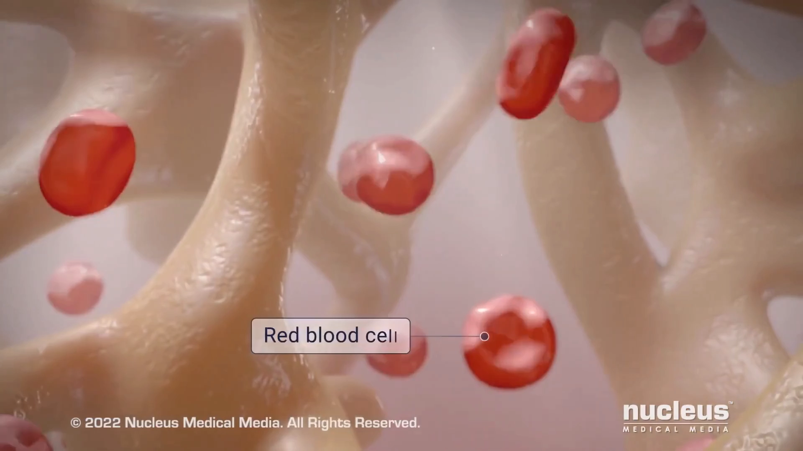
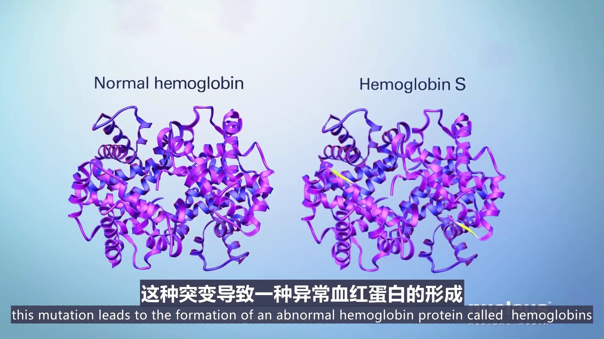
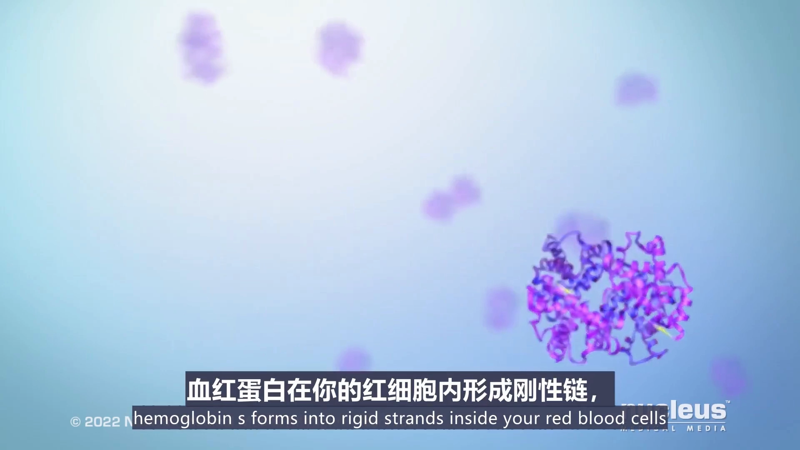
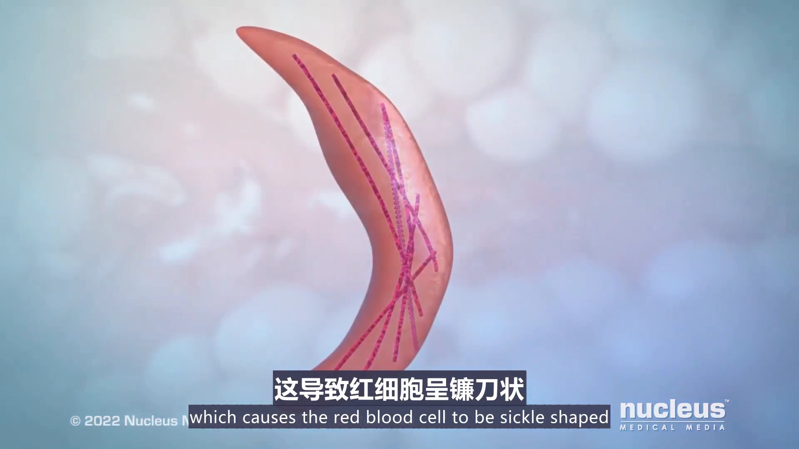
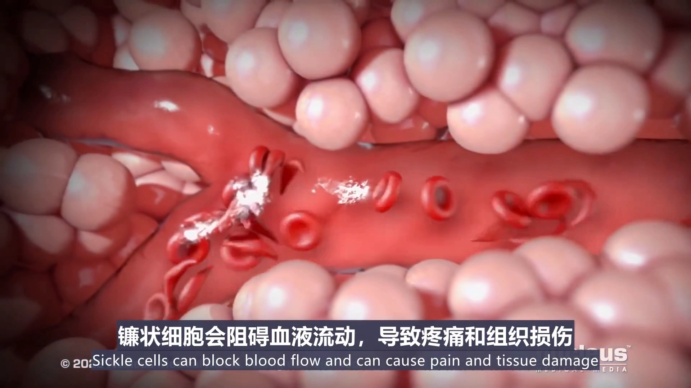

# 错义突变的蛋白后果：血红蛋白 S 如何把红细胞变成镰刀

> 视频来源：[镰刀状红细胞贫血 | 医学动画](https://www.bilibili.com/video/BV19V4y157bV/)（Bilibili · 医学动画短片，约 4 分钟，中文配音）
> 导读：这支动画不讲密码子，只把"一个基因改变 → 一种异常蛋白 → 细胞形状改变 → 组织损伤"这条链走完。它补的是编码区变异在**蛋白与细胞层面**的后果，密码子层面的判读见同目录的 [编码区变异的四类后果](编码区变异的四类后果：同义、错义、无义与移码.md)。

## 本讲要解决的核心问题（SCQA）

**背景**：编码区变异的分类（同义、错义、无义、移码）只说明"密码子和氨基酸怎么变"。但真正决定它是不是疾病变异的，是**蛋白功能有没有变、细胞表型有没有变**。

**冲突**：从"一个氨基酸被换掉"到"人出现贫血、疼痛、器官损伤"，中间隔着好几层：蛋白结构、蛋白聚集、细胞形状、细胞寿命、组织供氧。任何一层跳过，结论都会显得像"突变所以致病"的跳跃。

**疑问**：一个错义突变造成的异常蛋白，是怎么一步步变成细胞和机体层面的表型的？

**回答（中心思想）**：镰状细胞贫血提供了这条链最干净的一个例子：**β 珠蛋白基因突变 → 异常血红蛋白 S → 血红蛋白在红细胞内聚成刚性链 → 红细胞变成镰刀形 → 阻塞血流、寿命从 90–120 天缩到 10–20 天 → 贫血与器官损伤**。同一个氨基酸替换，后果不是"蛋白少一点活性"，而是"蛋白获得了一种新的、有害的行为（聚集成链）"。

---

## 一、正常情况：红细胞是氧气的运输工具

身体需要红细胞为组织供氧。红细胞在骨髓中由血液干细胞分裂产生，正常红细胞呈**圆盘状**，每个红细胞里都含有一种叫**血红蛋白**的蛋白质分子，负责携带氧气。[【跳转到 00:15】](https://www.bilibili.com/video/BV19V4y157bV/?t=15) [【跳转到 00:35】](https://www.bilibili.com/video/BV19V4y157bV/?t=35)

在肺泡里，氧气进入血液并附着到红细胞中的血红蛋白上；红细胞再把氧气输送到全身的细胞。[【跳转到 00:55】](https://www.bilibili.com/video/BV19V4y157bV/?t=55) 圆盘状、可变形，是它能挤过毛细血管的前提——这一点在后面会变成关键。

## 二、变异落在哪：β 珠蛋白基因

视频把遗传链条交代得很清楚：这是由一种**缺陷基因**引起的，通过细胞中的遗传物质 DNA 从父母双方传给孩子；DNA 由基因组成，其中两个基因叫 **α 珠蛋白基因**和 **β 珠蛋白基因**，它们含有制造血红蛋白的蓝图。[【跳转到 01:20】](https://www.bilibili.com/video/BV19V4y157bV/?t=80) [【跳转到 01:30】](https://www.bilibili.com/video/BV19V4y157bV/?t=90)

真正发生改变的是 **β 珠蛋白基因**：它已经改变，也就是突变，这种突变导致一种异常血红蛋白形成，称为**血红蛋白 S**（HbS）。[【跳转到 01:40】](https://www.bilibili.com/video/BV19V4y157bV/?t=100) [【跳转到 01:45】](https://www.bilibili.com/video/BV19V4y157bV/?t=105)

需要说明边界：这支动画只讲到"β 珠蛋白基因发生了突变"，**没有给出具体的碱基替换与密码子变化**。按同目录另一篇的判据，"改变一个氨基酸"的编码区变异属于**错义突变**；但本视频没有交代这个突变究竟改的是哪个密码子、换成哪个氨基酸，本文不代为补写。本文只跟随视频，讲清"基因改变之后、蛋白与细胞层面发生了什么"。

## 三、蛋白层面：一个氨基酸的替换换来了"会聚集"的新行为

动画用两个结构并排展示正常血红蛋白与血红蛋白 S，并用黄色标出差异所在的位置。[【跳转到 01:45】](https://www.bilibili.com/video/BV19V4y157bV/?t=105)

关键后果是：血红蛋白 S 会在红细胞内**形成刚性链**。[【跳转到 01:50】](https://www.bilibili.com/video/BV19V4y157bV/?t=110)

这是理解错义突变后果的关键一课：**后果不一定是"功能变弱"，也可能是"多了一种原来没有的行为"**。这里的异常蛋白仍然能装进红细胞、仍然与氧结合，但它多出了聚集成链的能力，这个新行为才是致病的起点。相比之下，"活性位点被换掉导致酶活下降"是另一种完全不同的错义后果类型。

## 四、细胞层面：形状改变带来两个后果

### 4.1 形状：从圆盘到镰刀

刚性链把红细胞撑成**镰刀状**。[【跳转到 01:57】](https://www.bilibili.com/video/BV19V4y157bV/?t=117)

### 4.2 流动：阻塞与组织损伤

镰状细胞会**阻碍血液流动**，导致疼痛和组织损伤。[【跳转到 02:03】](https://www.bilibili.com/video/BV19V4y157bV/?t=123)

### 4.3 寿命：90–120 天缩到 10–20 天

正常红细胞可以维持 90 到 120 天，镰状细胞只能维持 10 到 20 天。身体跟不上细胞被破坏的速度，血液中的红细胞就比正常人少，这种情况叫**贫血**。[【跳转到 02:08】](https://www.bilibili.com/video/BV19V4y157bV/?t=128) [【跳转到 02:13】](https://www.bilibili.com/video/BV19V4y157bV/?t=133) [【跳转到 02:23】](https://www.bilibili.com/video/BV19V4y157bV/?t=143)

注意这里的因果是两条并行的路径：**阻塞**（血流不畅、疼痛、组织损伤）与**短寿命**（红细胞被破坏得快、供氧能力不足）。同一个蛋白异常，通过两个不同的细胞机制产生两组表型。

## 五、机体层面：症状与并发症

视频列出的症状与并发症包括：[【跳转到 02:33】](https://www.bilibili.com/video/BV19V4y157bV/?t=153) [【跳转到 02:58】](https://www.bilibili.com/video/BV19V4y157bV/?t=178)

- 身体各部位疼痛，比如手、脚、下背部和腹部；
- 眼白和皮肤发黄（黄疸）；
- 因贫血而长期疲倦；
- 并发症：剧烈疼痛、眼睛损伤、心脏与脾脏受损；脾脏是制造免疫细胞的器官，受损会增加感染风险。

人群分布上，祖先来自撒哈拉以南非洲的人患病风险最高，南美洲、西班牙裔地区、加勒比和中美洲也有分布。[【跳转到 03:10】](https://www.bilibili.com/video/BV19V4y157bV/?t=190) [【跳转到 03:24】](https://www.bilibili.com/video/BV19V4y157bV/?t=204)

## 六、这条链给编码区变异判读的三点提示

1. **变异类型不等于后果严重程度**。错义突变既可能几乎无影响，也可能像这里一样产生全新的有害行为。判断必须走到蛋白行为这一层。
2. **蛋白层面要问"多了什么"而不只是"少了什么"**。聚集、错误定位、被降解，都是常见的错义后果类型；只问"活性还剩多少"会漏掉这一类。
3. **从蛋白到表型要经过细胞这一层**。形状、寿命、流动是细胞层面的中间变量，跳过它们就会把"蛋白异常"直接等同于"疾病"。

至于"这个变异在临床上算不算致病"，涉及人群频率、家系共分离、功能实验与临床解释规范，属于 [4.2.6 变异致病性证据](../../../README.md#b02-4-2-6) 的范围，本节不展开。

## 小结

- 镰状细胞贫血的起点是 β 珠蛋白基因的突变，产物是异常血红蛋白 S。
- 血红蛋白 S 在红细胞内聚成刚性链，使红细胞变成镰刀形。
- 后果分两路：血流阻塞（疼痛、组织损伤）与红细胞寿命缩短（10–20 天 vs 90–120 天，导致贫血）。
- 机体层面表现为疼痛、黄疸、疲倦，以及眼、心、脾等器官损伤与感染风险升高。
- 这是"错义突变 → 蛋白获得有害新行为 → 细胞表型 → 机体表型"的完整链条，也是判断编码区变异后果时应当走完的层级。

## 关键术语速查

| 术语 | 一句话解释 |
| --- | --- |
| 血红蛋白 | 红细胞内携带氧气的蛋白质；其制造蓝图来自 α 珠蛋白基因与 β 珠蛋白基因 |
| 血红蛋白 S（HbS） | β 珠蛋白基因突变后形成的异常血红蛋白，会在红细胞内聚成刚性链 |
| 镰状细胞 | 因 HbS 刚性链而变成镰刀形的红细胞，易阻塞血流且寿命短 |
| 贫血 | 红细胞被破坏速度快于生成速度，血液中红细胞数量少于正常 |
| 黄疸 | 眼白与皮肤发黄，本视频中作为镰状细胞贫血的症状之一 |