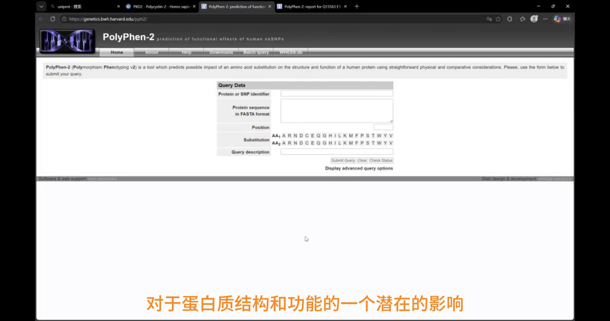
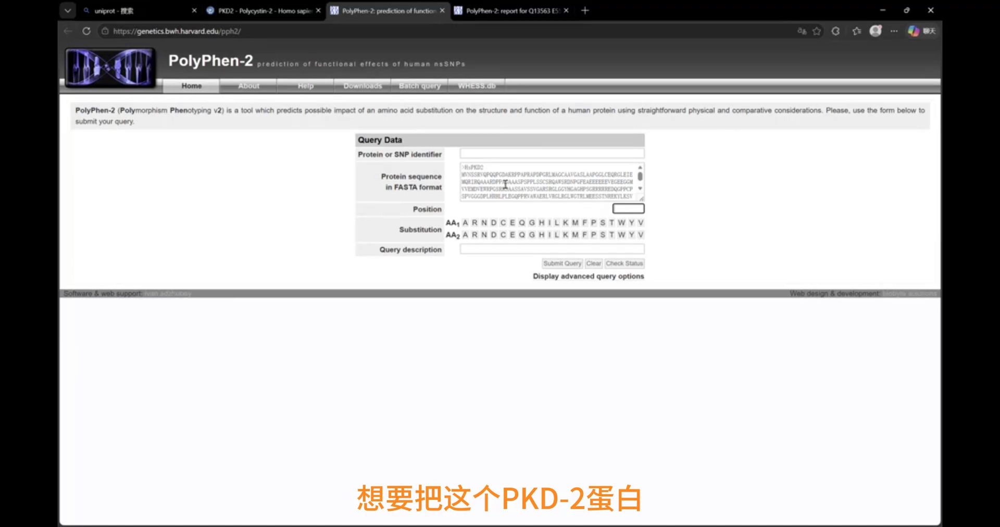
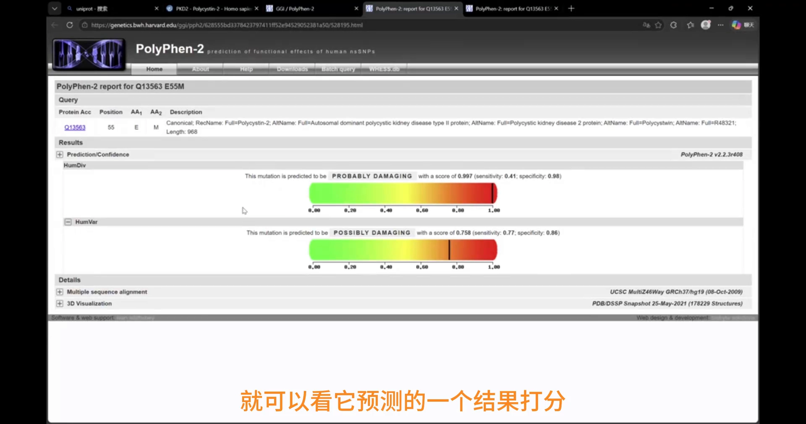

# 预测不等于功能：PolyPhen-2 如何给错义突变打分

> 视频来源：[如何评估点突变对于蛋白结构和功能的影响](https://www.bilibili.com/video/BV1xy5s6nEkk/)（Bilibili · 生信工具演示，约 4 分钟）
> 导读：一支工具演示视频，本文只取它对"证据边界"有用的部分：预测器吃什么输入、基于什么信息、输出什么类别，以及同一个变异在两套模型下为什么给出不同结论。

## 本讲要解决的核心问题（SCQA）

**背景**：编码区变异可以按同义、错义、无义、移码分类（见 [编码区变异的四类后果](编码区变异的四类后果：同义、错义、无义与移码.md)）。分类只说明"变了什么"，不说明"有没有害"。

**冲突**：错义突变是后果最不确定的一类：换一个氨基酸，可能毫无影响，也可能让蛋白失活。逐个做实验太慢，于是大家用预测工具打分；但预测分数很容易被当成结论——"分数 0.997，所以是致病变异"。

**疑问**：这类预测器到底基于什么信息、给出的是什么性质的结论？它能在多大程度上替代功能证据？

**回答（中心思想）**：PolyPhen-2 这类工具做的是**基于序列保守性与结构同源性的推断**，输出是"良性／可能有害／很可能有害"这样的**概率式分类**，不是功能测量。它的价值在于给候选变异排序、缩小实验范围；它的边界在于：只看单个氨基酸替换、依赖已有比对与结构、不同训练集（HumDiv／HumVar）会对同一个变异给出不同结论。所以预测分数是**待验证的假设**，不是功能后果本身。

---

## 一、它回答什么问题：单个氨基酸替换会不会影响这个蛋白

视频开篇把问题摆得很实在：做分子生物学研究时经常遇到——**单个碱基的改变，是否会影响我们关注的蛋白质的结构和功能？** PolyPhen-2 就是一个用来评估点突变对蛋白功能影响的在线网站。[【跳转到 00:05】](https://www.bilibili.com/video/BV1xy5s6nEkk/?t=5)

它的适用范围在页面上就写着：**预测人类蛋白质中氨基酸替换（nsSNP，非同义单核苷酸多态）对结构与功能的可能影响**。[【跳转到 00:55】](https://www.bilibili.com/video/BV1xy5s6nEkk/?t=55)

这句话里有两个限制，读工具输出时必须记住：

- **只处理氨基酸替换**（错义类），不处理移码、无义、整码插入缺失，也不处理剪接与调控变异；
- **只针对人类蛋白**，跨物种使用要先想清楚适用性。

## 二、它凭什么预测：保守性 + 结构同源性

PolyPhen-2 主要基于**序列的保守性**和**结构的同源性**来做预测。[【跳转到 00:30】](https://www.bilibili.com/video/BV1xy5s6nEkk/?t=30)

具体来说，它综合几方面信息做整体评估：序列的保守性、蛋白质三维结构的影响，以及已知的关键位点信息对蛋白功能的影响，然后用机器学习算法把突变分成良性、可能有害、很可能有害等几类。[【跳转到 00:55】](https://www.bilibili.com/video/BV1xy5s6nEkk/?t=55)

理解这三类信息的含义，就理解了它的能力边界：

| 用到的信息 | 隐含的假设 | 失效的情形 |
| --- | --- | --- |
| 序列保守性 | 进化上不变的位点更重要，改动更可能有害 | 位点保守但该物种另有补偿；或位点不保守但功能关键 |
| 结构同源性 | 落在结构核心、界面、口袋里的替换更可能破坏功能 | 蛋白无序区、多构象、复合物组装依赖的位点 |
| 已知关键位点 | 已有知识可以迁移到新变异 | 研究不足的蛋白、罕见变异 |

换句话说，它预测的是"**这类替换在已知规律下像不像有害**"，不是"这个蛋白在这株细胞里活性掉了多少"。

## 三、怎么用：从序列到一次打分

操作流程很直接，视频用一个具体例子走了一遍：

1. 输入蛋白：可以粘贴 FASTA 格式的蛋白序列，也可以输入数据库编号；视频里关注的是人的 **PKD2** 蛋白，序列从 UniProt 下载后输入。[【跳转到 01:20】](https://www.bilibili.com/video/BV1xy5s6nEkk/?t=80) [【跳转到 01:45】](https://www.bilibili.com/video/BV1xy5s6nEkk/?t=105)
2. 指定位置与替换：先确认第 55 位是什么氨基酸（视频里是**谷氨酸 E**），再选择要换成的氨基酸（例子中是**甲硫氨酸 M**）。[【跳转到 02:10】](https://www.bilibili.com/video/BV1xy5s6nEkk/?t=130)
3. 提交，等结果，在结果页看打分。[【跳转到 02:35】](https://www.bilibili.com/video/BV1xy5s6nEkk/?t=155)

提交后页面会显示预测进度与结果入口，视频里点 refresh 看预测后的结果。[【跳转到 02:40】](https://www.bilibili.com/video/BV1xy5s6nEkk/?t=160) 视频到 03:36 结束，最后一段无字幕，只是结果页停留。

这里有一个容易忽略的细节：**同一个位置，换成不同氨基酸，结论可以完全不同**。工具问的是"这个具体替换"，不是"这个位点重不重要"。

## 四、结果怎么读：两套模型给出两个结论

结果页并排给出两套模型（HumDiv 与 HumVar）的打分。视频对两者的区别说得很清楚：**HumDiv 模型主要面向复杂疾病相关的研究，灵敏度比较高，更容易识别潜在的有害变异；HumVar 的判定标准比 HumDiv 更严格。**[【跳转到 03:02】](https://www.bilibili.com/video/BV1xy5s6nEkk/?t=182) [【跳转到 03:27】](https://www.bilibili.com/video/BV1xy5s6nEkk/?t=207)

画面里这次预测（PKD2 的 E55M）的结果是：

| 模型 | 结论 | 分数 | 灵敏度 | 特异度 |
| --- | --- | --- | --- | --- |
| HumDiv | PROBABLY DAMAGING（很可能有害） | 0.997 | 0.41 | 0.98 |
| HumVar | POSSIBLY DAMAGING（可能有害） | 0.758 | 0.77 | 0.86 |

这张图是本节最重要的证据边界教材：**同一个变异、同一个工具、同一天，两套模型给出了不同等级的结论**。差别不在变异本身，而在模型用什么数据训练、把判定阈值放在哪里。

> 需要提醒的一处不一致：视频口述说 HumDiv "灵敏度比较高、更容易识别潜在的有害变异"，而同一画面给出的灵敏度数值是 HumDiv 0.41、HumVar 0.77，方向相反。本文以画面上的数值为准，口述部分只保留"两者判定标准不同、HumVar 更严格"这层意思。

所以读这类输出要同时看三件事：**结论类别、分数、以及该模型声明的灵敏度／特异度**。只抄"0.997"这个数字，等于把"在这个训练集下很像有害"读成了"确实有害"。

## 五、从预测到功能后果：还差哪几步

把 PolyPhen-2 的输出放回本节的主线（序列变异 → 蛋白功能 → 表型），可以清楚看到它覆盖了哪一段、没覆盖哪一段：

| 环节 | 预测器能给什么 | 还需要什么证据 |
| --- | --- | --- |
| 变异是否改变氨基酸 | 需要你先把变异翻译成氨基酸替换（这一步工具不替你做） | 转录本选择、密码子表、阅读框判读 |
| 蛋白功能是否改变 | 一个概率式分类 | 体外活性／稳定性测量、结合实验 |
| 细胞表型是否改变 | 不能给 | 细胞实验、敲入／敲除模型 |
| 是否致病 | 不能给 | 人群频率、家系共分离、功能证据与临床解释规范 |

这也解释了为什么错义突变的判读总要"多证据合看"：预测器擅长的是第一、二步之间的**排序**，而不是结论。致病性判读的完整证据框架见 [4.2.6 变异致病性证据](../../../README.md#b02-4-2-6)。

## 小结

- PolyPhen-2 预测的是**人类蛋白中单个氨基酸替换**对结构与功能的可能影响，不处理移码、无义、整码变异与剪接、调控变异。
- 它的依据是序列保守性、结构同源性与已知关键位点信息，再用机器学习给出良性／可能有害／很可能有害的分类。
- 输出是概率式分类，不是功能测量；必须连同分数与模型的灵敏度／特异度一起读。
- 同一个变异在 HumDiv 与 HumVar 下可能得到不同等级的结论，说明"阈值与训练集"本身就是结论的一部分。
- 预测分数适合用来给候选变异排序、决定先做哪个实验；它不能替代功能实验、细胞表型与人群／家系证据。

## 关键术语速查

| 术语 | 一句话解释 |
| --- | --- |
| nsSNP | 非同义单核苷酸多态，即导致氨基酸替换的单碱基变异 |
| PolyPhen-2 | 基于序列保守性与结构同源性预测人类氨基酸替换影响的在线工具 |
| HumDiv | 面向复杂疾病与性状差异训练的模型，灵敏度低、特异度高 |
| HumVar | 面向更严格判定标准的模型，同一变异给出更低等级结论 |
| 灵敏度／特异度 | 灵敏度=真有有害变异被检出的比例；特异度=判为有害中确实有害的比例 |
| 功能证据 | 直接测量蛋白活性、稳定性、结合或细胞表型的实验数据，区别于预测分数 |