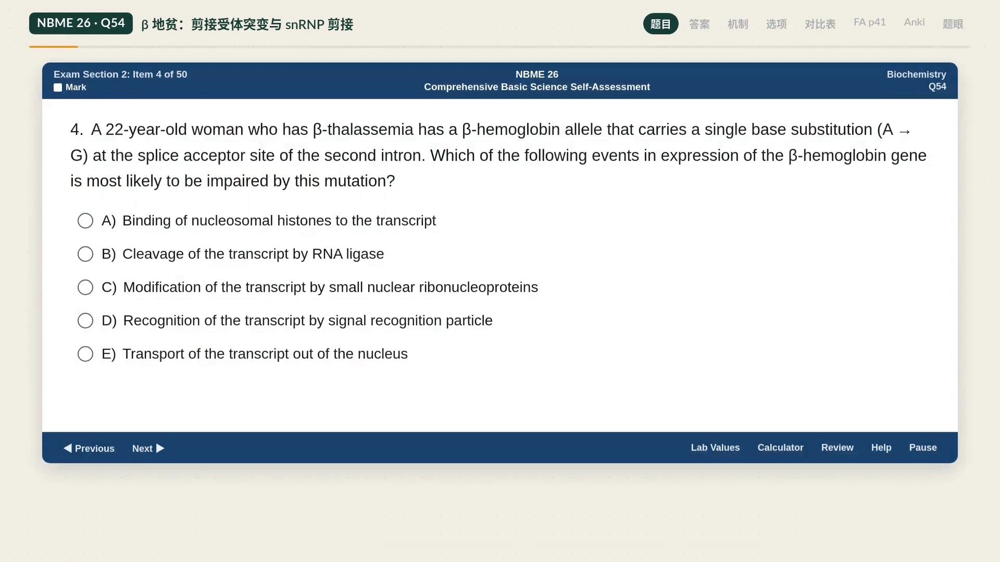
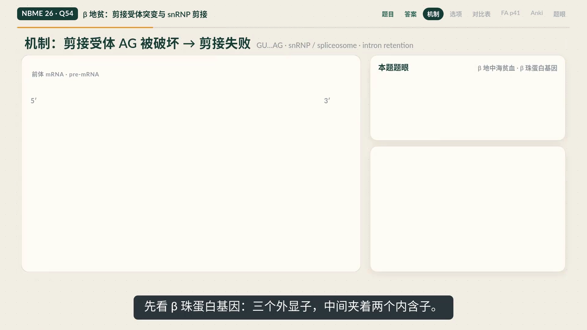
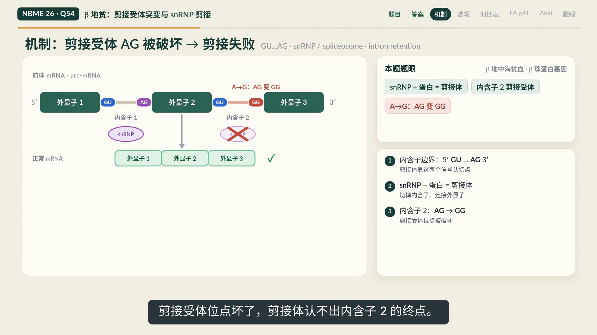
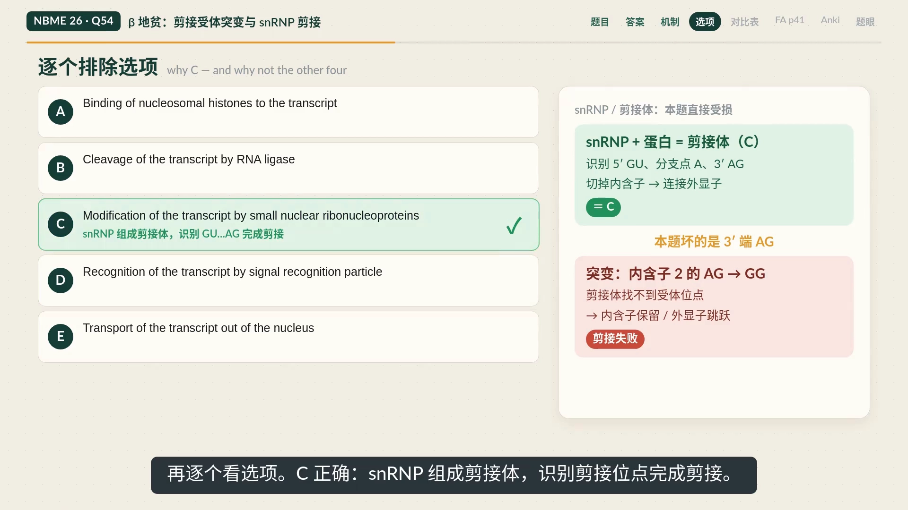

# 3′ 剪接受体 AG→GG：内含子保留、外显子跳跃与 β-地中海贫血

> 视频来源：[NBME 26 · Q54 剪接受体突变：内含子末端 AG 变 GG，为什么受损的是 snRNP？](https://www.bilibili.com/video/BV1dBxj6rEUq/)（B 站 · 5 分钟）
> 本文是上一题（5′ 供体位点 GT→AT）的互补案例：这次坏的是内含子末端的 3′ 受体位点（[【跳转到 00:00】](https://www.bilibili.com/video/BV1dBxj6rEUq/?t=0)）。两篇合起来，覆盖一个内含子的两端。

## 本讲要解决的核心问题（SCQA）

**背景**：β-地中海贫血的经典病因之一是 β-珠蛋白（HBB）基因变异；题目给出一个 22 岁女性患者，一个等位基因在第二个内含子的剪接受体位点有单碱基替换 A→G。

**冲突**：上一题的 GT→AT 坏的是内含子“开头”，这次坏的是内含子“末尾”。同样是一个碱基，为什么后果是“内含子保留或外显子跳跃”，而不是“外显子变长”？

**疑问**：这个 A→G 到底破坏了哪一步？为什么答案不是“RNA 连接酶切割”，也不是“转录本出核”，而是“snRNP 对转录本的修饰”？

**回答（中心思想）**：AG→GG 破坏的是内含子 2 的 **3′ 剪接受体**。剪接体认不出内含子 2 的终点，内含子 2 就切不掉、留在 mRNA 里；或者外显子被跳过。异常 mRNA 翻译不出正常的 β 链，β-珠蛋白减少、α 链相对过剩，才造成溶血和无效造血。

## 一、题目：坏的是“终点”，不是“起点”

题干（[【跳转到 00:22】](https://www.bilibili.com/video/BV1dBxj6rEUq/?t=22)）：

题目问的不是“哪个蛋白会变”，而是“**基因表达的哪一步**最可能受损”（[【跳转到 00:47】](https://www.bilibili.com/video/BV1dBxj6rEUq/?t=47)）。这决定了做题顺序：先定位变异作用的层级，再看蛋白后果。

选项：

- A 核小体组蛋白结合到转录本上
- B RNA 连接酶切割转录本
- C 小核核糖核蛋白（snRNP）修饰转录本
- D 信号识别颗粒识别转录本
- E 转录本运出细胞核

## 二、正常情况：GU 开门，AG 关门

讲者先摆出 β-珠蛋白基因的结构（[【跳转到 01:17】](https://www.bilibili.com/video/BV1dBxj6rEUq/?t=77)）：

三个外显子中间夹着两个内含子。每个内含子的 5′ 端是 **GU**，3′ 端是 **AG**。小核核糖核蛋白（snRNP）与蛋白质组成剪接体，认出这两个信号，切掉内含子、连接外显子。

讲者的口诀是：**GU 开门，AG 关门**（[【跳转到 02:07】](https://www.bilibili.com/video/BV1dBxj6rEUq/?t=127)）。5′ 位点告诉剪接体“内含子从这里开始”，3′ 位点告诉它“内含子到这里结束”。

## 三、突变之后：内含子 2 的终点没了

本题的突变在内含子 2 的 3′ 端：AG 的 A 变成 G，成了 GG（[【跳转到 01:42】](https://www.bilibili.com/video/BV1dBxj6rEUq/?t=102)）。

剪接体认不出内含子 2 的终点，于是出现两种可能的 RNA 产物：

1. **内含子保留**：内含子 2 切不掉，留在成熟 mRNA 里，形成“外显子 1–外显子 2–内含子 2–外显子 3”的异常转录本。
2. **外显子跳跃**：剪接体干脆跳过受影响的区域，把外显子 1 直接接到外显子 3。

讲者没有判断这位患者具体是哪一种，只说两者都可能。这一点很重要：**同一个位点变异，在不同细胞、不同转录本背景下可以给出不同的 RNA 产物比例**；题目问的是“哪一步受损”，不是“产物一定是哪一种”（[【跳转到 02:13】](https://www.bilibili.com/video/BV1dBxj6rEUq/?t=133)）。

## 四、为什么答案不是“连接酶”，也不是“出核”

讲者逐一排除（[【跳转到 02:18】](https://www.bilibili.com/video/BV1dBxj6rEUq/?t=138)）：

- **A 组蛋白结合转录本**：组蛋白包装的是 DNA、形成核小体，不与 RNA 转录本结合。
- **B RNA 连接酶切割转录本**：剪接的切割和连接都由剪接体完成，不是单独的 RNA 连接酶。这是一个常见误解——DNA 连接酶、RNA 连接酶确实存在，但剪接不是它们的工作。
- **C snRNP 修饰转录本**：正确。snRNP 与蛋白组成剪接体，识别 5′ GU、分支点 A、3′ AG，切掉内含子、连接外显子。
- **D 信号识别颗粒识别转录本**：信号识别颗粒在翻译时把核糖体带到粗面内质网，和剪接无关。
- **E 转录本运出细胞核**：出核发生在加工完成之后；剪接位点突变首先坏的是剪接这一步。

所以答案选 C（[【跳转到 02:43】](https://www.bilibili.com/video/BV1dBxj6rEUq/?t=163)）。这里的“修饰”在题里指的就是剪接加工。

## 五、从 RNA 到表型：β 链少了，α 链相对过剩

异常 mRNA 翻译不出正常的 β 链，β-珠蛋白合成减少（[【跳转到 02:09】](https://www.bilibili.com/video/BV1dBxj6rEUq/?t=129)）。

β-珠蛋白是成人血红蛋白的组成部分。β 链减少后，α 链相对过剩；过剩的 α 链在红细胞前体里沉淀，造成：

- 红细胞前体受损，形成**无效造血**；
- 成熟红细胞被破坏，形成**溶血**；
- 最终表现为小细胞低色素性贫血，即 β-地中海贫血。

这条链条与上一题的 PKU 案例结构相同（[【跳转到 02:59】](https://www.bilibili.com/video/BV1dBxj6rEUq/?t=179)）：**变异 → 剪接位点失效 → RNA 产物异常 → 蛋白减少或缺陷 → 细胞/器官表型**。区别只在“缺的是酶”还是“缺的是结构蛋白”。

## 六、两题合起来：一个内含子的两端

| | Q25（5′ 供体） | Q54（3′ 受体） |
| --- | --- | --- |
| 变异 | 内含子 12 开头 GT→AT | 内含子 2 末端 AG→GG |
| 破坏的信号 | 5′ 剪接位点（GU） | 3′ 剪接位点（AG） |
| 主要 RNA 后果 | 外显子 12 被跳过 | 内含子 2 保留，或外显子被跳过 |
| 蛋白后果 | 缺一段的 PAH | β 链减少 |
| 疾病 | 苯丙酮尿症 | β-地中海贫血 |

两题都说明：**剪接位点只有两个核苷酸宽，一个碱基就足以让它失效**（[【跳转到 03:46】](https://www.bilibili.com/video/BV1dBxj6rEUq/?t=226)）；而失效之后具体走哪条备用路径，取决于哪一端坏了、附近有没有可用的隐蔽位点，以及细胞里的剪接因子组成。

## 小结（[【跳转到 04:37】](https://www.bilibili.com/video/BV1dBxj6rEUq/?t=277)）

- 内含子 2 的 AG→GG 破坏 3′ 剪接受体，剪接体认不出内含子终点。
- RNA 后果是内含子保留或外显子跳跃；两者都让 β 链无法正常合成。
- 受损的步骤是 snRNP/剪接体对转录本的剪接加工，不是连接酶切割、不是出核、也不是翻译定位。
- β 链减少导致 α 链相对过剩、沉淀、溶血与无效造血，形成 β-地中海贫血。
- 与 5′ 供体突变合起来看：一个内含子的两端，坏哪一端，决定 RNA 上“多一段”还是“少一段”。

## 关键术语速查（[【跳转到 04:55】](https://www.bilibili.com/video/BV1dBxj6rEUq/?t=295)）

| 术语 | 一句话解释 |
| --- | --- |
| 3′ 剪接位点（受体位点） | 内含子末尾的 AG，告诉剪接体内含子到哪里结束 |
| 内含子保留 | 内含子没被切掉，留在成熟 mRNA 里 |
| snRNP | 小核核糖核蛋白，与蛋白组成剪接体，识别剪接位点并催化剪接 |
| 无效造血 | 红细胞前体在成熟前受损或死亡，不能产出足够红细胞 |
| β-地中海贫血 | β-珠蛋白合成减少、α 链相对过剩导致的遗传性贫血 |