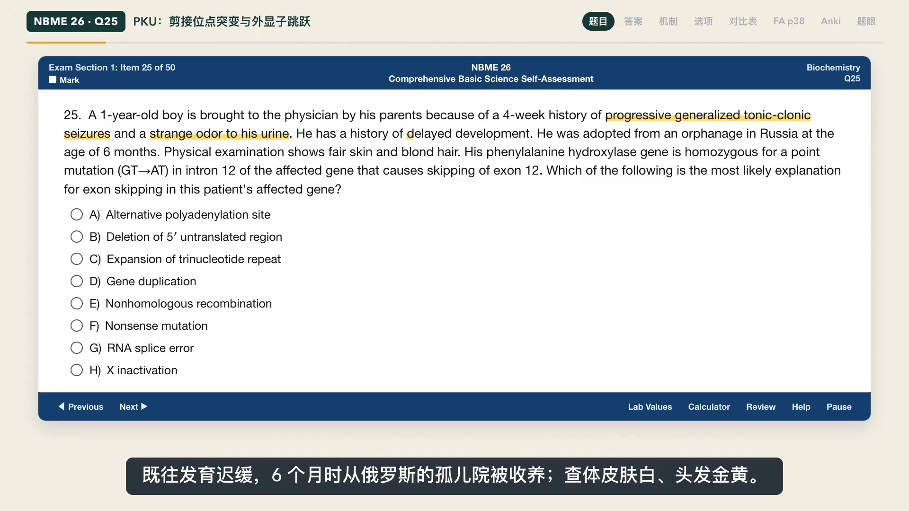
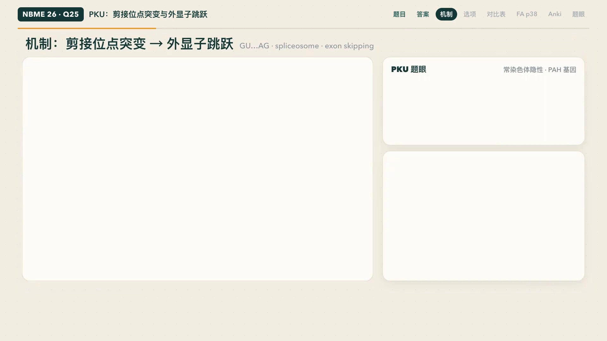
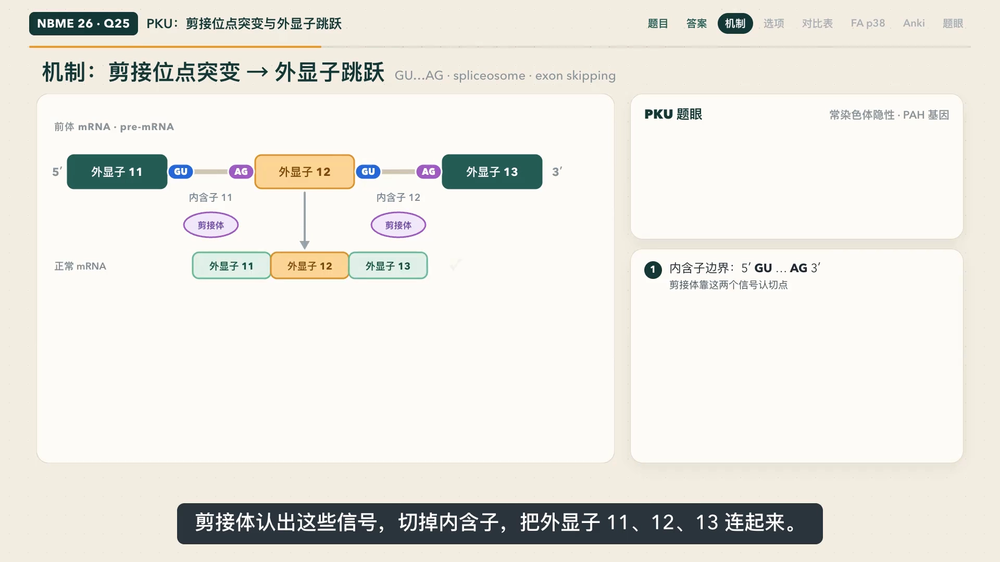
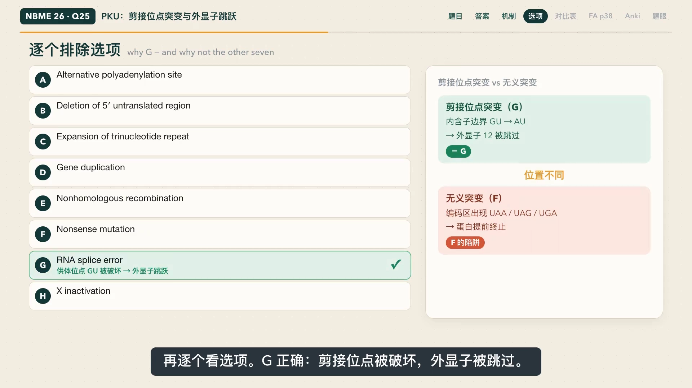

# 5′ 剪接位点 GT→AT：一个碱基如何让外显子 12 消失

> 视频来源：[NBME 26 · Q25 剪接位点突变：intron 12 的 GT→AT 为什么让外显子 12 消失？](https://www.bilibili.com/video/BV1SNx56xES3/)（B 站 · 5 分钟）
> 这是一道以苯丙酮尿症为背景的题目讲解（[【跳转到 00:00】](https://www.bilibili.com/video/BV1SNx56xES3/?t=0)）。本文按“变异 → 位点识别 → RNA → 蛋白 → 表型”的顺序重排，并保留讲者对“剪接位点突变 vs 无义突变”的区分。

## 本讲要解决的核心问题（SCQA）

**背景**：苯丙酮尿症（PKU）的经典病因是苯丙氨酸羟化酶（PAH）缺陷；题目已经告诉我们，PAH 基因内含子 12 有一个纯合点突变 GT→AT，并且导致外显子 12 被跳过。

**冲突**：一个碱基替换，为什么不是“少一个氨基酸”，而是“整段外显子从 mRNA 上消失”？它和“无义突变导致蛋白提前终止”有什么区别？

**疑问**：从 DNA 上的 GT→AT，到 RNA 上的外显子跳跃，再到患者的癫痫、发育迟缓和特殊尿味，中间发生了什么？

**回答（中心思想）**：GT→AT 破坏的是内含子 12 开头的 **5′ 剪接位点（供体位点）**。剪接体认不出这个位点，就把外显子 11 直接接到外显子 13，外显子 12 连同两侧内含子一起被切掉；由此产生的 mRNA 翻译出有缺陷的 PAH，苯丙氨酸不能被转成酪氨酸，才出现 PKU 的表型。

## 一、题目里的三层信息

题干（[【跳转到 00:23】](https://www.bilibili.com/video/BV1SNx56xES3/?t=23)）：

- **临床层**：1 岁男孩，近四周进行性全身强直阵挛发作，尿有怪味，发育迟缓；皮肤白、头发金黄。
- **基因层**：PAH 基因内含子 12 纯合点突变，GT→AT。
- **RNA 层**：这个突变导致外显子 12 被跳过。

题目问的是“外显子跳跃最可能的原因”，选项里既有剪接错误，也有无义突变、可变多聚腺苷酸化、三核苷酸重复扩增等（[【跳转到 00:55】](https://www.bilibili.com/video/BV1SNx56xES3/?t=55)）。讲者的解法是先把基因结构摆出来，再解释为什么只有“剪接错误”能对上。

## 二、正常情况：GU 开门，AG 关门

讲者先回到基因结构（[【跳转到 01:26】](https://www.bilibili.com/video/BV1SNx56xES3/?t=86)）：

外显子编码蛋白，内含子在剪接时被切掉。每个内含子都有固定边界：**5′ 端是 GU，3′ 端是 AG**。剪接体认出这两个信号，切掉内含子，把外显子 11、12、13 依次连起来。

这里只需要记住一件事：**GU 是内含子的“开头标记”**（[【跳转到 01:17】](https://www.bilibili.com/video/BV1SNx56xES3/?t=77)）。它不在外显子里，而在内含子最前面两个核苷酸上。DNA 上写 GT，转录到 RNA 上就是 GU。

## 三、突变之后：供体位点坏了，外显子 12 被跳过

本题的突变位于内含子 12 的开头：DNA 的 GT 变成 AT，RNA 上就是 GU 变成 AU（[【跳转到 01:44】](https://www.bilibili.com/video/BV1SNx56xES3/?t=104)）。

后果分两步：

1. **外显子 12 后面的供体位点坏了**：剪接体认不出内含子 12 的起点。
2. **剪接体改用上游的供体**：它从外显子 11 的供体位点直接接到外显子 13 的受体位点，于是外显子 12 连同两侧内含子一起被切掉。

在成熟 mRNA 上，外显子 11 后面直接就是外显子 13（[【跳转到 02:28】](https://www.bilibili.com/video/BV1SNx56xES3/?t=148)）。外显子 12 不是“被剪短”，而是**整段不存在**。这就是外显子跳跃（exon skipping）。

## 四、从 RNA 到表型：缺一段的 PAH 不能完成反应

少了外显子 12 的 mRNA，翻译出有缺陷的苯丙氨酸羟化酶（[【跳转到 02:09】](https://www.bilibili.com/video/BV1SNx56xES3/?t=129)）。

PAH 的正常工作是把苯丙氨酸转成酪氨酸。酶有缺陷时：

- 苯丙氨酸不能被转化，在体内堆积；
- 酪氨酸减少；
- 于是出现癫痫、发育迟缓、尿的霉味；
- 黑色素合成减少，所以皮肤白、头发金黄。

这条链条把“RNA 上少了一段”与“患者身上的每一个体征”接了起来。讲者没有在视频里展开“外显子 12 的长度是不是 3 的倍数、读框有没有改变”，所以本文也不替它补这一步；能确定的是：**这个缺失导致了酶功能缺陷**。

## 五、为什么不是无义突变

题目最容易混淆的选项是 F（无义突变）。讲者专门做了对照（[【跳转到 02:33】](https://www.bilibili.com/video/BV1SNx56xES3/?t=153)）：

| | 剪接位点突变（本题，G） | 无义突变（F） |
| --- | --- | --- |
| 位置 | 内含子边界（GU→AU） | 编码区 |
| 直接后果 | 外显子 12 被跳过 | 出现 UAA/UAG/UGA 终止密码子 |
| 蛋白后果 | 缺一段的 PAH | 蛋白提前终止、截短 |

两者都会让蛋白“不完整”，但**出问题的层级不同**：无义突变是密码子本身变成了终止信号；本题的变异根本不在编码区，它破坏的是“把外显子拼起来”的信号。所以答案选 G（RNA 剪接错误）（[【跳转到 03:18】](https://www.bilibili.com/video/BV1SNx56xES3/?t=198)）。

其余选项也被逐一排除（[【跳转到 02:58】](https://www.bilibili.com/video/BV1SNx56xES3/?t=178)）：

- **A 可变多聚腺苷酸化位点**：改的是 RNA 的 3′ 端加尾，不会让中间的外显子消失。
- **B 5′ 非翻译区缺失**：改的是 RNA 的 5′ 端，同样不会让中间的外显子消失。
- **C 三核苷酸重复扩增**：属于重复扩增类疾病，常表现为遗传早现，不能解释一个碱基替换造成的外显子跳跃。
- **D 基因重复、E 非同源重组**：都是 DNA 层面的大范围变化，不是单碱基替换。
- **H X 染色体失活**：发生在女性的 X 染色体上，而这个男孩的 PAH 基因在常染色体上。

## 六、这道题留下的三个判读习惯（[【跳转到 03:34】](https://www.bilibili.com/video/BV1SNx56xES3/?t=214)）

1. **先看变异在哪一层**：在内含子边界、在外显子内部、还是在调控元件上，后果完全不同。本题的 GT 位于内含子开头，是 5′ 剪接位点。
2. **把 DNA 与 RNA 的字母分开**：DNA 写 GT→AT，RNA 写 GU→AU；讨论剪接位点时两种写法都会出现，不能混。
3. **不要用“蛋白截短”倒推变异类型**：剪接位点突变和无义突变都能给出截短或缺陷蛋白，必须回到变异位置与 RNA 后果去区分。

## 小结（[【跳转到 04:49】](https://www.bilibili.com/video/BV1SNx56xES3/?t=289)）

- PAH 内含子 12 的 GT→AT 破坏 5′ 剪接位点（GU→AU），剪接体认不出内含子 12 的起点。
- 剪接体改用外显子 11 的供体接到外显子 13 的受体，外显子 12 整段被跳过。
- 缺失外显子 12 的 mRNA 翻译出有缺陷的 PAH，苯丙氨酸堆积、酪氨酸减少，形成 PKU 的癫痫、发育迟缓、特殊尿味与浅色皮肤毛发。
- 它与无义突变的区别在层级：一个破坏剪接信号，一个把编码区变成终止密码子。
- 判读顺序：变异位置 → RNA 后果 → 蛋白后果 → 表型。

## 关键术语速查

| 术语 | 一句话解释 |
| --- | --- |
| 5′ 剪接位点（供体位点） | 内含子开头的 GU，告诉剪接体内含子从哪里开始 |
| 3′ 剪接位点（受体位点） | 内含子末尾的 AG，告诉剪接体内含子到哪里结束 |
| 外显子跳跃 | 整个外显子没被识别，上游外显子直接接到下游外显子 |
| 无义突变 | 编码区密码子变成终止密码子，蛋白提前终止 |
| 苯丙氨酸羟化酶（PAH） | 把苯丙氨酸转成酪氨酸的酶；缺陷导致苯丙酮尿症 |