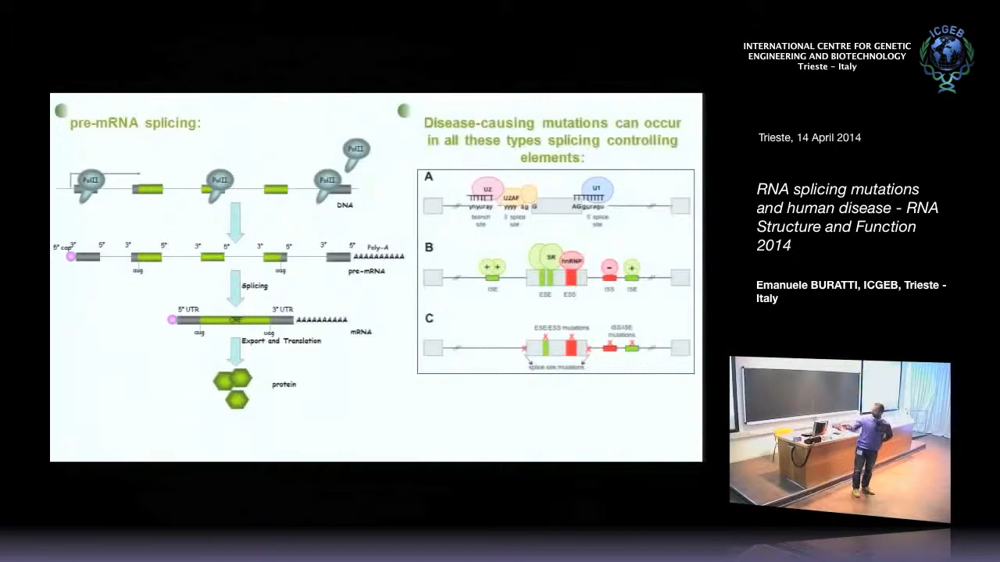
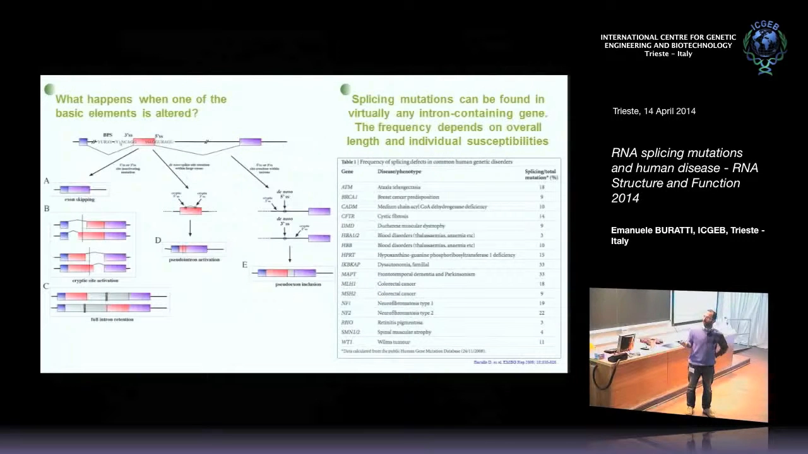
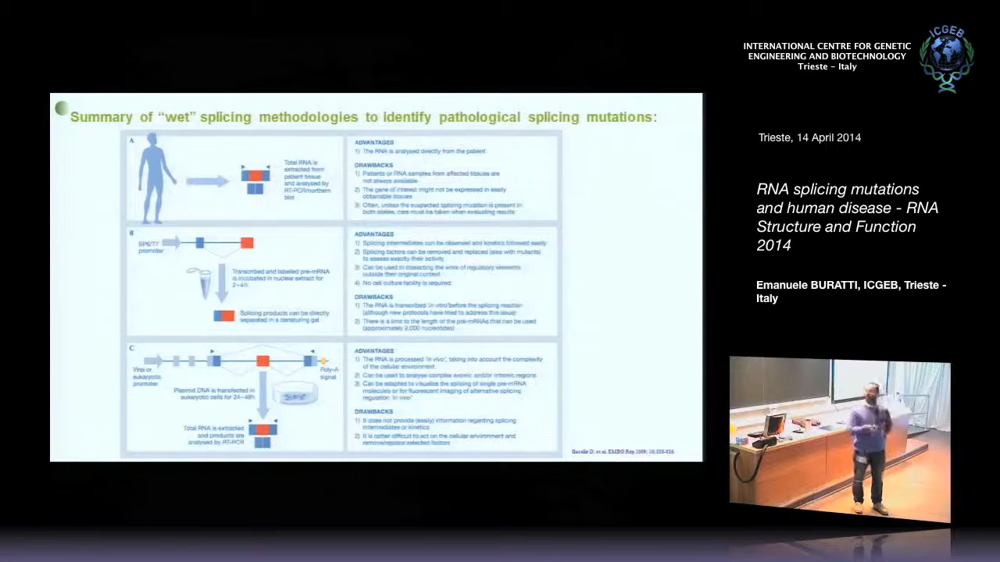
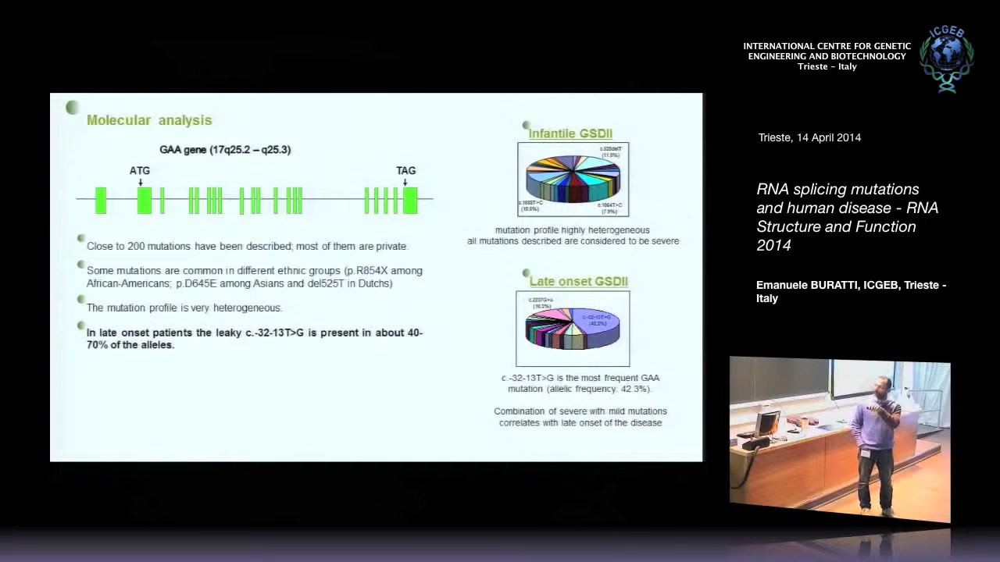
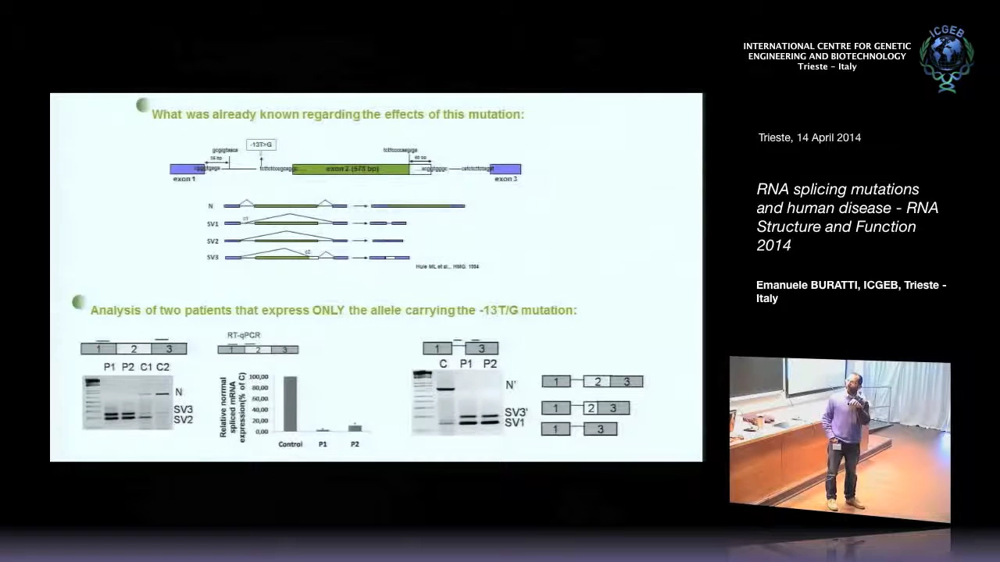
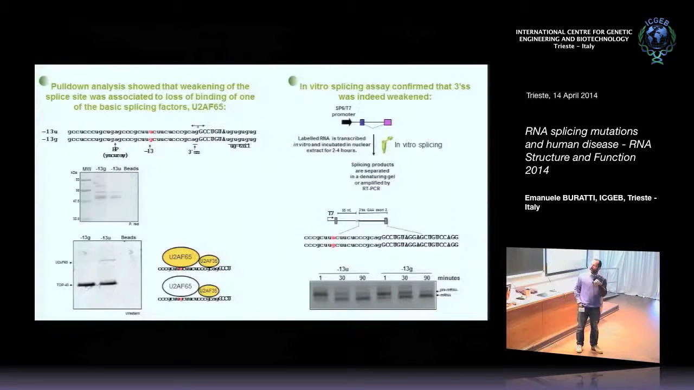
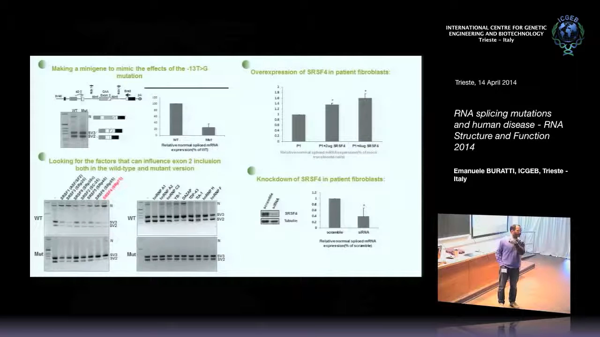
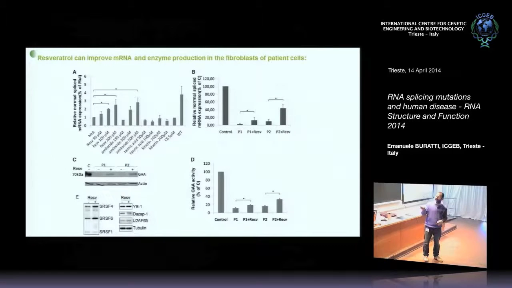
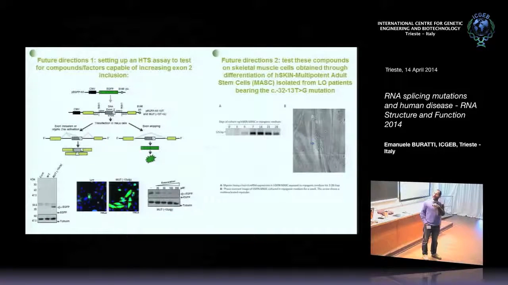

# RNA 剪接突变：位点破坏之后，RNA 与蛋白会发生什么

> 视频来源：[RNA splicing mutations and human disease - RNA Structure and Function 2014](https://www.youtube.com/watch?v=94Xx1VCTjOA)（YouTube · Emanuele Buratti，ICGEB Trieste）｜时长约 37 分钟
> 本文覆盖讲者前半段的突变类型、检出思路与 Pompe 病案例（约 00:00–22:30），后半段的化合物筛选与高通量系统只保留与“判读”有关的部分。讲者用英文，术语按中文习惯改写；视频中的数字与结论均按原话保留。

## 本讲要解决的核心问题（SCQA）

**背景**：剪接体把前体 mRNA 上的内含子切掉、把外显子接起来，这套机器精确到单个核苷酸，目的是让阅读框原封不动地送到核糖体。

**冲突**：一个碱基替换就能让剪接体认不出某个位点。同一个变异，可能让整个外显子消失，也可能让外显子变长或变短，还可能把一段内含子留在成熟 mRNA 里。

**疑问**：从“DNA 上的一个碱基变了”，到“RNA 上多了或少了哪一段”，再到“蛋白还能不能用”，中间要经过哪些环节？怎么判断一个变异是不是剪接变异？

**回答（中心思想）**：剪接变异的核心不是“剪接坏了没有”，而是**剪接位点被破坏后，剪接体改用了哪个备用位点，以及正常转录本还剩下多少**。前者决定 RNA 上多出或缺少哪一段，后者决定蛋白还剩多少功能；两者都要在正确的组织背景和正确的转录本注释下核对。

## 一、剪接的精度，决定了变异的代价

剪接的默认状态是“每次都一样”：同一个基因、同一个外显子，在大多数细胞里都接到同一个位置。讲者强调，这种精确性是**核苷酸级别**的——外显子从哪一个碱基开始、到哪两个碱基结束，都必须固定，否则三联体密码的读框就错位了（[【跳转到 00:25】](https://www.youtube.com/watch?v=94Xx1VCTjOA&t=25)）。

因此，能影响剪接的变异不只在“剪接位点”上。讲者把可被破坏的元件分成三层（[【跳转到 01:40】](https://www.youtube.com/watch?v=94Xx1VCTjOA&t=100)）：

1. **基本位点**：3′ 剪接位点、分支点、5′ 剪接位点。它们由 U2AF、U1 等基本因子识别，负责告诉剪接体“外显子从这里开始、到这里结束”。
2. **外显子上的调控元件**：外显子剪接增强子（ESE）与外显子剪接沉默子（ESS），结合 SR 蛋白或 hnRNP 蛋白。
3. **内含子上的调控元件**：内含子剪接增强子（ISE）与内含子剪接沉默子（ISS）。

基本位点往往**不足以**让剪接体把一个外显子当成整体来识别，所以还需要第 2、3 层的元件帮忙。任何一层被变异破坏，外显子都可能“不被认出”。

## 二、位点被破坏之后，RNA 上出现五种典型后果

讲者用一张图把后果分成五类（[【跳转到 04:35】](https://www.youtube.com/watch?v=94Xx1VCTjOA&t=275)）。这张图是本节最值得记住的框架：**先看 RNA 上发生了什么，再谈蛋白**。

### 2.1 外显子跳跃：整段外显子从 mRNA 上消失

如果变异落在共识序列里，外显子不再被识别，剪接体就把它的上游外显子直接接到下游外显子——这叫**外显子跳跃**（exon skipping）。这是讲者口中“最常见”的缺陷类型（[【跳转到 03:20】](https://www.youtube.com/watch?v=94Xx1VCTjOA&t=200)）。

外显子跳跃在蛋白层有两种结局：

- **读框被改变**：蛋白要么不翻译，要么翻译成截短产物。
- **读框没变**：蛋白能翻译出来，但少了这个外显子编码的全部氨基酸，通常失去功能，也可能获得不该有的功能。

讲者没有展开“什么情况下读框不变”，只强调两种结局都存在，因此不能默认“少一个外显子就一定完全没蛋白”。

### 2.2 只有一个位点坏掉：隐蔽剪接位点被激活

更常见于疾病的情形是：**一对剪接位点里只坏了一个，另一个还在**。这时剪接体不会放弃这个外显子，而是“拼命去找一个看起来像原来位点的序列”（[【跳转到 04:35】](https://www.youtube.com/watch?v=94Xx1VCTjOA&t=275)）。

结果是外显子仍然被包含，但边界变了：

- 外显子**变短**：剪接体用了外显子内部一个更靠里的位点，外显子前端或后端的一段被切掉。
- 外显子**变长**：剪接体用了内含子里一个更靠外的位点，外显子末端带进了一小段内含子序列。

这类被“备用”的位点叫**隐蔽剪接位点**（cryptic splice site）。它在正常情况下也可能被低效率使用，只是竞争不过正常位点；正常位点一旦被破坏，它就上位。蛋白层的后果同样是读框改变、截短，或增删若干残基。

### 2.3 内含子完全保留

图中列出的第三类后果是**内含子完全保留**（full intron retention）：整段内含子没有被切掉，留在成熟 mRNA 里。讲者在这一页只给了分类，没有展开这一类的蛋白结局；本节不替它补结论。

### 2.4 深部内含子里的变异：造出假位点与假外显子

还有一类长期被低估的变异：它们不在外显子边界附近，而是落在**很长的内含子深处**。讲者说，直到全转录组 RNA 测序变得足够强大，这类变异才被大量发现（[【跳转到 05:25】](https://www.youtube.com/watch?v=94Xx1VCTjOA&t=325)）。

它们的作用是**凭空造出一个剪接位点**：

- **假供体位点激活**（pseudo-donor activation）：内含子里出现一个可被 U1 识别的供体样序列，剪接体从这里下刀。
- **假外显子插入**（pseudoexon inclusion）：新位点与另一个备用位点配对，把内含子里的一段序列当成一个新“外显子”接进 mRNA。

后果是成熟 mRNA 里多出一段本来不存在的序列，读框改变，或带进提前终止密码子。

### 2.5 发生率：10%–15%，但高度依赖基因结构

讲者引用自己的一篇综述：在各类疾病已报道的突变里，能影响剪接的平均约 **10%–15%**，范围从 **3% 到 50%**（[【跳转到 06:15】](https://www.youtube.com/watch?v=94Xx1VCTjOA&t=375)）。

差异来自基因结构：外显子多、内含子长的基因更容易出现剪接突变；基因小、外显子短，剪接突变就少。讲者的结论是：**任何有剪接的基因都可能发生剪接突变**，不能因为某个基因“剪接不复杂”就排除这类变异。

## 三、怎么判断一个变异是不是剪接变异

讲者给了三条路，顺序是从“最直接”到“最可扩展”（[【跳转到 07:55】](https://www.youtube.com/watch?v=94Xx1VCTjOA&t=475)）。

### 3.1 直接看患者 RNA：最接近真实，但受组织限制

最直接的办法是取患者白细胞，扩增 mRNA，看有没有外显子被跳过、有没有额外外显子被接进来（[【跳转到 07:55】](https://www.youtube.com/watch?v=94Xx1VCTjOA&t=475)）。

限制有两个：

- **拿不到样本**：患者可能很远，甚至已经去世，只剩 DNA。
- **基因必须在取到的组织里表达**：这是讲者反复强调的前提。如果基因只在脑或心脏表达，就很难拿到能直接分析的 RNA 样本（[【跳转到 08:45】](https://www.youtube.com/watch?v=94Xx1VCTjOA&t=525)）。

这一条直接对应本节要核对的“组织背景”：**RNA 层面的阴性结果，可能只是这个组织不表达该基因，而不是剪接正常**。

### 3.2 Minigene：把可疑的外显子搬进细胞

当患者 RNA 拿不到时，可以把“可疑外显子 + 两侧内含子”装进一个质粒，两侧接上能被组成型识别的外显子，转染细胞，让细胞自己的剪接机器去剪（[【跳转到 09:35】](https://www.youtube.com/watch?v=94Xx1VCTjOA&t=575)）。

标准做法是做两个版本：一个带变异，一个不带，比较外显子识别有没有差别。讲者用它验证了三个原本“生信说不清”的 Pompe 变异：野生型里外显子 6–7–8 正常连接，带变异时外显子 7 被完全忽略，只剩 6–8 连接。

Minigene 的代价是**脱离原基因组环境**：它只保留了被测试的外显子和一小段侧翼序列，远处增强子、染色质状态、组织特异的调控因子都不在。讲者在后面用“把 minigene 转进不同细胞系”来部分弥补这一点。

### 3.3 生信预测：用来排序，不用来定论

第三条路是把外显子与侧翼内含子序列输入预测工具，让工具判断变异是否可能影响 5′ 位点、3′ 位点或某个增强子序列（[【跳转到 11:15】](https://www.youtube.com/watch?v=94Xx1VCTjOA&t=675)）。

讲者对它的定位很明确：**用于在长变异列表里排序，决定先做哪一个实验**，而不是替代实验。他自己的三个 Pompe 变异就是“生信给不出明确的是/否”，最后靠 minigene 才定下来。

## 四、Pompe 病：一个变异如何把“重症”变成“晚发”

讲者用 Pompe 病把上面所有方法串了一遍。这个案例之所以重要，是因为它同时展示了**位点破坏、隐蔽位点、转录本比例、蛋白残余量与组织背景**五件事。

### 4.1 疾病与基因

Pompe 病是常染色体隐性溶酶体贮积病，约 1/4000。病因是 α-葡糖苷酶（acid alpha-glucosidase，GAA）缺陷，糖原在溶酶体里堆积，造成心肌与骨骼肌问题（[【跳转到 13:20】](https://www.youtube.com/watch?v=94Xx1VCTjOA&t=800)）。

临床分两型：婴儿型很重，出生后不久死亡；晚发型在 40–60 岁出现，主要累及骨骼肌，最终多死于呼吸衰竭。

一个对治疗很有利的事实是：**酶活性降到正常的 30% 以下才开始发病**，而且不少低于 30% 的人仍然健康。也就是说，只要把酶量提高一点点，就可能把婴儿型变成晚发型，或把晚发型变成健康人（[【跳转到 15:25】](https://www.youtube.com/watch?v=94Xx1VCTjOA&t=925)）。

### 4.2 关键变异：c.-32-13T>G

GAA 基因已报道超过 200 个变异，多数很私人。讲者关注的是一个“渗漏”变异：**c.-32-13T>G**，位于外显子 2 受体位点上游第 13 个核苷酸，正常是 T，变成了 G（[【跳转到 18:20】](https://www.youtube.com/watch?v=94Xx1VCTjOA&t=1100)）。

它在晚发型患者中占等位基因的 **40%–70%**（幻灯片标等位频率 42.3%）。典型情形是一条等位基因被严重变异完全失活，另一条带这个渗漏变异——所以患者还剩一点点酶。

### 4.3 一个变异，三种 RNA 产物

这个变异不在 GU 或 AG 上，而在**多聚嘧啶区**附近。它造成的不是“剪接全坏”，而是三种产物并存（[【跳转到 22:30】](https://www.youtube.com/watch?v=94Xx1VCTjOA&t=1350)）：

1. **正常剪接（N）**：外显子 1–2–3 正常连接。
2. **外显子 2 跳跃（SV2/SV1）**：外显子 2 很长，本来就不容易被识别，位点弱化后整段被跳过。
3. **隐蔽受体激活（SV3′）**：剪接体用了外显子 2 内部、供体位点上游 60 nt 处的一个受体样位点，只保留外显子 2 的前 60 个核苷酸。

这就是“异构体比例”的具体含义：**不是“有没有正常转录本”，而是正常转录本还剩多少、异常转录本占多少**。在两例只表达该等位基因的患者里，正常 mRNA 分别只剩约 10% 和 2%–3%（相对对照）；在 minigene 体系里，带变异版本的正常剪接约为野生型的 20%。

### 4.4 分子机制：U2AF65 结合变弱

为什么一个位于 -13 的 T>G 会削弱剪接？讲者把原因落到早期外显子识别上：3′ 受体位点的识别需要 **U2AF35 认 AG**，以及 **U2AF65 认 AG 上游的多聚嘧啶区**（[【跳转到 24:35】](https://www.youtube.com/watch?v=94Xx1VCTjOA&t=1475)）。

用两段人工 RNA 做 pull-down：-13 位是正常 U 时，U2AF65 结合良好；换成 G 后，U2AF65 的识别完全丢失。体外剪接实验也显示 3′ 位点确实被削弱。

这解释了一个容易误解的点：**剪接变异不一定落在 GU/AG 这两个字母上**。多聚嘧啶区、分支点附近、甚至更深的内含子序列，都可以通过改变某个因子的结合来改变剪接效率。

### 4.5 比例可以被反式因子推动

讲者接着问：既然还剩一点正常剪接，是什么在决定这一点比例？他们把 minigene 与一系列 SR 蛋白、hnRNP 蛋白共转染，发现只有 **SRSF4（旧名 SRp75）** 能提高变异背景下外显子 2 的识别（[【跳转到 26:40】](https://www.youtube.com/watch?v=94Xx1VCTjOA&t=1600)）。

在患者成纤维细胞里过表达 SRSF4，正常外显子 2 的比例上升；敲低 SRSF4，残余的正常转录本显著下降。这说明**同一个变异在不同细胞里可以有不同比例**，因为决定比例的 SR/hnRNP 组成不同——这正是“组织背景”影响判读的分子基础。

### 4.6 从比例到表型：一点点酶就够用

讲者随后筛选能提高 SRSF4 水平或活性的化合物，发现白藜芦醇（resveratrol）能在 minigene 和患者成纤维细胞里提高正常剪接比例，并提高 GAA 的酶活性（[【跳转到 30:00】](https://www.youtube.com/watch?v=94Xx1VCTjOA&t=1800)）。

这条链条把本节的主线走完了：**变异 → 位点弱化 → 隐蔽位点/跳跃 → 正常转录本比例下降 → 酶量下降 → 表型**。因为 Pompe 病的表型阈值在 30% 酶活性附近，比例从 2% 提到 10% 也可能有临床意义；反过来，如果某个基因需要 100% 的产物，同样的比例变化就可能是完全丧失功能。

## 五、把方法推到更高通量：报告基因与肌肉细胞

为了筛成千上万的化合物，讲者把 minigene 改造成**荧光报告系统**：把 GAA 外显子 2 插在 EGFP 中间，外显子 2 被跳过时 EGFP 两半拼起来发出荧光，外显子 2 被包含时 EGFP 被打断、不发光（[【跳转到 32:05】](https://www.youtube.com/watch?v=94Xx1VCTjOA&t=1925)）。

这样“剪接比例”就变成了可筛的荧光读数。讲者还在把患者来源的多能成体干细胞分化成肌管，以便在更接近受累组织的细胞里验证化合物——这仍然是“组织背景”问题的延伸：在成纤维细胞里有效的化合物，不一定在肌肉细胞里同样有效。

## 六、判读一个剪接变异时，按这个顺序核对

把讲者的内容压缩成一张检查表：

1. **变异落在哪一层**：基本位点（GU/AG、分支点、多聚嘧啶区）、外显子/内含子调控元件，还是深部内含子。
2. **RNA 上出现哪一种后果**：外显子跳跃、隐蔽位点激活（外显子变长/变短）、内含子保留、假外显子插入。注意同一个变异可以同时产生多种产物。
3. **正常转录本还剩多少**：比例，而不是有/无。患者 RNA 与 minigene 的数字不能直接互换。
4. **蛋白层会怎样**：读框是否改变、是否截短、是否只是缺一段；截短产物是否会被无义介导降解，讲者没有展开，不能替他下结论。
5. **组织背景是否匹配**：该基因在检测组织里表不表达；决定比例的 SR/hnRNP 组成是否与受累组织一致。
6. **用的是哪条转录本、哪个外显子编号**：讲者最后说，这套方法“只要换掉基因名、外显子号和变异名”就能搬到别的剪接变异上——反过来说，**外显子编号是跟着转录本走的**，换一条注释，同一个坐标可能落在不同的外显子/内含子上。这一步属于注释核对，见 B02 §2.1.4 与 §2.1.7。

## 小结

- 剪接变异的核心问题不是“剪接坏没坏”，而是**剪接体改用了哪个位点、正常产物还剩多少**。
- 位点破坏有五种典型 RNA 后果：外显子跳跃、隐蔽位点激活、内含子保留、假供体位点激活、假外显子插入。
- 剪接突变约占疾病突变的 10%–15%，范围 3%–50%，取决于基因的外显子数与内含子长度。
- 判断一个变异是否影响剪接，有三条路：患者 RNA（受组织表达限制）、minigene（脱离原环境）、生信预测（只用于排序）。
- Pompe 病的 c.-32-13T>G 是“渗漏”变异的范本：多聚嘧啶区变弱 → U2AF65 结合下降 → 外显子跳跃 + 隐蔽受体激活 → 正常转录本只剩百分之几到 20% → 酶量下降 → 晚发型。
- 比例可以被反式因子（如 SRSF4）推动，所以同一个变异在不同组织里的后果可以不同。
- 判读时要同时核对：变异层级、RNA 后果、正常转录本比例、蛋白后果、组织背景、转录本注释。

## 关键术语速查

| 术语 | 一句话解释 |
| --- | --- |
| 外显子跳跃（exon skipping） | 整个外显子没被识别，上游外显子直接接到下游外显子 |
| 隐蔽剪接位点（cryptic splice site） | 正常情况下竞争不过主位点、位点被破坏后才被启用的备用位点 |
| 内含子保留（intron retention） | 内含子没被切掉，留在成熟 mRNA 里 |
| 假外显子（pseudoexon） | 深部内含子里由变异造出的新“外显子”，被接进 mRNA |
| 多聚嘧啶区 | 3′ 受体位点上游富含 C/U 的序列，由 U2AF65 识别 |
| 渗漏变异（leaky mutation） | 不把剪接完全关死，仍保留少量正常产物的变异 |
| 异构体比例 | 同一基因座不同剪接产物之间的相对丰度，常以正常产物占野生型的百分比表示 |
| minigene | 把可疑外显子与侧翼内含子装进质粒、在细胞里测试剪接的人工系统 |