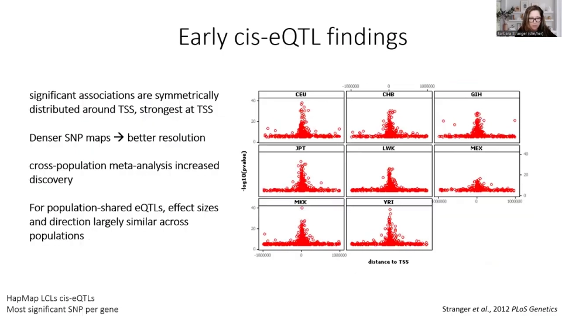
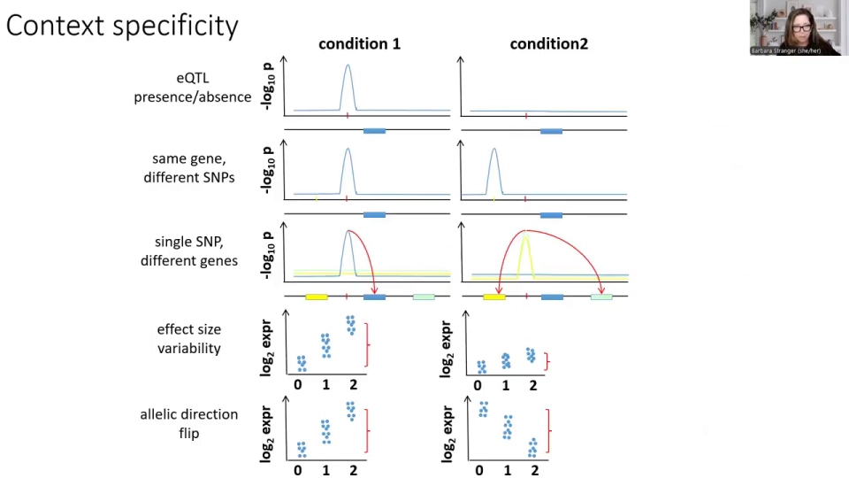
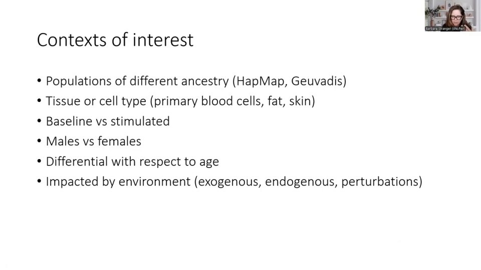
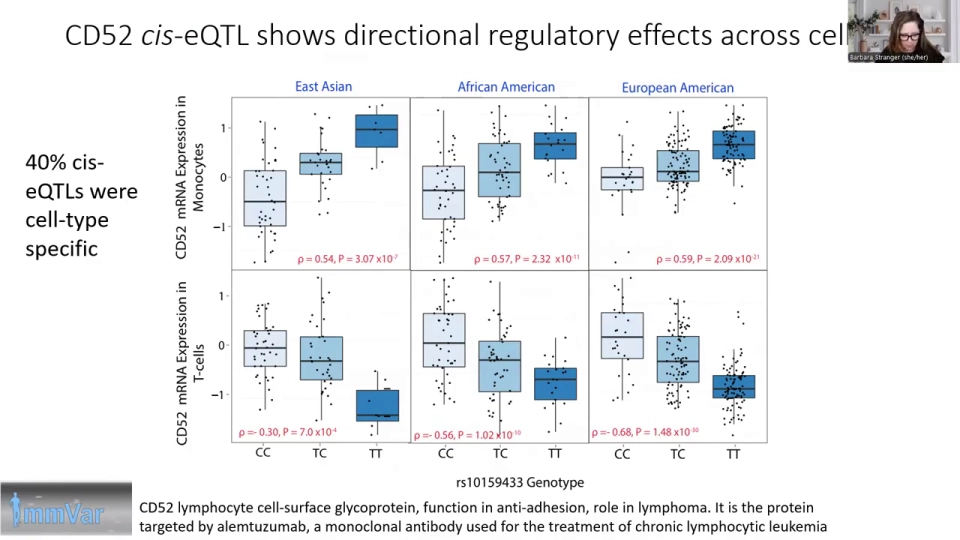
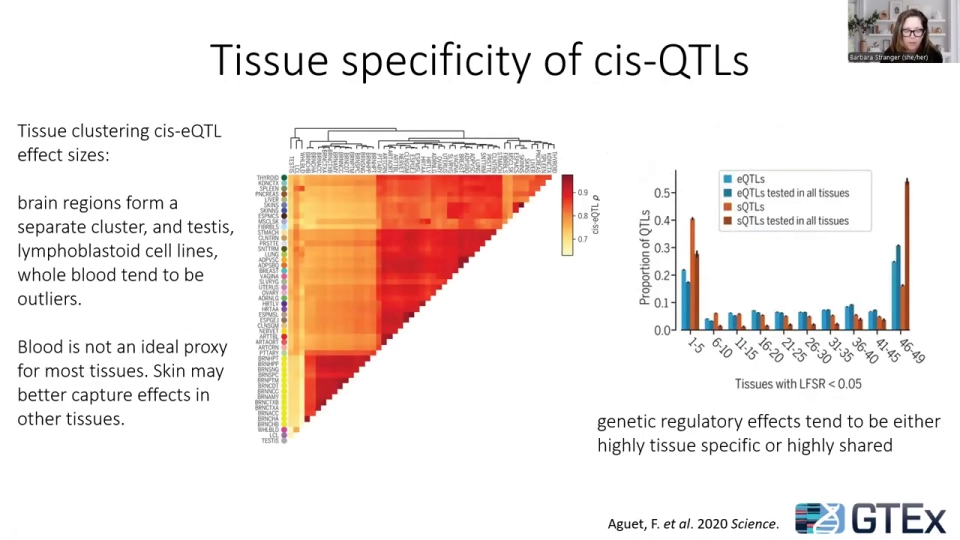
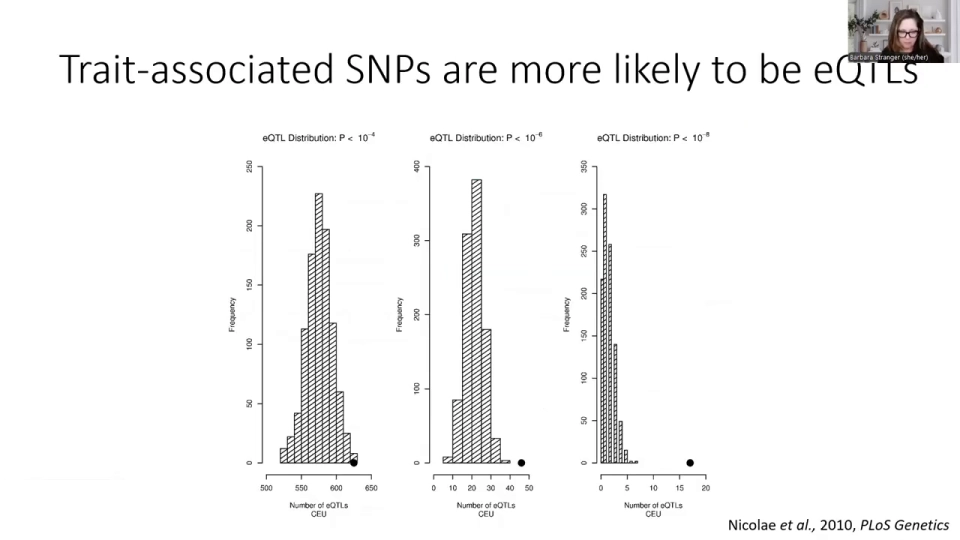

# eQTL 的背景依赖：组织、细胞类型与刺激状态

> 视频来源：[Expression quantitative trait locus (eQTL) mapping: Context, GTEx, and interpretation](https://www.youtube.com/watch?v=snT1iAT2lX0)（YouTube · Barbara Stranger）｜时长约 21 分钟
> 导读：这是 eQTL 定位系列的第二讲，第一讲讲怎么做，这一讲讲结果怎么读。本文只取与「调控区变异判读」有关的部分：eQTL 能证明什么、在什么条件下会失效、以及为什么同一个变异在不同细胞里可以方向相反。

## 本讲要解决的核心问题（SCQA）

**背景**：eQTL 是「与基因表达水平相关的遗传变异」。它把基因型和表达连起来，是把非编码变异与靶基因对应起来的常用证据。

**冲突**：同一个变异，在不同人群、不同组织、不同细胞状态里，可能有关联也可能没有，效应大小可能不同，甚至方向相反。如果只在一个组织里做分析，很容易得到不可推广、甚至误导的结论。

**疑问**：eQTL 关联到底能证明什么？它的结论在什么范围内成立？判读时需要核对哪些背景？

**回答（中心思想）**：eQTL 是**统计关联**，不是因果证明；它的效应高度依赖背景。使用 eQTL 时，必须把「在哪个祖源、哪种组织或细胞类型、什么状态、男女、什么年龄、什么环境」一起写进结论，否则这个关联不能用来解释疾病。

## 一、顺式 eQTL 集中在转录起始位点附近

早期 eQTL 研究多在淋巴母细胞系里做，用 HapMap 项目的样本，覆盖欧洲、非洲、东亚等多个祖源。这既是优势（可以跨人群比较），也埋下了后面「背景依赖」的伏笔。

最一致的发现是：顺式 eQTL 的关联强度在转录起始位点（TSS）处最高，向上下游各 1 Mb 逐渐减弱 [【跳转到 01:12】](https://www.youtube.com/watch?v=snT1iAT2lX0&t=72)：

这与调控生物学一致：启动子和许多调控元件就在 TSS 附近。另一个技术性要点是：**SNP 密度提高会改善分辨率**，更密的变异图谱能把关联缩小到更精确的位置。

但「集中在 TSS」只是平均图像。单个变异是否有效应、效应多大，取决于背景。

## 二、背景特异性有五种表现形式

Stranger 把「背景特异性」定义为两种条件下 eQTL 不同，并给出五种常见形式 [【跳转到 02:46】](https://www.youtube.com/watch?v=snT1iAT2lX0&t=166)：

| 形式 | 表现 | 判读含义 |
| --- | --- | --- |
| eQTL 有无 | 条件 1 有峰，条件 2 没有 | 这个变异只在特定背景下起作用 |
| 同一基因、不同 SNP | 两个条件各有一个显著 SNP | 同一基因的调控在不同背景下由不同位点主导 |
| 同一 SNP、不同基因 | 一个 SNP 在两个条件下连到不同基因 | 靶基因本身随背景改变 |
| 效应大小不同 | 都有峰，高度不同 | 调控强度受背景调节 |
| 方向翻转 | 一个条件下升、另一个条件下降 | 同一等位基因在不同细胞里作用相反 |

最后一种最容易被忽略，也最能说明「只做一个组织会出错」。

## 三、背景有六个维度

判读 eQTL 时要核对的背景，Stranger 列了六项 [【跳转到 04:01】](https://www.youtube.com/watch?v=snT1iAT2lX0&t=241)：

1. **祖源**：大多数顺式 eQTL 在不同人群间共享，只有相对很小一部分是人群特异的。但罕见不等于不重要——它可能反映等位基因频率、连锁不平衡结构或选择的差异，也可能贡献于人群间的疾病风险差异。
2. **组织或细胞类型**：相当一部分顺式 eQTL 是细胞类型特异的。这是最重要、也最常被忽略的维度。
3. **基线 vs 刺激**：有些关联只在免疫细胞受刺激后才出现。
4. **性别**：通过基因型×性别交互可以找出男女效应不同的位点。
5. **年龄**：基因调控随发育和衰老变化。
6. **环境暴露**：外源、内源或实验扰动都可能改变效应。

### 3.1 细胞类型：CD52 的方向翻转

CD52 是讲得最清楚的一个例子 [【跳转到 06:02】](https://www.youtube.com/watch?v=snT1iAT2lX0&t=362)：

- 在单核细胞中，T 等位基因在三个祖源人群里都**提高** CD52 表达；
- 在 T 细胞中，同一个等位基因在三个祖源人群里都**降低**表达。

这不是统计噪声，而是可重复的方向翻转。Stranger 的结论很直接：**只用单一组织做分析，可能错过重要生物学，甚至把你引向错误方向**。幻灯片还注明，约 40% 的顺式 eQTL 是细胞类型特异的。

### 3.2 组织：全血不是好的代理

GTEx 把「组织背景」做成了系统性的资源：2010 年启动，标准化采集约一千名已故供者的 50 种组织，同时做 RNA 测序和全基因组测序，构建跨组织的 eQTL 与剪接 QTL 目录。规模是它影响力的一部分：数百名供者、数千份样本、几十种组织，包括多个脑区。

跨组织比较的结论有两条 [【跳转到 08:43】](https://www.youtube.com/watch?v=snT1iAT2lX0&t=523)：

- **调控效应要么高度组织特异，要么广泛共享**，中间状态较少。
- **组织会按调控相似性聚类，而且不是所有组织都能代表其他组织**。全血是最容易获取的组织，却是一个明显的离群值；淋巴母细胞系和睾丸也与其他组织差得很远。幻灯片明确写着：血液对大多数组织不是理想代理。

这直接决定了一个实践问题：如果疾病相关细胞是脑或胰岛，用全血 eQTL 去解释这个位点，很可能得出错误结论。

### 3.3 刺激与性别：关联可以被「藏起来」

- **刺激特异**：对多种免疫细胞施加不同刺激后，有些与疾病相关的关联只在其中一种刺激条件下出现。也就是说，扰动本身也有背景特异性。
- **性别偏倚**：通过基因型×性别交互，可以看到三种情况——合并分析有信号但男女效应大小不同；合并分析没信号但男女各有强信号且方向相反；男性没信号、女性有强信号，合并后信号消失。不做交互分析，这些都会被漏掉。

## 四、eQTL 能证明什么、不能证明什么

### 4.1 它能做的：把变异与表达连起来

- 顺式 eQTL 和剪接 QTL 富集在功能元件上，支持「许多这类变异通过调控机制起作用」。
- 反式 eQTL 数量少、效应小，而且很多看起来是由顺式效应介导的：一个变异影响附近基因，这个基因再影响其他基因，形成调控级联。所以反式关联不能一律当作「直接的长程调控」。
- GWAS 变异在 eQTL 中富集，这是「性状相关变异可能通过基因调控起作用」的重要早期观察。

### 4.2 它不能做的：单独定因果

富集是群体层面的统计现象，不是单个位点的因果证明。要把 eQTL 连到疾病，常用**共定位**：检验 GWAS 信号与 eQTL 信号是否可能由同一个底层变异驱动。这是一个统计框架，能提高可信度，但仍不是功能实验。

因此 eQTL 的定位是：**关联证据**。它告诉你「这个变异与这个基因的表达在统计上相关」，不告诉你「改变这个变异会导致表达改变」，也不告诉你中间经过哪个转录因子、哪个元件。

## 五、eQTL 之外：剪接、多组学与时间

eQTL 只覆盖「表达总量」这一层。同一批数据还能给出别的读数：

- **剪接 QTL（sQTL）**：Geuvadis 是最早用 RNA 测序做的大规模 eQTL 研究之一，它发现遗传变异不只影响总体表达水平，也影响转录本结构，包括剪接；而且这两类调控效应在很大程度上相互独立。GTEx 里剪接 QTL 数量少于表达 QTL，但同样相当多。
- **多组学层**：GTEx 的下一阶段（enhancing GTEx）把 DNA 甲基化、染色质可及性、组蛋白修饰、体细胞突变和蛋白测量整合进来，试图把「变异 → 分子表型」的链条补得更完整。
- **时间维度**：基因调控在生命周期中变化，遗传效应可能在发育阶段和衰老过程中不同。发育期 GTEx 在不同年龄组中各取少量个体做 RNA 测序和 eQTL，就是为了把时间背景纳入进来。

资源方面，GTEx 门户可以交互式查看表达模式、eQTL 和组织特异效应，适合产生假设；eQTLGen 联盟在血液方面样本量非常大，对检出效应较小的反式 eQTL 更有功效。QTL 定位的软件工具很多，各有长处，选哪个取决于具体问题和数据集。

## 六、判读清单：拿到一个 eQTL 结论先问什么

1. **在哪个组织或细胞类型里做的？** 这个组织与疾病相关细胞是否接近？全血、淋巴母细胞系是常见但不具代表性的选择。
2. **有没有考虑刺激状态？** 免疫细胞尤其重要。
3. **人群与性别构成？** 效应是否在男女、祖源间一致？
4. **是顺式还是反式？** 反式效应可能是级联，不是直接调控。
5. **有没有共定位或功能实验支持？** 只有 eQTL 关联时，结论应写成候选。
6. **样本量与检出功效？** eQTL 数量随样本量增加；没检出不等于没有效应。

## 小结

- 顺式 eQTL 集中在 TSS 附近，但单个变异的效应高度依赖背景。
- 背景有六个维度：祖源、组织／细胞类型、基线 vs 刺激、性别、年龄、环境。
- 同一变异在不同细胞里可以方向相反（CD52 在单核细胞与 T 细胞）；约 40% 的顺式 eQTL 是细胞类型特异的。
- 组织之间不能随意互相代理，全血对多数组织不是好代理。
- eQTL 是关联证据；要谈因果，需要共定位、扰动实验或其他功能证据配合。

## 关键术语速查

| 术语 | 一句话解释 |
| --- | --- |
| eQTL | 与某个基因表达水平统计相关的遗传变异 |
| 顺式 eQTL | 变异与它所调控的基因在同一位点或邻近区域 |
| 反式 eQTL | 变异与基因距离较远，常通过中间因子起作用 |
| 背景特异性 | 同一变异在不同条件（组织、刺激、性别等）下效应不同 |
| GTEx | 基因型—组织表达项目，跨多组织构建 eQTL 与剪接 QTL 目录 |
| 共定位 | 检验 GWAS 信号与 eQTL 信号是否由同一个底层变异驱动的统计方法 |
| 剪接 QTL | 与剪接比例相关的遗传变异，和表达 QTL 可以相互独立 |