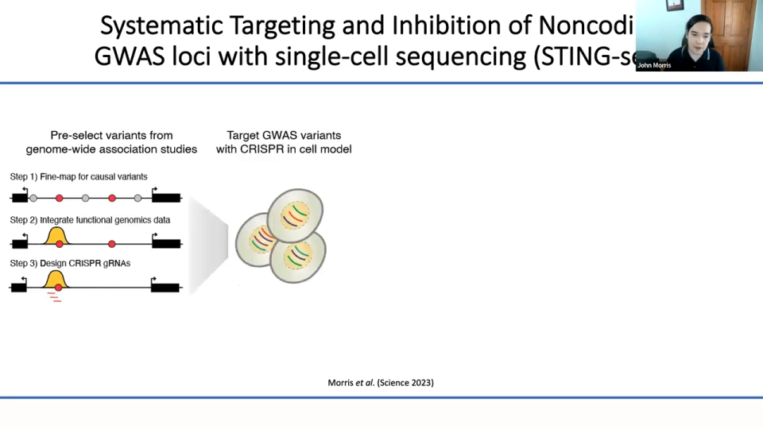
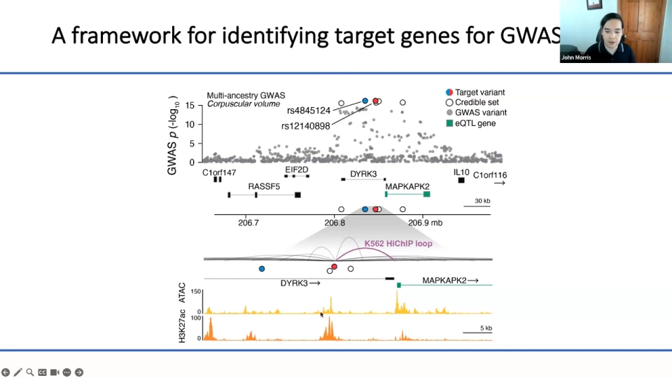
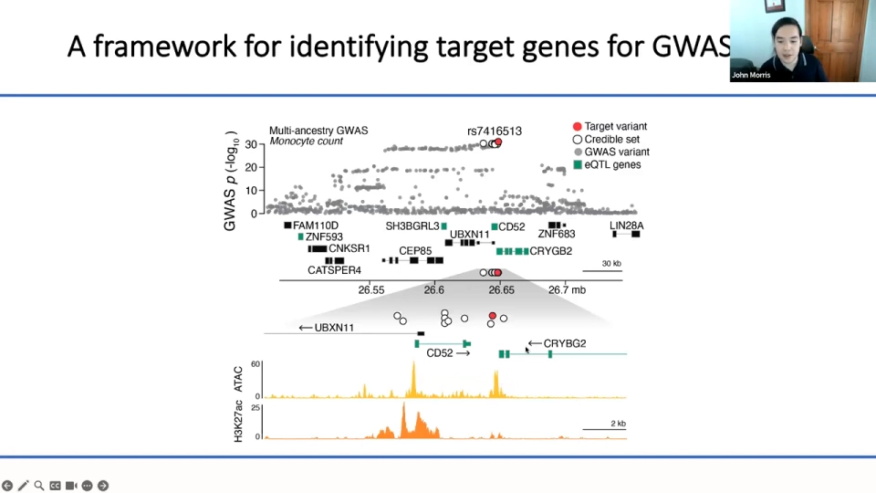
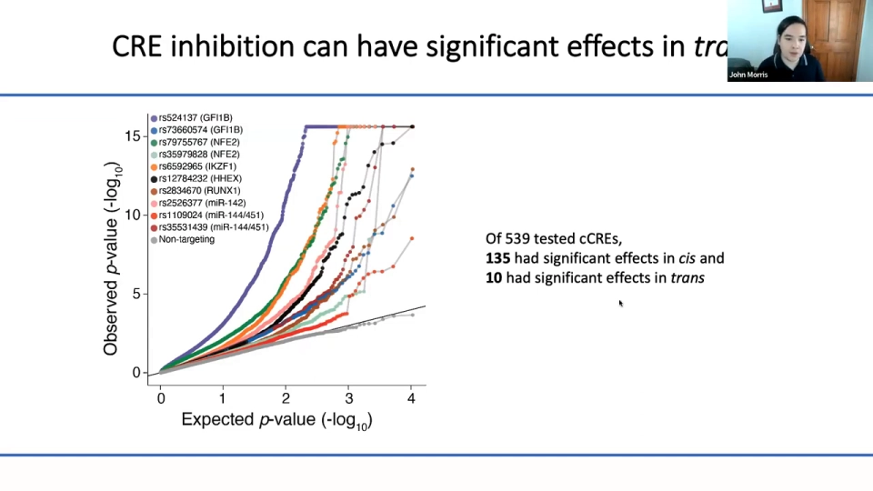
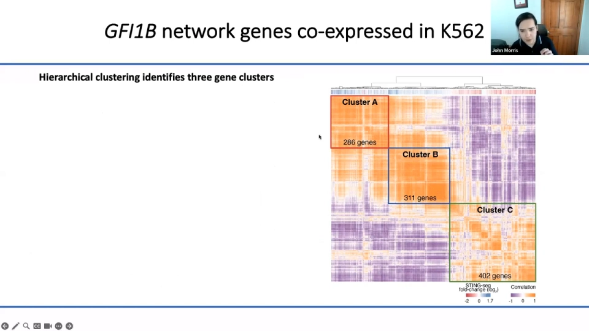
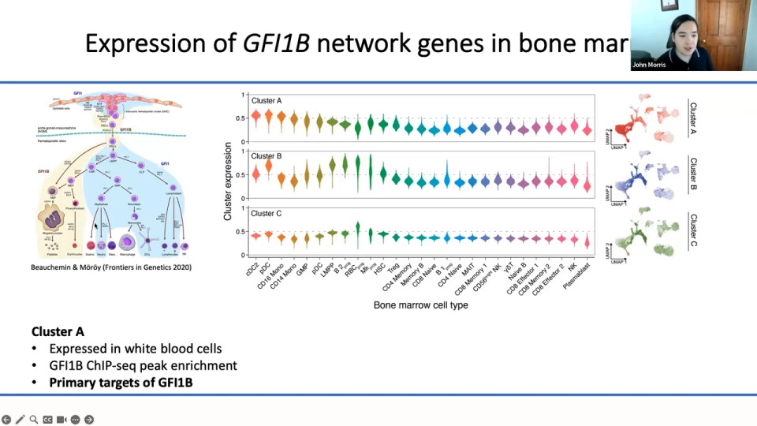
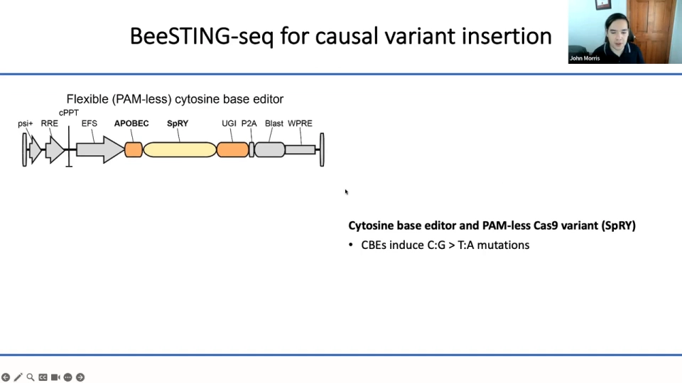
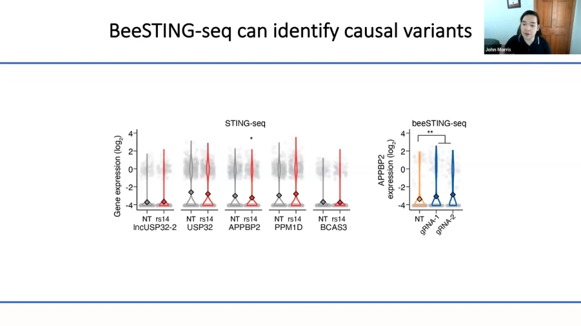

# 调控元件的因果检验：CRISPRi 扰动、靶基因与碱基编辑

> 视频来源：[Beyond GWAS: Massively parallel genome engineering to pinpoint causal variants and target genes](https://www.youtube.com/watch?v=TRBnnxXYRLE)（YouTube · John Morris，New York Genome Center / NYU）｜时长约 32 分钟
> 导读：这支报告讲的是「已知一个非编码位点与性状相关之后，怎么用 CRISPR 扰动把它变成因果结论」。本文把 GWAS 统计压到最低，只保留与调控区变异判读有关的部分：怎么选靶、怎么读扰动结果、靶基因为什么常常不是最近的基因、以及碱基编辑如何把「元件」推进到「具体碱基」。

## 本讲要解决的核心问题（SCQA）

**背景**：关联研究给出的是位点，一个位点里可能有几十个变异，附近可能有多个基因。我们想知道的是因果变异和它的靶基因。

**冲突**：关联强度不能区分同一连锁区域里的变异；距离最近也不能确定靶基因；eQTL 常常给出多个候选基因，甚至互相矛盾。

**疑问**：有没有办法在内源基因组里直接扰动候选元件，看它到底控制哪个基因？

**回答（中心思想）**：用 CRISPRi 在内源基因组里抑制候选调控元件，配合单细胞转录组读出，可以把「元件 → 靶基因」这一步变成因果实验；再用碱基编辑把「元件」推进到「具体碱基」。它的产出不是全部答案，而是把候选集大幅收窄。

## 一、方法：从候选变异到因果效应

### 1.1 选靶：先缩小候选集

STING-seq 的流程分三步 [【跳转到 03:55】](https://www.youtube.com/watch?v=TRBnnxXYRLE&t=235)：

1. **精细定位**：在一个位点里挑出最可能因果的变异子集；
2. **整合功能基因组数据**：看这些变异是否落在所研究细胞模型里有活性的调控元件上；
3. **设计 guide RNA**：靶向候选元件，或直接靶向变异本身。

这里的功能基因组数据（染色质可及性、组蛋白修饰）起的是**筛选**作用，不是证明作用：它把「几十个变异」缩到「几个候选元件」，但一个元件在某种细胞里开放，不代表它一定调控某个基因。

### 1.2 读出：单细胞里的因果比较

实验用高 MOI，让每个细胞随机整合多条 guide；然后做多模态单细胞捕获：每个细胞同时拿到完整转录组、guide RNA 身份和细胞表面蛋白水平。

分析逻辑很朴素：如果关心 guide X 对基因 A 的效应，就把带 X 的细胞聚在一起，和不带 X 的细胞比较。因为 guide 是随机分配的，这种比较有因果方向。用非靶向 guide 作无效对照，可以检查整套检验是否校准。

### 1.3 规模与产出

他们用了两套血细胞性状的关联数据（UK Biobank 约 36 万人，血细胞联盟约 75 万人、五个全球人群），最终靶向约 250 个非编码位点上的 539 个候选顺式调控元件。细胞模型是 K562，因为它可以模拟人红系祖细胞。

结果：97 个位点上的 135 个元件有显著靶基因，共 115 个显著基因；其中 16 个来自人群特异的关联变异；约四分之一的受检元件有显著靶基因；**约 40% 的位点能指定靶基因**。

这个 40% 很重要：它说明这类方法有效，但也说明**大多数位点用当前方法还定不了靶基因**。判读时不能把「没有显著靶基因」当成「没有靶基因」。

## 二、案例一：MAP3K2——多条证据收敛

第一个案例是红细胞平均体积的位点 [【跳转到 05:50】](https://www.youtube.com/watch?v=TRBnnxXYRLE&t=350)：

- 蓝色 rs48 是先导变异，红色 rs12 是第二显著变异，两者都落在类增强子元件上，也都是精细定位给出的最可能因果变异；
- 血细胞性状 eQTL 数据显示，两个变异都被注释为 **MAP3K2** 的 eQTL；
- Hi-C／HiChIP 接触数据显示，只有红色变异所在的元件与 MAP3K2 启动子成环；
- CRISPRi 扰动结果：只有扰动红色元件使 MAP3K2 表达下降，扰动蓝色元件没有效应。

四条证据在这里收敛到同一个结论：因果变异是红色那个，靶基因是 MAP3K2。注意 eQTL 这一层并没有区分两个变异——它把两个都标成 MAP3K2 的 eQTL；真正把两者分开的是接触数据和扰动实验。这就是「证据互补」的具体含义：**关联负责提名，扰动负责裁决**。

## 三、案例二：CD52——靶基因不是最近的基因

第二个案例是单核细胞计数的位点 [【跳转到 07:00】](https://www.youtube.com/watch?v=TRBnnxXYRLE&t=420)：

这个位点的情况复杂得多：

- eQTL 数据给出**多个**候选：CRYBG2、CD52、SH3 基因、ZNF593；
- 按二维距离，最近的基因体是 CRYBG2，最近的转录起始位点落在另一个基因上，CD52 按两个指标都排第二；
- CRISPRi 扰动这个元件后，**CD52 是压倒性最强的靶标**，表达大幅下降；CRYBG2 和最近 TSS 的那个基因都没有效应；
- CD52 编码细胞表面蛋白，正好在检测面板里，所以也能看到蛋白水平显著下降；
- eQTL 集合里最远的 ZNF593 也有一个很小但显著的表达效应。

这个案例给出三个判读要点：

1. **最近的基因不是靶基因**。距离只是先验，不是证据。
2. **一个元件可以调控多个基因**（调控多效性）。这里 CD52 是主靶标，ZNF593 是弱靶标。直接靶向 CD52 本身不会影响 ZNF593，说明 ZNF593 的效应确实来自这个增强子。
3. **蛋白水平可以跟着变**。CD52 正好是一个药物靶点，这提示一种机制：对药物的反应减弱，可能不是蛋白损伤性变异造成的，而是增强子损伤性变异降低了蛋白量。

不过作者也提醒：**大多数元件确实靶向最近的基因，而且只靶向一个基因**。CD52 这类多效性案例更接近例外。但正因为是例外，才需要扰动实验来发现——否则这些位点会被距离规则判错。

## 四、从顺式到反式：扰动会牵出网络

539 个候选里，135 个有显著顺式效应，其中 10 个还有广泛的反式效应 [【跳转到 08:55】](https://www.youtube.com/watch?v=TRBnnxXYRLE&t=535)：

被扰动的元件大多落在转录因子或 microRNA 上，所以抑制它们不仅改变直接靶标，还改变整个下游网络。作者用 K562 的 ChIP-seq 数据和 TargetScan 预测检查这些网络是否富集「本该在那里的基因」，结果总体显著；但 RUNX1 和 microRNA-144 的网络太小，富集检验功效不足——**网络规模本身会影响结论**。

更有意思的是，这些反式网络也富集了 GWAS 基因：说明复杂性状的基因不仅受自己的顺式变异影响，也受反式调控因子上的变异影响。

### 4.1 网络内部的三个簇

GFI1B 网络最大，约 1000 个基因。对它们在 K562 里的共表达做层次聚类，得到三个簇 [【跳转到 10:48】](https://www.youtube.com/watch?v=TRBnnxXYRLE&t=648)：

- **A、B 簇**：抑制 GFI1B 后表达升高，而且富集 GFI1B 的 ChIP-seq 峰，是直接靶标。GFI1B 经典上是抑制因子，去掉抑制因子后这些基因升高，逻辑自洽。
- **C 簇**：抑制 GFI1B 后表达下降，但**不富集** GFI1B 的直接结合峰，因此被解释为次级靶标（随 GFI1B 一起变化的共表达模块）。

把三个簇画到人骨髓单细胞数据上，模式更清楚 [【跳转到 12:04】](https://www.youtube.com/watch?v=TRBnnxXYRLE&t=724)：

- A 簇主要在白细胞：GFI1B 主动抑制白细胞分化所需的基因；
- B 簇主要在祖细胞：GFI1B 维持多能状态；
- C 簇主要在红系祖细胞，而且只有 C 簇富集红细胞性状的 GWAS 基因。

这个例子说明：**细胞系里的扰动结果需要原代细胞数据来定位**。K562 里看到的表达变化，要放回骨髓的细胞类型背景里才能解释成「哪个分化阶段的哪群基因」。

## 五、从元件到碱基：beeSTING-seq

CRISPRi 能证明「这个元件调控这个基因」，但不能证明「这个位点上哪个碱基是因果变异」。为此他们把 CRISPRi 换成碱基编辑器，做成 beeSTING-seq（base editing STING-seq）。

用的是一套不需要 PAM 的胞嘧啶碱基编辑器（pSpRY 变体），可以诱导 C→T 或 G→A 的改变 [【跳转到 14:08】](https://www.youtube.com/watch?v=TRBnnxXYRLE&t=848)：

为什么需要 PAM-less？CRISPRi／CRISPRa 诱导的是一段窗口效应，guide 位置稍有偏差还能工作；碱基编辑关心的是精确位置，受 PAM 限制会直接失去可编辑的位点。

验证之后，他们筛了 46 个变异。一个例子是 rs14：它落在一个内含子增强子元件上，在关联数据里是一个 C→T 变异，正好是碱基编辑能造的类型 [【跳转到 15:22】](https://www.youtube.com/watch?v=TRBnnxXYRLE&t=922)：

这里出现了一个看似矛盾、实则互补的结果：**抑制整个元件让 APPBP2 下降，而造出风险等位基因让 APPBP2 升高**。两者不冲突——CRISPRi 是把元件整体关掉，碱基编辑是把这个位点换成风险版本，风险版本可能只是减弱而非消除元件的抑制/激活能力。这也说明：**扰动元件和扰动具体碱基回答的是两个不同问题**。

作者特别指出，在没有高功效 eQTL 数据的情况下，这种「直接造出因果变异」的能力尤其重要。

## 六、问答里的三个限制

报告后的提问集中在三个实践问题上，正好补足方法边界：

- **功效**：对单个 CRE 做全转录组检验时功效是够的；但如果要报告所有可能的反式关联，就会遇到功效问题。所以作者只报告确实找到网络的那些元件，而不是列出全部反式命中。
- **重复序列与 guide 设计**：非编码区可能有重复序列，而碱基编辑本身可选的位置就少——编辑器只有 3–5 个碱基的窗口，对给定变异把所有可能的碱基对都试一遍也只有三到五条 guide。大的同聚物基序、T 终止基序都会让某些位点无法设计 guide。所以「能编辑的变异」本身就是一个有偏的子集。
- **细胞类型与外推**：细胞混合物能否观察到细胞类型特异的扰动效应，仍是未来工作；作者正在扩展到其他细胞系。若要把血细胞性状的结论外推到神经性状，可以用孟德尔随机化或 LD 分数回归做统计层面的探索，但最终仍取决于是否有与疾病相关的细胞类型——例如用 iPSC 衍生神经元，前提是候选变异确实落在这些细胞里有活性的增强子上。

## 七、这套方法的边界

- **40% 的位点能指定靶基因**，其余位点可能是细胞模型不对、元件在该细胞里不活跃、或技术灵敏度不够。没检出不等于没有。
- **细胞模型决定结论**：K562 模拟红系祖细胞，换成别的细胞类型，靶基因可能不同。作者在问答里也提到正在扩展到其他细胞系。
- **反式网络的功效有限**：只报告确实找到网络的元件，因为报告所有反式关联会遇到功效问题。
- **碱基编辑的窗口限制**：一个编辑器只有 3–5 个碱基的窗口，重复序列、同聚物、终止基序都可能让某些变异无法设计 guide。
- **扰动不等于自然状态**：CRISPRi 是把元件强行关掉，碱基编辑是把一个等位基因换掉；两者都不是「在自然群体里观察这个变异的效果」。

## 小结

- CRISPRi 扰动内源调控元件，配合单细胞转录组，可以把「元件 → 靶基因」变成因果实验。
- 约 40% 的位点能指定靶基因；没指定不等于没有靶基因。
- 靶基因常常不是最近的基因；一个元件可以调控多个基因（调控多效性）。
- eQTL、接触数据、扰动实验各自只能排除一部分可能，收敛才能定结论。
- 碱基编辑把「元件」推进到「具体碱基」，但受 PAM 与编辑窗口限制。
- 细胞模型决定结论的适用范围，细胞系结果需要原代细胞数据来解释。

## 关键术语速查

| 术语 | 一句话解释 |
| --- | --- |
| STING-seq | 用单细胞测序系统靶向并抑制非编码位点的 CRISPRi 筛选方法 |
| CRISPRi | 用 dCas9 融合抑制结构域，在不切 DNA 的情况下压制目标元件的转录 |
| MOI | 感染复数，这里指每个细胞平均整合多少条 guide |
| 调控多效性 | 同一个调控元件影响多个靶基因 |
| 反式效应 | 扰动一个元件后，远处基因表达也发生变化，常通过转录因子级联实现 |
| 碱基编辑 | 不切断双链、直接把一个碱基改成另一个碱基的编辑方式 |
| PAM | Cas9 识别目标 DNA 所需的邻近短序列，限制可编辑位点 |
| beeSTING-seq | 把 STING-seq 的 CRISPRi 换成碱基编辑，用于直接造出候选因果变异 |