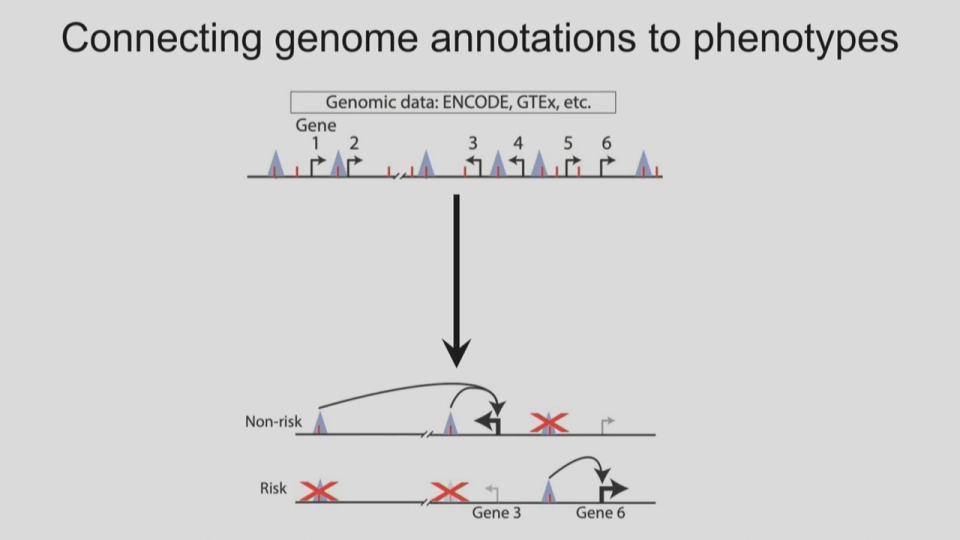
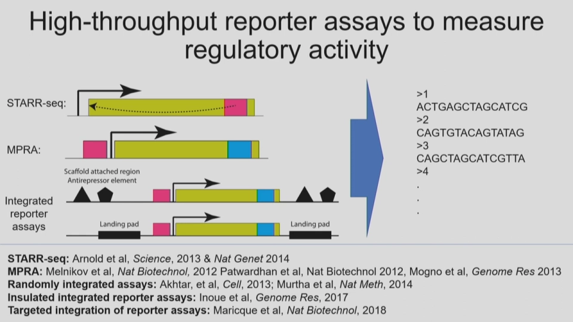
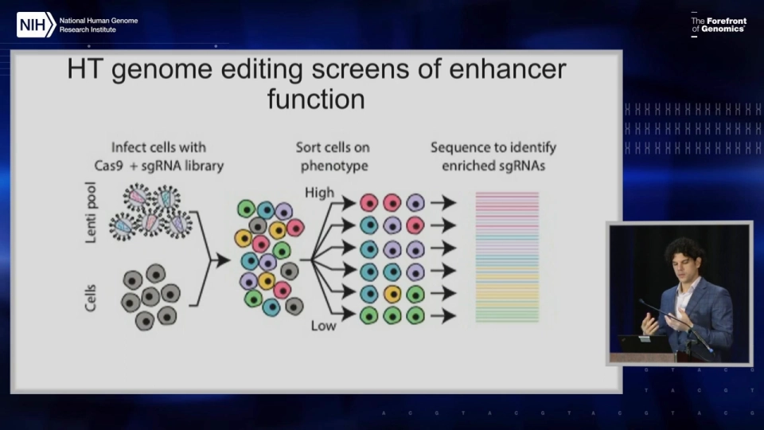
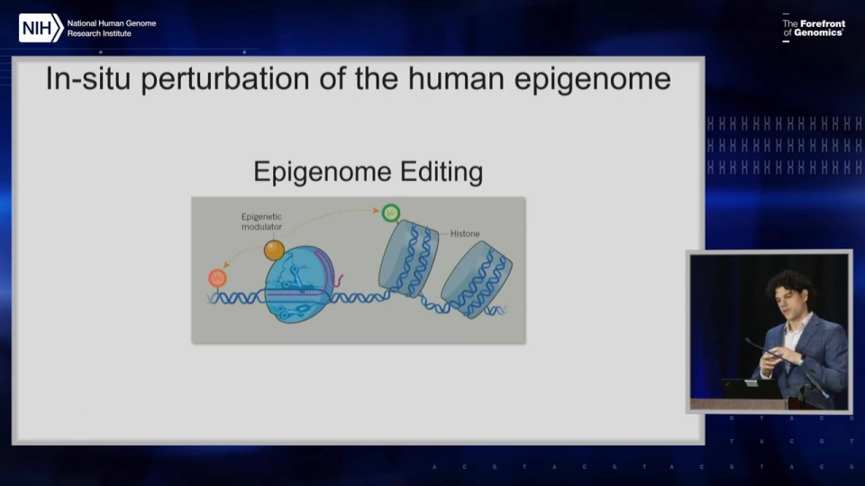
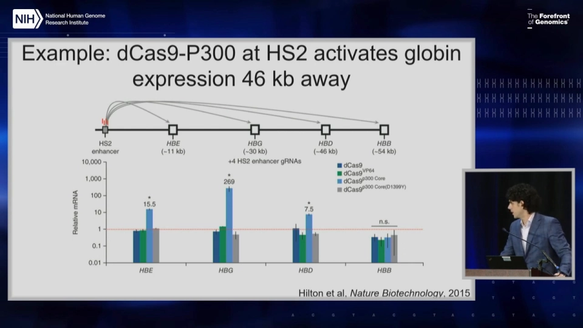
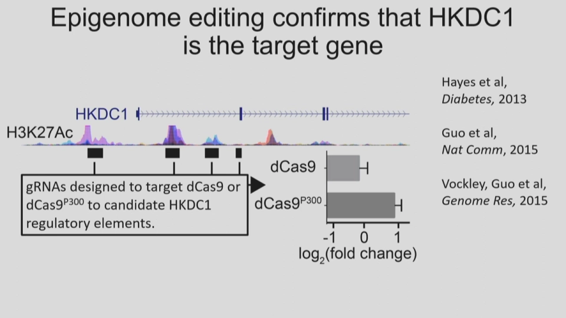
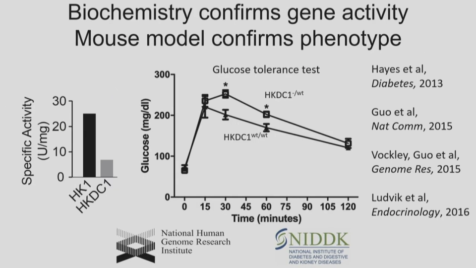
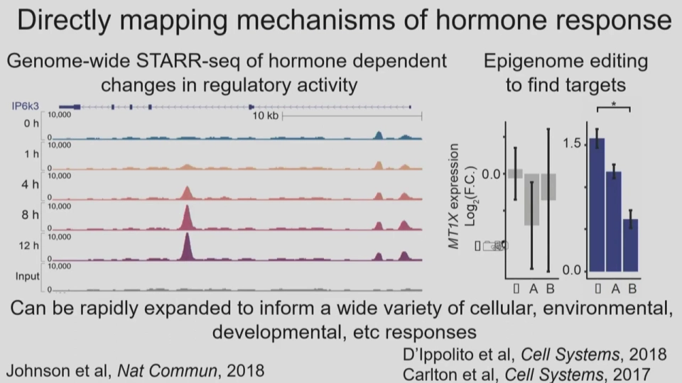

# 非编码变异的作用路径：调控元件、靶基因与三类证据

> 视频来源：[New technologies to study the function of the non-coding genome & variants therein - Timothy Reddy](https://www.youtube.com/watch?v=B83OeJfP7yQ)（YouTube · NIH NHGRI / The Forefront of Genomics，讲者 Timothy Reddy）｜时长约 17 分钟
> 导读：这支报告把「非编码变异怎么起作用」拆成一条可操作的链条：先给元件加功能注释，再把元件连到基因，最后连到表型。本文按这条链条组织，重点在报告基因与 CRISPR／表观编辑两类扰动证据，以及它们各自的盲区。

## 本讲要解决的核心问题（SCQA）

**背景**：我们已经有了注释得很好的基因组：知道基因在哪里，知道大量候选调控元件在哪里，也知道许多与疾病相关的变异落在哪些区域。

**冲突**：疾病相关变异里有很大一部分落在非编码区，但我们一直说不清它们在功能上做了什么。全基因组测序让非编码变异在大量人群中快速增加，理解能力跟不上，差距只会越拉越大。

**疑问**：怎样从「这个变异落在一个候选增强子里」走到「它改变了哪个基因的表达、通过什么机制」？

**回答（中心思想）**：非编码变异的作用路径是「变异 → 调控元件活性 → 靶基因表达 → 表型」，每一段都需要不同的证据：注释给出候选，报告基因测出元件活性，CRISPR 与表观编辑把元件和具体基因连起来。任何一段缺失，结论都只是候选。

## 一、作用路径：变异改的是元件，不是蛋白

编码区变异改变蛋白序列，非编码变异改变的是「这段 DNA 什么时候、在哪个细胞里、以多强被读取」。Reddy 用一张图把整条链条画了出来 [【跳转到 03:43】](https://www.youtube.com/watch?v=B83OeJfP7yQ&t=223)：

这张图里有两个容易忽略的要点：

- 变异落在元件上，元件再通过空间接触作用到启动子。所以「变异属于哪个基因」不是坐标距离问题，而是「这个元件连到哪个启动子」的问题。
- 一个区域里往往有多个元件、多个基因。风险单倍型可能同时破坏两个元件，也可能只破坏其中一个，剩下的元件仍然在起作用。

因此判读顺序是：**先确定元件是否真的有活性，再确定它连到哪个基因，最后才谈变异改变了什么**。Reddy 把这三步分别对应到三类技术。

## 二、报告基因：把元件活性变成可测的数字

### 2.1 从荧光素酶到高通量报告基因

最早的做法是荧光素酶报告基因：把候选元件克隆到荧光素酶基因前面，看发光强度。它能回答「这段序列能不能驱动转录」，但一次只能测一个元件，通量太低。

过去三到五年最大的变化，是把这种读出换成 DNA 序列读出：每个候选元件带一个可测序的条形码，测序后数条形码，就知道每个元件驱动转录的强弱 [【跳转到 04:38】](https://www.youtube.com/watch?v=B83OeJfP7yQ&t=278)。

这张幻灯片把常见变体归了类，差别主要在**元件放在哪、读出怎么来**：

| 类型 | 元件位置 | 读出 | 特点 |
| --- | --- | --- | --- |
| STARR-seq | 报告基因下游 | 元件自身的转录本 | 元件充当增强子并被转录，直接测序 |
| MPRA | 报告基因上游 | 条形码 | 灵活，可放合成序列、饱和突变文库 |
| 整合型报告基因 | 基因组固定位置 | 条形码／报告基因 | 控制拷贝数与位置效应 |

### 2.2 这类实验能回答什么

- **哪些候选元件真的有活性**：把注释里的元件逐个放进报告基因体系，活性接近背景的就可以降级。
- **变异对元件活性的定量影响**：把风险等位基因和普通等位基因并排测，得到倍数变化。Reddy 提到可以直接测患者 DNA，把患者基因组放进报告基因体系，这在大型生物样本库之后是很有吸引力的用法。
- **饱和突变**：对同一个元件做逐碱基替换，画出「哪些碱基不能动」的活性图谱。这正好对应 motif 预测给出的候选位点，但给出的是功能读数而不是序列相似度。

### 2.3 报告基因的盲区

报告基因测的是**元件自身的活性**，不是它对内源靶基因的作用。它把元件从原来的染色质环境里拿出来，放到质粒或固定整合位点上，因此：

- 测不出这个元件在内源基因组里连到哪个启动子；
- 测不出细胞类型特异的染色质环境（虽然可以换细胞系，但质粒上的染色质状态与内源不同）；
- 一个元件在报告基因里活性很强，不代表它在内源位点上真的调控邻近基因。

所以报告基因是「元件功能」的证据，不是「靶基因」的证据。要跨过这一步，需要扰动内源序列。

## 三、CRISPR 与表观编辑：把元件和靶基因连起来

### 3.1 CRISPR 编辑：直接改序列

最直接的办法是用 CRISPR-Cas9 在内源基因组里突变候选元件，改几个核苷酸，再看结合在上面的蛋白或下游表达是否改变。Reddy 举的例子是 BCL11A 增强子的原位饱和突变：Dan Bauer 实验室对这个增强子做了饱和突变，证明扰动它会导致胎儿血红蛋白升高——这与之前工作的预测一致，而且已经进入临床转化，Sangamo 等公司在做治疗镰状细胞病的试验 [【跳转到 07:11】](https://www.youtube.com/watch?v=B83OeJfP7yQ&t=431)。

要把这件事做成筛选，流程是 [【跳转到 06:46】](https://www.youtube.com/watch?v=B83OeJfP7yQ&t=406)：

1. 用携带 sgRNA 文库的慢病毒转导细胞，每个细胞随机拿到一条 sgRNA；
2. 按关心的表型（或基因表达）分选高、低两组；
3. 测序两组的 sgRNA，被富集或耗竭的那条就指向一个有功能的元件。

这套逻辑的关键是**有分选就有因果方向**：不是「这个元件与表达相关」，而是「破坏这个元件导致表达改变」。

### 3.2 表观编辑：不改序列，改状态

基因组编辑不一定总是我们想要的：它会在 DNA 上留下切口，规模上也有限制。与之并行的是表观基因组编辑：把催化失活的 Cas9（dCas9）接到不同的表观修饰结构域上，在指定位点改变染色质状态，而不改序列 [【跳转到 08:01】](https://www.youtube.com/watch?v=B83OeJfP7yQ&t=481)。

Reddy 实验室 2015 年的例子是把 dCas9 接到组蛋白乙酰转移酶结构域 p300 上，导向珠蛋白的 HS2 增强子 [【跳转到 08:46】](https://www.youtube.com/watch?v=B83OeJfP7yQ&t=526)：

这张图有三个信息：

- **一个增强子可以作用于多个基因**：HBE、HBG、HBD 都被提高，幅度不同（HBG 最强，约 269 倍；HBE 约 15.5 倍；HBD 约 7.5 倍）。
- **距离不是决定因素**：46 kb 外的 HBD 有响应，54 kb 外的 HBB 没有。所以「离得近」既不是必要条件也不是充分条件。
- **细胞背景仍然重要**：实验是在本来不表达珠蛋白的细胞类型里做的，说明表观编辑可以强行打开一个在该细胞里关闭的调控连接。这既是它的力量，也是它的局限——它证明的是「这个元件有能力调控这些基因」，不证明「在这个细胞里平时就是这么调控的」。

表观编辑的用法很灵活：接到激活结构域上做激活，接到 KRAB、LSD1 等抑制结构域上做压制，还有用它驱动染色质成环的新方法。和 CRISPR 编辑一样，它也能做高通量筛选，例如筛选 HER2 的激活因子和抑制因子。

### 3.3 两类扰动的分工

| 扰动方式 | 改什么 | 能证明 | 不能证明 |
| --- | --- | --- | --- |
| CRISPR 编辑（敲除／饱和突变） | DNA 序列 | 这段序列对表达是必需的 | 具体哪个碱基、哪个转录因子 |
| 碱基编辑 | 单个碱基 | 这个碱基就是因果变异 | 机制中间步骤 |
| 表观编辑（dCas9-p300／KRAB） | 染色质修饰 | 改变状态足以改变表达 | 自然状态下是否这样发生 |
| CRISPRi／CRISPRa | 转录（不切 DNA） | 元件的调控方向与靶基因 | 序列变异本身的效果 |

## 四、案例：HKDC1 与「最近的基因不是靶基因」

Reddy 用一个完整案例说明这条链条怎么走完 [【跳转到 11:09】](https://www.youtube.com/watch?v=B83OeJfP7yQ&t=669)。

起点是 2013 年的一项 GWAS：10 号染色体上一个变异与妊娠期高血糖相关。到 2015 年，他们用低通量和高通量报告基因实验相结合，把这个先导 SNP 周围的调控变异和调控元件定位出来。之后用表观基因组编辑靶向这些区域找靶基因 [【跳转到 11:39】](https://www.youtube.com/watch?v=B83OeJfP7yQ&t=699)：

结果指向 HKDC1——当时这个基因只有三篇文献，本来根本不会进入候选名单。街对面就有一个非常合适的候选基因，己糖激酶 1（hexokinase 1），他们原以为结果会是它，实际却是另一个基因。

接下来是功能与表型的补证 [【跳转到 12:02】](https://www.youtube.com/watch?v=B83OeJfP7yQ&t=722)：

- 生化实验证明 HKDC1 在葡萄糖代谢里确实有活性（虽然比 HK1 低）；
- 小鼠模型出现妊娠期高血糖，复现人类表型。

这个案例的教学价值在于它同时否定了两种偷懒的推断：**不能按距离选靶基因**，也**不能只凭报告基因活性定结论**。距离、活性、表达关联都只是候选，最后要靠扰动和表型把链条闭合。

## 五、证据的边界：统计、对照与假阴性

Reddy 在讲完技术后专门用一页说明「这不是魔法」[【跳转到 10:06】](https://www.youtube.com/watch?v=B83OeJfP7yQ&t=606)：

- **统计是并行的必需品**：高通量实验产出的是海量计数，底下需要大量统计工作；两者不携手，我们基本上是瞎的。
- **对照决定结论**：非靶向 sgRNA、输入对照、报告基因的空载体，决定了你看到的信号是不是真的。
- **假阴性不等于无功能**：看不到效应，可能是这个元件在这个细胞模型里本来就不活跃，也可能是当前技术测不到这个区域。Reddy 把「如何解释假阴性」列为未来需要专门研究设计的问题。
- **细胞模型的选择**：是否总需要一个非常特定的细胞模型，还是可以用更容易操作的替代模型，本身仍是一个开放问题。

同一条限制也适用于环境响应。Reddy 实验室用糖皮质激素（可的松一类抗炎药）处理细胞，然后用全基因组的报告基因读出调控活性变化 [【跳转到 13:22】](https://www.youtube.com/watch?v=B83OeJfP7yQ&t=802)：

这里用的是已知作用机制的药物（通过糖皮质激素受体起作用）作示范；同样的方法可以用到机制未知的环境条件上——按需要处理细胞、用各种方式扰动，直接标出哪些元件改变了活性。这条路线把「背景依赖」从一句提醒变成了可测量的对象。

## 小结

- 非编码变异的作用路径是「变异 → 元件活性 → 靶基因表达 → 表型」，判读要按这个顺序逐段取证。
- 注释只给候选；报告基因（luciferase、STARR-seq、MPRA）测的是元件自身活性，不能定靶基因。
- CRISPR 编辑、碱基编辑、表观编辑与 CRISPRi／CRISPRa 在内源基因组里扰动，能给出因果方向和靶基因，但结论依赖细胞模型。
- 一个增强子可以作用于多个基因，距离既不是必要条件也不是充分条件；最近的基因常常不是靶基因。
- 高通量实验必须与统计、对照一起看；假阴性可能来自细胞模型或技术灵敏度，而不是「没有功能」。

## 关键术语速查

| 术语 | 一句话解释 |
| --- | --- |
| 顺式调控元件 | 位于基因附近、不编码蛋白但能影响该基因转录的 DNA 片段，包括启动子、增强子、沉默子、绝缘子 |
| 报告基因 | 把候选元件接到一个容易测量的基因（荧光素酶、GFP 或条形码）前面，用读出量代表元件活性 |
| STARR-seq | 把候选序列放在报告基因下游，元件自身被转录，直接测序转录本定量活性 |
| MPRA | 大规模并行报告基因实验，用条形码把大量候选序列放在同一个实验里测 |
| dCas9 | 催化失活的 Cas9，能定位到目标 DNA 但不切割，用来携带表观修饰模块 |
| 表观基因组编辑 | 用 dCas9 融合表观修饰酶，在指定位点改变染色质状态而不改 DNA 序列 |
| 饱和突变 | 对一段序列的每个碱基逐一替换，系统测量每个位置对功能的影响 |
| 假阴性 | 实际有功能但实验没检出，可能因为细胞模型不匹配或技术灵敏度不足 |