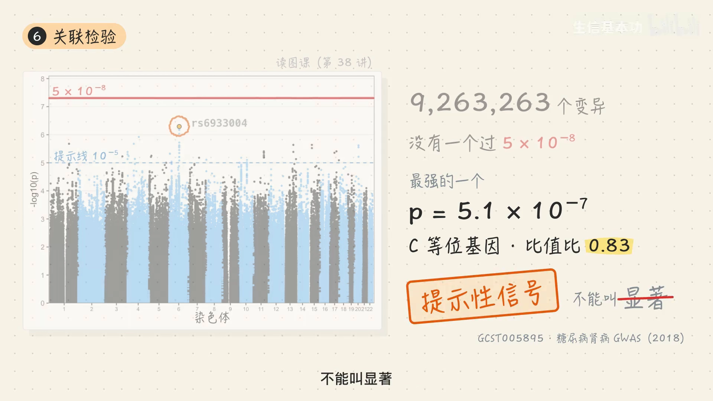
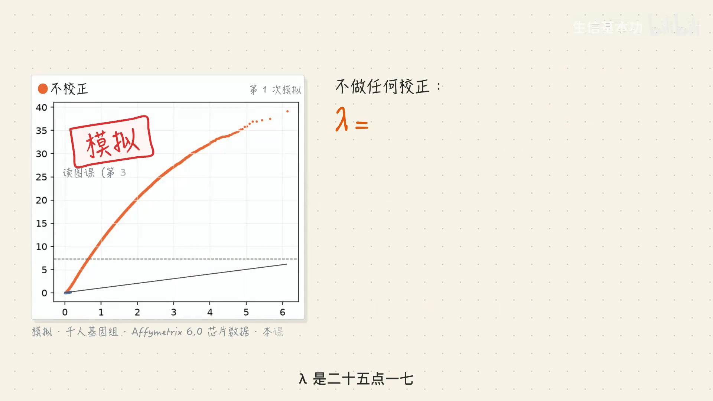
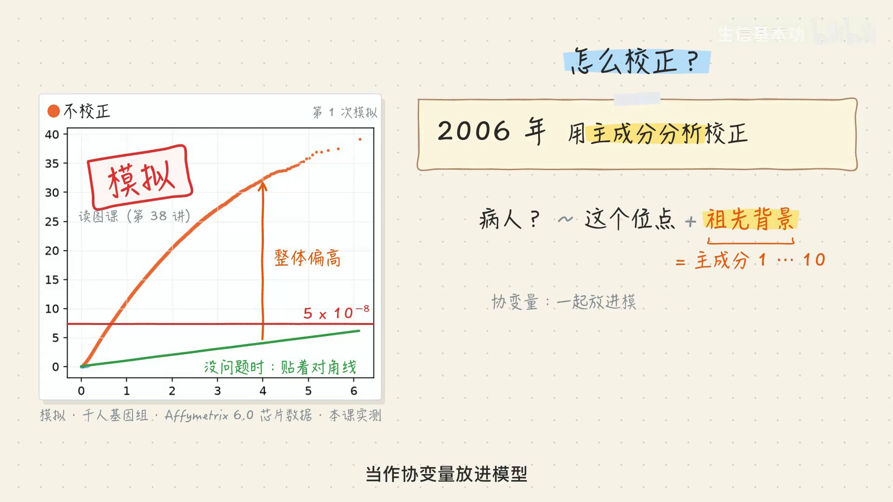
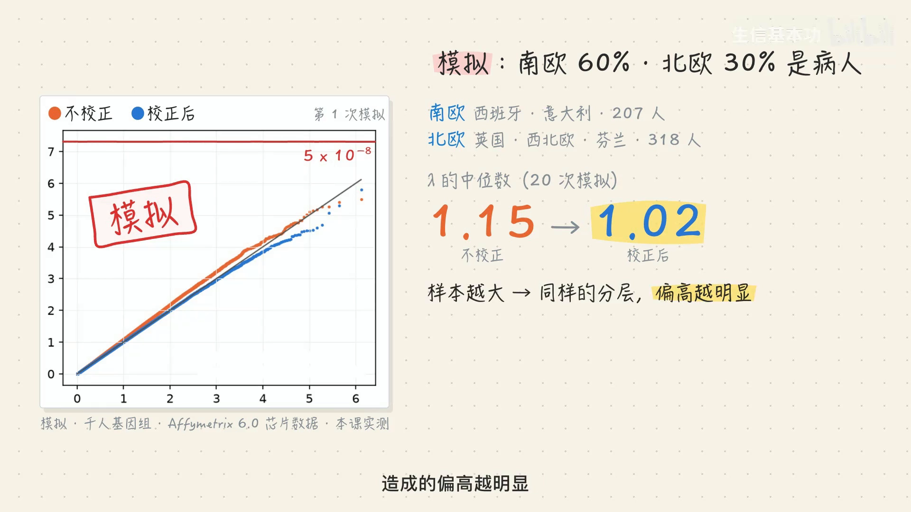
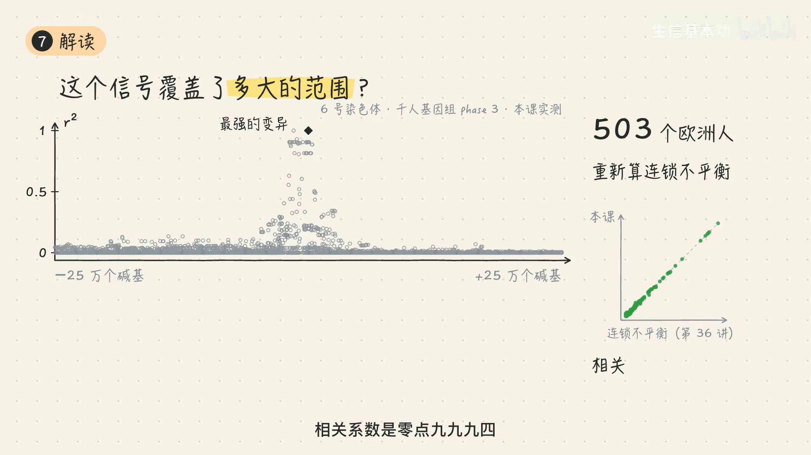
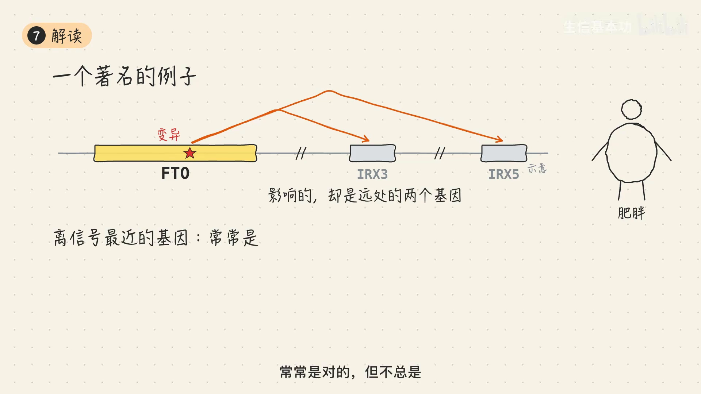
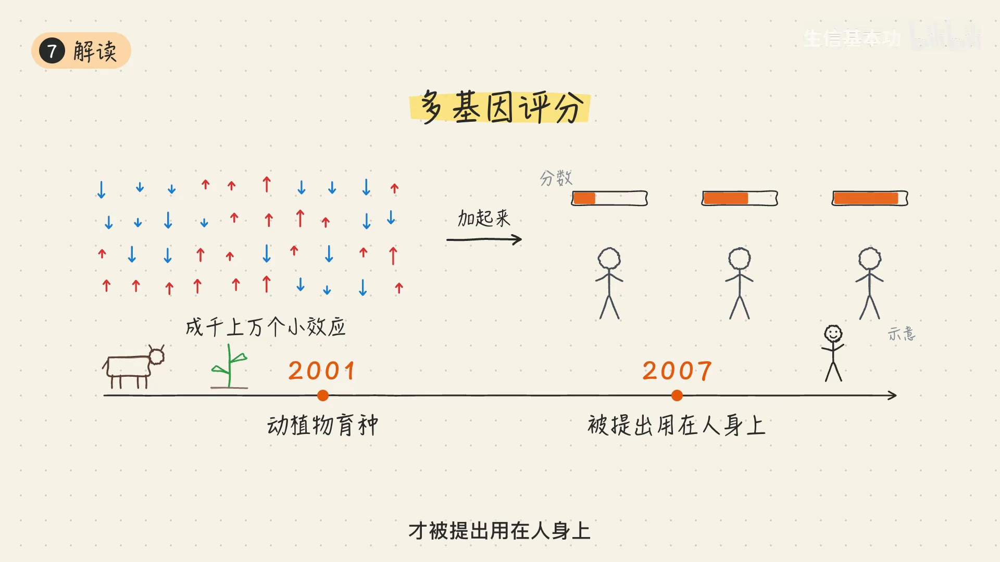

# 关联统计量与人群分层：GWAS 信号从哪里来，到哪里为止

> 视频来源：[生信入门 第47讲：群体遗传与GWAS｜零基础公开课](https://www.bilibili.com/video/BV1WhWQ67E5X/)（B 站 · 生信入门，33 分 27 秒）。本文依据该视频的 AI 字幕与画面整理，时间戳指向原片。字幕中的术语错拼（如「gwaas」「兰姆达」「哈温」「瓦伦德效应」）已按画面与通行写法订正；基因名 GAB2R1 / GABR R1 按上下文与基因注释统一为 GABRR1。
> 导读：这一讲用一份真实的糖尿病肾病 GWAS 和一份千人基因组芯片数据，把「关联」拆成效应量、P 值、显著线、人群分层和结果解读五件事。本文只取其中的概念部分；质控、填补与软件操作属于流程细节，不在本节展开。

## 本讲要解决的核心问题（SCQA）

**背景**：GWAS 的做法很直接：找一群病人、一群对照，在全基因组的每一个变异上比一比两组的等位基因频率，哪里差得多，哪里就可能和病有关。[【跳转到 04:10】](https://www.bilibili.com/video/BV1WhWQ67E5X/?t=250)

**冲突**：可结果一出来，麻烦也跟着来。最显著的位点常常不是真正的原因；病人和对照如果祖先背景不同，又会冒出海量假信号。一份 5717 人的研究，最强的信号 P 值是 $5.1\times10^{-7}$，连全基因组显著线都没过——它到底算不算「没关系」？[【跳转到 09:45】](https://www.bilibili.com/video/BV1WhWQ67E5X/?t=585)

**疑问**：关联统计量各自回答什么问题？显著线是怎么定的？为什么祖先背景能骗过检验？一个过了线的信号，离「因果变异」和「靶基因」还有多远？

**回答（中心思想）**：GWAS 给出的是一套**关联语言**：比值比说方向和大小，P 值说「在无关假设下这个结果有多难出现」，显著线控制的是全基因组多重检验。LD 让一个真实变异把邻居一起抬起来，人群分层则能让整张图一起抬高；前者靠精细定位和多人群收窄，后者靠主成分或混合模型校正。**一个信号是一段区域，不是一个基因；最近的基因不一定是靶基因。**

---

## 一、GWAS 在比较什么：两组人的等位基因频率

### 1.1 从一个人的变异，走到一群人的频率

上一讲从一个人的测序出发，在 100 万个碱基里找出了他的 2000 多个变异。这一讲换一个尺度：同一个位置上可能出现的不同字母叫**等位基因**；每个人在这个位置有两份，一份来自父亲、一份来自母亲，合起来叫**基因型**；一个等位基因在人群所有拷贝里占的比例，叫**等位基因频率**，少见的那一个叫**次要等位基因频率**。[【跳转到 00:25】](https://www.bilibili.com/video/BV1WhWQ67E5X/?t=25)

GWAS 就是把「一个人有没有这个字母」换成「一群人里这个字母占多少」，再比较病人组和对照组。它不追踪家系，也不直接测功能，只问一件事：**这个位点的字母频率，在两组人之间差得够不够大。**

### 1.2 比值比：效应量的方向与大小

比较的结果常用**比值比**（odds ratio，OR）表示：

- OR $>1$：带这个等位基因的人更常出现在病人里；
- OR $<1$：带这个等位基因的人更常出现在对照里；
- OR $=1$：两组没有差别。[【跳转到 04:35】](https://www.bilibili.com/video/BV1WhWQ67E5X/?t=275)

OR 回答的是「效应有多大、朝哪个方向」，但它不是「带这个字母就一定得病」的概率。一个 OR 很小的位点，如果样本足够大、P 值足够小，仍然可能过显著线；反过来，OR 很大但样本很小，也可能过不了线。**效应量和显著性是两个维度**，读结果时要分开看。

### 1.3 一个里程碑：CFH 与 7.4 倍

2005 年 4 月，一项老年黄斑变性的研究只用了 96 个病人、50 个对照，测了 11 万多个变异，在 CFH 基因里找到了一个信号：两份都带风险等位基因的人，比值比是 7.4。研究者再测序，又在附近找到一个改变氨基酸的变异，和它紧密连锁。这项研究常被当做第一个里程碑式的 GWAS。[【跳转到 05:00】](https://www.bilibili.com/video/BV1WhWQ67E5X/?t=300)

它能这么做，靠的是 HapMap：2005 年在四个人群、269 份样本里测了 100 多万个变异，发现基因组是一块一块遗传的，测一部分就能推出其余。2007 年英国的一个联合项目，七种常见病每种大约 2000 个病人，共用大约 3000 个对照，一次找到了 24 个信号。[【跳转到 05:25】](https://www.bilibili.com/video/BV1WhWQ67E5X/?t=325)

注意 CFH 这个故事里已经埋了本节的伏笔：**最显著的 SNP 本身不改变蛋白质；真正改变氨基酸的变异，是后来在附近测序找到的。** 关联信号先到，因果解释后到。

---

## 二、P 值与全基因组显著线：一条人为约定的线

### 2.1 P 值回答什么

每个被检验的变异都会得到一个 P 值。可以把它理解成：**如果这个位点其实和性状无关，出现当前这么强（或更强）的关联有多难。** P 值越小，越难用「无关」来解释；但它不是「无关的概率」，也不直接告诉你效应有多大。

曼哈顿图把每个变异的 $-\log_{10}(P)$ 画在纵轴上：P 值越小，点越高。所以「点高」只说明统计上更难用偶然解释，**不说明对疾病的影响大**。[【跳转到 00:15】](https://www.bilibili.com/video/BV1LUp162EV1/?t=15)

### 2.2 $5\times10^{-8}$ 从哪来

一次 GWAS 要检验几十万到几百万个变异。如果每个都按 $P<0.05$ 判断，假阳性会多到无法收拾。通行的全基因组显著线是：

$$
P < 5\times10^{-8}
$$

它的来历很朴素：在欧洲人的基因组里，一次全基因组扫描大约相当于 **100 万次独立的检验**；把总体假阳性控制在 0.05，均摊到 100 万个检验上，就是 $0.05/10^6=5\times10^{-8}$。它是一个**约定**，不是自然常数。[【跳转到 05:50】](https://www.bilibili.com/video/BV1WhWQ67E5X/?t=350)

这条线也不是放之四海而皆准：

- 非洲人群的基因组更多样，大约相当于两倍的独立检验，门槛要更严；
- 稀有变异的检验次数和频率结构不同，门槛也要更严；
- 不同研究设计、不同人群，适用性会有差别。

### 2.3 没过线不等于没关系：功效与样本量

视频里那份糖尿病肾病 GWAS，发现阶段 3345 个病人、2372 个对照，一共 5717 人，全是欧洲人。最强的信号 OR 是 0.83；如果这就是真实效应，这项研究过线的机会只有 **23%**——大约四次里才有一次。要有 80% 的把握，大约需要 1 万 290 人，是发现阶段的 1.8 倍。在这个频率上，这个样本量有八成把握能检出的最小效应，OR 大约是 1.27。[【跳转到 09:20】](https://www.bilibili.com/video/BV1WhWQ67E5X/?t=560)

所以「没过线」要分两种读法：一种是效应真的接近 1，另一种是**样本太小、功效不够**。视频里这份数据最强的 P 是 $5.1\times10^{-7}$，没过线；讲者判断这更可能是人不够多，而不是没有关系。[【跳转到 09:45】](https://www.bilibili.com/video/BV1WhWQ67E5X/?t=585)

反过来，刚好擦线的信号也不一定是假的：一项统计发现，26 个擦线的关联后来有 19 个在更大的研究里过了线。到今天，专门收集这些结果的 GWAS Catalog 收录了大约 7800 篇论文、120 万条左右的关联。[【跳转到 06:15】](https://www.bilibili.com/video/BV1WhWQ67E5X/?t=375)

---

## 三、显著位点只解释一小部分：消失的遗传力

2008 年，身高研究只找到 40 个显著的位点，加起来只能解释大约 5% 的遗传力。同一年《自然》的一篇新闻特写把这个缺口叫做「消失的遗传力」，第二年的一篇综述让它成了整个领域的课题。[【跳转到 06:40】](https://www.bilibili.com/video/BV1WhWQ67E5X/?t=400)

答案后来渐渐清楚：2010 年有人把所有常见变异放在一起算，能解释 45% 的身高差异。**遗传力大多没有消失，而是分散在成千上万个效应很小的位点上。** 2022 年一项 540 万人的研究找到了 1 万 2000 多个独立的位点，在欧洲人里能解释 40% 的身高差异，在其他人群里只有 10% 到 20%。[【跳转到 07:05】](https://www.bilibili.com/video/BV1WhWQ67E5X/?t=425)

这件事对读 GWAS 很重要：**显著位点列表不是遗传力的全部。** 一个性状可能由很多个小效应的位点共同决定；只盯着最显著的那几个，会低估遗传贡献，也会误以为「没找到就是没有」。

---

## 四、人群分层：祖先背景怎样造出成千上万个假信号

### 4.1 皮马人的免疫球蛋白标记

1988 年，一项研究调查了 4920 位皮马人和帕帕戈人：一种免疫球蛋白上的标记和二型糖尿病负相关，带这个标记的人患病率只有不带的人的 0.27 倍。听起来像一个保护因素。可研究者发现，这个标记其实是**混入了欧洲血统的标志**；在这个人群里，欧洲血统多的人糖尿病本来就少，真正起作用的是祖先背景。[【跳转到 17:06】](https://www.bilibili.com/video/BV1WhWQ67E5X/?t=1026)

这就是**人群分层**（population stratification）：病例组和对照组的祖先构成不同，而祖先不同又带来全基因组范围的等位基因频率差异。于是任何一个「标记了祖先来源」的位点，都会看起来和疾病相关。

### 4.2 筷子基因：一个思想实验

有人打过一个比方，叫「筷子基因」：如果拿一群东亚人和一群欧洲人比较会不会用筷子，一定能找到大量和用筷子相关的变异；可这些变异只是标记了祖先来自哪里。[【跳转到 17:31】](https://www.bilibili.com/video/BV1WhWQ67E5X/?t=1051)

视频用真实基因型模拟了一次：515 个东亚人、525 个欧洲人，随机给东亚人里 70% 标上病人，欧洲人里 30% 标上病人。注意，**没有任何一个位点真正影响这个病**。[【跳转到 17:56】](https://www.bilibili.com/video/BV1WhWQ67E5X/?t=1076)

不做任何校正，$\lambda$ 是 **25.17**。排在最前面的，全是东亚人和欧洲人之间频率差最大的位点。[【跳转到 18:20】](https://www.bilibili.com/video/BV1WhWQ67E5X/?t=1100)

### 4.3 $\lambda$ 与 QQ 图：整体偏高了多少

$\lambda$（基因组膨胀因子）衡量的是**检验结果整体偏高了多少**：没有系统偏差时应该接近 1；大于 1 说明 P 值整体偏小，小于 1 说明偏保守。

QQ 图把这件事画出来：横轴是「如果没有关联，P 值应该是什么分布」的期望值，纵轴是实际观察到的 $-\log_{10}(P)$。没有问题时，点应该贴着对角线；如果整条线从很早开始就抬起来、跑到对角线上方，说明有系统性的假阳性——人群分层就是最常见的原因之一。[【跳转到 18:25】](https://www.bilibili.com/video/BV1WhWQ67E5X/?t=1105)

### 4.4 校正：主成分与混合模型

怎么校正？2006 年有人提出用**主成分分析**（PCA）：把每个人的祖先背景压缩成几个主成分，当作协变量放进模型，问的是「在祖先背景相同的人内部，这个位点还和病有关吗」。[【跳转到 18:25】](https://www.bilibili.com/video/BV1WhWQ67E5X/?t=1105)

在这 2660 个互不相关的人里，第一个主成分把非洲人群和其他人分开，第二个把东亚和欧洲分开。放进前十个主成分以后，$\lambda$ 降到 **1.010**，一个假阳性也没有了。再加一个真正的致病位点（OR 约为 2），不校正时它排在二十多万名，淹没在假信号里；校正以后它排第三，二十次模拟里没有一次出现假阳性。[【跳转到 18:50】](https://www.bilibili.com/video/BV1WhWQ67E5X/?t=1130)

分层不只在洲际之间。基因型的主成分几乎画出了一张欧洲地图：芬兰人自成一群，意大利和西班牙的人在一头，西北欧和英国的人在另一头。南北欧之间的差异只有东亚和欧洲之间的大约 1/27，但样本一大，它照样能把 $\lambda$ 抬起来：模拟南欧 60%、北欧 30% 是病人，不校正 $\lambda$ 的中位数是 1.15，校正以后降到 1.02。[【跳转到 19:15】](https://www.bilibili.com/video/BV1WhWQ67E5X/?t=1155)

另一种办法是**混合模型**：把每两个人之间的亲缘程度都放进去。它最早用在玉米育种上；肾病研究的 P 值就是用这类模型算的，所以它可以保留亲属，不必把有亲缘关系的样本全部删掉。[【跳转到 20:10】](https://www.bilibili.com/video/BV1WhWQ67E5X/?t=1210)

### 4.5 $\lambda$ 偏高不一定是分层

反过来也要小心：如果一个性状真的由成千上万个小效应的位点决定，$\lambda$ 本来就会偏高。2015 年的 LD 分数回归就是用来区分「分层造成的膨胀」和「多基因遗传结构造成的膨胀」的。视频里这份肾病数据 $\lambda$ 在 0.977 到 1.024 之间，没有明显的偏高。[【跳转到 20:35】](https://www.bilibili.com/video/BV1WhWQ67E5X/?t=1235)

所以 $\lambda$ 是一个**信号**，不是判决书：要结合 QQ 图形状、研究设计、人群构成和 LD 分数回归一起读。

---

## 五、一个信号是一段区域，不是一个基因

### 5.1 42 个变异，2.26 万碱基

过了显著线，下一步不是「找到致病位点」，而是「这个信号覆盖了多大的范围」。视频用 503 个欧洲人重新算了 LD：和最强变异 $r^2$ 在 0.8 以上的，一共 **42 个变异**，跨了 **2 万 2600 个碱基**。这 42 个里谁是真正起作用的，**统计上分不开**。[【跳转到 25:13】](https://www.bilibili.com/video/BV1WhWQ67E5X/?t=1513)

这段区域里只有一个基因 GABRR1，离最强的变异 3725 个碱基，编码一种 γ-氨基丁酸受体的亚基；往外 10 万个碱基以内还有三个基因，25 万个碱基以内一共八个编码蛋白质的基因。[【跳转到 25:38】](https://www.bilibili.com/video/BV1WhWQ67E5X/?t=1538)

### 5.2 最近的基因不一定是靶基因

「最近的基因就是起作用的基因吗？」不一定。最著名的例子是 FTO：和肥胖相关的变异就在 FTO 基因里面，后来发现它们影响的却是远处的另外两个基因 IRX3 和 IRX5。[【跳转到 26:03】](https://www.bilibili.com/video/BV1WhWQ67E5X/?t=1563)

统计上，离信号最近的基因**常常**是对的：身高研究里，包含已知骨骼生长基因的位点中，有 13 个的最近基因正好是对的。但它不总是对，所以「最近」只能当线索，不能当结论。

### 5.3 eQTL：表达关联能补什么、不能补什么

还有什么证据？一种是**表达数量性状位点**（eQTL）：看这个变异会不会改变附近基因的表达。GTEx 项目在很多种人体组织里同时测了基因型和基因表达。视频里这个变异在九种组织里影响 GABRR1 的表达；在大多数组织里，C 等位基因让它表达更高，而 C 等位基因又和更低的肾病风险一起出现。[【跳转到 26:53】](https://www.bilibili.com/video/BV1WhWQ67E5X/?t=1613)

听起来很顺，但有两个问题：

1. **组织不对。** 这九种组织里没有一种是肾；最强的在颈动脉。颈动脉里它还影响另外几个基因，比如 SRSF12 和 PM20D2。
2. **相关不等于因果。** eQTL 说明「这个变异和表达有关」，不说明「表达变化导致了疾病」。很多信号落在非编码区，可能通过远处的增强子影响别的基因。

附近还有一个基因 RRAGD，离这里 12 万 9000 多个碱基；它的突变会造成一种肾小管疾病，听起来很像肾病基因。可没有任何证据把它和这个信号连起来。**听起来合理，不是证据。** 所以哪个基因真正起作用，现有的证据回答不了。[【跳转到 27:18】](https://www.bilibili.com/video/BV1WhWQ67E5X/?t=1638)

---

## 六、关联结果能拿来做什么：多基因评分及其边界

把成千上万个小效应加起来，给每个人打一个分，就是**多基因评分**（polygenic score）。这个主意最早来自动植物育种，2001 年提出，2007 年才被用在人身上。[【跳转到 28:08】](https://www.bilibili.com/video/BV1WhWQ67E5X/?t=1688)

2018 年的一项研究说，8% 的人冠心病风险达到三倍以上。可这些评分在欧洲血统的人身上要准好几倍，因为大多数 GWAS 做的都是欧洲人；多基因风险评分大多建在欧洲人群上，跨人群预测会变差。这既是科学问题，也是公平问题。[【跳转到 28:33】](https://www.bilibili.com/video/BV1WhWQ67E5X/?t=1713)

---

## 七、边界：这一节不展开什么

- **不展开质控与填补的操作细节**：样本检出率、性别核对、哈代-温伯格检验、芯片填补、参考面板选择，视频里都有，但它们属于 GWAS 流程，不是本节要建立的关联判读能力。这里只保留一个结论：**每一条规则都要选对参照的人群；填补靠 LD 和参考人群，常见变异补得好，稀有变异差。**
- **不展开完整 GWAS 软件操作**：PLINK、TASSEL、SAIGE 等工具的命令与参数不在本节范围。
- **不展开临床判读**：一个变异在病人身上意味着什么、如何结合家系与功能证据做致病性判断，见 [§4.2.6 变异致病性证据](../../../README.md#b02-4-2-6)。
- **不重复 LD 的定义与度量**：$D$、$D'$、$r^2$、单倍型、相位与重组，见 [§4.1.6 连锁与单倍型](../../../README.md#b02-4-1-6)。
- **不展开遗传力估计**：SNP 遗传力、双胞胎设计、遗传相关，见 [§4.1.7 遗传力与数量遗传基础](../../../README.md#b02-4-1-7)。

---

## 小结

1. **GWAS 比较的是频率**：病人组和对照组的等位基因频率差；OR 说方向和大小，P 值说「无关假设下这个结果有多难出现」。
2. **显著线是约定**：$5\times10^{-8}$ 来自「约 100 万次独立检验、总体假阳性 0.05」，人群和变异频率会改变它的适用性。
3. **没过线有两种可能**：真的没关系，或者样本太小、功效不够。擦线信号也值得在更大研究里复核。
4. **显著位点只解释一小部分**：大多数复杂性状由很多小效应位点共同决定，「消失的遗传力」分散在全基因组里。
5. **人群分层能造出大量假阳性**：祖先背景不同会让整张 QQ 图抬高、$\lambda$ 远大于 1；主成分和混合模型可以校正。
6. **$\lambda$ 偏高不一定是分层**：多基因遗传结构也会抬高 $\lambda$，要结合 QQ 形状和 LD 分数回归读。
7. **信号是一段区域**：LD 让一个真实变异把邻居一起抬起来；精细定位给的是候选集合，不是因果判决。
8. **最近的基因不一定是靶基因**：FTO/IRX3/IRX5 是经典反例；eQTL 能补表达证据，但组织、方向和因果都要另证。

## 关键术语速查

| 术语 | 一句话解释 |
| --- | --- |
| 等位基因频率 | 一个等位基因在人群所有拷贝里占的比例。 |
| 比值比（OR） | 病人组与对照组中某个等位基因的比值之比；$>1$ 表示在病人里更常见，$<1$ 表示在对照里更常见。 |
| P 值 | 在「这个位点与性状无关」的假设下，出现当前或更强关联的概率；越小越难用偶然解释。 |
| 全基因组显著线 | 控制全基因组多重检验的 P 值门槛，常用 $5\times10^{-8}$。 |
| 统计功效 | 真实存在效应时，研究能把它检出来的概率；样本越大、效应越大，功效越高。 |
| 人群分层 | 病例与对照的祖先构成不同，导致全基因组范围的频率差异和假阳性。 |
| $\lambda$（基因组膨胀因子） | 检验结果整体偏高程度的指标；无系统偏差时接近 1。 |
| QQ 图 | 把观察到的 $-\log_{10}(P)$ 对期望值作图；贴对角线表示没有整体膨胀。 |
| 主成分分析（PCA） | 把祖先背景压缩成少数几个连续变量，作为协变量放进关联模型。 |
| 混合模型 | 把样本两两之间的亲缘程度放进模型，校正群体结构和亲缘关系。 |
| 表达数量性状位点（eQTL） | 与某个基因表达水平相关的遗传变异。 |
| 多基因评分 | 把许多小效应位点加权求和，得到个体的遗传倾向分数。 |