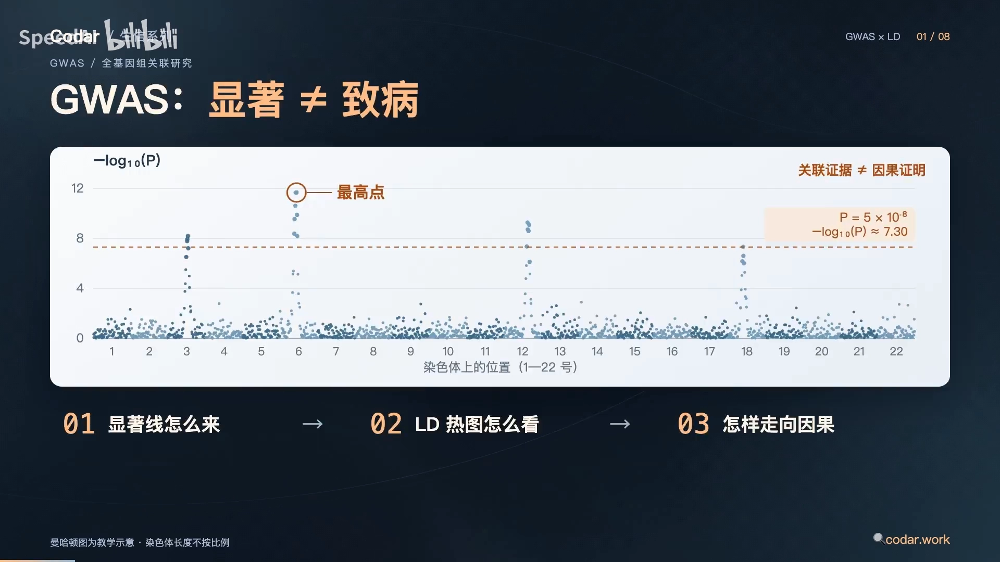
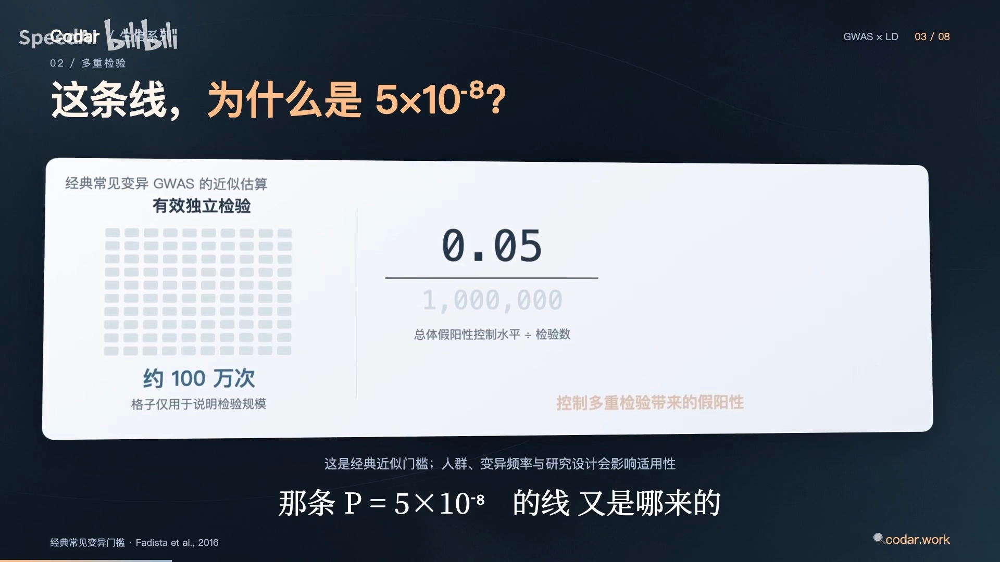
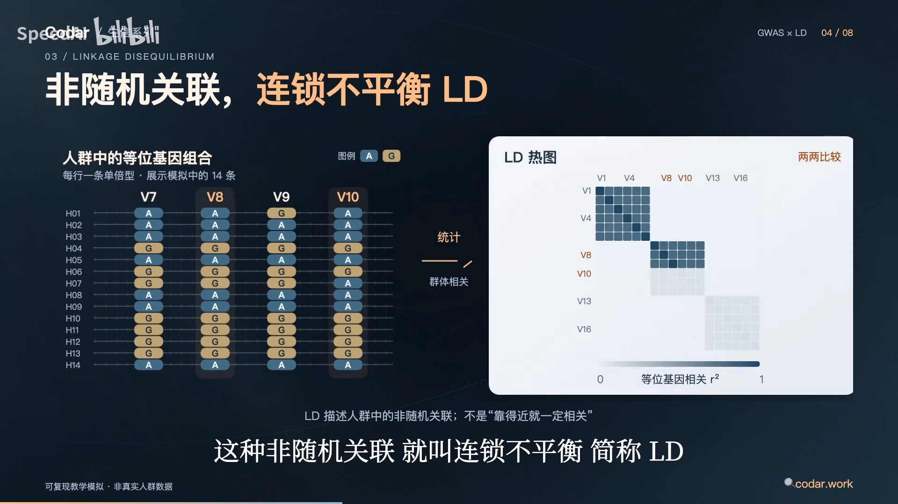
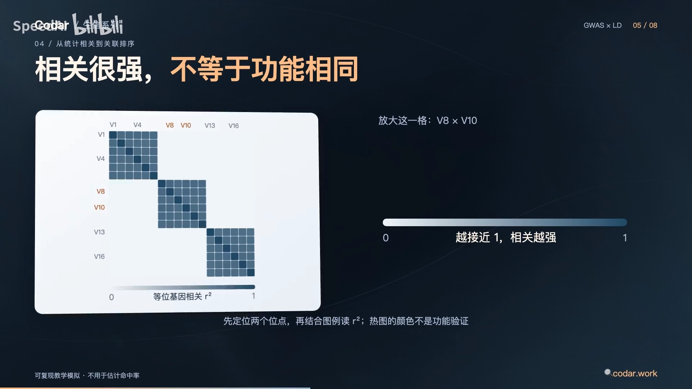
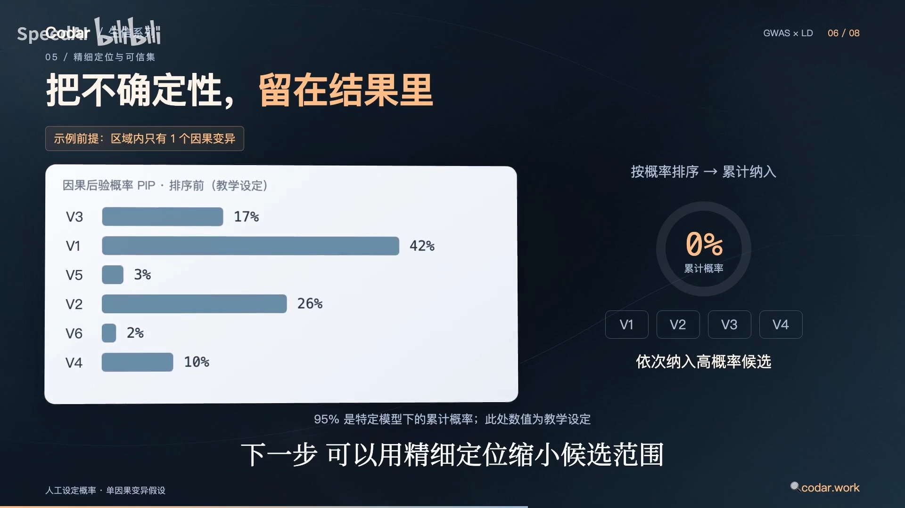
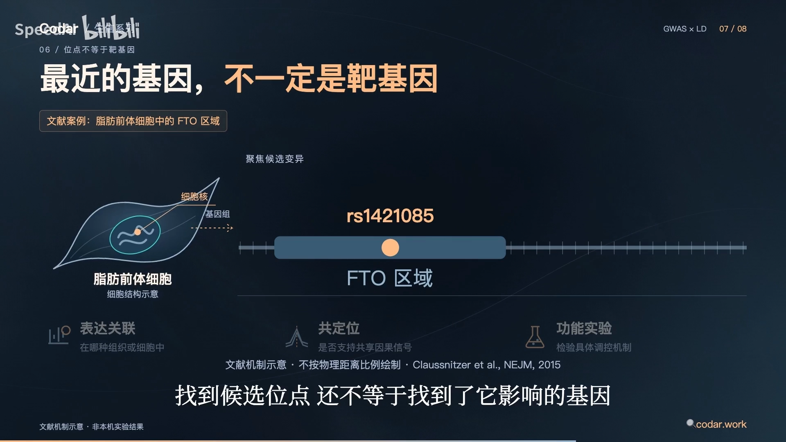

# 曼哈顿图与精细定位：高点、显著线与可信集

> 视频来源：[【生信图解01｜GWAS 最显著的位点，就是致病位点吗？】](https://www.bilibili.com/video/BV1LUp162EV1/)（B 站 · SpeedAI，2 分 14 秒）。本文依据该视频的 AI 字幕与画面整理，时间戳指向原片。字幕中的「RX5」按画面与通行基因名订正为 IRX5。
> 导读：这是一支两分钟的图解，把「显著线、连锁不平衡、从关联走向因果」三件事串起来。它不教软件操作，只回答一个问题：看到曼哈顿图上最高的那个点，能不能直接说它就是致病位点。

## 本讲要解决的核心问题（SCQA）

**背景**：GWAS 的结果常画成一张曼哈顿图：横轴是染色体位置，纵轴是 P 值的负对数，每个点是一个被检验的遗传变异。[【跳转到 00:10】](https://www.bilibili.com/video/BV1LUp162EV1/?t=10)

**冲突**：图上最高的点最显眼，很多人自然把它当成「致病位点」。可它常常只是真正原因旁边的一个邻居；有时连它所在的基因都不是真正起作用的基因。

**疑问**：曼哈顿图该怎么读？那条显著线是怎么来的？为什么附近会有一簇点一起升高？从「一片信号」到「一个候选变异」，再到「一个靶基因」，中间还差什么？

**回答（中心思想）**：**点高只说明 P 值小，不说明效应大；过显著线只说明难用偶然解释，不说明已经证明因果；附近一簇点一起升高，是连锁不平衡（LD）把邻居一起抬了起来。** 从信号到候选变异要靠精细定位的可信集，从候选变异到靶基因还要靠表达关联、共定位和功能实验。

---

## 一、曼哈顿图：每个点是一个被检验的变异

### 1.1 横轴是位置，纵轴是 $-\log_{10}(P)$

曼哈顿图的读法只有两条：

- **横轴**：变异在基因组上的位置，通常按染色体 1、2、3……依次排开；
- **纵轴**：P 值的负对数，$-\log_{10}(P)$。

所以点越高，P 值越小。$P=10^{-8}$ 对应纵轴 8，$P=10^{-12}$ 对应纵轴 12。[【跳转到 00:15】](https://www.bilibili.com/video/BV1LUp162EV1/?t=15)

### 1.2 点高不等于效应大

这是最容易混淆的一点：**纵轴高只说明「在无关假设下这个结果很难出现」，不说明这个变异对疾病的影响大。** 点高只告诉你 P 值小，它不告诉你 OR 有多大、朝哪个方向。[【跳转到 00:15】](https://www.bilibili.com/video/BV1LUp162EV1/?t=15)

所以读图时要同时看两件事：**统计显著性**（点多高）和**效应量**（OR 多大、方向如何）。曼哈顿图只负责前者。

---

## 二、显著线 $5\times10^{-8}$：控制的是多重检验

### 2.1 100 万次有效独立检验

一次 GWAS 要检验几十万到几百万个变异。如果每个都按 $P<0.05$ 判断，假阳性会多到无法收拾。常见变异的全基因组研究，经典估算大约相当于 **100 万次有效独立检验**；把总体假阳性控制在 0.05，均摊到 100 万个检验上：

$$
P < \frac{0.05}{1{,}000{,}000} = 5\times10^{-8}
$$

这条线是为了控制多重检验带来的假阳性，不是自然常数。[【跳转到 00:23】](https://www.bilibili.com/video/BV1LUp162EV1/?t=23)

### 2.2 过线不等于致病

**过了显著线，只说明这个位点与性状的关联很难用偶然解释；它没有证明这个位点导致疾病。** 关联可能来自真正的因果变异，也可能来自与因果变异高度 LD 的邻居；抽样波动还可能让邻居的 P 值比真正的原因更小。[【跳转到 00:31】](https://www.bilibili.com/video/BV1LUp162EV1/?t=31)

显著线是一道**过滤门槛**，不是一纸**因果判决**。

---

## 三、为什么附近一簇点一起升高：连锁不平衡

### 3.1 LD：等位基因的非随机搭配

曼哈顿图上，一个信号很少是孤零零的一个尖峰，常常是一簇点一起升高。原因是**连锁不平衡**（linkage disequilibrium，LD）：一些位点的等位基因在人群中经常以特定组合一起出现，这种非随机关联就叫 LD。[【跳转到 00:41】](https://www.bilibili.com/video/BV1LUp162EV1/?t=41)

所以一个真正影响性状的变异，可能让与它相关的邻居也显示出关联信号。邻居本身不致病，只是因为和原因绑在一起，被一起检验出了关联。[【跳转到 00:51】](https://www.bilibili.com/video/BV1LUp162EV1/?t=51)

### 3.2 相关强不等于功能相同

LD 热图里每一格是在比较两个位点。如果图例用的是 $r^2$，数值越接近 1，说明它们的统计相关越强；**但这不等于两个位点的功能一样。** 一个位点可能在调控区、另一个在内含子，它们只是恰好绑在一起。[【跳转到 01:00】](https://www.bilibili.com/video/BV1LUp162EV1/?t=60)

抽样波动等因素还可能让邻居的 P 值比真正的原因更小。这就是为什么**最高的点不一定是因果变异**。[【跳转到 01:12】](https://www.bilibili.com/video/BV1LUp162EV1/?t=72)

---

## 四、精细定位：把不确定性留在结果里

### 4.1 后验概率与 95% 可信集

下一步可以用**精细定位**（fine-mapping）缩小候选范围。做法不是「挑第一名」，而是：

1. 先假设这段区域只有一个因果变异；
2. 按模型算出每个变异是因果变异的概率（后验概率，PIP）；
3. 按概率从高到低排序，依次纳入，直到累计概率达到至少 **95%**；
4. 这一组变异就是**可信集**（credible set）。[【跳转到 01:18】](https://www.bilibili.com/video/BV1LUp162EV1/?t=78)

### 4.2 可信集不是「致病印章」

要特别注意两点：

- **可信集是特定模型下的候选集合**，不是给集合里每个位点盖了「致病」的章；
- **它假设区域内只有一个因果变异**。如果存在多个因果变异，分析方法也要相应调整。[【跳转到 01:18】](https://www.bilibili.com/video/BV1LUp162EV1/?t=78)

所以精细定位的产物是「一组值得继续查的候选」，而不是「一个已经确定的答案」。它把不确定性**留在结果里**，而不是假装消失。

---

## 五、候选位点不等于靶基因

### 5.1 FTO 的教训

找到候选位点，还不等于找到了它影响的基因。一个经典例子是 FTO 区域的肥胖相关信号：研究在脂肪前体细胞中发现，这里的一个变异可以影响更远处 IRX3 和 IRX5 的调控。[【跳转到 01:38】](https://www.bilibili.com/video/BV1LUp162EV1/?t=98)

所以判断靶基因不能只看谁离得近，还要结合：

- **相关组织中的表达关联**：这个变异在什么组织、什么细胞里和哪个基因的表达有关；
- **共定位**：性状信号和表达信号是否指向同一个因果变异；
- **功能实验**：改变这个位点，是否真的改变调控活性或表型。

### 5.2 三句话

视频最后把整支内容压缩成三句话：[【跳转到 01:59】](https://www.bilibili.com/video/BV1LUp162EV1/?t=119)

1. **点高不等于效应大。**
2. **最显著不等于已经证明因果。**
3. **离得近不等于就是靶基因。**

下次看到 GWAS 图，先读关联，再看证据。[【跳转到 02:04】](https://www.bilibili.com/video/BV1LUp162EV1/?t=124)

---

## 六、边界：这一节不展开什么

- **不展开 LD 的公式与算法**：$D$、$D'$、$r^2$ 的定义、单倍型、相位、重组与 LD 衰减，见 [§4.1.6 连锁与单倍型](../../../README.md#b02-4-1-6)。
- **不展开 GWAS 的完整统计模型**：效应量、P 值、显著线、人群分层与 QQ 图，见同节 [《关联统计量与人群分层》](./关联统计量与人群分层：GWAS信号从哪里来，到哪里为止.md)。
- **不展开精细定位的具体软件与先验设置**：本文只讲可信集的读法，不讲 FINEMAP、SusieR 等工具的参数。
- **不展开临床判读**：候选变异如何结合人群、家系、功能与临床证据做致病性判断，见 [§4.2.6](../../../README.md#b02-4-2-6)。

---

## 小结

1. **曼哈顿图**：横轴是位置，纵轴是 $-\log_{10}(P)$；点高只说明 P 小，不说明效应大。
2. **显著线**：$5\times10^{-8}$ 来自「约 100 万次独立检验、总体假阳性 0.05」，是过滤门槛，不是因果判决。
3. **LD 让信号成片**：一个真实变异会把邻居一起抬起来；$r^2$ 高只说明统计相关强，不说明功能相同。
4. **精细定位给可信集**：按因果后验概率排序，累计到 95%；它是特定模型下的候选集合，不是致病印章。
5. **候选位点不等于靶基因**：FTO/IRX3/IRX5 说明「最近」只能当线索；还要表达关联、共定位和功能实验。
6. **三句话**：点高不等于效应大；最显著不等于已证明因果；离得近不等于就是靶基因。

## 关键术语速查

| 术语 | 一句话解释 |
| --- | --- |
| 曼哈顿图 | 把每个变异的 $-\log_{10}(P)$ 按基因组位置画出来的散点图。 |
| 全基因组显著线 | 控制全基因组多重检验的 P 值门槛，常用 $5\times10^{-8}$。 |
| 连锁不平衡（LD） | 人群中两个位点的等位基因非随机地一起出现。 |
| $r^2$ | 两个位点等位基因计数的相关系数平方，0–1；越接近 1，互相代表的能力越强。 |
| 精细定位 | 用统计模型给每个变异一个因果后验概率，并给出可信集。 |
| 可信集 | 在特定模型下，以一定累计概率（如 95%）包含因果变异的一组变异。 |
| 后验概率（PIP） | 在给定数据和模型下，某个变异是因果变异的概率。 |
| 共定位 | 检验性状关联信号与表达等分子信号是否指向同一个因果变异。 |