# 五类变异证据怎么用：人群频率、家系共分离、功能实验与计算预测

> 视频来源：[基于 ACMG/AMP 和 ClinGen 框架的临床遗传变异分类解读](https://www.bilibili.com/video/BV1rv4y137ZL/)（B 站 · Illumina 在线讲堂出生缺陷系列第四讲，讲者张博士，上海交通大学医学院附属国际和平妇幼保健院）｜时长约 47 分钟
> 本文按证据类别组织：人群频率、病例与家系、功能实验、表型、变异类型特异、计算预测，最后落到分类与重分析。判读框架本身（五级、基因—疾病关系、分类与临床解读的区别）见同节另一篇《变异分类不是临床诊断》。

## 本讲要解决的核心问题（SCQA）

**背景**：二代测序已经常规用于临床，全外显子组测序一次会产生 20 到 40 万个变异，全基因组测序接近 400 万个。

**冲突**：经过表型和基因型过滤，剩下的可能只有几十个甚至几个变异，但最后这一步必须人工判读。判读不是「看着像就写致病」，而是要回答：这个变异在人群中常见吗？在别的病人身上出现过吗？在这个家系里和疾病一起传吗？它真的破坏了基因产物吗？计算预测又说了什么？

**疑问**：这五类证据各自能证明什么、不能证明什么？它们怎么合成一个级别？

**回答（中心思想）**：每一类证据都只回答「偶然还是必然」「有没有功能后果」这两个问题的一部分。人群频率负责排除常见多态，病例与家系负责建立统计关联，功能实验负责证明变异本身造成损害，表型负责把基因和病人对上，计算预测只能提供支持性提示。**任何单一证据都不足以定性，判读是把它们的强度和方向加起来。**

## 一、先立框架：五个答案、26 条证据、三条游戏规则

### 1.1 五级分类像「好人—坏人」的光谱

讲者用了一个不恰当但好记的比喻：把变异简单叫「突变」或「SNP」，就像把人分成好人和坏人。指南把变异分成五类：

| 级别 | 比喻 | 含义 |
| --- | --- | --- |
| 致病（P） | 坏人 | 有充分证据支持致病 |
| 可能致病（LP） | 可能坏人 | 证据较强但未达致病 |
| 意义未明（VUS） | 犯罪嫌疑人 | 证据不足，既不能定罪也不能排除 |
| 可能良性（LB） | 可能好人 | 证据倾向良性 |
| 良性（B） | 好人 | 有充分证据支持良性 |

28 条证据项（现用 26 条，两条已弃用）按「方向 + 强度 + 流水号」命名：PVS1、PS1、PM2、PP3 是致病方向，BA1、BS1、BP4 是良性方向。判读就是把这些条款过一遍，得到证据组合，再映射到级别。例如「两个 PM + 两个 PP → 可能致病」就是最常见的组合之一。

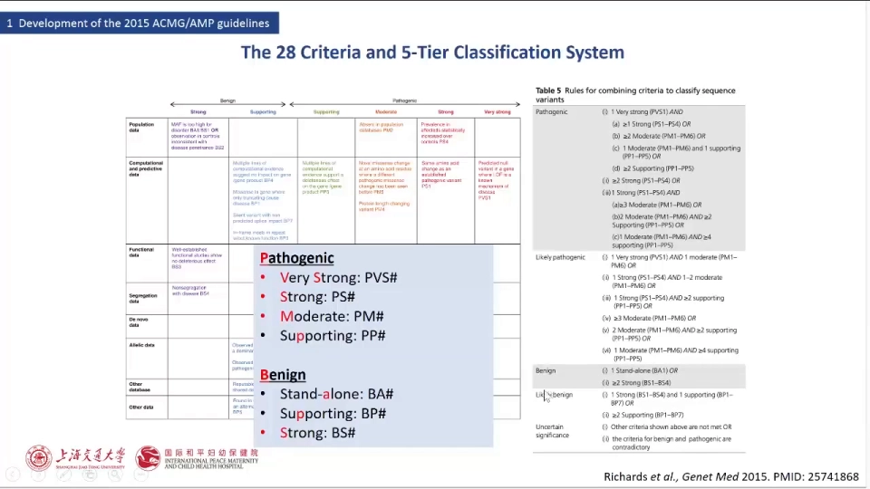

[【跳转到 04:48】](https://www.bilibili.com/video/BV1rv4y137ZL/?t=288)

### 1.2 三套指南的优先级

实际判读时手上有三套文件，优先级是：

1. 该基因／疾病对应的 **VCEP 专家组指南**（或相近疾病的工作组）；
2. **SVI** 的通用建议；
3. **2015 版 ACMG/AMP** 指南；
4. 实验室据此制定自己的标准并固定下来。

[【跳转到 10:14】](https://www.bilibili.com/video/BV1rv4y137ZL/?t=614)

如果基因不在任何专病工作组名单里，讲者的建议是：选一个最接近的专病组参考其阈值（例如代谢病参考 PAH 组），再结合 SVI 与 ACMG 制定本实验室标准。关键是**同一基因以后一直用同一套标准**，不能今天一套明天一套。

### 1.3 三条「游戏规则」

1. **基因—疾病关系是前提**：在临床意义未明的基因上检出的变异，报告时应始终写 VUS。ClinGen 的基因 curation 工作组把基因—疾病关系分成七级，级别直接限制变异分类的上限。
2. **优先级**：有专病组先用专病组，没有再用 SVI，最后用 2015 版。
3. **证据可升降级**：26 条证据的强度可以调整，命名方式是在原编号后加下划线和强度，例如 PP1_Moderate、PP1_Strong。

[【跳转到 10:44】](https://www.bilibili.com/video/BV1rv4y137ZL/?t=644)

### 1.4 判读流程的四个模块

把证据按来源分成四块，流程就清楚了：

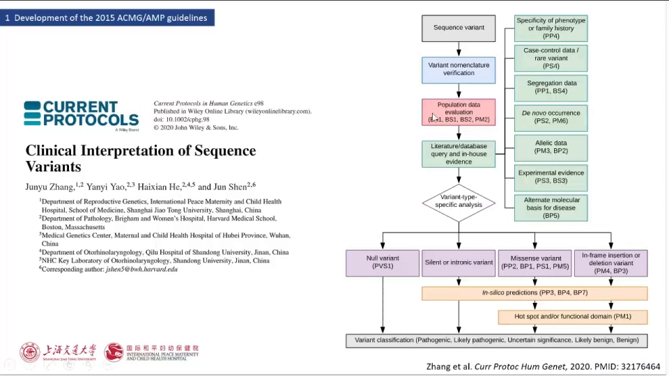

[【跳转到 08:17】](https://www.bilibili.com/video/BV1rv4y137ZL/?t=497)

- **人群数据**：BA1、BS1、BS2、PM2；
- **当前病例与已报道病例**：PS4、PM3、PP1、PS2/PM6、PP4；
- **变异类型特异**：PVS1（无功能）、PM4/BP3（整码插入缺失）、PP2/BP1（错义）等；
- **计算预测**：PP3、BP4、BP7、PM1。

这个分法的好处是能看出「哪些证据只适用于某类变异」：比如 PM1 只适用于错义变异和整码变异，PVS1 只适用于无功能变异。

## 二、人群频率：三个证据、两个口径

人群数据的逻辑最简单：**一个导致严重早发疾病的变异，不可能在人群中很常见**。所以频率高就是良性的强证据，频率极低只是「不反对致病」。

### 2.1 BA1：任一人群超过 5%

BA1 在 2018 年更新后的表述是：如果一个变异在**任何一个**超过 2000 个等位基因的大陆人群中频率超过 5%，且该基因没有对应的 BA1 修改，就可以用 BA1。

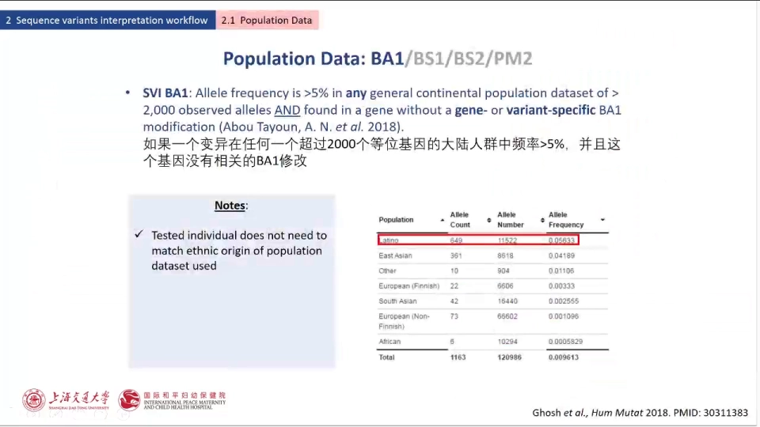

[【跳转到 11:33】](https://www.bilibili.com/video/BV1rv4y137ZL/?t=693)

这个例子很能说明「任一人群」的含义：总频率只有 0.96%，东亚人群 4.4%，都没过线，但拉丁人群 5.6% 过线了，BA1 就成立。因为一个变异如果在某个人群里常见到 5%，它不可能是这个人群里严重单基因病的原因。

注意两个例外：有些 VCEP 对 BA1 有自己的阈值，要按工作组来；SVI 还维护一个「频率大于 5% 但确实是致病变异」的列表，这些变异不能用 BA1。

### 2.2 BS1：频率超过疾病发病率的预期

BS1 比 BA1 温和：变异频率高于该疾病发病率所能容许的上限。这个上限不是拍脑袋，而是由**疾病发生率、遗传方式、外显率**共同决定，可以用在线小工具算出一个基因的最大可信人群频率。

[【跳转到 12:23】](https://www.bilibili.com/video/BV1rv4y137ZL/?t=743)

不同疾病的阈值差别很大。讲者举例：显性遗传耳聋和隐性遗传耳聋的 BS1 阈值不同，隐性耳聋还有一个 BS1_Supporting 的档位。这也解释了为什么不能拿一个通用百分比套所有基因。

### 2.3 PM2：罕见性只是支持证据

PM2 现在降为 PM2_Supporting，含义是「这个变异在人群中很罕见」。使用时要理解 gnomAD 这类数据库的性质：

- 它包含的是**普通人群**，不是「正常对照」；
- 普通人群里也会有迟发疾病患者和不完全外显的个体。

所以对隐性遗传病或晚发疾病，只要频率在合理容许范围内，PM2 就可以用，不强求「人群中完全看不到」；而对严重、完全外显、婴儿期就发病的疾病，才要求各个数据库里频率都是零。

[【跳转到 13:13】](https://www.bilibili.com/video/BV1rv4y137ZL/?t=793)

讲者在问答里又强调了一次：不同疾病的 PM2 阈值应该不一样，别拿「亚洲人小于 5%」这种单一阈值套所有基因。

## 三、病例与家系：三个「数数」的动作

这一块是判读里最重要、也最费人工的部分。讲者把它拆成三个动作：数先证者、数新发、数共分离。

### 3.1 数先证者：PS4

PS4 的原表述是「变异在患病人群中的频率显著高于正常对照人群」，现在可以拆成两条路径：

- **较常见的变异**（不符合 PM2）：做病例对照的统计，计算 OR 和置信区间；OR > 5.0 且置信区间合理时可用 PS4。
- **罕见变异**（符合 PM2）、显性／X 连锁遗传：直接数不相关的、表型一致的家系或先证者个数。

不同 VCEP 给出的计数阈值不同：

| 基因／疾病 | PS4_Supporting | PS4_Moderate | PS4 | PS4_Very Strong |
| --- | --- | --- | --- | --- |
| RASopathy | 1 | 3 | 5 | — |
| CDH1 | 1 | 2 | 4 | 16 |
| PTEN | 1 | 2 | 4 | 16 |
| 耳聋（显性） | 2 | 6 | 15 | — |
| MYH7 | 2 | 6 | 15 | — |
| RUNX1 | 1 | 2 | 4 | — |

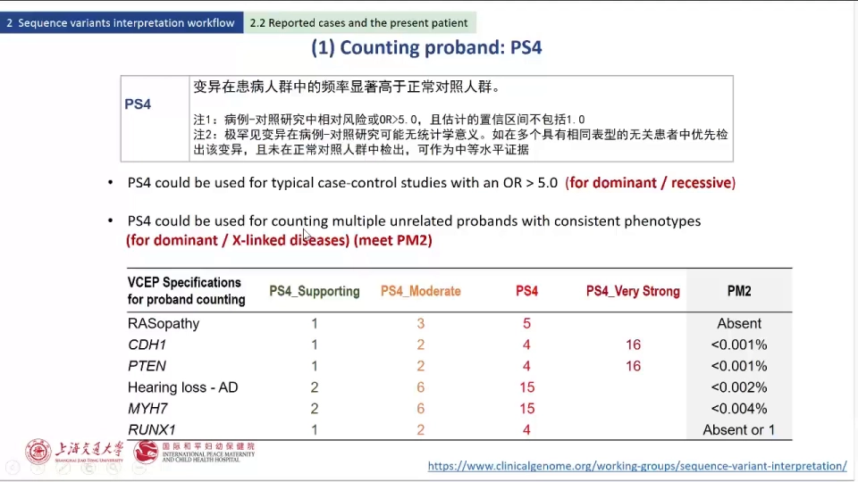

[【跳转到 15:31】](https://www.bilibili.com/video/BV1rv4y137ZL/?t=931)

这张表说明两件事：第一，**阈值是基因特异的**，不能跨基因套用；第二，强度之间的数量关系大致按指数增长（1、2、4、16），这与贝叶斯框架下「证据强度」的含义一致。

如果变异是隐性遗传且符合 PM2，就不能用 PS4 数先证者，而要改用 **PM3**（在反式位置上检出致病变异）。PM3 的用法 SVI 有专门文件。

### 3.2 数新发：de novo

对没有家族史的家庭，「父母正常、孩子携带」的新发变异是重要证据。SVI 也发布了详细使用说明，讲者没有展开，只提醒要区分亲缘关系是否已验证、表型是否特异。

### 3.3 数共分离：PP1

共分离的证据形式是「变异与疾病在家系中一起传递」。计数规则：

> 共分离次数 = 携带该变异的患病成员数 − 1（先证者不计入）

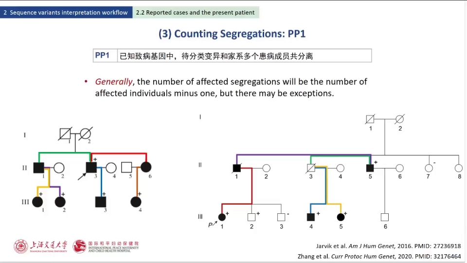

[【跳转到 16:58】](https://www.bilibili.com/video/BV1rv4y137ZL/?t=1018)

讲者特别讲了一个例外：右图这个家系有 5 个患者，共分离次数也是 5。因为第三个成员虽然没发病、也没做基因检测，但他连接了两个经基因检测确认携带变异的患者，所以计算时要把他算进去。这说明**共分离数的是「信息量」，不是简单的患者个数**。

数完次数后，用 LOD 值把「共分离」换算成统计支持度：

$$
Z\ (\mathrm{LOD}) = \log_{10}\left(\frac{1}{0.5^{\text{segregations}}}\right)
$$

这是显性遗传的公式；隐性遗传的分母换成 $0.25^{\text{affected}} \times 0.75^{\text{unaffected}}$。

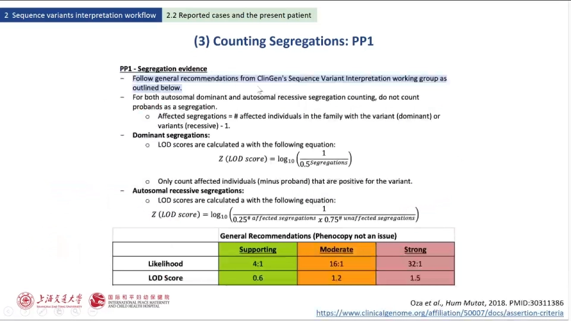

[【跳转到 17:57】](https://www.bilibili.com/video/BV1rv4y137ZL/?t=1077)

阈值是 LOD 0.6 / 1.2 / 1.5，分别对应 4:1、16:1、32:1 的似然比，也就是 Supporting / Moderate / Strong。为什么 4 次共分离只给 Moderate？因为 $0.5^4 = 1/16$，恰好是 16:1。

两个容易踩的坑：

- **多家庭比单家庭更有说服力**：同样是 4 次共分离、LOD 都是 1.2，如果来自不同家庭，可以达到 Strong；如果都在一个家庭里，只能 Moderate。2016 年那篇论文的计算方法就体现了这一点。
- **变异判读与基因 curation 的门槛不同**：显性遗传疾病，家系小于 4 次共分离时，在基因 curation 里不能计入；但在变异分析里，超过 2 次就可以计入。

[【跳转到 19:20】](https://www.bilibili.com/video/BV1rv4y137ZL/?t=1160)

## 四、功能证据：PS3 必须证明「是变异本身造成的」

这是全篇最容易被误用的一类证据。讲者用 GAA（酸性 α-葡萄糖苷酶，糖原贮积病 II 型的致病基因）举例：

- 如果测的是**患者外周血淋巴细胞**里的 GAA 活性 < 10%，这属于**基因水平**的生化检测，应该用 **PP4**（表型高度符合该基因相关疾病），而不是 PS3。
- 如果是**两盘细胞**，一盘转入野生型 GAA、一盘转入变异型 GAA，测到变异型那盘的活性低——因为两盘之间唯一的变量就是这个变异，这时才能用 **PS3**。

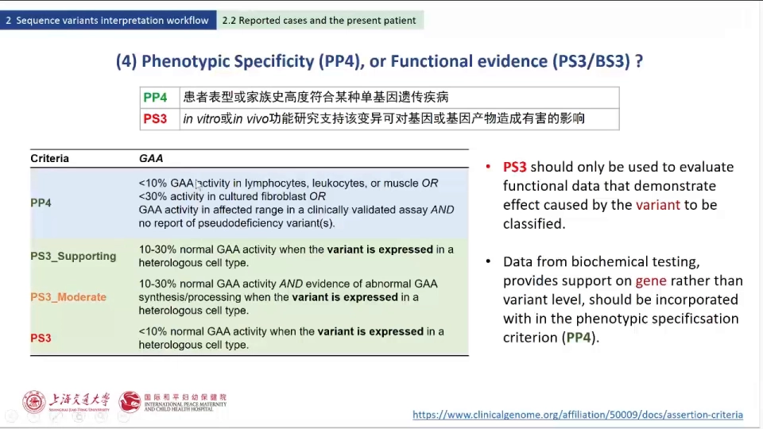

[【跳转到 20:43】](https://www.bilibili.com/video/BV1rv4y137ZL/?t=1243)

一句话总结：**PS3 评价的是「变异本身导致的功能改变」，患者身上的酶活、生化指标属于「基因／表型层面」的证据，归 PP4。** 两者经常在代谢病里被混用。

另外，SVI 在 2024 年初发布了 PS3 的详细使用流程（四大步骤），对功能实验的要求非常高。按这个流程，文献里报道的很多功能实验只能给到 PS3_Supporting。反过来，这个流程也可以用来设计实验：对照怎么设、对照变异选多少个，都有讲究。

[【跳转到 22:14】](https://www.bilibili.com/video/BV1rv4y137ZL/?t=1334)

## 五、表型证据：PP4 与共分离合并

PP4 说的是「患者表型高度符合某个基因相关的单基因病」。它的强度取决于：根据当前表型，拿到阳性基因检测结果的概率有多高。

讲者的例子是血友病：患者八因子检测不到，又做了 F8 的序列变异、拷贝数变异和特殊倒位检测，预期拿到 F8 诊断的可能性接近 100%，PP4 可以给到满分。

ClinGen 2024 年 6 月的更新建议把 PP1（共分离）和 PP4（表型特异）结合使用，因为「疾病与基因共分离」和「表型高度符合某个基因」在概念上密不可分。更新后的 PP1 不仅看患病成员携带变异，也看未患病成员不携带变异。

[【跳转到 13:12】](https://www.bilibili.com/video/BV1rv4y137ZL/?t=792)

## 六、变异类型特异：PVS1 要回答两个问题

PVS1 是无功能变异（无义、移码、经典剪接位点）的极强证据，但它有两个前提问题：

1. **loss of function 是不是这个基因的致病机制？**
2. **这个变异是不是真的导致 loss of function？**

### 6.1 第一个问题：基因对单倍剂量不足敏感吗

最快的办法是查 ClinGen 的基因 dosage curation 数据。比如某个耳聋基因，单倍剂量不足分数是 3 分，说明已有足够证据支持 LoF 是该基因的致病机制。

但只有 1000 多个基因做过 dosage curation，大多数基因查不到。这时可以借助 gnomAD 的 pLI 和 ExAC 的 HI index 预测，但**预测不可靠**：讲者举了一个基因，pLI 只有 0.03，看起来完全不像单倍剂量不足敏感，但查文献发现多篇报道支持它与单倍剂量不足、LoF 相关。所以遇到预测与文献冲突时，要回到文献判断，而不是看到 pLI 小就否定。

[【跳转到 24:52】](https://www.bilibili.com/video/BV1rv4y137ZL/?t=1492)

### 6.2 第二个问题：这个变异真的造成功能缺失吗

SVI 给出了一棵决策树。核心判断之一是 **NMD 逃逸**：基因最后一个外显子，以及倒数第二个外显子的最后 50 个碱基，这两个区域的终止密码子不会触发无义介导的 mRNA 降解（NMD）。

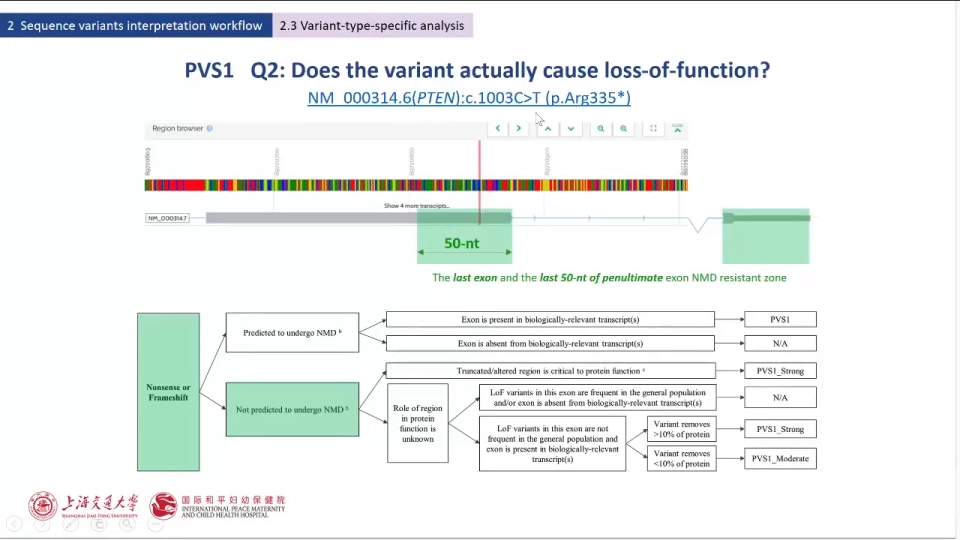

[【跳转到 26:27】](https://www.bilibili.com/video/BV1rv4y137ZL/?t=1587)

PTEN 的例子：变异位于倒数第二个外显子最后 50 个碱基内，预测不会发生 NMD，因此不能直接给 PVS1；但 PTEN 的专家指南指出最后一个外显子也含关键功能结构域，截断该区域仍然重要，最终给 **PVS1_Strong**。而且由于该基因在 curation 中关系明确，不需要再对强度做校正。

讲者提到 AutoPVS1 这类自动化工具：输入变异就能给出分步结果，但实际使用中发现有些结果不可靠，用于报告前必须人工复核。

[【跳转到 28:03】](https://www.bilibili.com/video/BV1rv4y137ZL/?t=1683)

## 七、计算预测：三类预测、一个自定阈值

计算预测分三个方向：

1. **错义变异预测**：SIFT、PolyPhen2、CADD、REVEL、ClinPred 等；
2. **剪接预测**：HSF、NNSplice、MaxEntScan、SpliceAI 等；
3. **核苷酸保守性预测**：GERP、PhastCons、PhyloP 等。

SVI 和专病组都建议用 **REVEL** 作为 PP3/BP4 的依据，但阈值各家不同：SVI 只对 PP3 设了阈值（> 0.75），BP4 还没有统一设定；耳聋工作组用 ≥ 0.7 / ≤ 0.15，LSD 用 > 0.75 / < 0.5。所以实验室必须自己定一套并固定使用。

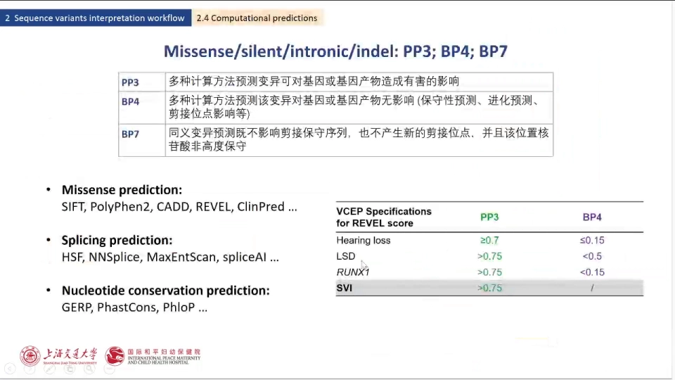

[【跳转到 29:14】](https://www.bilibili.com/video/BV1rv4y137ZL/?t=1754)

剪接预测里，SpliceAI 是近年表现较好的工具。另一条证据是 **PM1**（突变热点或关键功能域），但主观性很大：耳聋、胶原蛋白基因的 Gly-X-Y 高保守区、TP53、RUNX1 等，都是专家组已经明确规定可以使用 PM1 的区域。

对没有规定的基因，可以用**区域约束分数**：在 gnomAD 里选中 ExAC v1.0 后查看，分数越小越保守（例子里是 0.02）；DECIPHER 里也能查到同样的数据。此外 CCDS（约束性编码区）、MissCast（把变异映射到蛋白三维结构）等工具可以辅助判断关键位点。

[【跳转到 31:24】](https://www.bilibili.com/video/BV1rv4y137ZL/?t=1884)

## 八、收口：分类、重分析与报告更新

四类证据收集完，流程的最后一步是把证据组合成五级分类。

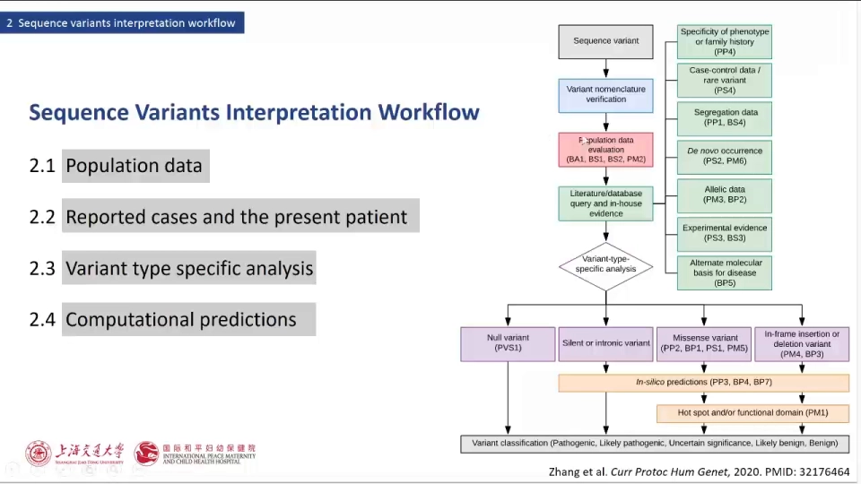

[【跳转到 33:11】](https://www.bilibili.com/video/BV1rv4y137ZL/?t=1991)

但分类不是终点。指南在更新、人群数据库在更新、新的病例报道随时出现，所以需要**重分析**。

### 8.1 什么时候启动重分析

- 实验室定期重分析（ClinGen 要求 LP 和 VUS 至少每两年一次；LB 在人群数据库更新后也应重分析）；
- 医生或患者要求；
- 之前分类不明确的变异有了新病例报道，或实验室新病例中检出了以前未分类的变异；
- 人群数据库（如 gnomAD 大版本更新）或解读指南更新；
- **临床决策之前**（产前诊断、PGD 等）；
- 受检者或家族成员出现新表型。

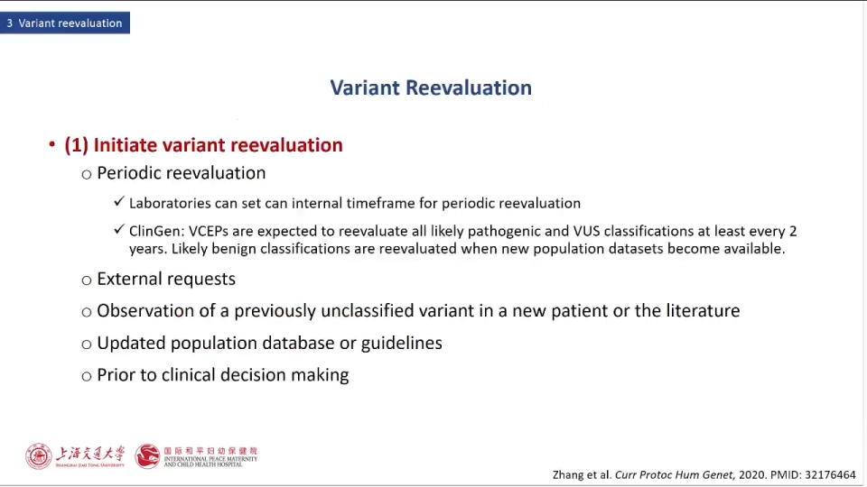

[【跳转到 34:07】](https://www.bilibili.com/video/BV1rv4y137ZL/?t=2047)

### 8.2 重分析时哪些信息最容易变

- **家系数据**：最初只做患儿全外，后来加做父母，可能补上新发证据或共分离证据，VUS 可能因此升级；
- **人群数据库**：一个拿不准的变异，如果人群数据库更新后发现大量携带者，判断会明显改变；
- **文献**：是否有新病例报道；
- **预测工具**：是否有新的、更可靠的工具（如 SpliceAI）；
- **功能实验**：有条件时对不明确的变异补做功能研究，特别是剪接变异。

### 8.3 报告更新与数据共享

不是所有重分析结果都要发报告。如果级别变化不影响临床决策（例如从 LP 变成 LB），可以不报告；但如果从 P/LP 变成 VUS/LB，或反过来从 VUS/LB 变成 P/LP，就必须第一时间更新报告。

最后，讲者建议把更新后的变异上传到公共数据库（如 ClinGen），让全球同行都能看到。

[【跳转到 38:17】](https://www.bilibili.com/video/BV1rv4y137ZL/?t=2297)

### 8.4 两个常见疑难

- **深度内含子剪接变异**：预测软件往往不准，多数只能判 VUS。如果表型与基因高度一致，可以做 RNA 分析（外周血淋巴细胞或成纤维细胞）看是否影响剪接；已有研究支持 RNA 分析有助于 VUS 重分类。
- **基因内的大片段缺失／重复**：只要涉及的只是一个基因，就可以用序列变异指南来分类，PVS1 决策树里有对应路径；ACMG/ClinGen 另有 CNV 指南，两者在基因内 CNV 上的结论应当一致。

[【跳转到 42:15】](https://www.bilibili.com/video/BV1rv4y137ZL/?t=2535)

## 小结

- 五级分类是光谱，不是好／坏二分；26 条证据按「方向 × 强度」命名，判读是组合映射，不是逐条背诵。
- 三套指南有优先级：VCEP 专病组 > SVI 通用建议 > 2015 版 ACMG/AMP；基因—疾病关系决定分类上限。
- 人群频率：BA1 看任一人群 > 5%（且 ≥2000 等位基因），BS1 看是否超过疾病发病率预期，PM2 只是支持证据且要看数据库是「普通人群」而非对照。
- 病例与家系：PS4 数先证者（阈值基因特异，OR > 5 或按 VCEP 计数表），隐性用 PM3；共分离次数 = 患者数 − 1，再用 LOD 0.6 / 1.2 / 1.5 映射到 Supporting / Moderate / Strong，多家庭比单家庭更有力。
- 功能证据：PS3 必须证明「变异本身」造成功能改变；患者来源的酶活、生化数据属于 PP4（表型），不是 PS3。
- 变异类型特异：PVS1 要先回答「LoF 是不是机制」和「这个变异是否真的 LoF」，注意 NMD 逃逸的 50 nt 规则与关键功能区域。
- 计算预测：REVEL 用于错义、SpliceAI 用于剪接、PM1 用于热点／关键域；阈值由实验室固定，不能随结果调整。
- 分类会变：数据库、文献、指南更新或临床决策前都要重分析，影响决策时必须更新报告。

## 关键术语速查

| 术语 | 一句话解释 |
| --- | --- |
| BA1 | 独立良性证据：变异在任一大陆人群频率 > 5%（≥2000 等位基因） |
| BS1 | 良性证据：变异频率高于疾病发病率所能容许的上限 |
| PM2_Supporting | 罕见性支持证据；gnomAD 是普通人群而非正常对照 |
| PS4 | 病例证据：病例对照 OR > 5，或按 VCEP 阈值数不相关先证者 |
| PM3 | 隐性遗传中，在反式位置检出致病变异的证据 |
| PP1 | 共分离证据，强度由 LOD 值（0.6 / 1.2 / 1.5）决定 |
| PS3 | 功能实验证据，必须证明是变异本身造成的功能损害 |
| PP4 | 表型特异性证据：患者表型高度符合该基因相关疾病 |
| PVS1 | 无功能变异的极强证据，需先确认 LoF 是致病机制 |
| NMD | 无义介导的 mRNA 降解；最后外显子及倒数第二外显子末 50 nt 可逃逸 |
| PM1 | 突变热点／关键功能域证据，主观性较强，需专家组规定或区域约束分数支持 |
| 重分析 | 因新证据或临床需要重新判读，级别变化影响决策时须更新报告 |