# 变异分类不是临床诊断：ACMG 与 ClinGen 的五级判读与证据框架

> 视频来源：[【20230701】ACMG/AMP/ClinGen 序列变异致病性分类新进展](https://www.bilibili.com/video/BV1Ad1tYuEao/)（B 站 · CMGA 2024 中国医师协会医学遗传医师分会年会，讲者张军玉）｜时长约 20 分钟
> 本文覆盖判读框架与边界：一个变异怎么得到「致病／可能致病／VUS／可能良性／良性」这五个答案，为什么答案要绑定疾病和遗传模式，以及「变异分类」和「临床解读」为什么是两件事。逐条证据的用法（人群频率、家系共分离、功能实验、计算预测）见同节另一篇《五类变异证据怎么用》。

## 本讲要解决的核心问题（SCQA）

**背景**：高通量测序已经很便宜，一个全外显子组测序的数据，如果不做前面的过滤和优选，会拿到 20 到 40 万个变异；测序质量本身早已不是瓶颈。

**冲突**：真正的痛点是从这几十万个变异里找出与病人相关的那一两个，而不是报告出十几个变异去为难临床医生。可是「这个变异有害」并不是一个非黑即白的判断——把变异简单叫「突变」或「SNP」，就像把人分成好人和坏人。

**疑问**：那么，一个变异到底凭什么被写成「致病」？这个结论能直接当成病人的诊断吗？

**回答（中心思想）**：ACMG/AMP 的证据框架把变异分成五级，用一组可加权的证据项去支持或反对致病性；但分级只在「某个基因—某种疾病—某种遗传模式」这个前提下成立，而且它回答的是「这个变异有没有致病力」，不是「这个病人是不是这个病」。**变异分类与临床解读必须分开**。

## 一、判读只回答两个问题

讲者把整套复杂规则压缩成两个问题，先立框架再看条款：

1. **遗传学问题**：这个患者身上出现这个变异，是偶然事件还是必然事件？——对应人群频率、家系共分离、新发、病例对照等证据。
2. **功能学与预测学问题**：证据是否提示这个变异真的影响了蛋白质的功能或表达，因而具有生物学意义？——对应功能实验、剪接预测、计算预测等证据。

[【跳转到 01:19】](https://www.bilibili.com/video/BV1Ad1tYuEao/?t=79)

第一个问题问的是「这个变异和疾病是不是碰巧同时出现」，第二个问题问的是「这个变异有没有干坏事的能力」。两者都成立，才谈得上致病；只有一个成立，通常只能得到较弱的级别。这就是为什么后面所有证据项都可以归到这两类问题下，而不需要死记 26 条编号。

## 二、五个答案与 28 条证据项

### 2.1 五个级别对应的是概率区间

ACMG/AMP 2015 版把变异分为五级，每一级对应一个「具有致病力」的概率区间：

| 级别 | 含义 | 概率 |
| --- | --- | --- |
| 致病（P） | 有足够证据认为该变异具有致病力 | > 0.99 |
| 可能致病（LP） | 该变异有较大概率具有致病力 | 0.90–0.99 |
| 意义未明（VUS） | 证据不足以分类为 P/LP 或 LB/B | 0.10–0.90 |
| 可能良性（LB） | 该变异有较小可能具有致病力 | 0.001–0.10 |
| 良性（B） | 该变异具有致病力的可能性极低 | < 0.001 |

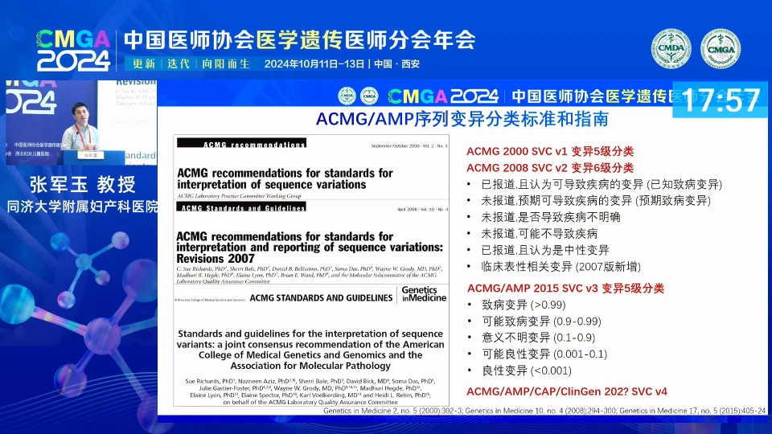

[【跳转到 01:58】](https://www.bilibili.com/video/BV1Ad1tYuEao/?t=118)

这张表最重要的信息不是数字本身，而是：**级别是一个概率陈述，不是事实陈述**。说一个变异「致病」，意思是「有超过 99% 的把握认为它在特定疾病和遗传模式下有致病力」，而不是「它一定让这个人得病」。

### 2.2 证据项按方向和强度命名

28 条证据项（现在实际使用 26 条，有两条已不再使用）像法律条款一样，每条由两到三个字母加一个数字组成：

- 第一个字母表示方向：**P** 致病性（pathogenic）、**B** 良性（benign）；
- 中间字母表示强度：**VS** 极强、**S** 强、**M** 中等、**P** 支持；
- 最后的数字是流水号。

于是有 PVS1、PS1、PM2、PP3，以及 BA1、BS1、BP4 这样的编号。判读时把适用的条款过一遍，得到一个证据组合，再由组合映射到五个级别。

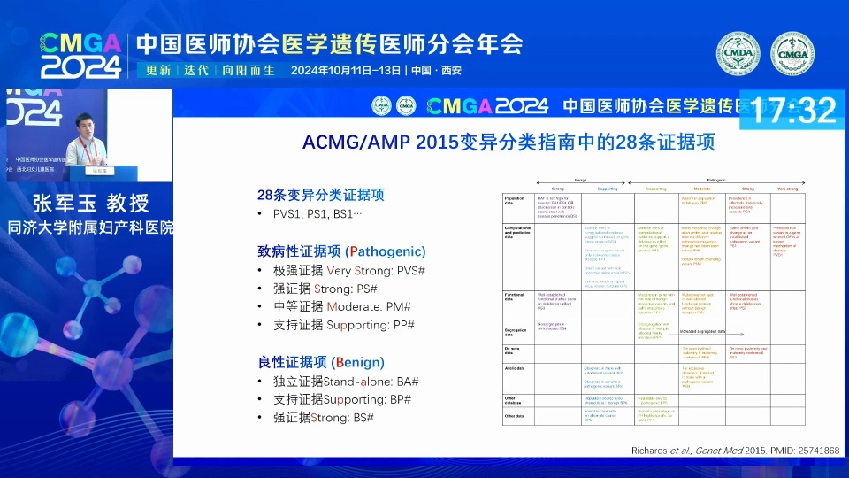

[【跳转到 02:23】](https://www.bilibili.com/video/BV1Ad1tYuEao/?t=143)

初学者常犯的错是背条款。更有效的记法是记住这张表的两个维度：**方向**（支持致病还是支持良性）和**强度**（极强到支持）。例如「两个中等致病证据 + 两个支持致病证据 → 可能致病」就是一次典型的组合，不必逐条背。

### 2.3 2015 版指南自己承认的五个毛病

讲者没有把指南当成圣经，而是直接列出它的问题：

1. **部分证据项主观性太强**。典型是 PP4（表型高度符合某个基因）：医生觉得「非常吻合」，就可能把一个良性变异也解释成病人的病因，等于把 PP4 的强度人为抬高。
2. **强度边界不清**。比如 PP1 到底多少例共分离才能升到 PP1_Strong，指南没有说清。
3. **证据重复使用**。同一批数据被拆成两条证据分别计分。
4. **强度不合适**。比如 PM2 现在已降为 PM2_Supporting。
5. **最要命的一条**：当致病证据和良性证据同时存在时，旧版允许不管冲突、直接判 VUS。讲者明确说，现在看来这是不合适的。

[【跳转到 02:48】](https://www.bilibili.com/video/BV1Ad1tYuEao/?t=168)

## 三、ClinGen 接手：三套指南与优先级

2015 版指南自己写了一句伏笔：不同基因疾病中证据的加权标准可能不同，特定疾病的工作组应制定更有针对性的指南。真正做这件事的是 **ClinGen**，它下面有两套工作组：

- **SVI**（Sequence Variant Interpretation Working Group）：序列变异解读工作组，发布通用规则更新；
- **VCEP**（Variant Curation Expert Panel）：几十个疾病变异解读专家组，发布特定基因／疾病的规则。

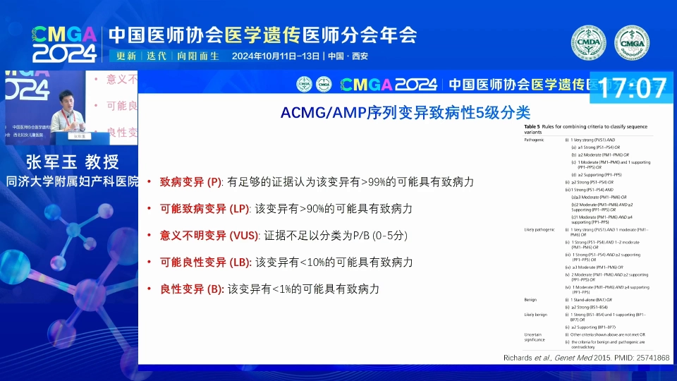

于是实际判读时有**三套指南**，优先级是：

1. 有对应疾病（或相近疾病）的 VCEP 专家组指南 → 优先用；
2. 没有 VCEP → 用 SVI 的通用建议；
3. 再退到 2015 版 ACMG/AMP 指南；
4. 实验室在此基础上制定并固定自己的标准。

[【跳转到 04:53】](https://www.bilibili.com/video/BV1Ad1tYuEao/?t=293)

这条优先级不是形式主义。比如线粒体变异，2015 版指南根本不覆盖，硬套就会出错，必须用线粒体 VCEP 的规则。同理，如果实验室对某个基因今天用一套阈值、明天换另一套，结果就无法比较。

## 四、分类成立有三个前提

### 4.1 前提一：基因与疾病的关系决定了分类上限

这是全篇最容易被忽略、但最影响结论的一点：**如果一个基因和疾病的关系本身不明确，在这个基因上说某个变异「致病」就是不合适的**。

ClinGen 的基因 curation 工作组已经评估了 1400 多个基因与疾病的关系，分成七级：Definitive（明确）、Strong（强）、Moderate（中等）、Limited（有限）、No known disease relationship（未知）、Conflicting evidence（证据冲突）、Refuted（被否定）。这个级别直接给变异分类设了上限：

| 基因—疾病关系 | 变异分类的上限 |
| --- | --- |
| Definitive / Strong | 五级分类均适用 |
| Moderate | 最高只能到可能致病（LP） |
| Limited 及以下 | 最高只能到 VUS |

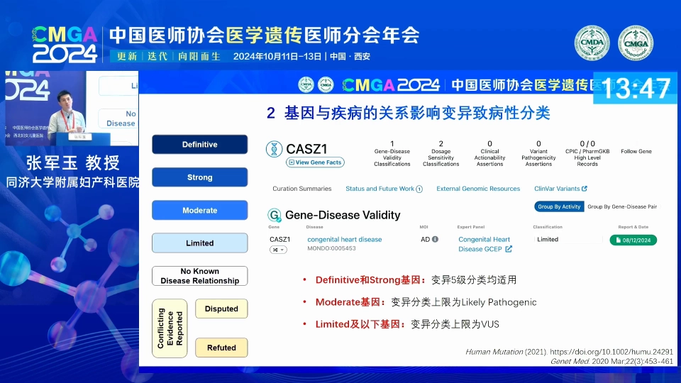

[【跳转到 06:08】](https://www.bilibili.com/video/BV1Ad1tYuEao/?t=368)

例子是 CASZ1：研究提示它可能与先天性心脏病有关，但按 2024 年最新评估，关系只有 Limited。那么即使在这个基因里检出一个看起来很「像」的变异，正式报告里的最高分类也只能是 VUS。**证据再漂亮，也不能突破基因—疾病关系这个天花板。**

### 4.2 前提二：分类绑定具体疾病和遗传模式

一个基因可以有多种疾病、多种遗传模式，甚至同一基因的不同机制导致完全不同的表型。讲者举了 KIT：

- 功能获得（gain of function）变异与色素沉着、胃肠间质瘤相关；
- 功能缺失（loss of function）变异与斑驳病相关。

对这类基因，ClinGen 的建议是**按疾病分别解读**，不能把一种疾病下的结论搬到另一种疾病上。更极端的情况是：同一个变异，对疾病 A 是显性致病变异，对疾病 B 却是显性良性变异。幻灯片上的例子是 KIT c.2469_2481del p.(Tyr823*)：对斑驳病是致病变异，对色素沉着／胃肠间质瘤却是显性良性变异。

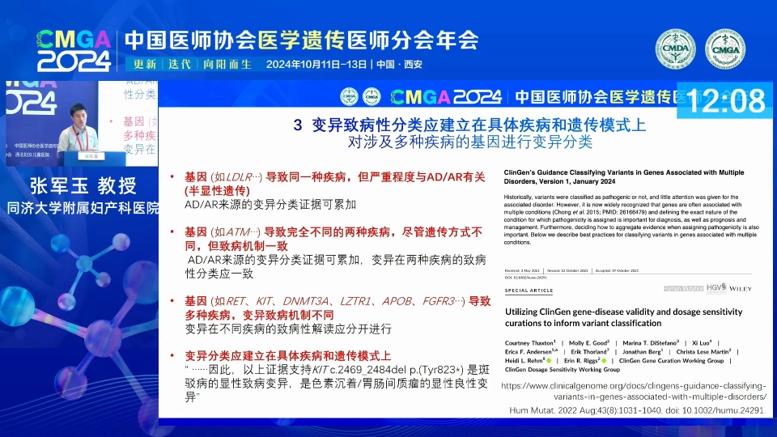

[【跳转到 06:57】](https://www.bilibili.com/video/BV1Ad1tYuEao/?t=417)

所以「这个变异是致病的」这句话本身是不完整的，完整说法必须是「这个变异在××基因相关的××疾病、××遗传模式下是致病的」。

### 4.3 前提三：先把变异名字写对

在评估之前，必须用 HGVS 命名规则、基于 MANE Select 转录本描述变异，三个要素缺一不可：

1. 转录本编号；
2. CDS 位置；
3. 核苷酸改变。

[【跳转到 09:52】](https://www.bilibili.com/video/BV1Ad1tYuEao/?t=592)

讲者用「加微信不备注性别」打比方：名字不对，后面所有工作都可能是无用功——你以为在解读病人检出的那个变异，其实解读的是另一个。这在临床上是医疗事故级别的错误，而不是尴尬。

## 五、变异分类 ≠ 临床解读

这是本讲的核心结论，值得单独成章。

| | 变异分类（variant classification） | 临床解读（clinical interpretation） |
| --- | --- | --- |
| 回答的问题 | 是否有足够证据认为该变异在特定疾病／遗传模式下具有致病力？ | 检出的变异能否解释当前患者的表型？ |
| 答案 | P / LP / VUS / LB / B 五级 | 阳性 / 不确定 / 阴性 |
| 依赖 | 人群、病例、功能、计算等证据 | 患者表型、家系、共分离、外显率等 |

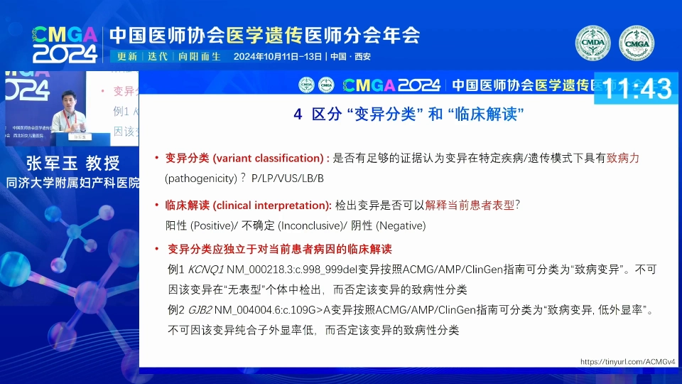

[【跳转到 07:47】](https://www.bilibili.com/video/BV1Ad1tYuEao/?t=467)

讲者给了两个方向相反的反例：

- **不能因为「没病」就否定分类**：一个按指南可判为致病的变异，如果在无表型个体中检出，不能因此把它的致病性分类改掉。分类依据的是证据总和，不是某一个人的表型。
- **不能因为外显率低就否定分类**：GJB2 的 c.109G>A 按 ClinGen 建议可分类为「致病变异，低外显率」。它的纯合子通常外显率很低、常常没有耳聋表现，但这不影响它的分类结论。

[【跳转到 08:12】](https://www.bilibili.com/video/BV1Ad1tYuEao/?t=492)

讲者用了一个很好懂的类比：新冠病毒是明确的致病病毒，但感染了新冠的人不一定有症状。**致病力（病原体/变异本身的性质）和外显率（个体是否表现出疾病）是两件事**。把它们混为一谈，就会在「这个变异到底致不致病」和「这个病人到底是不是这个病」之间来回跳。

由此得到本节要建立的分层：

- **功能变化**：变异让蛋白或 RNA 功能变了（功能实验、预测）；
- **疾病关联**：这个变异在患者中反复出现、与疾病共分离（人群、病例、家系）；
- **临床诊断**：把变异分类、表型、家系、外显率合起来，判断这个病人是否患病。

三者是递进关系，不能互相替代。一个变异有功能变化，不等于它致病；一个变异与疾病关联，也不等于这个病人就能确诊。

## 六、四类证据与 ClinGen 的具体修订

判读时把证据分成四块来收集，这是后面所有细节的骨架：

1. **人群数据**：BA1、BS1、BS2、PM2；
2. **当前病例与已报道病例**：PS4、PM3、PP1、PS2/PM6、PP4；
3. **变异类型特异证据**：PVS1（无功能）、PM4/BP3（整码插入缺失）、PP2/BP1（错义）等；
4. **计算预测**：PP3、BP4、BP7、PM1。

这四类证据的顺序也有讲究：先做人群频率，因为 BA1 是独立（stand-alone）良性证据，一旦成立就不必再往下堆证据；再做病例与家系；然后按变异类型走特异分支；最后才是计算预测——它在证据体系里通常只是支持级别。

下面几处修订最能说明「规则在往定量化走」。

### 6.1 人群频率：两个不同的频率口径

gnomAD 里一个变异会列出很多个人群频率，还有一个「过滤等位基因频率」（filtering allele frequency, FA）。ClinGen 在 2024 年初明确了口径：

- 用 **BA1 / BS1**（良性证据）时，参考 **Grpmax 过滤等位基因频率**——即频率最高的那个大陆人群的保守估计值；
- 用 **PM2_Supporting**（罕见性证据）时，参考**任意人群 ≥ 2000 个等位基因**的频率。

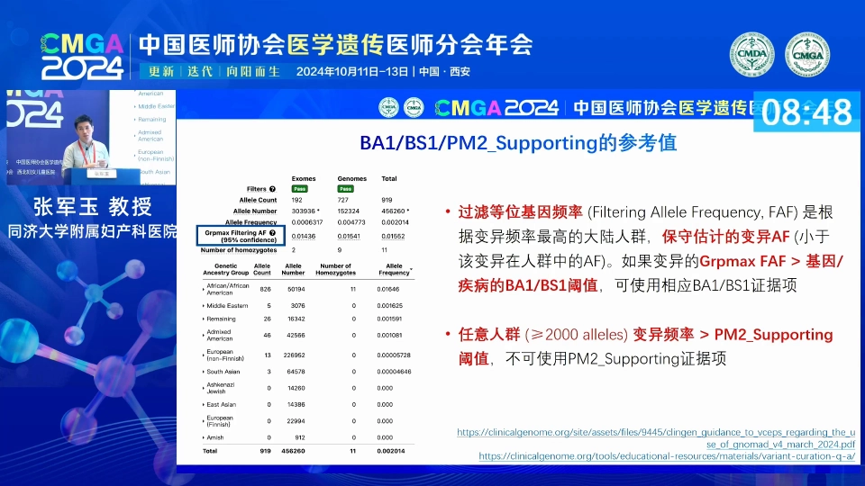

[【跳转到 10:42】](https://www.bilibili.com/video/BV1Ad1tYuEao/?t=642)

为什么强调「过滤」而不是直接看总频率？因为总频率会被样本量小的人群、近亲婚配、群体结构等因素拉偏；过滤等位基因频率是对「这个变异在人群中真实频率上限」的保守估计。用错口径，会把一个常见的良性多态误判成罕见变异。

### 6.2 新发变异：把「表型吻合度」折成分数

新发变异（de novo）分两条证据：PS2 用于**父母亲缘关系已确认**的新发，PM6 用于**未验证亲缘关系**的假定新发。ClinGen 进一步把「表型与基因的吻合程度」做成加分表：

| 表型吻合程度 | 亲缘关系已确认（PS2） | 亲缘关系未确认（PM6） |
| --- | --- | --- |
| 高度特异 | 2 分 | 1 分 |
| 吻合但不高度特异 | 1 分 | 0.5 分 |
| 吻合但不特异且遗传异质性高 | 0.5 分 | 0.25 分 |
| 不吻合 | 0 | 0 |

再按分数映射到证据强度：0.5 分 → Supporting，1 分 → Moderate，2 分 → Strong，4 分 → Very Strong。

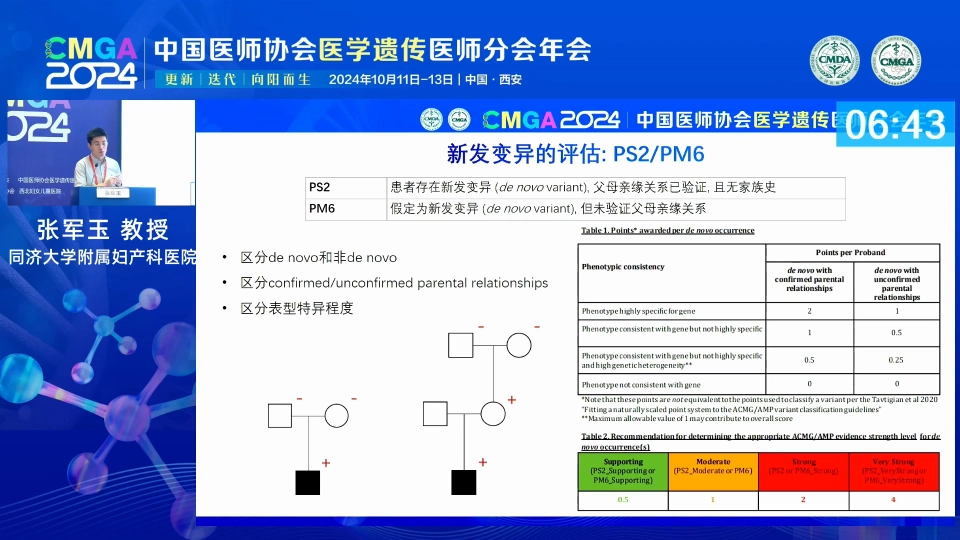

[【跳转到 13:12】](https://www.bilibili.com/video/BV1Ad1tYuEao/?t=792)

这张表的含义是：**「新发」本身不是同等强度的证据**。一个表型高度特异、亲缘关系确认的新发变异，比一个表型只是「不矛盾」、亲缘关系没验证的新发变异强得多。

### 6.3 共分离与表型：从两条证据变成一条

PP1 原本说的是「疾病与基因（变异）共分离」，PP4 说的是「疾病表型高度符合某个基因」。ClinGen 2024 年 6 月的更新认为这两个概念密不可分，建议**结合使用**：

- 不仅看患病成员是否携带变异，也看**未患病成员是否不携带**；
- PP4 的强度取决于「根据当前表型，拿到阳性基因检测结果的概率」有多高。

讲者的例子是血友病：患者八因子检测不到，又做了 F8 的序列、拷贝数和特殊倒位检测，预期拿到 F8 诊断的可能性接近 100%，这时 PP4 可以直接给到满分。

[【跳转到 14:27】](https://www.bilibili.com/video/BV1Ad1tYuEao/?t=867)

### 6.4 PVS1：关键区域缺失不再「温和处理」

PVS1 用于无功能变异（无义、移码、经典剪接位点等），前提是「该基因的功能缺失确实是疾病的致病机制」。2018 年的决策树在 2023 年被修订，主要改动是：

- 如果截短发生在**关键功能区域**，即使蛋白还能表达，也要用 **PVS1**，而不是 PVS1_Strong。

讲者的毛衣比喻很传神：少了个袖子还能穿，少了个肩膀就穿不了了。

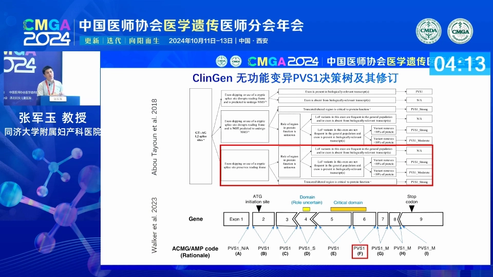

[【跳转到 15:17】](https://www.bilibili.com/video/BV1Ad1tYuEao/?t=917)

### 6.5 剪接：预测与实验都要，且归入 PVS1

2023 年起 ClinGen 建议对所有变异（外显子与内含子）都做 RNA 剪接预测和 RNA 实验证据评估。两个后果：

- 经典 ±1/±2 位点的剪接变异，如果预测**无害**，就不能再用 PVS1；
- 以前放在 PS3（功能实验）里的 RNA 剪接实验证据，现在按结果归入 PVS1 体系。

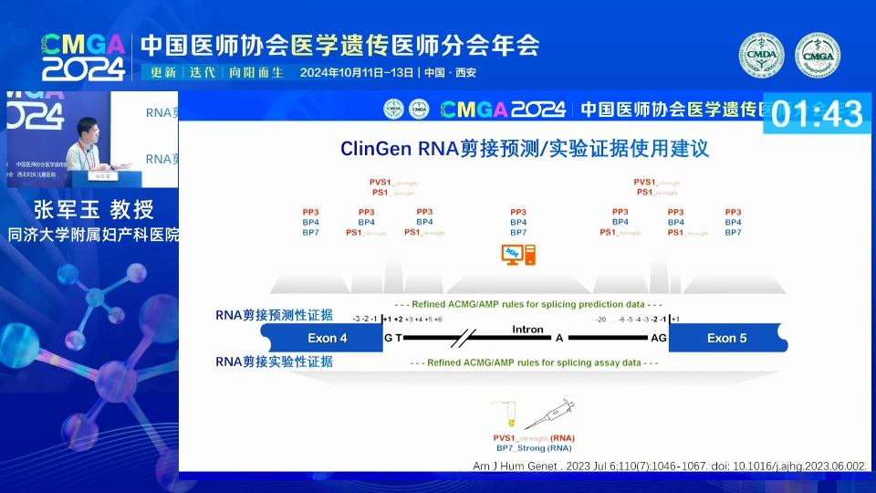

[【跳转到 17:22】](https://www.bilibili.com/video/BV1Ad1tYuEao/?t=1042)

### 6.6 计算预测：PP3 有了阈值，也做了「会不会滥用」的评估

错义变异以前用 PP3 非常主观。2023 年 ClinGen 给出具体阈值后，医生又担心「升级成 PP3_Strong 会不会让大量变异被误判为致病」。随后发表的一项评估统计了每个人 3000 多个基因的罕见变异，发现平均只有 **1 个**罕见变异符合 PP3_Strong——也就是说，实际影响远小于担忧。

[【跳转到 16:32】](https://www.bilibili.com/video/BV1Ad1tYuEao/?t=992)

### 6.7 积分制：把「组合」变成加法

为了方便临床医生，ClinGen 在 2020 年给出一个基于积分的分类方法：

| 证据强度 | 分值 |
| --- | --- |
| Very Strong | 8 |
| Strong | 4 |
| Moderate | 2 |
| Supporting | 1 |

- 总分 **≥ 10** → 致病；
- 总分 **6–9** → 可能致病。

[【跳转到 18:12】](https://www.bilibili.com/video/BV1Ad1tYuEao/?t=1092)

积分制的价值在于让 VUS「倾向哪边」变得可讨论：一个 5 分的变异和一个 1 分的变异，虽然都还是 VUS，但距离升级的距离完全不同。它也直观解释了为什么证据强度要按指数分级（1、2、4、8），而不是线性相加。

## 七、分类不是一次性结论：重评估与更新报告

变异分类会随着人群数据库更新、新病例报道、指南修订而改变。讲者列出触发重评估的条件：

- 周期性重评估；
- 医生或患者申请重评估；
- 新的病例或文献中出现之前未明确分类的变异；
- 人群数据库和变异分类指南更新；
- **临床决策之前**；
- 受检者或家族成员出现新的表型。

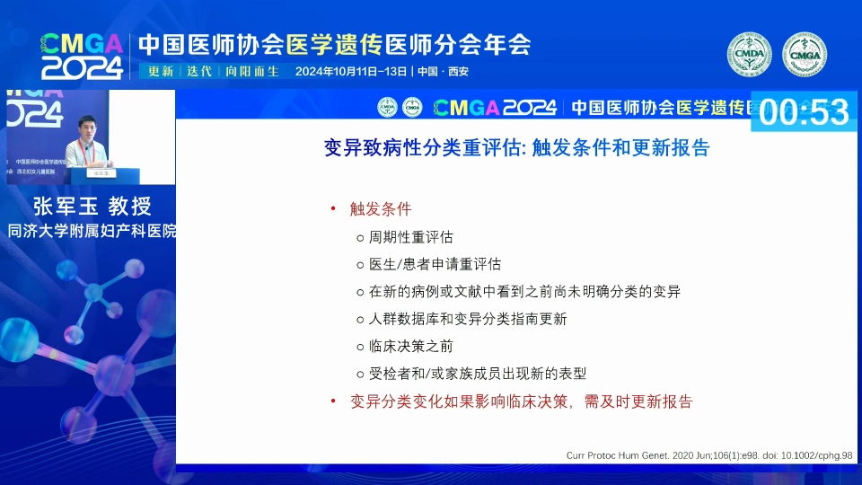

[【跳转到 19:02】](https://www.bilibili.com/video/BV1Ad1tYuEao/?t=1142)

讲者举的场景非常具体：一个变异一年前评为 LP，现在孕妇怀孕 16 周来做羊水穿刺——这就是触发条件。如果重评估后它变成了 VUS 甚至良性，报告必须更新，临床处理方式也要改。**「分类变了但报告没更新」本身就是临床风险**。

## 小结

- 判读只回答两个问题：这个变异与疾病是偶然还是必然（遗传学）；它是否真的影响了基因产物功能（功能与预测）。
- 五级分类是概率陈述：P > 0.99、LP 0.90–0.99、VUS 0.10–0.90、LB 0.001–0.10、B < 0.001。
- 26 条证据项按「方向 × 强度」命名，判读是把证据组合映射到级别，不是逐条背诵。
- 分类成立有三个前提：基因—疾病关系达到相应级别（Moderate 封顶 LP，Limited 封顶 VUS）、绑定具体疾病与遗传模式、变异命名（HGVS + MANE Select）正确。
- 变异分类回答「这个变异有没有致病力」，临床解读回答「这个病人是不是这个病」；外显率低、在无表型个体中检出，都不能反过来否定分类。
- ClinGen 的修订方向是定量化：人群频率分两个口径、新发变异按表型吻合度折分、共分离与表型合并、PVS1 按关键区域定强度、RNA 剪接纳入 PVS1、积分制（≥10 致病，6–9 可能致病）。
- 分类不是终点：数据库、文献、指南更新或临床决策之前都要重评估，影响决策时必须更新报告。

## 关键术语速查

| 术语 | 一句话解释 |
| --- | --- |
| ACMG/AMP 2015 | 序列变异五级分类与 28 条证据项的通行框架，现行实际使用 26 条 |
| ClinGen | 负责细化 ACMG 规则的机构，下设 SVI（通用规则）与 VCEP（疾病专家组） |
| VUS | 意义未明变异，证据不足以判为致病或良性，对应 0.10–0.90 的概率区间 |
| PVS1 | 无功能变异的极强致病证据，前提是功能缺失确为该基因的致病机制 |
| BA1 / BS1 | 良性证据：任一人群频率 > 5%（BA1）；频率超过疾病发病率预期（BS1） |
| PM2_Supporting | 罕见性支持证据，参考任意人群 ≥2000 等位基因的频率 |
| PP1 / PP4 | 共分离证据 / 表型特异性证据，ClinGen 建议结合使用 |
| PS3 | 功能实验证据，必须证明是「变异本身」造成的功能改变 |
| 外显率 | 携带致病变异者表现出疾病的比例，与变异分类是两件事 |
| 重评估 | 因数据库、文献、指南或临床决策需要而重新判读，可能改变级别并需更新报告 |