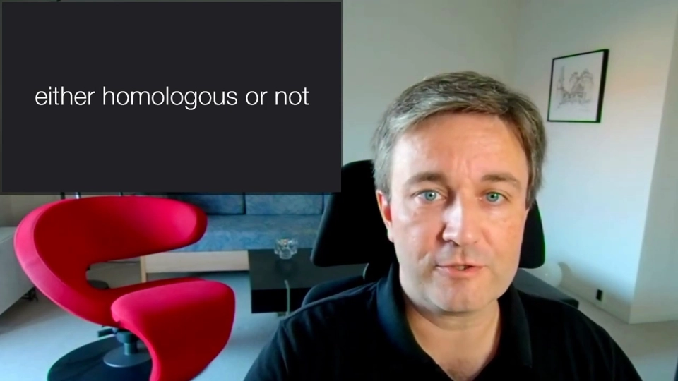
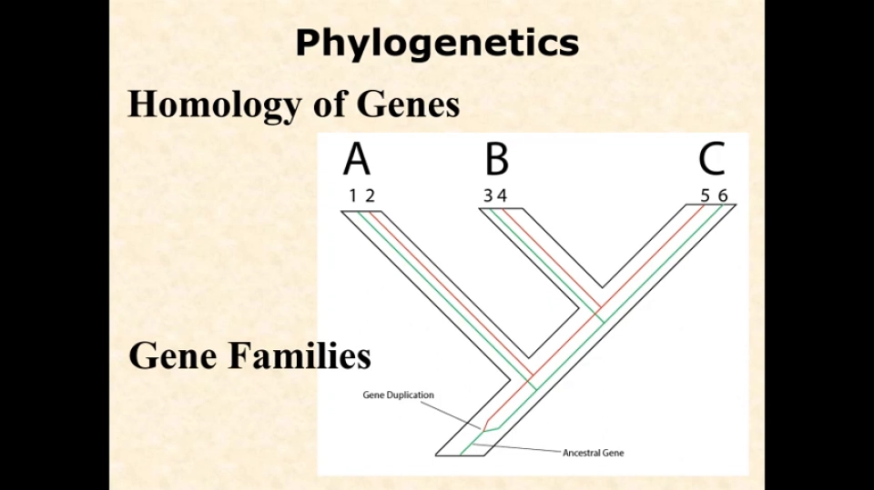
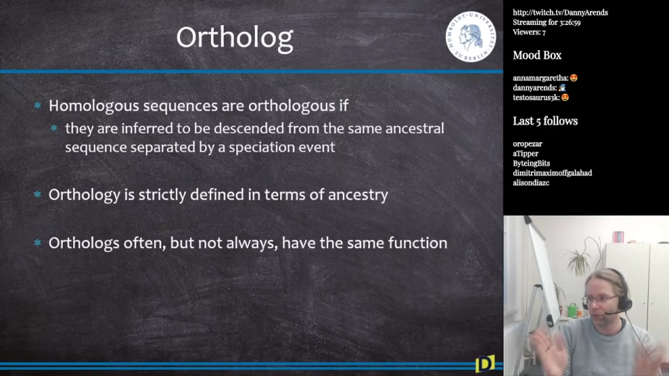
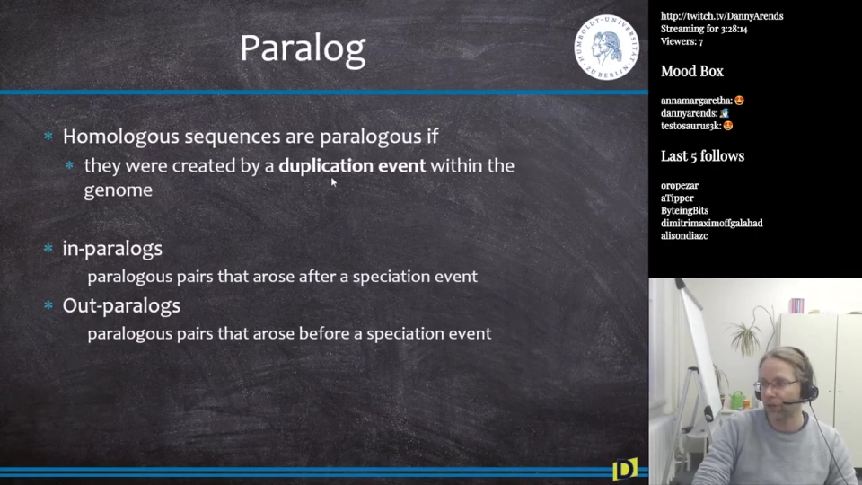
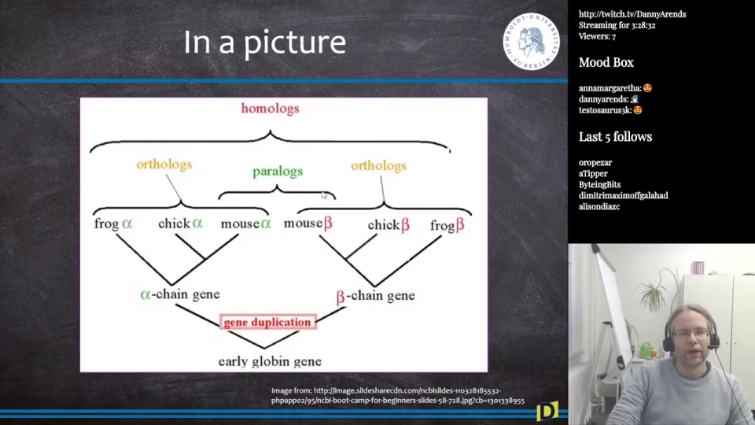
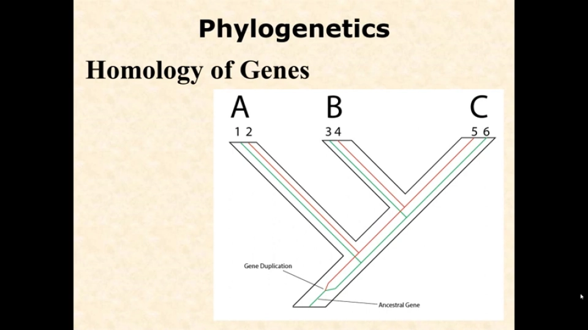
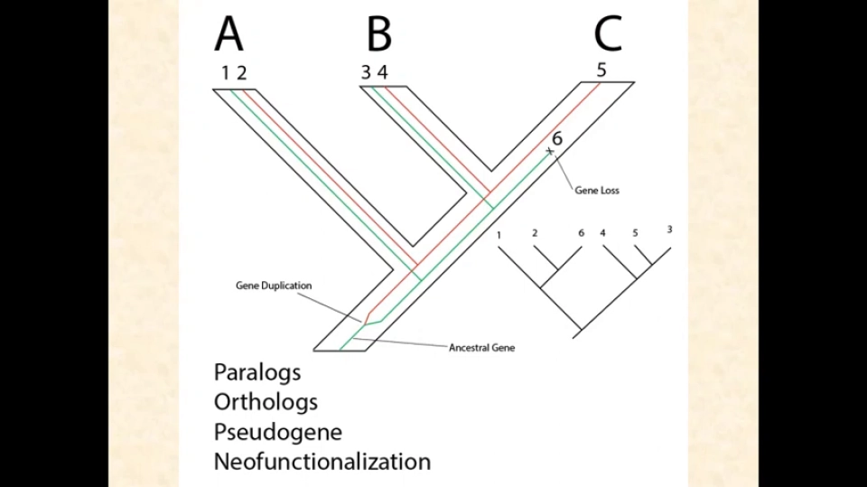

# 同源、直系同源与旁系同源：从基因树读出复制与分化

> 视频来源：[BIOL 3406 Unit 1 6 4 Gene Duplication and Paralogy](https://www.youtube.com/watch?v=5WI3ZrBQCBQ)（YouTube · Matthew Terry，约 18 分钟）、[Protein Homology and Phylogeny (Bioinformatics S5E4)](https://www.youtube.com/watch?v=V6PQxgja3q4)（YouTube · Danny Arends，约 33 分钟）、[The dark side of phylogeny](https://www.youtube.com/watch?v=mi1f4-lXjaY)（YouTube · Lars Juhl Jensen，约 5 分钟）
> 导读：三支视频互补——第一支用基因树讲清复制、丢失与旁系同源；第二支把同源、直系同源、旁系同源和 in-paralog/out-paralog 放回同一张图；第三支专门纠正“百分比同源”和“功能直系同源”两类常见误用。字幕为自动生成，术语已按上下文订正。

## 本讲要解决的核心问题（SCQA）

**背景**：比较两个基因时，我们最先看到的是序列相似度；相似度高，就很容易顺口说“它们是同一个基因”。

**冲突**：相似可能来自两种完全不同的历史——两个物种分化时各带走一份，或者同一个基因组里先复制出了一份。复制之后，拷贝还会丢失、变成假基因，或者获得新功能。于是“最像的那个”不一定是对应关系最正确的那个。

**疑问**：怎样判断两个基因是同源、直系同源还是旁系同源？基因复制和丢失会怎样影响跨物种推断？把功能注释从一个物种搬到另一个物种时，风险在哪里？

**回答（中心思想）**：同源是“有没有共同祖先”的二值关系；直系同源对应物种分化，旁系同源对应基因复制；in-paralog/out-paralog 则要相对于某一次具体的物种分化来读。复制与丢失会让基因树偏离物种树，所以同源关系必须靠“共同祖先节点是什么事件”来判断，不能靠相似度或一对一映射来定义，更不能把直系同源直接等同于功能相同。

## 一、同源不是相似度，而是“有没有共同祖先”

### 1.1 同源是二值关系

“同源”（homology）指的是两个序列相似，是因为它们来自同一个共同祖先。这个定义只有“是”与“不是”两种状态，没有程度之分。[【跳转到 00:00】](https://www.youtube.com/watch?v=5WI3ZrBQCBQ&t=0)

初学者最容易犯的错，是把同源当成一个百分比。文献里常能看到“高度同源”“42% 同源”这样的说法；讲者统计过，PubMed 里有上万条摘要、全文里有数万篇文章这样写。这些说法把**序列相似度**（sequence similarity）或**序列一致性**（sequence identity）误当成了同源程度。两个序列要么有共同祖先，要么没有；相似度可以从 0% 到 100%，但同源不是。[【跳转到 00:24】](https://www.youtube.com/watch?v=mi1f4-lXjaY&t=24)



更准确的用法是：**相似度是用来推断同源的证据，不是同源的定义**。我们通过序列相似性去寻找同源、直系同源和旁系同源；没有哪种方法完美，但这些推断对研究基因演化和注释基因功能仍然有用。[【跳转到 04:23】](https://www.youtube.com/watch?v=mi1f4-lXjaY&t=263)

### 1.2 基因家族：同一个祖先基因的所有后代

把所有能追溯到同一个祖先基因的拷贝放在一起，就得到一个**基因家族**（gene family）。家族内的基因彼此同源，但同源的具体类型可能不同：有些是物种分化留下的，有些是基因复制留下的。[【跳转到 01:40】](https://www.youtube.com/watch?v=5WI3ZrBQCBQ&t=100)

珠蛋白家族是个好例子：血红蛋白的不同亚基、肌红蛋白，都能追溯到很早的祖先基因；家族很大，但内部关系要逐对判断。[【跳转到 02:30】](https://www.youtube.com/watch?v=5WI3ZrBQCBQ&t=150)



## 二、直系同源：共同祖先节点是一次物种分化

**直系同源**（ortholog）指两个基因在物种分化事件处分开：它们来自两个物种的最后一个共同祖先中的同一个基因。人类 α 血红蛋白和黑猩猩 α 血红蛋白就是直系同源。[【跳转到 05:25】](https://www.youtube.com/watch?v=5WI3ZrBQCBQ&t=325)

换成基因树的语言：把两个基因的共同祖先节点找出来，如果这个节点代表的是**物种分化**，它们就是直系同源；如果代表的是**基因复制**，它们就是旁系同源。[【跳转到 06:15】](https://www.youtube.com/watch?v=5WI3ZrBQCBQ&t=375)



直系同源**常常**有相同功能，但这不是定义的一部分。小鼠和人都带肌生成抑制蛋白（myostatin），小鼠的 myostatin 是人的 myostatin 的直系同源；但直系同源也可能在演化中改变功能。[【跳转到 03:17】](https://www.youtube.com/watch?v=V6PQxgja3q4&t=197)

## 三、旁系同源：共同祖先节点是一次基因复制

**旁系同源**（paralog）指两个基因的共同祖先节点是一次**基因复制**：一个基因在基因组内多出了一份，两个拷贝再各自积累突变。最直观的判据是：如果两个基因在同一个物种里，它们几乎总是旁系同源。[【跳转到 06:15】](https://www.youtube.com/watch?v=5WI3ZrBQCBQ&t=375)



复制之后，两个拷贝最初完全相同、通常还挨在一起；随后它们可以各自积累突变，功能开始分化。复制带来的第一层好处是冗余，长期好处是：一个拷贝可以保留祖先功能，另一个拷贝则可能获得新功能。[【跳转到 02:55】](https://www.youtube.com/watch?v=5WI3ZrBQCBQ&t=175)

珠蛋白家族把直系同源和旁系同源放在了同一张图里：α 链基因和 β 链基因来自一次古老的基因复制；蛙、鸡、鼠各自的 α 链之间是直系同源，各自的 β 链之间也是直系同源；而同一个物种内的 α 链与 β 链互为旁系同源。[【跳转到 06:12】](https://www.youtube.com/watch?v=V6PQxgja3q4&t=372)



基因复制可以反复发生，把一个小家族扩成很大的家族。Hox 基因家族就是多次复制的结果：果蝇的八个标准 Hox 基因彼此相似，但它们的相似要追溯到多次基因复制，而不是多次物种分化。[【跳转到 09:10】](https://www.youtube.com/watch?v=5WI3ZrBQCBQ&t=550)

> **边界**：水平基因转移也会产生同源关系，这类基因叫 xenolog。它的共同祖先不是垂直遗传中的分化或复制，本节不展开，只需知道“同源”并不只有直系/旁系两种来源。[【跳转到 07:05】](https://www.youtube.com/watch?v=5WI3ZrBQCBQ&t=425)

## 四、in-paralog 与 out-paralog：先确定“哪一次物种分化”

### 4.1 两个词的定义

旁系同源还可以再分两类，判据是**这次基因复制发生在所讨论的物种分化之前还是之后**：

- **in-paralog**（内旁系同源）：在物种分化**之后**发生的复制产生的旁系同源对。
- **out-paralog**（外旁系同源）：在物种分化**之前**发生的复制产生的旁系同源对。

[【跳转到 04:57】](https://www.youtube.com/watch?v=V6PQxgja3q4&t=297)

这两个词不是给基因贴的永久标签，而是给“基因树上的某个节点”做的注释：先指定物种分化事件，再看复制节点在它上面还是下面。[【跳转到 05:22】](https://www.youtube.com/watch?v=V6PQxgja3q4&t=322)

### 4.2 out-paralog：复制发生在分化之前

先用珠蛋白的例子。α 链和 β 链的基因复制发生在蛙、鸡、鼠这些物种分化之前；所以同一个物种内的 α 与 β 是旁系同源，而且相对于这次物种分化，它们属于 **out-paralog**。[【跳转到 07:55】](https://www.youtube.com/watch?v=V6PQxgja3q4&t=475)

把结构画出来更清楚（结构示意，不对应具体物种）：

```text
祖先基因 A
   │
   ├── A1 ──┬── 物种 X 的 X1
   │        └── 物种 Y 的 Y1
   └── A2 ──┬── 物种 X 的 X2
            └── 物种 Y 的 Y2
```

在这张图里：

- X1–Y1 是直系同源，X2–Y2 也是直系同源；
- X1–Y2 是 out-paralog：它们的共同祖先是 A，而 A→A1/A2 的复制发生在 X–Y 分化之前；
- X1–X2 也是 out-paralog：同一物种内的两个拷贝同样来自那次分化前的复制。

### 4.3 in-paralog：复制发生在分化之后

如果复制发生在物种分化之后，情况就变成“一个祖先基因先分到两个物种，其中一支再复制”（同样是结构示意）：

```text
祖先基因 A
   │
   ├── 物种 X ──┬── X1   ← 物种分化之后，在 X 谱系内又复制了一次
   │            └── X2
   │
   └── 物种 Y ───── Y1
```

这时：

- X1–X2 是 **in-paralog**：它们的复制发生在 X–Y 分化之后；
- X1–Y1、X2–Y1 都是直系同源：X 谱系里的两个拷贝都能追溯到 X–Y 共同祖先中的那一个基因。

### 4.4 同一个基因对，换个分化事件就可能换名字

in/out 是相对于“你正在比较的那次物种分化”而言的。同一对拷贝，换一个参照的分化事件，就可能从 in-paralog 变成 out-paralog。读文献时如果只看到“这是 in-paralog”而不看参照的分化事件，很容易误解。[【跳转到 05:22】](https://www.youtube.com/watch?v=V6PQxgja3q4&t=322)

这也解释了一个常见困惑：**直系同源可以是一对多**。基因 A1 在物种 C 里可能有 C1、C2、C3 三个直系同源，它们都同样真实，没有哪一个是“唯一正确”的。人们为了简化，常强行要求一对一直系同源，再从中挑一个“最像”的，把它叫作“真正的”或“功能上的”直系同源；这一步已经把相似度当成了同源关系。[【跳转到 01:39】](https://www.youtube.com/watch?v=mi1f4-lXjaY&t=99)


## 五、复制与丢失如何让基因树偏离物种树

### 5.1 基因树的节点不全是物种分化

把物种历史和基因历史叠在一起看：黑色的粗线是物种树，红绿细线是基因树。基因树上的节点有两类——物种分化节点和基因复制节点。只看基因树，很容易把复制节点误读成物种分化节点。[【跳转到 00:50】](https://www.youtube.com/watch?v=5WI3ZrBQCBQ&t=50)



### 5.2 丢失有两种：整段 DNA 没了，或变成假基因

基因复制之后，一个拷贝可能被丢失。丢失有两种常见形式：

1. **整段 DNA 缺失**：染色体上那一段直接没了，物种里少一个家族成员；
2. **序列还在，但不再表达**：DNA 仍留在基因组里，也能通过序列相似性认出来，但它不再是一个有功能的基因，这叫**假基因**（pseudogene）。

[【跳转到 03:45】](https://www.youtube.com/watch?v=5WI3ZrBQCBQ&t=225) [【跳转到 05:00】](https://www.youtube.com/watch?v=5WI3ZrBQCBQ&t=300)

### 5.3 不同物种丢不同的拷贝，基因树就会“说谎”

看下面这张图：祖先在根部发生了一次基因复制，物种 A、B、C 本来都带着两个拷贝；但 C 丢失了其中一个（图上标为 Gene Loss）。这时如果只用剩下的拷贝建基因树，得到的树形就不能直接当作物种树来读。[【跳转到 11:07】](https://www.youtube.com/watch?v=5WI3ZrBQCBQ&t=667)



这就是“基因复制与丢失对推断的影响”：**基因树上的节点既可能是物种分化，也可能是基因复制；再加上不同物种丢了不同的拷贝，只看基因树就很难判断哪个节点对应物种分化**。复制事件越多、丢失越多，判断越困难。[【跳转到 15:06】](https://www.youtube.com/watch?v=5WI3ZrBQCBQ&t=906)

## 六、功能迁移的风险：直系同源不等于功能相同

### 6.1 直系同源“常有”相同功能，但不是定义

直系同源常常保留相同功能，所以跨物种注释时，我们习惯把模式物种的功能直接搬给新物种的同源基因。但讲者特意加了一句限定：orthologs often, but not always, have the same function。[【跳转到 03:17】](https://www.youtube.com/watch?v=V6PQxgja3q4&t=197)

复制之后，一个拷贝可以保留祖先功能，另一个拷贝获得新功能，这叫**新功能化**（neofunctionalization）。这是基因组里新功能产生的重要机制，在发育调控基因中尤其常见。[【跳转到 15:56】](https://www.youtube.com/watch?v=5WI3ZrBQCBQ&t=956)

### 6.2 “功能直系同源”是把两件事混在一起

“功能直系同源”（functional ortholog）这个说法，通常指在多个直系同源里挑一个序列最像、推测功能最接近的。问题在于：**直系同源是由演化事件定义的，不是由序列相似度定义的，也不是由功能定义的**。相似度是用来找直系同源的工具；直系同源常有保守功能，所以能用来做注释——但这两件事不能反过来当作定义。[【跳转到 02:04】](https://www.youtube.com/watch?v=mi1f4-lXjaY&t=124)

更麻烦的是，演化历史本身我们并不知道，只能从序列推断；推断方法有很多种，方法之间会不一致，而没有真相就无法判断谁对。这不是说系统发育没用，而是说：**要把“相似度”“同源关系”“功能”三个层次分开说**。[【跳转到 02:29】](https://www.youtube.com/watch?v=mi1f4-lXjaY&t=149) [【跳转到 03:19】](https://www.youtube.com/watch?v=mi1f4-lXjaY&t=199)

### 6.3 跨物种注释的实用判据

把功能从物种 A 搬到物种 B 时，至少要先回答四个问题：

1. 这对基因**是同源**吗？证据是相似度、结构域、还是系统发育？
2. 它们的共同祖先节点是**物种分化**还是**基因复制**？
3. 如果是旁系同源，复制发生在所比较的物种分化**之前还是之后**（out 还是 in）？
4. 这条谱系上有没有**丢失、假基因或新功能化**？一对一直系同源是不是被强行凑出来的？

只有前三个问题都清楚，第四个问题的答案才值得采信。否则，“最像的那个”可能只是一个保留了相似序列的旁系同源拷贝。

## 七、一张判读清单

| 步骤 | 要问的问题 | 常见错误 |
| --- | --- | --- |
| 1. 同源 | 两个序列有共同祖先吗？ | 把“相似度高”直接说成“同源” |
| 2. 事件 | 共同祖先节点是物种分化还是基因复制？ | 把基因树上的复制节点当成物种分化 |
| 3. 参照 | 相对于哪一次物种分化？是 in 还是 out？ | 不看参照事件，给基因贴永久标签 |
| 4. 丢失 | 有没有整段缺失、假基因、谱系特异性丢失？ | 只用现存拷贝建树，忽略丢失 |
| 5. 功能 | 是直系同源还是旁系同源？有没有新功能化？一对一是不是凑出来的？ | 把 best hit 直接当功能等价 |

## 小结

- **同源是二值关系**：有共同祖先就是同源，没有就不是；相似度只是推断同源的证据，不是同源的程度。
- **直系同源对应物种分化**：两个基因在物种分化事件处分开；它们常有相同功能，但功能不是定义。
- **旁系同源对应基因复制**：同一物种内的两个拷贝几乎总是旁系同源；复制后可以保留祖先功能，也可以新功能化。
- **in-paralog/out-paralog 是相对于某次物种分化而言的**：复制在分化之后是 in，在分化之前是 out；同一个基因对换个参照分化就可能换名字。
- **复制与丢失会让基因树偏离物种树**：丢失可以是整段缺失或假基因；不同物种丢不同的拷贝，基因树就不再直接复现物种关系。
- **功能迁移要过四道关**：同源证据、共同祖先事件、in/out 参照、丢失与新功能化；直系同源不等于功能相同，一对一是简化假设而不是自然保证。

## 关键术语速查

| 术语 | 一句话解释 |
| --- | --- |
| 同源（homology） | 两个序列有共同祖先；只有“是/否”，没有百分比 |
| 直系同源（ortholog） | 共同祖先节点是物种分化；通常在不同物种之间 |
| 旁系同源（paralog） | 共同祖先节点是基因复制；同一物种内的拷贝几乎总是旁系同源 |
| in-paralog（内旁系同源） | 在所讨论的物种分化之后发生的复制产生的旁系同源对 |
| out-paralog（外旁系同源） | 在所讨论的物种分化之前发生的复制产生的旁系同源对 |
| 基因家族（gene family） | 能追溯到同一个祖先基因的一组基因 |
| 假基因（pseudogene） | 序列还在基因组里，但已不再表达为功能基因的拷贝 |
| 新功能化（neofunctionalization） | 复制后的一个拷贝获得祖先没有的新功能 |
| xenolog | 通过水平基因转移获得的同源基因；本节不展开 |