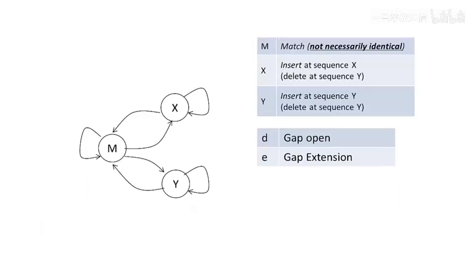
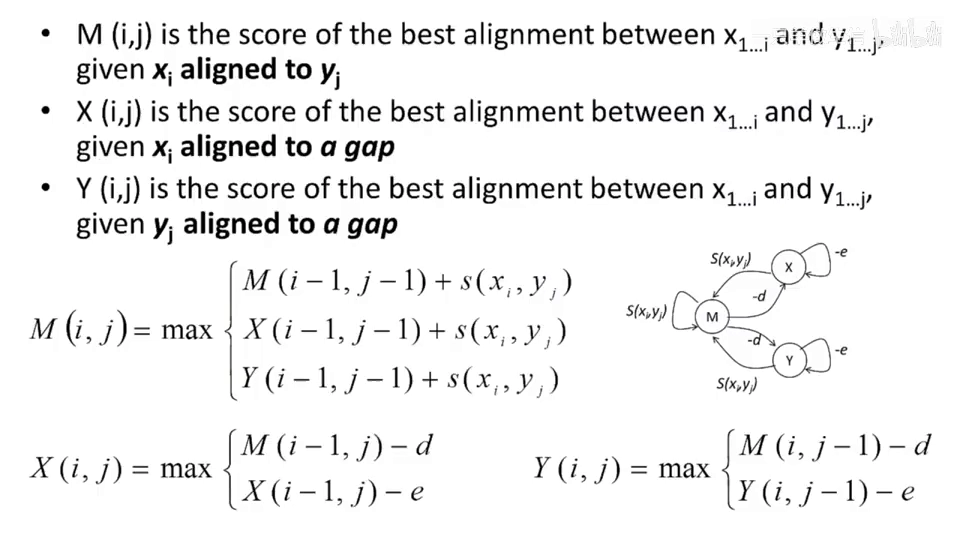
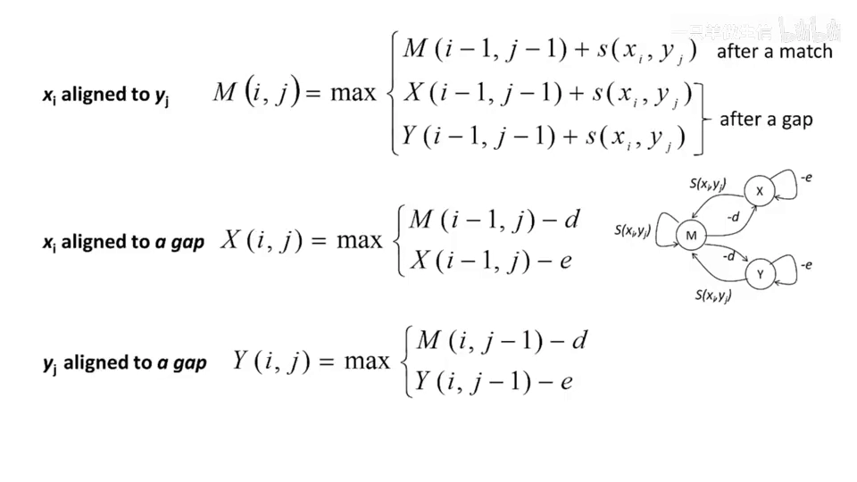

# 仿射空位罚分：gap-open 与 gap-extension

> 视频来源：[考虑仿射空位罚分的序列比对，以及如何计算 Needleman-Wunsch 算法的时间复杂度](https://www.bilibili.com/video/BV1r2qWBfEUY/)（Bilibili · 北大生物信息学课程补充材料）
> 导读：这是北大“生物信息学导论与方法”的补充学习材料，讲者高歌。它接着全局/局部比对往下走，只解决一个问题：一个空位往往不止一个碱基长，罚分该怎样区分“开空位”和“延长空位”。视频还顺带把 Needleman-Wunsch 的 $O(mn)$ 时间复杂度讲清楚。

## 本讲要解决的核心问题（SCQA）

**背景**：前面讲全局比对和局部比对时，空位罚分都只用一个值 $d$：每出现一个空位，就扣 $d$ 分。

**冲突**：一次插入或缺失往往涉及多个残基，一个空位的长度常常大于一。如果每延长一个碱基都按“新开一个空位”来罚，长空位会被罚得过重，算法会不愿意把一段真实的缺失对齐成一个空位。

**疑问**：怎样让“开第一个空位”和“继续延长这个空位”收不同的费？这样改之后，动态规划还成立吗，计算量会变成多少？

**回答（中心思想）**：把空位罚分拆成 gap open（$d$）和 gap extension（$e$），并引入 M、X、Y 三个状态，用有限状态机描述状态之间的转移。这样仍然可以用动态规划填表，只是从填一个矩阵变成填三个相互关联的矩阵，时间复杂度仍是 $O(mn)$。

## 一、线性空位罚分的问题

讲者先回顾：在第一节里提到，由于一次插入和删除往往涉及多个残基，因此与替换不同，一个空位的长度常会大于一。所以空位罚分往往采取一种线性组合的模式，也就是把 **gap open** 和 **gap extending** 区分开来，分别给予不同的罚分。[【跳转到 00:33】](https://www.bilibili.com/video/BV1r2qWBfEUY/?t=33)

但在第二、第三节介绍全局和局部比对算法时，为了简化，空位罚分没有区分这两者，而是统一等于一个值 $d$。[【跳转到 00:52】](https://www.bilibili.com/video/BV1r2qWBfEUY/?t=52)

这两种做法的差别可以用一个直觉理解：线性罚分下，长度 $k$ 的空位扣 $k \cdot d$；仿射罚分下，同样长度的空位扣 $d + (k-1)\cdot e$。只要 $e < d$，长空位就不会被“重复收开张费”，更符合“一次插入事件”的生物学直觉。

## 二、三个状态与有限状态机

### 2.1 状态 M、X、Y

要正确区分 gap open 和 gap extending，就需要引入**状态**的概念。讲者沿用第二节的三种比对关系，把它们称为三个状态：[【跳转到 01:14】](https://www.bilibili.com/video/BV1r2qWBfEUY/?t=74)

- **M**：两个残基彼此对上，不一定相等（match 或 mismatch）；
- **X**：序列 X 的残基对一个空位，或者说在序列 X 上发生了一次插入；
- **Y**：序列 Y 的残基对一个空位，或者说在序列 Y 上发生了一次插入。

### 2.2 状态转移就是“收费规则”

用计算机科学中有限状态机的概念，可以把序列比对描述成状态之间的转移：[【跳转到 01:46】](https://www.bilibili.com/video/BV1r2qWBfEUY/?t=106)

- 从 M 到 X 或 Y：对应一次 **gap open**，收 $d$；
- 从 X 到 X、从 Y 到 Y：对应 **gap extending**，收 $e$；
- 从 M 到 M：无空位情况下比对的延伸，按替换得分 $s(x_i,y_j)$ 收费。

这张状态图就是后面递推公式的来源。只要沿着箭头走，每一步该扣什么分就确定了。

## 三、三个递推公式

### 3.1 状态的定义

讲者给出三个量的定义：[【跳转到 02:17】](https://www.bilibili.com/video/BV1r2qWBfEUY/?t=137)

- $M(i,j)$：$x_i$ 对应到 $y_j$，也就是两个残基对在一起时，序列 X 前 $i$ 位与序列 Y 前 $j$ 位的最好比对分数；
- $X(i,j)$：$x_i$ 比对到空位时，同样两个前缀的最好比对分数；
- $Y(i,j)$：$y_j$ 比对到空位时，同样两个前缀的最好比对分数。

### 3.2 公式

$$
M(i,j) = \max
\begin{cases}
M(i-1,j-1) + s(x_i,y_j) \\
X(i-1,j-1) + s(x_i,y_j) \\
Y(i-1,j-1) + s(x_i,y_j)
\end{cases}
$$

$$
X(i,j) = \max
\begin{cases}
M(i-1,j) - d \\
X(i-1,j) - e
\end{cases}
\qquad
Y(i,j) = \max
\begin{cases}
M(i,j-1) - d \\
Y(i,j-1) - e
\end{cases}
$$

### 3.3 逐项读公式

讲者逐项解释：[【跳转到 02:55】](https://www.bilibili.com/video/BV1r2qWBfEUY/?t=175)

- $M(i-1,j-1)$ 表示残基 $x_{i-1}$ 和 $y_{j-1}$ 对在了一起；$X(i-1,j-1)$ 和 $Y(i-1,j-1)$ 则表示残基 $x_{i-1}$ 或 $y_{j-1}$ 对应一个空位。三者都可以斜向走到 $M(i,j)$，再按 $x_i$ 与 $y_j$ 的替换得分收费。
- $M(i-1,j)$ 表示残基 $x_{i-1}$ 和 $y_j$ 对在一起，但 $x_i$ 对应一个空位——这是新开一个空位，也就是 gap open，所以减去 $d$。
- $X(i-1,j)$ 表示 $x_{i-1}$ 已经对应一个空位，现在 $x_i$ 继续对空位——这是 gap extending，所以减去 $e$。
- $Y$ 方向同理：$M(i,j-1)-d$ 是 gap open，$Y(i,j-1)-e$ 是 gap extending。

关键差别就在“上一个状态是不是已经在空位里”。如果已经在 X 状态，继续空位只收 extension；如果刚从 M 进来，则要收一次 open。

## 四、三个平面一起填

和之前的 $F$ 类似，也可以用动态规划矩阵把三组状态的迭代关系表示成**三个平面之间的单元格填充**。[【跳转到 04:10】](https://www.bilibili.com/video/BV1r2qWBfEUY/?t=250)

讲者特别提醒：对于每一个平面而言，回溯关系既可能来自本平面，也可能来自另外一个平面。也就是说，填 $X(i,j)$ 时，上一格可能来自 $M$（开空位），也可能来自 $X$（延长空位）；回溯时同样要判断到底是哪一种。

这也是仿射空位罚分比线性罚分复杂的地方：不是矩阵变大，而是每个格子要维护三种“身份”，回溯路径要在三个平面之间切换。

## 五、时间复杂度：仍然是 $O(mn)$

最后讲者简单讨论了全局比对算法的时间复杂度。[【跳转到 04:40】](https://www.bilibili.com/video/BV1r2qWBfEUY/?t=280)

把 X、Y 两条序列分别画在矩阵的 X 轴和 Y 轴上，$F(i,j)$ 就可以直观理解为矩阵元素的下标，公式的迭代就变成对矩阵自上而下、自左而右逐个单元格填空。对于长度分别为 $m$ 和 $n$ 的序列，需要填写的格子总数是 $m \times n$ 个。[【跳转到 04:50】](https://www.bilibili.com/video/BV1r2qWBfEUY/?t=290)

假定每次操作需要一个常数时间 $c$，总时间就正比于 $m \times n$，即 $O(mn)$。讲者总结：Needleman-Wunsch 算法把时间代价从穷举法的指数时间降到了平方时间，有效降低了时间复杂度。[【跳转到 05:15】](https://www.bilibili.com/video/BV1r2qWBfEUY/?t=315)

仿射空位罚分虽然把一张表变成三张表，但每格仍然只做常数次比较，所以复杂度级别不变，只是常数变大。

## 小结

- 线性空位罚分对每个空位碱基都收同一个 $d$，长空位会被罚得过重。
- 仿射空位罚分拆成 gap open（$d$）和 gap extension（$e$），长度 $k$ 的空位扣 $d+(k-1)e$。
- 用 M、X、Y 三个状态描述“配对”“X 对空位”“Y 对空位”，状态转移直接给出收费规则。
- 三个状态各有一组递推公式；$M$ 从斜向的三种状态取最大，$X$ 和 $Y$ 在 open 与 extension 之间取最大。
- 实现上是三个相互关联的平面，回溯时可能在平面之间切换。
- 计算量仍是 $O(mn)$，只是常数变大。

## 关键术语速查

| 术语 | 一句话解释 |
| --- | --- |
| 空位罚分 | 对插入/缺失扣的分 |
| gap open | 新开一个空位时收的罚分 $d$ |
| gap extension | 在已有空位后继续延长时收的罚分 $e$ |
| 仿射空位罚分 | 空位罚分写成 $d+(k-1)e$ 的线性组合 |
| 状态 M / X / Y | 配对 / X 残基对空位 / Y 残基对空位 |
| 有限状态机 | 用状态和状态转移描述比对过程 |
| $O(mn)$ | 填 $m \times n$ 个格子的时间复杂度 |