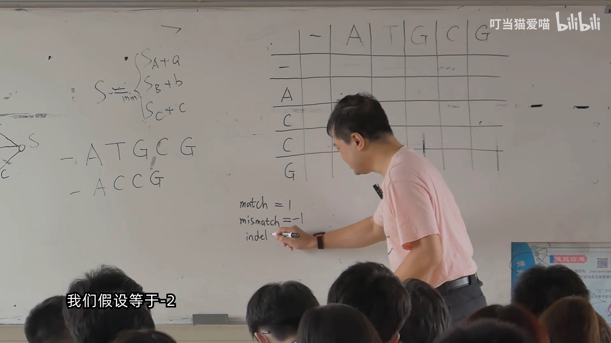
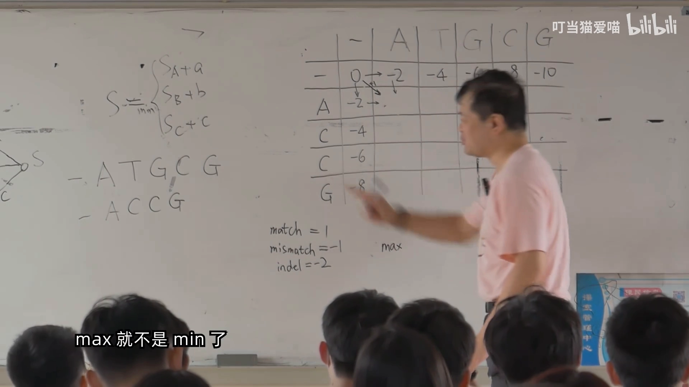
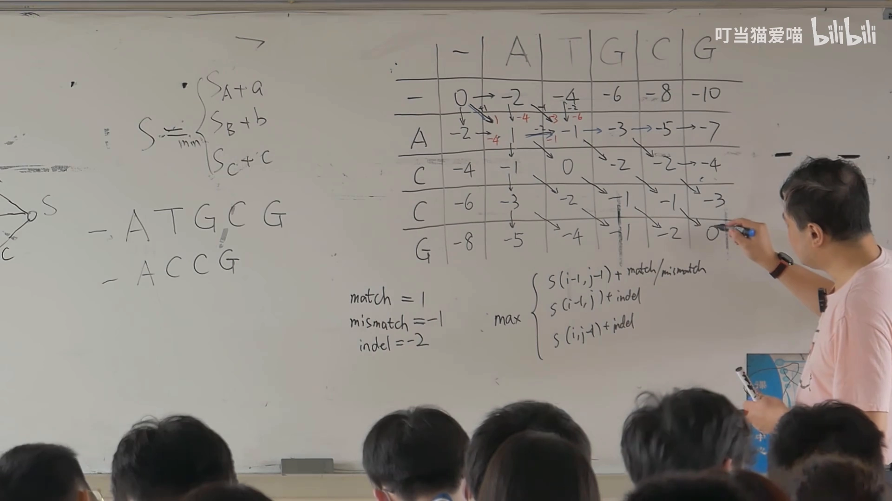
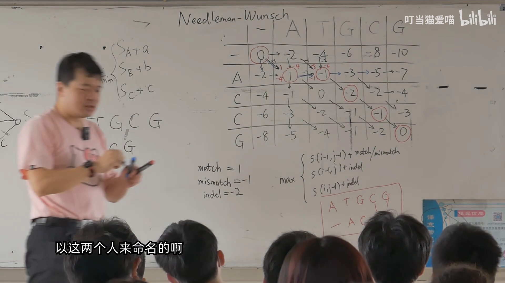
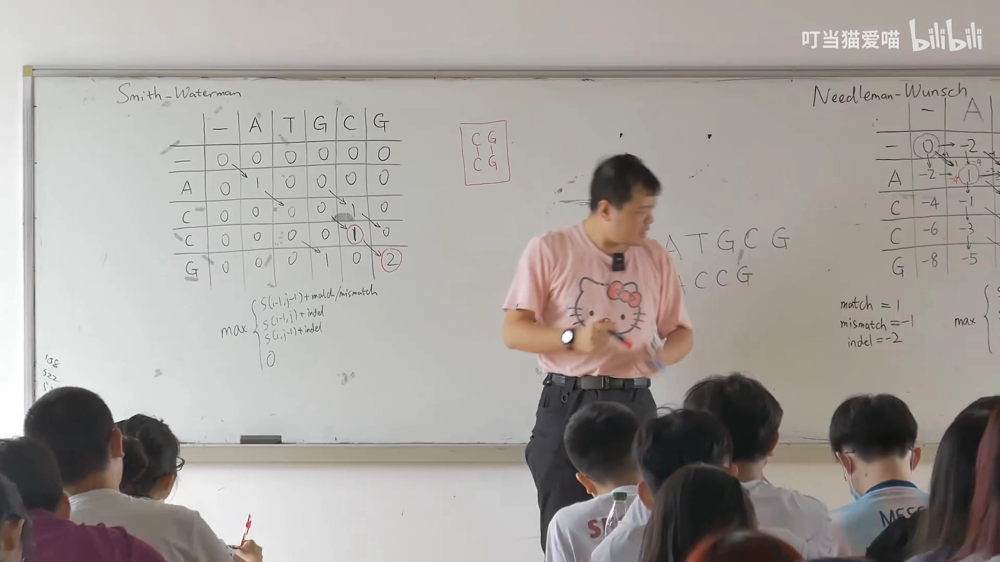

# 双序列比对：动态规划、全局与局部

> 视频来源：[生物信息学 2020版 3. 双序列比对：动态规划（暨南大学本科课程）](https://www.bilibili.com/video/BV1kD4y1o723/?p=1)（Bilibili · 叮当猫爱喵）｜时长约 37 分钟
> 导读：一堂从零手算双序列比对矩阵的课。先用导航找最短路解释动态规划，再一步步填出 Needleman-Wunsch 的全局比对矩阵，最后只改一条“加零”规则，得到 Smith-Waterman 的局部比对。本文按“目标—打分—递推—回溯—两种目标对比”重排，保留课堂上的算例与板书画面对应。

## 本讲要解决的核心问题（SCQA）

**背景**：生物信息学里有一个基本假设——序列相似的东西，功能往往也相似。研究一个新基因或新蛋白质时，我们通常先看它和已知序列像不像，再据此推测功能。

**冲突**：把两条序列放在一起，可以排出很多种对齐方式。哪一种才算“对得好”？如果逐一枚举所有排法，计算量会随序列长度迅速爆炸；而且两条序列可能只有一小段相似，其余部分毫不相干。

**疑问**：怎样用一种系统的算法，在可接受的计算量内找到得分最高的比对？全局比对和局部比对的目标有什么不同，打分规则又怎样改变最终结果？

**回答（中心思想）**：双序列比对可以看成在得分矩阵上找一条最高分路径。动态规划让每个格子只比较三个候选（斜向配对、上方插入空位、左方插入空位），从而把指数级枚举降为一次填表；从矩阵的哪个角落开始、到哪里结束，以及是否允许分数归零，决定了得到的是全局比对还是局部比对。

## 一、为什么序列比对是生物信息学的基石

### 1.1 序列相似，功能相似

课程一开始给出一个时间点：目前比较公认的生物信息学起点是 1981 年，Smith-Waterman 算法诞生的年份。[【跳转到 00:54】](https://www.bilibili.com/video/BV1kD4y1o723/?p=1&t=54)

但比年份更重要的是背后的假设。讲者把它称为一个“不能算定理、只能算假设”的前提：**序列相似的东西，功能必然相似**。[【跳转到 01:34】](https://www.bilibili.com/video/BV1kD4y1o723/?p=1&t=94)

为什么需要这个假设？因为把每一个物种的每一个基因、每一个蛋白质的功能都独立研究清楚，几乎不可能。讲者举了一个很具体的成本例子：在上世纪八九十年代，能把 PCR 做明白、把基因克隆出来、把蛋白质表达出来，再表征等电点之类的性质，基本够一个硕士毕业；如果能进一步找到细胞里的相互作用蛋白并分析通路，在本世纪初甚至够一个博士学位。[【跳转到 02:12】](https://www.bilibili.com/video/BV1kD4y1o723/?p=1&t=132)

既然逐个研究这么费事，通行做法就是：先在模式生物里把某个基因或蛋白质的功能研究清楚，再依据“序列相似、功能相似”的假设，把结论推广到其他物种的类似序列上。[【跳转到 03:02】](https://www.bilibili.com/video/BV1kD4y1o723/?p=1&t=182)

### 1.2 比对本身并不简单

把两条序列放在一起“比一比”，听起来简单，数学上却不简单。讲者提到，直到今天仍有顶级刊物在发表序列比对相关的研究，这个话题从学科建立至今经久不衰。[【跳转到 03:46】](https://www.bilibili.com/video/BV1kD4y1o723/?p=1&t=226)

所以这门课要带大家看这个领域的历史，从历史里理解算法的原理和发展。[【跳转到 04:40】](https://www.bilibili.com/video/BV1kD4y1o723/?p=1&t=280)

## 二、动态规划：先解决“导航找最短路”

### 2.1 从地图导航理解“往回推一步”

讲者先用手机导航做类比。地图上有 N 个城市，城市之间有很多路，每段路有长度；要从起点到终点找一条最近的路。地图很复杂时，人工规划很难最优。[【跳转到 07:33】](https://www.bilibili.com/video/BV1kD4y1o723/?p=1&t=453)

动态规划的做法是“往回推一步”。假设终点 S 的上一步只可能是 A、B、C 三个城市，而我已经知道从起点到 A、B、C 的最短距离分别是 $S_A$、$S_B$、$S_C$，也知道 A、B、C 到 S 的距离分别是 $a$、$b$、$c$，那么：

$$
S = \min(S_A + a,\; S_B + b,\; S_C + c)
$$

这一步很容易，因为三个子问题的答案都已知。可实际算法里 $S_A$、$S_B$、$S_C$ 也不知道，怎么办？再往回退一步，一直退到边界。讲者的说法是：“这样推一推，总能推到极限上去。”[【跳转到 09:38】](https://www.bilibili.com/video/BV1kD4y1o723/?p=1&t=578)


### 2.2 把比对看成一条路径

双序列比对可以类比成同一个问题：从起点到终点找一条路径，使两条序列的匹配度最高。所以最早的序列比对算法就是基于动态规划。[【跳转到 11:41】](https://www.bilibili.com/video/BV1kD4y1o723/?p=1&t=701)

课堂用的算例是两条 DNA 序列：

```
X: A T G C G
Y: A C C G
```

一条 5 个碱基，一条 4 个碱基。为了给“空位”留位置，先在两条序列前面各加一个空，然后画一个得分矩阵。[【跳转到 12:37】](https://www.bilibili.com/video/BV1kD4y1o723/?p=1&t=757)

## 三、打分规则：match、mismatch 与 indel

### 3.1 三种列

比对时，每一列只有三种可能：

- **match（匹配）**：两个碱基相同，记 $+1$；
- **mismatch（错配）**：两个碱基不同，记 $-1$；
- **indel（插入/缺失）**：一个碱基对着空位，记 $-2$。



为什么 indel 罚得比 mismatch 更重？讲者给的理由是生物学后果：错配只改变一个位置，而插入或缺失如果发生在编码区，可能引起移框突变，让后面的蛋白质“面目全非”。所以 indel 的匹配度下降更严重，要罚多一点。[【跳转到 15:17】](https://www.bilibili.com/video/BV1kD4y1o723/?p=1&t=917)

讲者同时强调：这些分数都是**人为设置**的，不同的设置会得到不同的比对结果。[【跳转到 15:59】](https://www.bilibili.com/video/BV1kD4y1o723/?p=1&t=959) 这句话是理解后文“打分改变区间”的钥匙。

### 3.2 初始化：第一行与第一列

矩阵左上角是“空对空”，定义为 0。第一行表示序列 X 为空、Y 的碱基逐个对空位；第一列表示序列 Y 为空、X 的碱基逐个对空位。所以它们是一串累加的 indel 罚分：第一行是 $0, -2, -4, -6, -8$，第一列是 $0, -2, -4, -6, -8, -10$。[【跳转到 16:10】](https://www.bilibili.com/video/BV1kD4y1o723/?p=1&t=970)



从某个格子横向移动，表示一条序列不动、另一条序列过了一位，也就是产生一个 indel；纵向移动同理。斜向移动则表示两条序列同时过一位，两个碱基配对，按 match 或 mismatch 打分。[【跳转到 16:55】](https://www.bilibili.com/video/BV1kD4y1o723/?p=1&t=1015)

## 四、填表：每个格子只比较三个候选

### 4.1 递推公式

设 $S(i,j)$ 是序列 X 前 $i$ 个碱基与序列 Y 前 $j$ 个碱基的最高得分，$s(x_i,y_j)$ 是两个碱基的替换得分（相同为 $+1$，不同为 $-1$），indel 罚分为 $d=-2$，则：

$$
S(i,j) = \max
\begin{cases}
S(i-1,j-1) + s(x_i,y_j) & \text{斜向：两个碱基配对} \\
S(i-1,j) + d & \text{上方：X 的碱基对空位} \\
S(i,j-1) + d & \text{左方：Y 的碱基对空位}
\end{cases}
$$

讲者特别提醒：导航问题求的是最小值，这里求的是**最大值**，所以是 max 而不是 min。[【跳转到 19:44】](https://www.bilibili.com/video/BV1kD4y1o723/?p=1&t=1184)



### 4.2 手算一个格子

以 $S(2,2)$ 为例：X 的第 2 位是 T，Y 的第 2 位是 C，错配。

- 斜向：$S(1,1) + (-1) = 1 - 1 = 0$；
- 上方：$S(1,2) + (-2) = -1 - 2 = -3$；
- 左方：$S(2,1) + (-2) = -1 - 2 = -3$。

三者取最大，得 $S(2,2)=0$。讲者带着学生把整个矩阵一格一格填完，边填边感叹“手算这玩意儿特别容易错，看得眼花”。[【跳转到 24:01】](https://www.bilibili.com/video/BV1kD4y1o723/?p=1&t=1441)

### 4.3 记录方向：为回溯做准备

光有分数不够，还要记住每个格子的最高分是从哪个方向来的。课堂上的做法是：在格子里画箭头，斜向、上方或左方。[【跳转到 22:25】](https://www.bilibili.com/video/BV1kD4y1o723/?p=1&t=1345)

这一步是后面“找回比对”的依据。没有方向，只知道最高分，却不知道最高分对应哪条路径。

## 五、回溯：从右下角走回左上角

### 5.1 回溯规则

全局比对从最后一行、最后一列（右下角）开始，顺着箭头往回走，直到左上角“空对空”的格子结束。[【跳转到 24:52】](https://www.bilibili.com/video/BV1kD4y1o723/?p=1&t=1492)

课堂算例的回溯过程是：

- 右下角 G 对 G，斜向；
- C 对 C，斜向；
- G 对 C，斜向错配；
- T 对空位，向上；
- A 对 A，斜向，到达左上角。

最终得到：

```
X: A T G C G
Y: A - C C G
```

最后面的 CG 能配上，前面的匹配效果比较差。整个比对得分是 0。[【跳转到 27:15】](https://www.bilibili.com/video/BV1kD4y1o723/?p=1&t=1635)



### 5.2 平局怎么办

手算时会出现两个候选分数相同的情况。课堂上的默认规则是“优先选斜向”。但讲者补充：如果希望结果更符合观感，可以改成“优先选择来源得分更高的方向”。比如走斜向来源于 1、走横向来源于 0，就优先斜向。这样矩阵里的箭头方向会改变，回溯出的比对也会更自然。[【跳转到 27:33】](https://www.bilibili.com/video/BV1kD4y1o723/?p=1&t=1653)

这说明一件事：**最高分相同的比对可能不止一条**。算法给出的是其中一条，具体哪一条取决于平局规则。

### 5.3 为什么叫“全局”

这个算法以 Needleman 和 Wunsch 命名，1977 年发表，被称为**全局比对**（global alignment）。原因是回溯一定从右下角走到左上角，两条序列被“头对头、尾对尾”地撑平。即使两条序列长度差别很大，也会被强行拉长对齐。[【跳转到 29:11】](https://www.bilibili.com/video/BV1kD4y1o723/?p=1&t=1751)

全局比对的隐含假设是：两条序列整体上同源，从头到尾都应该能对上。可现实中很多情况并非如此。

## 六、局部比对：只改一条“加零”规则

### 6.1 为什么需要局部比对

生物信息学里用得更多的是**局部比对**（local alignment）。讲者用结构域举例：蛋白质发挥功能往往依赖特定的结构域，只要这个结构域能和对上的序列匹配，功能就可能确定；结构域以外的序列对这个结构可能没有直接影响。[【跳转到 30:09】](https://www.bilibili.com/video/BV1kD4y1o723/?p=1&t=1809)

所以我们需要一种算法，只找两条序列中高度相似的子片段，而不管前后那些比对效果很差的部分。这就是 1981 年发表的 Smith-Waterman 算法。[【跳转到 30:48】](https://www.bilibili.com/video/BV1kD4y1o723/?p=1&t=1848)

### 6.2 只加一个零

Smith-Waterman 的改动非常小：在原来的三个候选之外，再加一个候选 0。

$$
S(i,j) = \max
\begin{cases}
S(i-1,j-1) + s(x_i,y_j) \\
S(i-1,j) + d \\
S(i,j-1) + d \\
0
\end{cases}
$$

讲者的原话是“非常简单的一条规则的改变”，但结果“有很大很大的不一样”。[【跳转到 31:47】](https://www.bilibili.com/video/BV1kD4y1o723/?p=1&t=1907)

这个 0 的作用是**保底**：只要三个候选都小于零，就取 0，相当于在这里“重新开始”一段比对。于是矩阵里不会再出现一路负下去的情况。[【跳转到 32:21】](https://www.bilibili.com/video/BV1kD4y1o723/?p=1&t=1941)


### 6.3 从哪里开始回溯

局部比对回溯的起点不再是右下角，而是**整个矩阵中的最大值**。找到最大值后，从那里往回走，走到 0 就停止。[【跳转到 34:45】](https://www.bilibili.com/video/BV1kD4y1o723/?p=1&t=2085)

课堂算例中，最大值 2 恰好落在右下角，对应最后两个碱基：

```
X: C G
Y: C G
```

前面的部分被完全忽略。讲者说，实际数据中最大值可能在矩阵中间，那就从中间开始回溯。[【跳转到 35:09】](https://www.bilibili.com/video/BV1kD4y1o723/?p=1&t=2109)



## 七、两种目标的差别：区间由边界和零决定

把两个矩阵并排看，差别一目了然：

| | 全局比对（Needleman-Wunsch） | 局部比对（Smith-Waterman） |
| --- | --- | --- |
| 回溯起点 | 右下角 | 矩阵中的最大值 |
| 回溯终点 | 左上角 | 遇到 0 停止 |
| 覆盖范围 | 两条序列的全部 | 只覆盖高分片段 |
| 边界处理 | 第一行/列累加负分 | 第一行/列全为 0，每格可归零 |
| 适用情形 | 两条序列整体同源、长度相近 | 只有一段结构域或片段相似 |

讲者总结：全局比对要利用两条序列所有的信息，基本上会把它们撑到头对头、尾对尾；局部比对寻找局部非常相似或高度相似的子序列，完全不管前后比对效果很差的部分，直接忽略掉。所以它们的应用场景也很不一样。[【跳转到 35:55】](https://www.bilibili.com/video/BV1kD4y1o723/?p=1&t=2155)


### 7.1 打分和缺口怎样改变区间

回到讲者反复强调的那句话：分数是人为设置的。把这句话和两种算法放在一起，就能看出打分对“比对区间”的影响：

- **替换打分**决定“错配值不值得对在一起”。match 相对 mismatch 越高，算法越愿意把两个不同碱基也排在同一列；mismatch 罚得越重，算法越倾向于用空位把它们错开。
- **缺口罚分**决定“插入/缺失值不值得开”。indel 罚得轻，算法更愿意用空位换匹配；罚得重，算法宁可保留错配，也不愿开空位。
- **边界与归零规则**决定区间本身。全局比对强制覆盖全长；局部比对允许在任意位置从 0 重新开始，因此输出的只是高分片段，区间可长可短。

换句话说，同一个打分矩阵，换一套分数，最高分路径可能换一条；换一种边界规则，输出的区间可能从“全长”缩成“一小段”。这也是为什么实际工具都允许用户调整打分与缺口参数——参数不是细节，它直接定义了什么叫做“好比对”。

## 小结

- 序列比对建立在“序列相似、功能相似”的假设上，是生物信息学最基础的操作之一。
- 双序列比对可以看成得分矩阵上找最高分路径；动态规划让每个格子只比较斜向、上方、左方三个候选，避免枚举所有排法。
- 打分规则通常写成 match 正分、mismatch 负分、indel 更重的负分；indel 罚得更重，是因为编码区的插入缺失可能造成移框。
- 填表时同时记录“分数从哪来”，回溯才能从矩阵走回比对。
- Needleman-Wunsch 从右下角回溯到左上角，得到覆盖两条序列全长的全局比对。
- Smith-Waterman 只加一条“候选 0”规则，从矩阵最大值回溯到 0，得到只覆盖高分片段的局部比对。
- 替换打分、缺口罚分、边界与归零规则共同决定最终比对区间；平局规则决定同分时选哪一条路径。

## 关键术语速查

| 术语 | 一句话解释 |
| --- | --- |
| 双序列比对 | 把两条序列的碱基或氨基酸一一对应起来，允许插入空位 |
| 全局比对 | 强制两条序列从头到尾都参与比对，代表算法是 Needleman-Wunsch |
| 局部比对 | 只找两条序列中得分最高的相似片段，代表算法是 Smith-Waterman |
| 动态规划 | 把大问题拆成重叠子问题，保存子问题最优解，逐格递推 |
| 得分矩阵 | 行、列分别是两条序列，每个格子存该前缀组合的最高分 |
| match / mismatch | 两个碱基相同 / 不同时的替换得分 |
| indel | 插入或缺失，表现为一个碱基对着空位 |
| 回溯 | 从终点格顺着记录的方向走回起点，读出比对 |
| 空位罚分 | 对插入/缺失扣的分，可统一一个值，也可区分 open 与 extension |