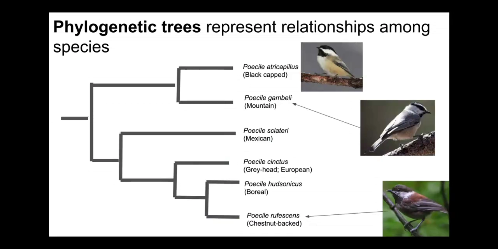
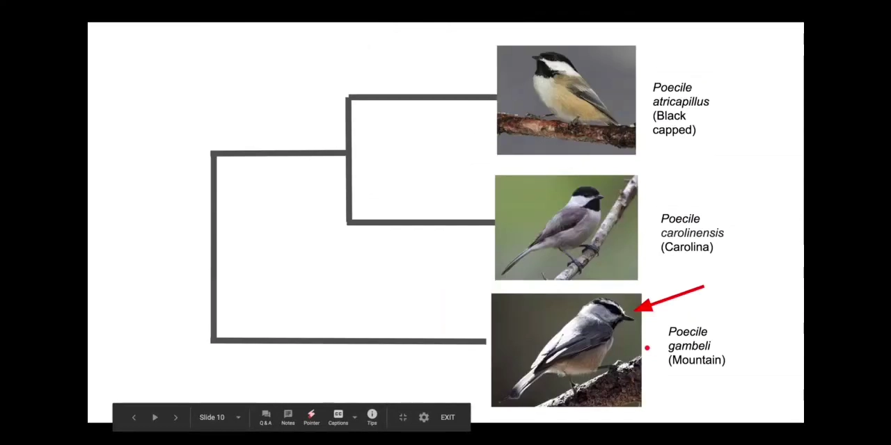
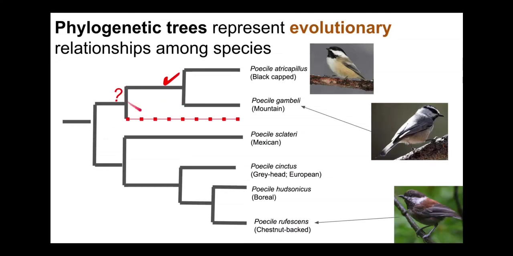
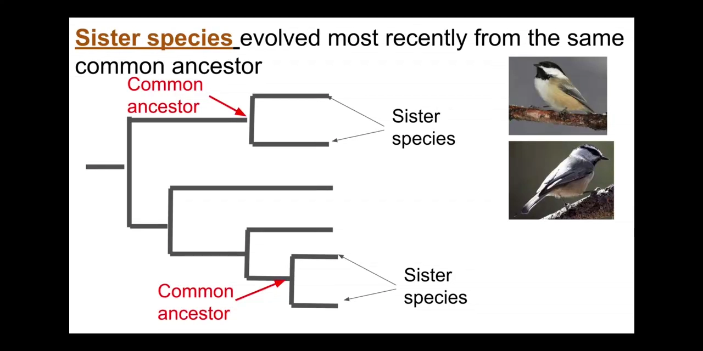
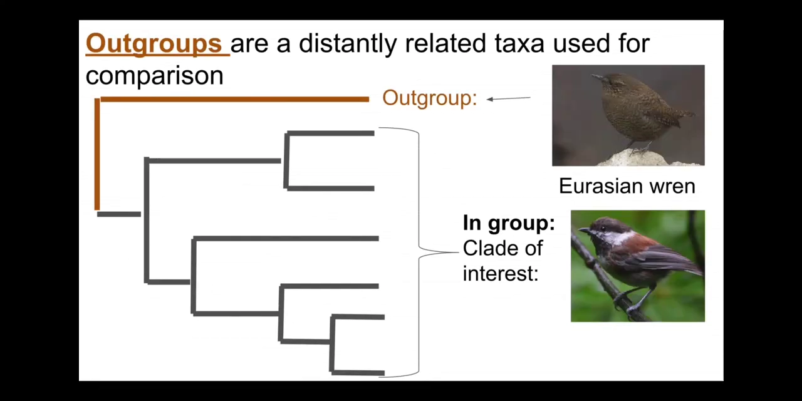
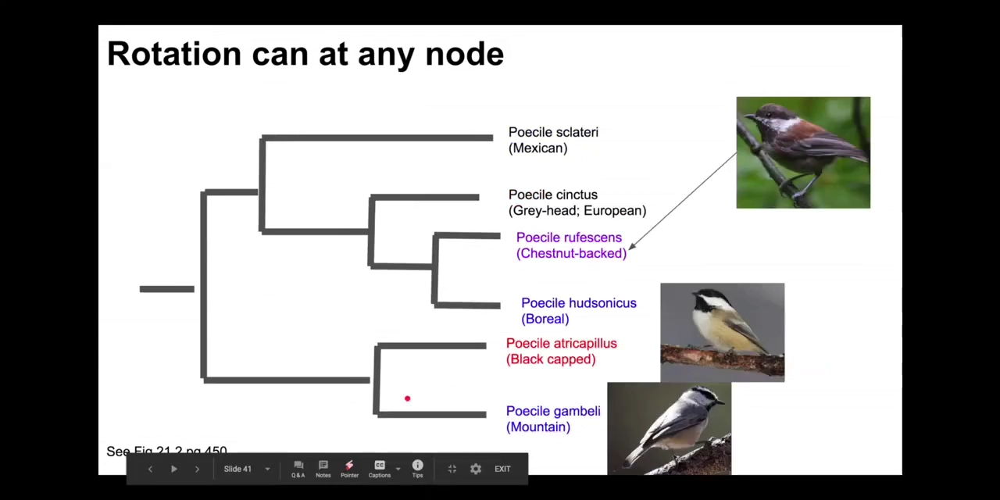
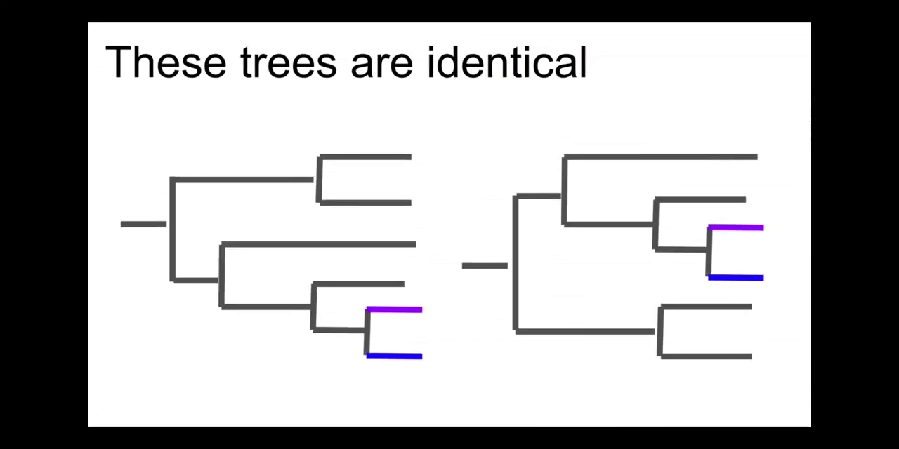

# 系统发育树怎么读：根、节点、姐妹群与旋转

> 视频来源：[如何理解系统发生树/系统发育树？](https://www.bilibili.com/video/BV16M4y1E7fy/)（Bilibili · 育空狼小孩，约 14 分钟，译自英文系统发育树入门讲座）
> 导读（100 字以内）：用北美山雀做贯穿案例，把"树表示的是进化关系而不是相似度"讲成一条链：先看形态猜错一次，再逐个拆开根、节点、枝条、分类单元、姐妹群、演化支和外群，最后用旋转说明树上的顺序没有意义。

## 本讲要解决的核心问题（SCQA）

**背景**：系统发育树是进化生物学中用来呈现和理解生物之间关系的重要工具，在生态学和其他生物学学科里也经常出现。

**冲突**：树看起来像一张组织架构图，读者很容易顺着"从上到下、从左到右"去读，把它当成"谁更高级""谁先出现"的排序。更麻烦的是，凭外形相似去猜关系，经常会猜错。

**疑问**：一棵树到底编码了什么信息？哪些部件有含义，哪些只是画法？

**回答（中心思想）**：树只编码**进化关系**——谁和谁共享更近的共同祖先。根、节点、枝条、末端、演化支各有确定含义；而末端的排列顺序、枝条的左右、整棵树的旋转都不携带信息。判断关系要看**节点**，不看枝条靠得多近、也不看谁画在上面。

---

## 一、树表示的是进化关系，不是相似度

本讲用北美山雀做案例。树上的每个末端是一个物种，位置在顶端：

[【跳转到 00:45】](https://www.bilibili.com/video/BV16M4y1E7fy/?t=45)

树上放什么都可以：物种、属、科，也可以是个体（比如具体的病人）甚至单个细胞。关键在于我们关心的是**进化关系**，而不是这些生物看起来有多像、行为有多相似。

[【跳转到 01:20】](https://www.bilibili.com/video/BV16M4y1E7fy/?t=80)

这一点值得单独强调，因为相似度是个诱人但不可靠的替代指标。有时候两个物种长得像确实能提供线索，但并不总是这样，所以形态相似并不总是构建系统发育的最好方法——通常**基因证据是最有力的方法**。

[【跳转到 01:55】](https://www.bilibili.com/video/BV16M4y1E7fy/?t=115)

本讲在这里做了一次现场演示：黑顶山雀和卡罗莱纳山雀长得很像，都分布在美国东部，分布区在宾夕法尼亚州南部的阿巴拉契亚山脉相连，形态上也很接近，而且它们实际上可以杂交。按外形判断，很自然会把这俩画成一对姐妹群，把眼部有明显白眉纹的山地山雀放得远一些。

[【跳转到 02:11】](https://www.bilibili.com/video/BV16M4y1E7fy/?t=131)

**这棵树是错的。** 基因证据和其他更精细的证据表明：黑顶山雀和山地山雀的亲缘关系更近，卡罗莱纳山雀反而更远。

[【跳转到 02:59】](https://www.bilibili.com/video/BV16M4y1E7fy/?t=179)

这个反例的价值在于它同时否掉了两个直觉：形态相似 ≠ 关系近；能杂交 ≠ 同一物种（卡罗莱纳山雀与黑顶山雀可以杂交，但它们是不同的物种，见同小节另一篇关于生殖隔离的博客）。

---

## 二、五个部件：根、节点、枝条、末端、分类单元

接下来是本讲的术语部分。

**根**在树的底部，表示推断出的、树上所有物种的共同祖先。注意不是所有的树都有根——基础教材和生态学里出现的树通常有根，但无根树也很常见。

[【跳转到 04:19】](https://www.bilibili.com/video/BV16M4y1E7fy/?t=259)

**枝条**是树上的线段。**节点**是枝条分开的地方，根也是一个节点。

[【跳转到 04:54】](https://www.bilibili.com/video/BV16M4y1E7fy/?t=294)

**分类单元**（taxon）是某个有名字的种群或物种群，甚至可能比种群更细，但通常指种群、物种或更高的类群。一个物种就是它内部所有种群的分类单元；一个属是所有物种的分类单元；科则是由所有属组成的一群。

[【跳转到 05:29】](https://www.bilibili.com/video/BV16M4y1E7fy/?t=329)

一个分支可以只带一个分类单元（比如这根枝条末端只有黑顶山雀），也可以带多个——比如一个分支下面有四个末端。

[【跳转到 06:04】](https://www.bilibili.com/video/BV16M4y1E7fy/?t=364)

---

## 三、姐妹群与共同祖先：节点是"推断的祖先"

**姐妹物种**是彼此最近的亲属：它们共享一个只属于它们的节点。反过来，如果两个物种之间还隔着别的物种，它们就不是姐妹。

[【跳转到 06:39】](https://www.bilibili.com/video/BV16M4y1E7fy/?t=399)

**共同祖先是用节点表示的**。这一点是读树的核心，本讲特意强调了两层：

1. 这些共同祖先是**推断**出来的过去存在过的物种，我们不一定认识它们，通常也不知道它们长什么样。
2. 越往下走，节点代表的共同祖先越古老，涵盖的物种越多。

[【跳转到 07:14】](https://www.bilibili.com/video/BV16M4y1E7fy/?t=434)

由此得到"演化支"（clade）的定义：**从一个共同祖先传下来的所有分类单元**。所以从根开始，这是一个包含六个分类单元的分支；再往里某个节点，是一个包含四个分类单元的分支；还有一个包含三个分类单元的。

[【跳转到 07:49】](https://www.bilibili.com/video/BV16M4y1E7fy/?t=469)

这个定义有个直接后果：**分组不能凭喜好挑**。比如我们完全有理由把这四个物种放在一起，因为它们都来自北美；但在进化上它们并不构成一个分支，因为那样会漏掉同样出自这个共同祖先的其他物种。要定义一个分支，就必须把它包含的全部后代都放进去。

[【跳转到 08:24】](https://www.bilibili.com/video/BV16M4y1E7fy/?t=504)

---

## 四、外群与内群：给树一个参照系

很多树上会额外加一个**外群**（outgroup）——一个亲缘关系更远、用来做比较的物种。本讲加的是欧亚鹪鹩：它是林地里的一个小型鸟类，但喙、腿、翅膀都很不同，生活方式不同，遗传上关系也相当远。

[【跳转到 09:44】](https://www.bilibili.com/video/BV16M4y1E7fy/?t=584)

外群的作用是给"内群"（我们感兴趣的那个分支）提供方向：哪些性状是内群内部新出现的，哪些是从更远处继承来的。没有外群，某些极性判断就无从下手。

[【跳转到 10:19】](https://www.bilibili.com/video/BV16M4y1E7fy/?t=619)

---

## 五、旋转不改变关系：树没有"左右"和"高低"

这是本讲花时间最多、也最容易被误读的一点：**分类单元的排列顺序不是树的关键特征**。

[【跳转到 10:39】](https://www.bilibili.com/video/BV16M4y1E7fy/?t=639)

我可以绕任意一个节点旋转它的两个子分支：把山地山雀放到上面、黑顶山雀放到下面，绕节点一转，什么都没变——这两个物种仍然通过这个节点相连，仍然共享这个共同祖先，树的意思和树里包含的信息都没有改变。

[【跳转到 11:14】](https://www.bilibili.com/video/BV16M4y1E7fy/?t=674)

把整棵树都翻过来也一样：所有分支的模式都是相同的。

[【跳转到 11:56】](https://www.bilibili.com/video/BV16M4y1E7fy/?t=716)

这一条为什么重要？因为它同时否掉了两种常见误读：

- **"画在上面的更高级/更晚出现"**：上下只是画法。树上的所有末端都是同一时刻的现存类群，没有哪一支"更进化"。
- **"枝条挨得近就关系近"**：亲缘关系由**内部节点**决定，不由枝条在纸面上的相对距离决定。

[【跳转到 13:01】](https://www.bilibili.com/video/BV16M4y1E7fy/?t=781)

---

## 六、把读树的动作固定成四步

把本讲的内容压成一套可重复的操作：

1. **找根**：根在哪？如果没有根，先确认这棵树是无根树，很多方向性判断做不了。
2. **找节点**：想比较的两个物种，从末端往下走，第一个相遇的节点就是它们的最近共同祖先。相遇得越晚（越靠上），关系越近。
3. **看它是不是一个演化支**：如果要讨论"某一群"，检查这群是否包含某个共同祖先的**全部**后代。漏掉后代就不是演化支。
4. **忽略顺序**：末端从上到下的排列、枝条的左右、整棵树的旋转都不携带信息。

---

## 七、边界：本节没有覆盖的部分

- **树是假说**：本讲明确说共同祖先是"推断"出来的，卡罗莱纳山雀的确切位置也"有点不确定"。所以树不是事实记录，而是当前证据支持的最优假设；新证据可以改变拓扑。
- **建树方法**：本节完全没讲邻接法、最大似然、贝叶斯推断等算法，也没讲比对和模型选择。学习目标只要求会读，不要求会建。
- **分支长度的含义**：本讲的树没有标尺，也没有讨论枝条长度代表时间还是遗传距离。这一点由同小节的 [系统发育树的刻度与可信度：分支距离、自展值与分化时间](系统发育树的刻度与可信度：分支距离、自展值与分化时间.md) 展开。
- **基因树与物种树**：本讲反复说"基因证据"，但没有区分"单个基因的树"和"物种的树"。两者可能不一致（不完全谱系分选、杂交与基因渗入都会造成差异），本节不展开。
- **水平基因转移**：树状结构假设遗传信息主要沿垂直方向传递。原核生物中水平基因转移普遍存在，会让"生命之树"在局部变成网状。本节不涉及。
- **同源与同塑**：本讲用形态相似导致画错树的反例触及了这个问题（相似可能是共同祖先带来的，也可能是趋同演化独立产生的），但没有展开同源／同塑／趋同的判别。这是下一步读树时必须补的一层。