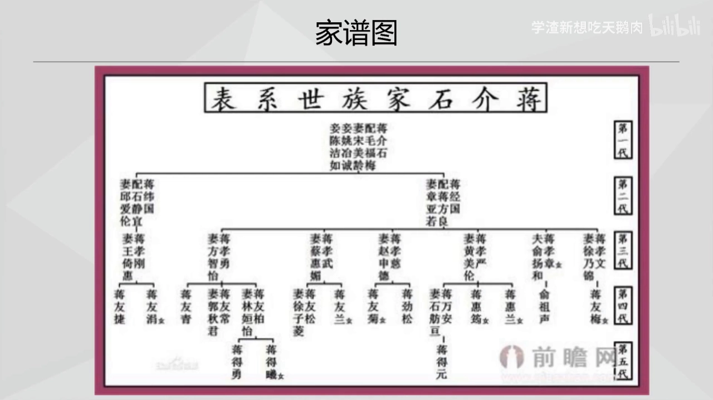
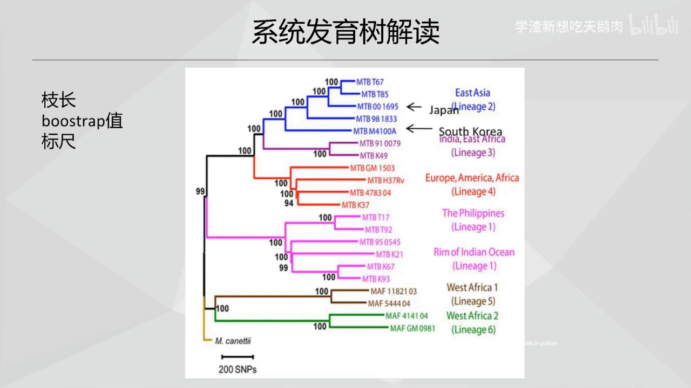
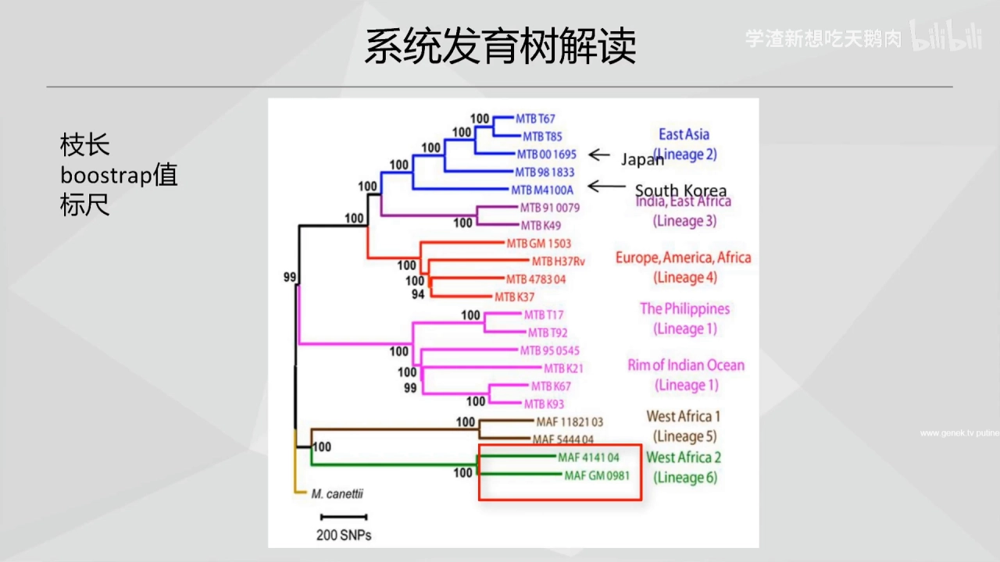
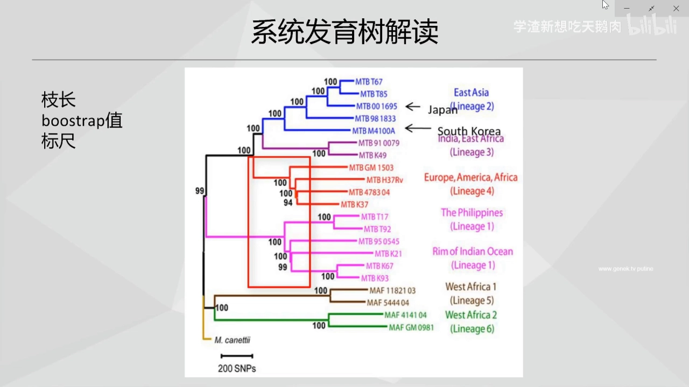

# 系统发育树的刻度与可信度：分支距离、自展值与分化时间

> 视频来源：[【系统发育树构建】-3 系统发育树解读](https://www.bilibili.com/video/BV1CQ4y1a7a8/)（Bilibili · Happy_Jekyll，约 5 分钟）
> 导读（100 字以内）：一支短讲解，把一张带数字和标尺的真实系统发育树拆成三个读数：拓扑、节点上的自展值、底部的比例尺。重点在最后一步——标尺量的是序列差异，不是时间；要把它换算成分化时间，还缺一个校准。

## 本讲要解决的核心问题（SCQA）

**背景**：上一篇讲了树的结构——根、节点、姐妹群、演化支，以及"旋转不改变关系"。但真实论文和数据库里的树，枝条上还挂着数字，底部还有一根标尺。

**冲突**：这些数字经常被直接读成"置信度很高"或"分化于多少年前"，但两者都不是看一眼就能得出的结论。

**疑问**：一张带刻度的树，哪些信息可以直接读，哪些必须再补一步才能读？

**回答（中心思想）**：一张典型的系统发育树主要有**三个信息**——拓扑结构、节点上的自展值（bootstrap）、以及标尺。拓扑和自展值可以直接读；**标尺不能直接读成时间**，它量的是序列差异，要换算成分化时间还需要突变速率或已知的分化时间做校准。

[【跳转到 02:34】](https://www.bilibili.com/video/BV1CQ4y1a7a8/?t=154)

---

## 一、先把它当作家谱读

本讲的开场类比很实用：系统发育树就是家谱。家谱里，最上面的是根，往下按代分层；同一代的两个分支是旁系关系，隔代往下是直系关系。通过家谱很容易知道每个人在家族中的位置。

[【跳转到 00:10】](https://www.bilibili.com/video/BV1CQ4y1a7a8/?t=10)

[【跳转到 00:22】](https://www.bilibili.com/video/BV1CQ4y1a7a8/?t=22)

这个类比能带出两件事：**层级**（越往下越古老）和**共同祖先**（两条线在某个节点汇合）。它也顺带说明了为什么"祖源分析"本质上就是找一个人在这棵树上的位置——把 DNA 序列测出来，比对之后放进已有的树里。

[【跳转到 01:42】](https://www.bilibili.com/video/BV1CQ4y1a7a8/?t=102)

---

## 二、三个读数：拓扑、自展值、标尺

本讲用一张结核分枝杆菌（*M. tuberculosis*）的系统发育树做示范。这类图在 NCBI 上搜索某个物种就会自动给出，列出与该物种相关的样品之间的关系。这是一棵有根树，图中用不同颜色区分不同谱系（Lineage 1–6 等），同一颜色分支内亲缘关系更近，也就是序列相似性更高。

[【跳转到 02:14】](https://www.bilibili.com/video/BV1CQ4y1a7a8/?t=134)

[【跳转到 02:34】](https://www.bilibili.com/video/BV1CQ4y1a7a8/?t=154)

| 读数 | 位置 | 直接含义 | 能不能直接下结论 |
| --- | --- | --- | --- |
| 拓扑结构 | 分支怎么分叉 | 谁和谁共享更近的共同祖先 | 能，但受自展值约束 |
| 自展值 | 节点上的数字 | 这个分支在重抽样下重复出现的比例 | 能，但有阈值 |
| 标尺 | 图底部 | 图上这段长度对应多少序列差异 | **不能**直接读成时间 |

三个读数里，前两个读的是"结构"，第三个读的是"刻度"。下面分开处理。

---

## 三、距离要沿枝条相加，不能量直线

树上两个末端之间的差异，等于它们各自往上走到共同祖先所经过的**所有枝条长度之和**。

[【跳转到 02:54】](https://www.bilibili.com/video/BV1CQ4y1a7a8/?t=174)

本讲举的例子是：样品 MAF GM 0981 与它同一分支内的 MAF 4141 04 之间的距离，是沿途第一段加第二段；而它与另一支的样品 MAF 1182103 之间的距离，是第二段加第三段加第四段加第五段，显然更远。

这条规则看起来琐碎，但它纠正了一个常见错误：**不要用纸面上两个末端的直线距离或上下间距判断亲缘关系**。枝条在图上可以画得长短不一，甚至可以为了排版而移动；只有沿路径累加的枝长才是数据。

---

## 四、自展值：这个分支有多稳

节点上的数字是**自展值**（bootstrap value）。它的构造方式是重抽样：把序列的位点重新抽样一次，用重排后的序列用同样的方法再画一次树；如果重排之后这个分支还在一起，就加一。一般重抽 1000 次，最终重现次数占重抽次数的百分比就是自展值——99 就表示 99% 的重抽样都支持这个分支。

[【跳转到 03:09】](https://www.bilibili.com/video/BV1CQ4y1a7a8/?t=189)

判读经验（本讲给的阈值）：通常认为自展值大于 75% 是可靠的，70% 也凑合；过低则说明树的分支关系不可靠。示例图中部的自展值都是 99、100，非常可靠。

[【跳转到 03:44】](https://www.bilibili.com/video/BV1CQ4y1a7a8/?t=224)

自展值低通常有两个相反的原因：序列太相似（没有足够的信息位点把分支区分开），或者序列差异太大（噪声让结构不稳定，每重抽一次就变一次）。本讲还补了一条尺度经验：在种及种以上的水平上画树一般比较稳定；如果只用单个基因或几个基因，自展值可能会很低。

**这里要小心一个误读**：自展值衡量的是"这套数据支持这个分支的稳定程度"，不是"这个分支为真的概率"。75% 不意味着 75% 的概率正确。

---

## 五、标尺不是时间：分子钟的逻辑与它的前提

最后是标尺。大部分情况下它就是比例尺，和地图上的比例尺差不多：示例中给定长度代表 **200 个 SNP**；有些树的标尺是小数，那它代表的是序列差异程度（如每个位点的替换数）。

[【跳转到 04:19】](https://www.bilibili.com/video/BV1CQ4y1a7a8/?t=259)

关键的一句是：**这个标尺并不代表分化时间**。只有知道了突变频率，或者已知两个物种的分化时间，才能把序列的差异度转化为分化时间。

这句话就是"分子钟"的全部逻辑骨架，可以写成一句比例关系（以下为对视频那句话的展开，视频本身没有给公式）：

> 两个类群之间的序列差异度 ≈ 2 × 每位点每年突变速率 × 分化后经过的时间

差异度可以直接从树上读出来（就是第三节的沿路径累加），未知量是速率。所以要用分子钟，必须先**校准**：拿一个分化时间已知的节点（通常是可靠的化石或明确的地质事件）去反推速率，再用这个速率去换算其他节点。没有校准，标尺只能告诉你"谁差异更大"，不能告诉你"谁分得更早"。

这一步也解释了为什么"分子钟"不是一个可以无条件套用的常数：速率本身会随类群、基因、世代时间变化，这一点本讲没有展开，属于边界。

[【跳转到 04:54】](https://www.bilibili.com/video/BV1CQ4y1a7a8/?t=294)

---

## 六、边界：本节没有覆盖的部分

- **建树算法**：本讲只说"用相同的方法再画一次树"，没有讲邻接法、最大似然、贝叶斯推断，也没有讲序列比对与替换模型。本节不涉及。
- **分子钟的模型与检验**：严格分子钟、松弛分子钟、速率差异的检验都不在本节范围；本节只保留"差异度 × 速率 → 时间，且需校准"这一层逻辑。
- **自展值之外的支持度**：后验概率、aLRT 等其他分支支持度指标本节未涉及；不同指标的数值不可直接互相比较。
- **基因树与物种树**：示例树是同一基因/基因组区域的分辨率，单个基因的树与物种的树可能不一致，本节不展开。
- **同源与同塑**：本节假定枝条长度反映的是可比较的同源位点差异；趋同演化造成的相似不进入这个累加，判别方法见上一篇的边界说明。
- **树是假说**：自展值和标尺都只是对当前数据与方法的刻画，不构成对进化历史的证明。