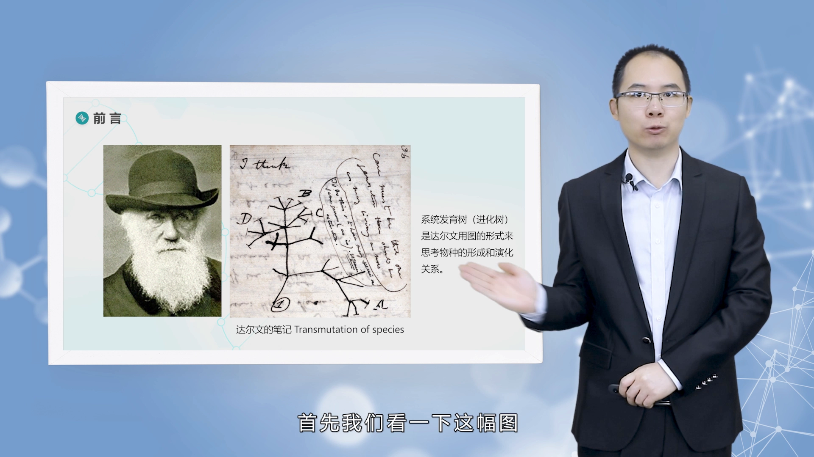
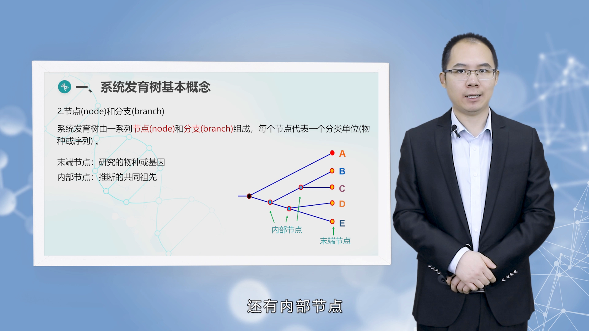
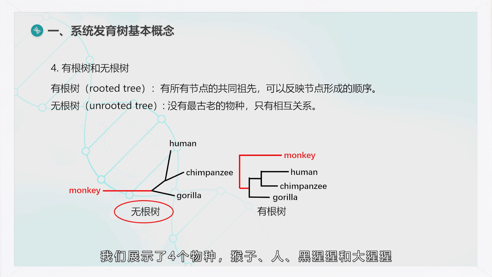
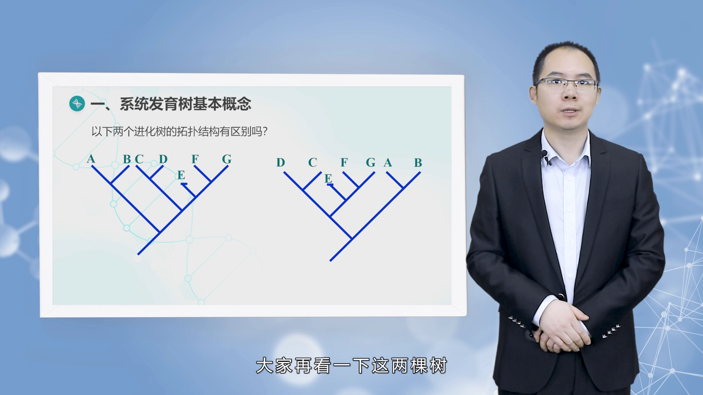
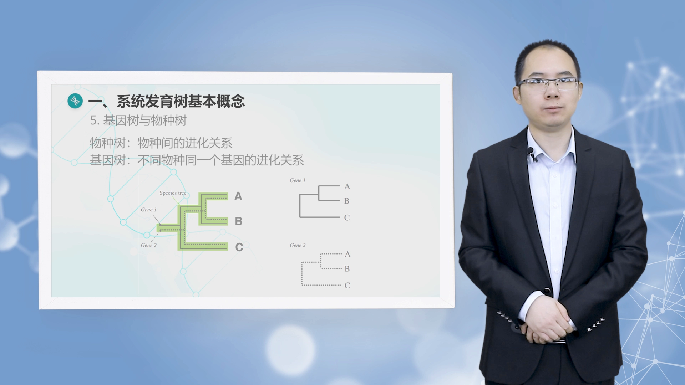
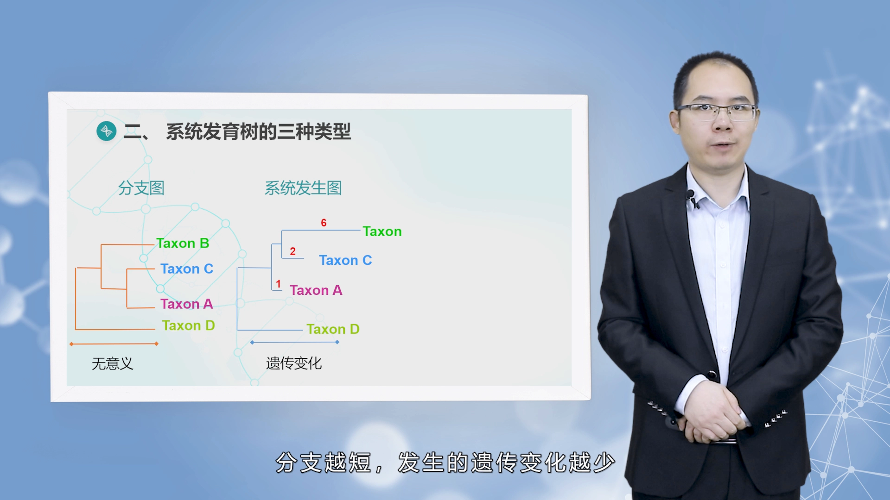
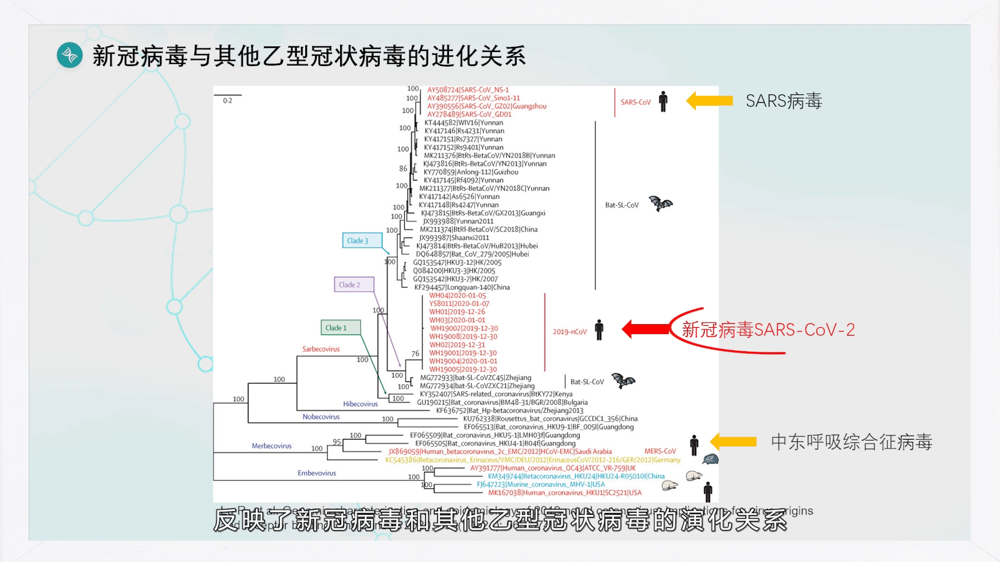
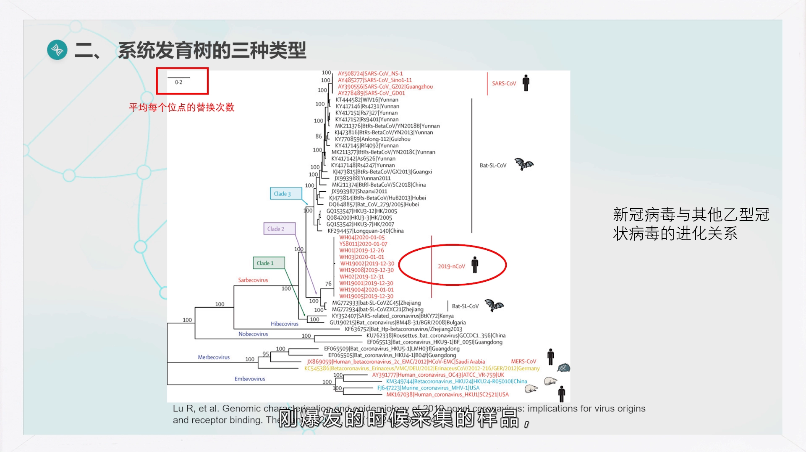
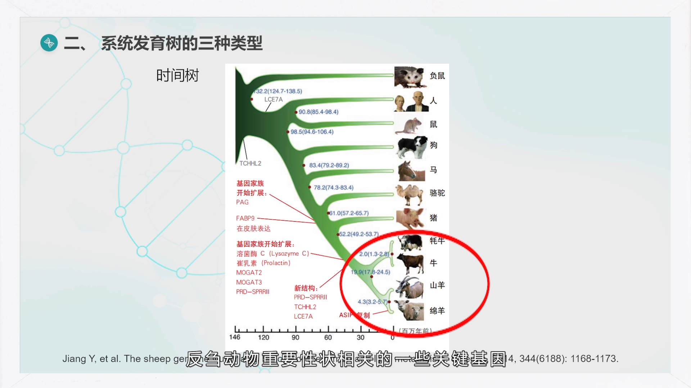

# 系统发育树的有根与无根：拓扑、外群定根与分支长度类型

> 视频来源：[生物信息学——第三章 系统发育分析1](https://www.bilibili.com/video/BV1me4y1x7Sm/)（Bilibili · 姜雨_NWAFU，约 9 分钟）
> 导读（100 字以内）：同一批物种为什么能画出好几种树？这支课把"树的信息"拆成三层：拓扑（谁和谁更近）、根的位置（能不能谈先后）、枝长的刻度（没有意义／遗传变化／时间），并用新冠病毒和反刍动物两棵真实树演示怎么读。

## 本讲要解决的核心问题（SCQA）

**背景**：系统发育树用节点和分支表示物种之间的演化关系。上一篇已经讲过根、节点、姐妹群和"旋转不改变关系"。

**冲突**：真正读论文时会遇到更麻烦的情况——同一批物种能画出好几棵看起来完全不同的树；有的树有根、有的没有；有的枝长只是排版、有的枝长在数突变、还有的枝长在数时间。如果不分清这三件事，就会把"画法"当成"结论"。

**疑问**：一棵树里，哪些差异是数据给出的信息，哪些只是画法？根是从哪来的？枝长到底在量什么？

**回答（中心思想）**：树携带的信息只有三样——**拓扑**（谁和谁共享更近的共同祖先）、**根的位置**（决定能不能谈演化先后）、**枝长的刻度含义**（无意义／遗传变化／时间）。拓扑相同而画法不同的树是同一棵树；无根树缺少根，只能谈相互关系；枝长必须看标尺才知道在量什么。

[【跳转到 00:25】](https://www.bilibili.com/video/BV1me4y1x7Sm/?t=25)

---

## 一、树的两个基本零件：末端节点与内部节点

系统发育反映的是某个物种的演化历史，系统发育树则是用图形把这段历史画出来，记录物种之间的相互关系。这个画法由来已久：达尔文在笔记里就用一棵分叉的树来思考物种的形成和演化关系。

[【跳转到 01:01】](https://www.bilibili.com/video/BV1me4y1x7Sm/?t=61)

进化树由**节点**和**分支**组成。

[【跳转到 01:49】](https://www.bilibili.com/video/BV1me4y1x7Sm/?t=109)

- **末端节点**：树上最外侧的那些端点，每个代表一个**分类单元**，也就是我们研究的对象。它可以是一个物种，也可以是一个基因。
- **内部节点**：分支相交的地方，代表**推断的共同祖先**。
- **分支**：连接节点的线段。

[【跳转到 02:14】](https://www.bilibili.com/video/BV1me4y1x7Sm/?t=134)

这里有个容易忽略的细节：**末端节点上放的不一定是物种**。同一套画法可以用来比较物种，也可以用来比较不同物种的同一个基因，甚至同一个基因的不同拷贝。读树前先确认"叶子是什么"，否则后面的结论会套错层级。

---

## 二、有根树与无根树：能不能谈"先后"

系统发育树分为**有根树**和**无根树**，区别只在一点：根在哪里。

[【跳转到 02:39】](https://www.bilibili.com/video/BV1me4y1x7Sm/?t=159)

| 类型 | 有没有最古老的节点 | 能读出什么 | 读不出什么 |
| --- | --- | --- | --- |
| 有根树（rooted tree） | 有，根是所有节点的共同祖先 | 节点形成的**顺序**、谁先分化 | —— |
| 无根树（unrooted tree） | 没有，只有相互关系 | 谁和谁更近 | 演化**方向**与先后 |

本讲用四个物种举例：猴子、人、黑猩猩、大猩猩。左边这棵是**无根树**，它告诉你这四者的相互关系，但看不出物种间的演化顺序——不知道哪一支最先分出来。右边这棵是**有根树**，从根往下能读出先后。

[【跳转到 03:23】](https://www.bilibili.com/video/BV1me4y1x7Sm/?t=203)

为什么右边那棵可以定根？因为我们**事先知道**人、黑猩猩、大猩猩属于人科，而猴子属于猴科，猴子离另外三个的演化关系较远。把猴子当作**外群**（outgroup），根就落在"猴子"与"人科三者"之间。

[【跳转到 03:28】](https://www.bilibili.com/video/BV1me4y1x7Sm/?t=208)

所以有根树和无根树是可以相互转换的：无根树加上一个外群就能定根；有根树去掉根就退化成无根树。**根不是树自己长出来的，而是外部知识加上去的。**

---

## 三、给无根树定根：根可以放在任何一段，但只有一种符合历史

既然可以相互转换，那具体怎么定根？本讲用一个四物种的无根树做了演示：A、B、C、D 四个末端，五根树枝上的分支被分成 1 到 5 五段。

[【跳转到 04:10】](https://www.bilibili.com/video/BV1me4y1x7Sm/?t=250)

**理论上，根可以定在五段分支的任何一段。** 比如把根定在中间第 1 段（红线代表假设的外群），从共同祖先就分出了两大支：一支是 A 和 B，另一支是 C 和 D。

[【跳转到 04:15】](https://www.bilibili.com/video/BV1me4y1x7Sm/?t=255)

也可以把根定在第 2 段上。这时得到的树就变成：从祖先先分出 A，接着分出 B，最后是 C 和 D。

[【跳转到 04:40】](https://www.bilibili.com/video/BV1me4y1x7Sm/?t=280)

同理，根定在其他段上，得到的也是有根树，但**反映的演化关系不一样**。本讲特别强调了一句：实际情况中，**只会一种有根树符合真实的演化历史**。

[【跳转到 05:05】](https://www.bilibili.com/video/BV1me4y1x7Sm/?t=305)

这句话是本节最实用的判读规则：**无根树本身不含"谁是祖先"的信息**。看到一棵没有根的树，不要顺着画法去读"先分化出谁"；看到一棵有根的树，要问一句"根是怎么定的"——是用了外群，还是用了某种假设（例如分子钟）？根定错，整棵树的先后顺序就都错了，而拓扑可能完全没变。

---

## 四、拓扑：镜像翻转不改变关系

接下来是本讲的第二个重点。看这两棵树：左边末端的顺序是 A、B、C、D、E、F、G，右边变成了 D、C、F、G、A、B。

[【跳转到 05:30】](https://www.bilibili.com/video/BV1me4y1x7Sm/?t=330)

**它们的拓扑结构没有区别。** 本讲的说法是：只是做了两次镜像翻转，两棵树代表的演化关系完全一样。判断依据仍然是**最近的共同祖先**——从两个末端往下走，第一个相遇的节点相同，关系就相同。

这解释了一个常见的困惑：为什么同一篇论文里，同一个类群在不同图上位置变了？因为**末端从左到右的顺序、分支的左右、整棵树怎么翻转，都不携带信息**。拓扑相同就是同一棵树。反过来，两棵树看起来"形状很像"，但嵌套关系不同，那就是不同的拓扑、不同的结论。

---

## 五、叶子放什么：物种树与基因树

树的画法一样，但叶子上放的东西可以不同，这就分出两种树：

[【跳转到 05:55】](https://www.bilibili.com/video/BV1me4y1x7Sm/?t=355)

- **物种树**：用一个物种的全基因组序列来构建，反映**物种间**的进化关系。
- **基因树**：用不同物种的某一个基因片段来构建，反映**同一个基因**在不同物种间的进化关系。

本讲没有展开两者的不一致，只在结尾留了一个问题（见第八节）。但读树时至少要记住：**看到一棵树，先确认它的叶子是物种还是基因**。叶子不同，能下的结论就不同。

---

## 六、枝长的三种含义：分支图、系统发生图、时间树

第三层信息是枝长。本讲按"枝长代表什么"把树分成三类：

[【跳转到 06:20】](https://www.bilibili.com/video/BV1me4y1x7Sm/?t=380)

| 类型 | 枝长代表 | 能读出什么 |
| --- | --- | --- |
| 分支图（cladogram） | 没有生物学意义，只是排版 | 只能读拓扑 |
| 系统发生图（phylogram） | 遗传变化：枝越短，发生的遗传变化越少 | 拓扑 + 相对差异大小 |
| 时间树（timetree） | 时间：横坐标就是从古到今 | 拓扑 + 分化时间 |

这张图值得仔细看：**分支图**里所有末端被拉到同一水平线，枝长只为排版；**系统发生图**里枝长有长短，枝上还能标出变化数。所以看到一棵树，第一件事是找**标尺**——没有标尺的树，多半是分支图，枝长不能读。

---

## 七、读标尺：0.2 是"每个位点 0.2 次替换"，不是时间

本讲用两棵真实树演示。第一棵是新冠病毒与其他乙型冠状病毒的进化关系树。

[【跳转到 07:05】](https://www.bilibili.com/video/BV1me4y1x7Sm/?t=425)

树左上角有一个比例尺，单位是 **0.2**，表示这段长度代表**平均每个碱基发生了 0.2 次突变**（即每个位点的平均替换次数）。

[【跳转到 07:30】](https://www.bilibili.com/video/BV1me4y1x7Sm/?t=450)

由此得到读法：**枝长越长，代表相关序列积累的突变越多**。

本讲还给了一个具体观察：这几个新冠病毒样品的枝长都非常短。原因是这项研究采集的样品都是在疫情刚爆发时采集的，**时间较短，病毒基因组积累的突变比较少**。

[【跳转到 07:55】](https://www.bilibili.com/video/BV1me4y1x7Sm/?t=475)

这个例子把"枝长 = 替换数"讲透了：枝长短不是因为"这几个病毒更原始"或"关系更近"，而是因为**观测的时间窗口短，还没来得及积累突变**。读枝长时要先想清楚它在量什么，再解释长短。

---

## 八、时间树：横坐标换成时间之后

第二棵是常见哺乳动物的进化树。这棵树的横坐标就是从古到今的时间，因此它是**时间树**。

[【跳转到 08:20】](https://www.bilibili.com/video/BV1me4y1x7Sm/?t=500)

从这棵树上可以读出：反刍动物出现的时间大概在 **3000 万年前**。树上还标记了一些与反刍动物重要性状相关的关键基因家族**开始扩张的时间**，例如溶菌酶 C、催乳素、MOGAT2、MOGAT3 等，以及 PRD–SPRRII 这类新结构的出现位置。

时间树和系统发生图的区别不在画法，而在**横轴的单位**：一个是替换数，一个是百万年。把系统发生图误读成时间树，就会把"差异大"说成"分得早"——这正是上一篇用分子钟讨论过的问题：要从替换数换到时间，中间还缺一个速率校准。

---

## 九、边界：本节没有覆盖的部分

- **建树方法**：本讲开头说会用 MEGA 演示构建进化树，但本节只处理"怎么读"，不讲序列比对、替换模型、邻接法／最大似然／贝叶斯推断与树搜索。这些属于 [5.1.7 系统发育推断](../../../README.md#b02-5-1-7)。
- **分支支持度**：本讲的示例树上节点也有数字（如 100），但没有展开自展值的构造与阈值。这一层由同小节的 [系统发育树的刻度与可信度：分支距离、自展值与分化时间](系统发育树的刻度与可信度：分支距离、自展值与分化时间.md) 处理。
- **定根的其他依据**：本讲只演示了用外群定根。实际工作中还会用分子钟、基因重复等假设定根，本讲没有涉及；但"根是外加的假设"这一点不变。
- **基因树与物种树为什么不一致**：本讲只在结尾提问（a 图是反刍动物物种树，b 图是很多基因树重叠的结果），没有给出原因。不完全谱系分选、基因重复与丢失、杂交与基因渗入都可能造成差异，本节不展开；旁系同源／直系同源的区分见 [5.1.3 同源、直系同源与旁系同源](../../../README.md#b02-5-1-3)。
- **相似不等于功能同一**：本讲能支持"画法上的相邻不等于关系近""枝长相近不等于分化晚"，但没有讨论序列相似与功能相同的关系。同一个基因在不同物种中序列相似，功能却可能已经改变；反过来，不同来源的序列也可能趋同到同一功能。功能推断要另找证据，见 [5.2.2 跨物种同源映射](../../../README.md#b02-5-2-2)。

---

## 小结

- 树只有两个零件：**末端节点**（研究对象，可以是物种或基因）与**内部节点**（推断的共同祖先），由**分支**连接。
- **有根树**能读节点形成的顺序；**无根树**只能读相互关系，读不出先后。
- **根是外加的**：用外群等外部知识定根。无根树的根理论上可以放在任何一段分支上，但只有一种符合真实历史。
- **拓扑才是信息**：末端顺序、分支左右、整棵树的镜像翻转都不改变关系；判断依据是最近的共同祖先。
- 叶子可以是物种也可以是基因，对应**物种树**与**基因树**，两者不一定一致。
- 枝长有三种刻度：**分支图**（无意义）、**系统发生图**（遗传变化）、**时间树**（时间）。读枝长前先找标尺。
- 标尺 0.2 表示每个位点平均 0.2 次替换；枝长短可能只是采样时间短，不代表"更原始"。

## 关键术语速查

| 术语 | 一句话解释 |
| --- | --- |
| 末端节点（叶节点） | 树最外侧的端点，代表一个分类单元（物种或基因） |
| 内部节点 | 分支相交处，代表推断出的共同祖先 |
| 有根树 | 有唯一根节点的树，能读出节点形成的先后顺序 |
| 无根树 | 没有根的树，只表示类群之间的相互关系 |
| 外群（outgroup） | 亲缘关系较远、用来给无根树定根的分类单元 |
| 拓扑结构 | 分支的嵌套关系；相同拓扑的树无论怎么翻转都是同一棵树 |
| 物种树 | 用全基因组序列构建、反映物种间关系的树 |
| 基因树 | 用某一基因片段构建、反映同一基因在不同物种间关系的树 |
| 分支图（cladogram） | 枝长无生物学意义、只表达拓扑的树 |
| 系统发生图（phylogram） | 枝长代表遗传变化多少的树 |
| 时间树（timetree） | 横坐标为时间、枝长代表分化时间的树 |