# 系统发育推断：替换模型、建树算法与分支支持

> 视频来源：[【基因组学讨论】15.1 系统发生树-建树原理](https://www.bilibili.com/video/BV1d4Z6YfEfR/)（Bilibili · 落羽杉Andy，约 77 分钟）
> 导读（100 字以内）：一场把"树怎么从比对算出来"讲完整的课堂：先用 JC/Kimura 模型把序列差异换算成距离，再逐一比较距离法、最大简约、最大似然与贝叶斯，最后用自展法给出分支支持。重点在每一步的假设与代价。

## 本讲要解决的核心问题（SCQA）

**背景**：上一篇已经会读树了——拓扑、节点、枝长、根、外类群。但真实论文里的树不是手画的，枝条上还挂着支持度数字。

**冲突**：同一批序列，换一种建树方法、换一个替换模型、换一次重抽样，得到的拓扑可能不一样；而节点上的数字又常被直接读成"这个分支有多真"。

**疑问**：一棵树究竟是怎样从一份多序列比对"算"出来的？那些支持度数字到底在衡量什么，又不能衡量什么？

**回答（中心思想）**：系统发育推断是**"比对 + 替换模型 + 建树准则 + 搜索/抽样"**四件事的组合：替换模型负责把"看到多少差异"翻译成"发生了多少次替换"，建树准则负责在众多可能的树里挑一棵，支持度则负责说明"换一批数据，这个分支还站不站得住"。**支持度衡量的是估计的稳定性，不是这段演化历史为真的概率**；树是当前数据与方法下的一个假说。

[【跳转到 46:30】](https://www.bilibili.com/video/BV1d4Z6YfEfR/?t=2790)

---

## 零、先约定几个词

本节不重讲树判读，只把后面反复用到的词固定下来（详细判读见 [5.1.6](../5.1.6_系统发育树判读：拓扑、分支长度与根/系统发育树怎么读：根、节点、姐妹群与旋转.md)）。

- **分类单元（taxon / OTU）**：树最末端的每一个点，代表一条序列或一个物种。
- **节点**：分类单元往上追溯时分开的点，代表一个祖先状态。
- **类群**：一个节点及其全部后代。只含一个祖先和它**所有**后代的叫**单系**；丢掉一部分后代的叫**并系**；把来自不同分支的后代凑在一起的叫**多系**。系统学上单系最合理，并系勉强可接受，多系应拒绝。
- **有根 / 无根**：无根树只说明"谁和谁更近"，不指明朝向；用**外类群**（研究类群之外、更接近祖先的参照）定根，就得到有根树。
- **标度 / 非标度**：非标度的枝长只是排版，没有数值含义；标度的枝长代表分异程度或分异时间。

[【跳转到 06:58】](https://www.bilibili.com/video/BV1d4Z6YfEfR/?t=418)
[【跳转到 15:26】](https://www.bilibili.com/video/BV1d4Z6YfEfR/?t=926)
[【跳转到 17:07】](https://www.bilibili.com/video/BV1d4Z6YfEfR/?t=1027)

---

## 一、推断的输入：一份比对，加一个替换模型

### 1.1 流程只有四步，难点在最后一步

构建分子系统树的流程是固定的四步：

1. **选分子**：用一个基因或蛋白来代表这段进化过程；
2. **序列比对**：把同源位点排到同一列；
3. **相似性衡量**：用"相异"或"置换"把比对变成距离；
4. **建树算法**：在可能的树里挑一棵。

[【跳转到 14:02】](https://www.bilibili.com/video/BV1d4Z6YfEfR/?t=842)

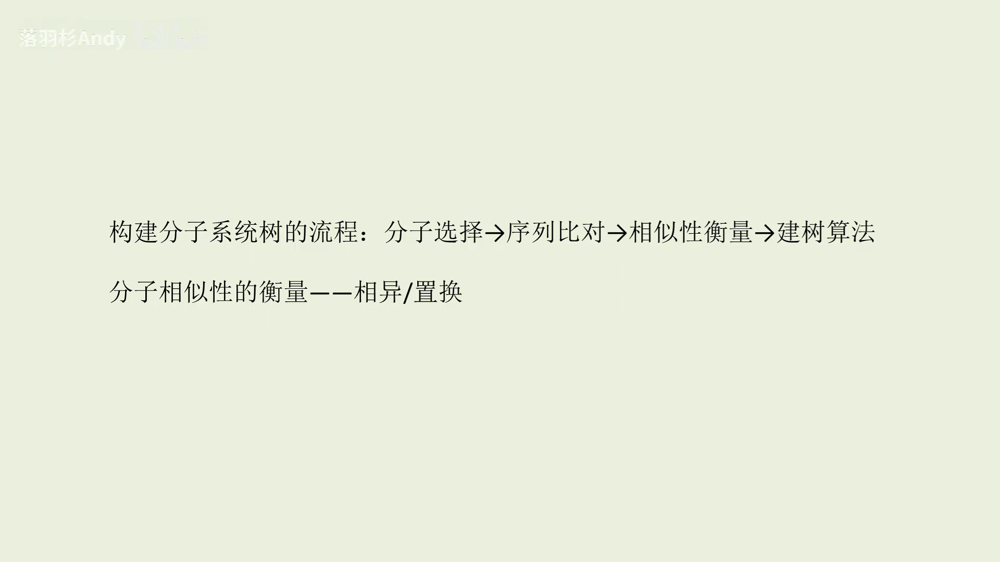

比对本身在前面的小节已经讲过；本节从第 3 步开始，因为**同一份比对，用"相异"还是"置换"去读，会得到不同的距离，进而得到不同的树**。

### 1.2 相异很直观，但它会把"绕远路"的替换算丢

**相异**（p-distance）就是数两个序列在多少个位点上不一样，再除以位点总数。四条序列两两比较，很快就能看出谁和谁更近。

[【跳转到 16:27】](https://www.bilibili.com/video/BV1d4Z6YfEfR/?t=987)

但相异只记录"最终不同"，不记录"过程中发生了什么"。讲者列了三种会让相异失真的情况：

| 情况 | 过程 | 最终看到的结果 | 相异会怎样误判 |
| --- | --- | --- | --- |
| 趋同置换 | A 先变 C 再变 T；另一支 A 直接变 T | 两支都是 T | 看起来相同，其实走了不同路径 |
| 平行置换 | 两支各自独立变成同一个碱基 | 两支相同 | 相同被当成同源 |
| 反转置换 | 变成 T 之后又变回 C | 与祖先相同 | 中间发生过的替换被完全抹掉 |

所以相异简单，但会**低估**真实发生过的替换次数：同一个位点可能变了两次、三次，最后看起来只差一次，甚至看起来没差。要处理这一点，就需要一个描述"替换怎样随时间发生"的**替换模型**。

[【跳转到 15:02】](https://www.bilibili.com/video/BV1d4Z6YfEfR/?t=902)

### 1.3 JC 单参数模型：所有替换等概率

最简单的模型是 **Jukes-Cantor（JC）单参数模型**：任何一个碱基变成另外三种碱基的概率都相同，记为 $\alpha$；保持不变的概率就是 $1-3\alpha$。

[【跳转到 17:10】](https://www.bilibili.com/video/BV1d4Z6YfEfR/?t=1030)

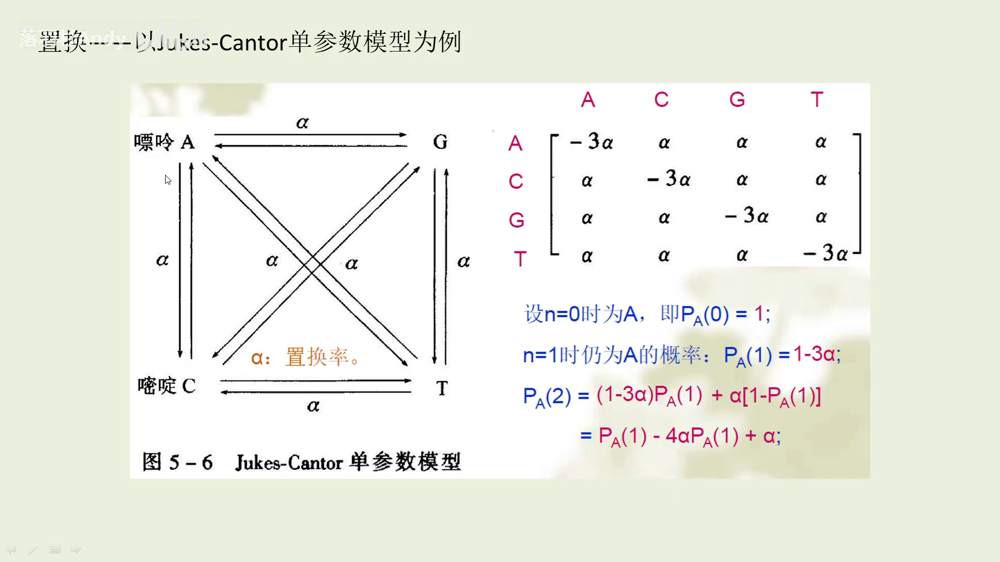

模型要回答的是"经过若干代之后，这个位点还是 A 的概率是多少"。第一代是 $1-3\alpha$；第二代则有两种来路：第一代是 A 且保持为 A，或者第一代不是 A 但在第二代突变成 A。写成递推就是

$$
P_A(n+1) = P_A(n) - 4\alpha P_A(n) + \alpha
$$

把世代间隔取到无限小，递推变成微分方程，再积分，就得到**取代函数**：

$$
P_A(t) = \frac{1}{4} + \frac{3}{4}e^{-4\alpha t}, \qquad
P_{T}(t)=P_{C}(t)=P_{G}(t)=\frac{1}{4} - \frac{1}{4}e^{-4\alpha t}
$$

[【跳转到 18:40】](https://www.bilibili.com/video/BV1d4Z6YfEfR/?t=1120)

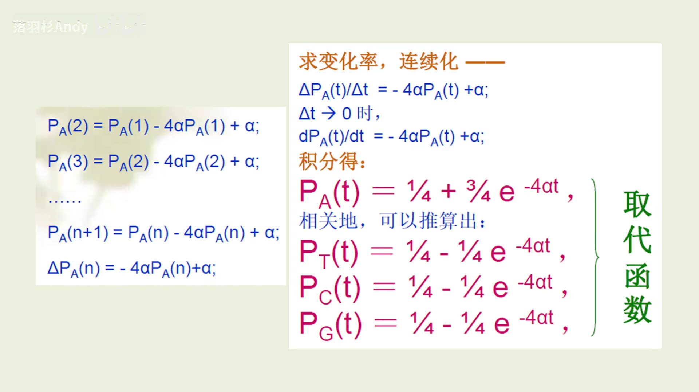

这一步的意义是：**模型把"时间 × 速率"合成了一个可计算的量**。但马上出现一个新问题——$\alpha$ 到底取多少？讲者给了三条路：真的去测某个物种的突变率；按物种给一个经验值；或者干脆**从比对数据本身反推**，也就是参数估计。

### 1.4 用相异反过来估计置换：把未知的突变率消掉

关键的一步代换是：JC 模型下任一位点的总置换率是 $3\lambda$，两条序列分开时间 $t$，距离就是 $d = 3\lambda t$。设两条序列在 $n$ 个位点中有 $x$ 个差异，观测差异比例 $\hat{p}=x/n$。把 $p$ 写成 $t$ 的函数，再把 $\lambda t$ 换成 $d/3$，就得到

$$
p = \frac{3}{4} - \frac{3}{4}e^{-4\lambda t} = \frac{3}{4} - \frac{3}{4}e^{-4d/3}
$$

反解出距离：

$$
\hat{d} = -\frac{3}{4}\ln\left(1-\frac{4}{3}\hat{p}\right)
$$

[【跳转到 21:19】](https://www.bilibili.com/video/BV1d4Z6YfEfR/?t=1279)

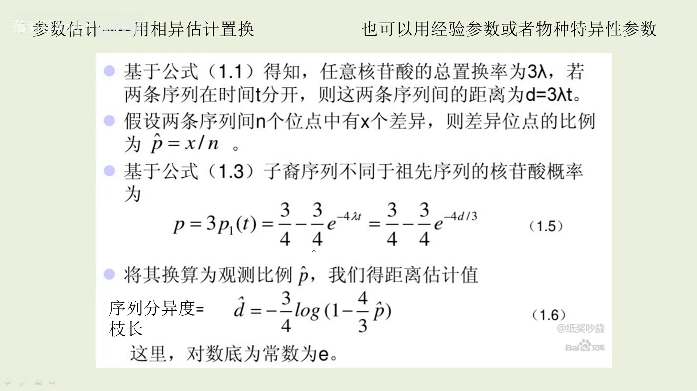

注意这个结果里**已经没有 $\lambda$ 了**：未知的突变率被消掉，只剩下可以直接从比对中数出来的 $\hat{p}$。算出来的 $\hat{d}$ 就是**序列分异度**，也就是树上的**枝长**。这就是"用相异估计置换"的含义——输入仍是简单的差异计数，输出却是校正过多次替换的距离。

讲者顺带指出一个边界：如果反过来想求 $\lambda$，就还需要时间 $t$，那要靠化石、比较解剖学或同位素等证据，已经不是单纯的分子方法。

### 1.5 Kimura 双参数模型：转换比颠换容易

JC 假设四种替换等概率，但结构上嘌呤（A、G）彼此接近，嘧啶（C、T）彼此接近。**转换**（transition）是嘌呤变嘌呤、嘧啶变嘧啶；**颠换**（transversion）是嘌呤与嘧啶互换。前者显然更容易发生。

[【跳转到 22:44】](https://www.bilibili.com/video/BV1d4Z6YfEfR/?t=1364)

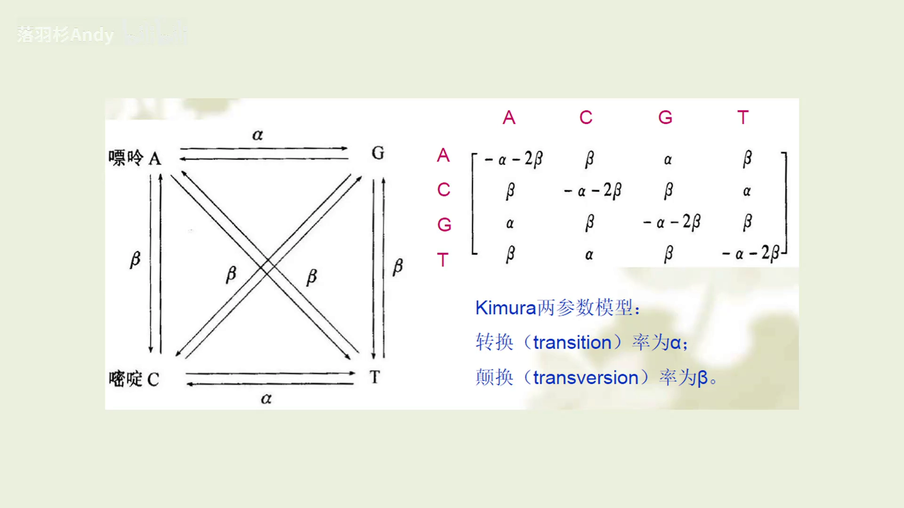

**Kimura 两参数模型（K2P）** 就给转换和颠换各一个速率。原理与 JC 完全相同，只是距离公式里同时出现转换差异比例和颠换差异比例两个 $\hat{p}$。再往上还有更复杂的核苷酸模型（例如把四种碱基频率也作为参数估计的模型），以及蛋白质用的氨基酸替换模型（如 BLOSUM）；讲者明确说，**后面建树不必手推这些公式，但要知道它们原理相近**。

### 1.6 模型怎么选：让软件把候选模型都试一遍

模型越复杂，参数越多，越容易过拟合；太简单又会系统性低估距离。实际操作中不靠手挑，而是用 ModelFinder、jModelTest 这类软件：把比对好的序列输进去，软件把各种模型都试一遍，用某种准则评估，给出推荐模型和对应参数。

[【跳转到 23:42】](https://www.bilibili.com/video/BV1d4Z6YfEfR/?t=1422)

讲者在这里插了一段"翻车"经历：他本想演示 jModelTest，结果打开的是名字相近的 Apache JMeter 下载页。这段可以当作提醒——**模型选择工具与性能测试工具只差几个字母，别装错**；至于"用哪个准则比较模型"，他只用一篇论文带过，没有展开。

---

## 二、选分子：速率要匹配问题的时间尺度

建树之前还要回答一个更靠前的问题：用哪个分子？不同分子的变异速率差别很大：

- **RNA 病毒**：复制酶易错，序列变化很快（HIV、流感、新冠）；
- **线粒体 DNA**：复制酶易错，又处于高氧环境，进化也快；
- **组蛋白、rRNA**：功能重要，受强纯化选择，进化很慢；
- **非编码区**：约束少，进化很快。

[【跳转到 25:42】](https://www.bilibili.com/video/BV1d4Z6YfEfR/?t=1542)

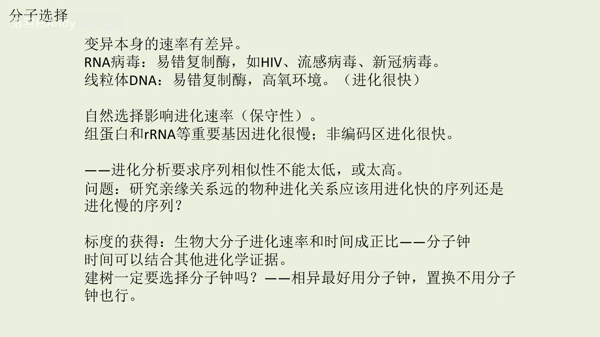

选择标准是**相似性适中**：太低，位点已经饱和，差异数不再随分化时间增长；太高，信息位点太少，树不稳定。所以研究亲缘关系远的类群，应该选**进化慢**的分子——时间已经很长，把速率压低，距离才落在合适区间。

这也带出**分子钟**：如果某个大分子的进化速率大致恒定，那么"变化程度与时间成正比"，枝长就可以直接读成时间（16S rRNA、细胞色素 C、线粒体 DNA 常被这样使用）。讲者给了一条很实用的边界：

- 用**相异**建树（如 UPGMA 一类方法）时，最好选分子钟分子，因为相异默认"差异越多、分开越久"；
- 用**置换**建树（如后面讲的邻接法）时，不必强求分子钟，因为模型本身已经显式处理了速率与时间。

---

## 三、四类建树算法：同一份数据，四种挑树方式

流程走到最后一步：在所有可能的树里挑一棵。讲者按"是否使用替换模型、是否穷举"把方法分成四类，重点讲最大似然法。

[【跳转到 27:53】](https://www.bilibili.com/video/BV1d4Z6YfEfR/?t=1673)

### 3.1 距离矩阵法与邻接法：只用了距离，没用模型

**距离矩阵法**先算两两距离，排成一个矩阵，再从矩阵建树。它用的距离来自"序列差异的数量"，本质是相异法，**不考虑置换**，所以精度有限。

**邻接法（NJ）** 是其中常用的一种：先把所有序列接成一个星状树，每次找距离最近的一对作为邻居合并，合并后重新计算距离，重复到只剩一个类群。

[【跳转到 28:50】](https://www.bilibili.com/video/BV1d4Z6YfEfR/?t=1730)

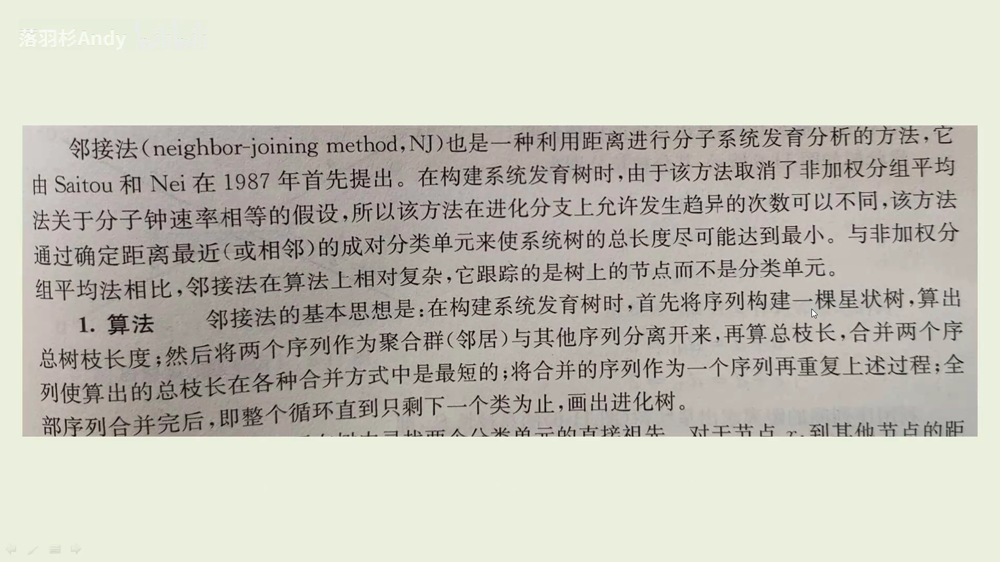

邻接法很快，但讲者的评价很直接：**"这个方法肯定不那么准"**——它只看距离，不评估"在这棵树下观察到这份数据的概率"。

### 3.2 最大简约法：只数替换次数，不用替换模型

**最大简约法（MP）** 的准则是一句口号："简单的就是真理"。它考虑替换，但**不用替换模型**，只数在给定拓扑下最少需要多少次替换；替换次数最少的树就是最大简约树。

[【跳转到 29:59】](https://www.bilibili.com/video/BV1d4Z6YfEfR/?t=1799)

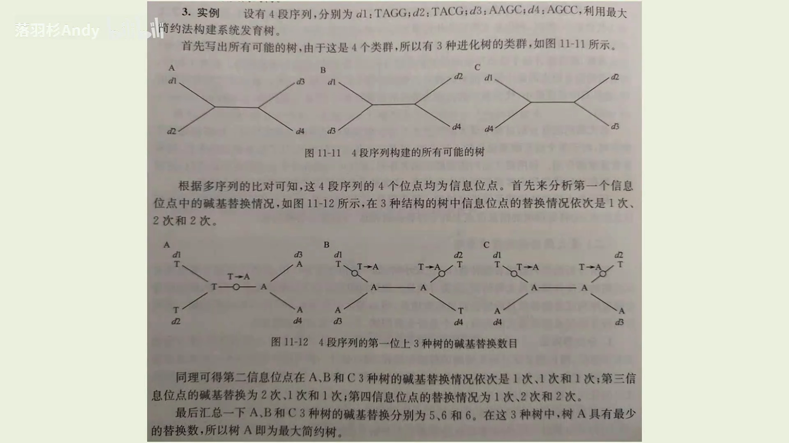

这个例子很能说明问题：四条序列只有三种无根拓扑，逐个位点数一遍就能比出优劣。但"最少替换"是一个**演化假设**（演化倾向于少变），不是从数据里估出来的概率。

### 3.3 最大似然法：在"模型 + 树"下，这份数据出现的概率最大

**最大似然法（ML）** 是讲者认为目前最合理、应用最多、也要求重点掌握的方法。它和统计学里的最大似然估计同源，但用法相反：

- 统计学里：事件已发生，反推未知参数；
- 建树时：模型参数已经估好（来自前面的距离估计），未知的是**树**；于是把所有候选树都算一遍，哪棵树让这份比对出现的概率最大，就选哪棵。

[【跳转到 30:32】](https://www.bilibili.com/video/BV1d4Z6YfEfR/?t=1832)

具体怎么算？以四条序列、每条三个位点为例，候选拓扑只有三种。对某一棵树、某一个位点：

1. 假设某个内部节点（比如 d5）上的碱基是 A、G、C、T 中的一种；
2. 沿着每条枝，用替换模型算出"从祖先碱基变成子代碱基"的概率；
3. 把所有枝的概率乘起来；
4. 内部节点有 4 种可能，两个内部节点就是 $4\times4=16$ 项相加；
5. 三个位点相互独立，再把三个位点的似然值相乘，取对数变成相加，得到对数似然。

[【跳转到 35:09】](https://www.bilibili.com/video/BV1d4Z6YfEfR/?t=2109)

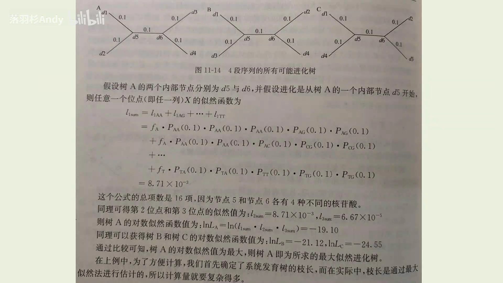

三种拓扑的对数似然分别是 $-19.10$、$-21.12$、$-24.55$，最大的是树 A，所以选树 A。注意幻灯片最后一行的小字：这个例子为了便于计算**先固定了枝长 0.1**；真实分析中枝长也要用最大似然估计，计算量会大得多。

这也解释了最大似然法最大的代价：**它要穷举所有树**。邻接法只需找邻居，最大似然法要把每种拓扑都算一遍，所以很慢。讲者对几种方法的比较是：最大似然法对假设不敏感（鲁棒）、估计一致性高（数据越多越稳）、符合生物学过程，但耗时最长；贝叶斯推断原理更复杂。

[【跳转到 42:17】](https://www.bilibili.com/video/BV1d4Z6YfEfR/?t=2537)

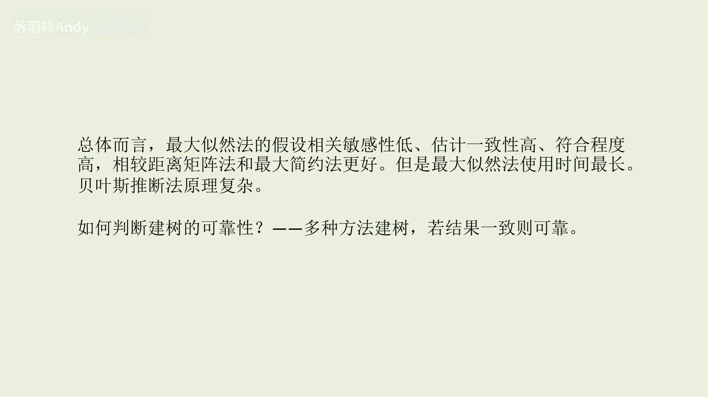

### 3.4 贝叶斯推断：直接给每棵树一个后验概率

**贝叶斯推断（BI）** 把问题换了个问法：不是"哪棵树让数据最可能出现"，而是"**已知这份数据，某棵树为真的概率是多少**"。用贝叶斯公式：

$$
P(\text{Tree}\mid \text{Data}) = \frac{P(\text{Data}\mid \text{Tree})\cdot P(\text{Tree})}{P(\text{Data})}
$$

其中 $P(\text{Tree})$ 是先验概率，$P(\text{Data}\mid\text{Tree})$ 是似然，$P(\text{Data})$ 是数据的概率（归一化常数）。算出来的 $P(\text{Tree}\mid\text{Data})$ 就是**后验概率（PP）**，后验概率最大的树为最优树。

[【跳转到 39:18】](https://www.bilibili.com/video/BV1d4Z6YfEfR/?t=2358)

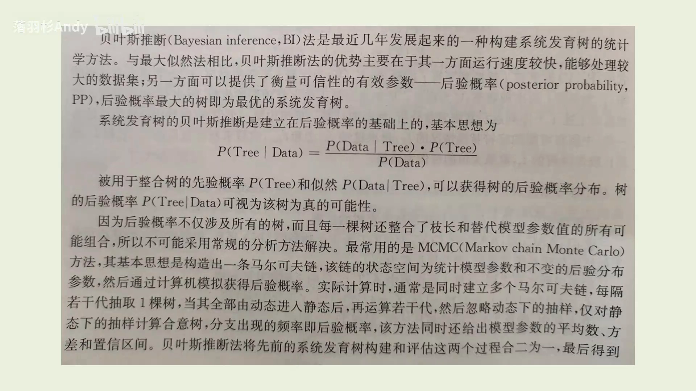

难点在于分母：它要对**所有树 × 所有枝长 × 所有模型参数组合**积分，常规方法算不了。实际做法是 **MCMC（马尔可夫链蒙特卡罗）**：

- 构造一条马尔可夫链，让它在"树 + 参数"的空间里游走；
- 先跑若干代，等链从初始状态进入平稳分布（这段叫 burn-in，预热期）；
- 预热期之后每隔若干代抽一棵树，只保留平稳阶段的样本；
- 统计这些样本：某个分支出现的频率，就是它的后验概率；同时还能得到模型参数的均值、方差和置信区间。

[【跳转到 40:48】](https://www.bilibili.com/video/BV1d4Z6YfEfR/?t=2448)

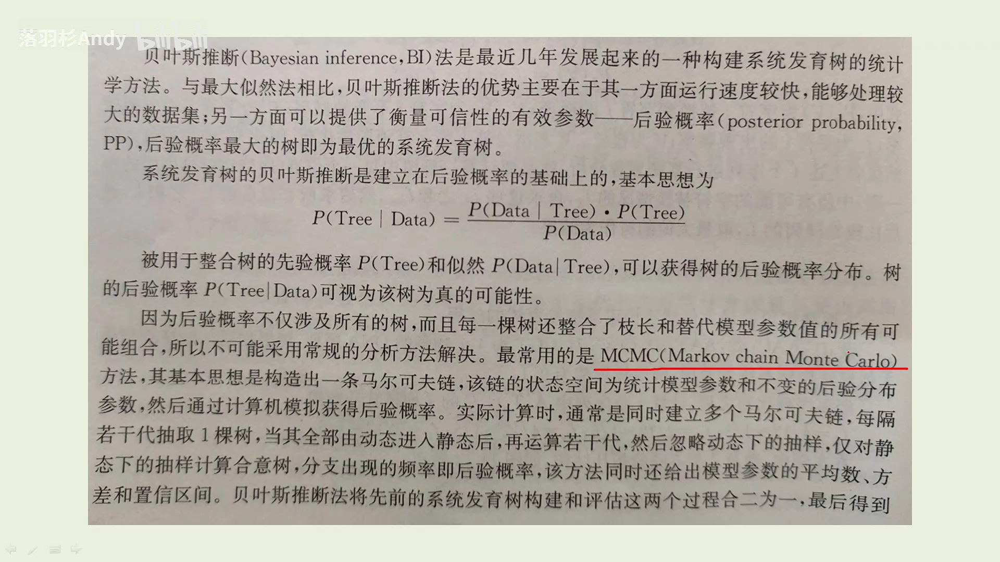

讲者用蒙特卡罗求积分打了个比方：要求一个形状复杂函数下方的面积，不必解析积分，只要在方框里随机撒一万个点，数落在曲线下方的比例，就能估出面积。MCMC 就是在"树的空间"里做类似的事——**用抽样频率逼近后验概率**。

贝叶斯方法的好处是**构建与评估合二为一**：一次运行既得到树，也得到每个分支的后验概率，还附带参数的区间估计。代价是原理复杂、需要判断链是否收敛，且结果依赖先验与模型设定。

---

## 四、分支支持：换一批数据，这个分支还在不在

### 4.1 自展法：对位点做可放回重抽样

有了树，还要回答"这个分支有多稳"。讲者介绍的是**自展法（bootstrap）**，它可以套在前面的任何一种建树方法上。

直觉来自一个统计例子：从一批产品里抽 30 个测寿命，画出的频数直方图并不接近正态分布。这说明 30 个样本太少、代表性不够。怎么办？在这 30 个数据的基础上**有放回地**反复抽取，造出大量"伪样本"，再统计分布，就会接近理论形状。

[【跳转到 43:42】](https://www.bilibili.com/video/BV1d4Z6YfEfR/?t=2622)

搬到建树上，抽样单位不是序列，而是**比对后的位点（列）**：

1. 原比对有 $n$ 个位点，从中**有放回**抽 $n$ 个位点，拼成一份"伪比对"（某些位点被抽中两次、三次，某些一次也没抽到）；
2. 用这份伪比对按同样的方法建一棵树；
3. 重复 100 次（或更多），得到 100 棵树；
4. 看这 100 棵树里，某个分支在多少棵中出现——这个比例就是该分支的**自展值**。

[【跳转到 44:19】](https://www.bilibili.com/video/BV1d4Z6YfEfR/?t=2659)

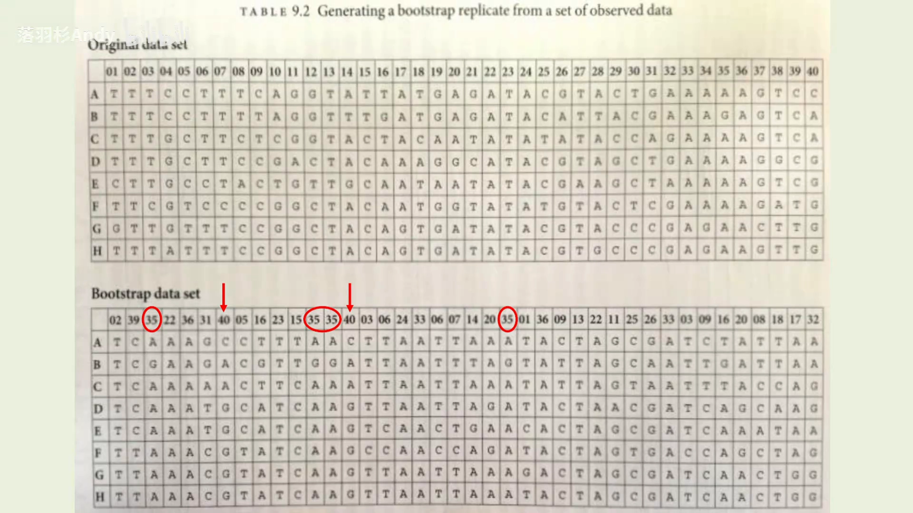

### 4.2 自展法在防什么：一个坏位点不该毁掉整棵树

讲者特别解释了自展法在最大似然里的作用。最大似然要把各位点的似然值**相乘**；乘法很脆弱——只要某一个位点估得很不准（异常值），整个乘积就会被它拖垮，"一个小数分子的破坏会让整个事都坏掉"。

自展之后，每个伪比对抽到那个"破坏分子"的概率很低，大多数重复树都不含它，形状趋于一致；少数含它的树形状异常。最后取那棵**大多数重复都重合**的代表性树，就把单点异常的影响压下去了。

[【跳转到 45:44】](https://www.bilibili.com/video/BV1d4Z6YfEfR/?t=2744)

### 4.3 自展值的读法与边界

- **它衡量的是"这套数据 + 这套方法"下分支的稳定性**：位点稍作扰动，分支就散架，说明数据里的信息不足以固定这个分支。
- **它不是"分支为真的概率"**：自展值 95 不意味着这段演化关系有 95% 的概率成立。这一点在 [B01 的自展值小节](<../5.1.6_系统发育树判读：拓扑、分支长度与根/系统发育树的刻度与可信度：分支距离、自展值与分化时间.md>) 有专门讨论，那里也给了"大于 75% 一般较可靠"的经验阈值。
- **低自展值有两种相反的原因**：序列太相似，信息位点不够；或者序列差异太大，噪声让结构不稳定。看到低值要先判断属于哪一种，而不是一律判为"树错了"。
- **后验概率与自展值不可直接互换**：两者来自不同的推断框架（抽样频率 vs 贝叶斯后验），数值尺度不同，不能拿 0.95 的 PP 去对 95 的 bootstrap 说"一样可靠"。

### 4.4 最朴素也最有效的交叉检验：换方法看结果是否一致

讲者给的可靠性判断很实在：**同时用多种方法建树，如果结果一致，树就比较可靠**。距离法、简约法、最大似然、贝叶斯各自假设不同，它们同时支持同一个分支，比任何单一数字都更有说服力。

这些方法都有成熟实现，讲者提到的常用建树软件是 PHYLIP、PAUP 和 MEGA；他没有在本次课里演示操作，只说明下一个视频会用 PHYLIP 实际建一棵分子树。

[【跳转到 45:59】](https://www.bilibili.com/video/BV1d4Z6YfEfR/?t=2759)

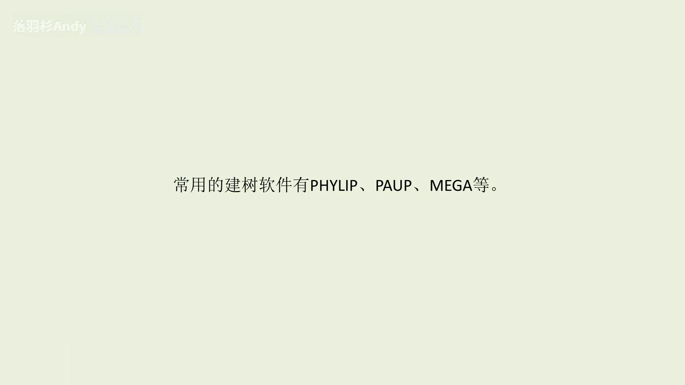

---

## 五、估计不确定性 vs 真实演化：这条线要划清

把整场讲座串起来，可以得到一条清晰的边界：

| 层次 | 它回答什么 | 它不能回答什么 |
| --- | --- | --- |
| 比对 | 哪些位点被当作同源列 | 这些列是否真的同源（比对本身是假设） |
| 替换模型 | 观察到的差异对应多少次替换 | 真实发生过几次替换（模型是近似） |
| 建树准则 | 在这套准则下哪棵树最优 | 哪棵树是真实历史 |
| 自展值 | 重抽样后分支是否重现 | 分支为真的概率 |
| 后验概率 | 在当前先验与模型下树的后验支持 | 先验错了会怎样 |
| 枝长 | 序列分异度（或校准后的时间） | 没有校准就不能读成绝对年代 |

具体到本节，至少有三类"估计不确定性"要分开：

1. **抽样不确定性**：位点不够、序列太短，换一批位点树就变——自展值主要刻画这一层。
2. **模型不确定性**：JC、K2P、更复杂的模型会给出不同的距离和不同的树；模型选错，支持度再高也只是"在这个错误模型下很稳定"。
3. **方法/搜索不确定性**：最大似然要穷举所有树，实际数据下穷举不完，只能启发式搜索；搜索没走到的那棵树，似然再高也不会被选中。

而"真实演化"还额外受制于：**基因树不等于物种树**（同一个生物的不同基因可以给出不同拓扑）、**水平基因转移会让树变成网状**（这时"一棵树"本身就是不合适的模型）、以及**已灭绝类群只能靠形态证据**。讲者在开头就提醒：相似不一定同源，趋同进化在形态和分子层面都存在。

所以正确的读法是：**把树读成"当前数据 + 当前模型 + 当前方法下的最优假说"，把支持度读成"这个假说对数据扰动的稳健程度"**，而不是读成历史本身。

---

## 小结

- 系统发育推断 = 比对 + 替换模型 + 建树准则 + 搜索/抽样；四者任一改变，树都可能改变。
- 相异只数最终差异，会漏掉趋同、平行、反转置换；替换模型把差异换算成替换次数。
- JC 假设四种替换等概率，K2P 区分转换与颠换；模型越复杂参数越多，实际用 ModelFinder/jModelTest 选择。
- 距离矩阵法/邻接法只用距离、不用模型，快但不准；最大简约法只数替换次数，不用替换模型。
- 最大似然法在给定模型下穷举树，取"数据出现概率最大"的树；准但慢，且真实分析中枝长也要估。
- 贝叶斯推断用 MCMC 抽样逼近后验概率，构建与评估合一，但依赖先验、模型与收敛判断。
- 自展法对**位点**做可放回重抽样，重复建树，用分支重现比例作为支持度；它衡量稳定性，不是"为真的概率"。
- 多种方法结果一致，是最朴素也最有效的可靠性证据。
- 树是假说：抽样、模型、搜索三层不确定性之外，还有基因树/物种树不一致与水平基因转移等真实演化层面的复杂性。

## 关键术语速查

| 术语 | 一句话解释 |
| --- | --- |
| 相异（p-distance） | 两条序列不同位点所占比例，只看结果、不看过程 |
| 置换（substitution） | 演化过程中实际发生的碱基替换，可能多次发生在同一位点 |
| JC 单参数模型 | 四种碱基互相替换概率都为 α 的最简单替换模型 |
| Kimura 两参数模型（K2P） | 转换速率 α 与颠换速率 β 分开的替换模型 |
| 取代函数 | 模型给出的"经过时间 t 后某碱基变成另一碱基"的概率 |
| 序列分异度 / 枝长 | 用模型从差异比例反解出的距离，JC 下为 $-\frac{3}{4}\ln(1-\frac{4}{3}\hat{p})$ |
| 邻接法（NJ） | 每次合并距离最近的一对邻居、使总枝长最小的距离建树法 |
| 最大简约法（MP） | 选替换次数最少的树，不使用替换模型 |
| 最大似然法（ML） | 在给定模型下选"数据出现概率最大"的树 |
| 贝叶斯推断（BI） | 用后验概率 $P(\text{Tree}\mid\text{Data})$ 评估树，常用 MCMC 抽样 |
| MCMC | 马尔可夫链蒙特卡罗，用抽样频率逼近后验分布 |
| 后验概率（PP） | 贝叶斯框架下某分支在样本中出现的频率 |
| 自展法（bootstrap） | 对位点有放回重抽样、重复建树，用分支重现比例衡量稳定性 |
| 自展值 | 重复树中某分支重现的百分比，不是分支为真的概率 |
| 分子钟 | 假定分子进化速率恒定，使枝长可换算为时间 |
| 外类群 | 研究类群之外、更接近祖先的参照，用来给无根树定根 |

## 材料与边界说明

- 本节的树判读基础（分类单元、节点、单系/并系/多系、有根/无根、外类群、标度/非标度）只在第零节压缩交代，完整判读见 [5.1.6](../5.1.6_系统发育树判读：拓扑、分支长度与根/系统发育树怎么读：根、节点、姐妹群与旋转.md)；比对算法见 [5.1.4](../5.1.4_成对序列比对：局部／全局目标、打分与缺口/仿射空位罚分：gap-open%20与%20gap-extension.md) 与 [5.1.5](../5.1.5_多序列比对：列对应、保守位点与同源信息/Multiple%20Sequence%20Alignment.md)。
- 视频没有展开：模型选择的数学准则（AIC/BIC 等）、最大似然与贝叶斯的树搜索启发式（NNI、SPR 等）、收敛诊断、分化时间校准的具体方法。这些属于后续小节或专门工具文档。
- 视频中的 jModelTest 演示实际打开的是 Apache JMeter 页面，正文已按事实说明，未据此描述 jModelTest 的界面。
- 自展值"不是为真概率"与 75% 经验阈值来自 [B01 自展值小节](<../5.1.6_系统发育树判读：拓扑、分支长度与根/系统发育树的刻度与可信度：分支距离、自展值与分化时间.md>)，不是本视频原话，正文已标注出处。