# dN／dS 与选择压力：同义与非同义替换的比值怎么算、怎么读

> 视频来源：[Searching for Natural Selection: dN/dS](https://www.youtube.com/watch?v=ZlcHujBbQ2Q)（YouTube · Introduction to Genetics and Evolution 公开课，约 14 分钟）
> 导读（100 字以内）：一支把 dN/dS 从"数位点"讲到"读结论"的短课：先逐位点区分同义与非同义位点，手算一个比值，再用人类—黑猩猩全基因组与 ASPM 说明这个数该怎么读、哪里会读错。

## 本讲要解决的核心问题（SCQA）

**背景**：前面的小节已经会做比对、会建树（见 [5.1.4](../5.1.4_成对序列比对：局部／全局目标、打分与缺口/双序列比对：动态规划、全局与局部.md)、[5.1.5](../5.1.5_多序列比对：列对应、保守位点与同源信息/Multiple%20Sequence%20Alignment.md)、[5.1.7](../5.1.7_系统发育推断：序列模型、树搜索与分支支持/系统发育推断：替换模型、建树算法与分支支持.md)）。把两条序列排在一起，就能数出它们在多少个位点上不一样。

**冲突**：差异本身不说明这些差异是怎么留下的。一个氨基酸改变可能是被自然选择推着迅速扩散的，可能是"坏突变"正在被淘汰，也可能对适合度毫无影响、只是随漂变在群体里晃荡。更麻烦的是，编码区里**非同义位点本来就比同义位点多得多**，直接比较两类差异的个数会系统性偏向一边。

**疑问**：怎样把"蛋白层面的改变"放到一把近乎中性的尺子上去量？量出来的比值到底在估计什么，什么情况下会给出误导性的答案？

**回答（中心思想）**：**dN/dS 用同义替换当分母、当"中性基准"，把非同义替换按位点数标准化，从而估计非中性演化相对于中性演化的多少。** 读法是：约等于 1 表示"不能拒绝中性"，小于 1 表示以约束（纯化选择）为主，大于 1 表示发生了反复的正选择。但它是**一个基因、一段时间、所有位点的平均值**：同一基因里"约束"和"快速演化"可以同时存在并互相抵消，所以约等于 1 并不等于"这个基因在中性演化"；这个指标还偏保守，找适应性氨基酸替换时假阴性偏多。

[【跳转到 06:30】](https://www.youtube.com/watch?v=ZlcHujBbQ2Q&t=390)

---

## 零、先把三个词固定下来

- **同义替换（synonymous change）**：核苷酸变了，但编码的氨基酸没变。因为密码子有简并性（多个密码子对应同一个氨基酸），这类改变**大体上、但不完全**是中性的。
- **非同义替换（non-synonymous change）**：核苷酸变了，氨基酸也跟着变。视频把它的命运分成三种：被**正选择**（有利、迅速扩散）、被**负选择/纯化选择**（相当于坏突变，出现后很快被清除）、或者**中性**（蛋白变了，但适合度没怎么变，于是在群体里随机漂）。
- **位点（site）**：这里指比对后编码序列里的一个核苷酸位置。注意 dN、dS 的分母不是"差异个数"，而是**位点数**——这是本节最容易算错的一步。

比对怎么来、同源位点怎么定，不在本讲重复；需要时回看 [5.1.4](../5.1.4_成对序列比对：局部／全局目标、打分与缺口/双序列比对：动态规划、全局与局部.md) 与 [5.1.5](../5.1.5_多序列比对：列对应、保守位点与同源信息/Multiple%20Sequence%20Alignment.md)。

---

## 一、为什么不能直接数差异：需要一把"中性尺子"

### 1.1 非同义差异有三种命运，差异数本身分不出来

视频用一个很直白的对照开场：非同义差异可能是好的、可能是坏的、也可能无所谓。好的会**很快在一个物种内扩散**；坏的"出现后可能待一会儿，但选择大体上在把它们清除掉"；无所谓的则"在群体里晃来晃去"（bebop around）。同义差异不改变氨基酸，因此被视为"大体上、但不完全"中性。

[【跳转到 00:32】](https://www.youtube.com/watch?v=ZlcHujBbQ2Q&t=32)

问题就在这里：如果你只数"两条序列有几个非同义差异"，你无法区分这三种命运。差异多，可能是正选择推得快，也可能只是这个基因突变率高、或者两个物种分开的时间长。

### 1.2 用同义差异做分母，把突变率的差异除掉

讲者的解法是把同义差异当成**中性参照**：

- 同义差异被认为是中性积累的，因此可以用它来**校正不同基因之间突变率的差异**；
- 非同义差异相当于"实验组"，同义差异相当于"对照组"；
- 两者相除，就得到"非中性变化相对于中性变化"的估计。

[【跳转到 01:24】](https://www.youtube.com/watch?v=ZlcHujBbQ2Q&t=84)

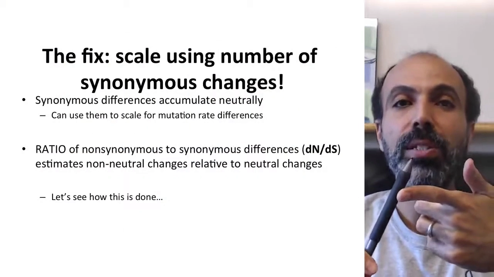

这一步的直觉值得记住：**dN/dS 不是"差异计数"，而是一个用中性位点做内标的比值**。它之所以能在不同基因之间比较，靠的正是这个内标。

---

## 二、dN 与 dS 的定义：先数位点，再数变化

### 2.1 定义里最关键的是"每……位点"

视频给的定义很短：

- $d_N$ = 非同义变化数 **除以** 非同义位点数；
- $d_S$ = 同义变化数 **除以** 同义位点数。

写成公式：

$$
d_N = \frac{\#\,\text{nonsynonymous changes}}{\#\,\text{nonsynonymous sites}},
\qquad
d_S = \frac{\#\,\text{synonymous changes}}{\#\,\text{synonymous sites}}
$$

[【跳转到 01:47】](https://www.youtube.com/watch?v=ZlcHujBbQ2Q&t=107)

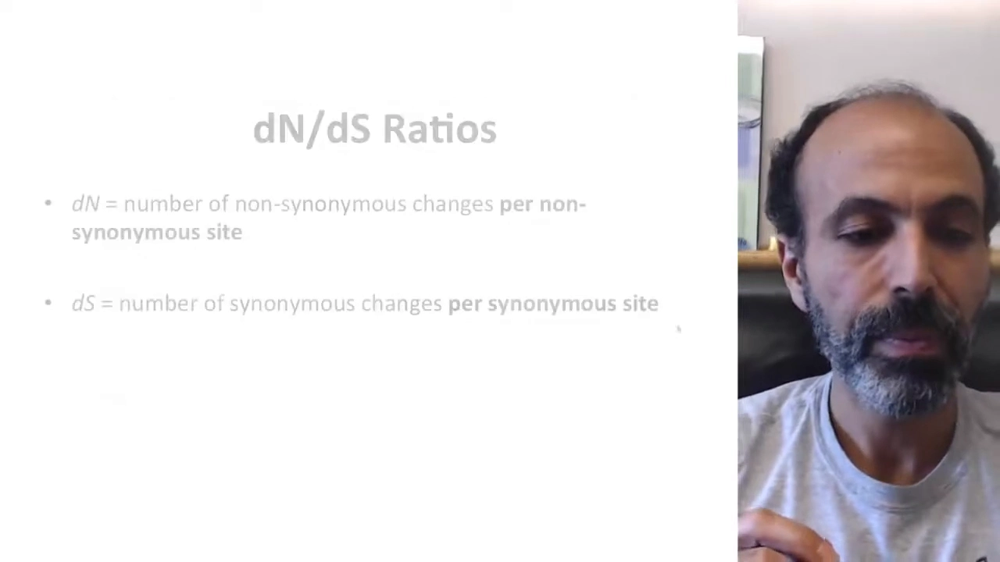

为什么要除以位点？因为**密码子三个位置的"同义机会"并不均等**：每个密码子的第二位永远是非同义位点（任何改变都换氨基酸），第三位则常常是同义位点。如果只数变化个数，非同义变化天然会显得更多，所以必须按"有多少位点可能产生这类变化"来标准化。

### 2.2 一个四密码子的手算例子

视频用两条各含四个密码子的序列做演示（上排当作人、下排当作黑猩猩）：

| 序列 | 密码子 | 氨基酸 |
| --- | --- | --- |
| 人 | ACT CCG GGG CCC | Thr Pro Gly Pro |
| 黑猩猩 | ACG CCG GGC CTC | Thr Pro Gly Leu |

逐位点看：第一个密码子的第三位 ACT→ACG 仍是苏氨酸（同义）；第二个密码子完全相同；第三个密码子第三位 GGG→GGC 仍是甘氨酸（同义）；第四个密码子第三位 CCC→CTC 把脯氨酸换成了亮氨酸（非同义）。所以**实际发生的变化是 2 个同义、1 个非同义**。

[【跳转到 02:33】](https://www.youtube.com/watch?v=ZlcHujBbQ2Q&t=153)

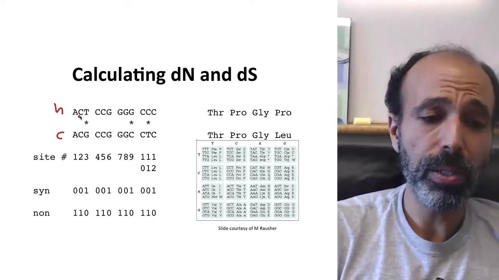

接下来是本节的核心操作——**先给每个位点分类，再数变化**：

1. 以 ACT 的第一位为例，把它换成 CCT、TCT 或 GCT，分别得到脯氨酸、丝氨酸、丙氨酸，都换了氨基酸，所以这一位是**非同义位点**；
2. 任何密码子的第二位都是非同义位点；
3. ACG 的第三位无论换成什么碱基都不改变苏氨酸，所以是**同义位点**。

幻灯片上逐密码子记成 `syn 001` / `non 110`，四个密码子合计：**同义位点 4 个、非同义位点 8 个**。

[【跳转到 04:13】](https://www.youtube.com/watch?v=ZlcHujBbQ2Q&t=253)

### 2.3 边界情形：有些位点"部分同义"

现实里还有一类位点：换成某些碱基同义、换成另一些则非同义。视频举了 TTT（苯丙氨酸）：TTT→TTC 仍是苯丙氨酸，但 TTT→TTG 或 TTA 就变成亮氨酸。处理办法是按概率分摊：如果起点是 TTG，第三位有 $1/3$ 的概率同义、$2/3$ 的概率非同义，于是同义位点记 $1/3$、非同义位点记 $2/3$。

[【跳转到 05:03】](https://www.youtube.com/watch?v=ZlcHujBbQ2Q&t=303)

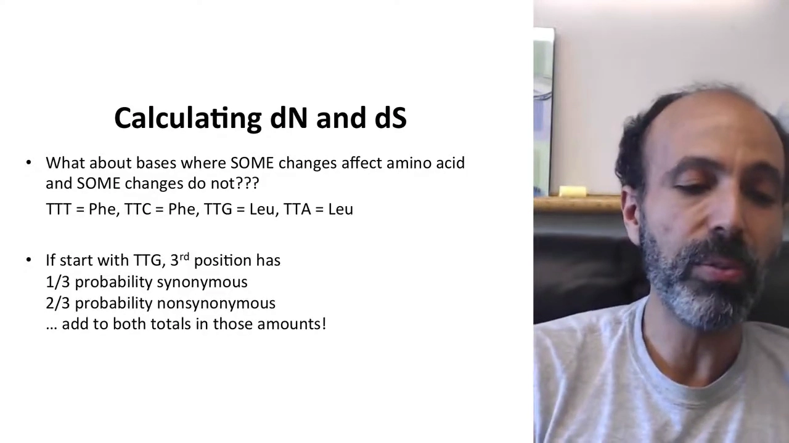

讲者明确说这类题不会在课程里考，但**知道它存在**很重要：所谓"同义位点数"本身就是一个近似计数，而不是数出来的整数。

### 2.4 把比值算出来

把上面的数代进去：

$$
d_N = \frac{1}{8} = 0.125, \qquad
d_S = \frac{2}{4} = 0.5
$$

$$
\frac{d_N}{d_S} = \frac{0.125}{0.5} = 0.25
$$

[【跳转到 06:05】](https://www.youtube.com/watch?v=ZlcHujBbQ2Q&t=365)

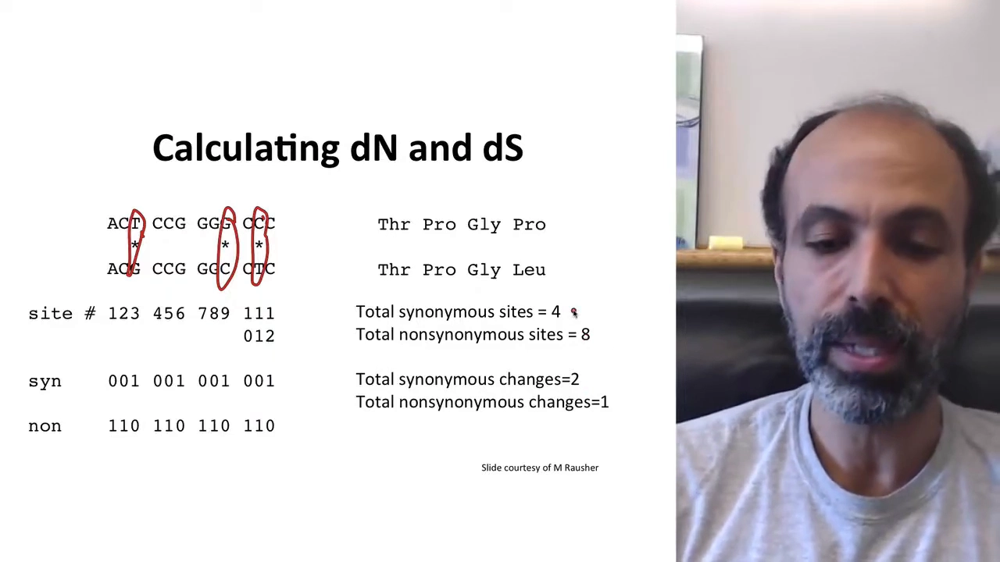

讲者顺带提醒：这里只是"把差异标出来"，**并没有判断方向**——不知道是 C 变成了 T，还是 T 变成了 C。

---

## 三、比值的三种读法

### 3.1 约等于 1：不能拒绝中性

如果这个基因真的在中性演化——任何氨基酸改变对适合度都无所谓——那么非同义变化应当和同义变化以同样的速率积累，于是 $d_N/d_S \approx 1$。讲者强调这是**零假设**：它说的是"非同义变化上没有选择"，既没有好的也没有坏的。

一个容易被忽略的细节：这种情况下非同义变化的**个数**其实会比同义变化多，但因为非同义**位点**也更多，除以位点数之后正好抵消。

[【跳转到 06:47】](https://www.youtube.com/watch?v=ZlcHujBbQ2Q&t=407)

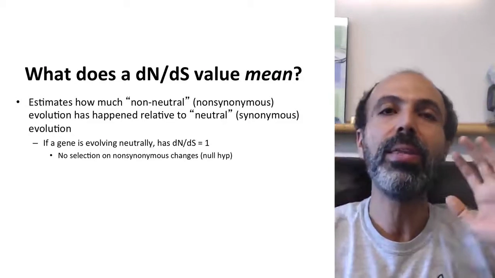

### 3.2 小于 1：约束（纯化选择）

$d_N/d_S$ 明显小于 1，说明非同义变化被"压住"了：大多数出现的氨基酸改变是有害的，被选择淘汰掉。讲者说这**非常典型**，并回指课程前面用流感病毒讲过的例子。

[【跳转到 07:12】](https://www.youtube.com/watch?v=ZlcHujBbQ2Q&t=432)

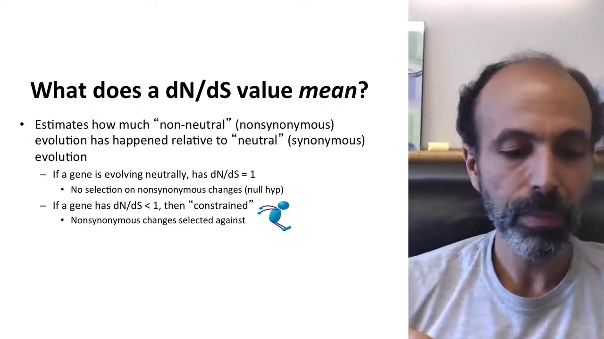

### 3.3 大于 1：反复的正选择

$d_N/d_S > 1$ 比较少见，但很有意思：这意味着在同一个基因里，**多个非同义变化被自然选择青睐并固定下来**，是"强烈的反复正选择"的信号。

[【跳转到 07:32】](https://www.youtube.com/watch?v=ZlcHujBbQ2Q&t=452)

把三种读法放在一起，就是本节要背下来的判读表：

| dN/dS | 一句话读法 | 视频里的措辞 |
| --- | --- | --- |
| 约等于 1 | 不能拒绝中性 | cannot reject neutrality |
| 小于 1 | 约束为主，多数氨基酸改变被淘汰 | constrained |
| 大于 1 | 反复正选择，多个氨基酸改变被青睐 | recurrent positive selection |

---

## 四、真实数据：人类—黑猩猩基因组的 dN/dS

### 4.1 全基因组平均 0.23，少数基因超过 1

讲者给出一张人类—黑猩猩的 dN/dS 分布：**全基因组平均约 0.23**——所以前面手算的 0.25 确实"相当典型"。在检测的 **13,454 个基因中，有 585 个**的 dN/dS 大于 1，这些就是正在经历反复正选择的候选。它们常与**抗寄生虫**和**受精**有关，属于"预期会快速反复演化"的类别。

[【跳转到 08:04】](https://www.youtube.com/watch?v=ZlcHujBbQ2Q&t=484)

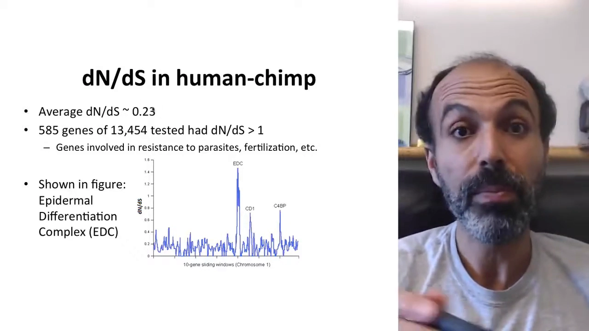

### 4.2 滑动窗口：把"哪个区段在快速演化"画出来

图的下方是 1 号染色体上以 10 个基因为一个窗口滑动得到的 dN/dS 曲线，可以看到几个明显的峰：**EDC**（表皮分化复合体，Epidermal Differentiation Complex）最高，此外还有 CD1 与 C4BP。讲者用这张图说明：平均值之外，**沿染色体看比值的起伏**能定位到具体区段。

---

## 五、动手算一个：ASPM

### 5.1 题目

视频插入一道随堂练习：ASPM 基因影响人类脑容量，给出人和黑猩猩各 5 个密码子，要求算 dN/dS。

| 物种 | 序列 |
| --- | --- |
| 人 | CGT GGC GCA CTT GTA |
| 黑猩猩 | CGT CGT CCA CTT GTA |

[【跳转到 08:29】](https://www.youtube.com/watch?v=ZlcHujBbQ2Q&t=509)

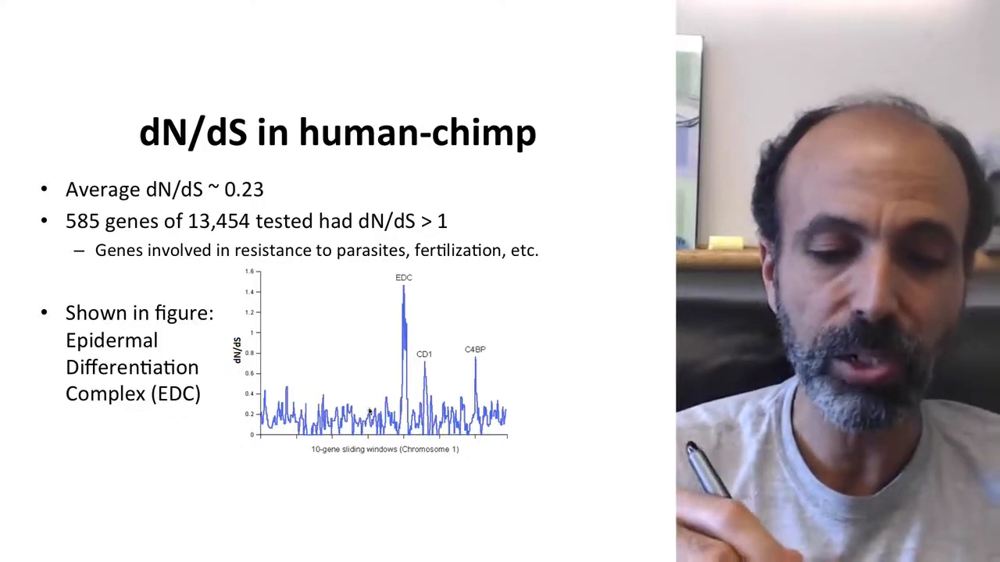

### 5.2 位点统计与变化统计

讲者挑的都是"第一位、第二位非同义，第三位同义"的典型密码子，于是每个密码子记 `non 110`、`syn 001`：

- 非同义位点：$5 \times 2 = 10$；
- 同义位点：$5 \times 1 = 5$。

[【跳转到 09:36】](https://www.youtube.com/watch?v=ZlcHujBbQ2Q&t=576)

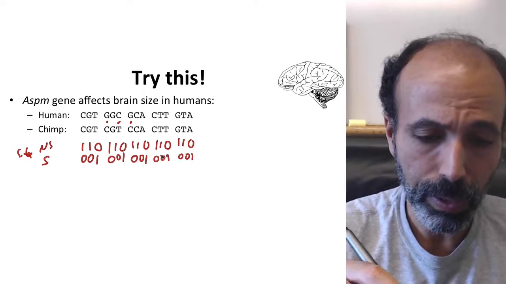

实际差异共 3 处，按位点分别判断：第二密码子第一位 G→C（Gly→Arg，非同义）、第二密码子第三位 C→T（Gly→Gly，同义）、第三密码子第一位 G→C（Ala→Pro，非同义）。所以**非同义变化 2 个、同义变化 1 个**。

[【跳转到 10:16】](https://www.youtube.com/watch?v=ZlcHujBbQ2Q&t=616)

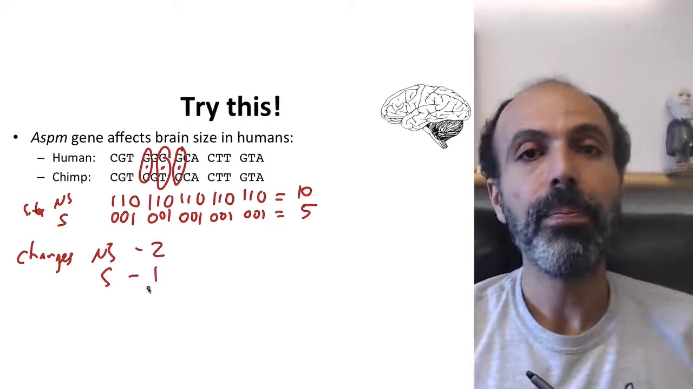

### 5.3 算出的比值与真实值

$$
d_N = \frac{2}{10} = 0.2, \qquad
d_S = \frac{1}{5} = 0.2, \qquad
\frac{d_N}{d_S} = \frac{0.2}{0.2} = 1
$$

[【跳转到 10:24】](https://www.youtube.com/watch?v=ZlcHujBbQ2Q&t=624)

算出来正好是 1。而 ASPM **整基因的真实 dN/dS 约为 0.9**，讲者的评价是"其实差得不算远"。

[【跳转到 10:49】](https://www.youtube.com/watch?v=ZlcHujBbQ2Q&t=649)

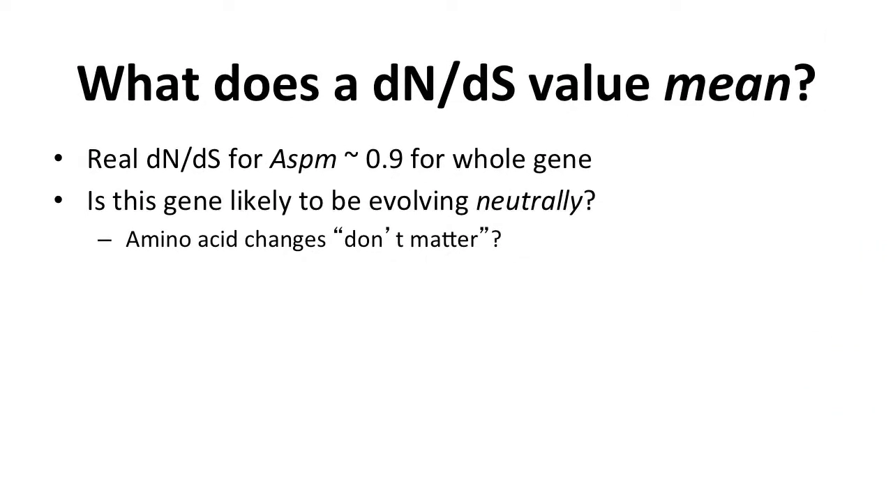

---

## 六、解释边界：为什么单个比值会"骗人"

### 6.1 一个基因里可以同时有约束和快速演化

算出的 1（真实值 0.9）最容易引出的误读是："这个影响脑容量的基因在中性演化，氨基酸怎么变都无所谓。"讲者的反驳很直接：这**极不可能**。更合理的解释是，同一个基因里**同时**存在两种过程——有些核苷酸改变正被快速淘汰（约束），另一些则是有利的、正在被固定（快速演化）。当两者并存时，dN/dS 取的是**整基因的平均**，两种力量互相抵消，于是看起来像"中性"。

[【跳转到 11:14】](https://www.youtube.com/watch?v=ZlcHujBbQ2Q&t=674)

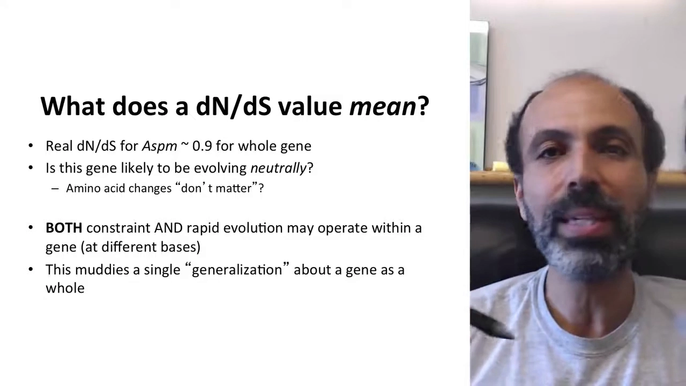

讲者提到，正因为如此，有些人会把基因**拆成区段**分别计算，而不是只给一个全基因的值。

### 6.2 三种读法的边界要一起记

把讲者的收尾总结整理成一张表，比只看"1、小于 1、大于 1"要准确得多：

| 看到的比值 | 能说的 | 不能说的 |
| --- | --- | --- |
| 约等于 1 | 不能拒绝中性 | 这个基因真的在中性演化（现实中几乎不可能有蛋白编码基因完全中性） |
| 小于 1 | 有大量约束，多数氨基酸改变被淘汰 | 完全没有适应性改变（仍可能夹着少数有利变化） |
| 大于 1 | 确有选择驱动快速改变，多个氨基酸改变被青睐 | 每一个可能的改变都是好的（通常仍有一部分是坏的） |

[【跳转到 12:15】](https://www.youtube.com/watch?v=ZlcHujBbQ2Q&t=735)

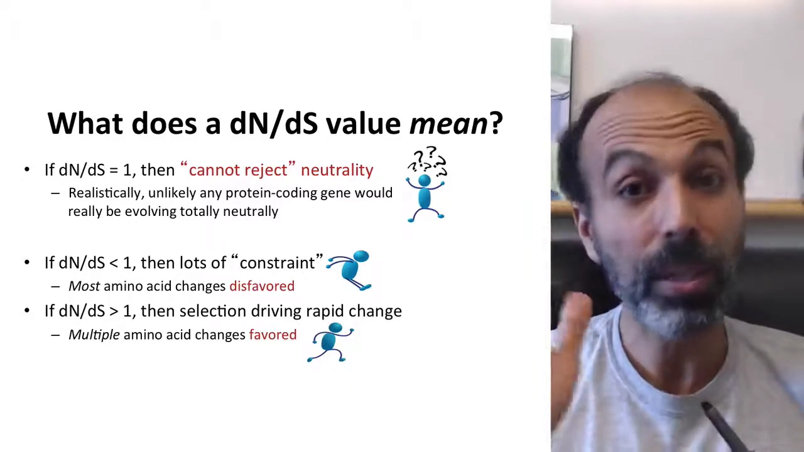

一句话概括：**单个 dN/dS 是"一个演化过程的平均值"，它只能告诉你"约束很多""快速演化很多"或者"分不出来"。**

### 6.3 这个指标偏保守：假阴性多

讲者最后承认这套读法"并不完全令人满意"：dN/dS 在寻找适应性氨基酸改变时**偏保守**，用高比值当门槛会漏掉很多真的适应性演化（假阴性太多）。所以视频结尾预告了下一个检验——**McDonald-Kreitman 检验**，它更擅长捕捉这类适应性氨基酸改变。

[【跳转到 12:40】](https://www.youtube.com/watch?v=ZlcHujBbQ2Q&t=760)
[【跳转到 13:19】](https://www.youtube.com/watch?v=ZlcHujBbQ2Q&t=799)

### 6.4 还有哪些前提被这个比值默默用掉了

把视频里散落的限定条件收拢，可以看出 dN/dS 至少依赖四件事：

1. **只适用于蛋白编码区**：整套推导建立在密码子与氨基酸的对应上，非编码区没有"同义/非同义"之分。
2. **同义位点被当作中性基准**：讲者的原话是"大体上、但不完全"中性；如果同义位点本身也受选择，分母就不再是干净的中性尺子。
3. **位点数是近似计数**：部分同义的位点要按 $1/3$、$2/3$ 分摊，"同义位点数"不是整数。
4. **比值是平均**：跨整个基因、跨所有位点，也跨整段演化过程；方向也不在计算之内（只数差异，不判谁变谁）。

这些限定并不否定 dN/dS 的用处——它仍然是"用中性内标衡量蛋白层面选择"的最简洁工具；它们决定的是**结论能说多满**。

---

## 小结

- 非同义差异可能被正选择、被纯化选择，也可能是中性；只数差异个数分不出这三种命运。
- 同义差异被视为（大体上）中性，可用来校正基因间突变率差异，于是有 $d_N/d_S$。
- $d_N$、$d_S$ 的分母是**位点数**，不是差异数；密码子第二位永远非同义，第三位常同义。
- 手算流程：逐位点分类 → 数同义/非同义位点 → 数同义/非同义变化 → 相除。四密码子例得 $d_N=0.125$、$d_S=0.5$、比值 0.25。
- 判读：约 1 = 不能拒绝中性；小于 1 = 约束为主；大于 1 = 反复正选择。
- 人类—黑猩猩全基因组平均约 0.23；13,454 个基因中 585 个大于 1，多与抗寄生虫、受精相关；滑动窗口能定位 EDC 等高峰区段。
- ASPM 练习：位点 10/5、变化 2/1，算出比值 1；真实值约 0.9，但不能据此说该基因中性演化——约束与快速演化可在同一基因内并存并互相抵消。
- 边界：只适用于编码区、依赖同义位点近中性、位点计数是近似、结果是全基因平均；且该指标偏保守、假阴性多，所以还需要 McDonald-Kreitman 检验。

## 关键术语速查

| 术语 | 一句话解释 |
| --- | --- |
| 同义替换 | 核苷酸改变但不改变氨基酸，被视为大体中性 |
| 非同义替换 | 核苷酸改变并改变氨基酸，其命运可为正选择、纯化选择或中性 |
| 同义位点 | 该位置上任何碱基改变都不改变氨基酸（部分同义位点按比例分摊） |
| 非同义位点 | 该位置上改变会换氨基酸；每个密码子第二位必为非同义位点 |
| $d_N$ | 非同义变化数除以非同义位点数 |
| $d_S$ | 同义变化数除以同义位点数 |
| dN/dS（Ka/Ks） | 非中性演化相对于中性演化的估计；约 1 不能拒绝中性，小于 1 约束，大于 1 反复正选择 |
| 纯化选择 | 清除有害氨基酸改变的负选择，使 dN/dS 小于 1 |
| 反复正选择 | 同一基因中多个氨基酸改变被选择固定，使 dN/dS 大于 1 |
| 滑动窗口 | 沿染色体按固定基因数取窗计算比值，用来定位快速演化区段 |
| McDonald-Kreitman 检验 | 视频预告的后续检验，比 dN/dS 更擅长捕捉适应性氨基酸改变 |

## 材料与边界说明

- 本节只走"同义/非同义 → dN/dS → 判读与边界"这条线；比对算法与建树流程分别见 [5.1.4](../5.1.4_成对序列比对：局部／全局目标、打分与缺口/双序列比对：动态规划、全局与局部.md)、[5.1.5](../5.1.5_多序列比对：列对应、保守位点与同源信息/Multiple%20Sequence%20Alignment.md)、[5.1.7](../5.1.7_系统发育推断：序列模型、树搜索与分支支持/系统发育推断：替换模型、建树算法与分支支持.md)，树判读见 [5.1.6](../5.1.6_系统发育树判读：拓扑、分支长度与根/系统发育树怎么读：根、节点、姐妹群与旋转.md)。
- 视频没有展开：PAML/codeml 等软件的具体操作、位点模型/分支模型、Ka/Ks 的多种校正算法、统计显著性检验，以及 McDonald-Kreitman 检验的细节。本节不据其他材料补写这些内容。
- 视频中"13,000 个基因"为口语表述，幻灯片写作 13,454，正文采用幻灯片数字并保留"约"的语境；ASPM 真实 dN/dS 约 0.9、全基因组平均约 0.23、585 个基因大于 1 均照录幻灯片。
- 字幕为自动生成，术语已按上下文订正（如 dnds → dN/dS、nonsense → non-synonymous、mcdonald creighton → McDonald-Kreitman）。