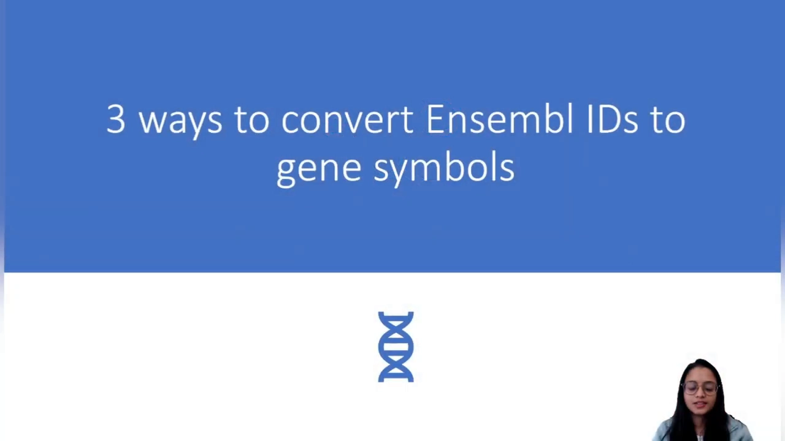
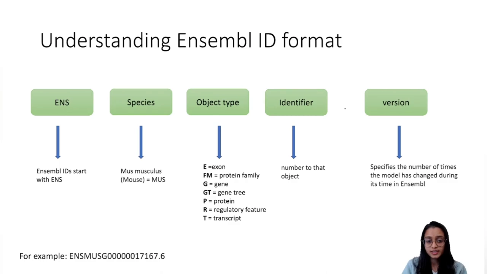
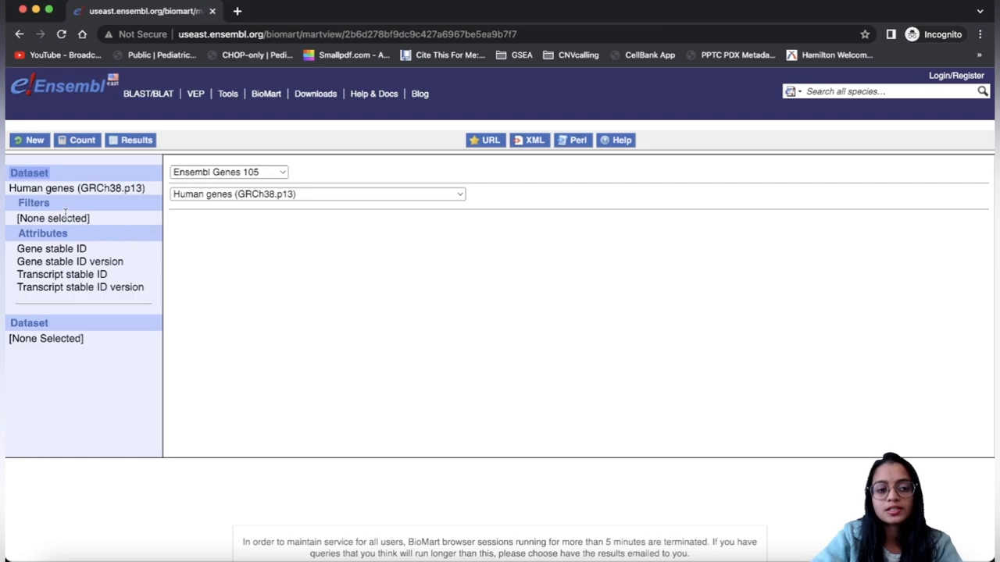
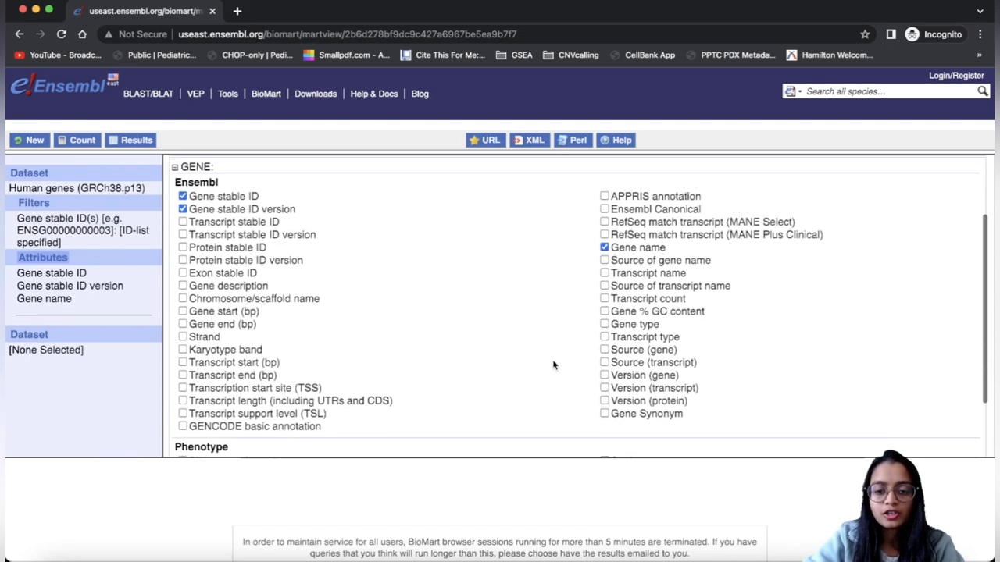
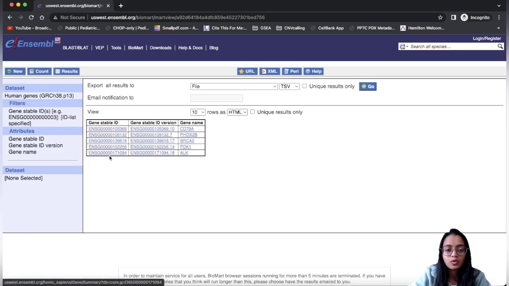
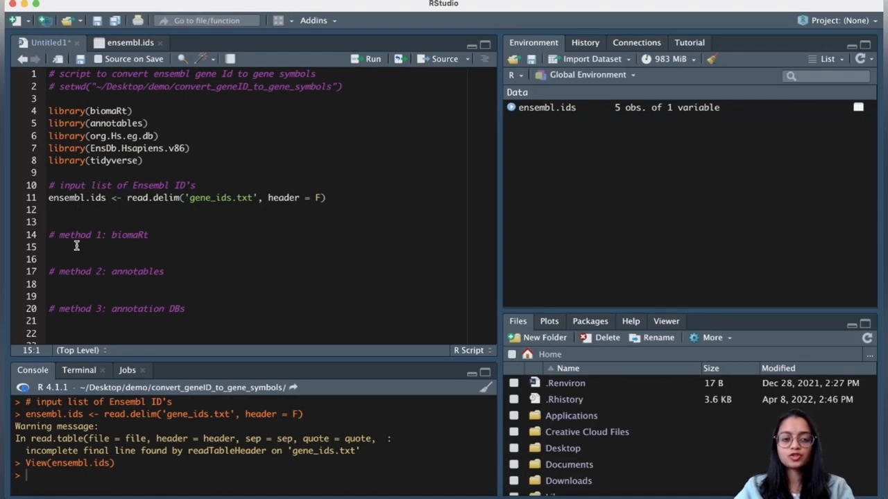
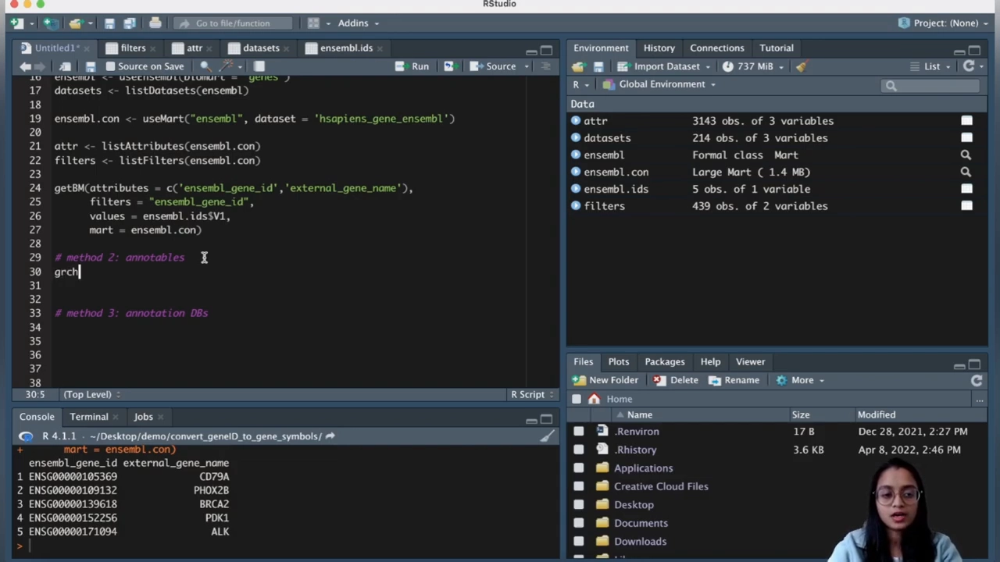
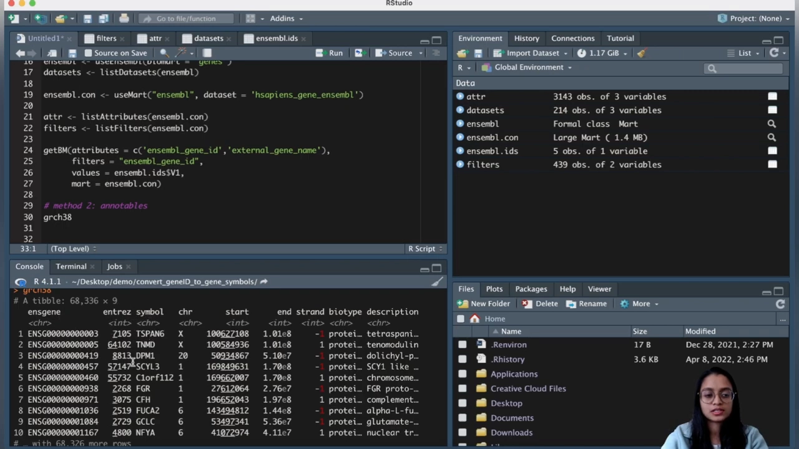
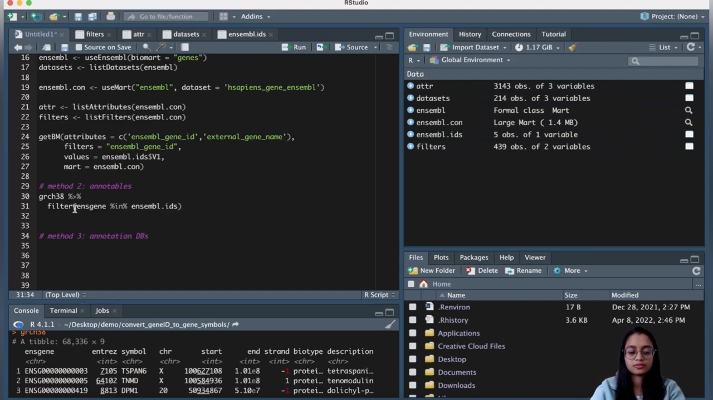

# Ensembl ID 拆开看：稳定 ID、版本号与三种 ID 转符号的方法

> 视频来源：[3 ways to convert Ensembl IDs to gene symbols | Bioinformatics 101](https://www.youtube.com/watch?v=cWe359VnfaY)（YouTube · Bioinformagician，约 20 分钟）
> 导读：一支实操型教程，用同一份 5 个 Ensembl ID 的小文件，把 BioMart 网页、biomaRt、annotables、AnnotationDbi 四条路都走了一遍。本文先讲清 Ensembl ID 的五段结构，再按"网页 → R 包"的顺序复述三种方法，最后把视频里露出来的版本与映射风险集中列出来。字幕为自动生成，术语与代码名已按画面订正。

## 本讲要解决的核心问题（SCQA）

**背景**：差异表达分析、通路分析跑完，手上拿到的基因列表常常是 Ensembl ID；而画热图、做富集、写文章，需要的往往是基因符号。

**冲突**：转换看起来只是"查一张表"，但这张表两头都在动。ID 后面挂着版本号，符号是外部命名委员会给的、会随命名更新而变，不同数据库还各自钉在不同的 Ensembl 版本和基因组构建上。表查错了，整张表达矩阵就会悄悄错位——不报错，只是结果不对。

**疑问**：Ensembl ID 的每一段分别是什么意思？版本号要不要保留？三种转换方法各自依赖什么数据，风险出在哪一环？

**回答（中心思想）**：Ensembl ID 是一段**结构化的稳定标识**——`ENS` + 物种码 + 对象类型 + 编号 + 版本，其中编号是稳定的、版本记录模型改过几次；而基因符号是**外部命名**给的、会变的名字。所以 ID → 符号的转换本质上是"从稳定键查一个会变的名字"，正确做法是：**始终把原始 ID 一起输出、注意版本与符号的一对多、并固定所用的 Ensembl 版本与基因组构建**。三种方法（BioMart 网页／biomaRt、annotables、AnnotationDbi）只是取数渠道不同，这条原则不变。

## 一、为什么需要转换：ID 有好几套

讲者的开场很直接：我们早晚都会拿到一份基因列表，它来自差异表达分析（一组差异表达的基因或转录本），或者来自某条通路涉及的基因。这些基因的书写格式各不相同——可能是 Ensembl ID，可能是 RefSeq ID，也可能是 Entrez ID，而我们经常需要把它们从一种格式转成另一种。[【跳转到 00:10】](https://www.youtube.com/watch?v=cWe359VnfaY&t=10)

转换方法很多，本讲只挑三种常用的：[【跳转到 00:35】](https://www.youtube.com/watch?v=cWe359VnfaY&t=35)

| 方法 | 依赖 | 数据从哪来 |
| --- | --- | --- |
| BioMart（网页 + biomaRt） | Ensembl 官方查询服务 | 实时查询 Ensembl 数据库 |
| annotables | 一个 R 数据包 | 作者从 BioMart 取数、清理列名后打包 |
| AnnotationDbi | R 包 + 注释数据库 | 查询 org.Hs.eg.db、EnsDb 等 SQL 式数据存储 |

三者的差别不在"准不准"，而在**数据是什么时候、从哪个版本取的**——这一点后面会变成最关键的风险。

## 二、Ensembl ID 的五段结构

因为全程处理 Ensembl ID，讲者先拆了一遍格式。一个 Ensembl ID 由五部分组成。[【跳转到 01:42】](https://www.youtube.com/watch?v=cWe359VnfaY&t=102)

1. **`ENS`**：前缀，说明这是一个 Ensembl ID。
2. **物种码**：三字母代码，如 `MUS` 代表*Mus musculus*（小鼠）。**人类没有物种码**——这是初学者最容易看错的一段。
3. **对象类型**：一个或两个字母，说明这个 ID 指向什么对象。
4. **编号**：与该对象关联的一串数字。
5. **版本号**：小数点后的数字，表示这个模型在 Ensembl 里**被改动过多少次**。[【跳转到 02:07】](https://www.youtube.com/watch?v=cWe359VnfaY&t=127)

对象类型的字母表如下：

| 代码 | 含义 | 代码 | 含义 |
| --- | --- | --- | --- |
| E | exon（外显子） | P | protein（蛋白） |
| FM | protein family（蛋白家族） | R | regulatory feature（调控特征） |
| G | gene（基因） | T | transcript（转录本） |
| GT | gene tree（基因树） | | |

讲者给的例子是 `ENSMUSG00000017167.6`：`ENS` 是前缀，`MUS` 是小鼠，`G` 说明它关联的是基因，`00000017167` 是编号，小数点后的 `6` 表示这是第 6 版。[【跳转到 02:32】](https://www.youtube.com/watch?v=cWe359VnfaY&t=152)

这段结构里有两点值得单独拎出来：

- **编号是稳定的，版本是会涨的**。同一个基因的编号不变，随着注释模型修订，版本号从 `.5` 变成 `.6`。所以"同一基因"的两种写法 `ENSMUSG00000017167` 和 `ENSMUSG00000017167.6` 指的是同一个对象，但"模型改过没有"这一层信息只在后者里。
- **对象类型决定了 ID 能不能互换**。`ENSG…`（基因）和 `ENST…`（转录本）不是同一个层级的东西；一个基因有多个转录本，拿转录本 ID 去查基因符号，得到的是一对多的结果。基因、转录本、蛋白的层级关系见 [2.1.4 基因、转录本与蛋白产物的一对多关系](../../../README.md#b02-2-1-4)。

## 三、方法一：BioMart 网页界面

BioMart 是 Ensembl 提供的查询与过滤工具，常用于 ID 映射和特征提取；讲者同时演示网页界面和 biomaRt 包两种用法。[【跳转到 00:52】](https://www.youtube.com/watch?v=cWe359VnfaY&t=52)

演示数据是 5 个 Ensembl 基因 ID，存在一个文本文件里。[【跳转到 03:38】](https://www.youtube.com/watch?v=cWe359VnfaY&t=218) 在 Ensembl 基因组浏览器页面点进 BioMart 后，查询是分三步搭起来的：

1. **选数据库（database）**：本讲选 `Ensembl Genes`。
2. **选数据集（dataset）**：本讲选 `Human genes`，因为数据来自*Homo sapiens*。[【跳转到 04:12】](https://www.youtube.com/watch?v=cWe359VnfaY&t=252)
3. **设过滤器（filters）与属性（attributes）**：filters 限定"取哪些行"，attributes 决定"取哪些列"。[【跳转到 04:34】](https://www.youtube.com/watch?v=cWe359VnfaY&t=274)

注意上图左上角：数据库是 **Ensembl Genes 105**，数据集是 **Human genes (GRCh38.p13)**。这两个版本号是后面所有结果的"出厂日期"，截图或记录时必须一起留下。

filters 面板里可以按区域、基因、表型、GO 词条等很多维度限制数据；本讲只需要"只保留我输入的那些 ID"，所以进 gene 面板、勾选 Ensembl gene ID，然后粘贴 ID 或上传文件。[【跳转到 04:59】](https://www.youtube.com/watch?v=cWe359VnfaY&t=299) 讲者特别提到，这个输入框**接受多种 ID 格式**，所以要先看清自己手上的数据是什么格式，再决定怎么填。[【跳转到 05:24】](https://www.youtube.com/watch?v=cWe359VnfaY&t=324)

attributes 面板是本讲的重点。讲者只勾了三项：`Gene stable ID`、`Gene stable ID version`、`Gene name`。[【跳转到 06:15】](https://www.youtube.com/watch?v=cWe359VnfaY&t=375)

这张截图的信息量比讲者口头说的更多：

- **`Gene stable ID` 和 `Gene stable ID version` 是两个独立字段**。勾前者得到 `ENSG00000139618`，勾后者得到 `ENSG00000139618.17`。要按版本严格对齐，就得勾后者。
- **`Gene name` 这一项的名字本身就说明了它的身份**：它是"外部基因名"，也就是外部命名委员会给的符号，不是 Ensembl 自己造的编号。符号会变、会重名（见 [基因符号不是身份证：官方命名、别名与跨物种命名规则](基因符号不是身份证：官方命名、别名与跨物种命名规则.md)），而 stable ID 不会。
- **面板里还有 `Gene Synonym`（基因同义词）**。勾上它，一个 ID 可能带回多个别名；反过来若拿别名去反查，就可能命中多个 ID。别名是官方维护的字段，但它是"多对多"的。

点 Results 之后，得到的就是这三列。[【跳转到 06:40】](https://www.youtube.com/watch?v=cWe359VnfaY&t=400)

| Gene stable ID | Gene stable ID version | Gene name |
| --- | --- | --- |
| ENSG00000105369 | ENSG00000105369.10 | CD79A |
| ENSG00000109132 | ENSG00000109132.7 | PHOX2B |
| ENSG00000139618 | ENSG00000139618.17 | BRCA2 |
| ENSG00000152256 | ENSG00000152256.14 | PDK1 |
| ENSG00000171094 | ENSG00000171094.18 | ALK |

五个基因的版本号是 `.10`、`.7`、`.17`、`.14`、`.18`——**版本号是每个模型各自的计数器，不是全局的发布号**。所以不能用"版本号大小"来比较两个基因谁更新，也不能用版本号做跨基因的筛选条件。结果可以按多种格式导出下载。[【跳转到 07:05】](https://www.youtube.com/watch?v=cWe359VnfaY&t=425)

## 四、方法一（续）：用 biomaRt 把同样的事写成代码

网页点一遍能拿到结果，但要可复现，就得写成代码。讲者用 biomaRt 把上面的步骤逐条翻译成函数调用。[【跳转到 07:39】](https://www.youtube.com/watch?v=cWe359VnfaY&t=459)

对应关系很清楚：

| 网页操作 | biomaRt 函数 |
| --- | --- |
| 选数据库（Ensembl Genes） | `listEnsembl()` 查可用库 → `useEnsembl(biomart = "genes")` |
| 选数据集（Human genes） | `listDatasets()` 查 214 个数据集 → `useMart(dataset = ...)` |
| 查可选属性 | `listAttributes()`，约 3143 个 |
| 查可选过滤器 | `listFilters()`，约 439 个 |
| 填 ID 并取结果 | `getBM(attributes, filters, values, mart)` |

几个容易卡住的细节，讲者都点到了：

- `listEnsembl()` 会列出可用数据库及对应的取值；要用 "Ensembl Genes 105" 这个库，传的值是 `genes`。[【跳转到 08:29】](https://www.youtube.com/watch?v=cWe359VnfaY&t=509)
- `listDatasets()` 返回约 214 个数据集，人类基因那一项要在里面搜出来。[【跳转到 09:19】](https://www.youtube.com/watch?v=cWe359VnfaY&t=559)
- `getBM` 的 `attributes` 是"要取哪些列"，`filters` 是"限制条件"，`values` 是限制条件的取值，`mart` 是连接对象。[【跳转到 10:34】](https://www.youtube.com/watch?v=cWe359VnfaY&t=634)
- **符号在 biomaRt 里叫 `external_gene_name`，稳定 ID 叫 `ensembl_gene_id`**。[【跳转到 11:24】](https://www.youtube.com/watch?v=cWe359VnfaY&t=684) 名字里的 "external" 再次提醒：这是外部命名，不是 Ensembl 内部编号。
- 过滤器的名字是 `ensembl_gene_id`，`values` 直接传输入向量的那一列。[【跳转到 13:04】](https://www.youtube.com/watch?v=cWe359VnfaY&t=784)

跑出来的结果就是输入 ID 与对应符号的一一列表。[【跳转到 13:54】](https://www.youtube.com/watch?v=cWe359VnfaY&t=834)

注意这段代码里 `attributes` 只写了两个属性：`ensembl_gene_id` 与 `external_gene_name`——**没有取版本字段**。这就是网页版与代码版的一个实际差异：网页上你勾了什么、结果表里就有什么；写成代码后，取哪些列变成了一行需要自己负责的决定。要保留版本，就得把版本属性显式加进去。

## 五、方法二：annotables——按基因组构建版本取整张表

第二种方法用一个叫 annotables 的 R 数据包。它的作者从 BioMart 取数、清理列名，打包成 R 数据包，让所有人都能直接取用。[【跳转到 01:17】](https://www.youtube.com/watch?v=cWe359VnfaY&t=77)

用法是按**基因组构建版本**直接取表：人类可以取 `grch37`（即 hg19），也可以取 `grch38`（较新的构建）。[【跳转到 14:19】](https://www.youtube.com/watch?v=cWe359VnfaY&t=859)

这张表的结构值得记住，它是"多种 ID 并排放在一起"的典型形态：

| 列名 | 含义 |
| --- | --- |
| `ensgene` | Ensembl 基因 ID（稳定 ID） |
| `entrez` | Entrez Gene ID |
| `symbol` | 基因符号 |
| `chr`、`start`、`end`、`strand` | 染色体位置 |
| `biotype` | 基因类型（如 protein_coding） |
| `description` | 基因描述 |

共 68,336 行。用法就是按输入 ID 过滤这张表，只留下自己列表里的基因。[【跳转到 15:09】](https://www.youtube.com/watch?v=cWe359VnfaY&t=909) 过滤之后，一行里就同时拿到了符号、Entrez ID、坐标和类型——**一次查询换回多个 ID 体系的对应关系**。

代价也很明确：这张表是**打包时刻的快照**，而且被钉在某个基因组构建上。`grch37` 和 `grch38` 是两张不同的表，选错构建，坐标和一部分 ID 就对不上。这一点和第 1.2.1 节讲的参考基因组版本问题是同一件事，见 [1.2.1 参考基因组：组装版本与坐标系统](../../../README.md#b02-1-2-1)。

## 六、方法三：AnnotationDbi 与 mapIds

第三种方法用 AnnotationDbi 查询注释数据库。讲者用了两个库：一个物种特异的库（`org.Hs.eg.db`）和一个 Ensembl 库（`EnsDb.Hsapiens.v86`），都通过 `mapIds` 取"ID → 符号"的映射。[【跳转到 15:34】](https://www.youtube.com/watch?v=cWe359VnfaY&t=934)

`mapIds` 有四个关键参数，它们和 BioMart 的概念一一对应：

| mapIds 参数 | 含义 | 对应 BioMart 的 |
| --- | --- | --- |
| 数据库名 | 查哪个库 | database |
| `keys` | 输入的 ID 向量 | values |
| `keytype` | 输入 ID 是什么类型 | filters |
| `column` | 想取回什么 | attributes |

最容易出错的是 `keytype`：**它随数据库而变**。讲者的做法是先跑 `keytypes()` 看这个库支持哪些类型，再决定填什么。[【跳转到 15:34】](https://www.youtube.com/watch?v=cWe359VnfaY&t=934)

- 在 `org.Hs.eg.db` 里，输入是 Ensembl ID，所以 `keytype` 用 `ENSEMBL`；取符号用 `column = "SYMBOL"`。
- 在 `EnsDb.Hsapiens.v86` 里，同样是 Ensembl 基因 ID，`keytype` 却要写 `GENEID`；`column` 仍然是 `SYMBOL`。

讲者的原话是：格式完全一样，只是两个库的 keytype 信息不同，**跑之前必须先查一遍**。[【跳转到 15:34】](https://www.youtube.com/watch?v=cWe359VnfaY&t=934) 两个库跑完，返回的都是"基因 ID → 符号"的命名列表。

## 七、把风险集中列出来

把三张截图放在一起看，这支视频其实顺带展示了几处真实存在的对齐风险。

### 7.1 版本号会不一致，而且不一致是常态

第 3 节的 BioMart 结果里，五个基因的版本号是 `.10`、`.7`、`.17`、`.14`、`.18`。这说明版本号是**逐模型的修订计数**，不是统一的发布号。[【跳转到 06:40】](https://www.youtube.com/watch?v=cWe359VnfaY&t=400)

后果是：如果两张表分别在不同时间从 Ensembl 取数，同一个 `ENSG…` 的版本号可能一个是 `.16`、一个是 `.17`。此时按"带版本的 ID"做连接，就会漏掉这些行；按"不带版本的 ID"做连接，又会把模型已经改过的注释当成同一份。**要么接受版本漂移、要么显式对齐版本，但不能假装没这回事。**

### 7.2 不同来源钉在不同的版本上

视频里同时出现了三个版本坐标：

- BioMart 网页：**Ensembl Genes 105**，数据集 **Human genes (GRCh38.p13)**；
- biomaRt 代码：同样连 105 版；
- AnnotationDbi 用的库：**EnsDb.Hsapiens.v86**（Ensembl 86），而 `org.Hs.eg.db` 是另一套发布节奏；
- annotables：按 **GRCh37 / GRCh38** 分表。

也就是说，同一支视频里的三种方法，背后至少跨了两个 Ensembl 版本（105 与 86）。如果一部分基因用 BioMart 转、另一部分用 EnsDb 转，再合并，符号与 ID 的对应关系就可能来自不同版本的注释。**混用来源时，必须记录每个来源的版本号。**

### 7.3 符号是"外部名字"，不是键

`external_gene_name`、`Gene name`、`SYMBOL`、annotables 的 `symbol`——四个名字，指的都是同一类东西：命名委员会给的符号。它在 BioMart 的 attributes 里和 `Gene stable ID` 并列，本身就说明了两者地位不同：一个是外部名字，一个是数据库内部编号。

由此可以推出三条实操建议（本节视频未逐一演示，属于对上述结构的直接推论）：

1. **转换时把原始 ID 一起输出**。讲者在网页版特意勾了 `Gene stable ID`，就是为了"看到映射"而不是只拿到一列符号。
2. **不要只用符号做合并键**。符号会重名、会改，而 stable ID 不会；两套数据合并时，用 ID 连接、把符号当附属列。
3. **别名要单独处理**。`Gene Synonym` 和 "keep aliases, synonyms" 这类字段是多对多的，用它做匹配能提高召回，但也必然引入歧义。

符号为什么会重名、为什么会变、大小写为什么有物种含义，见 [基因符号不是身份证：官方命名、别名与跨物种命名规则](基因符号不是身份证：官方命名、别名与跨物种命名规则.md)；跨物种时一对多关系怎么处理，见 [5.2.2 跨物种同源映射：一对多关系与功能迁移风险](../../../README.md#b02-5-2-2)。

## 小结

- Ensembl ID 是结构化的稳定标识：`ENS` + 物种码（人类没有）+ 对象类型（G/E/T/P…）+ 编号 + 版本；编号稳定，版本记录模型改过几次。
- 版本号是**逐模型的计数器**，五个基因可以是 `.7` 到 `.18`，不能拿来比较新旧。
- BioMart 网页的核心是 filters（取哪些行）与 attributes（取哪些列）；`Gene stable ID` 与 `Gene stable ID version` 是两个独立字段，`Gene name` 是外部命名给的符号。
- biomaRt 把同样的步骤写成 `listEnsembl` → `listDatasets` → `useMart` → `listAttributes`/`listFilters` → `getBM`；符号对应 `external_gene_name`，稳定 ID 对应 `ensembl_gene_id`。
- annotables 按基因组构建版本（grch37/grch38）取整张对照表，一行里同时给出 Ensembl ID、Entrez ID、符号、坐标与 biotype，代价是快照式数据。
- AnnotationDbi 的 `mapIds` 用 `keys`/`keytype`/`column`，其中 **keytype 随数据库而变**（`ENSEMBL` vs `GENEID`），跑之前必须查 `keytypes()`。
- 三种方法背后可能跨着不同 Ensembl 版本（视频里同时出现 105 与 86），混用来源时必须记录版本；合并数据时用稳定 ID 做键，符号只作附属列。

## 关键术语速查

| 术语 | 一句话解释 |
| --- | --- |
| Ensembl stable ID | Ensembl 给基因/转录本等对象的稳定编号，如 `ENSG00000139618`，编号不随注释修订而变 |
| 版本号（version） | stable ID 小数点后的数字，表示该注释模型被改动过多少次，如 `.17` |
| 对象类型码 | ID 中的字母段，`G`=基因、`T`=转录本、`E`=外显子、`P`=蛋白、`R`=调控特征 |
| 物种码 | ID 中的三字母物种标记，如 `MUS`=小鼠；人类 ID 没有这一段 |
| BioMart | Ensembl 的查询服务，用 database/dataset + filters + attributes 搭查询 |
| biomaRt | BioMart 的 R 接口，`getBM` 是核心取数函数 |
| annotables | 打包了 BioMart 数据的 R 数据包，按基因组构建版本（grch37/grch38）取表 |
| AnnotationDbi | 查询注释数据库的 R 包，核心函数 `mapIds`，需要 `keys`/`keytype`/`column` |
| keytype | 输入 ID 的类型名，随数据库而变，如 `ENSEMBL`（org.Hs.eg.db）或 `GENEID`（EnsDb） |
| external gene name | Ensembl 对基因符号的称呼，强调它是外部命名委员会给的，不是 Ensembl 编号 |