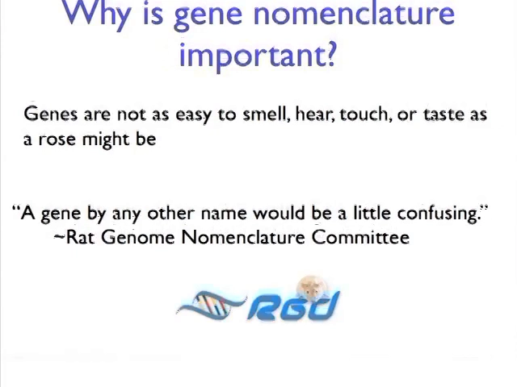
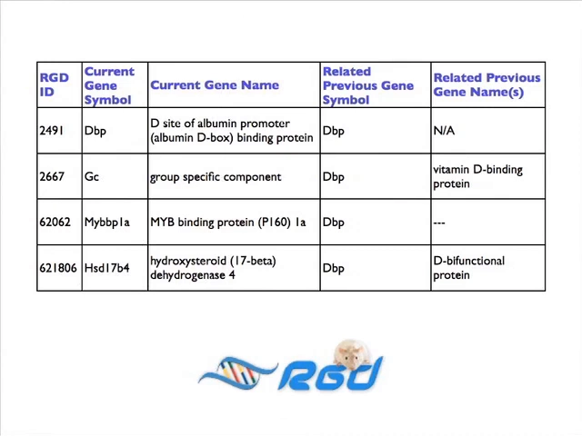
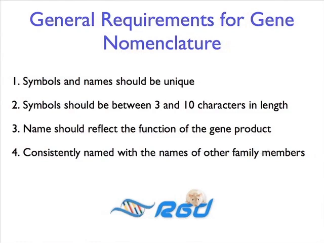
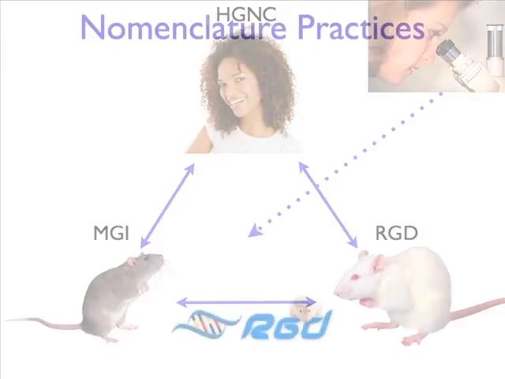
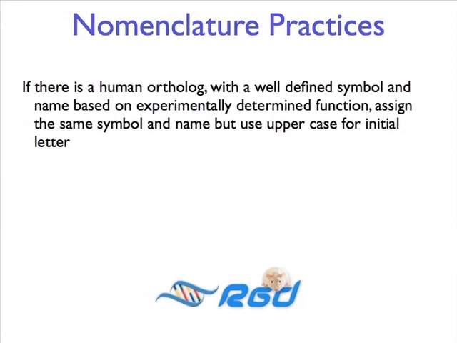
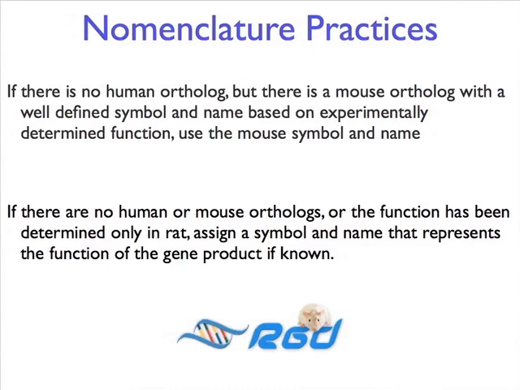
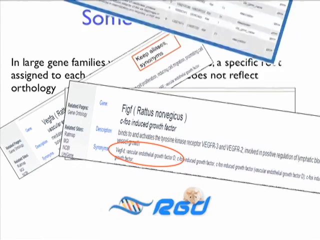
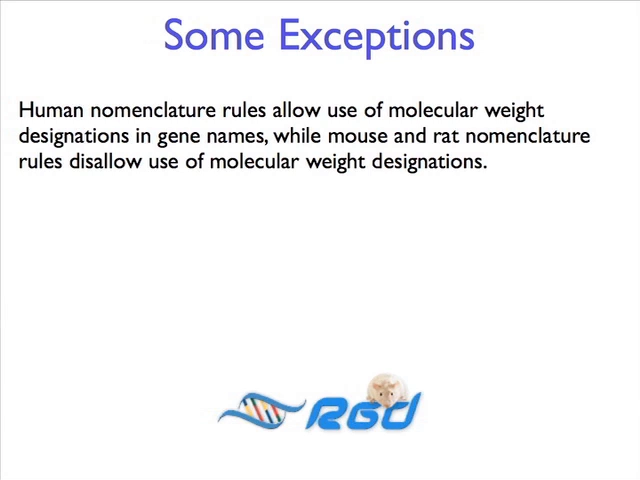
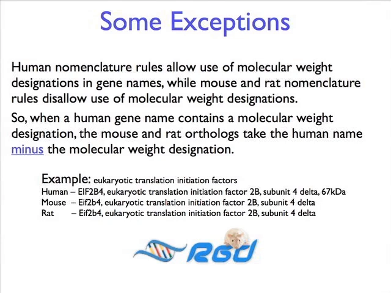
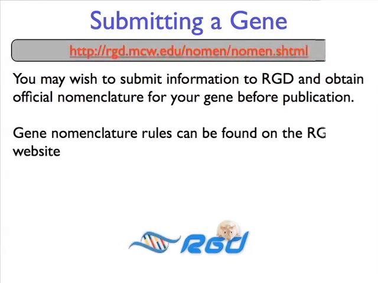

# 基因符号不是身份证：官方命名、别名与跨物种命名规则

> 视频来源：[An Introduction to Biomedical Nomenclature Part II, Gene Nomenclature](https://www.youtube.com/watch?v=_xMj3ny7QO0)（YouTube · Rat Genome Database，约 6.5 分钟）
> 导读：这是大鼠基因组数据库（RGD）生物命名系列的第二讲，专门讲"基因符号是怎么定出来的"。全片只有二十来张幻灯片，但把符号的唯一性要求、命名委员会的上下游关系、大鼠命名的决策顺序和三类例外讲得很完整，适合当作基因符号的入门规范来读。字幕为自动生成，术语已按上下文订正。

## 本讲要解决的核心问题（SCQA）

**背景**：查一个基因，最先拿到的几乎总是一个符号——`Dbp`、`Eif2b4`、`Figf`。写文章、做检索、画图，用的都是这个短名字。

**冲突**：名字是可以重名的。同一个符号 `DBP` 在大鼠里曾经被四个不同的基因用过；同一个基因也可能同时挂着几个别名和旧名。文献检索又是自动匹配字符串的，符号一乱，结果就跟着乱。

**疑问**：基因符号到底由谁定、按什么规则定？为什么一个符号会同时属于好几个基因？跨物种时，能不能把人的符号直接搬到小鼠和大鼠身上？

**回答（中心思想）**：基因符号是**给人读的名字**，不是**给机器用的键**。命名委员会用"同物种内唯一、3–10 个字符、反映功能、与家族成员一致"这四条规则来分配符号，但历史别名会保留、跨物种命名以人类为模板逐级复制、大家族与假基因还有专门的例外。所以符号适合阅读和检索线索，不适合当唯一标识；要稳定对齐，得靠稳定 ID（见 [Ensembl ID 拆开看：稳定 ID、版本号与三种 ID 转符号的方法](Ensembl%20ID%20拆开看：稳定%20ID、版本号与三种%20ID%20转符号的方法.md)）。

## 一、符号是名字，不是标识：DBP 撞名的四个基因

讲者用一句莎士比亚开场：玫瑰换个名字还是香的，因为鼻子能替我们纠正命名错误。[【跳转到 00:25】](https://www.youtube.com/watch?v=_xMj3ny7QO0&t=25) 但基因没有"鼻子"——文献里出现的基因，并不总是带着能佐证它身份的数据。所以对基因来说，"换个名字"真的会让人糊涂。[【跳转到 00:30】](https://www.youtube.com/watch?v=_xMj3ny7QO0&t=30)

具体例子是一张大鼠的表格：四个基因，只有一个的**现行官方符号**是 `Dbp`。[【跳转到 00:44】](https://www.youtube.com/watch?v=_xMj3ny7QO0&t=44)

| RGD ID | 现行基因符号 | 现行基因名 | 相关旧符号 | 相关旧基因名 |
| --- | --- | --- | --- | --- |
| 2491 | Dbp | D site of albumin promoter (albumin D-box) binding protein | Dbp | N/A |
| 2667 | Gc | group specific component | Dbp | vitamin D-binding protein |
| 62062 | Mybbp1a | MYB binding protein (P160) 1a | Dbp | --- |
| 621806 | Hsd17b4 | hydroxysteroid (17-beta) dehydrogenase 4 | Dbp | D-bifunctional protein |

这张表值得逐列看，它把"符号"和"身份"的差别摆在了明面上：

- **RGD ID 一列才是身份**：2491、2667、62062、621806 是四个互不相同的编号，一行一个基因，不会重复。
- **现行基因符号一列是名字**：`Dbp`、`Gc`、`Mybbp1a`、`Hsd17b4`，四个各不相同——这是"同物种内唯一"规则在起作用。
- **相关旧符号一列是历史**：后三个基因都曾经被叫作 `Dbp`。旧名不会被删掉，而是被保留下来备查。

于是麻烦就来了：如果拿 `Dbp` 去自动检索文献，四个基因的文章会混在一起。[【跳转到 01:01】](https://www.youtube.com/watch?v=_xMj3ny7QO0&t=61) 这就是"符号不能当键"的最直接的后果——它唯一，只唯一在**当下、本物种**这一层，历史上并不唯一。

## 二、命名的四条通用要求

官方命名要满足的条件，讲者列了四条。[【跳转到 01:17】](https://www.youtube.com/watch?v=_xMj3ny7QO0&t=77)

1. **符号和名称在同一物种的命名体系内应当唯一**。注意限定语是"同一物种"——跨物种并不要求唯一，这正是后面小鼠、大鼠可以沿用人类符号的前提。
2. **符号长度 3–10 个字符**，是基因名的缩写形式。太短容易撞，太长不便书写。
3. **名称最好能反映基因产物的功能**。这是"名字"这一侧的追求，和编号那种纯标识符正好相反。
4. **同一家族的基因，命名要与其他成员保持一致**。家族成员共享词干、用数字区分，读者一眼能看出它们是一伙的。

这四条里，第 1 条和第 3、4 条其实是有张力的：功能会随着研究深入被修正，家族划分也会变，而"唯一"和"一致"都要求名字跟着动。名字一动，旧名就变成别名——第一节那张表里的 `Dbp` 旧符号，就是这么攒出来的。

## 三、谁在定名：HGNC 定人类，MGI 与 RGD 跟随

命名不是自发约定，而是由专门的机构负责。讲者的说法是：科学文献中各个物种的官方基因命名，由特定的基因组机构和基因组数据库承担。[【跳转到 01:22】](https://www.youtube.com/watch?v=_xMj3ny7QO0&t=82)

- **人类**：HGNC（HUGO Gene Nomenclature Committee）确定*Homo sapiens*的官方命名。[【跳转到 01:55】](https://www.youtube.com/watch?v=_xMj3ny7QO0&t=115)
- **小鼠**：MGI（Mouse Genome Informatics）承接。
- **大鼠**：RGD（Rat Genome Database）承接。

关键在于**方向**：人类命名是其他脊椎动物命名的模板，其他物种中直系同源基因的名字通常直接照抄人类那一份。[【跳转到 02:20】](https://www.youtube.com/watch?v=_xMj3ny7QO0&t=140)

但箭头不是单向的。如果一个基因最先在小鼠或大鼠里被发现，命名的传播方向就会反过来。[【跳转到 02:26】](https://www.youtube.com/watch?v=_xMj3ny7QO0&t=146) 而当某个基因家族的命名需要调整时，三个命名委员会会一起讨论，找出对所有人都合适的方案；建立新家族时，还会征询研究社区的意见。[【跳转到 02:51】](https://www.youtube.com/watch?v=_xMj3ny7QO0&t=171)

对读数据的人来说，这里有个隐含结论：**同一个符号在不同物种里指向的"同一个基因"，依据是命名约定，不是序列证据**。符号照抄只说明命名时认为它们对应，不说明它们真的一一对应。至于一对多的直系同源／旁系同源关系怎么处理、功能能不能迁移，见 [5.2.2 跨物种同源映射：一对多关系与功能迁移风险](../../../README.md#b02-5-2-2)；本节只处理"名字怎么传"。

## 四、大鼠命名的决策顺序：从人类问到功能

因为人类命名是脊椎动物的标准，给大鼠基因命名的流程是**逐级回退**的。讲者把这条链讲得很清楚。[【跳转到 03:05】](https://www.youtube.com/watch?v=_xMj3ny7QO0&t=185)

1. **有人类直系同源，且符号与名称基于实验确定的功能**：直接沿用同样的名称和符号，但大鼠符号**只把首字母大写**。这就是为什么人写 `DBP`、鼠写 `Dbp`——大小写差异不是笔误，而是物种标记。
2. **没有人类直系同源，但有小鼠直系同源**：沿用小鼠的名称和符号。
3. **人类和小鼠都没有，或功能只在大鼠中确定**：分配一个能反映基因产物功能的符号和名称。
4. **完全没有功能数据**：可能先给一个通用编号当符号；如果序列与另一个基因相似，名字可能写成"某某样基因"（XYZ gene）。[【跳转到 03:20】](https://www.youtube.com/watch?v=_xMj3ny7QO0&t=200)

这条链解释了初学者最常踩的两个坑：

- **大小写是有信息的**。`DBP`（人）、`Dbp`（大鼠/小鼠）是同一套命名下的不同物种写法。做符号匹配时如果做了大小写不敏感的归一，就会把物种信息一起抹掉；反过来，如果严格区分大小写，同一个基因跨物种就匹配不上。两种做法各有代价，取决于你想对齐的是"同一个基因"还是"同一个字符串"。
- **符号相同 ≠ 关系已确认**。第 1、2 步的依据是"存在直系同源"，第 3、4 步则完全没有这层依据——一个按功能起的名，或者一个通用编号，跨物种时根本没有对应物。

## 五、三类例外：大家族、假基因、分子量

规则总有例外，讲者专门用一段讲了三类。[【跳转到 03:45】](https://www.youtube.com/watch?v=_xMj3ny7QO0&t=225)

### 5.1 超大基因家族：名字可以相同，符号必须不同

有些家族经历了太多轮基因复制，直系同源几乎无法判定。典型例子是犁鼻器受体（vomeronasal receptors）：**名字可以一样，但不同物种给出的符号不同**，这样即使层级编号相同，也不会被误当成直系同源。[【跳转到 04:03】](https://www.youtube.com/watch?v=_xMj3ny7QO0&t=243)

这条规则的设计意图很值得注意：它故意**破坏了符号的跨物种可比性**，就是为了防止读者从"名字像"推出"关系近"。

### 5.2 假基因：编号是物种专属的

假基因用**物种专属的编号**命名，所以不能从另一个物种的编号推断直系同源关系；人类假基因的符号写法也和小鼠、大鼠不同。[【跳转到 04:16】](https://www.youtube.com/watch?v=_xMj3ny7QO0&t=256)

同一段画面里还能看到一个实用细节：数据库的基因页面会专门标注"keep aliases, synonyms"（保留别名与同义词），并在条目下列出 `Vegfd`、`vascular endothelial growth factor D`、`c-fos induced growth factor` 等一串同义词。**别名不是脏数据，而是官方维护的一等字段**——检索时它们是召回率的来源，做映射时它们又是歧义的来源。

### 5.3 分子量：人类允许，鼠类不允许

人类命名规则允许在基因名里写分子量，小鼠和大鼠的规则不允许。于是当人类基因名带分子量时，小鼠和大鼠的直系同源基因取人类名字**减去分子量那部分**。[【跳转到 04:35】](https://www.youtube.com/watch?v=_xMj3ny7QO0&t=275)

讲者给的例子是翻译起始因子：

| 物种 | 符号 | 名称 |
| --- | --- | --- |
| 人 | EIF2B4 | eukaryotic translation initiation factor 2B, subunit 4 delta, 67kDa |
| 小鼠 | Eif2b4 | eukaryotic translation initiation factor 2B, subunit 4 delta |
| 大鼠 | Eif2b4 | eukaryotic translation initiation factor 2B, subunit 4 delta |

三个符号在去掉大小写后完全一致，名称却长短不一。如果拿"名称字符串完全相同"当作同一基因的判据，这一组就会被判成不同基因——**符号、名称、ID 三者谁更稳定，取决于你拿它做什么**。

## 六、发表之前先把名字注册掉

讲者最后给了一条操作性建议：RGD 会持续审阅基因命名，如果你发现了新的大鼠基因，可以在**发表之前**提交给 RGD，先拿到官方命名。[【跳转到 05:25】](https://www.youtube.com/watch?v=_xMj3ny7QO0&t=325)

命名规则本身发布在 RGD、MGI 和 HGNC 三个网站上，RGD 还提供了一份方便的注册表单；讲者强烈建议在发表前就取得官方命名。[【跳转到 05:46】](https://www.youtube.com/watch?v=_xMj3ny7QO0&t=346)

为什么这件事值得写进流程：如果论文先发表、符号后注册，那么这篇论文里的符号就会变成"旧符号"，进入第一节那张表的"相关旧符号"一列。后来的人用官方符号检索，反而搜不到这篇文章。**符号的历史包袱，很多时候就是发表顺序造成的。**

## 小结

- 基因符号是**给人读的名字**，稳定 ID 才是**给机器用的键**。DBP 一例里，四个基因共用一个旧符号，只有 RGD ID 能区分它们。
- 命名有四条通用要求：同物种内唯一、3–10 个字符、反映功能、与家族成员一致。这些要求本身就会推动符号随时间变化。
- 命名由机构负责：HGNC 定人类，MGI 与 RGD 承接；传播方向通常是人类 → 鼠类，但先在小鼠或大鼠发现的基因会反向传播。
- 大鼠命名是逐级回退的：人类直系同源 → 小鼠直系同源 → 按功能命名 → 通用编号。后两级没有同源依据，跨物种时不可直接对应。
- **大小写是物种标记**：`DBP`（人）与 `Dbp`（鼠）是同一套命名下的不同写法，做符号匹配时必须先决定要不要归一。
- 三类例外各有用途：大家族故意让符号跨物种不同，防误判同源；假基因编号是物种专属；分子量只允许出现在人类名称里。
- 别名与同义词是官方维护的字段，检索时提高召回，映射时制造歧义；发表前注册命名，可以避免自己的符号很快变成"旧符号"。

## 关键术语速查

| 术语 | 一句话解释 |
| --- | --- |
| 基因符号（gene symbol） | 基因的短名字，如 `Dbp`、`EIF2B4`，同物种内唯一，跨物种不保证唯一 |
| 基因名称（gene name） | 符号展开后的全称，通常描述基因产物的功能 |
| 别名／同义词（alias / synonym） | 基因曾经使用或非官方通用的其他名字，由数据库保留备查 |
| HGNC | HUGO Gene Nomenclature Committee，负责人类基因的官方命名 |
| MGI | Mouse Genome Informatics，负责小鼠基因命名与注释 |
| RGD | Rat Genome Database，负责大鼠基因命名与注释，并提供 RGD ID |
| RGD ID | 数据库分配的稳定编号，如 2491，用于唯一标识一个大鼠基因 |
| 直系同源（ortholog） | 由物种分化事件分开的两个基因，命名传播通常沿这条关系进行 |
| 通用编号（generic ID） | 尚无功能数据时临时用作符号的编号，不含功能信息 |