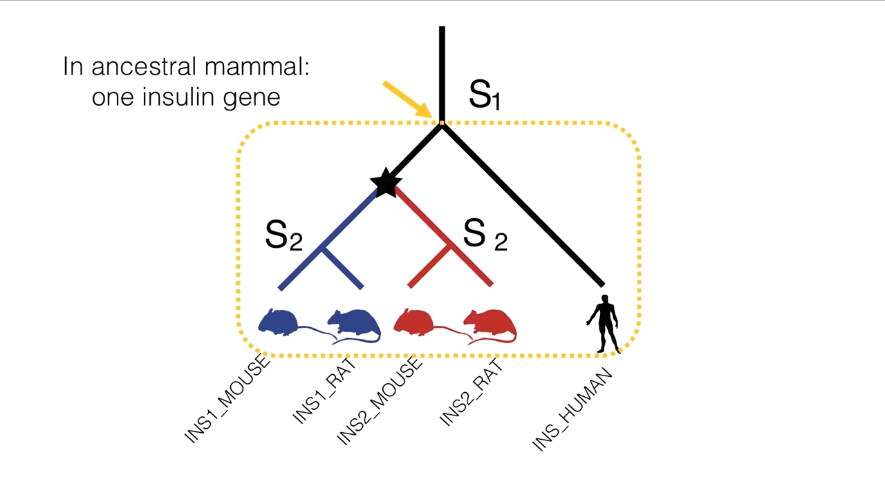
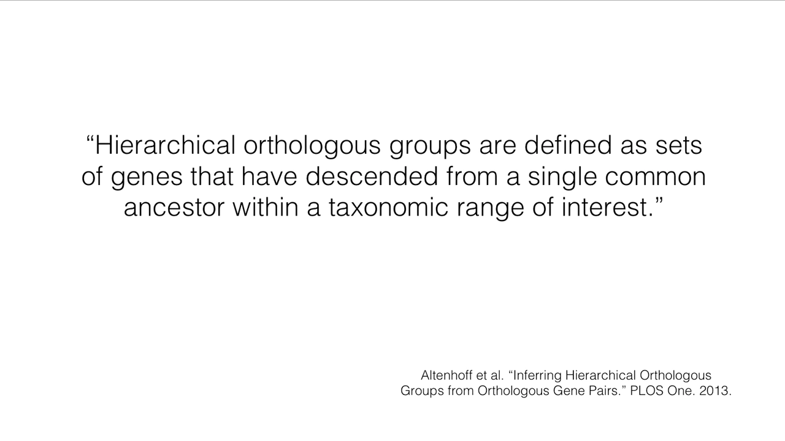
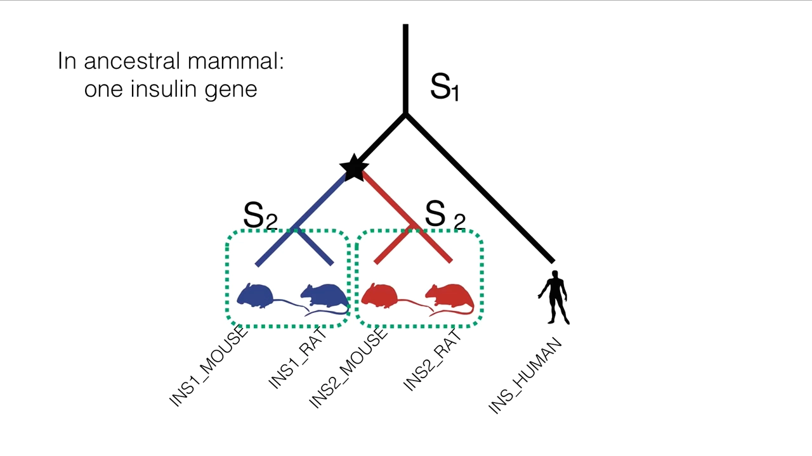

# 层级同源群：一对多映射取决于你选定的分类层级

> 视频来源：[What are HOGs (Hierarchical Orthologous Groups)?](https://www.youtube.com/watch?v=5p5x5gxzhZA)（YouTube · Dessimoz Lab，OMA Tutorial 系列，约 4 分钟）
> 导读：四分钟只讲一件事——用胰岛素基因说明"一对多"不是映射出错，而是没有声明分类层级。本文按"例子 → 定义 → 换层级 → 嵌套 → 对映射的含义"重排，概念定义回链 5.1.3，重点放在层级选择如何改变映射结果。字幕为自动生成，术语已按上下文订正。

## 本讲要解决的核心问题（SCQA）

**背景**：跨物种映射的日常问法是"人类这个基因在小鼠里对应谁"。如果两边都只有一个拷贝，这个问题有唯一答案，直接搬功能注释就行。

**冲突**：胰岛素基因不是这样。人类只有 **1 个**胰岛素基因，小鼠和大鼠各带 **2 个**（INS1 与 INS2），合起来是五个拷贝。于是"人类胰岛素对应谁"有两个候选，而且两个候选都成立——不是其中一个更"真"。

**疑问**：一对多的时候，到底该把两个拷贝都算进来，还是必须挑一个？如果必须挑，凭什么挑？这个"一对多"是数据缺陷还是真实历史？

**回答（中心思想）**：一对多不是缺陷，而是**分类层级没有声明**。OMA 用**层级同源群**（hierarchical orthologous group，HOG）表达这件事：一个 HOG 是"在某个给定类群里、能追溯到该类群共同祖先那一个基因"的全部后代。同一个胰岛素家族，在**哺乳动物**层级是**一个** HOG（含人类基因和四个啮齿类拷贝，此时人类对啮齿类就是一对多），在**啮齿类**层级是**两个** HOG（此时小鼠 INS1 与大鼠 INS2 变成 out-paralog，不再互为对应）。所以映射的第一步不是挑基因，而是先说清"我在哪个层级上做映射"。

## 一、胰岛素这个例子：一对多从哪里来

### 1.1 三个物种、五个拷贝

先把事实摆齐：人类 1 个拷贝，小鼠 2 个，大鼠 2 个。如果只做"人类 → 小鼠"的映射，得到的就是一条**一对多**记录：一个查询基因，两个目标基因。[【跳转到 00:25】](https://www.youtube.com/watch?v=5p5x5gxzhZA&t=25)

### 1.2 树上只有两个关键节点

要解释一对多，得看这五个基因的历史。树上只有两类节点：**星号是基因复制事件**，**标着 S 的是物种分化事件**。其中 **S1 是哺乳动物的分化**，**S2 是啮齿类的分化**。[【跳转到 00:50】](https://www.youtube.com/watch?v=5p5x5gxzhZA&t=50)



关键在于**复制节点（星号）画在 S1 之后、S2 之前**：它在啮齿类这一支上，位置比哺乳动物分化晚、比啮齿类分化早。这个位置决定了一切：

- 所有哺乳动物的共同祖先里**只有一个**胰岛素基因；
- 啮齿类的共同祖先里**已经有两个**（复制发生在这之前）。

## 二、HOG 的定义：把"层级"写进定义里

HOG 的正式定义是：**在某个感兴趣的类群范围内，追溯到同一个共同祖先基因的一组基因**。[【跳转到 00:00】](https://www.youtube.com/watch?v=5p5x5gxzhZA&t=0)



这个定义里有两个词必须一起读：

1. **"追溯到同一个共同祖先基因"**——这是同源关系本身，与 [5.1.3 同源、直系同源与旁系同源](../../5.1_序列同源、比对与系统发育/5.1.3_同源、直系同源与旁系同源/同源、直系同源与旁系同源：从基因树读出复制与分化.md) 里的定义一致；
2. **"在某个分类范围内"**——这是 HOG 额外加的东西，也是它区别于"一对一直系同源"的地方。

一个 HOG 内部同时装着**直系同源**和**in-paralog**：直系同源来自物种分化（可以是定义该 HOG 的**基部**分化 S1，也可以是之后的 S2），in-paralog 来自**发生在这个类群内部**的复制。[【跳转到 01:15】](https://www.youtube.com/watch?v=5p5x5gxzhZA&t=75) 以胰岛素为例，小鼠 INS1 与大鼠 INS2 相对于「全体哺乳动物」就是 in-paralog，所以在这个层级上它们留在同一个 HOG 里。[【跳转到 01:40】](https://www.youtube.com/watch?v=5p5x5gxzhZA&t=100)

## 三、同一个基因对，换个层级就换名字

### 3.1 哺乳动物层级：一个 HOG，人类对啮齿类是一对多

因为所有哺乳动物祖先只有一个胰岛素基因，所以人类胰岛素、小鼠 INS1、小鼠 INS2、大鼠 INS1、大鼠 INS2 **全部属于同一个 HOG**。这个 HOG 的基部就是 S1。[【跳转到 00:50】](https://www.youtube.com/watch?v=5p5x5gxzhZA&t=50)

在这个层级上，人类基因与两个啮齿类拷贝都是**直系同源**：它们的分开是物种分化造成的，复制只是发生在啮齿类那一侧。这就是数据库里那条"一对多"记录的来历——**一对多的"多"，是对方物种在分化之后自己复制出来的**。

### 3.2 啮齿类层级：两个 HOG，INS1 与 INS2 变成 out-paralog

把视线降到啮齿类层级，情况反过来：小鼠和大鼠的祖先**已经有两个**拷贝，所以今天每个啮齿类物种的两个胰岛素基因，分别来自那两个祖先拷贝。于是定义出**两个** HOG——一个装 INS1，一个装 INS2。[【跳转到 02:05】](https://www.youtube.com/watch?v=5p5x5gxzhZA&t=125)



在这个层级上，小鼠 INS1 与大鼠 INS2 **不再是直系同源，而是 out-paralog**：它们开始分化的那次复制，发生在啮齿类物种分化**之前**。out-paralog 的判据就是"复制早于所参照的物种分化"，详细推导见 [5.1.3](../../5.1_序列同源、比对与系统发育/5.1.3_同源、直系同源与旁系同源/同源、直系同源与旁系同源：从基因树读出复制与分化.md)。[【跳转到 02:30】](https://www.youtube.com/watch?v=5p5x5gxzhZA&t=150)

一句话总结这个反转：**同一对基因（小鼠 INS1 与大鼠 INS2），在哺乳动物层级是同一个 HOG 里的成员，在啮齿类层级是不同 HOG 的成员。** 变的不是基因，是参照的类群。

## 四、层级嵌套：为什么叫"层级"

把不同层级的 HOG 叠起来看，**越基部的 HOG 包含越多越小的 HOG**——这就是"层级"（hierarchical）一词的来源。[【跳转到 02:30】](https://www.youtube.com/watch?v=5p5x5gxzhZA&t=150)

用胰岛素家族画出来就是：

```text
哺乳动物层级的 HOG（基部 = S1）
├── 人类 INS
└── 啮齿类层级的 HOG A（基部 = 复制后的那一支）→ 小鼠 INS1、大鼠 INS1
    啮齿类层级的 HOG B                          → 小鼠 INS2、大鼠 INS2
```

讲者给了一个很贴切的对照：当生物学家随口说"**哺乳动物的胰岛素基因**"时，指的其实是哺乳动物层级上那**唯一一个** HOG 的**全体成员**——包括两个啮齿类拷贝，而且**刻意不区分它们**；当说"**啮齿类的两个拷贝**"时，才是在说那两个可能已经在细微处分化了的基因类型，所以那个层级上自然应该有两个 HOG。[【跳转到 02:55】](https://www.youtube.com/watch?v=5p5x5gxzhZA&t=175)

这段话的价值在于：**日常语言里其实一直在隐含地声明层级**，只是我们没意识到。数据库把这个隐含声明显式化了。[【跳转到 03:20】](https://www.youtube.com/watch?v=5p5x5gxzhZA&t=200)

## 五、这对跨物种映射意味着什么

### 5.1 一对多不是缺陷，是没声明层级

看到"一对多"就想去挑一个"最像的"，等于在没有声明层级的情况下强行要求一对一。正确做法是两步：

1. **先声明层级**：这次映射是在哺乳动物范围内做，还是在啮齿类范围内做？
2. **再决定粒度**：哺乳动物层级上，人类胰岛素对两个啮齿类拷贝是"同一个概念"；啮齿类层级上，INS1 与 INS2 是两个不同的概念，不能互换。

### 5.2 参考偏倚：换个查询物种，答案就变了

这个例子里还藏着一层**参考偏倚**：

- 以**人类**为查询、往**啮齿类**映射，得到一对多（1 对 2），你必须处理"多"；
- 以**小鼠**为查询、往**大鼠**映射，得到的是干净的一对一（INS1 对 INS1、INS2 对 INS2），因为两边复制历史相同；
- 以**小鼠**为查询、往**人类**映射，得到的是多对一（2 对 1），两个拷贝都指向同一个人类基因。

**同一组基因，换一个当参考物种，映射问题的形状就变了。** 一个只在"人类 → 小鼠"方向成立的一对一假设，反过来用就会出错。这也是为什么跨物种注释的结论必须写清方向。

### 5.3 功能迁移：先问"在哪个层级上迁移"

把小鼠敲除表型外推到人时，这个例子的教训很直接：

- 如果小鼠的两个拷贝在**啮齿类层级**已经分化（不同 HOG），那么"敲掉小鼠 INS1 得到的表型"不能自动搬到人类胰岛素上——人类只有一个拷贝，它更接近哪一支需要单独判断；
- 如果两个拷贝在**哺乳动物层级**仍属同一 HOG，那么"人类胰岛素的功能"这个说法本身就是一个**集合层面**的概括，它对单个拷贝未必成立。

所以功能迁移的第一步不是找最像的基因，而是**确认这次迁移发生在哪个层级、对方物种在这个层级上有几个成员**。家族扩张与收缩的定量视图见 [5.2.3 比较基因组学](../../../README.md#b02-5-2-3)。在 OMA 浏览器里按物种和层级浏览 HOG，就是这一节的下一步操作。[【跳转到 03:45】](https://www.youtube.com/watch?v=5p5x5gxzhZA&t=225)

## 六、判读清单

| 步骤 | 要问的问题 | 常见错误 |
| --- | --- | --- |
| 1. 定层级 | 这次比较的类群范围是什么（哺乳动物？啮齿类？） | 不声明层级，直接要一对一 |
| 2. 数拷贝 | 查询物种与目标物种各带几个拷贝 | 只数目标物种，忽略查询侧也可能是多 |
| 3. 找复制节点 | 复制发生在所参照的物种分化之前还是之后 | 把 out-paralog 当直系同源 |
| 4. 定方向 | 谁是查询、谁是目标 | 把"人→鼠"的结论反过来用 |
| 5. 迁移功能 | 在哪个层级上迁移，对方在该层级有几个成员 | 在扩张过的家族里强求一对一 |

## 小结

- **HOG 的定义里写死了层级**：在某个类群范围内、追溯到同一个祖先基因的一组基因，内部同时含直系同源和 in-paralog。
- **胰岛素是标准案例**：人类 1 个拷贝、小鼠与大鼠各 2 个；复制节点位于哺乳动物分化之后、啮齿类分化之前。
- **哺乳动物层级是一个 HOG**：人类基因与两个啮齿类拷贝都是直系同源，表现为一对多。
- **啮齿类层级是两个 HOG**：小鼠 INS1 与大鼠 INS2 变成 out-paralog，不再互为对应。
- **层级嵌套**：越基部的 HOG 包含越多越小的 HOG，这正是"层级"的含义，也对应日常语言里"哺乳动物的胰岛素基因"这种集合式说法。
- **映射前先声明层级与方向**：一对多不是数据缺陷；换个参考物种，一对多、一对一、多对一会互相转换。

## 关键术语速查

| 术语 | 一句话解释 |
| --- | --- |
| 层级同源群（HOG） | 在某个给定类群范围内、追溯到同一个共同祖先基因的一组基因 |
| 基部物种分化（basal speciation） | 用来定义该 HOG 范围的那次物种分化（例中的 S1） |
| 一对多直系同源 | 分化之后只有一侧发生复制，另一侧仍保留单拷贝 |
| in-paralog | 复制发生在这个类群内部，两个拷贝仍属同一 HOG |
| out-paralog | 复制发生在所参照的物种分化之前，两个拷贝分属不同 HOG |
| 层级嵌套 | 越基部的 HOG 包含多个更小的 HOG |
| 参考偏倚 | 换一个物种当查询，映射问题的形状（一对一/一对多/多对一）随之改变 |