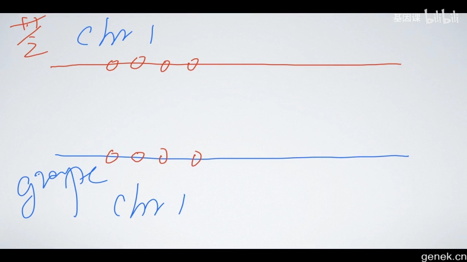
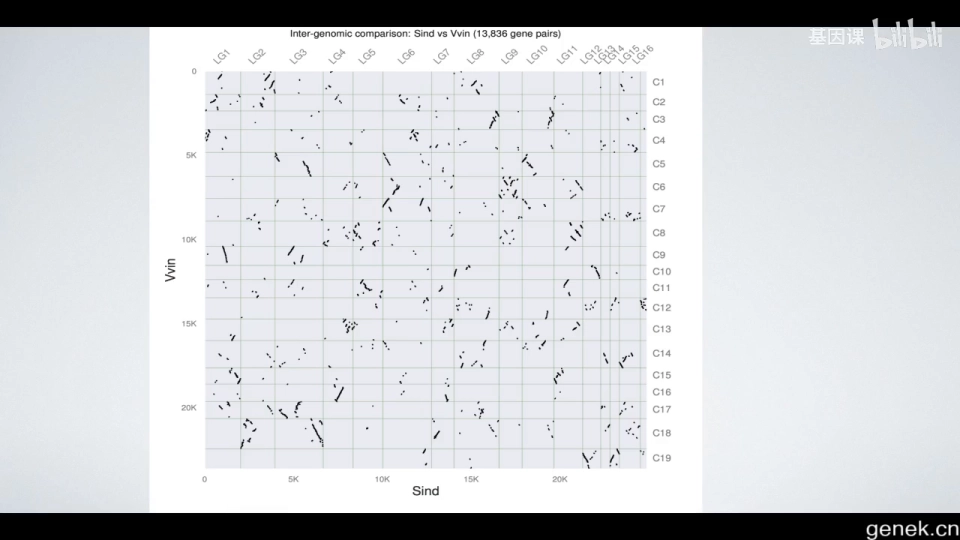
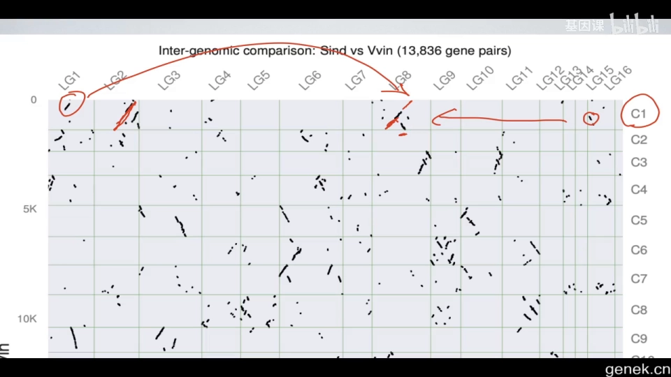
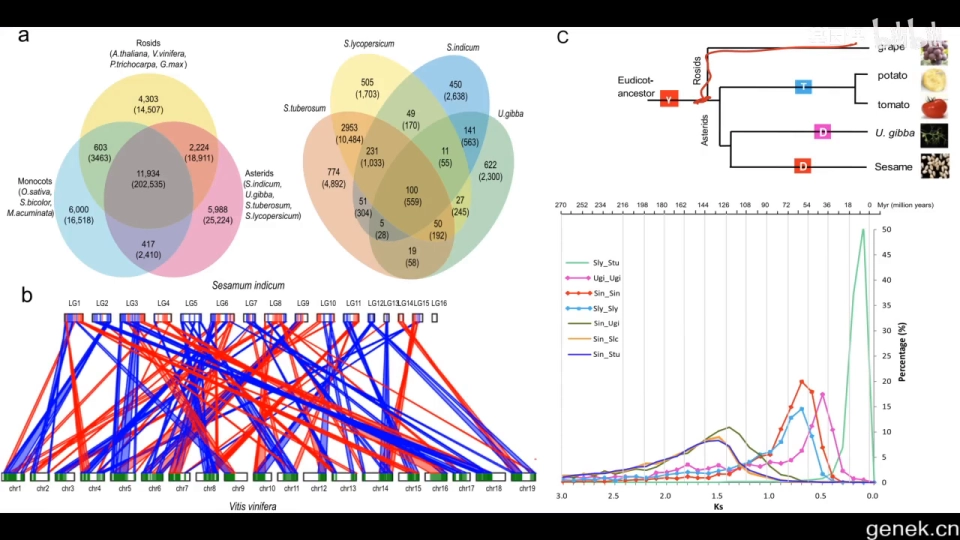
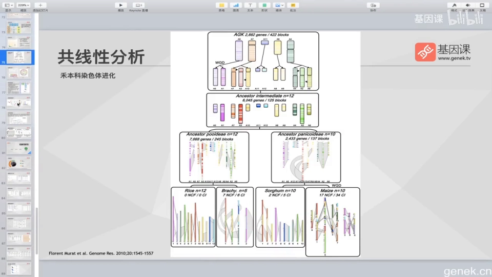
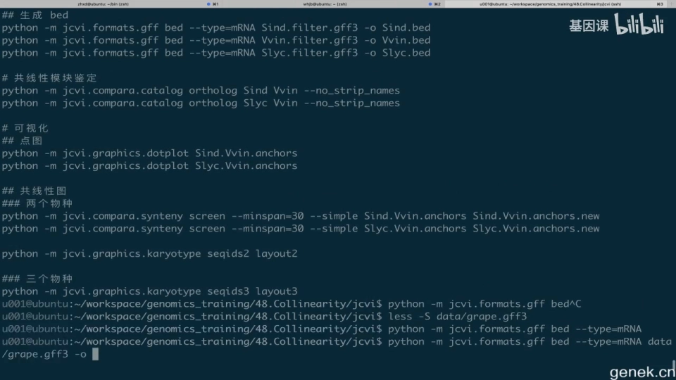
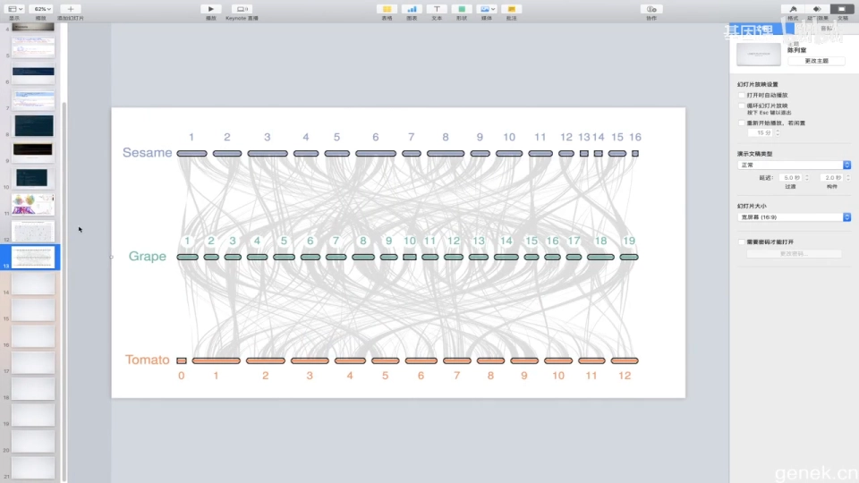
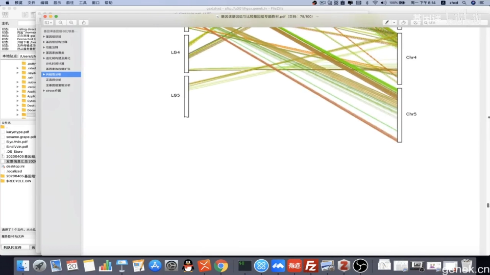

# 共线性与点图：从基因顺序读出全基因组复制与祖先染色体

> 视频来源：[第16节：共线性分析](https://www.bilibili.com/video/BV1iJ4m1w7L1/)（B 站 · 基因课，约 84 分钟）
> 导读：这是一节以 jcvi 为例的共线性分析实操课，但真正值钱的是前半段"怎么读图"：讲者用芝麻、葡萄、番茄三个物种，把一张点图读成了全基因组复制、二倍化和祖先染色体。本文按"块的定义 → 点图读法 → 复制与重排 → 祖先染色体 → 流程与参数 → 对功能推断的影响"重排，命令行部分只保留能说明原理的步骤。字幕为 B 站 AI 字幕，术语已按上下文订正（"贡献性"→共线性、"二倍起"→二倍体等）。

## 本讲要解决的核心问题（SCQA）

**背景**：跨物种比较我们已经有了两套工具：比序列（[5.1.4 双序列比对](../../5.1_序列同源、比对与系统发育/5.1.4_成对序列比对：局部／全局目标、打分与缺口/双序列比对：动态规划、全局与局部.md)）和查同源关系（[5.2.2 跨物种同源映射](../5.2.2_跨物种同源映射：一对多关系与功能迁移风险/Ensembl%20同源数据：一对一、一对多与多对多的判读与置信度.md)）。这两套工具回答的都是"谁像谁"。

**冲突**：但"谁像谁"丢掉了位置信息。基因组上最宏观的那几类事件——全基因组复制、染色体融合与分裂、片段换到另一条染色体、片段反向——改变的恰恰不是序列像不像，而是**同源基因在染色体上的排列顺序**。只看同源关系表，这些事件全都看不见。

**疑问**：怎么把"顺序"变成一个可计算、可画图的量？一张点图或共线性图到底该怎么读？读到"一条染色体对应两条"意味着什么？这些结论又如何改变我们对基因功能的推断？

**回答（中心思想）**：把染色体上**连续出现的同源基因**打包成一个"共线性块"，再用块在染色体上的排布（点图、核型图）去读事件：**块落在对角线上 = 顺序保守；一条染色体对两条 = 全基因组复制；块换到别的染色体或方向反转 = 重排**。块的数量与对应倍数直接给出复制层数，块的错位给出重排史。对功能推断的后果是双向的：**顺序保守的地方，位置本身可以当功能线索**（同一个块里的基因往往共享调控环境）；**顺序被打散或拷贝数变了的地方，按位置外推就会失效**。

## 一、共线性块：把"顺序"变成一个可数的单位

### 1.1 一个块 = 至少五六个连续的同源基因

讲者先在白板上画了两条染色体，一条芝麻、一条葡萄，都是 1 号染色体，上面各画了四个基因点，同源基因一一对应。[【跳转到 01:44】](https://www.bilibili.com/video/BV1iJ4m1w7L1/?t=104)

定义由此而来：如果**至少有连续五到六条基因**，在芝麻基因组中的顺序跟葡萄基因组中的顺序基本一致，那么由这些基因组成的这个块，就叫做一个**共线性块**（collinear block，也叫 synteny block）。[【跳转到 02:59】](https://www.bilibili.com/video/BV1iJ4m1w7L1/?t=179)

### 1.2 块允许缺口，不要求"完全一致"

严格意义上的块是"上面五个基因和下面五个基因顺序完全一致、一一对应"。但讲者马上补了一句：实际分析不能要求这么严——比如芝麻这一侧多出一条基因，比对不到对方任何地方，"多一条就多一条"，这个块仍然算数。[【跳转到 03:24】](https://www.bilibili.com/video/BV1iJ4m1w7L1/?t=204)

这条看似技术性的让步其实决定了后面所有结论的粒度：**块是"近似"的守恒单位，不是"精确"的字符串匹配**。所以块的最小基因数（min_size）是一个必须写进方法学的参数——jcvi 默认 4 个基因，MCscanX 默认 5 个，改一个数字，块的数量和长度都会变。

### 1.3 为什么这个单位值得算

讲者开场给了一个很直白的价值判断：基因家族分析出来"也就是一堆数字"，共有家族多少、特有家族多少，一时半会儿看不出有意义的东西；而共线性分析"直接就能看出来一些有意义的东西"。[【跳转到 00:42】](https://www.bilibili.com/video/BV1iJ4m1w7L1/?t=42)

原因在于块把**一维的基因列表**变成了**二维的排布**：一旦同源关系带上了坐标，就可以画图，而图能一眼看出的东西（一条对两条、整段换染色体、整段反向）用表格是看不出来的。

## 二、点图怎么读：对角线、一条对两条、错位

### 2.1 点图就是"两张基因组的坐标纸"

把芝麻的 16 条染色体（lg1–lg16）放在横轴、葡萄的 19 条染色体（C1–C19）放在纵轴，每一个同源基因对打一个点，就得到一张点图（dot plot）。这张图的标题写着 `Inter-genomic comparison: Sind vs Vvin (13,836 gene pairs)`——芝麻与葡萄之间一共 13 836 对共线性基因。[【跳转到 04:32】](https://www.bilibili.com/video/BV1iJ4m1w7L1/?t=272)

读图规则只有三条：

1. **落在对角线上**：这段序列在两条染色体上顺序一致，没有被打断；
2. **落在别的染色体对应的行/列上**：这段序列换了染色体，也就是**易位**一类的重排；
3. **块的方向与对角线相反**（从左上走向右下）：这段序列在两条染色体上**反向排列**，也就是**倒位**一类的重排。

所以点图上"密密麻麻"不是噪声，而是**重排史的密度**：块越碎、越偏离对角线，说明这两个基因组之间积累的重排越多。

### 2.2 一条染色体对两条：把块平移拼起来

讲者放大葡萄的 1 号染色体（C1），让观众自己数它在芝麻里对应几份拷贝。方法很土但很有效：**把共线性块平移、拼接**——把 lg2 上的一段，加上 lg1 与 lg8 上各一段，平移过来拼起来，正好等于葡萄 C1 的全长。[【跳转到 06:20】](https://www.bilibili.com/video/BV1iJ4m1w7L1/?t=380)

结论是：**葡萄的一条染色体，在芝麻基因组里对应两份拷贝**。同样的规律在 3 号、5 号染色体上也能看到——5 号"两个连在一起，这是一份，挪过来这是一份，非常清晰"。[【跳转到 07:35】](https://www.bilibili.com/video/BV1iJ4m1w7L1/?t=455)

### 2.3 一条对两条 = 全基因组复制

为什么会出现 1:2？讲者的回答是**全基因组复制**（whole genome duplication，WGD）：在葡萄这一支分化出去之后，芝麻的基因组经历过一次二倍化事件（图中标为 **D**），加倍了；而番茄、马铃薯这一支经历过一次三倍化事件（图中标为 **T**）。[【跳转到 08:33】](https://www.bilibili.com/video/BV1iJ4m1w7L1/?t=513)

讲者还给了一个很好用的类比：突变按尺度排队——单点的叫 SNP，插入缺失叫 INDEL，再大一点叫结构变异，"我认为再大的突变就叫 WGD"。[【跳转到 08:58】](https://www.bilibili.com/video/BV1iJ4m1w7L1/?t=538)

## 三、加倍之后为什么又变回"二倍体"：二倍化与基因丢失

读到这里会冒出一个矛盾：既然芝麻加倍过，它不该是四倍体吗？番茄、马铃薯三倍化过，不该是六倍体吗？为什么现在都叫二倍体？

讲者的答案是**二倍化**（diploidization）：在漫长的历史里，加倍的基因组会**丢失掉很多序列**，不同拷贝之间的分化也会越来越大。[【跳转到 10:38】](https://www.bilibili.com/video/BV1iJ4m1w7L1/?t=638)

具体机制他讲得很形象：同一份序列的两份拷贝，**通常一份保持原来的功能、比较稳定，另一份会快速丢失、进化、重组**；当两份拷贝"越来越不相似，看起来就像不同的序列一样"，你就不能再按染色体套数叫它四倍体、六倍体了。[【跳转到 11:17】](https://www.bilibili.com/video/BV1iJ4m1w7L1/?t=677)

这一段其实已经碰到了本小节的核心问题——**复制对功能推断的影响**：

- 加倍给了两个拷贝，功能可以**分摊**（各干一部分），也可以**一个保留、一个自由演化**；
- 但"自由演化"最常见的结局是**丢失**，于是加倍留下的痕迹从"多一套染色体"退化成"多几个块"；
- 讲者提到油料所的一个课题组研究油菜（四倍体）里的**不平等丢失**，正是这类工作。[【跳转到 55:06】](https://www.bilibili.com/video/BV1iJ4m1w7L1/?t=3306)

### 3.1 独立证据：Ks 分布上的两个峰

点图给出的是"位置上的 1:2"，还有一类证据来自序列本身：把共线性块里每一对同源基因的 **Ks**（同义替换率，可粗略当时间标尺）算出来画分布，峰的位置就对应一次复制事件。讲者展示的论文图里，芝麻这一支的峰标着 **D**，番茄/马铃薯这一支的峰标着 **T**，与点图的读法互相印证。[【跳转到 08:33】](https://www.bilibili.com/video/BV1iJ4m1w7L1/?t=513)

这张图值得逐块看：左下那张核型图就是"点图"的另一种画法——把两条基因组的染色体画成平行的条，用连线表示共线性块，**红蓝两色正好把两套拷贝分开**；右上的物种树上，D 和 T 两个方块标出了两次加倍发生的位置。Ks 的横轴从 3.0 到 0.0（越靠右越近），两个峰分别落在芝麻与番茄/马铃薯的支系上。

为什么用 Ks 而不是直接数块？因为块的数量受参数影响，而 Ks 分布是**序列分化**的独立读数，两者一致时结论才稳。Ks 与选择压力的完整讨论见 [5.1.8 dN/dS 与选择压力](../../5.1_序列同源、比对与系统发育/5.1.8_序列分歧与选择压力：同义／非同义替换与 dN／dS/dN／dS%20与选择压力：同义与非同义替换的比值怎么算、怎么读.md)。

### 3.2 为什么拿葡萄当参照

讲者明确说了选葡萄的理由：葡萄是一个**古多倍体**，在经历那次古老的 WGD 之后，它自己这一支**再没有经过全基因组复制**，所以它的基因组"比较保守、比较单纯"；其他物种都跟它比，"是它的几倍，那就是发生了什么样的加倍事件，就很容易找出来"。这也是为什么很多被子植物研究都拿葡萄做参照。[【跳转到 75:52】](https://www.bilibili.com/video/BV1iJ4m1w7L1/?t=4552)

这条经验可以直接迁移到功能推断上：**参照物种选得越"干净"，倍数关系越容易读**。反过来，如果参照物种自己也复制过，1:2 和 2:4 就分不开了。

## 四、从"现在的染色体"倒推"祖先的染色体"

共线性分析最漂亮的一个用法，是把现存的几条染色体"倒推"回祖先的核型。讲者举的是禾本科的例子：水稻 12 条、短柄草 5 条、高粱 10 条、玉米 10 条染色体，用四个物种之间的共线性块往前推，可以得到一串祖先核型。[【跳转到 14:26】](https://www.bilibili.com/video/BV1iJ4m1w7L1/?t=866)

这张图是整节课的"总纲"，读法如下：

- **每个框里的彩色竖条是一条祖先染色体**，条上的数字是块编号；
- **框与框之间的连线是共线性块**，线从哪条走到哪条，就说明这段序列去了哪里；
- **框上标注的"基因数 / 块数"**（例如 AGK 2,882 genes / 423 blocks、Ancestor pooideae n=12 7,668 genes / 245 blocks）是这次重建的"证据量"；
- 最下一排每个物种下面还有 `0 NCF / 0 CI`、`7 NCF / 6 CI`、`2 NCF / 5 CI`、`17 NCF / 34 CI` 这样的统计，讲者没有展开，只提醒这类图需要大量人工判断。

讲者对这个方法的评价很克制，值得原样保留：这件事"确实有一定难度，你得在这个领域积累非常深的知识"，"这不是说弄个软件一跑结果就出来了，你要不断判断，根据画出来的图去猜测这些共线性块当初是怎么组合、怎么重组的"。[【跳转到 15:19】](https://www.bilibili.com/video/BV1iJ4m1w7L1/?t=919)

换句话说，**祖先染色体重建是"人 + 图"的工作，不是"软件 + 参数"的工作**。这也解释了为什么这类图在文章里总是配大量手工标注。

## 五、把流程跑起来：输入、鉴定块、画图

讲者用 jcvi（Python 版的 MCscan，唐海宝开发）演示了完整流程。命令行细节不必背，但每一步的**输入输出契约**值得记住，因为它决定了结果能怎么用。[【跳转到 17:35】](https://www.bilibili.com/video/BV1iJ4m1w7L1/?t=1055)

### 5.1 两个输入：序列 + 位置

- **CDS 序列**：用来算"哪个基因跟哪个基因长得像"，本质是一次相似性比对（jcvi 用 last，MCscan 用蛋白序列）；
- **GFF 注释**：提供每个基因在哪条染色体、起止在哪，也就是位置信息。[【跳转到 18:24】](https://www.bilibili.com/video/BV1iJ4m1w7L1/?t=1104)

**两者缺一不可**：只有序列能算出同源，只有位置能算出顺序，共线性是两者的乘积。

### 5.2 先洗注释：只留挂在染色体上的序列

讲者花了不少时间演示"踩坑"：原始 GFF 里除了 lg1–lg16，还有 `cov` 开头、`C` 开头的 scaffold/contig，以及 `random` 开头的未定位序列。如果不剔掉，画出来的图就是"一大片密密麻麻的琐碎小方块"。[【跳转到 24:09】](https://www.bilibili.com/video/BV1iJ4m1w7L1/?t=1449)

这一步的教训比命令本身重要：**共线性图的质量上限由注释决定**。未挂载的序列没有可靠的顺序，把它们放进图里只会制造假块。同样的道理也适用于番茄 GFF 里 `SL3.0_ch00` 这类前缀（讲者用 sed 去掉）和 CDS 与 GFF 的 ID 体系必须对得上（CDS 的 ID 要对应转录本 ID）。

### 5.3 鉴定块：先"高质量"，再"补全"

鉴定块的核心逻辑（讲者用白板画过）是两轮：

1. **第一轮**：last 比对 → 过滤 → 得到一批高质量锚点（anchors），块内基因相似度高；
2. **第二轮**：以第一轮的块为骨架，**回头把那些相似度不高、但夹在块中间的基因也拉进来**——理由是"它周边的基因都属于共线性的，那么大概率这个基因也应该是它对应的"。[【跳转到 49:06】](https://www.bilibili.com/video/BV1iJ4m1w7L1/?t=2946)

于是每个物种对会产出两个文件：`*.anchors`（高质量、偏短）与 `*.lifted.anchors`（补全、偏长）。讲者的建议是：**先用高质量的那份，如果物种离得太远、效果不好，再换补全的那份**。[【跳转到 50:32】](https://www.bilibili.com/video/BV1iJ4m1w7L1/?t=3032)

这个文件格式值得记住：**块内是"基因对 + 分数"的列表，块与块之间用 `###` 隔开**。所以"块"在数据里就是一个连续的行段，块的长度、块的得分分布都可以直接从这张表统计。

### 5.4 画图：点图、双物种核型图、三物种核型图

jcvi 把命令行串成了一条流水线，讲者最后把整段脚本展示出来，正好可以当作流程总览：[【跳转到 37:34】](https://www.bilibili.com/video/BV1iJ4m1w7L1/?t=2254)

三个可视化的分工：

| 图 | 横纵轴是什么 | 能回答什么问题 |
| --- | --- | --- |
| 点图（dotplot） | 两条基因组的坐标 | 块落在哪里、是否换染色体、是否反向 |
| 双物种核型图（karyotype） | 两条基因组平行排列 + 连线 | 染色体级别的对应关系与倍数 |
| 三物种核型图 | 三条基因组平行排列 | 谁是"中间参照"、哪一段在三者间都保守 |

三物种那张图讲者给了一个很实用的技巧：**把最保守的物种放在中间**（葡萄），上下各放一个，这样"上面到中间""中间到下面"两段对应关系可以互相校验。[【跳转到 68:25】](https://www.bilibili.com/video/BV1iJ4m1w7L1/?t=4105)

### 5.5 两个必须写进方法学的参数

画图前有一道筛选：`synteny screen --minspan=30 --simple`，把太短的块剔掉再画。讲者坦率地说自己对这个参数"不是特别有把握"，但把两个参数的作用讲清楚了：[【跳转到 57:06】](https://www.bilibili.com/video/BV1iJ4m1w7L1/?t=3426)

- **min_size**：一个块至少包含多少个共线性基因，少于这个数就不画；
- **minspan**：块的最小跨度（默认 30），同样起过滤作用。讲者在这里很坦白：他说自己对这个参数的确切含义"不是特别有把握"，只知道它和 min_size 一起决定哪些块能进图。

筛选的效果在日志里看得最清楚：番茄对葡萄一共 968 个块，筛完只剩 316 个。[【跳转到 60:20】](https://www.bilibili.com/video/BV1iJ4m1w7L1/?t=3620)

**换一个 minspan，块数就从 968 变成 316**——这意味着任何"某物种有 N 个共线性块"的说法，都必须带上参数。

### 5.6 工具边界：为什么换成 jcvi

讲者没有回避工具比较：MCscan/MCscanX 是最有名的、几乎所有重测序文章都用过，但"这个软件不好用"，出图"分辨率特别低，不能导出矢量图，都是 PNG 格式"，"只能看不能用"。[【跳转到 73:39】](https://www.bilibili.com/video/BV1iJ4m1w7L1/?t=4419)

所以这节课选 jcvi 的理由是**出图质量**，不是算法优劣——两者的块鉴定思路是同一套（比对 + 锚点 + 链化）。另外讲者也交代了 jcvi 做不了圈图，圈图要用 circlize 另做，而圈图的价值在于**把共线性、基因密度、重复序列含量、GC 含量叠在一张图上**。

## 六、这些结果怎么影响功能推断

把上面所有内容收束到本小节的学习目标上，共线性分析对功能推断有四个直接后果。

### 6.1 顺序保守 → 位置本身是功能线索

块内的基因在物理上仍然连在一起，所以"位置"是一条独立于序列的线索。讲者在答疑里给的用法是判断**祖先基因的来源与分化**：把共线性块和物种树结合起来，就能判断哪个块是更古老的一份拷贝——他演示的做法是把葡萄 C1 的两个拷贝分别标成红色与绿色，红色那份"没有被打散"，代表更古老的一拷贝。[【跳转到 52:10】](https://www.bilibili.com/video/BV1iJ4m1w7L1/?t=3130)

这类"哪一份更原始"的判断正是功能推断的起点：结合前面"一份保持原来的功能、另一份快速丢失与重组"的经验，更原始的那份通常是保留原功能的候选，另一份才是新功能或丢失的候选。

### 6.2 顺序被打散 → 按位置外推失效

反过来，一旦块被拆到不同染色体（就像芝麻里葡萄 C1 的两份拷贝分别落在 lg2 与 lg1+lg8 上），"因为 A 和 B 相邻所以它们功能相关"这条推理就断了。[【跳转到 07:35】](https://www.bilibili.com/video/BV1iJ4m1w7L1/?t=455)

讲者的原话很到位：这一份"已经被重组了"，"这一份和这一份已经分到两个染色体上了"。**重排是功能推断的噪声源**，而点图正是估计这个噪声大小的工具。

### 6.3 一条对两条 → 拷贝数差异，功能可能分摊或丢失

1:2 的对应关系直接告诉你：这个基因在这个物种里有**两份来源相同的拷贝**。接下来的功能推断必须回答三个问题：

- 两份拷贝都还在吗？（二倍化会丢掉一份）
- 都在的话，是**分摊**了原来的功能，还是一份**新功能化**？
- 如果只剩一份，它更接近祖先状态，还是另一份更接近？

这些问题没法只靠共线性回答，但共线性给出了**候选集**：同一个块里的两份拷贝，就是需要逐对比较的对象。至于"两份拷贝算直系同源还是旁系同源"，定义见 [5.1.3 同源、直系同源与旁系同源](../../5.1_序列同源、比对与系统发育/5.1.3_同源、直系同源与旁系同源/同源、直系同源与旁系同源：从基因树读出复制与分化.md)；跨物种映射时一对多怎么处理，见 [5.2.2 跨物种同源映射](../5.2.2_跨物种同源映射：一对多关系与功能迁移风险/Ensembl%20同源数据：一对一、一对多与多对多的判读与置信度.md)。

### 6.4 基因丢失 → 模式生物外推失效

二倍化过程中被丢掉的那份拷贝，在别的物种里可能还留着。于是"小鼠有这个基因、人没有"这类差异，很多时候不是功能创新，而是**丢失**。按共线性的读法，这两种情况可以分开：如果两侧的块都还在、中间缺一个，那是丢失；如果整段块都不在，那这一段可能从来就不在这个支系里。

### 6.5 两个延伸用法

讲者在答疑里还给了两个延伸：

- **种内共线性**：把同一物种的两份 CDS 当成两个"物种"跑一遍，就能找**串联重复/片段重复**——这是"基因家族扩张"里局部扩张那一类的直接证据。[【跳转到 77:37】](https://www.bilibili.com/video/BV1iJ4m1w7L1/?t=4657)
- **基于基因组序列的共线性**：不用基因，直接拿两条基因组做 lastz 比对，得到的是**大片段复制**（segmental duplication，SD），这类做法在动物基因组文章里偶尔还能见到。[【跳转到 76:47】](https://www.bilibili.com/video/BV1iJ4m1w7L1/?t=4607)

## 小结

- **共线性块 = 至少五六个连续同源基因组成的近似守恒单位**；块允许缺口，最小基因数是必须写进方法学的参数（jcvi 默认 4，MCscanX 默认 5）。
- **点图的三条读法**：落在对角线上是顺序保守，落在别的染色体上是易位类重排，方向反转是倒位类重排。
- **一条染色体对两条 = 全基因组复制**；芝麻这一支经历过一次二倍化（D），番茄/马铃薯经历过一次三倍化（T），Ks 分布上的峰是独立旁证。
- **加倍之后会二倍化**：一份拷贝保持功能、另一份快速丢失与重组，所以"四倍体"最终看起来像二倍体。
- **参照物种要选干净的**：葡萄是古多倍体且此后未再复制，所以常被当作倍数关系的标尺。
- **祖先染色体重建是人工判断的工作**：禾本科从 n=5 的祖先核型一路推到水稻 12、短柄草 5、高粱 10、玉米 10。
- **流程的输入输出契约**：CDS + GFF → 洗注释 → 锚点（高质量）→ lifted 锚点（补全）→ 点图/核型图；块数随 minspan 从 968 变到 316。
- **对功能推断的影响是双向的**：顺序保守处位置可当线索，顺序打散处位置外推失效；1:2 给出需要逐对比较的候选拷贝；丢失解释了"模式生物有、人没有"。

## 关键术语速查

| 术语 | 一句话解释 |
| --- | --- |
| 共线性（collinearity / synteny） | 两个基因组上连续多个同源基因保持相同顺序的现象 |
| 共线性块（collinear block） | 由至少五六个连续同源基因组成的、允许少量缺口的守恒区段 |
| 点图（dot plot） | 横纵轴各放一条基因组、每个同源基因对打点的图，用于读块的位置与方向 |
| 核型图（karyotype plot） | 把多条染色体平行排列、用连线表示共线性块的图 |
| 全基因组复制（WGD） | 整套染色体一起加倍的事件，在点图上表现为一条对多条 |
| 二倍化（diploidization） | 加倍之后大量拷贝丢失与分化，使基因组重新表现得像二倍体 |
| 大片段复制（segmental duplication, SD） | 不用基因、直接用基因组序列比对鉴定出的片段级重复 |
| 锚点（anchors） | 共线性块里的同源基因对及其比对得分，`###` 分隔不同块 |
| lifted anchors | 以高质量块为骨架、把中间低相似度基因补进来的扩展版锚点 |
| min_size / minspan | 画图时过滤共线性块的两个阈值：最少基因数、最小跨度 |
| 祖先核型（AGK） | 由现生物种共线性关系反推出来的祖先染色体组成 |
| jcvi | 唐海宝开发的 Python 版 MCscan，用于共线性鉴定与出图 |