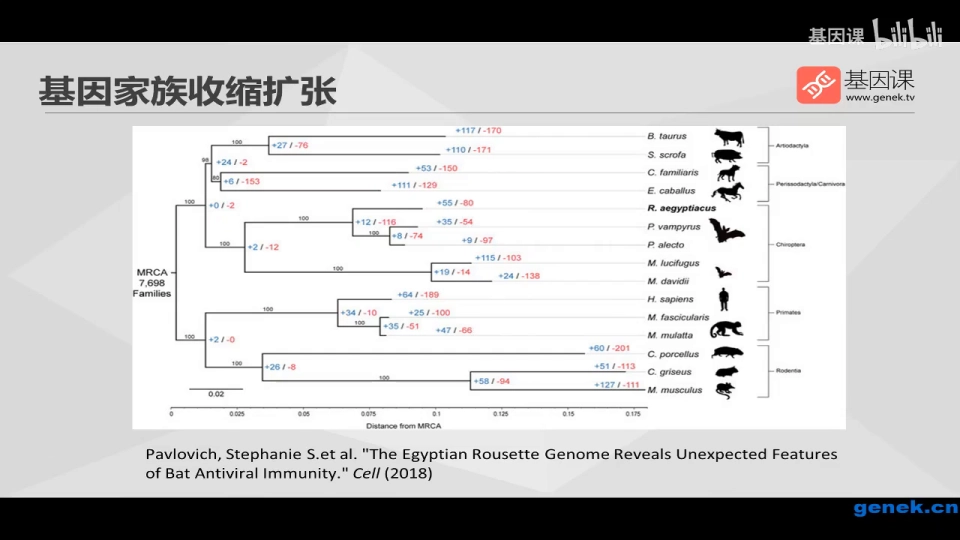
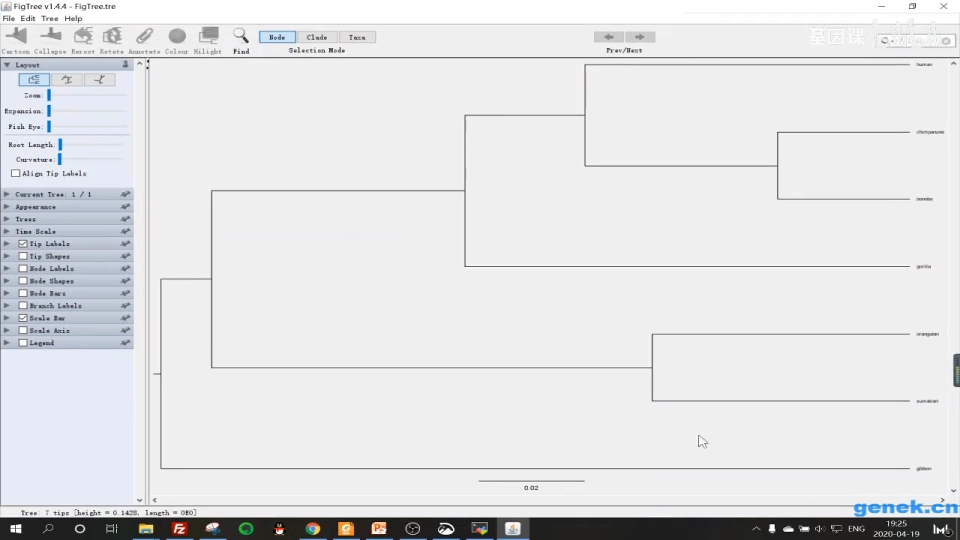
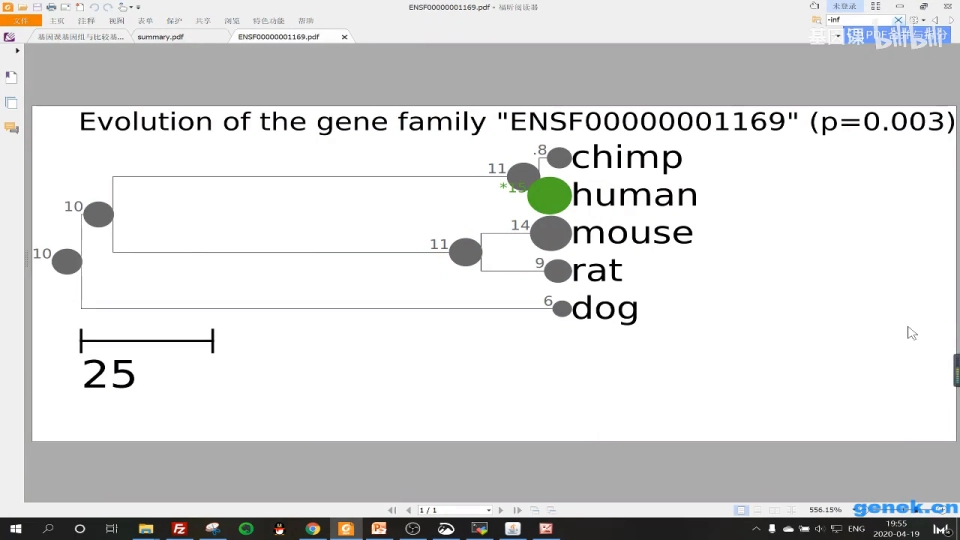

# 基因家族的生灭：CAFE 如何推断扩张、收缩与快速进化

> 视频来源：[第15节：基因家族收缩与扩张](https://www.bilibili.com/video/BV13y411h7qu/)（B 站 · 基因课，约 124 分钟）
> 导读：这是一节 CAFE 的完整实操课：从基因家族计数表出发，用带分化时间的物种树和随机生灭模型，反推每个祖先节点上每个家族有多少条基因，再把"节点 vs 祖先"的差读成扩张与收缩。本文按"定义 → 读图 → 模型 → 输入输出 → 显著性 → 后续分析 → 会改变结论的选择"重排，命令行只保留能说明原理的部分。字幕为 B 站 AI 字幕，术语已按上下文订正（"金家族"→基因家族、"栏目达"→lambda、"PY6"→p 值等）。

## 本讲要解决的核心问题（SCQA）

**背景**：基因家族聚类（如 OrthoFinder）会给我们一张表：每一行是一个基因家族，每一列是一个物种，格子里是这个家族在该物种里的基因条数。这张表是静态的。

**冲突**：我们真正想回答的是动态问题——"在这个家族的历史上，哪一支在变多、哪一支在变少？"直接拿两个现生物种的数字相减会误导：两个物种各自都在变，差值里混着两条支的贡献，甚至会出现"A 比 B 多，但 A 其实相对自己的祖先在减少"这种反直觉情况。

**疑问**：怎么把"现在的拷贝数"变成"历史上的增减"？怎么判断哪个家族的变化是显著的？显著之后又该怎么把它变成生物学结论？

**回答（中心思想）**：用**带分化时间的物种树**加**随机生灭（birth-death）模型**，先估出一个基因获得/丢失速率 $\lambda$，再在每个内部节点反推祖先拷贝数；把每个节点与它的**直接祖先**相比，差就是扩张或收缩。显著性分两层筛：先看家族整体的 family-wide $p$ 值，再看具体分支的 branch $p$ 值。**对功能推断的后果是**：显著扩张/收缩的家族只是**候选名单**，数值本身没有意义，必须落到功能（富集、结构域）才有结论；而"根节点家族数从 2 万变成几千"提醒我们，**家族集合怎么选，会直接改变你得到的结论**。

## 一、先把"家族大小变化"定义清楚

### 1.1 基因家族是什么

讲者给的定义很朴素：**由一个祖先基因因为复制产生的一些相似基因**，这些相似基因可能有相似的生物学功能，这一组就叫一个基因家族。[【跳转到 07:22】](https://www.bilibili.com/video/BV13y411h7qu/?t=442)

聚类做的事就是把这些家族一个个挑出来。注意这里有个容易被忽略的点：**聚类是纯计算的**，它只看序列两两之间的相似性（本质是把 BLAST 的 E 值转成一个数值矩阵，再做矩阵运算聚成类），**完全没有跟任何数据库比对**，所以聚类结果里的家族**天生没有功能标签**。[【跳转到 81:47】](https://www.bilibili.com/video/BV13y411h7qu/?t=4907)

### 1.2 收缩与扩张是"相对于祖先"，不是"相对于别的物种"

这是全课最重要的一句话。讲者反复强调：研究基因家族收缩和扩张，研究的是**基因家族在进化过程中的大小变化**——"但记住，这个增大变小的过程其实是相对于它自己的祖先来的，相对于它的祖先节点，它的基因是在增多还是减小"。[【跳转到 07:47】](https://www.bilibili.com/video/BV13y411h7qu/?t=467)

到了答疑环节他又用一张假想的树把这个点讲透：如果一支是 20 条、另一支是 10 条，直接比只能得到"数值上有差异"；真正要问的是**这两支各自相对于它们共同祖先的节点**是增还是减。[【跳转到 101:10】](https://www.bilibili.com/video/BV13y411h7qu/?t=6070)

### 1.3 早期算法有多粗暴

在 CAFE 之前，文献里用过一些非常简单的判定：比如研究土豆和番茄，**哪个家族在土豆里是番茄的两倍，就认为它在土豆里扩张**；或者要求某个物种的家族基因数**大于其他所有物种的两倍**。[【跳转到 08:37】](https://www.bilibili.com/video/BV13y411h7qu/?t=517)

这类规则的问题很明显：它把"物种间差异"直接当成"进化方向"，既不考虑系统发育关系，也不考虑时间。CAFE 的价值就在于把这两件事都放进了模型。

## 二、先学会读一张 CAFE 树图

### 2.1 图上的数字是"家族个数"，不是"基因个数"

这是初学者最常读错的地方。讲者拿一张经典图（Qu et al. 2013，地山雀基因组）逐项解释：`+117 / −10` 表示**相对于这个祖先节点，有 117 个基因家族发生了扩张、10 个家族发生了收缩**；`MRCA (23789)` 表示最近共有祖先处一共 23 789 个基因家族；末端物种后面的 `+26/−69` 是**这个物种自身这一支**相对于人与小鼠共同祖先的变化。[【跳转到 11:21】](https://www.bilibili.com/video/BV13y411h7qu/?t=681)

所以这张图回答的是"**哪些节点上家族数量变化最剧烈**"，而不是"哪个基因多了几条"。

### 2.2 支长可以表示时间，也可以表示遗传距离

同一类图有两种画法，读之前要先看清楚：

- 上面那张图横轴标着 `Million years ago`，**支长 = 时间**；
- 下面这张蝙蝠免疫的图，横轴标着 `Distance from MRCA`，刻度是 0.02、0.05……，**支长 = 建树时的遗传距离**。[【跳转到 13:51】](https://www.bilibili.com/video/BV13y411h7qu/?t=831)

这个区别不是排版问题：**支长是时间，才能和 CAFE 的速率模型对上**（见第三节）；支长是遗传距离，就只能看拓扑与相对变化。

### 2.3 三张图放在一起，是为了讲"家族数为什么差三倍"

讲者把三张图并排放在一起，专门讲一件事：根节点的家族数分别是 **23 789**（人和鸟类）、**7 698**（蝙蝠，全是哺乳动物）、**3 815**（牦牛）。[【跳转到 15:06】](https://www.bilibili.com/video/BV13y411h7qu/?t=906)

"如果你正常做这么多物种的基因家族聚类分析，拿到的家族个数应该是几万个，比如说 4 万、5 万个都可能，但绝对不会是 7698。"[【跳转到 14:16】](https://www.bilibili.com/video/BV13y411h7qu/?t=856)

差别来自**过滤**：有的分析用全部家族，有的只用"在最近共有祖先处就存在"的家族。这件事后面还会以 `-filter` 参数的形式再出现一次（见第七节），它直接决定了你最终能报出多少个"扩张家族"。

## 三、模型：随机生灭、lambda 与祖先拷贝数

### 3.1 一个速率参数 lambda

CAFE 用的模型是**随机生灭过程**（birth-death process）。它算的核心参数是 $\lambda$：**在进化过程中，单位时间内产生或丢失的基因条数**（讲者的说法是"单位时间产生或者丢失的基因家族个数"，但结合后文"基因条数"的例子，它作用在基因条数上）。[【跳转到 17:34】](https://www.bilibili.com/video/BV13y411h7qu/?t=1054)

有了 $\lambda$ 和时间，就能沿着树往上游推：每个内部节点上，这个家族应该有多少条基因。讲者把这一步概括为"它其实是在推断每一个中间节点、或者叫祖先节点，每个物种在它祖先节点的基因条数"。[【跳转到 10:31】](https://www.bilibili.com/video/BV13y411h7qu/?t=631)

### 3.2 时间单位决定 lambda 的量纲

讲者给了一个具体例子：如果分析里时间单位是**百万年**，$\lambda = 0.01$ 就表示"每一个百万年发生 0.01 条基因的增减"。[【跳转到 50:09】](https://www.bilibili.com/video/BV13y411h7qu/?t=3009)

所以 $\lambda$ 不能脱离时间单位单独引用。同一份数据换成"以亿年为单位"，$\lambda$ 就会差两个数量级。

### 3.3 必须有分化时间：超度量树

做这个分析的前提是**带分化时间的物种树**，而且必须是**超度量树**（ultrametric tree）：从根到每个物种的支长加起来等长，支长代表的全是时间。[【跳转到 25:44】](https://www.bilibili.com/video/BV13y411h7qu/?t=1544)

这就解释了课程顺序：**先讲基因家族聚类，再讲分化时间计算，最后才讲收缩扩张**——因为后者需要前两者的产物。树可以从 TimeTree 这类网站按物种列表生成，也可以自己建。[【跳转到 27:32】](https://www.bilibili.com/video/BV13y411h7qu/?t=1652)

### 3.4 两个数值约束：lambda×时间 ≤ 1，score 不能是负无穷

讲者给了两条很实用的自检：

1. **$\lambda$ 乘以时间不能大于 1**。以他的树为例，根节点时间约 91 个百万年，$\lambda = 0.005$，乘积 0.455，在范围内；软件认为超过 1 会"不太准确"。[【跳转到 90:38】](https://www.bilibili.com/video/BV13y411h7qu/?t=5438)
2. **日志里的 score 必须是正常数字**。如果出现 `-inf`（负无穷），说明有某个家族的基因数在不同物种间差异过大，把似然算崩了；处理办法是把那一行从输入表里删掉，反复迭代直到能算出正常值。[【跳转到 89:11】](https://www.bilibili.com/video/BV13y411h7qu/?t=5351)

这两条都不是"高级技巧"，而是**结果能不能用**的门槛。

## 四、输入与运行：三个文件

### 4.1 输入一：基因家族计数表

格式是**制表符分隔**的表格：第一列是家族描述（占位，随便写），第二列是家族名，后面每一列是一个物种的基因条数。[【跳转到 22:34】](https://www.bilibili.com/video/BV13y411h7qu/?t=1354)

它和 OrthoFinder 的 `Orthogroups.GeneCount` 表只差两件事：**多了一列 total**（要删掉）、**少了一列描述**（要补上）。讲者的处理是 `cut -f 1-5` 去掉 total，再用 `awk` 把第一列打印两遍补出描述列。[【跳转到 65:10】](https://www.bilibili.com/video/BV13y411h7qu/?t=3910)

### 4.2 输入二：超度量树

树不是单独文件，而是**直接写进配置文件**。写法上有两个坑：**树中间不能有空格**，**结尾不要 Newick 的分号**。[【跳转到 26:39】](https://www.bilibili.com/video/BV13y411h7qu/?t=1599)

从分化时间软件（MCMCtree/FigTree）导出的 nexus 树还要做一轮文本清洗：去掉方括号里的置信区间、去掉 `TREE =` 前缀、把时间单位从"亿年"换算回"百万年"（乘以 100）。讲者用 sed/awk 一步步演示，核心就一句：**树上的数字必须和你的时间单位一致**。[【跳转到 57:30】](https://www.bilibili.com/video/BV13y411h7qu/?t=3450)

### 4.3 输入三：配置文件

配置文件里几个参数各有分工，值得记住：[【跳转到 23:59】](https://www.bilibili.com/video/BV13y411h7qu/?t=1439)

| 参数 | 作用 | 注意 |
| --- | --- | --- |
| `-i` | 指定基因家族计数表 | 必须制表符分隔 |
| `-p` | family-wide $p$ 值阈值 | 决定"要不要继续算这个家族的分支显著性" |
| `-t` | 线程数 | 默认 8，服务器上别开满 |
| `tree` | 超度量树 | 无空格、无分号 |
| `-s` | 让软件自己估 $\lambda$ | 通常用它 |
| `-l` | 直接指定 $\lambda$ | 拆分大家族时用（见第八节） |
| `-filter` | 过滤掉 MRCA 处不存在的家族 | 会大幅减少家族数 |

讲者还提到一个指定日志输出的参数（他读作 `-l`）；同一个字母在另一处被用来指定 $\lambda$，实际写配置时按软件的帮助文档确认即可。

## 五、读输出：header、家族行与两层 p 值

### 5.1 header 部分是"整棵树"的汇总

CAFE 的主输出是一个 `.cafe` 文件。开头是固定的 header：树结构与支长、估出来的 $\lambda$、每个节点的 node id，然后是几行汇总（平均扩张、平均收缩、无变化家族数等）。[【跳转到 28:24】](https://www.bilibili.com/video/BV13y411h7qu/?t=1704)

读 header 的关键是**括号里的数字对**：`(0,2)` 表示"节点 0 与节点 2 这一对"，`(1,5)` 表示"节点 1 与节点 5"。要对照 `# IDs of nodes` 那一行，才知道 0 是大猩猩、2 是人、1 是人与大猩猩的祖先、5 是小鼠与大鼠的祖先。[【跳转到 29:39】](https://www.bilibili.com/video/BV13y411h7qu/?t=1779)

### 5.2 家族行：树上每个节点都标了拷贝数

header 之后，每一行是一个家族。第二列是树，但树上每个节点后面多了一串下划线加数字——**这个数字就是该节点上这个家族的基因条数**（现生物种的是观测值，内部节点的是推断值）。[【跳转到 33:23】](https://www.bilibili.com/video/BV13y411h7qu/?t=2003)

于是"收缩/扩张"就是**一次减法**：大猩猩 12 条、它和人的祖先 13 条，大猩猩就是收缩 1 条；人 14 条、祖先 13 条，人就是扩张 1 条。再往上一层，节点 13 相对于更上面的 10 是扩张、节点 8 相对于 10 是收缩，一路推到根。[【跳转到 34:38】](https://www.bilibili.com/video/BV13y411h7qu/?t=2078)

### 5.3 两层显著性：先家族、后分支

- **family-wide $p$ 值**：这个家族整体上是否显著变化。没有达到 `-p` 阈值时，软件**根本不会去算分支显著性**。[【跳转到 23:59】](https://www.bilibili.com/video/BV13y411h7qu/?t=1439)
- **branch（Viterbi）$p$ 值**：在家族整体显著的前提下，具体哪一支显著。讲者说这个值"也会有人叫它 branch p 值"。[【跳转到 50:59】](https://www.bilibili.com/video/BV13y411h7qu/?t=3059)

这个两级设计很重要：**它把"这个家族在变"和"在这个物种这一支上变"分开了**。前者是家族层面的证据，后者才是可以写进"某物种特异适应"的候选。

另外两个细节：冒号后面的数字是**分化时间**（例如 6 表示 6 个百万年）；表头里的 `Likelihood Ratio` 等列**实际不输出**，别看错列。[【跳转到 36:18】](https://www.bilibili.com/video/BV13y411h7qu/?t=2178)

## 六、五个汇总文件与两张图

CAFE 自带的补充程序（Python 2 写的，要先切环境）会把 `.cafe` 结果拆成几个汇总文件。[【跳转到 37:16】](https://www.bilibili.com/video/BV13y411h7qu/?t=2236)

| 文件 | 内容 | 用途 |
| --- | --- | --- |
| `summary_pub.txt` | 每个物种：扩张家族数、获得基因条数、平均扩张、收缩家族数、丢失条数、平均收缩、无变化家族数 | 做一张"物种级"总表 |
| `summary_node.txt` | 每个节点：扩张家族数、收缩家族数、快速进化家族数 | 画树图时标数字 |
| `summary_fams.txt` | 每个节点下**具体的**快速进化家族列表（`+` 扩张、`−` 收缩） | 讲者认为**最重要**的文件，用来挑家族 |
| `summary_anc.txt` | 每个家族在每个节点（含祖先）的推断拷贝数 | 回溯某个家族的历史 |
| `summary.log` | 运行日志 | 排查 |

讲者对这几个文件的取舍很明确：**"这个文件我个人认为是最重要的"**——指的是 `summary_fams.txt`，因为它是从"一堆数字"走向"具体家族"的入口。[【跳转到 42:27】](https://www.bilibili.com/video/BV13y411h7qu/?t=2547)

### 6.1 两张图：整棵树 vs 单个家族

CAFE 自带的绘图程序只能画一种信息（扩张、收缩或快速进化三选一），图也比较简陋，所以讲者又用了第三方包 `cafe_fig`（GitHub 上，需要小改一行才能在无图形界面的服务器上跑）。[【跳转到 46:22】](https://www.bilibili.com/video/BV13y411h7qu/?t=2782)

它输出两类图：

- **summary 图**：整棵树 + 每个节点的扩张/收缩，用圆圈大小和颜色表示幅度；
- **family-wide 图**：每个家族一张子图，标出各物种的拷贝数与显著变化的分支。

讲者对这两张图的评价很实在：图"丑丑的"，原因是物种太少（只有 4–5 个）、分化时间跨度太短，绘图程序里每个百万年对应的像素是固定的，时间范围越小、物种越少，图就越扁、圈越小。[【跳转到 83:25】](https://www.bilibili.com/video/BV13y411h7qu/?t=5005)

## 七、把结果变成生物学：显著家族之后做什么

### 7.1 数值本身没有意义

讲者说得很直接：这些收缩和扩张的数值，"直接的数值是没有意义的"，要看的是**具体的收缩和扩张的基因家族的功能**，"你还是要把它落到功能上去"。[【跳转到 109:58】](https://www.bilibili.com/video/BV13y411h7qu/?t=6598)

### 7.2 从家族到基因列表：四步

以"芝麻里显著扩张的家族"为例，讲者演示了一条纯命令行路线：[【跳转到 71:57】](https://www.bilibili.com/video/BV13y411h7qu/?t=4317)

1. 在 `summary_fams.txt` 里 `grep` 出芝麻那一行；
2. `cut -f 2` 取出家族 id 那一列，用 `tr` 把逗号换成换行，变成一行一个家族；
3. 按 `+`/`−` 前缀分开扩张与收缩两个列表（讲者说实际分析里"不太关心哪些家族在收缩，关心的都是这些扩张的基因家族"）；
4. 回到 OrthoFinder 的 `Orthogroups.tsv`，按家族 id 取出芝麻那一段基因 id。

一个细节值得记：`Orthogroups.tsv` 里**每个物种的基因 id 用"逗号+空格"分隔，物种之间用制表符分隔**，所以 `cut -f 1,2` 就能拿到"家族 id + 芝麻基因列表"两列。[【跳转到 76:20】](https://www.bilibili.com/video/BV13y411h7qu/?t=4580)

### 7.3 富集是主力手段

拿到基因列表后，就是常规富集：GO、KEGG、结构域三个层面都可以做，"你看到底哪一个可能跟你研究的这个物种特异的一些东西相关"。[【跳转到 122:22】](https://www.bilibili.com/video/BV13y411h7qu/?t=7342)

富集之后再做一步"落地"：把关键家族的基因拿去做进化树，看它们的**共有结构域**有什么特点、有没有物种特异的域或类型——"就跟常规的单个基因家族分析的文章里面一样了"。

### 7.4 家族功能注释不是聚类自带的

这是本讲一个容易被忽略但很重要的提醒：OrthoFinder 的 `group` **对不上任何数据库的家族编号**，要做功能注释只能"把这个家族里面每条基因做功能注释，再汇总"。[【跳转到 79:12】](https://www.bilibili.com/video/BV13y411h7qu/?t=4752)

汇总的规则讲者也给了：**看"共有"而不是"全部一致"**——比如要求这个家族里 95% 的基因都注释到同一个 Pfam 编号，才把该结构域赋给这个家族；因为家族内部注释冲突（一个注释到 A 功能、一个注释到 B 功能）是常态。eggNOG-mapper 给每个家族一个功能，用的也是"逐基因注释再汇总"这条路。

## 八、几个会改变结论的选择

这一节是整堂课最有"方法学"味道的部分：同一份数据，几个开关不同，结论就不同。

### 8.1 用全部家族还是用过滤后的家族

`-filter` 参数的作用是：只保留"在最近共有祖先（MRCA）处就存在"的家族——也就是要求**两个子支上至少各有一个物种**带着这个家族。[【跳转到 85:13】](https://www.bilibili.com/video/BV13y411h7qu/?t=5113)

它会把家族数从几万砍到几千（就是第二节那三张图的差异）。讲者的建议是**跑两次**（一次过滤、一次不过滤），"哪个结果更符合你的预期"就用哪个，"有的文章是用所有的基因家族去做这个事儿，有的文章是用只有共有祖先节点的这些基因去做这个事"。[【跳转到 88:17】](https://www.bilibili.com/video/BV13y411h7qu/?t=5297)

### 8.2 大家族怎么办：拆开、固定 lambda、再合并

作者的建议是：**如果某个家族在任一物种里超过 100 条基因，就先把它拆出去**，用剩下的"小家族"估 $\lambda$，再用 `-l` 把 $\lambda$ 固定住，回头单独跑那些大家族。[【跳转到 91:42】](https://www.bilibili.com/video/BV13y411h7qu/?t=5502)

讲者补了两条很实际的修正：

- **100 这个阈值是人为的**，要按物种调整：植物（尤其土豆、番茄这种近期三倍化过的）家族普遍偏大，可能要放到 200；[【跳转到 97:16】](https://www.bilibili.com/video/BV13y411h7qu/?t=5836)
- **别把整类家族一刀切掉**：像 P450 这种本来就很大的家族，一过滤就全军覆没；如果它只是"条数多"但**变化不大**，讲者建议保留。[【跳转到 98:31】](https://www.bilibili.com/video/BV13y411h7qu/?t=5911)

拆分的代价也要说清楚：两份结果**没法汇总统计**，所以更好的做法是"算出 $\lambda$ → 固定 $\lambda$ → 用全部家族重跑一遍"。[【跳转到 96:19】](https://www.bilibili.com/video/BV13y411h7qu/?t=5779)

### 8.3 根节点不允许是零

CAFE 有个隐含假设：任何家族**一定有一个祖先基因**。所以即使输入表里所有物种在某家族都是 0，它也会在根节点给你补上一条。讲者用测试数据的第一行演示了这个现象，并提醒"这种情况运行时不报错"，但那一行的计算"是没有意义的"。[【跳转到 85:43】](https://www.bilibili.com/video/BV13y411h7qu/?t=5143)

### 8.4 获得/丢失 ≠ 扩张/收缩

答疑里有人问能不能用 DOLP 算获得和丢失来代替 CAFE。讲者的回答很干脆：**这是两个概念**——获得/丢失是**定性的有或无**，扩张/收缩是**变大还是变小**（当然包含有和无）。DOLP 只有在**真的没有分化时间**时才用。[【跳转到 120:42】](https://www.bilibili.com/video/BV13y411h7qu/?t=7242)

### 8.5 收缩扩张无法实验验证

有人问这类结论要不要实验验证。讲者的回答是：**"这个收缩扩张没有办法验证，收缩扩张都是算出来的"**——它是基于模型对祖先状态的推断，不是可以直接测的读数。[【跳转到 101:10】](https://www.bilibili.com/video/BV13y411h7qu/?t=6070)

这句话决定了这类结果在论文里的位置：它是**提出候选的筛选工具**，不是结论本身。真正能验证的是候选基因的功能，而不是"这个家族扩张了"这个推断。

## 小结

- **收缩/扩张是相对于祖先节点的变化**，不是两个现生物种的差值；这是全课的地基。
- **CAFE 用随机生灭模型**：先估基因获得/丢失速率 $\lambda$（单位时间、作用于基因条数），再沿树反推每个节点的祖先拷贝数。
- **必须有超度量树**：支长是时间、从根到各末端等长；$\lambda$ 的量纲由时间单位决定。
- **两条自检**：$\lambda \times$ 时间不能大于 1；日志里的 score 不能是 `-inf`，否则要剔除异常家族重跑。
- **输出分两层**：header 是整棵树的汇总（按节点对读），家族行是每个家族在每个节点的拷贝数；显著性先看 family-wide $p$，再看 branch $p$。
- **`summary_fams.txt` 是最有用的文件**：它把"哪个节点上哪些家族快速进化"列了出来，是挑家族的入口。
- **数值本身没有意义**：必须落到功能（GO/KEGG/结构域富集）与结构域特征上。
- **三个会改变结论的开关**：用不用 `-filter`、大家族拆不拆、$\lambda$ 自己估还是固定。
- **获得/丢失 ≠ 扩张/收缩**；收缩扩张是推断，不能直接实验验证。

## 关键术语速查

| 术语 | 一句话解释 |
| --- | --- |
| 基因家族（gene family） | 由一个祖先基因经复制产生的一组相似基因 |
| 收缩 / 扩张（contraction / expansion） | 某个节点上家族拷贝数相对其直接祖先的减少 / 增加 |
| 随机生灭模型（birth-death process） | 用"单位时间以一定速率获得或丢失基因"来描述家族大小演化的模型 |
| lambda（$\lambda$） | 基因获得/丢失速率，量纲依赖时间单位（如每百万年） |
| 超度量树（ultrametric tree） | 从根到所有末端距离相等的树，支长即时间 |
| MRCA | 最近共有祖先（most recent common ancestor） |
| family-wide p 值 | 家族整体是否显著变化的检验值，未过阈值则不计算分支显著性 |
| branch / Viterbi p 值 | 在家族整体显著的前提下，具体分支是否显著变化 |
| 快速进化家族（rapidly evolving family） | family-wide $p$ 值小于阈值（常用 0.01）的家族，扩张与收缩都算 |
| `-filter` | 只保留在 MRCA 处已存在的家族，会大幅减少家族总数 |
| CAFE | 做基因家族收缩扩张分析的主流软件，当前常用 4.x 版本 |
| OrthoFinder | 基因家族聚类工具，其 `Orthogroups.GeneCount` / `.tsv` 是 CAFE 的输入来源 |