# 肽键平面与 phi/psi 二面角：Ramachandran 允许区从哪来

> 视频来源：[《2.1.2 蛋白质二级结构，phi 和 psi 二面角及 ramachandran 图》](https://www.bilibili.com/video/BV1oi421X7Rs/)（Bilibili · Truthen教授生命世界，约 21 分钟）
> 导读：这是一节结构生物学课程的实录，从"肽键为什么是平面的"一路讲到"Ramachandran 图上的三块允许区对应什么"。本文按它的顺序整理，重点放在肽键化学、主链方向与二面角定义，以及允许区的物理来源；二级结构本身的细节只讲到这里需要的程度。

## 本讲要解决的核心问题（SCQA）

**背景**：一条蛋白链由几十到上千个氨基酸残基首尾相连而成，相邻残基之间靠**肽键**连接。序列写在纸上是线性的，但真实分子在三维空间里卷曲、折叠，形成 α 螺旋、β 片层、loop 这些二级结构。

**冲突**：如果主链上的每根键都能自由旋转，一条链能摆出的形状将是天文数字，蛋白质就不可能折叠成"明确"的结构。可现实中，晶体学家解出来的结构里，主链的构象空间其实非常小——小到可以用一张二维图概括。

**疑问**：主链到底有几个自由度？为什么只有少数构象是允许的？这些"允许"又是被什么物理因素划出来的？

**回答（中心思想）**：肽键因为共振而带有**部分双键**性质，于是**六个主链原子被锁在同一个平面里**，肽键本身几乎不能转（ω 只有 0° 和 180° 两个值，绝大多数是 180° 的反式）；这样一来，**每个残基只剩两个可转的键**——绕 N–Cα 的 φ 和绕 Cα–C 的 ψ。而这两个角并不是随便取值：原子之间的**空间冲突**（范德华球撞在一起）把 (φ, ψ) 平面切出**三块允许区**，α 螺旋、β 片层、loop 各自落在其中特定的位置。

---

## 一、先认清主链：残基、方向与原子命名

**结论先行**：多肽链是氨基酸脱水缩合形成的不分支长链，链上每个单元已经"缺了一个水"，所以叫**氨基酸残基（residue）**；残基之间靠**酰胺键**连接，在蛋白质里这个酰胺键就叫**肽键**（[【跳转到 01:09】](https://www.bilibili.com/video/BV1oi421X7Rs/?t=69)）。

这一步看似只是名词，但后面所有的角度都建立在这套原子上。一个残基在主链上只贡献三个"骨架"原子：

- **N**：酰胺氮，带一个氢（写作 H 或 HN）；
- **Cα**：α 碳，四价，除了 N 和 C 之外还挂一个侧链（R 基）和一个氢；
- **C**：羰基碳，双键连一个氧（O）。

于是主链可以写成一条重复的带子：

$$
\cdots-\mathrm{N}-\mathrm{C}_\alpha-\mathrm{C}-\mathrm{N}-\mathrm{C}_\alpha-\mathrm{C}-\cdots
$$

**方向很重要**：蛋白质和多肽的习惯阅读方向是 **从 N 端到 C 端**，也就是上面这条带子从左往右读。这个约定不是装饰——它决定了后面 φ、ψ 的定义顺序，也决定了 β 链箭头的方向。

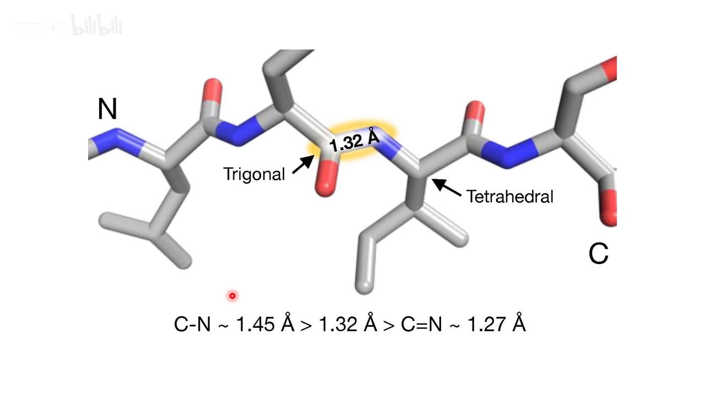

## 二、肽键不是普通单键：1.32 Å 背后的共振

**结论先行**：肽键的 C–N 键长是 **1.32 Å**，比典型的 C–N 单键（约 1.45 Å）短，又比典型的 C=N 双键（约 1.27 Å）长——这个"居中"的键长，是它带**部分双键**性质的直接证据（[【跳转到 02:04】](https://www.bilibili.com/video/BV1oi421X7Rs/?t=124)）。

早期研究肽键时就注意到一个矛盾：α 碳原子表现出预期的**四面体**几何（连着四个基团），而羰基碳表现出**三角平面**几何（连着三个基团）。四面体 + 三角平面这两种几何放在一根普通单键两侧是说不通的，它提示这根键带有双键成分（[【跳转到 01:39】](https://www.bilibili.com/video/BV1oi421X7Rs/?t=99)）。

解释是**共振**：羰基的 π 电子可以与氮上的孤对电子共轭，写成两个共振式——一个是常见的 C=O / N–H 形式，另一个是 C–O⁻ / N⁺=C 形式。真实分子是两者的杂化体，所以这根键既不是纯单键，也不是纯双键（[【跳转到 02:34】](https://www.bilibili.com/video/BV1oi421X7Rs/?t=154)）。

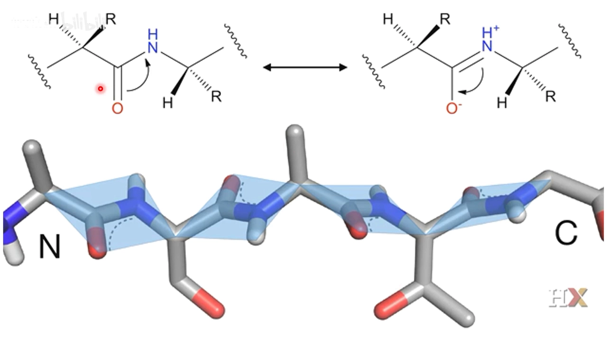

## 三、部分双键带来两个后果：平面，以及转不动

**结论先行**：部分双键性质有两个直接后果——**肽键是平面的**，而且**不能像单键那样自由旋转**（[【跳转到 02:59】](https://www.bilibili.com/video/BV1oi421X7Rs/?t=179)）。

**后果一：六个原子共面。** 氨基氮和它连的氢、羰基碳和它连的氧，全部落在同一个平面上。由于相邻两个残基各贡献一半，这个平面在 α 碳两侧各出现一次，于是主链被切成一串"刚性平板"，板与板之间才是可转的关节。这正是"肽键平面"（amide plane / peptide plane）这个词的来源。

**后果二：肽键只能取两种构象。** 既然转不动，描述这根键两侧两个 α 碳相对位置的那个二面角——它有个专门的名字叫 **ω（omega）**——就只有两个值（[【跳转到 07:10】](https://www.bilibili.com/video/BV1oi421X7Rs/?t=430)）：

- **反式（trans）**：两个 α 碳在肽键的相反两侧，$\omega = 180^\circ$；
- **顺式（cis）**：两个 α 碳在肽键的同一侧，$\omega = 0^\circ$。

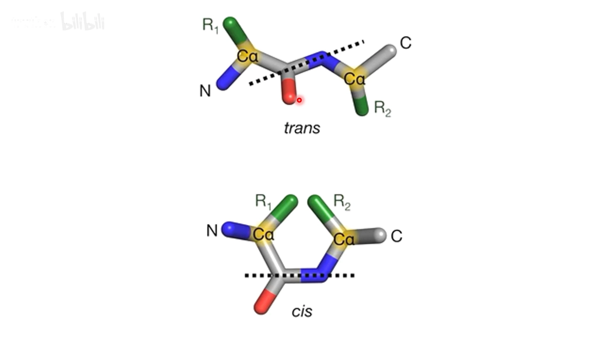

**为什么几乎全是反式？** 顺式构象下，两个相邻残基的侧链挤在同一侧，容易发生空间冲突，因此顺式在结构上是不利的（[【跳转到 04:10】](https://www.bilibili.com/video/BV1oi421X7Rs/?t=250)）。所以天然结构里绝大多数肽键都是反式。

**唯一的例外是脯氨酸。** 脯氨酸是环状氨基酸，它的侧链绕回来自成环，把氮也圈了进去；结果是顺式和反式的空间冲突差不多，两种构象一样"不利"。既然没有哪种更占优，脯氨酸氮端的肽键就经常出现顺式（[【跳转到 04:51】](https://www.bilibili.com/video/BV1oi421X7Rs/?t=291)）。注意这个例外只影响**脯氨酸的氮端**肽键，脯氨酸与其他氨基酸形成的肽键并没有这种必然性（[【跳转到 05:16】](https://www.bilibili.com/video/BV1oi421X7Rs/?t=316)）。

> 读到这可以回答一个常见困惑：为什么说"脯氨酸会破坏螺旋"？因为螺旋要求主链以固定的节拍规律旋转，而脯氨酸氮端的肽键可能直接锁成顺式，把这段节拍打断。视频在讲 α 螺旋时把这个问题留作思考题（[【跳转到 14:27】](https://www.bilibili.com/video/BV1oi421X7Rs/?t=867)），答案就藏在 ω 的这个例外里。

## 四、剩下两个自由度：φ 和 ψ 的定义与记忆法

**结论先行**：肽键固定之后，每个残基只剩**两个**可自由旋转的主链二面角——绕 **N–Cα** 的 **φ（phi）** 和绕 **Cα–C** 的 **ψ（psi）**（[【跳转到 05:55】](https://www.bilibili.com/video/BV1oi421X7Rs/?t=355)）。

先把"二面角"这个词说清楚。几何上，二面角是**两个相交平面之间的夹角**；通过一条直线可以作无数个平面，每两个半平面之间就夹出一个二面角（[【跳转到 03:20】](https://www.bilibili.com/video/BV1oi421X7Rs/?t=200)）。落到分子上，就是"沿着一根键看过去，前后各取两个原子，看这两个平面错开了多少度"。所以二面角永远由**四个原子**决定。

对主链来说，这两个角分别是：

| 角度 | 旋转轴（那根键） | 大致要看的四个原子 | 取值范围 |
| --- | --- | --- | --- |
| $\varphi$（phi） | N–Cα | 上一个残基的 C、本残基的 N、Cα、C | $-180^\circ$ ~ $+180^\circ$ |
| $\psi$（psi） | Cα–C | 本残基的 N、Cα、C、下一个残基的 N | $-180^\circ$ ~ $+180^\circ$ |
| $\omega$（omega） | C–N（肽键） | Cα、C、N、下一个 Cα | 只有 $0^\circ$ 或 $180^\circ$ |

**怎么记住名字和顺序？** 视频给了一个很实用的办法：按字母顺序（[【跳转到 06:45】](https://www.bilibili.com/video/BV1oi421X7Rs/?t=405)）。既然我们习惯从 N 端读到 C 端，那么沿链走过去时先遇到 N–Cα 这根键、再遇到 Cα–C 这根键；而字母表里 $\varphi$ 在 $\psi$ 之前——**先 φ 后 ψ**，正好对应"先 N–Cα，后 Cα–C"。

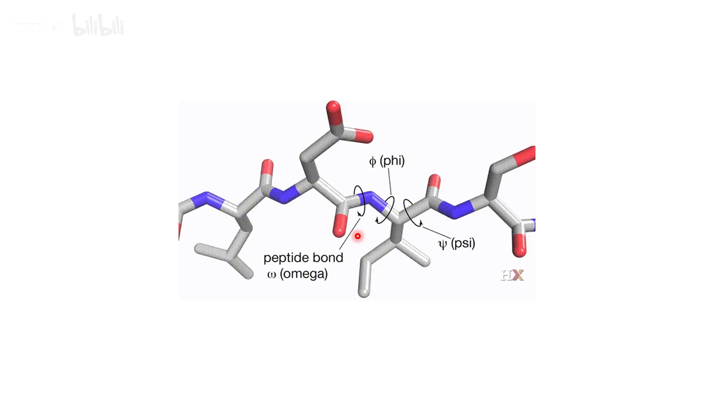

**怎么"量"一个角？** 视频的动画演示是：测 φ 时从氮端沿着 N–Cα 的方向看过去，量两个羰基之间的夹角；测 ψ 时从氮端沿着 Cα–C 的方向看过去，量两个氮之间的夹角（[【跳转到 07:32】](https://www.bilibili.com/video/BV1oi421X7Rs/?t=452)、[【跳转到 07:57】](https://www.bilibili.com/video/BV1oi421X7Rs/?t=477)）。每个残基都有自己的一对 $(\varphi, \psi)$。

举个具体数字：视频里那个**异亮氨酸**残基，$\varphi = -138^\circ$、$\psi = +132^\circ$（[【跳转到 08:22】](https://www.bilibili.com/video/BV1oi421X7Rs/?t=502)）。把它标在一张以 φ 为横轴、ψ 为纵轴的二维图上，就得到一个点（[【跳转到 08:43】](https://www.bilibili.com/video/BV1oi421X7Rs/?t=523)）：

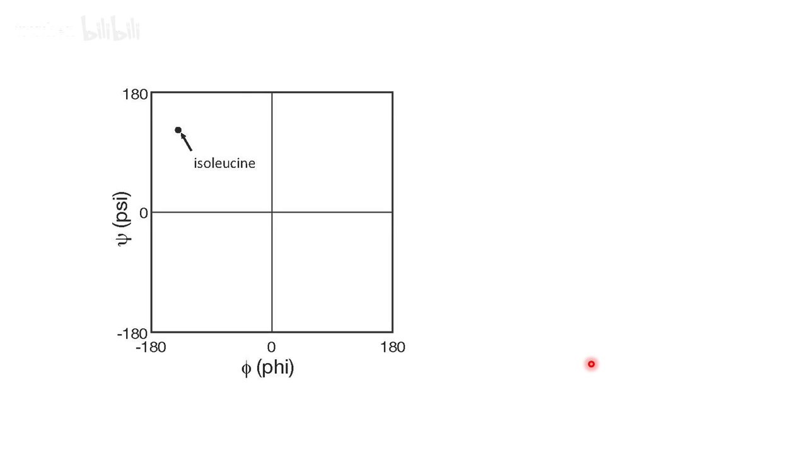

## 五、把每个残基画成一个点：Ramachandran 图怎么来的

**结论先行**：1963 年，印度结构生物学家 **G. N. Ramachandran** 提出：对一个氨基酸来说，并不是所有 $(\varphi, \psi)$ 取值都允许，因为会存在空间冲突；他用分子模型把所有可能的取值试了一遍，发现只有**三块区域**能容纳天然蛋白质里真实出现的二面角组合（[【跳转到 09:08】](https://www.bilibili.com/video/BV1oi421X7Rs/?t=548)、[【跳转到 09:33】](https://www.bilibili.com/video/BV1oi421X7Rs/?t=573)）。

这张图就是 **Ramachandran 图**（拉氏图）。它的构造逻辑非常朴素：

1. 固定一个残基的侧链（先只看主链），把 $\varphi$ 从 $-180^\circ$ 转到 $+180^\circ$；
2. 每转到一个角度，就用**范德华半径**把主链原子画成球，看它们会不会和相邻残基的原子撞上；
3. 撞上的角度记为"不允许"，不撞的记为"允许"；
4. 对 $\psi$ 重复一遍，最后把两个方向的结论叠加成二维图。

视频里的动画正是这么做的：残基绕 φ 键旋转，一旦原子球开始重叠，就用圆柱体标出"这里出现了空间冲突"（[【跳转到 10:23】](https://www.bilibili.com/video/BV1oi421X7Rs/?t=623)）；然后同样的方法把 ψ 键转一圈，考察冲突如何随角度变化（[【跳转到 10:48】](https://www.bilibili.com/video/BV1oi421X7Rs/?t=648)）。

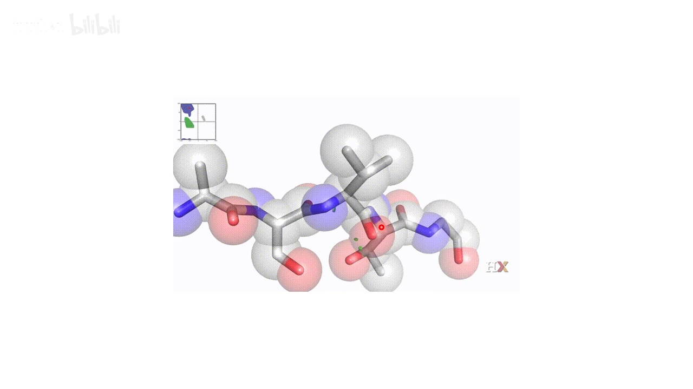

最终得到的三块区域（[【跳转到 09:58】](https://www.bilibili.com/video/BV1oi421X7Rs/?t=598)）：

- **绿色区域**（φ 为负、ψ 为负，位于图的左中）：对应 **α 螺旋**；
- **蓝色区域**（φ 为负、ψ 为正，位于图的左上）：对应 **β 片层**；
- **灰色区域**（φ 为正、ψ 接近 0，位于图的右上偏中）：视频把它和 **loop** 联系起来。

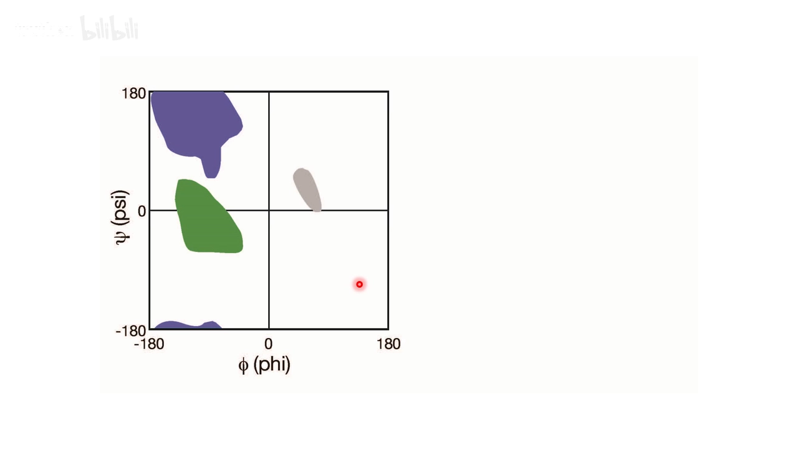

**关键点：允许区不是"经验统计出来的习惯"，而是"物理上撞不撞"的硬约束。** 反过来，落在允许区里也只说明"不撞"，不说明"一定形成某种二级结构"——这一点后面还会强调。

## 六、允许区与二级结构：一张图对应三种骨架形状

**结论先行**：要形成某种规则的二级结构，需要**连续多个残基**的二面角都落在同一块允许区里；反过来，单个残基落在某块区域并不保证它就在那种结构里（[【跳转到 11:18】](https://www.bilibili.com/video/BV1oi421X7Rs/?t=678)）。

### 6.1 α 螺旋：连续残基落在绿色区

α 螺旋要求序列上一连串残基的 $(\varphi, \psi)$ 都落在绿色区（[【跳转到 11:43】](https://www.bilibili.com/video/BV1oi421X7Rs/?t=703)）。这样排出来的主链会形成螺旋，并且让**第 n 个残基的羰基碳与第 n+4 个残基的氨基之间形成氢键**（[【跳转到 12:47】](https://www.bilibili.com/video/BV1oi421X7Rs/?t=767)）——这些氢键沿螺旋轴排成一列，正是螺旋的"骨架铆钉"。

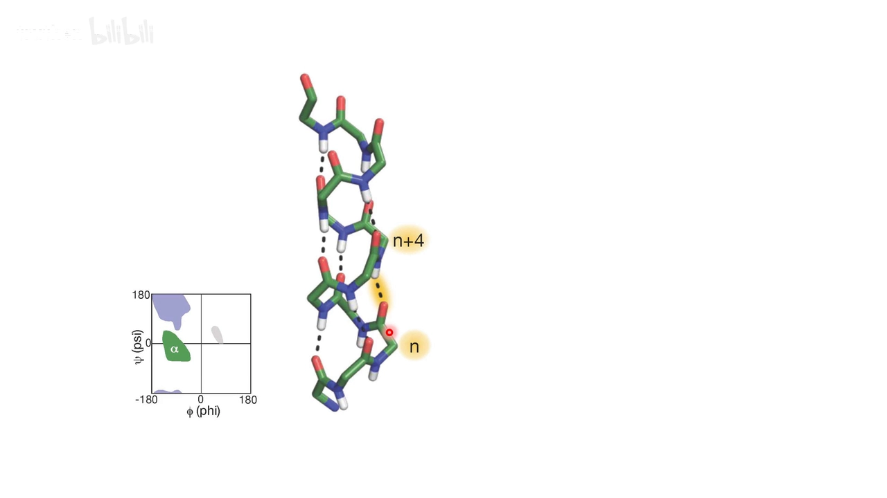

几个可以直接记住的数字与事实：

- 天然的 **L 型氨基酸形成右手螺旋**。判断方法：想象走一段螺旋楼梯，栏杆在你右手边；或者右手大拇指朝上，其余四指沿螺旋走向自然向上卷（[【跳转到 11:57】](https://www.bilibili.com/video/BV1oi421X7Rs/?t=717)）。
- 螺旋**每转一圈包含 3.6 个氨基酸残基**（[【跳转到 13:37】](https://www.bilibili.com/video/BV1oi421X7Rs/?t=817)）。
- 因为 3.6 不是整数，序列上每隔 3~4 个残基就会落在螺旋的**同一侧面**。视频用 **ATP 合酶**举例：螺旋上黄色的疏水残基在序列上彼此隔开 3~4 个位置，但在空间上排成同一条疏水带，正好可以贴到另一个螺旋（图中蓝色）上形成疏水核心（[【跳转到 14:02】](https://www.bilibili.com/video/BV1oi421X7Rs/?t=842)）。

> 这就是"一级结构模式"的含义：序列上周期为 3~4 的疏水/亲水交替，是螺旋在序列上留下的指纹。

### 6.2 β 片层：连续残基落在蓝色区

β 片层要求一系列残基的 $(\varphi, \psi)$ 落在蓝色区（[【跳转到 14:57】](https://www.bilibili.com/video/BV1oi421X7Rs/?t=897)）。这些残基先形成伸展的 **β 链**，多条 β 链之间靠主链氨基与羧基的氢键并排缝合，形成 **β 片层**（[【跳转到 15:12】](https://www.bilibili.com/video/BV1oi421X7Rs/?t=912)）。

- β 链之间可以是**平行**、**反平行**，或者两者**混合**；视频展示的那个片层就是混合的。
- 反平行的两条链通常来自序列上**相邻**的片段，中间用一个短的 loop 拐回来；但形成片层的链也可以来自同一条链上相距很远的部分，甚至来自另一条蛋白质（[【跳转到 15:37】](https://www.bilibili.com/video/BV1oi421X7Rs/?t=937)）。
- 片层的几何很规整：**侧链方向垂直于含氢键的那个平面**，而且同一条 β 链上的侧链在平面上下**交替**出现（[【跳转到 16:52】](https://www.bilibili.com/video/BV1oi421X7Rs/?t=1012)）。因此 β 链的序列常常是"疏水—极性—疏水—极性"交替，让片层一面疏水、一面极性。

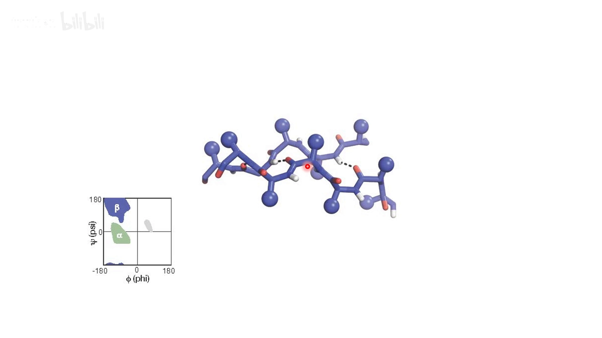

### 6.3 loop：三块区域都能用

第三块（灰色）区域对应 **loop**。但要注意一个容易误解的地方：**形成 loop 的残基可以取任何允许的 $(\varphi, \psi)$ 组合**，所以三块区域里都可能有 loop 残基（[【跳转到 17:17】](https://www.bilibili.com/video/BV1oi421X7Rs/?t=1037)）。

反过来说更重要：**落在 α 区域的残基不一定在螺旋里，落在 β 区域的也不一定在片层里**——它们完全可能只是 loop 的一部分（[【跳转到 18:32】](https://www.bilibili.com/video/BV1oi421X7Rs/?t=1112)）。要形成规则二级结构，条件是"**一连串**残基都落在同一区域"。

loop（也叫转角 turn）的角色是把相邻的规则二级结构连起来：左边例子是一个 loop 连接两条反平行链形成的片层，右边例子是螺旋–loop 的组合（[【跳转到 19:22】](https://www.bilibili.com/video/BV1oi421X7Rs/?t=1162)）。它们的功能特征也很一致：

- 大多数 loop 位于蛋白质**表面**；
- 组成 loop 的氨基酸常是**极性、侧链较小**的残基；
- loop 常常位于**活性位点**，因为它们在构象上有很大的柔韧性（flexibility），可以围绕配体调整成最合适的形状（[【跳转到 19:47】](https://www.bilibili.com/video/BV1oi421X7Rs/?t=1187)）。

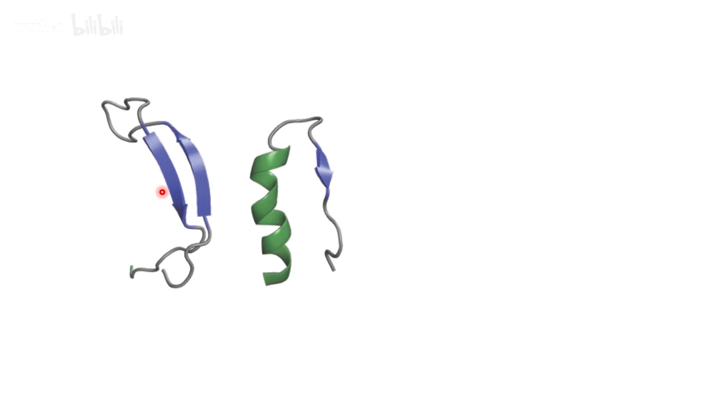

### 6.4 两个"特殊残基"：脯氨酸与甘氨酸

视频在讲 loop 时顺带回顾了这两个残基，它们恰好是构象自由度上的两个极端（[【跳转到 20:12】](https://www.bilibili.com/video/BV1oi421X7Rs/?t=1212)）：

- **甘氨酸**是最小的氨基酸，侧链就是一个氢，构象极其灵活，能进入其他残基进不去的角度；
- **脯氨酸**是环状氨基酸，构象被环限制得很死，但能形成顺式肽键。

一个太灵活、一个太死板，两者都不利于形成规则的螺旋/片层节拍，所以它们**常常出现在 loop 区域**（[【跳转到 20:37】](https://www.bilibili.com/video/BV1oi421X7Rs/?t=1237)）。

## 七、把一张图用在一个真实蛋白上

**结论先行**：视频最后用**乙醇脱氢酶**（alcohol dehydrogenase，能量代谢中的重要酶）收尾——它同时含有 α 螺旋、β 片层和 loop，把它的所有残基的 $(\varphi, \psi)$ 画到 Ramachandran 图上，点会**分布在全部三块允许区**里（[【跳转到 20:54】](https://www.bilibili.com/video/BV1oi421X7Rs/?t=1254)）。

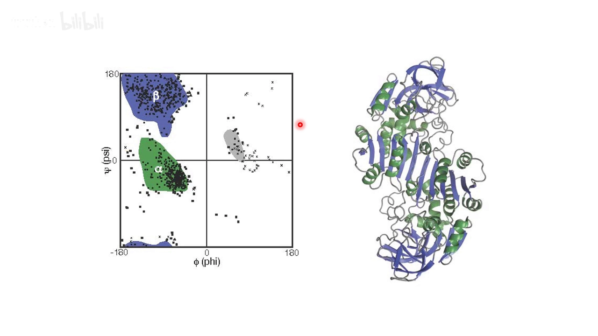

这张图也解释了 Ramachandran 图在结构生物学里的实际用途：**它是一把"几何合理性"的尺子**。解出一个新结构后，把每个残基的 $(\varphi, \psi)$ 点上去，绝大多数点应该落在允许区里；如果大量点落在空白区，说明模型建错了。

## 小结

- 多肽链由氨基酸残基通过**肽键**连接，习惯阅读方向是 **N 端 → C 端**；主链骨架原子是 N、Cα、C。
- 肽键 C–N 键长 **1.32 Å**，介于单键 1.45 Å 与双键 1.27 Å 之间，是**共振**造成的**部分双键**。
- 部分双键带来两个后果：**六个原子共面**（肽键平面），以及**不能自由旋转**——ω 只有 $0^\circ$（顺式）和 $180^\circ$（反式），几乎全是反式，例外是脯氨酸氮端的肽键。
- 于是每个残基只剩两个自由度：绕 N–Cα 的 **φ** 和绕 Cα–C 的 **ψ**，范围都是 $-180^\circ$ ~ $+180^\circ$；记忆法是"按字母顺序，先 φ 后 ψ，正好对应 N→C 的方向"。
- 二面角由**四个原子**决定，本质是"沿一根键看过去，两个半平面的夹角"。
- **Ramachandran 图**是把所有 $(\varphi, \psi)$ 组合按"原子会不会撞上"分类得到的二维图，只有三块允许区；允许区的来源是**空间冲突（范德华重叠）**，不是统计习惯。
- 允许区与二级结构的对应：绿色 ≈ α 螺旋（n→n+4 氢键、右手、3.6 残基/圈），蓝色 ≈ β 片层（平行/反平行/混合、侧链垂直交替），灰色与 loop 相关；但**单个残基落在某区并不等于它就在那种结构里**，必须是连续一串残基同区。
- 甘氨酸（最灵活）与脯氨酸（最受限、可成顺式肽键）常出现在 loop；脯氨酸的顺式肽键也是它"破坏螺旋"的原因。

## 关键术语速查

| 术语 | 一句话解释 |
| --- | --- |
| 残基（residue） | 已经参与脱水缩合、不再是完整氨基酸的链上单元 |
| 肽键 / 酰胺键 | 羰基碳与氨基氮之间的 C–N 键，在蛋白质中称肽键 |
| 部分双键 | 共振使肽键介于单键与双键之间，键长 1.32 Å |
| 肽键平面 | 羰基氧、羰基碳、酰胺氮与氢共面形成的刚性平面 |
| ω（omega） | 描述肽键两侧两个 α 碳相对位置的二面角，只有 0° / 180° |
| φ（phi） | 绕 N–Cα 键的旋转角，范围 -180° ~ +180° |
| ψ（psi） | 绕 Cα–C 键的旋转角，范围 -180° ~ +180° |
| 二面角 | 两个相交半平面之间的夹角，由四个原子决定 |
| Ramachandran 图 | 以 φ 为横轴、ψ 为纵轴，标出允许/不允许组合的二维图 |
| 允许区 | 原子之间不发生空间冲突的 (φ, ψ) 组合集合 |
| 右手螺旋 | 沿螺旋走时"栏杆在右手边"的旋向，天然 L 型氨基酸形成右手螺旋 |
| loop / 转角 | 连接规则二级结构的柔性片段，多在蛋白表面与活性位点 |