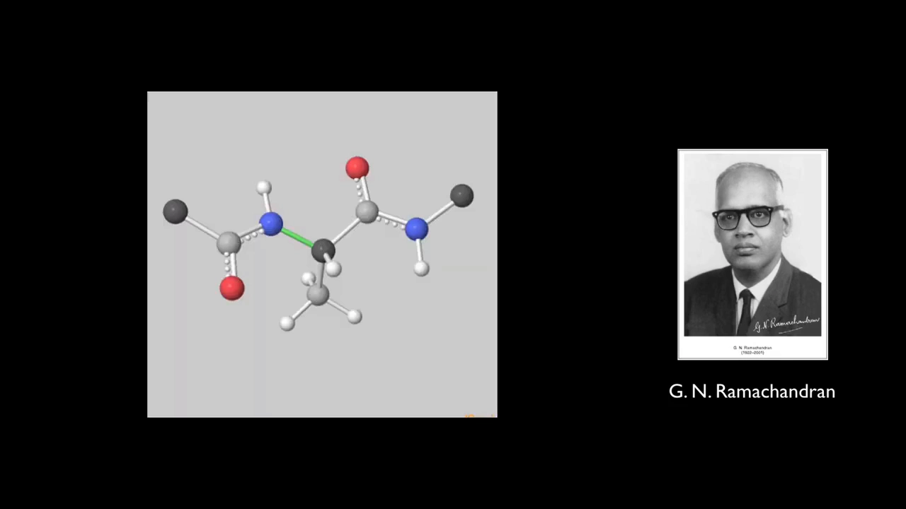
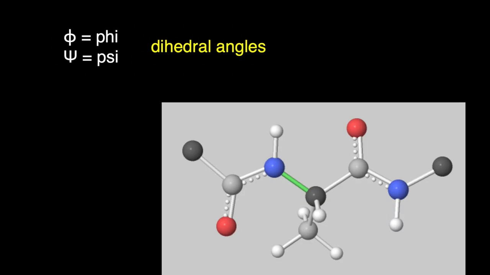
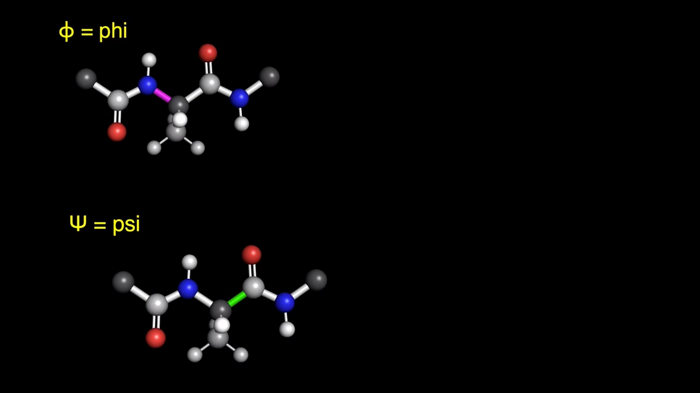
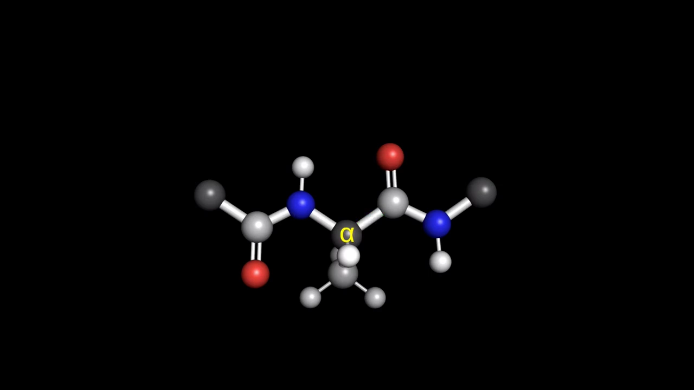
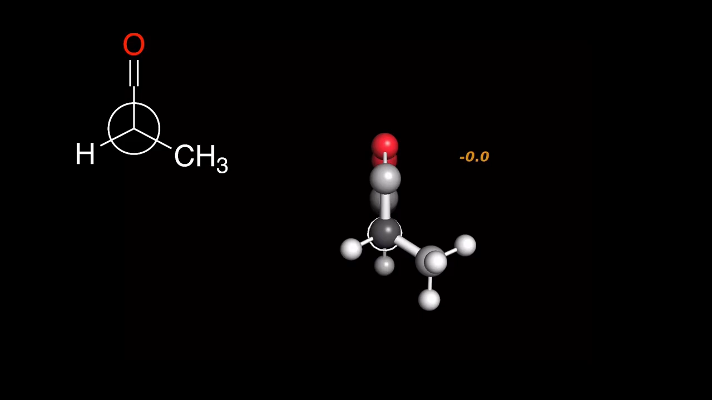
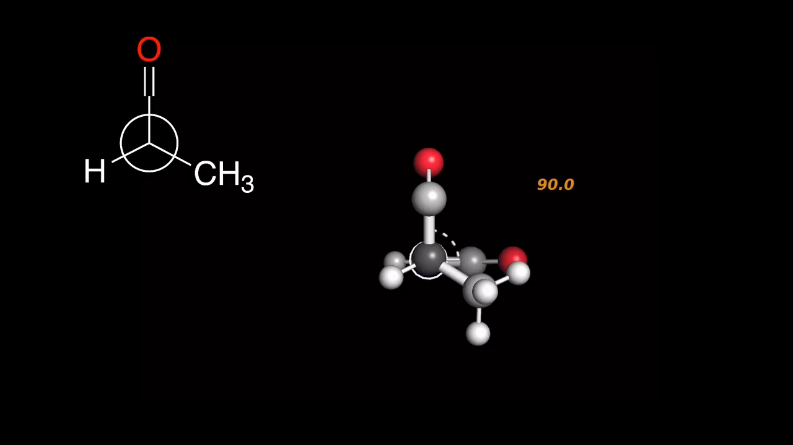
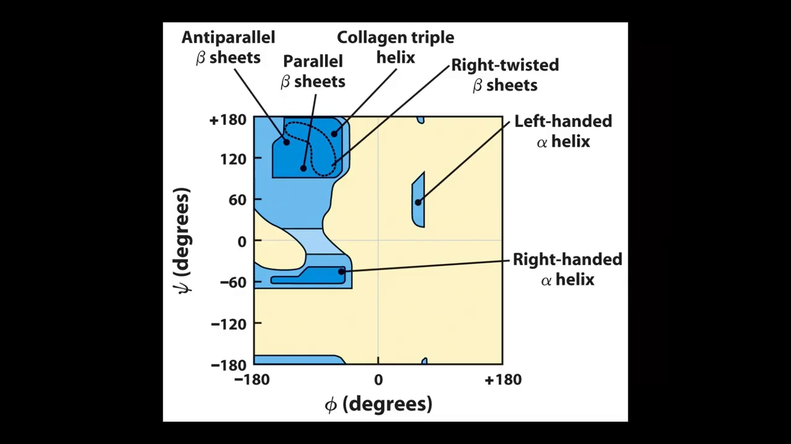

# 酰胺平面与拉氏图：用 3D 模型量 phi/psi 并读懂允许区

> 视频来源：[《酰胺平面动画详解以及拉氏图（Ramachandran Plots）》](https://www.bilibili.com/video/BV1dV4y1U7nS/)（Bilibili · 地球来的奇迹，约 9 分钟）
> 导读：这是一支纯"动手"的教程：拿一条三肽的 3D 模型，一步步演示怎么量 φ 和 ψ、怎么判断正负号、怎么把它画成 Newman 投影式。它不推导化学，专治"知道 φ/ψ 是两个角，但看着结构图就是不会读"。

## 本讲要解决的核心问题（SCQA）

**背景**：肽键因为共振而共面，主链被切成一块块刚性平面；每个残基只剩两个可转的角——绕 N–Cα 的 φ 和绕 Cα–C 的 ψ。把它们画成二维图，就是 Ramachandran 图。

**冲突**：名字和定义都背下来了，可是一拿到真实结构：这个角到底从哪里"看"进去？为什么有的角是正的、有的是负的？Newman 投影式上那几个基团该画在几点钟？——这些操作层面的问题，教材上的静态图往往讲不清。

**疑问**：能不能把"量 φ/ψ"变成一套照着做就行的动作？

**回答（中心思想）**：能。核心是**四原子 + 一个视角 + 一个钟面**：沿所关心的那根键看过去，把与 α 碳相连的氮（或羰基碳）摆在 12 点钟，再看另一个氮（或羰基）落在 12 点到 6 点之间还是 6 点到 12 点之间——前者为正，后者为负。掌握这套动作后，α 螺旋的 $(-60^\circ, -50^\circ)$ 和 β 片层的 $(-140^\circ, +130^\circ)$ 都能在模型上直接"看出来"。

---

## 一、为什么结构生物学家需要这两个角

**结论先行**：蛋白质要执行维持生命的功能，必须折叠成非常特殊的三维形状；而晶体学家解析结构时，是把原子按电子密度"摆"到三维空间里的，模型本身带有歧义，所以他们需要一种办法，**按分子几何上真正允许的范围来检验自己建的结构是否合理**（[【跳转到 00:55】](https://www.bilibili.com/video/BV1dV4y1U7nS/?t=55)）。

肽链先卷曲、弯折成螺旋和片层这类**二级结构元素**，这些元素再进一步折叠成**三级结构**（[【跳转到 00:22】](https://www.bilibili.com/video/BV1dV4y1U7nS/?t=22)）。二级结构是"局部骨架形状"，而局部骨架形状完全由主链二面角决定——所以检验二面角，就是在检验骨架画得对不对。

答案就是 **Ramachandran 图**。1963 年，印度物理学家 **G. N. Ramachandran** 提出了一套标准方法，用来定义多肽链中某个给定氨基酸的几何构型（[【跳转到 01:06】](https://www.bilibili.com/video/BV1dV4y1U7nS/?t=66)）。他的团队指出：由于空间上的原因，有些几何形状根本不可能存在——一个氨基酸在多肽链里不能采取某些构象，因为它会和相邻残基发生不利的拥挤；而把主链上的这两个角画成图时，**二级结构的不同元素会各自占据图上不同的区域**（[【跳转到 01:11】](https://www.bilibili.com/video/BV1dV4y1U7nS/?t=71)）。

## 二、起点：肽键平面把主链切成"刚性板"

**结论先行**：φ 和 ψ 都是**二面角**——按定义，二面角是**两个相交平面之间的夹角**（[【跳转到 01:49】](https://www.bilibili.com/video/BV1dV4y1U7nS/?t=109)）。而主链上之所以只剩两个二面角，是因为肽键自己不能转。

看模型时注意一个细节：羰基和相邻的氮之间画的是**虚线**。这是因为肽键（以及一般的酰胺键）的共振程度很强，强到氮和羰基基本共面，把**六个原子**都锁在 α 碳两侧各自的同一个平面里（[【跳转到 01:54】](https://www.bilibili.com/video/BV1dV4y1U7nS/?t=114)）。

既然酰胺键不能自由旋转，我们就只能绕 **α 碳上的两根键**来转动（[【跳转到 02:19】](https://www.bilibili.com/video/BV1dV4y1U7nS/?t=139)）。这两根键，就是 φ 和 ψ 的旋转轴。

## 三、φ 绕 N–Cα，ψ 绕 Cα–C

**结论先行**：φ 角定义为绕 **α 碳到氮**这根键的旋转（视频里染成**洋红色**）；ψ 角则是绕 **α 碳到羰基碳**这根键的旋转（染成**绿色**）（[【跳转到 03:13】](https://www.bilibili.com/video/BV1dV4y1U7nS/?t=193)）。

视频用一条**由三个丙氨酸组成的三肽**来演示，并且先标出 **N 端和 C 端**（[【跳转到 02:37】](https://www.bilibili.com/video/BV1dV4y1U7nS/?t=157)）。这一步不是多余的：只有知道链的方向，才知道"前一个残基"和"后一个残基"分别在哪一侧。

**一个实用技巧**：要测量中间那个丙氨酸的 φ 和 ψ，本来需要用到前后两个残基里的部分原子；但可以把无关原子**隐藏**掉来简化结构，因为这些原子会挡住别的原子，让角度分析更难（[【跳转到 02:48】](https://www.bilibili.com/video/BV1dV4y1U7nS/?t=168)）。用分子可视化软件时，这一步几乎总是第一步。

## 四、四原子模式：沿键看过去

**结论先行**：无论 φ 还是 ψ，本质上都是**一个四原子模式**——沿旋转轴看过去，比较"前两个原子所在的半平面"和"后两个原子所在的半平面"。

具体到操作：

- 沿 φ 键（Cα→N）看下去时，这个氮会**藏在 α 碳背后**，我们要比较的是**两个羰基碳**之间的夹角（[【跳转到 03:38】](https://www.bilibili.com/video/BV1dV4y1U7nS/?t=218)）；
- 沿 ψ 键（Cα→C）看下去时，羰基碳被挡住，我们要比较的是**两个氮**之间的夹角（[【跳转到 04:03】](https://www.bilibili.com/video/BV1dV4y1U7nS/?t=243)）。

所以"量角"这个动作可以拆成两句：**先决定沿哪根键看，再决定看哪两个原子**。前者由 φ/ψ 决定，后者由"被挡住的是谁"决定。

## 五、Newman 投影：把 3D 模型压成一个钟面

**结论先行**：要把它画成二维的 **Newman 投影式**，可以把模型想象成一个**钟面**：直视所关心的那根键，把与 α 碳相连的**氮或羰基碳放在 12 点钟位置**（[【跳转到 04:28】](https://www.bilibili.com/video/BV1dV4y1U7nS/?t=268)）。

前碳（α 碳）的画法有个容易记的对称性：

- 画 **φ** 的前碳时，**氢指向左边、甲基指向右边**；
- 画 **ψ** 的前碳时，我们是从**另一侧**看 α 碳，所以**氢指向右边、甲基在左边**。

后碳上的基团则随旋转而变。二面角的取值范围是 $-180^\circ$ 到 $+180^\circ$；当两个羰基碳**完全重叠**时，角度为 $0^\circ$（[【跳转到 04:41】](https://www.bilibili.com/video/BV1dV4y1U7nS/?t=281)）。

从 $0^\circ$ 出发转动，就能读出角度的正负与大小。视频在 $90^\circ$ 处暂停，把后碳上的基团逐个画进 Newman 投影式：羰基碳处在 $90^\circ$ 位置就画在那里，而后氮上唯一另一个基团（氢）在相对的一侧、与羰基相差 $180^\circ$（[【跳转到 05:31】](https://www.bilibili.com/video/BV1dV4y1U7nS/?t=331)）。

## 六、正负号规则：12 点到 6 点为正

**结论先行**：一旦转过 $180^\circ$（钟面上的 6 点），角度就变成负值——也就是说，**后碳上的基团处在 12 点到 6 点之间时角度为正，处在 6 点到 12 点之间时角度为负**（[【跳转到 05:56】](https://www.bilibili.com/video/BV1dV4y1U7nS/?t=356)）。

这条规则可以整理成一张小表：

| 后碳基团的位置（钟面） | 二面角符号 | 极端情况 |
| --- | --- | --- |
| 12 点 | $0^\circ$ | 两个羰基（或两个氮）重叠 |
| 12 点 → 6 点（顺时针） | 正 | 6 点时为 $+180^\circ$ |
| 6 点 → 12 点 | 负 | 接近 12 点时为 $-180^\circ$ |

注意 $+180^\circ$ 与 $-180^\circ$ 是**同一个位置**，只是从不同方向绕过去。

## 七、典型值：α 螺旋与 β 片层各自落在哪

**结论先行**：α 螺旋的典型值是 $\varphi \approx -60^\circ$、$\psi \approx -50^\circ$（两个都是负的）；β 片层的典型值是 $\varphi \approx -140^\circ$、$\psi \approx +130^\circ$（ψ 是正的）。

视频逐个演示了这些读数：

- 在 $-140^\circ$ 处暂停并画 Newman 投影式——这是 **β 片层**里氨基酸的典型 φ 角（[【跳转到 05:56】](https://www.bilibili.com/video/BV1dV4y1U7nS/?t=356)）；
- 再往右走，$-60^\circ$ 是 **α 螺旋**的典型 φ 角（[【跳转到 06:21】](https://www.bilibili.com/video/BV1dV4y1U7nS/?t=381)）；
- 转到 ψ：α 螺旋的典型 ψ 角是 $-50^\circ$，画成 Newman 投影式后，后碳上的氮大约在 **10 点钟**方向（[【跳转到 06:46】](https://www.bilibili.com/video/BV1dV4y1U7nS/?t=406)、[【跳转到 07:11】](https://www.bilibili.com/video/BV1dV4y1U7nS/?t=431)）；
- 对 β 片层，ψ 是正的，$+130^\circ$ 是典型值（[【跳转到 07:36】](https://www.bilibili.com/video/BV1dV4y1U7nS/?t=456)）。

把这些数字和"允许区"对上，就得到一张标准的 Ramachandran 图：

这张图上能直接读出三件事：

1. **α 螺旋在左下**（φ 负、ψ 负），这解释了为什么说"α 螺旋中的氨基酸，φ 和 ψ 都是负值"；
2. **β 片层在左上**（φ 负、ψ 正），平行链、反平行链、胶原三股螺旋的取值略有差别，但都在这一片；
3. **右手与左手 α 螺旋分居两侧**——左手 α 螺旋在 φ 为正的那一小块，说明"旋向"这个几何特征在二面角上是可区分的。

## 八、三步法：以后拿到结构照着做

视频最后把整个过程归纳成三步（[【跳转到 07:52】](https://www.bilibili.com/video/BV1dV4y1U7nS/?t=472)、[【跳转到 08:17】](https://www.bilibili.com/video/BV1dV4y1U7nS/?t=497)、[【跳转到 08:33】](https://www.bilibili.com/video/BV1dV4y1U7nS/?t=513)）：

1. **沿所关心的那根键看过去**，让前面的 α 碳朝向你（测 φ 就沿 Cα–N，测 ψ 就沿 Cα–C）；
2. **把与 α 碳直接相连的氮或羰基碳摆在 12 点钟位置**——是氮还是羰基碳，取决于你看的是 φ 键还是 ψ 键；
3. **判断正负**：另一个氮或羰基落在 12 点到 6 点之间，角度为正；落在 6 点到 12 点之间，角度为负。

把这三步和"四原子模式"合起来，就是一句口诀：**沿轴看、定 12 点、判象限**。

> 视频作者还提醒：看我演示是一回事，自己动手玩 3D 模型是另一回事，所以他建议去视频简介里的 **Proteopedia** 页面自己转一转（[【跳转到 09:11】](https://www.bilibili.com/video/BV1dV4y1U7nS/?t=551)）。这类空间操作确实只能靠手感积累——一开始觉得难是正常的，练多了就顺了。

## 小结

- 结构生物学家需要一套几何标准来**检验模型是否合理**，Ramachandran 图就是这把尺子。
- 肽键的共振把六个原子锁在同一个平面里，所以主链只能绕 **α 碳上的两根键**旋转：φ 绕 **Cα–N**（洋红），ψ 绕 **Cα–C**（绿）。
- 二面角 = 两个相交半平面的夹角，落到分子上就是**四原子模式**：沿轴看过去，比较前后两个基团错开多少。
- 换算成二维要用 **Newman 投影式**：把与 α 碳相连的氮或羰基碳放在 **12 点钟**。
- 正负号规则：后碳基团在 **12 点→6 点之间为正**，**6 点→12 点之间为负**；$0^\circ$ 是两个基团重叠，$\pm 180^\circ$ 是同一个位置。
- 典型值：α 螺旋 $\approx (-60^\circ, -50^\circ)$（双负），β 片层 $\approx (-140^\circ, +130^\circ)$（ψ 为正）；它们在 Ramachandran 图上分别落在左下与左上。
- 操作口诀：**沿轴看、定 12 点、判象限**。

## 关键术语速查

| 术语 | 一句话解释 |
| --- | --- |
| 酰胺平面 / 肽键平面 | 肽键共振形成的六原子刚性平面，板与板之间才能转 |
| φ（phi） | 绕 Cα–N 键旋转的二面角，决定残基"往前"的朝向 |
| ψ（psi） | 绕 Cα–C 键旋转的二面角，决定残基"往后"的朝向 |
| 二面角 | 两个相交半平面之间的夹角，由四个原子确定 |
| Newman 投影式 | 沿某根键看过去、把前后基团画在同一个圆上的二维表示 |
| 四原子模式 | 量二面角时实际要看的四个原子：轴两端各两个 |
| Ramachandran 图 | 以 φ、ψ 为坐标、标出允许与不允许组合的二维图 |
| 允许区 | 原子之间不发生空间冲突的 (φ, ψ) 区域 |
| Proteopedia | 可交互查看蛋白质结构与其几何参数的在线百科 |