# 二级结构如何排成拓扑：模体、拓扑图与折叠分类

> 视频来源：[Motifs, Domains, Topology & Tertiary Structure of Proteins](https://www.youtube.com/watch?v=K_tA5Tkcvoo)（YouTube · 讲者 Dr. Vipin Verma，BIOCHEMISTRY 系列）｜时长约 42 分钟
> 导读：这支课把「二级结构之上」的几个易混词一次讲清：模体（超二级结构）、拓扑、折叠、结构域。它的独特之处是把**拓扑图**当成一种可读的记号来教——棒代表螺旋、箭头代表 β 链，连接顺序就是拓扑。字幕为自动生成，术语（motif、helix、helices、disulfide、covalent、van der Waals 等）已按上下文订正。

## 本讲要解决的核心问题（SCQA）

**背景**：你已经认识 α 螺旋与 β 片层这两种二级结构元件，也知道它们靠主链氢键形成。

**冲突**：但真实蛋白质里，螺旋和片层总是成组出现——两条螺旋夹一个转角、四条 β 链折成希腊钥匙。这些「成组的排列」既不是二级结构，也不等于整个蛋白质，长期缺少统一叫法；更麻烦的是，同一个词 motif 有时指空间排列，有时指一段保守序列。

**疑问**：这些成组排列该怎么命名和分类？两个大小、序列都不同的蛋白质，凭什么说它们「拓扑相同」？拓扑和折叠、结构域又是什么关系？

**回答（中心思想）**：二级结构元件按特征性方式成组排列，就是**模体（超二级结构）**；把模体再排布起来形成的连接方案，就是**拓扑**——它只看「元件出现的顺序」和「元件之间怎么连」，不看长度和精确几何。**拓扑相同往往意味着共同祖先，也就构成结构分类的基础**；而结构域则是三级结构里能独立折叠的单元。

---

## 一、模体：两三个元件反复一起出现的排列

课程开篇就给出定义：**超二级结构**（super-secondary structure）也叫**结构模体**（structural motif）或**折叠单元**（folding unit），三个说法是一回事。它形成于**两三个二级结构元件反复地、以某种特征性排列一起出现**的时候。[【跳转到 00:49】](https://www.youtube.com/watch?v=K_tA5Tkcvoo&t=49)

定义里有三个要点，缺一不可：

1. **两个或三个**——即一对或更多二级结构元件；
2. **反复出现**——不是某个蛋白里的偶发构象；
3. **特征性排列**——看到结构就能认出来「这是那一类」，而且这种排列已在成千上万个蛋白质中被发现。[【跳转到 01:39】](https://www.youtube.com/watch?v=K_tA5Tkcvoo&t=99)

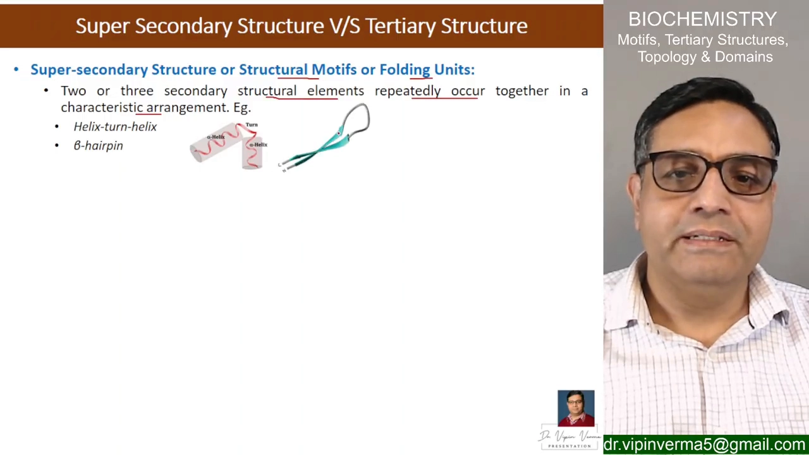

四个最常被点名的例子是：**螺旋-转角-螺旋**（helix-turn-helix）、**β 发夹**（β-hairpin）、**希腊钥匙**（Greek key）和 **β-α-β** 模体。[【跳转到 02:04】](https://www.youtube.com/watch?v=K_tA5Tkcvoo&t=124)

其中「希腊钥匙」这个名字来自古代遗址里发现的回纹图案：四条反平行 β 链的连接走向，看上去正好像那种钥匙回纹，因此得名。[【跳转到 02:29】](https://www.youtube.com/watch?v=K_tA5Tkcvoo&t=149)

这里要强调一个容易搞错的点：**模体只考虑元件在空间里怎么排，不考虑大小，也不考虑氨基酸组成**。同一个模体在不同蛋白质里，螺旋长度、β 链长度、氨基酸序列都可以不同，被保留下来的只是那个排列方式。[【跳转到 03:44】](https://www.youtube.com/watch?v=K_tA5Tkcvoo&t=224) 也正因如此，模体才会出现在许多彼此无关的蛋白质里——**有某个模体，并不代表这些蛋白功能相关**。

### 为什么叫「超」二级结构

两个理由：一是它**比二级结构大、比完整结构域小**；二是它的模式是**反复出现**的。[【跳转到 04:34】](https://www.youtube.com/watch?v=K_tA5Tkcvoo&t=274) 到目前为止，大约已确定 **1200 种**主要模体，而且这个数字还会随结构信息增加而上升。[【跳转到 04:59】](https://www.youtube.com/watch?v=K_tA5Tkcvoo&t=299)

## 二、motif 的两种含义：结构模体与序列模体

初学者最容易踩的坑在这里。课程明确提醒：**motif 这个词有两种用法**。[【跳转到 05:24】](https://www.youtube.com/watch?v=K_tA5Tkcvoo&t=324)

- **结构模体**（structural motif）：二级结构反复出现的三维排列，例如 β-α-β 模体。
- **序列模体**（sequence motif）：一段保守的氨基酸序列，出现在不同蛋白质中，例如 **RGD**。

RGD 模体的例子很具体：它对**整合素**（integrin）结合是必需的，而整合素对细胞与细胞之间的黏附非常重要。RGD 里 R、G、D 三个残基是核心，两侧的残基（课程里记作 X1、X2，例如 V 和 F）可以变化，但整体是 α-β 整合素结合所必需的。[【跳转到 05:49】](https://www.youtube.com/watch?v=K_tA5Tkcvoo&t=349)

所以读到「motif」这个词时，**要先看上下文指的是空间排列还是序列片段**。[【跳转到 06:39】](https://www.youtube.com/watch?v=K_tA5Tkcvoo&t=399)

## 三、模体不是独立的组织层次，但和「折叠」有大小之别

课程给了一个很关键的判断：当前的理解是，**结构模体只是一个反复出现的折叠模式，并不必然是独立的一级组织层次**。一级、二级、三级、四级是层次；模体只是「花样」，不占一层。[【跳转到 07:04】](https://www.youtube.com/watch?v=K_tA5Tkcvoo&t=424)

正因为如此，**模体（motif）和折叠（fold）经常被混用**，两个词可以互换。若一定要区分：**模体通常是更小的反复结构模式，折叠是更大的整体折叠安排**；两者之间没有严格边界。[【跳转到 07:29】](https://www.youtube.com/watch?v=K_tA5Tkcvoo&t=449)

还有一句可以当判据用的话：**二级结构是「元件」，模体和折叠是「这些元件在三维空间中的排列方式」**。[【跳转到 07:54】](https://www.youtube.com/watch?v=K_tA5Tkcvoo&t=474)

## 四、模体的分类（一）：全 α 螺旋类

课程把结构模体分成四大类，第一类是**全 α 螺旋模体**。[【跳转到 11:39】](https://www.youtube.com/watch?v=K_tA5Tkcvoo&t=699)

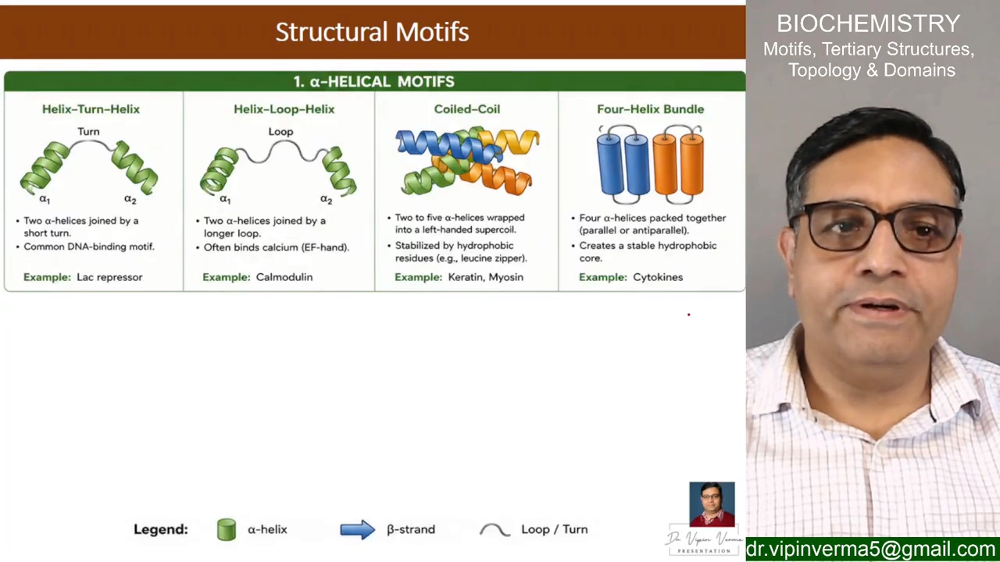

| 模体 | 结构特征 | 代表例子 |
| --- | --- | --- |
| 螺旋-转角-螺旋（helix-turn-helix） | 两个 α 螺旋由一个短转角连接 | lac 阻遏蛋白，常见于 DNA 结合模体 |
| 螺旋-环-螺旋（helix-loop-helix） | 两个 α 螺旋由一个较长的环连接 | 钙调蛋白（calmodulin），常结合钙 |
| 卷曲螺旋（coiled coil） | 2–5 条 α 螺旋缠绕成左手超螺旋，靠疏水残基（如亮氨酸拉链）稳定 | 角蛋白、肌球蛋白 |
| 四螺旋束（four-helix bundle） | 四条 α 螺旋平行或反平行堆积，形成稳定疏水核心 | 细胞因子 |

（表中内容对应 [【跳转到 11:48】](https://www.youtube.com/watch?v=K_tA5Tkcvoo&t=708) 至 [【跳转到 12:38】](https://www.youtube.com/watch?v=K_tA5Tkcvoo&t=758) 的讲解。）

## 五、模体的分类（二）：全 β 片层类

第二类是**全 β 片层模体**，课程给了三个例子：[【跳转到 13:03】](https://www.youtube.com/watch?v=K_tA5Tkcvoo&t=783)

- **β 发夹**（β-hairpin）：两条反平行 β 链由一个紧密转角连接，是**最简单的 β 片层模体**；例子是蛋白酶抑制剂 I27。
- **希腊钥匙**（Greek key）：四条反平行 β 链折成钥匙状拓扑，在许多蛋白质中常见，例如免疫球蛋白（Ig）结构域。
- **β 曲折**（β-meander）：一条连续多肽链来回折返，形成连续的、方向交替的反平行 β 链；例子是纤连蛋白 III 型结构域。

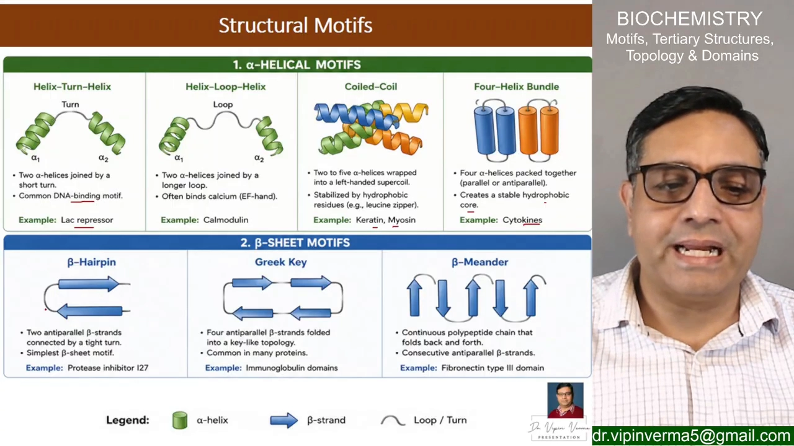

注意图中箭头的用法：**箭头方向就是 β 链的走向**。这是后面读拓扑图的基础。

## 六、模体的分类（三）：混合 α/β 与跨膜类

第三类是**混合 α/β 模体**，第四类是**跨膜与内膜/外膜模体**。[【跳转到 13:53】](https://www.youtube.com/watch?v=K_tA5Tkcvoo&t=833)

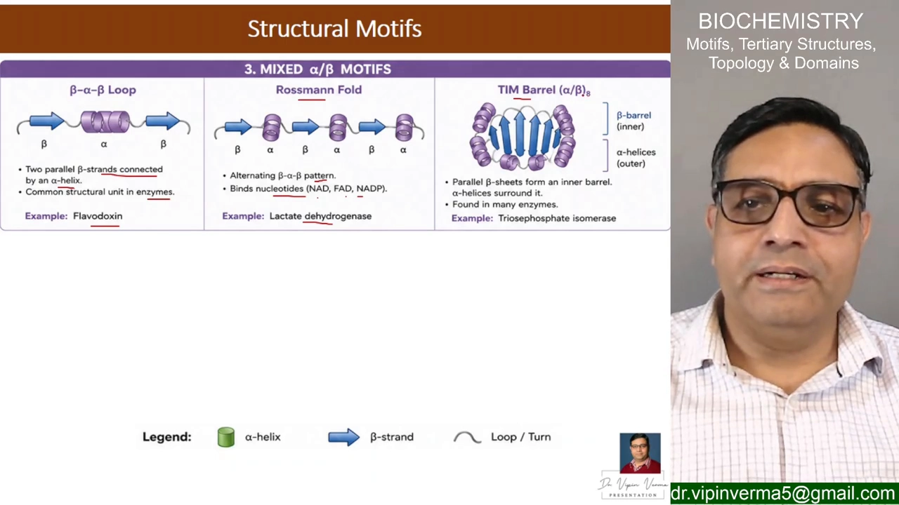

- **β-α-β 环**：两条**平行** β 链由一条 α 螺旋连接，是酶中非常常见的结构单元；例子是黄素氧还蛋白（flavodoxin）。
- **Rossmann 折叠**：交替的 β-α-β 模式，能结合核苷酸（NAD、FAD、NADP），因此在大量代谢途径中出现；例子是乳酸脱氢酶。
- **TIM 桶**（$(\alpha/\beta)_8$）：内侧是平行 β 片层围成的桶，外侧被 α 螺旋包围，见于许多酶；例子是磷酸丙糖异构酶。

跨膜类有两个例子：**α 螺旋桶**横跨脂双层，常见于 GPCR，例如视紫红质；**β 桶**通常出现在外膜，由反平行 β 链围成闭合的圆筒状孔道，例如孔蛋白（porin）。[【跳转到 15:03】](https://www.youtube.com/watch?v=K_tA5Tkcvoo&t=903)

## 七、拓扑：只看「谁接谁」，不看长短与细节

课程在这里转到本讲的核心概念。**拓扑（topology）描述的是：在某个蛋白质结构域内，二级结构元件（α 螺旋与 β 链）如何被连接和排列——不管它们的确切长度或精确几何形状**。[【跳转到 16:23】](https://www.youtube.com/watch?v=K_tA5Tkcvoo&t=983)

换句话说，拓扑是一张**建筑蓝图**、一种**简化表示**，而不是蛋白质的精确外形。课程的原话是：我们谈的不是精确形状，而是「它在纸上怎么画出来」。[【跳转到 16:48】](https://www.youtube.com/watch?v=K_tA5Tkcvoo&t=1008)

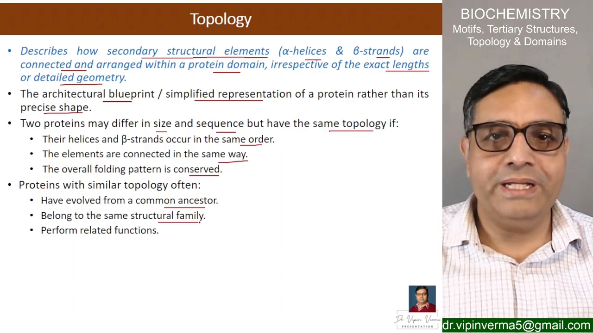

### 判断「拓扑相同」的三条标准

两个蛋白质可以大小不同、序列不同，却具有相同拓扑——只要满足三条：[【跳转到 17:13】](https://www.youtube.com/watch?v=K_tA5Tkcvoo&t=1033)

1. 它们的螺旋和 β 链**出现顺序相同**；
2. 这些元件在两者中**以相同方式连接**；
3. **整体折叠模式是保守的**。

三条同时成立，才叫同一拓扑。

### 拓扑相同意味着什么

课程接着给了进化上的解释：**拓扑相似的蛋白质往往来自共同祖先，属于同一个结构家族**（structural family，注意是结构家族，不是功能家族），并且通常执行相关的功能。[【跳转到 17:38】](https://www.youtube.com/watch?v=K_tA5Tkcvoo&t=1058)

这就是「结构同源」这一判断的落点：**序列可以漂移到看不出关系，但拓扑还留着祖先的痕迹**。

## 八、拓扑图怎么读：三种基本画法

课程用三张图演示了「把蛋白质画成拓扑」的方法：把螺旋画成小棒、把 β 链画成箭头，再用线连接它们。[【跳转到 18:03】](https://www.youtube.com/watch?v=K_tA5Tkcvoo&t=1083)

- **全 α 拓扑**：只有螺旋，例如四条螺旋依次相连。图中左侧是四根彩色小棒（标注第 1–4 个螺旋、N 端与 C 端），右侧是对应的三维结构。[【跳转到 18:28】](https://www.youtube.com/watch?v=K_tA5Tkcvoo&t=1108)
- **全 β 拓扑**：只有 β 链，例如八条链依次相连，同样用箭头表示走向。[【跳转到 18:53】](https://www.youtube.com/watch?v=K_tA5Tkcvoo&t=1133)
- **α/β 拓扑**：螺旋与 β 链混排，用不同颜色区分两类元件。[【跳转到 19:18】](https://www.youtube.com/watch?v=K_tA5Tkcvoo&t=1158)

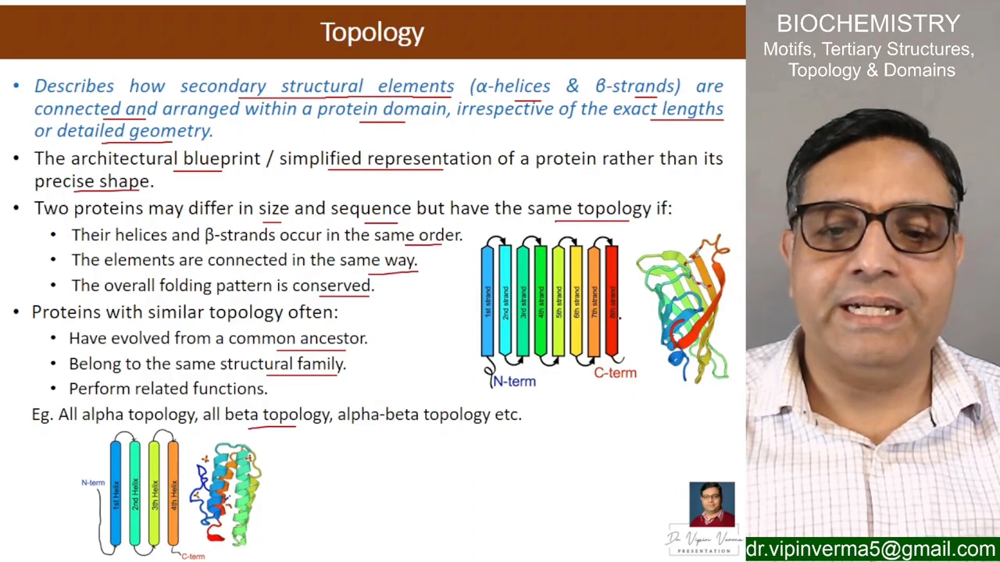

有了这套记号，一个复杂的三维结构就能被压缩成几行「棒 + 箭头 + 连线」。**比较两个蛋白的拓扑，本质上就是比较这两行记号**。

真实蛋白上的拓扑图长这样：肌红蛋白、血红蛋白的每个亚基、神经球蛋白，三者一级序列不同、寡聚状态也不同（单体、四聚体、单体），但底部那张「螺旋连接图」几乎一模一样——八个螺旋按 A 到 H 编号，连接顺序完全相同。[【跳转到 10:49】](https://www.youtube.com/watch?v=K_tA5Tkcvoo&t=649)

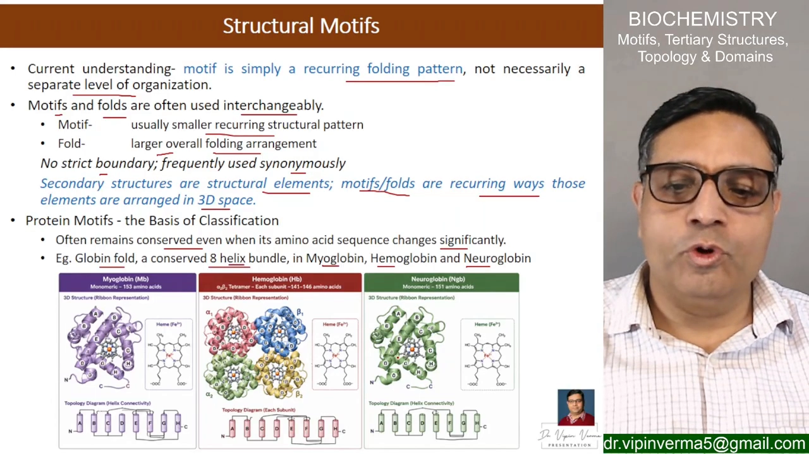

## 九、从拓扑到结构域：三级结构的「单位」

讲完拓扑，课程转到三级结构：**三级结构是单条多肽链采取的独特三维构象**——注意是单条链，不是两条以上多肽的聚集体。[【跳转到 19:56】](https://www.youtube.com/watch?v=K_tA5Tkcvoo&t=1196)

而三级结构里通常含有一个或多个**结构域**：**能独立折叠成紧凑三维单元的自稳定区段**。典型大小约 **50–250 个氨基酸**，常由金属离子或二硫键稳定；每个结构域都形成一个疏水核心，核心由二级结构构成、由环连接。[【跳转到 22:01】](https://www.youtube.com/watch?v=K_tA5Tkcvoo&t=1321)

结构域最硬的判据是：**即使把它从整条链上切下来，它仍保持天然三维结构**——这就是「独立稳定性」。[【跳转到 24:56】](https://www.youtube.com/watch?v=K_tA5Tkcvoo&t=1496)

课程给了一句可以直接背下来的类比：**α 螺旋和 β 片层是二级结构的单位，结构域是三级结构的单位**。[【跳转到 26:11】](https://www.youtube.com/watch?v=K_tA5Tkcvoo&t=1571)

结构域的另外两个特征是**功能自主**（同一蛋白里的不同结构域可以有彼此无关的功能），以及**数量与蛋白大小相关**（小蛋白常常只有一个结构域，大蛋白往往有多个）。[【跳转到 27:14】](https://www.youtube.com/watch?v=K_tA5Tkcvoo&t=1634) 而结构域的**架构**（数量、类型、排列、取向、柔性）决定了蛋白功能、相互作用潜力，以及活性位点的可及性与特异性。[【跳转到 25:21】](https://www.youtube.com/watch?v=K_tA5Tkcvoo&t=1521)

## 十、结构域的四大类：与折叠类型同构的分类

课程把结构域分成四类，并各配例子——这实际上就是结构分类的第一层：[【跳转到 28:04】](https://www.youtube.com/watch?v=K_tA5Tkcvoo&t=1684)

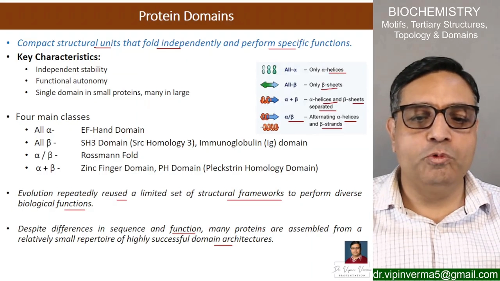

| 类别 | 构成 | 例子 |
| --- | --- | --- |
| 全 α（all-α） | 只有 α 螺旋 | EF-hand 结构域 |
| 全 β（all-β） | 只有 β 片层 | SH3 结构域、免疫球蛋白（Ig）结构域 |
| α/β | α 螺旋与 β 链**交替** | Rossmann 折叠 |
| α+β | α 螺旋与 β 片层**分开**分布 | 锌指结构域、PH 结构域 |

注意 α/β 与 α+β 的区别只在「交替」还是「分开」——这是最容易被混淆的一对。

课程随后逐个展开这六个代表结构域：

- **SH3 结构域**（全 β）：五条反平行 β 链排成两个互相垂直的 β 片层，结合富含脯氨酸的肽段，介导细胞信号中的蛋白—蛋白相互作用。[【跳转到 30:09】](https://www.youtube.com/watch?v=K_tA5Tkcvoo&t=1809)

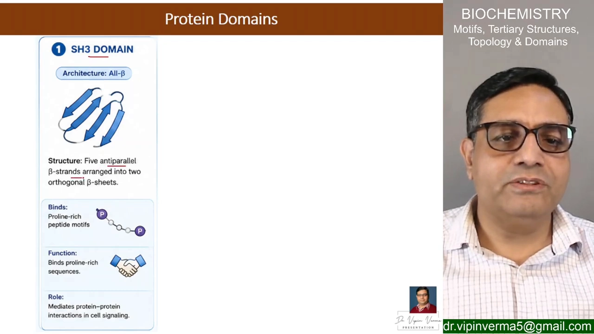
- **锌指结构域**（α+β）：Cys2-His2 型，两段 β 链加一条 α 螺旋，由锌离子稳定，结合 DNA 大沟，α 螺旋负责序列识别；是真核转录因子中最丰富的结构域之一。[【跳转到 30:34】](https://www.youtube.com/watch?v=K_tA5Tkcvoo&t=1834)
- **免疫球蛋白结构域**（全 β）：7–9 条反平行 β 链组成两个 β 片层，由二硫键稳定，提供带可变环的稳定支架用于分子识别，见于抗体、T 细胞受体和细胞黏附分子。[【跳转到 31:24】](https://www.youtube.com/watch?v=K_tA5Tkcvoo&t=1884)
- **PH 结构域**（α+β）：七条链的 β 三明治被 C 端 α 螺旋封盖，结合磷酸肌醇，把信号蛋白招募到细胞膜内侧。[【跳转到 32:12】](https://www.youtube.com/watch?v=K_tA5Tkcvoo&t=1932)
- **EF-hand 结构域**（全 α）：螺旋-环-螺旋模体，环配位一个钙离子，是钙感受与信号模块，典型例子是钙调蛋白。[【跳转到 32:37】](https://www.youtube.com/watch?v=K_tA5Tkcvoo&t=1957)
- **Rossmann 折叠**（α/β）：平行 β 片层（通常六条链）两侧被 α 螺旋夹住，结合并定位 NAD、NADH、FAD 等核苷酸辅因子，广泛存在于催化氧化还原反应的酶中。[【跳转到 33:02】](https://www.youtube.com/watch?v=K_tA5Tkcvoo&t=1982)

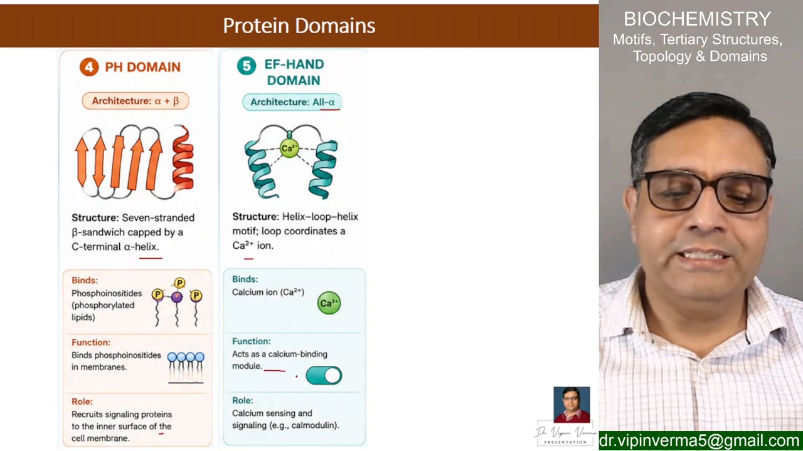

## 十一、两个 takeaway：进化只复用有限的结构框架

课程在这部分收束成两句结论：[【跳转到 28:54】](https://www.youtube.com/watch?v=K_tA5Tkcvoo&t=1734)

1. **进化反复复用有限的一套结构框架，去完成多样的生物学功能**——蛋白质里最常见的二级结构元件只有螺旋和片层两种，但它们的组合方式被反复利用。
2. **尽管序列和功能不同，许多蛋白质是由相对很小的一套「非常成功的结构域架构」拼装出来的**。

这就把「结构分类」的意义讲透了：分类不是为了好看，而是因为**可复用的框架本来就少**，所以能把成千上万的蛋白归到少数几类里。

## 十二、补充：什么力量把三级结构撑住，以及折叠失败的后果

课程最后用一张表总结了稳定三级结构的相互作用，分为非共价与共价两类：[【跳转到 33:52】](https://www.youtube.com/watch?v=K_tA5Tkcvoo&t=2032)

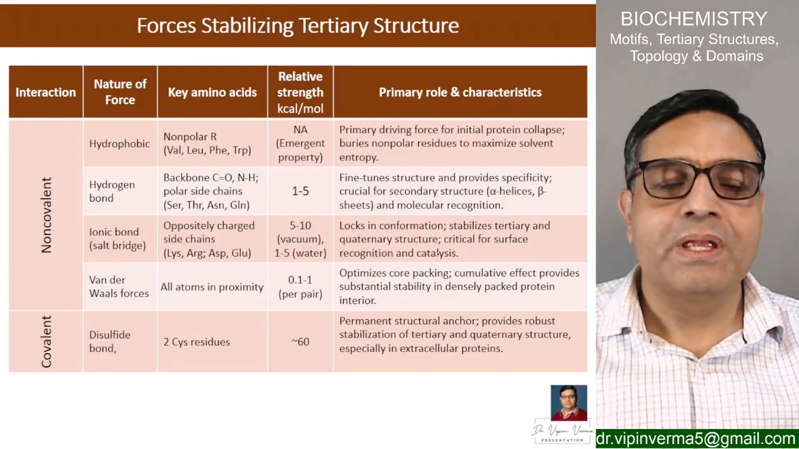

| 相互作用 | 关键参与基团 | 相对强度（kcal/mol） | 主要作用 |
| --- | --- | --- | --- |
| 疏水作用 | 非极性侧链（Val、Leu、Phe、Trp） | 不适用（涌现性质） | 初始塌缩的主要驱动力，埋藏非极性残基以提高溶剂熵 |
| 氢键 | 主链 C=O 与 N–H；极性侧链（Ser、Thr、Asn、Gln） | 1–5 | 微调结构、提供特异性，对 α 螺旋与 β 片层至关重要 |
| 离子键（盐桥） | 带相反电荷的侧链（Lys、Arg、Asp、Glu） | 真空 5–10；水中 1–5 | 锁定构象，稳定三级与四级结构，参与表面识别与催化 |
| 范德华力 | 邻近的所有原子 | 每对 0.1–1 | 优化核心堆积，累积效应提供可观稳定性 |
| 二硫键（共价） | 两个 Cys 残基 | 约 60 | 永久性结构锚点，尤其稳定胞外蛋白 |

课程强调：**三维结构决定了具体的几何形状与结合位点的化学环境**，而抗原—抗体、酶—底物这类相互作用本质上是物理接触，所以几何形状至关重要。[【跳转到 38:02】](https://www.youtube.com/watch?v=K_tA5Tkcvoo&t=2282)

一旦天然构象被破坏或发生错误折叠，就可能出现功能丧失，甚至获得有毒功能；一系列蛋白质错误折叠疾病（如阿尔茨海默病、帕金森病）都与错误折叠的蛋白有关。[【跳转到 39:16】](https://www.youtube.com/watch?v=K_tA5Tkcvoo&t=2356) 细胞因此设置了两道质控：分子伴侣帮助正确折叠，降解途径清除错误折叠的蛋白，只有正确折叠的蛋白才留在系统里。[【跳转到 40:31】](https://www.youtube.com/watch?v=K_tA5Tkcvoo&t=2431)

## 小结

- **模体 = 超二级结构 = 折叠单元**：两三个二级结构元件反复以特征性排列一起出现；只看排列，不看大小与序列。
- **motif 有两个意思**：结构模体（空间排列）与序列模体（保守序列，如 RGD）；读文献时必须分清。
- **模体不是独立层次**，它只是反复出现的折叠模式；模体比折叠小，两者常被混用。
- **四类模体**：全 α（HTH、HLH、卷曲螺旋、四螺旋束）、全 β（发夹、希腊钥匙、β 曲折）、混合 α/β（β-α-β、Rossmann、TIM 桶）、跨膜（α 螺旋桶、β 桶）。
- **拓扑只看连接方案**：元件出现顺序相同、连接方式相同、整体折叠模式保守，三条齐全才算同拓扑。
- **同拓扑常意味着共同祖先**，因此对应同一个结构家族，并常执行相关功能——这是「结构同源」的判据。
- **拓扑图是可读的记号**：棒 = 螺旋，箭头 = β 链，连线 = 主链走向；全 α、全 β、α/β 三种基本画法。
- **结构域是三级结构的单位**：50–250 残基、能独立折叠、切下来仍保持天然结构；分全 α、全 β、α/β、α+β 四类。
- **进化只复用有限框架**：螺旋和片层两种元件，被反复组合成少数几类成功架构。
- **稳定性来源**：疏水作用驱动塌缩，氢键微调特异性，盐桥锁定构象，范德华力优化堆积，二硫键做永久锚点。

## 关键术语速查

| 术语 | 一句话解释 |
| --- | --- |
| 超二级结构 / 结构模体 | 两三个二级结构元件反复出现的特征性空间排列，比二级结构大、比结构域小 |
| 序列模体 | 一段保守的氨基酸序列（如 RGD），与空间排列无关 |
| 折叠（fold） | 比模体更大的整体折叠安排；与模体常互换使用，无严格边界 |
| 拓扑（topology） | 结构域内二级结构元件的连接与排列方案，忽略长度与精确几何 |
| 拓扑图 | 用棒表示螺旋、箭头表示 β 链、连线表示连接顺序的简化示意图 |
| 结构家族 | 具有相同拓扑、推测来自共同祖先的一批蛋白质 |
| 结构域（domain） | 三级结构中能独立折叠并保持天然构象的紧凑单元，约 50–250 残基 |
| 全 α / 全 β / α/β / α+β | 结构域（及折叠）的四大类；α/β 是交替，α+β 是分开分布 |
| SH3 结构域 | 全 β 结构域，五条反平行 β 链成两个垂直片层，结合富含脯氨酸的肽段 |
| EF-hand | 全 α 的螺旋-环-螺旋模体，环配位钙离子，见于钙调蛋白 |
| Rossmann 折叠 | α/β 类折叠，平行 β 片层夹在螺旋之间，结合核苷酸辅因子 |
| TIM 桶 | $(\alpha/\beta)_8$ 模体：内侧平行 β 桶、外侧 α 螺旋，见于多种酶 |