# 从模体到折叠类型：蛋白质结构如何被拆成可比较的模块

> 视频来源：[2.1.3 蛋白质三级结构和四级结构、motif, fold and domain](https://www.bilibili.com/video/BV1QC411t7ig/)（B 站 · UP 主「Truthen教授生命世界」）｜时长约 14 分钟
> 导读：这是一节以**乙醇脱氢酶**为全程例子的结构层次课。它把「二级结构 → 模体 → 结构域 → 折叠 → 折叠类型」这条链一次讲通，并给出判断结构相似与序列同源的关键反例（血红蛋白与肌红蛋白）。字幕为 AI 生成，术语（模体、结构域、折叠、β 片层等）已按上下文订正。

## 本讲要解决的核心问题（SCQA）

**背景**：你已经知道蛋白质有 α 螺旋、β 片层和环（loop）这些二级结构元件，它们是主链局部的规则构象。

**冲突**：可是拿两个蛋白质来比较时，只看二级结构几乎什么也说明不了——绝大多数球蛋白都同时含有螺旋和片层。真正决定它们像不像的，是这些元件**在空间里怎么摆、按什么顺序连起来**。而描述这件事的词又特别多：模体（motif）、结构域（domain）、折叠（fold）、折叠类型，初学者很容易把它们当成同义词。

**疑问**：二级结构之上到底有哪些层次？一条多肽链如何被拆成可以互相比较的单元？结构长得像，是否就等于序列同源？

**回答（中心思想）**：三级结构是**「元件 → 模体 → 结构域 → 折叠」的逐级组装**；结构域是其中能独立折叠的模块，折叠是模块内部元件排列的整体方案，而折叠类型只有有限几类。正因为折叠类型有限，**序列差异很大（一致性低于 30%）的蛋白质仍可能共享同一折叠**——所以「结构相似」和「序列同源」必须分开判断。

---

## 一、三级结构与四级结构：一条链的三维排布，与多条链的装配

课程先说明为什么把三级结构和四级结构放在一起讲：**两者都描述蛋白质在二级结构之上的更高层次排列方式**，而且它们显示的三维形态，主要都靠各部分之间的非共价相互作用维持——范德华力、盐桥、氢键等。[【跳转到 00:00】](https://www.bilibili.com/video/BV1QC411t7ig/?t=0)

两者的分工很清楚：

- **三级结构**：同一条多肽链内部的螺旋（helix）、片层（sheet）和环（loop）在三维空间中的排列方式。[【跳转到 00:25】](https://www.bilibili.com/video/BV1QC411t7ig/?t=25)
- **四级结构**：多条多肽链结合在一起，形成执行特定细胞功能的蛋白质复合体。[【跳转到 00:50】](https://www.bilibili.com/video/BV1QC411t7ig/?t=50)

而在这两者之间，还有一条被教材压缩掉、但实际最常用的拆解路径：**三维结构由模体逐级形成，再到结构域，最后形成整个蛋白质**。[【跳转到 01:15】](https://www.bilibili.com/video/BV1QC411t7ig/?t=75) 换句话说，当我们描述多肽链如何以各种二级结构为基础进一步做空间排列时，有必要先定义清楚「结构层次」。

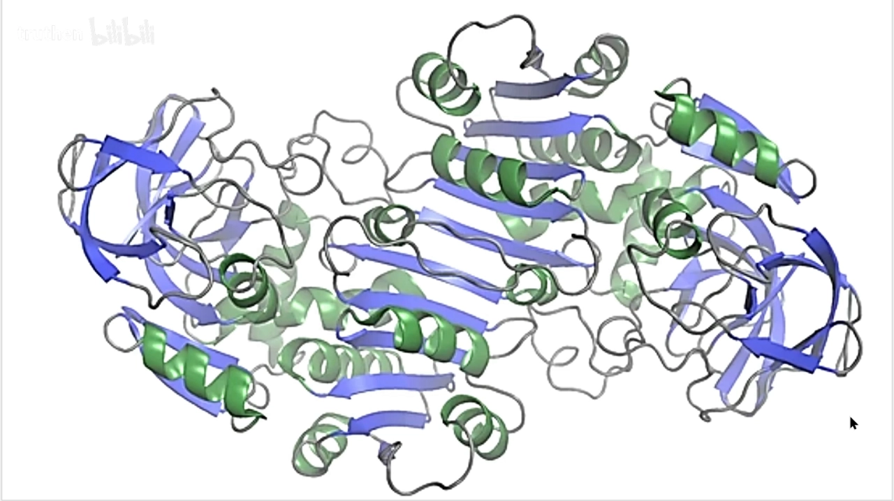

上图就是本讲的贯穿例子——**乙醇脱氢酶**（alcohol dehydrogenase）的完整结构，以卡通模式显示：螺旋用绿色、β 片层用蓝色、环用灰色。[【跳转到 01:45】](https://www.bilibili.com/video/BV1QC411t7ig/?t=105) 后面每一层拆解，都回到这张图上指认。

## 二、模体：最小的「可命名」排列

用最小的二级结构单位组合起来，就得到一种叫做**模体**（motif）的结构。模体常常由几个连续的二级结构元件组成。[【跳转到 02:15】](https://www.bilibili.com/video/BV1QC411t7ig/?t=135)

一个非常常见的模体是 **β-α-β 模体**：两条相邻的 β 链由一个 α 螺旋连接，而且这两条 β 链是**平行**的，它们共同形成一个 β 片层。[【跳转到 02:40】](https://www.bilibili.com/video/BV1QC411t7ig/?t=160)

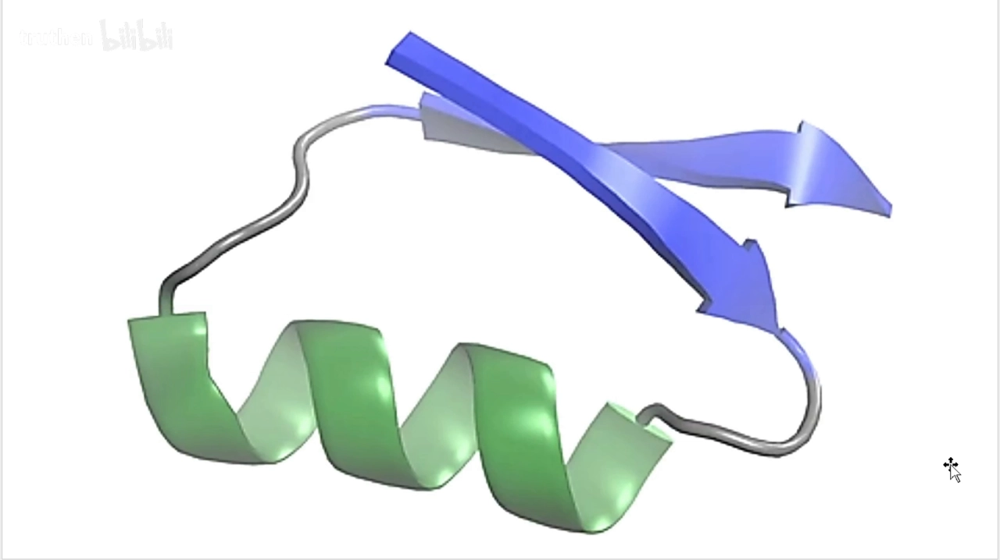

这里要抓住模体的一个特点：**它描述的是「排列」，不是「成分」**。同样叫 β-α-β 模体，不同蛋白质里螺旋多长、β 链多长、氨基酸是什么，都可以不同；被保留下来的只是那个空间排列方式。所以模体可以在许多彼此无关的蛋白质里反复出现。

## 三、结构域：能独立折叠的紧凑单元

一个或几个模体可以组装成一个紧凑的球状结构，也就是**结构域**（domain）。在乙醇脱氢酶里，刚才那个 β-α-β 模体（图中黄色部分）与另外的 β 链、几个 α 螺旋相互作用，就形成了一个结构域。[【跳转到 02:55】](https://www.bilibili.com/video/BV1QC411t7ig/?t=175)

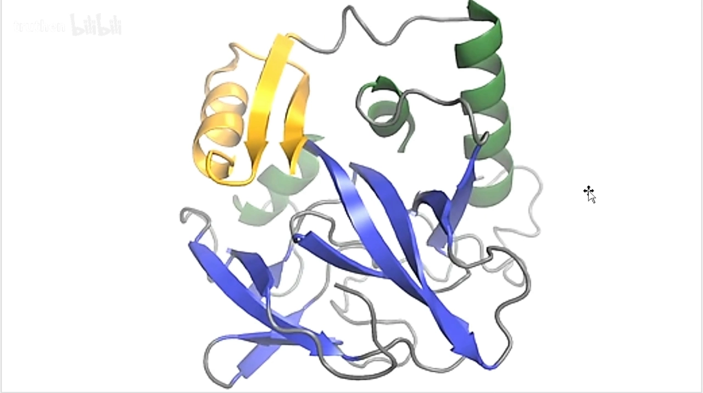

结构域的定义性特征是**相对独立的折叠单位**：一个独立的结构域通常能够自行折叠成特有的三级结构，并且能保持这种三级结构，而不依赖蛋白质的其他部分。[【跳转到 03:20】](https://www.bilibili.com/video/BV1QC411t7ig/?t=200) 蛋白质通常包含多个结构域，这些结构域之间再相互作用，形成功能单位。

在乙醇脱氢酶里，黄色结构域与第二个含有 **Rossmann 折叠**的结构域相互作用，共同构成这个酶。[【跳转到 03:43】](https://www.bilibili.com/video/BV1QC411t7ig/?t=223)

### 活性位点为什么总落在「缝」里

酶的活性位点通常位于**环（loop）区域**。这些环在化学性质和结构上都能够调整，比较灵活，可以改变形态以适应酶催化的需要。[【跳转到 04:08】](https://www.bilibili.com/video/BV1QC411t7ig/?t=248)

而活性位点常常位于**两个结构域之间的裂隙**当中，这些裂隙富含环结构。乙醇脱氢酶正是如此：两种底物 NADH 和乙醇，就在两个结构域之间的裂隙界面处相互结合。[【跳转到 04:38】](https://www.bilibili.com/video/BV1QC411t7ig/?t=278)

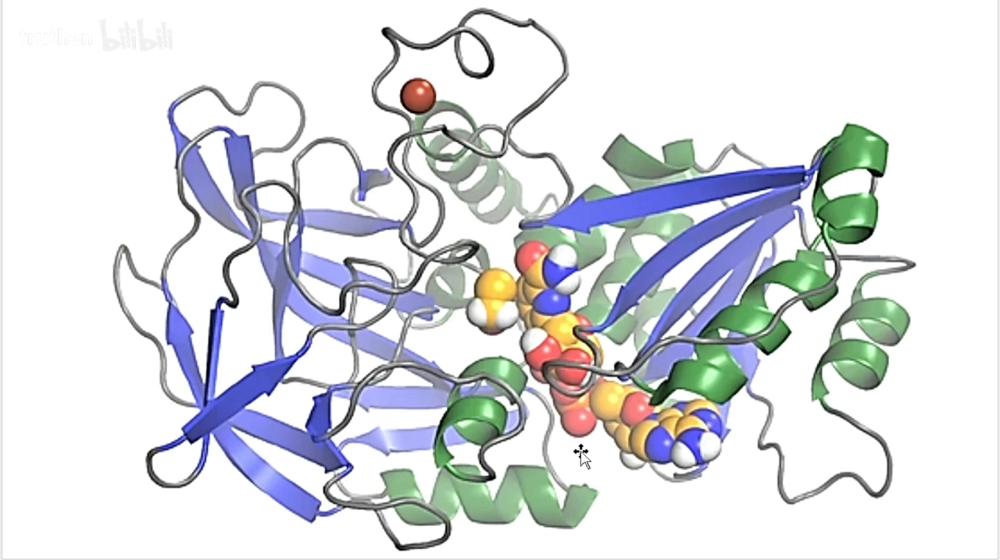

这张图值得记住：**结构域的边界往往就是功能的分界**。单个结构域负责折叠和稳定，两个结构域拼出的界面才负责催化。

## 四、四级结构：两个相同亚基，界面也能「续」出一张片层

有活性的乙醇脱氢酶实际上包含两个完全相同的蛋白质分子，也就是由两个亚基组成的**同源二聚体**；每个亚基都在两个结构域的界面处有一个活性位点。[【跳转到 05:08】](https://www.bilibili.com/video/BV1QC411t7ig/?t=308)

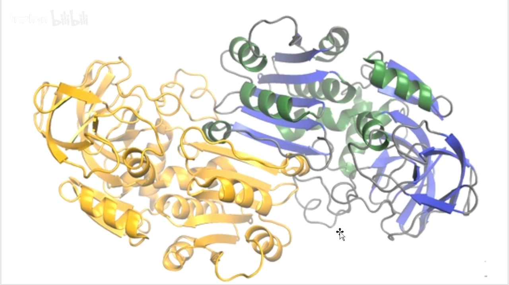

二聚体界面本身也很有意思：它一部分由两个相互作用的反平行 β 链构成。两个亚基各自的结构域里，Rossmann 折叠含有平行的 β 片层；两个亚基凑在一起后，又共同形成一个**混合的大 β 片层**——其中既有平行的 β 链，也有反平行的 β 链。[【跳转到 05:58】](https://www.bilibili.com/video/BV1QC411t7ig/?t=358)

这说明「层次」不是硬边界：**同一个二级结构元件可以同时服务于结构域内部和亚基之间的界面**。

## 五、折叠：结构域内部元件排列的「整体方案」

一个结构域内部二级结构元件的排列，就形成了我们称之为**折叠**（fold）的东西。类似于模体，同一种折叠也出现在许多不同的蛋白质当中。[【跳转到 06:28】](https://www.bilibili.com/video/BV1QC411t7ig/?t=388)

最典型的例子就是 **Rossmann 折叠**：它是一种非常常见的折叠类型，存在于数千种蛋白质当中，特别是存在于能够结合核苷酸作为辅因子的蛋白质当中。

那么结构域和折叠是什么关系？**每个结构域都含有某种折叠，但同一种折叠可以出现在数千个不同的结构域、以及序列不同的不同蛋白质中**。例如乙醇脱氢酶和谷胱甘肽还原酶都含有 Rossmann 折叠的结构域。[【跳转到 07:03】](https://www.bilibili.com/video/BV1QC411t7ig/?t=423)

可以用一句话记住三者的关系：

- **模体**：几个元件的小排列（可命名的「花样」）。
- **结构域**：能独立折叠的紧凑单元，内部含有某种折叠。
- **折叠**：结构域内部元件排列的整体方案，可跨蛋白、跨序列复用。

## 六、折叠类型的第一层分类：α、β、α/β

既然折叠可以复用，就可以用**折叠类型**给蛋白质结构分类。对蛋白质结构分类的第一个层级，就是三大不同的折叠类型：**α 折叠、β 折叠和 α/β 折叠**。[【跳转到 07:28】](https://www.bilibili.com/video/BV1QC411t7ig/?t=448)

乙醇脱氢酶属于混合的 **α/β 折叠**，它的 Rossmann 折叠是 β 链排列在 α 螺旋之间的一种特殊排列，其中包含几个 β-α-β 模体。这种排列产生一个由**六条平行 β 链**形成的 β 片层，而这个 β 片层夹在两侧的 α 螺旋之间。[【跳转到 07:56】](https://www.bilibili.com/video/BV1QC411t7ig/?t=476)

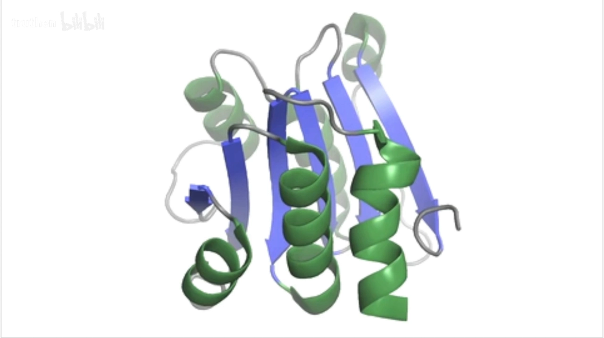

由一种主要的 β 折叠构成的蛋白质例子是**碳酸酐酶**：它催化二氧化碳与碳酸氢盐之间的相互转化，对维持血液中 pH 值的平衡非常重要。[【跳转到 08:29】](https://www.bilibili.com/video/BV1QC411t7ig/?t=509)

而一种常见的 α 折叠叫做**球蛋白折叠**（globin fold）。肌红蛋白（肌肉中结合氧气的蛋白质）就含有这种折叠，它在缺氧条件下释放氧气，这在剧烈运动过程中非常重要；这种球蛋白折叠包含**八个螺旋**，并与血红素辅因子的结合有关。[【跳转到 08:59】](https://www.bilibili.com/video/BV1QC411t7ig/?t=539)

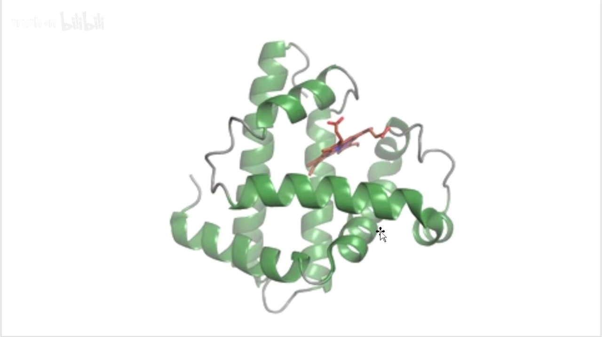

## 七、关键反例：序列相似 ≠ 结构相似

另一个球蛋白折叠的例子是血红蛋白。课程在这里给了一个必须记住的数字：**血红蛋白多肽链与肌红蛋白的一级序列一致性低于 30%，但两者在三维结构上非常相似，具有相似的折叠结构**。[【跳转到 09:31】](https://www.bilibili.com/video/BV1QC411t7ig/?t=571)

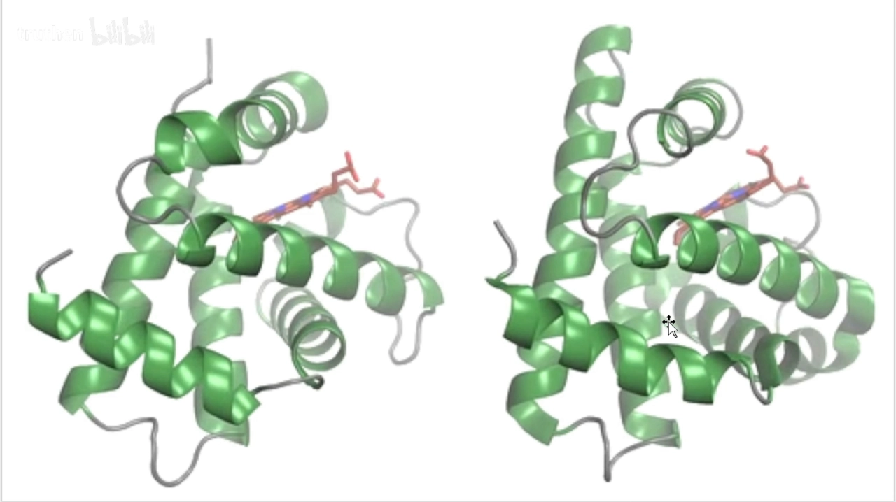

两者的差别不在折叠，而在装配：完整的血红蛋白由**四条**独立的多肽链组成，是四聚体，由两个 α 亚基和两个 β 亚基构成；而肌红蛋白是单体。这种把多条多肽组装成一个功能单位的形式，就是四级结构，这些独立的多肽称为**亚基**。[【跳转到 10:02】](https://www.bilibili.com/video/BV1QC411t7ig/?t=602)

四级结构的严格定义是：亚基与亚基之间呈现特定的三维空间分布，并且以非共价方式相连接；也就是寡聚蛋白中各亚基的空间排布、以及亚基接触部位的布局和相互作用。[【跳转到 10:27】](https://www.bilibili.com/video/BV1QC411t7ig/?t=627) 而形成四级结构的各个亚基可以有不同的一级结构（不同序列），也可以完全相同——乙醇脱氢酶就是两个完全相同的亚基组成的。[【跳转到 11:32】](https://www.bilibili.com/video/BV1QC411t7ig/?t=692)

### 由此得到一个可检验的推论

正如预期，序列相似的蛋白质往往具有相似的空间结构。**但反过来不成立**：序列上差异很大的蛋白质仍然可能具有非常相似的结构，正如血红蛋白和肌红蛋白所示。[【跳转到 12:02】](https://www.bilibili.com/video/BV1QC411t7ig/?t=722)

这条推论直接支撑了「对蛋白质结构进行分类」这件事：如果结构相似必然来自序列相似，那么按序列分类就够了，不必另建结构分类体系。恰恰因为**结构比序列保守得多**，才需要单独的结构分类。

## 八、折叠的数量是有限的

课程给出了两个并排的观察：

1. 现在已经鉴定出大约 **1500 种**折叠结构。[【跳转到 12:27】](https://www.bilibili.com/video/BV1QC411t7ig/?t=747)
2. 结构生物学过去 40 年里，通过晶体学、核磁共振或其他结构测定技术确定的折叠数量一直在增加，但**最近几年几乎不再增加**，几乎没有发现新的折叠结构。[【跳转到 12:43】](https://www.bilibili.com/video/BV1QC411t7ig/?t=763)

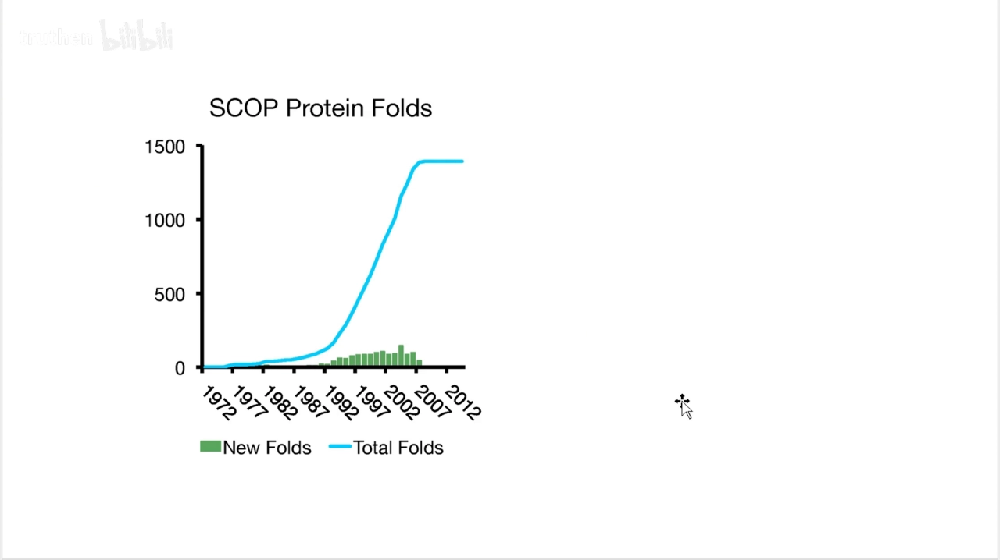

上图是 SCOP 数据库的统计（SCOP 即按结构对蛋白质进行分类的数据库）：蓝线是累计折叠数，在接近 1500 处走平；绿色柱是每年新增折叠数，早已趋近于零。

与此同时，已解析的蛋白质结构数量却呈指数增长。[【跳转到 13:08】](https://www.bilibili.com/video/BV1QC411t7ig/?t=788)

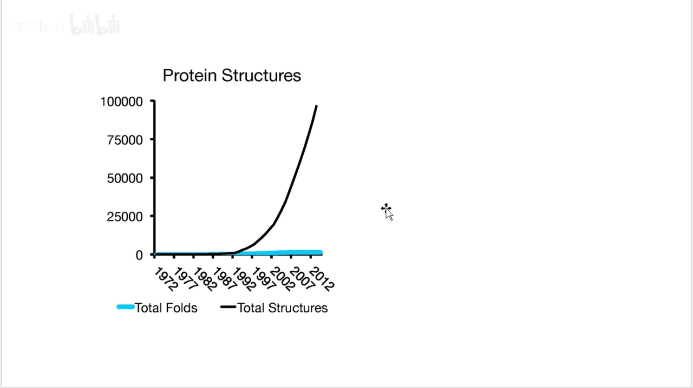

两张图放在一起就是本节最重要的一句话：**结构数量在爆炸，折叠种类却早已饱和**。蛋白质倾向于重复使用已存在的折叠，而不是采用全新的折叠——这就是为什么可以对蛋白质结构做分类，也是为什么「同一个折叠、不同序列」是常态而非例外。[【跳转到 12:02】](https://www.bilibili.com/video/BV1QC411t7ig/?t=722)

课程也提醒了这套分类的局限：即使我们知道蛋白质的一般折叠结构，关于蛋白质结构还有很多未知之处——**蛋白质的功能在很大程度上取决于其环（loop）的细节以及特定侧链的影响**。[【跳转到 13:08】](https://www.bilibili.com/video/BV1QC411t7ig/?t=788) 换句话说，折叠类型给出的是「骨架归类」，不给出功能细节。

## 九、结构域是模块，模块可以被重组

最后回到结构域的意义。蛋白质形成多个独立的结构域可以增加蛋白质的多样性，因为结构域具有**模块化**的特点：通过基因重组，可以把编码不同结构域的序列组合起来，形成新的基因，从而增加基因的多样性。[【跳转到 13:58】](https://www.bilibili.com/video/BV1QC411t7ig/?t=838)

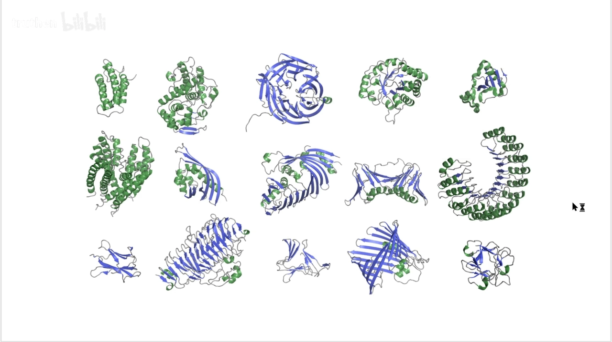

这张折叠图鉴正好收束全讲：看上去五花八门的结构，其实是有限几种「螺旋—片层」排列方式的不同组合。

## 小结

- **层次链**：二级结构元件 → 模体（几个元件的小排列）→ 结构域（能独立折叠的紧凑单元）→ 折叠（结构域内部排列的整体方案）→ 折叠类型（α、β、α/β）。
- **模体看排列，不看成分**：β-α-β 模体里的螺旋、β 链长度和序列都可以变，被保留的是空间排布。
- **结构域是功能与折叠的交界**：它能脱离其余部分保持三级结构；酶的活性位点常落在两个结构域之间的裂隙里，由灵活的环构成。
- **折叠可以跨蛋白复用**：Rossmann 折叠出现在数千种蛋白中，乙醇脱氢酶和谷胱甘肽还原酶都有。
- **结构相似不等于序列同源**：血红蛋白与肌红蛋白序列一致性低于 30%，却共享球蛋白折叠；因此结构分类是独立于序列分类的一层信息。
- **折叠种类有限**：约 1500 种（SCOP 统计已走平），而解析出的结构数在指数增长——蛋白质反复复用同一批折叠。
- **结构域是模块**：基因重组可以把不同结构域的编码序列拼起来，这是蛋白质多样性的一条主要来源。
- **分类的边界**：折叠类型只给出骨架归类，功能细节取决于环的具体形态与侧链。

## 关键术语速查

| 术语 | 一句话解释 |
| --- | --- |
| 模体（motif） | 几个连续二级结构元件反复出现的特征性空间排列，如 β-α-β 模体 |
| 结构域（domain） | 蛋白质内部相对独立、能自行折叠并保持三级结构的紧凑单元 |
| 折叠（fold） | 结构域内部二级结构元件排列的整体方案，可在序列不同的蛋白间复用 |
| 折叠类型 | 结构分类的第一层，按主要元件分为 α、β、α/β 三类 |
| Rossmann 折叠 | 平行 β 片层夹在两侧 α 螺旋之间的 α/β 折叠，常结合核苷酸辅因子 |
| 球蛋白折叠（globin fold） | 八个 α 螺旋组成的螺旋束，结合血红素，见于肌红蛋白与血红蛋白 |
| 同源二聚体 | 由两个完全相同的亚基组成的四级结构，如乙醇脱氢酶 |
| 亚基（subunit） | 四级结构中独立的多肽链，亚基间以非共价方式接触 |
| SCOP | 按结构层次对蛋白质结构域进行分类的数据库，其统计显示折叠种类趋于饱和 |