# 无序不是没功能：用 IUPred 打分读懂内在无序区

> 视频来源：[Intrinsically Disordered Regions (IDRs) & IUPred disorder prediction scores & plots](https://www.youtube.com/watch?v=1bXzOgUZ3PQ)（YouTube · the bumbling biochemist，时长约 33 分钟）
> 导读：这是一支"边讲原理边演示软件"的实操视频：先讲清内在无序区（IDR）是什么、序列有什么特征，再打开 IUPred3 网站，用 GW182、p53、Argonaute 2 三个真实蛋白教你怎么读那张 0–1 的打分曲线，最后说明为什么无序区在晶体结构里"看不见"，以及为什么 AlphaFold 的橙色低置信只能算提示、不能算实验证据。

## 本讲要解决的核心问题（SCQA）

**背景**：结构生物学的经典图景是"序列决定结构，结构决定功能"——α 螺旋、β 折叠拼成漂亮的立体形状，像钥匙配锁一样与配体结合。PDB 里成千上万个结构都在强化这个印象。

**冲突**：可是很多蛋白质（或蛋白质里的一大段）根本没有固定形状，像一团"松松垮垮"的线，却在细胞里干着脚手架、组装、调控这些关键工作。更麻烦的是：正因为它们没有固定形状，用 X 射线晶体学、冷冻电镜去"拍照"时，这些区域干脆从图上消失了——你既看不到它们，也容易误以为"看不见 = 不存在"或"看不见 = 无序"。

**疑问**：怎么判断一段序列天生就是无序的？软件给出的那条 0–1 曲线到底在说什么、该怎么读？结构里缺失的那一段，能不能当作"无序"的证据？

**回答（中心思想）**：内在无序是**序列本身编码的一种状态**——它没有唯一结构，而是在一组构象之间不停变化；IUPred 这类工具用"能量估计"把这种倾向折算成**每个残基 0–1 的概率**，画成一条沿序列展开的曲线。读图的关键是三件事：**看曲线在 0.5 上下哪一侧、看用长/短哪种模式、看曲线下方的注释轨道**。而"结构里缺失"只是**一条实验证据**，AlphaFold 的橙色低置信只是**一个提示**，两者都不能单独等同于"这段是无序的"。

## 一、无序不是"没有结构"，而是"没有唯一结构"

### 1.1 从"钥匙配锁"到"松松垮垮的线"

视频用一张图概括了 IDR 的四种典型面貌 [【跳转到 00:00】](https://www.youtube.com/watch?v=1bXzOgUZ3PQ&t=0)：

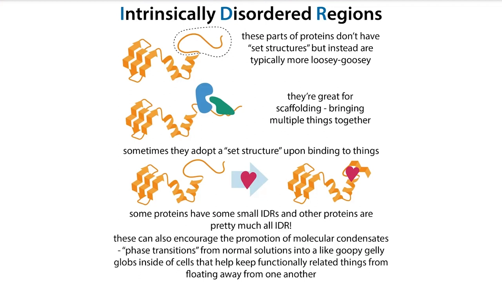

- **没有"设定好的结构"**：这些片段不像 α 螺旋、β 折叠那样有固定形状，而是"松松垮垮"（loosey-goosey）地摆来摆去；
- **擅长当脚手架**：把多个不同的蛋白、分子拉到一起；
- **有时在结合时才有结构**：单独存在时无序，结合上伙伴后在那一段形成确定结构（这就是后面要讲的"偶联折叠"）；
- **促成分子凝聚体**：把功能相关的东西聚成细胞里的一团"胶状小球"，让它们不至于漂散。

同一张图还强调：有的蛋白只是**带几小段 IDR**，有的蛋白**几乎整条都是 IDR**。

### 1.2 "内在"（intrinsic）两个字是关键

视频反复强调 "intrinsically disordered" 里 **intrinsic** 的含义：**光凭这段序列本身，就足以判断它在"周围什么都没有"的情况下大概率没有固定结构**。也就是说，无序不是"被环境弄坏了"，而是序列写好的属性。

这句话直接推出两个可操作的结论：

1. 既然信息在序列里，就**可以从序列预测**哪些区域无序、哪些蛋白是 IDP（intrinsically disordered protein，内在无序蛋白）；
2. "无序"和"有结构"不是永久标签——同一段序列**在结合伙伴之后可能折叠**，所以预测的是"孤立状态下的倾向"。

### 1.3 三个贯穿全片的例子

视频用三个真实蛋白把后面的所有概念串起来：

| 蛋白 | 身份 | 在本片里演示什么 |
| --- | --- | --- |
| **GW182**（TNRC6A） | RNA 干扰通路里的脚手架蛋白 | 几乎全长无序的 IDP，IUPred 曲线大部分在 0.5 以上 |
| **p53** | 肿瘤抑制因子，癌症中高频突变 | 有大段 IDR，且**集中在 N 端与 C 端**；同时有明确的结构域 |
| **Argonaute 2**（Ago2） | RNA 干扰的效应蛋白 | 主体高度有序，只有**短的无序片段**，正好演示"长/短模式"的差别 |

## 二、序列本身就透露了无序：从氨基酸组成到能量估计

### 2.1 第一步：先看实验验证过的无序区长什么样

要预测，先要有"标准答案"。视频介绍了 **DisProt** 数据库：它人工整理文献里**用实验证明过**的无序区——"我用了某种实验，发现这一段是无序的"，这条信息就被收录进去 [【跳转到 04:03】](https://www.youtube.com/watch?v=1bXzOgUZ3PQ&t=243)。

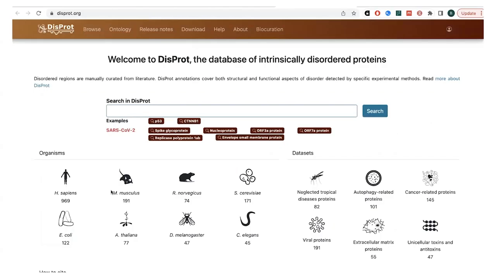

把 DisProt 里的无序区拿出来统计，早期研究者就注意到一个规律 [【跳转到 04:42】](https://www.youtube.com/watch?v=1bXzOgUZ3PQ&t=282)：

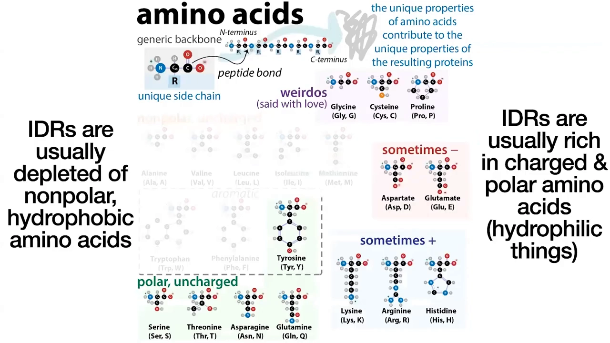

- **缺少**非极性、疏水的氨基酸（它们本来喜欢躲进疏水核心）；
- **富含**带电和极性的亲水氨基酸。

道理很直观：没有疏水核心可塌缩，链就难以折叠成致密结构。但视频也强调：**只看组成远远不够**，需要更强的算法。

### 2.2 第二步：IUPred 的"能量估计"思路

IUPred 全名是 **intrinsically unstructured protein prediction**。它不满足于"某类氨基酸更容易出现在无序区"，而是反过来**从已知结构里学** [【跳转到 05:11】](https://www.youtube.com/watch?v=1bXzOgUZ3PQ&t=311)：

1. 取 PDB 里那些**已知有序**的区域（晶体结构、NMR 结构）；
2. 统计哪些氨基酸经常挨在一起，并用一个**能量估计矩阵**（20×20）算出"这两个残基做邻居有多舒服"的自由能；
3. 把待测序列套进这个矩阵：如果相邻残基的组合在有序区里"很舒服"，就判为倾向有序；如果"不舒服"，就判为倾向无序。

视频把这套数学略过了（"我不是数学型的人"），但把结论讲得很清楚：**打分依赖两样东西——这个残基是什么，以及它在序列上的邻居是谁**。因为我们没有结构，只能用"序列上挨得近 ≈ 结构上也挨得近"这个近似 [【跳转到 07:42】](https://www.youtube.com/watch?v=1bXzOgUZ3PQ&t=462)。

### 2.3 第三步：把能量换算成 0–1 的概率

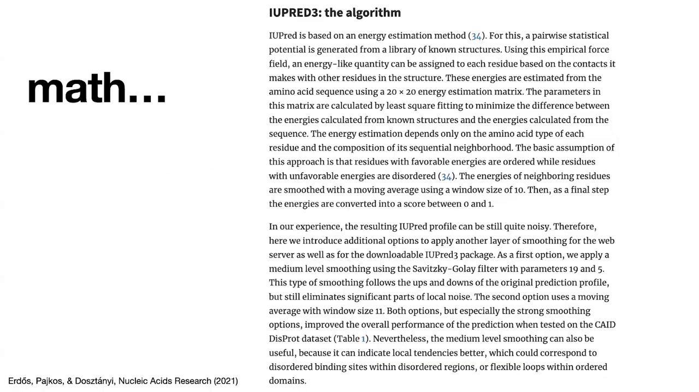

这张来自方法论文的幻灯片把流程写全了：成对统计势 → 20×20 能量估计矩阵 → 用**窗口大小为 10 的滑动平均**平滑邻居能量 → 换算成 0 到 1 之间的分数。用公式表示"平滑"这一步，就是

$$
e_i^{\text{smooth}} = \frac{1}{w}\sum_{k=-w/2}^{w/2} e_{i+k},\qquad w = 10
$$

其中 $e_i$ 是第 $i$ 个残基的能量估计值。平滑的意义是：单点噪声很大，看"一小段整体"更稳。

最终输出的分数是一个**概率**，不是"程度" [【跳转到 07:06】](https://www.youtube.com/watch?v=1bXzOgUZ3PQ&t=426)：

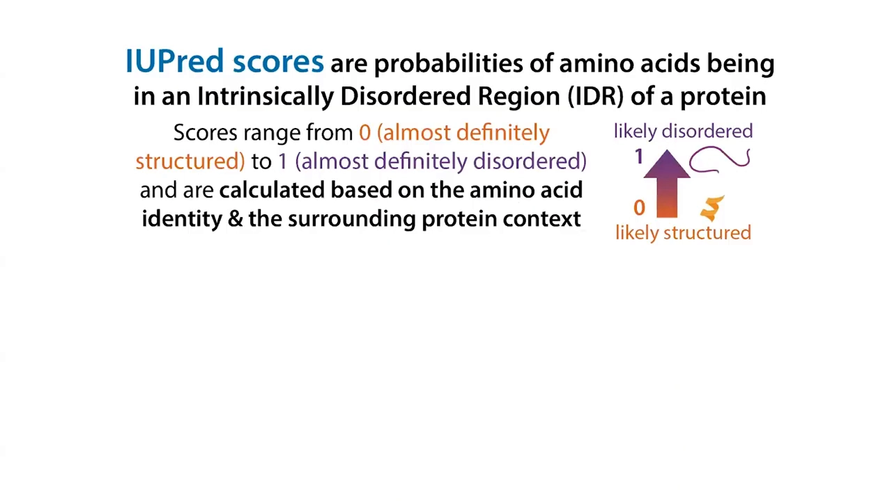

- 0 = 几乎可以确定**有序**；
- 1 = 几乎可以确定**无序**；
- 它是"是/否"的概率，**不是**"有多无序"的程度值。

## 三、怎么读一张 IUPred 曲线

### 3.1 三种典型形状

把每个残基的分数沿序列长度画出来，就得到 IUPred 曲线。视频给了三种典型形状 [【跳转到 08:32】](https://www.youtube.com/watch?v=1bXzOgUZ3PQ&t=512)：

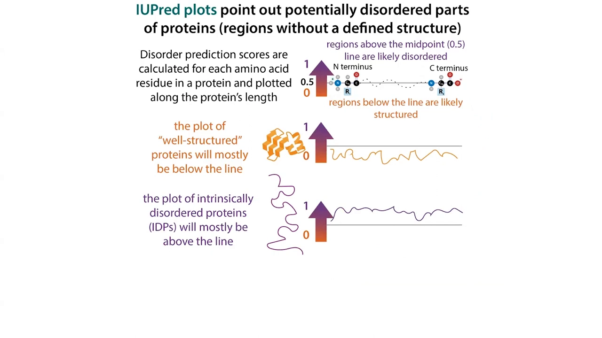

1. **高度有序的蛋白**：绝大多数在 0.5 线**以下**，只在末端偶尔冒头；
2. **IDP**：几乎整条都在 0.5 线**以上**；
3. **最常见的情况**：主体在 0.5 以下（有结构域），但夹着一段或几段明显抬头的无序区。

读图口诀：**线上 = 倾向无序，线下 = 倾向有序，0.5 是中点线**。

### 3.2 长模式 vs 短模式

IUPred 提供 **long** 和 **short** 两种模式 [【跳转到 16:19】](https://www.youtube.com/watch?v=1bXzOgUZ3PQ&t=979)：

- **long**：找**较长**的无序段，适合判断"整段是不是无序区"；
- **short**：找**较短**的无序段，适合抓那些"在结构里缺失的小片段"。

Ago2 就是最好的对照：用 long 模式，两端的信号不明显；换成 short 模式，**N 端和 C 端都冒出预测的无序峰**——而这正好对应它在晶体结构里看不到 N 端的事实。

### 3.3 平滑档位：别把局部特征抹平

IUPred3 允许选择平滑强度（无 / 中 / 强）[【跳转到 14:21】](https://www.youtube.com/watch?v=1bXzOgUZ3PQ&t=861)：

- **不平滑**：曲线非常锯齿，噪声大；
- **强平滑**：线很顺，但**可能把局部特征平均掉**；
- **中等平滑（默认）**：折中，视频全程用的是这一档。

这一点对判读很重要：如果你关心的是"某个很短的结合基序"，过度平滑可能恰好把它抹掉。

### 3.4 例子一：GW182——几乎全长无序的 IDP

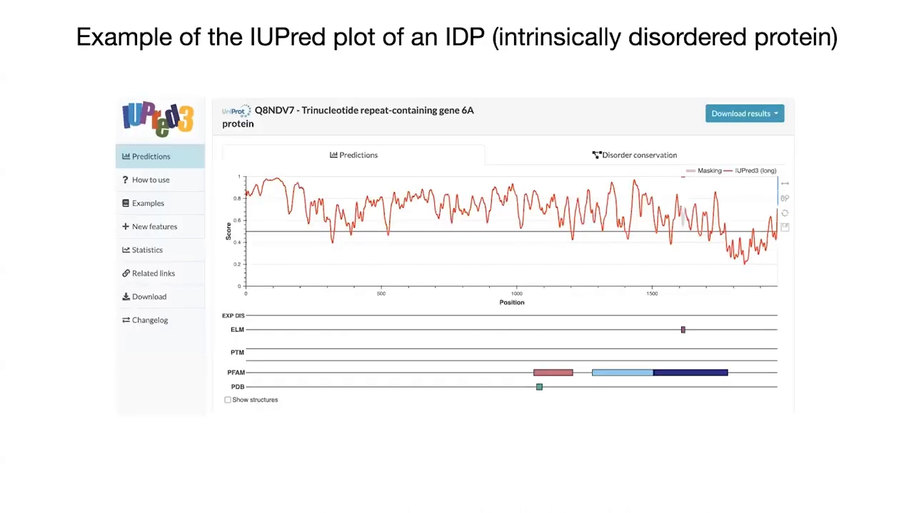

GW182 是 RNA 干扰通路里的脚手架蛋白 [【跳转到 11:40】](https://www.youtube.com/watch?v=1bXzOgUZ3PQ&t=700)：Argonaute 拿着约 20 nt 的小 RNA（microRNA 或 siRNA）找到互补的靶 mRNA，而要把 mRNA 降解掉，还需要 GW182 把去帽复合体（decapping complex）、去腺苷酸化复合体（deadenylation complex）等"执行者"拉过来。**正因为 GW182 大部分是无序的，它才能同时抓住很多不同的伙伴，并够到 mRNA 的两端**。

### 3.5 例子二：p53——IDR 常常在两端

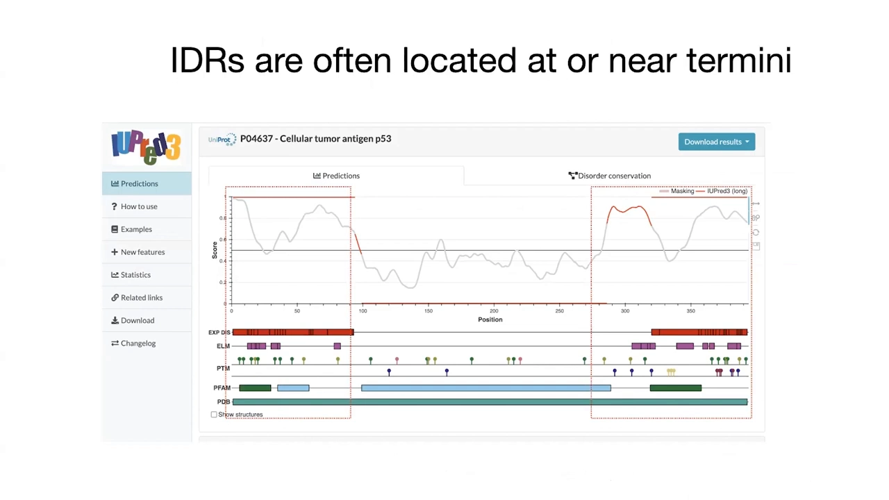

p53 是癌症中高频突变的肿瘤抑制因子，负责感知 DNA 损伤、阻止细胞失控增殖。它的曲线呈现一个很常见的格局：**中间主体在 0.5 以下，N 端和 C 端两段抬到线上** [【跳转到 14:46】](https://www.youtube.com/watch?v=1bXzOgUZ3PQ&t=886)。

视频点出规律：**IDR 经常位于或靠近末端（termini）**。这也解释了为什么做结构的人常常"掐头去尾"——把两端截掉，剩下的核心更容易结晶。

### 3.6 例子三：Ago2——主体有序，只有短片段无序

Ago2 是"有序蛋白里嵌着短无序段"的代表。视频用它的晶体结构（PDB 4F3T，人源 Ago2 结合 microRNA）指出：图上有虚线的地方，就是**结构里没解出来的片段** [【跳转到 15:12】](https://www.youtube.com/watch?v=1bXzOgUZ3PQ&t=912)。

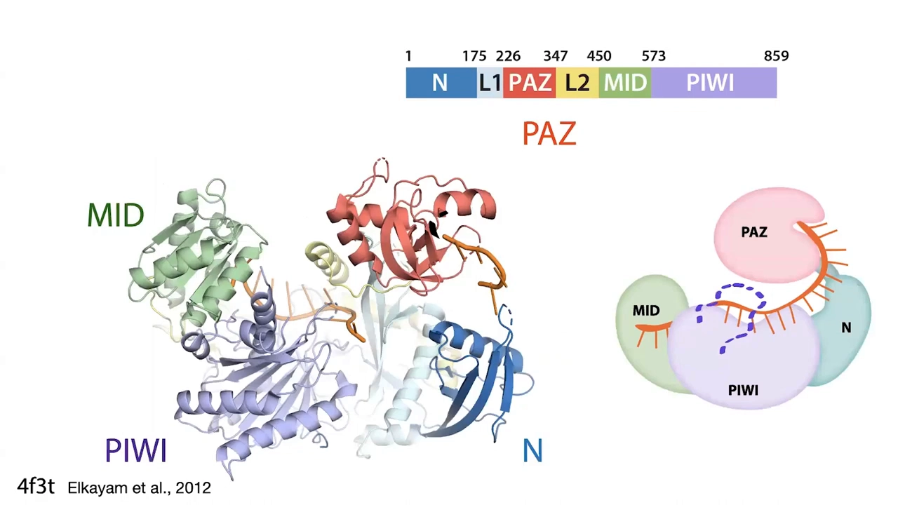

结构上：N、L1、PAZ、L2、MID、PIWI 六个结构域排开，虚线（如 PAZ 附近、N 端）表示这些残基在序列里存在、但在电子密度里"看不见"。

## 四、曲线下方的注释轨道：把预测和已有知识对上

IUPred3 的页面不只有一条曲线，曲线下面还有几条注释轨道 [【跳转到 17:21】](https://www.youtube.com/watch?v=1bXzOgUZ3PQ&t=1041)。视频重点讲了其中三条。

### 4.1 Pfam：保守结构域"通常"是有序的

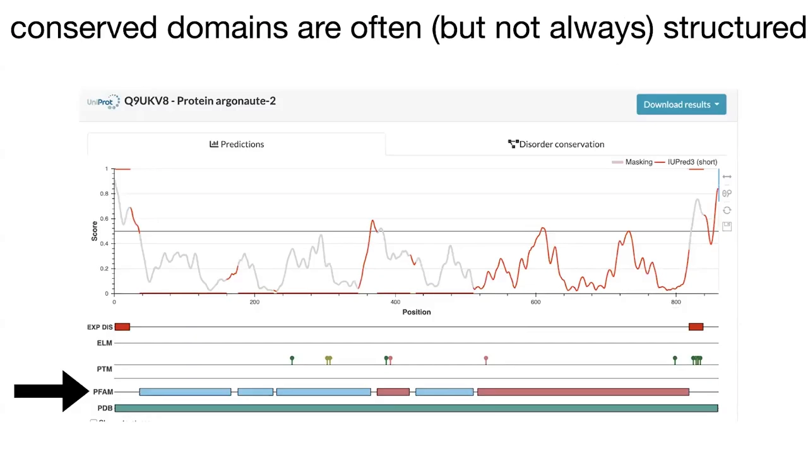

Pfam 轨道标出**保守结构域**的位置。视频的结论很谨慎：**保守结构域通常（但不总是）是有序的**——所以你会看到 Pfam 色块大多压在曲线低谷上，但两者并不严格一一对应。把预测和 Pfam 并排看，能快速判断"这段无序是不是落在某个已知结构域之外"。

### 4.2 PTM：磷酸化位点常常扎堆在 IDR 里

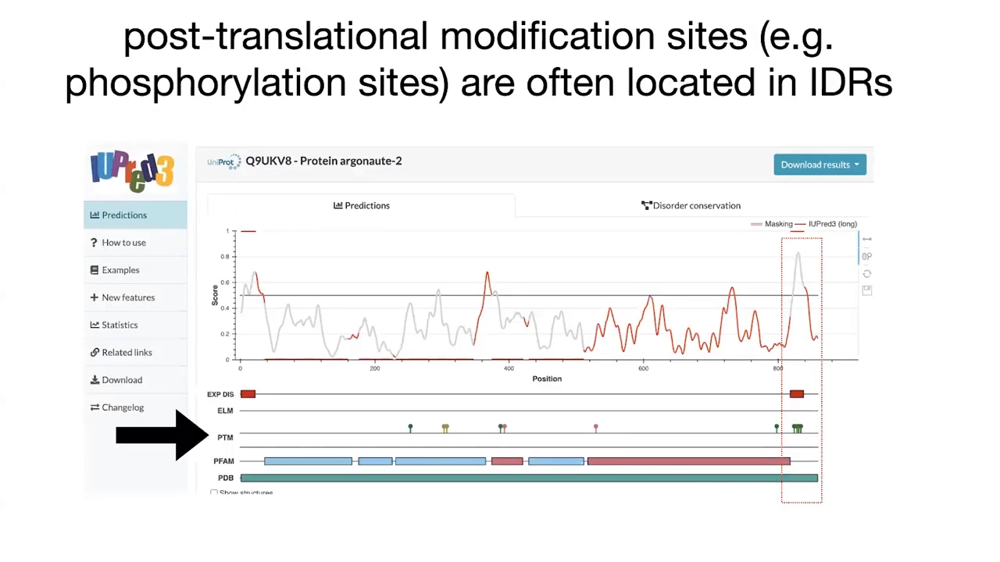

视频指出一个反复出现的现象：**翻译后修饰位点（尤其磷酸化位点）经常位于 IDR 中** [【跳转到 19:18】](https://www.youtube.com/watch?v=1bXzOgUZ3PQ&t=1158)。原因不难理解：无序区柔性大，修饰酶容易靠近、也容易把位点暴露出来；而修饰本身有时还会反过来改变结构。

Ago2 上就有一簇磷酸化位点，落在末端预测的无序区里。视频作者读研时研究的正是这一段：它被 **CK1α（casein kinase 1 alpha）**磷酸化后，会影响 Ago2 的活性——他们推测的作用是让 Ago2 在完成工作后释放 mRNA。

### 4.3 EXP DIS / ELM / PDB：实验证据、基序与结构覆盖

除了 Pfam 与 PTM，页面上还有几条轨道，含义分别是：

- **EXP DIS**：DisProt 里**有实验证据**的无序区；
- **ELM**：真核线性基序（短线性 motif）的位置；
- **PDB**：有哪些残基被结构解析覆盖。

读图时把这几条叠起来看，就能回答"这段预测的无序，有没有实验支持？有没有已知基序？结构里覆盖到哪？"——这比单看一条曲线可靠得多。

## 五、为什么无序区在结构里"看不见"

### 5.1 晶体学要的是"所有分子摆成同一个姿势"

视频用一句话概括了晶体学的苛刻要求：**要让所有蛋白分子停在完全相同的位置、相同的构象上**，才能形成有序晶格 [【跳转到 21:02】](https://www.youtube.com/watch?v=1bXzOgUZ3PQ&t=1262)。而无序区偏偏"不肯站好"：每个拷贝的姿势都不一样，衍射时相互抵消，电子密度里就只剩一片空白。

更糟的情况是：无序区太"甩"，会带着整条蛋白一起动，**连有序部分的结晶都受影响**。所以做结构的人会先预测哪里可能无序，然后**把末端截掉**，提高结晶成功率。

### 5.2 冷冻电镜也一样：平均之后就没有了

冷冻电镜不需要结晶，但同样要**把大量颗粒的平均结果**作为最终图 [【跳转到 22:17】](https://www.youtube.com/watch?v=1bXzOgUZ3PQ&t=1337)。无序区在每个拷贝里形状都不同，平均之后同样"化为一团雾"。所以结论是：**别指望在结构里看到 IDR**——不是它不存在，而是方法看不见。

### 5.3 缺失的残基，可以当作一条实验证据

正因为"看不见"有明确的物理原因，**结构里系统性缺失的片段**反而成了无序的证据 [【跳转到 22:59】](https://www.youtube.com/watch?v=1bXzOgUZ3PQ&t=1379)。DisProt 里 Ago2 的无序条目，证据写的就是"这些残基在所有晶体结构中都缺失"：序列里明明有，结构里看不到，因此判为无序。

在 PDB 的 3D 视图里，这类残基会被**标灰**，有时用**虚线**连起来；如果缺失片段太长，超过显示阈值，可能连虚线都不画 [【跳转到 30:12】](https://www.youtube.com/watch?v=1bXzOgUZ3PQ&t=1812)。看到虚线时，先分清两种可能：**没建模**（在序列里但没解出来）还是**被截掉了**（实验时就从序列里删了，属于人工截短）。

### 5.4 AlphaFold 的橙色：提示，不是证据

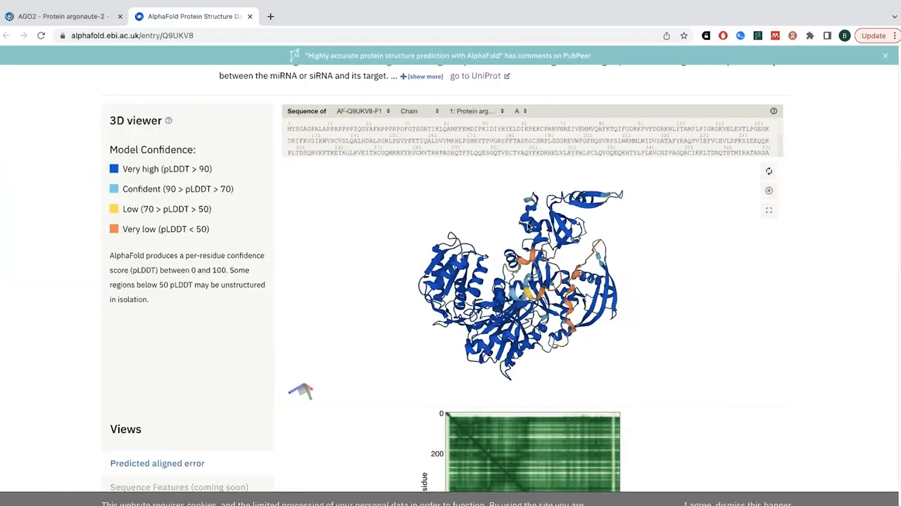

视频专门给了一个"当心"提示 [【跳转到 31:02】](https://www.youtube.com/watch?v=1bXzOgUZ3PQ&t=1862)：AlphaFold 会**硬着头皮给整条蛋白（包括 IDR）都预测一个结构**。IDR 在模型里通常表现为一条"像意大利面"的线，颜色常常是**深橙色**（pLDDT < 50，极低置信）。

这确实是一个"这段可能是 IDR"的**提示**，但视频明确说：**它不是真正的实验证据**。低置信也可能来自缺少同源序列、复合物缺失伙伴等原因。反过来同样成立：**不要把每一个低置信区都当成无序区**。

## 六、预测工具的边界：能做什么，不能做什么

### 6.1 不同工具擅长不同的无序类型

IUPred 只是众多预测器之一。视频提到，其它方法基于不同原理，**擅长的无序类型也不一样** [【跳转到 32:28】](https://www.youtube.com/watch?v=1bXzOgUZ3PQ&t=1948)：适合预测长无序段的工具，未必擅长抓短片段；擅长抓结合型无序区（ disordered binding region）的工具，也未必擅长其它类型。

### 6.2 基准测试给出的现实数字

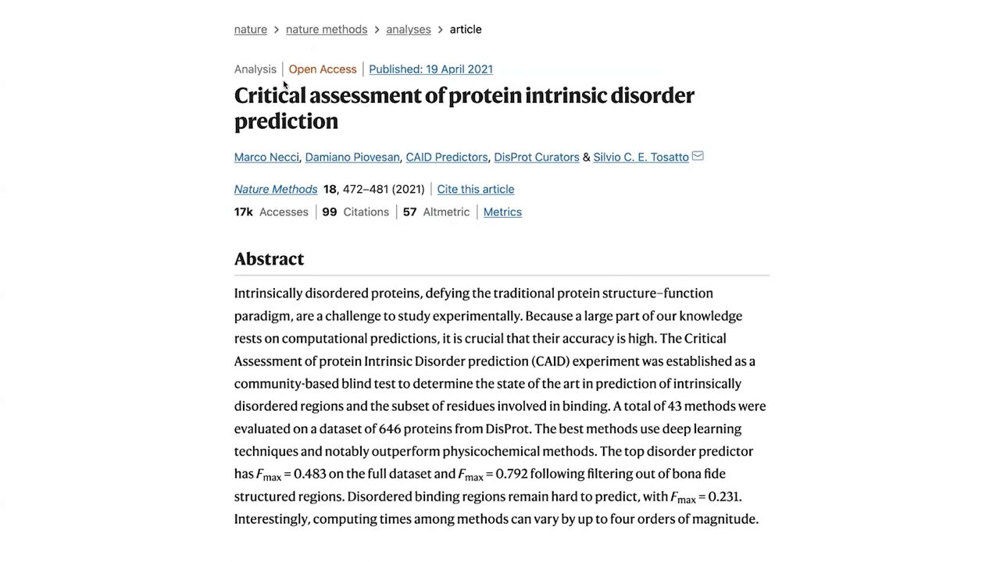

视频引用了 2021 年 *Nature Methods* 的 CAID 社区盲测：43 种方法、646 个 DisProt 蛋白参与评测。几个值得记住的数字：

- 最好的方法在**完整数据集**上 $F_{\max} = 0.483$；
- 把"确定有序"的区域剔掉后，$F_{\max}$ 升到 $0.792$；
- 但**无序结合区（disordered binding region）**只有 $F_{\max} = 0.231$——最难预测的部分。

这说明两件事：**预测整体无序已经相当可靠，预测"哪一小段会结合伙伴"仍然很难**；同时不同方法的计算耗时能差四个数量级。所以实践中的正确姿势是：**用预测提出假设，用实验（缺失残基、NMR、DisProt 条目等）去验证**。

## 小结

- **无序是序列编码的状态**：`intrinsic` 指"孤立状态下光凭序列就倾向没有固定结构"，它不等于"永远没有结构"——结合伙伴时可能折叠。
- **序列特征**：无序区缺少疏水/非极性残基，富含带电与极性残基；IUPred 进一步用 20×20 能量估计矩阵 + 窗口 10 的滑动平均，把倾向折算成 **0–1 的概率**。
- **读图三看**：看曲线在 **0.5** 哪一侧；看用 **long 还是 short** 模式；看**平滑档位**是否把短基序抹平了。
- **三条注释轨道很值钱**：Pfam（保守结构域通常有序但不总是）、PTM（磷酸化位点常扎堆在 IDR）、EXP DIS/ELM/PDB（实验证据、线性基序、结构覆盖）。
- **结构里看不见有物理原因**：晶体学要求同一构象、冷冻电镜靠平均，无序区两者都"化掉"；因此**缺失残基可以当作一条实验证据**，但要看懂它是"没建模"还是"被截掉"。
- **AlphaFold 橙色低置信只是提示**：既不能当作无序的实验证明，也不能把所有低置信区都判成无序。
- **预测有边界**：整体无序预测已较可靠（$F_{\max}\approx0.79$），**无序结合区仍很难**（$F_{\max}\approx0.23$），必须用实验交叉验证。

## 关键术语速查

| 术语 | 一句话解释 |
| --- | --- |
| IDR（intrinsically disordered region） | 蛋白质中没有固定结构的一段区域 |
| IDP（intrinsically disordered protein） | 几乎整条都没有固定结构的蛋白质 |
| intrinsic（内在的） | 光凭序列本身（孤立状态）就倾向无序，不依赖外部因素 |
| 构象集合 / ensemble | 无序区不是没有形状，而是在很多形状之间快速变化的一组状态 |
| DisProt | 人工整理、每条都附实验证据的内在无序蛋白数据库 |
| IUPred | 基于能量估计矩阵预测无序概率的工具，输出每个残基 0–1 的分数 |
| long / short 模式 | 分别偏向寻找较长、较短的无序片段 |
| ANCHOR | IUPred 家族里预测"无序结合区"的模块（结合时折叠） |
| 平滑（smoothing） | 对相邻残基分数取滑动平均，降低噪声但可能抹平局部特征 |
| pLDDT | AlphaFold 的逐残基置信度（0–100），低值提示可能无序，但不是实验证据 |
| 缺失残基（missing residues） | 序列里有、结构里没解出来的残基，可作为无序的实验证据之一 |
| CAID | 无序预测方法的社区盲测基准 |