# 蛋白质不是静止的雕塑：构象变化、无序区与"看不见"的结构证据

> 视频来源：[Protein flexibility, conformational changes, and intrinsically disordered regions (IDR's)](https://www.youtube.com/watch?v=iDonUd_cX8w)（YouTube · the bumbling biochemist，时长约 33 分钟）
> 导读：这支视频从"蛋白质一直在动"讲起，先讲构象变化与变构，再讲最松的那一类——内在无序区（IDR），最后用晶体学、冷冻电镜、NMR、HDX-MS、FRET 五种手段说明：为什么无序区在结构图里"看不见"，以及"看不见"到底能推出什么、不能推出什么。

## 本讲要解决的核心问题（SCQA）

**背景**：我们认识的蛋白质形象，几乎都来自 PDB 里那些漂亮的静态模型——α 螺旋、β 折叠、疏水核心，形状精确到原子。结构决定功能，这套逻辑支撑了整个结构生物学。

**冲突**：但蛋白质其实一直在动。有些区域只是轻微涨落或铰链式摆动，有些区域干脆**没有任何固定形状**（内在无序区，IDR）。而所有主流结构方法都建立在"把分子固定住"或"把大量分子平均起来"的前提上——于是最灵活、往往也最有趣的那部分，恰恰在图上"消失"了。更危险的是：图上的一片空白，很容易被误读成"这里什么都没有"或"这里就是无序"。

**疑问**：蛋白质怎么动、为什么动？无序区在功能上到底做什么？当传统方法看不见它们时，我们还能靠什么知道那里发生了什么？

**回答（中心思想）**：构象变化是**同一个蛋白的不同形状**，常由结合、翻译后修饰或环境变化触发；无序区是其中**柔性到极致**的一类，靠"没有固定形状"来当脚手架、在结合时折叠、促成分子凝聚体。晶体学要求所有分子摆成同一姿势，冷冻电镜靠大量颗粒平均，NMR 在溶液里看构象集合——**三者对无序区都"不友好"**。因此"缺失的电子密度"是一条重要线索，但它是**方法的产物**：必须配合 HDX-MS、FRET 这类动态测量，才能说清那里到底是有序、是动态，还是无序。

## 一、蛋白质不是雕塑：构象变化无处不在

### 1.1 同一个蛋白，不同的形状

视频用一张图定义了什么叫构象变化 [【跳转到 06:13】](https://www.youtube.com/watch?v=iDonUd_cX8w&t=373)：

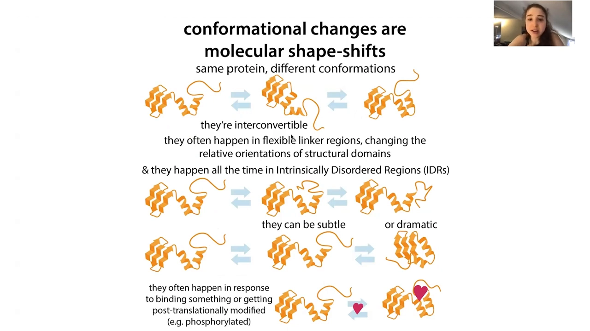

- **构象（conformation）= 同一个蛋白的不同形状或朝向**，不是另一个蛋白；
- 这些形状之间**可以互相转换**（interconvertible）；
- 变化常发生在**柔性连接区（linker）**，改变的是各结构域之间的**相对朝向**；
- 幅度可以从**轻微**（局部涨落）到**剧烈**（整条链重新排布）；
- 触发因素常见三类：**结合伙伴、翻译后修饰（如磷酸化）、环境变化（如温度）**。

视频用了一个很好懂的类比：手可以弯、可以伸、可以握拳——都是同一只手，只是构象不同。蛋白质也一样，它之所以换形状，是因为**周围给了它新的"选项"**：氨基酸各有偏好，环境一变，最舒服的排布就变了；一处变化还会像多米诺一样传到别处。

### 1.2 案例一：Argonaute 结合靶标时"张开"

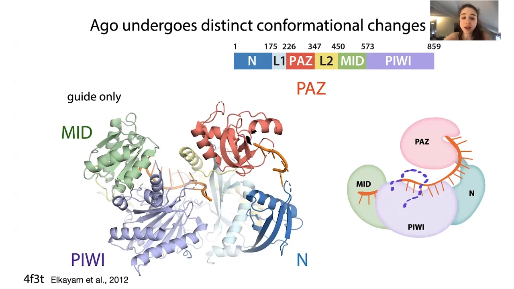

Argonaute（Ago）是 RNA 干扰的效应蛋白：它带着一段约 20 nt 的小 RNA 当"向导"，去找序列互补的靶 mRNA。视频指出，Ago 在不同状态下形状明显不同 [【跳转到 03:22】](https://www.youtube.com/watch?v=iDonUd_cX8w&t=202)：

- 只带向导 RNA 时，结构相对"闭合"；
- 一旦结合到靶标（先只是种子区配对），结构就**打开**；
- 如果靶标更长、配对延伸到更多位点，**打开得更多**。

这就是"结合诱导的构象变化"：不是蛋白自己随便变，而是**配体给了它新的能量地形**。

### 1.3 案例二：新冠病毒刺突蛋白的"剧烈变形"

视频给的第二个例子更戏剧化 [【跳转到 03:48】](https://www.youtube.com/watch?v=iDonUd_cX8w&t=228)：刺突蛋白结合 ACE2 受体、并被蛋白酶切开后，一部分会脱落，剩下嵌在病毒膜上的部分插入细胞膜，把两层膜拉到一起，形成一个**极度拉长的复合物**。这是"剧烈构象变化"的典型。

有意思的工程细节：做重组蛋白研究时，人们会引入**多聚脯氨酸替换**来稳定它，**目的就是阻止这个剧烈变形**。这反过来说明：构象变化不只是"现象"，它可以被设计、被抑制。

### 1.4 构象变化从哪来：给蛋白"更多选项"

视频把触发因素归成三类 [【跳转到 04:53】](https://www.youtube.com/watch?v=iDonUd_cX8w&t=293)：

| 触发 | 例子 | 机制直觉 |
| --- | --- | --- |
| **结合** | Ago 结合靶 RNA、受体结合配体 | 新伙伴带来新的相互作用，最舒服的排布变了 |
| **共价修饰** | 磷酸化、乙酰化、甲基化 | 多了一个带负电（磷酸基）或不同体积的基团，局部要重新安排 |
| **环境变化** | 温度、氧化还原状态等 | 相互作用强度随环境改变，能量地形整体平移 |

共同点是：**蛋白在"优化它所有的相互作用"**，一旦选项变了，最优解就变了。

### 1.5 变化幅度：从"轻微涨落"到"铰链式摆动"

不是所有运动都像刺突蛋白那样夸张 [【跳转到 09:33】](https://www.youtube.com/watch?v=iDonUd_cX8w&t=573)：

- **整体涨落**：有序蛋白里也有随机的热运动，但被大量强相互作用"按住"，幅度小；
- **结构域间摆动**：柔性连接区像铰链，让两个结构域靠近或远离——Ago 就属于这一类；
- **结构域内部的变化**：同一结构域里也能有局部重排。

视频还提到一个很能说明问题的观察：**Ago 在"没有 RNA"的状态下根本拿不到结构**，因为它太灵活了 [【跳转到 10:36】](https://www.youtube.com/watch?v=iDonUd_cX8w&t=636)。她用氢氘交换质谱（HDX-MS，后面会讲）看到：无 RNA 的 Ago 骨架"完全暴露、灵活、动态"。**拿不到结构，本身就是关于柔性的信息**。

## 二、变构：一处变化如何传到另一处

### 2.1 变构效应是什么

视频把"一处变化影响另一处"统一叫**变构效应（allostery）** [【跳转到 11:15】](https://www.youtube.com/watch?v=iDonUd_cX8w&t=675)。它的物理基础很朴素：蛋白是一个连通网络，你在 A 处改变了一个相互作用，B 处的"最舒服状态"也跟着变。

### 2.2 酶抑制：竞争性 vs 变构

以酶抑制为例 [【跳转到 11:40】](https://www.youtube.com/watch?v=iDonUd_cX8w&t=700)：

- **底物**：酶作用的那个分子；酶是"反应加速器"；
- **竞争性抑制剂**：长得像底物，占住活性位点，但酶没法对它做功；
- **变构抑制剂**：结合在**别的位点**，却让底物也结合不上，或让活性位点失活。

两者的区别正是"变构"的精髓：**不需要直接占位，也能远程关掉功能**。

### 2.3 受体：把信号"接力"传过膜

受体是另一个常见场景 [【跳转到 12:30】](https://www.youtube.com/watch?v=iDonUd_cX8w&t=750)：受体跨膜，外面结合配体，里面接 G 蛋白或激酶。配体并没有被运进细胞，它只是**改变了受体的构象**，这个变化沿着蛋白传到胞内段，再激活下游（比如让受体二聚化、激活激酶）。信号之所以能"穿墙"，是因为**胞外那一段和胞内那一段始终是连在一起的一条链**。

## 三、无序区：把柔性推到极致的那一类

### 3.1 定义：没有"设定好的结构"

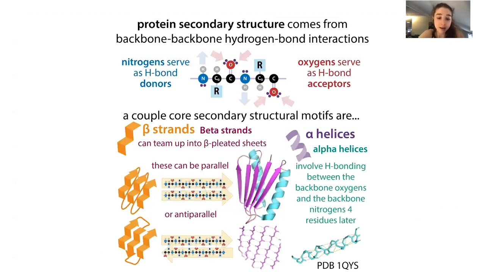

视频先复习了二级结构的来源 [【跳转到 07:53】](https://www.youtube.com/watch?v=iDonUd_cX8w&t=473)：氨基酸有共同的**骨架**（N–Cα–C）和各自不同的**侧链（R 基团）**。骨架上的氮是氢键**供体**、氧是氢键**受体**，而且间距规则，于是能形成规则的 β 折叠与 α 螺旋。

而 **IDR（intrinsically disordered region，内在无序区）** 是另一回事 [【跳转到 13:45】](https://www.youtube.com/watch?v=iDonUd_cX8w&t=825)：**我们基本不知道它长什么样，因为我们不认为它有任何设定好的形状**。它太松，拍照时"到处都是"，所以任何需要"固定姿势"的方法都拿它没办法。

### 3.2 位置：常在两端，也可能整条都是

IDR 的分布有两种典型 [【跳转到 14:35】](https://www.youtube.com/watch?v=iDonUd_cX8w&t=875)：

- 很多蛋白在 **N 端、C 端**带 IDR；
- 也有些蛋白**几乎整条都是 IDR**（即 IDP，内在无序蛋白）。

### 3.3 功能一：脚手架——把该凑在一起的东西凑在一起

视频的主角是 **GW182（TNRC6A）**，RNA 干扰通路里的脚手架蛋白 [【跳转到 15:39】](https://www.youtube.com/watch?v=iDonUd_cX8w&t=939)：

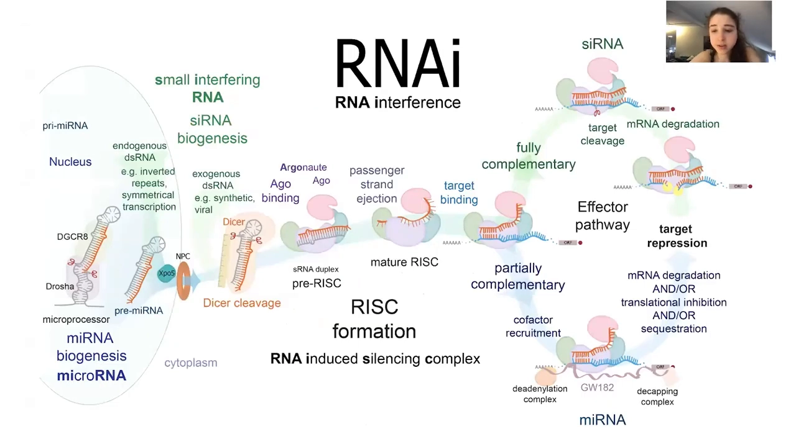

Ago 结合靶 mRNA 之后，要真正把 mRNA 降解掉，还需要去帽复合体、去腺苷酸化复合体等"执行者"到场。GW182 的作用就是**把 Ago 和执行者连起来**，而且它有一条**巨大的 IDR**，可以同时抓住很多东西、够到 mRNA 的两端。视频形容它像"**一颗肉丸挂在一盘意大利面中间**"——正是这种"面条般的柔性"让它能当连接器。

### 3.4 功能二：结合时才折叠（偶联折叠）

IDR 并不是永远无序 [【跳转到 18:26】](https://www.youtube.com/watch?v=iDonUd_cX8w&t=1106)：**有时它们在与伙伴结合后才获得确定结构**——"本来松松垮垮，一结合，那一段就有形状了"。这就是通常说的"偶联折叠与结合"（coupled folding and binding）：无序带来的低代价柔性，换来了高特异性的结合。

### 3.5 功能三：促成分子凝聚体（相分离）

IDR 还能推动**相变/相分离** [【跳转到 18:51】](https://www.youtube.com/watch?v=iDonUd_cX8w&t=1131)：细胞里本来溶解得好好的成分，聚成一颗颗"胶状、黏稠、果冻样"的小液滴，也就是**无膜细胞器 / 凝聚体（condensate）**。

为什么需要它？因为细胞里东西太多了：参与同一个过程（转录、翻译等）的分子如果散在细胞两端，反应就很难发生。**把这些东西局部浓缩在一起**，既提高效率，又防止它们漂走。IDR 的柔性让它能"网住"一堆伙伴，而不需要和每一个都形成固定的强结合。

### 3.6 AlphaFold 面对 GW182：一条"不知道该拿它怎么办"的线

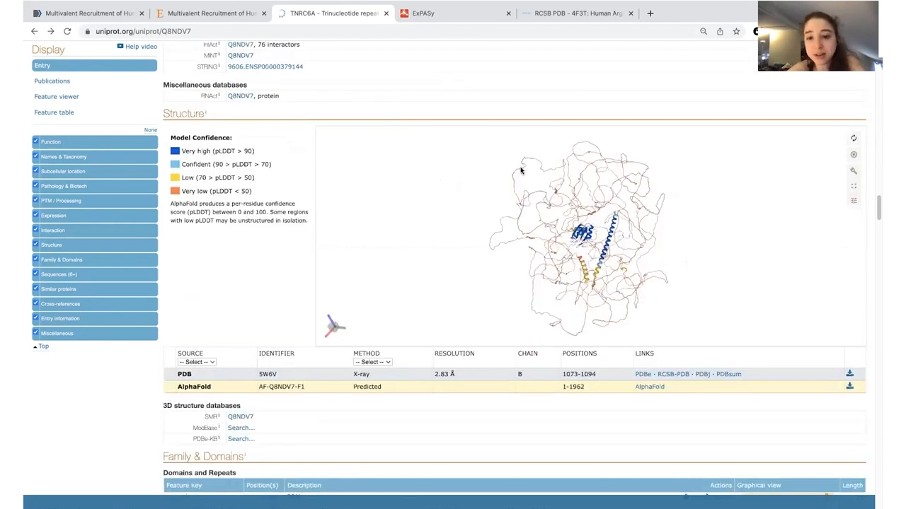

在 UniProt 里查 GW182，会看到 AlphaFold 预测模型 [【跳转到 16:17】](https://www.youtube.com/watch?v=iDonUd_cX8w&t=977)：除了中间一小段，其余都是**极低置信（橙色）**，模型画出来就是一团乱线。视频的解读是：**它根本不知道这段该怎么办**，而这段到底长什么样，"取决于它挂在了什么上面"。

## 四、为什么"看不见"：三种结构方法的取舍

### 4.1 结构生物学想回答什么

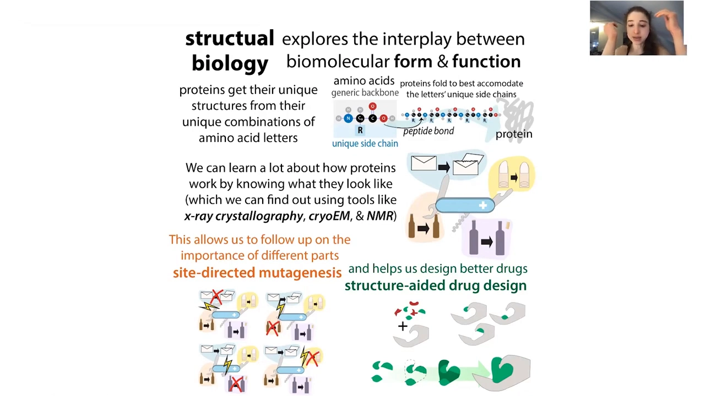

视频先交代了这门学科的目标 [【跳转到 20:06】](https://www.youtube.com/watch?v=iDonUd_cX8w&t=1206)：在原子层面看清分子形状，再据此理解功能、设计突变、做基于结构的药物设计。三种主力方法是 **X 射线晶体学、冷冻电镜（cryo-EM）、NMR**，它们对"柔性"的容忍度完全不同。

### 4.2 晶体学：先让所有分子摆成同一个姿势

晶体学的流程可以概括成四步 [【跳转到 22:11】](https://www.youtube.com/watch?v=iDonUd_cX8w&t=1331)：

1. 让蛋白分子排成**有序晶格（晶体）**——这要求所有分子停在**完全相同的位置和构象**；
2. 打 X 射线，射线被原子散射、彼此干涉；
3. 得到**衍射图样**，再反推出**电子密度图**；
4. 把原子模型"搭"进这张密度网格里。

分辨率决定你能看清多细：**数字越小分辨率越高**；分辨率差的时候，某些区域根本**没有可用的密度**。

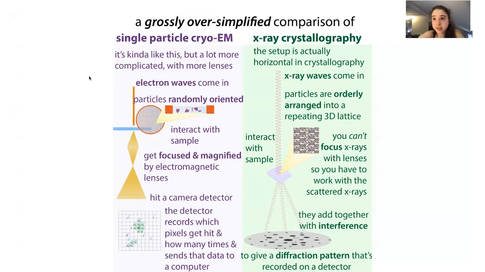

### 4.3 缺失的密度怎么读：你看到的是"模型"，不是"现实"

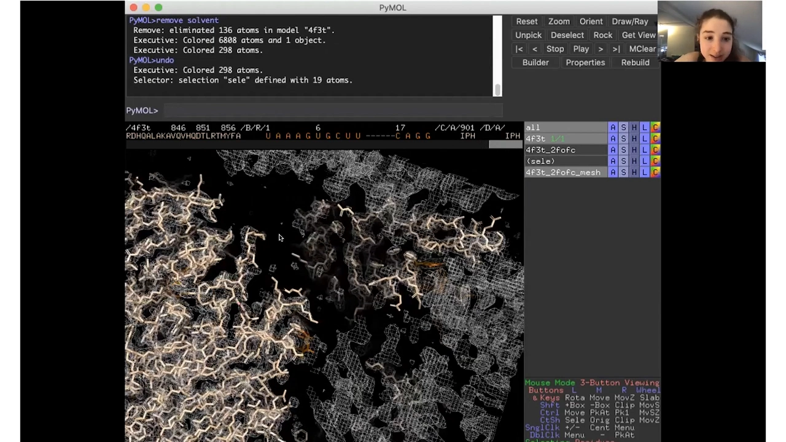

视频特别强调了一个观念 [【跳转到 25:04】](https://www.youtube.com/watch?v=iDonUd_cX8w&t=1504)：**你看到的晶体结构是一个"模型"**——研究人员把原子搭进密度网格的结果。不同区域的密度质量可以差很多，这不是研究者的失误，而是**蛋白本身太灵活**：柔性区的散射相互抵消，"看起来什么都没有"，但**蛋白其实在那里**。

在 PDB 文件里，这类区域通常表现为**虚线**（未建模）或**灰色残基**；如果缺失片段太长，可能连虚线都不画。看结构时务必分清：**"没建模"（序列里有、密度里没有）** 与 **"被截短"（实验时就从序列里删掉了）**。

### 4.4 冷冻电镜：不用结晶，但仍然要"平均"

冷冻电镜的好处是不需要晶体 [【跳转到 26:08】](https://www.youtube.com/watch?v=iDonUd_cX8w&t=1568)：让蛋白在薄冰里随机取向地冻住，拍大量照片，然后**把看起来一样的颗粒挑出来平均**，得到高分辨率重建；如果存在几种稳定构象，还能分类、分别重建。

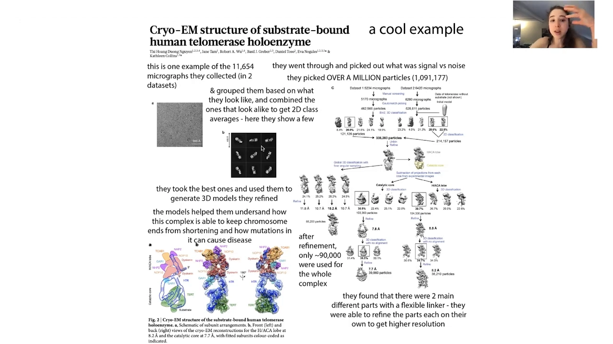

但代价同样明显 [【跳转到 27:48】](https://www.youtube.com/watch?v=iDonUd_cX8w&t=1668)：**如果某段真的没有固定形状，它在每个颗粒里都不一样，平均之后同样消失**；中间态、瞬时构象也抓不到。所以"冷冻电镜能看动态"是有条件的：**只有当蛋白在少数几个稳定构象之间切换时**，你才能把它们分开看。

### 4.5 NMR：在溶液里看"构象集合"

NMR 是溶液方法，不需要把蛋白固定住，因此**对柔性更友好** [【跳转到 20:31】](https://www.youtube.com/watch?v=iDonUd_cX8w&t=1231)。它的输出常常不是一个结构，而是**一组结构（ensemble）**——正好对应"蛋白在多个构象之间变化"这件事。代价是：**只能做较小的蛋白，而且需要大量样品**。

## 五、补上动态信息：HDX-MS 与 FRET

### 5.1 HDX-MS：用"氢能不能换掉"来测骨架的暴露程度

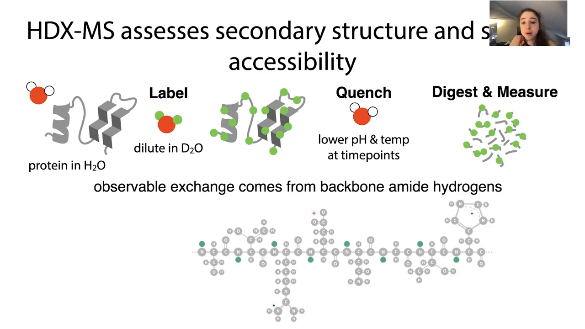

氢氘交换质谱（HDX-MS）的原理很巧 [【跳转到 28:41】](https://www.youtube.com/watch?v=iDonUd_cX8w&t=1721)：

1. 蛋白先在普通水（H₂O）里；
2. 稀释到重水（D₂O）中，骨架上的氢会被氘**逐步替换**；
3. 在设定时间点**降低 pH 与温度淬灭**交换；
4. 把蛋白酶切成肽段，用质谱测**每段的重量**——换了氘的肽段会变重。

关键在于：**可观测的交换只来自骨架酰胺氢**，而这些氢正是参与**氢键**的那些。所以：

- 处在**强二级结构**里的骨架氢被氢键"锁住"，**交换少**；
- **柔性、溶剂暴露**的区域，**交换多**。

于是 HDX-MS 能给出那些"在晶体结构里看不见的区域"的**二级结构与可及性信息**——这正是视频作者自己研究工作里用到的技术。

### 5.2 FRET：用"能量转移"量距离

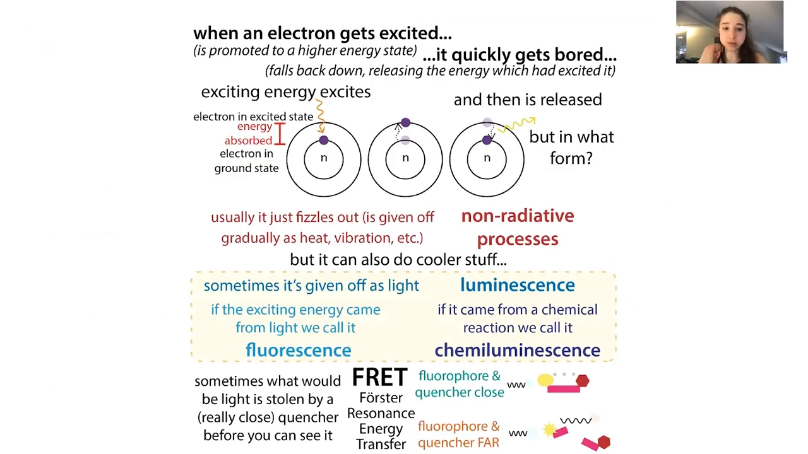

FRET（Förster 共振能量转移）的直觉是 [【跳转到 30:06】](https://www.youtube.com/watch?v=iDonUd_cX8w&t=1806)：

- **荧光基团（fluorophore）** 吸收某一波长的光，再发射另一波长的光；
- 如果附近有**淬灭剂（quencher）** 或另一个能接收能量的荧光基团，本该发出的光会被"偷走"，变成对方的信号；
- 这种转移**对距离极敏感**（只在很近时才明显）。

实验上，可以在蛋白的不同位置各挂一个荧光基团/淬灭剂（常利用表面暴露的半胱氨酸），然后问一个非常实用的问题：**结合了某个伙伴之后，这两处是靠近了还是远离了？** 这就把"构象变化"变成了可测量的距离变化。

## 六、判读要点：把"看不见"和"无序"分开

把全片收束成几条判读规则：

1. **静态图只是快照**：晶体结构是"蛋白找到舒服位置时被拍下的一张照片"，不代表它在细胞里的全部样子。
2. **缺失密度 ≠ 无序的证明**：它说明"这段在这个实验条件下没有统一位置"，可能因为无序，也可能因为柔性但仍有偏好构象、或是因为被截短/未建模。
3. **冷冻电镜"看不见"同理**：平均是它的工作原理，柔性区必然被平均掉；能分开看的前提是**存在少数几个稳定构象**。
4. **低置信预测只是提示**：AlphaFold 的橙色区域往往对应无序，但它也可能来自缺少同源信息，不能当实验证据。
5. **换方法补信息**：NMR 给构象集合，HDX-MS 给骨架的氢键/可及性，FRET 给特定位点间的距离变化——三者都在回答"它在动吗、怎么动"。
6. **反向也成立**：**拿不到结构本身就是信息**。Ago 无 RNA 状态拿不到晶体结构，正是因为那时它太灵活。

## 小结

- **构象变化 = 同一蛋白的不同形状**，可在构象间互换，常由**结合、翻译后修饰、环境**触发，幅度从轻微涨落到剧烈重排。
- **变构**是"一处变化传到另一处"：变构抑制剂不必占住活性位点也能关掉酶；受体靠构象变化把信号接力传过膜。
- **无序区（IDR）是柔性到极致的一类**：没有设定结构，擅长当**脚手架**（GW182 连接 Ago 与降解机器）、**结合时折叠**、**促成凝聚体**。
- **三种结构方法都对无序区不友好**：晶体学要求同一构象，冷冻电镜靠平均，NMR 只能做小蛋白且样品量大。
- **"看不见"有物理原因，也有判读陷阱**：缺失密度是线索，但要分清"未建模"与"被截短"；低置信预测只是提示。
- **动态信息要靠动态方法**：HDX-MS（骨架氢交换 = 二级结构/可及性）、FRET（位点间距离变化）、NMR（构象集合）。

## 关键术语速查

| 术语 | 一句话解释 |
| --- | --- |
| 构象（conformation） | 同一个蛋白的某一种形状/朝向，不同构象之间可以互换 |
| 构象变化 | 蛋白在构象之间的转换，常由结合、修饰或环境变化触发 |
| 变构（allostery） | 一处结合/变化远程影响另一处功能的现象 |
| IDR / IDP | 内在无序区 / 内在无序蛋白：没有固定结构的片段或整条蛋白 |
| 偶联折叠与结合 | 无序区在与伙伴结合时才形成确定结构 |
| 凝聚体 / 相分离 | IDR 推动形成的无膜、胶状局部浓缩区 |
| 电子密度图 | 晶体学中由衍射反推的电子分布，用来搭建原子模型 |
| 分辨率 | 能分辨的最小间距；数值越小分辨率越高 |
| 未建模残基 | 序列中存在、但因密度缺失而未搭进模型的残基 |
| 冷冻电镜（cryo-EM） | 冷冻颗粒成像后分类平均的重建方法，不需要结晶 |
| NMR | 溶液态结构方法，常输出一组构象（ensemble），适合小蛋白 |
| HDX-MS | 氢氘交换质谱：用骨架氢的交换程度反映二级结构与溶剂可及性 |
| FRET | 荧光共振能量转移：对距离敏感的测量手段，用于追踪构象变化 |
| pLDDT | AlphaFold 的逐残基置信度，低值提示可能无序但非实验证据 |