# α 螺旋、β 折叠与无规卷曲：靠主链氢键的「走法」把二级结构区分开

> 视频来源：[蛋白质的二级结构](https://www.bilibili.com/video/BV1K3JRzAEk7/)（Bilibili · 小蚂蚁讲生化，时长约 9 分 51 秒）
> 导读：这是一节按教材条目逐条过一遍的生化课，优点是把 α 螺旋、β 折叠、β 转角、β 凸起、无规卷曲的**判据和数字**都写在幻灯片上。本文按「氢键怎么连」这条主线重排，并补上了初学者最容易混淆的几处（谁是供体、谁是受体、平行还是反平行）。二面角本身的定义与 Ramachandran 图请见 1.1.5 小节，本文只用到其数值结论。

## 本讲要解决的核心问题（SCQA）

**背景**：一条多肽链是几十到几百个氨基酸首尾相连的长链。它不会直挺挺地待着，主链会在局部自发地盘出规律形状——这就是**二级结构（secondary structure）**。

**冲突**：常见的二级结构不止一种：α 螺旋、β 折叠、β 转角、β 凸起、环与无规卷曲。初学者看图时往往觉得「都是弯弯曲曲的线」，一换视角就分不清；更麻烦的是，α 螺旋和 β 折叠看起来差别很大，稳定它们的却是同一种相互作用——主链上的氢键。

**疑问**：这几种二级结构到底靠什么区分？为什么有的氨基酸偏爱螺旋、有的偏爱片层？它们各自在蛋白质里承担什么角色？

**回答（中心思想）**：区分二级结构只看三件事——**氢键在链内还是链间、肽段的伸展程度、以及侧链朝哪边伸**。α 螺旋是**链内**第 $n$ 位羰基氧与第 $n+4$ 位氨基氢的氢键，把主链卷成每圈 3.6 个残基的右手螺旋；β 折叠是**相邻 β 股之间**的氢键，把完全伸展的肽段并成锯齿状片层，走向有平行与反平行两种；β 转角用 4 个残基把链拐 180°；β 凸起是片层里多插一个残基造成的局部鼓包；无规卷曲与环则几乎没有规律，稳定性最差，却最常出现在活性中心 [【跳转到 00:20】](https://www.bilibili.com/video/BV1K3JRzAEk7/?t=20)。

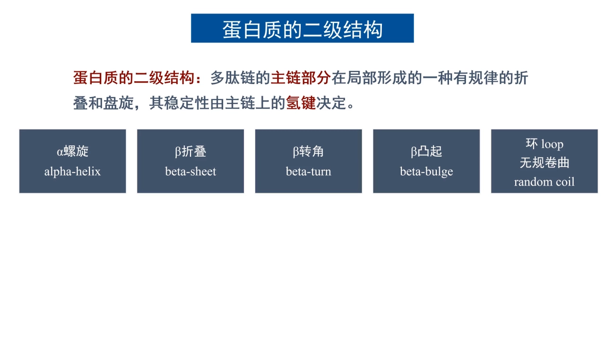

---

## 一、二级结构的定义里藏着判据：主链、局部、有规律、靠氢键

视频给出的定义很紧凑：二级结构是**多肽链的主链部分**在**局部**形成的**有规律**的折叠和盘旋，其稳定性由主链上的**氢键**决定 [【跳转到 00:06】](https://www.bilibili.com/video/BV1K3JRzAEk7/?t=6)。

这四句话其实每一句都是排除法：

- **主链部分**：说的是骨架（$-NH-C_\alpha H-CO-$）的走向，不涉及侧链（R 基团）的具体摆放。所以判断二级结构时，先看骨架，别被花花绿绿的侧链带偏。
- **局部**：只描述一段连续残基的构象，不描述整条链如何折叠成三维形状（那是三级结构的事）。
- **有规律**：同一段里每个残基的构象重复出现，可以用少数几个参数（每圈残基数、每残基上升距离）描述。
- **靠氢键**：稳定二级结构的不是共价键，而是主链 $C=O$ 与 $N-H$ 之间的氢键。肽键本身是刚性的平面（见 1.1.5 小节），能转的只有 $\phi$、$\psi$ 两个角，而氢键正好把这些转角「锁」在特定组合上。

**为什么必须是主链氢键？** 因为侧链千变万化，如果二级结构依赖侧链，就很难有普适的规律。主链上的 $C=O$ 和 $N-H$ 在每种氨基酸里都一样，所以鲍林（Linus Pauling）在 1951 年只靠纸笔和键长键角数据，就预言出了 α 螺旋和 β 折叠两种结构 [【跳转到 00:55】](https://www.bilibili.com/video/BV1K3JRzAEk7/?t=55)。

---

## 二、α 螺旋：第 $n$ 位的羰基氧，去抓第 $n+4$ 位的氨基氢

### 2.1 五条几何特征，一条都不能少

α 螺旋（alpha helix）是最常见的二级结构。幻灯片把它拆成五条 [【跳转到 01:41】](https://www.bilibili.com/video/BV1K3JRzAEk7/?t=101)：

1. **肽链主链围绕一个虚拟的轴以螺旋方式盘绕**——想象把一条链缠在一根看不见的柱子上。
2. **螺旋形成是自发的，稳定它的氢键非常有规律**——这里的「自发」指不需要酶或模板，只要序列和溶剂条件合适就会形成。
3. **每隔 3.6 个残基，螺旋上升一圈**。
4. **螺旋方向一般是右手，左手螺旋很少见**。
5. **R 基团在螺旋的表面，影响螺旋的形成和稳定**。

### 2.2 氢键模式：$n \to n+4$，封出一个 13 元环

最关键的一条是氢键的配对规则：**受体总是第 $n$ 位氨基酸残基的羰基氧（$C=O$），供体则是第 $n+4$ 位残基的氨基氢（$N-H$）**；被这个氢键封闭起来的环里一共含 **13 个原子** [【跳转到 01:20】](https://www.bilibili.com/video/BV1K3JRzAEk7/?t=80)。

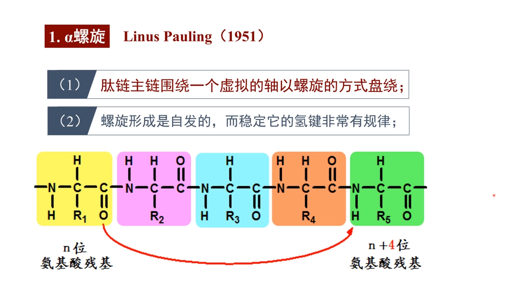

初学者最容易在这里记反。可以这样理解：肽键平面里 $C=O$ 的氧是「富电子」的一端，$N-H$ 的氢是「缺电子」的一端，所以氧永远是受体、氢永远是供体——**氢键的方向由化学决定，不是随便配对的**。

「13 元环」这个数字也不是随便来的：从第 $n$ 位的羰基碳出发，沿主链数到第 $n+4$ 位的氨基氮，再通过氢键回到起点，正好圈进 13 个原子。所以 α 螺旋在文献里常被记作 $3.6_{13}$ 螺旋：**每圈 3.6 个残基、环内 13 个原子**。

### 2.3 为什么是右手螺旋

螺旋有左手和右手两种旋向。视频指出自然界几乎只用右手 [【跳转到 01:41】](https://www.bilibili.com/video/BV1K3JRzAEk7/?t=101)，原因是氨基酸本身是**手性**的（除甘氨酸外都是 L 型），L 型氨基酸在立体上更容易形成右手螺旋。左手螺旋不是不可能，只是能量上吃亏、极少出现。

同一步幻灯片还给了第 5 条：**R 基团在螺旋的表面**。这一点非常重要，它意味着螺旋像一根「毛刷」，侧链全部朝外。这直接导致下一节的两亲性问题。

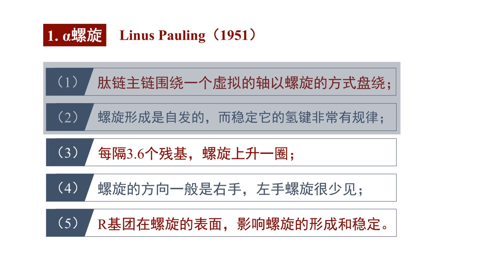

### 2.4 同一根螺旋，四种画法

同一个 α 螺旋可以用球棍模型、点模型（只画主链原子）、空间填充模型（按范德华半径画实心球）、带状模型（只画骨架飘带）来表示 [【跳转到 02:01】](https://www.bilibili.com/video/BV1K3JRzAEk7/?t=121)。它们不是四种不同的结构，而是**同一结构的四种抽象层级**：想看氢键用球棍，想看堆积紧不紧用空间填充，想看整体走向用带状。

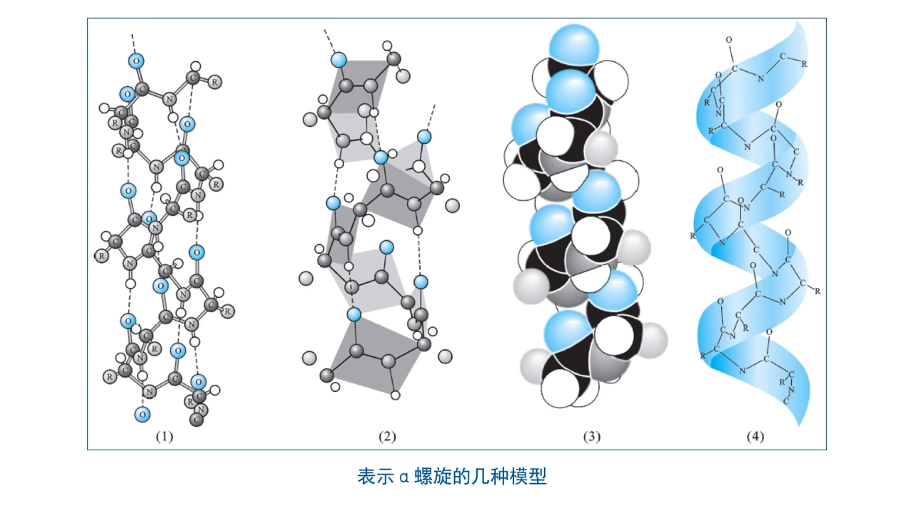

### 2.5 哪些氨基酸爱螺旋、哪些恨螺旋

幻灯片给了一张「影响 α 螺旋稳定性的氨基酸」表 [【跳转到 02:18】](https://www.bilibili.com/video/BV1K3JRzAEk7/?t=138)：

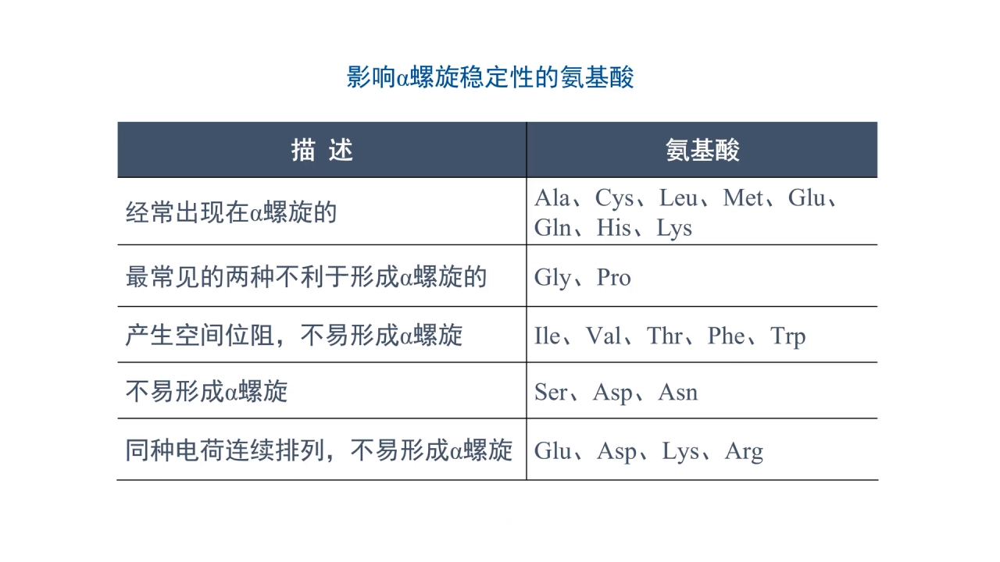

- **经常出现在 α 螺旋里**：Ala、Cys、Leu、Met、Glu、Gln、His、Lys。
- **最常见的两种「螺旋破坏者」**：**Gly 和 Pro** [【跳转到 02:43】](https://www.bilibili.com/video/BV1K3JRzAEk7/?t=163)。
  - **甘氨酸（Gly）**侧链只有一个氢，太小，不能提供相对固定的二面角，主链太「软」，构象到处乱跑，不利于形成规整螺旋。
  - **脯氨酸（Pro）**有两个原因：一是它的**亚氨基**形成肽键后，氮上已经没有氢可以充当氢键供体，螺旋的 $n \to n+4$ 氢键链在这里断掉；二是它的侧链是一个**刚性五元环**，把主链的 $\phi$ 角锁死，弯不过来。
- **空间位阻型**：Ile、Val、Thr、Phe、Trp——侧链基团大或带分支，挤在螺旋内部会打架。
- **侧链抢氢键型**：Ser、Asp、Asn——它们的侧链本身带氢键供体/受体，容易和主链「内讧」，把本该给螺旋的氢键抢走。
- **同种电荷排斥型**：Glu、Asp、Lys、Arg——如果带同种电荷的残基连续排在一起（比如连着几个 Asp），静电排斥会把螺旋推开 [【跳转到 03:33】](https://www.bilibili.com/video/BV1K3JRzAEk7/?t=213)。

这张表说明一件事：**二级结构不是序列「决定」的，而是序列「偏好」的**。同一段序列换个环境，螺旋可能就散了——这也是后面 2.1.7 讨论折叠动力学时要处理的问题。

### 2.6 三种特殊 α 螺旋：两亲性是关键

按侧链性质，α 螺旋可以分成三类 [【跳转到 03:56】](https://www.bilibili.com/video/BV1K3JRzAEk7/?t=236)：

| 类型 | 侧链构成 | 分布位置 |
| --- | --- | --- |
| 亲水 α 螺旋 | 亲水氨基酸 | 蛋白质表面，与水接触 |
| 疏水 α 螺旋 | 疏水氨基酸 | 蛋白质内部或跨膜区 |
| 两亲 α 螺旋 | 亲水与疏水各占一半 | 疏水面贴蛋白内部疏水区，亲水面朝水 |

**两亲 α 螺旋（amphipathic helix）**是三者中最有用的：因为螺旋每圈 3.6 个残基，侧链沿着螺旋表面大致每 3~4 个残基转一圈，如果序列按「疏水-亲水-疏水-亲水」的周期排布，螺旋就会形成一条**疏水条带**和一条**亲水条带**。把这样一根螺旋放在界面上，疏水面自动埋进疏水区、亲水面留在水里——这正是很多跨膜螺旋和抗菌肽的工作方式 [【跳转到 04:21】](https://www.bilibili.com/video/BV1K3JRzAEk7/?t=261)。

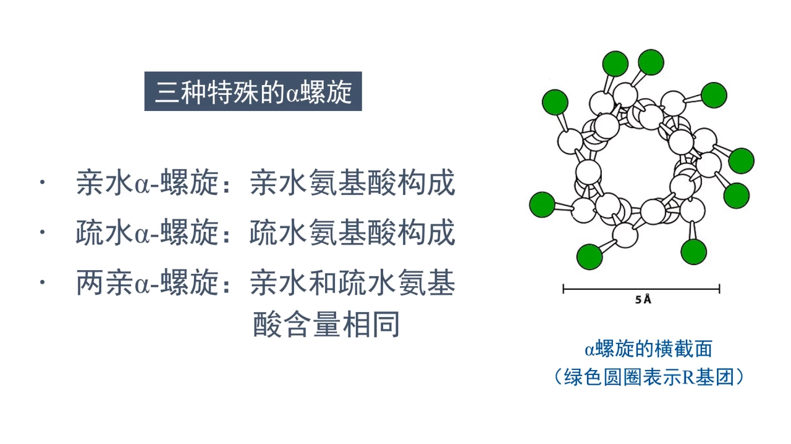

---

## 三、β 折叠：氢键从「链内」搬到「链间」

### 3.1 五条结构特征

β 折叠（beta sheet，也称 β 片层）同样是鲍林在 1951 年提出的。与 α 螺旋最直观的差别是：**肽链更加伸展，主链呈扇面状展开** [【跳转到 04:35】](https://www.bilibili.com/video/BV1K3JRzAEk7/?t=275)。

幻灯片给了五条特征 [【跳转到 04:54】](https://www.bilibili.com/video/BV1K3JRzAEk7/?t=294)：

1. **至少由两条肽段组成**，每条肽段完全伸展，肽平面之间呈**锯齿状**。
2. **每一股肽段称为 β 股（β strand）**，相邻 β 股呈平行排列（这里的「平行排列」指并排摆放，不是指走向相同），链间通过**氢键**相连。
3. **R 基团垂直于相邻两个肽平面的交线，交替分布在片层的两侧**——也就是侧链一上一下、像梳子齿一样交替伸出。
4. **肽段走向有平行（parallel）和反平行（antiparallel）两种**。
5. **反平行 β 折叠每个残基上升 0.347 nm，平行 β 折叠每个残基上升 0.325 nm**；β 折叠的二面角 $(\phi, \psi)$ 约为 $(-120^\circ, +105^\circ)$ [【跳转到 05:19】](https://www.bilibili.com/video/BV1K3JRzAEk7/?t=319)。

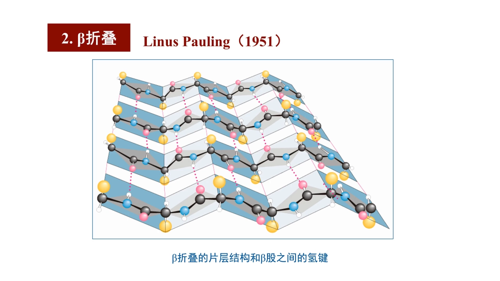

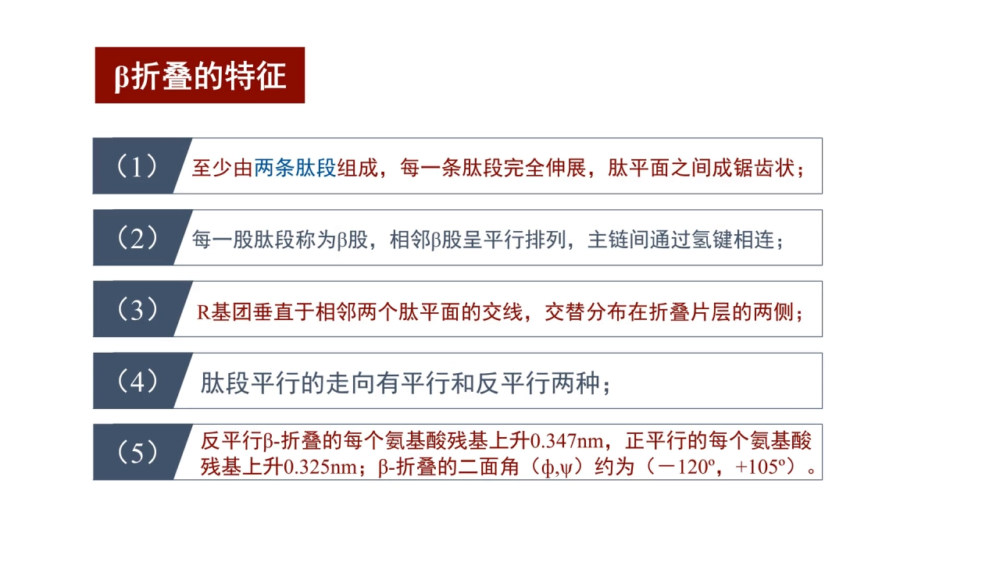

**为什么 β 股看起来是「锯齿」？** 因为肽键平面是刚性平面，相邻平面之间靠 $C_\alpha$ 折一下，于是整条 β 股就在片层平面内上下起伏，形成锯齿。侧链正是从这些锯齿的顶点交替伸出。

**上升距离有什么用？** 它是一把尺子。0.325 nm 和 0.347 nm 的差别来自氢键的排布方式不同（见下节），如果你在结构文件里量相邻 $C_\alpha$ 的距离，就能反推这一段是平行还是反平行。

### 3.2 平行与反平行：氢键的「斜度」不一样

这是全片最需要看图的一处 [【跳转到 05:56】](https://www.bilibili.com/video/BV1K3JRzAEk7/?t=356)：

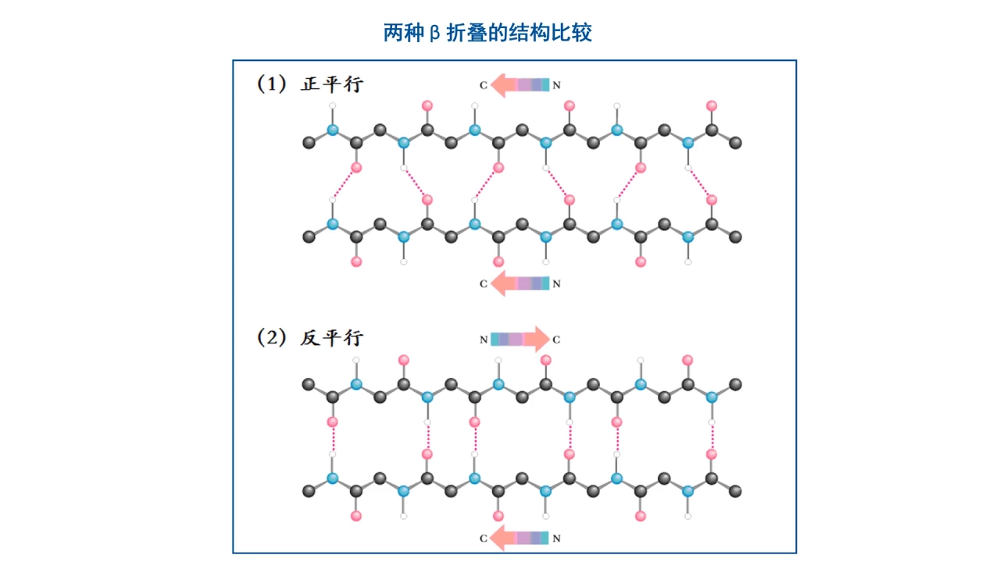

- **反平行（antiparallel）**：两条相邻 β 股走向相反（一条 $N\to C$，另一条 $C\to N$）。这时相邻残基的 $C=O$ 与 $N-H$ 几乎正对着，氢键**短、直、强度高**，而且每一对残基都能配对。所以反平行的每残基上升距离更大（0.347 nm），片层也更「舒展」。
- **平行（parallel）**：两条 β 股走向相同。这时氢键必须**斜着连**，$C=O$ 和 $N-H$ 不是正对，键长更长、更弱，而且配对是「错开一位」的。上升距离因此略小（0.325 nm）。

一句话记忆：**反平行是「正对着握手」，平行是「斜着握手」**。反平行的氢键更规整，因此热力学上更稳定；平行片层虽然弱一些，但在许多酶的核心结构里大量存在。

### 3.3 两亲 β 股与 β 桶

β 折叠也有类似「两亲螺旋」的现象。视频给了两条特性 [【跳转到 06:11】](https://www.bilibili.com/video/BV1K3JRzAEk7/?t=371)：

1. **β 股上交替出现疏水和亲水氨基酸**，形成**两亲 β 折叠**。因为 β 股的侧链本来就交替伸向片层两侧，只要序列按「疏-亲-疏-亲」排，片层就会一面疏水、一面亲水。**孔蛋白（porin）**就是典型：它的 β 股卷成一个**β 桶（β barrel）**，疏水面朝外贴在膜的脂质里，亲水面朝内构成让极性分子通过的通道。
2. **两个蛋白质各提供一个 β 股，可以拼成一片 β 折叠**，形成临时复合物。这种「靠片层临时粘一下」的相互作用在**信号转导**中很常见——结合与解离都不需要太高的能量代价。

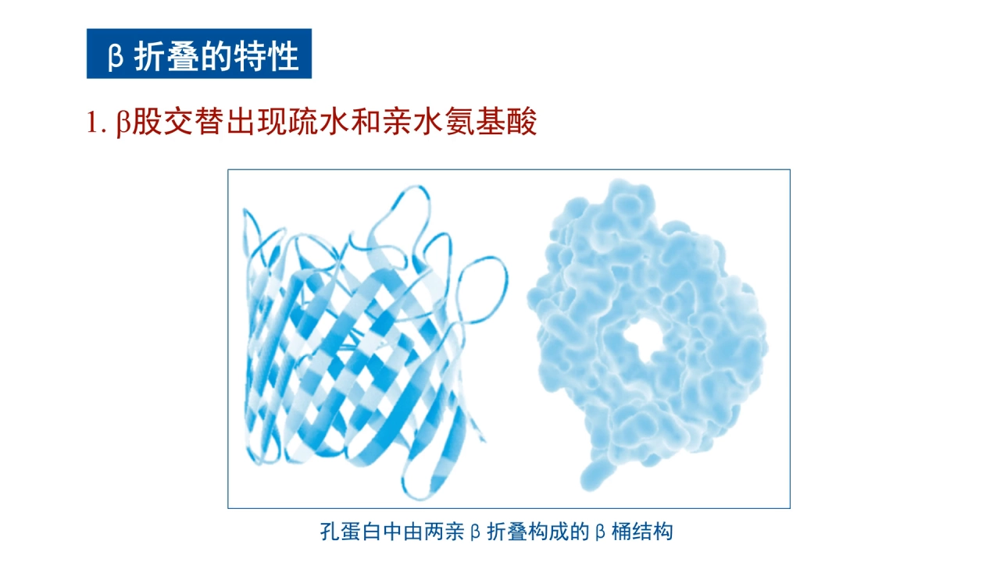

### 3.4 哪些氨基酸偏爱 β 折叠

β 折叠的氨基酸偏好与 α 螺旋几乎是**互补**的 [【跳转到 06:50】](https://www.bilibili.com/video/BV1K3JRzAEk7/?t=410)：

| 描述 | 氨基酸 |
| --- | --- |
| 经常出现在 β 折叠中 | Val、Ile、Phe、Tyr、Trp、Thr |
| 基本不出现在 β 折叠中 | Pro |

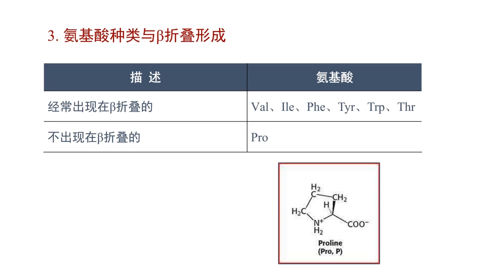

原因也一致：Val、Ile、Phe、Tyr、Trp、Thr 的侧链**大而疏水**，在伸展的 β 股上，侧链朝外、彼此不打架，反而能互相堆叠稳定片层；但在紧密的 α 螺旋里它们会挤在一起，所以这些残基在螺旋中不常见。**脯氨酸**的刚性环让主链弯不下来，而 β 股要求主链尽量伸展，所以 Pro 在片层里基本看不到。

---

## 四、β 转角与 β 凸起：让片层「拐弯」和「容错」的两个小装置

### 4.1 β 转角：4 个残基拐 180°

球状蛋白里，β 股不能一直伸下去，必须有人把它折回来。干这件事的就是 **β 转角（β turn）** [【跳转到 07:15】](https://www.bilibili.com/video/BV1K3JRzAEk7/?t=435)。它有四条特征 [【跳转到 07:20】](https://www.bilibili.com/video/BV1K3JRzAEk7/?t=440)：

1. **主链发生 180° 的改变**——一个急转弯。
2. **由 4 个连续的氨基酸残基组成**，**Gly 和 Pro 经常出现在中间位置**。Gly 侧链小、柔性大，Pro 的刚性环正好能「掰」出一个折角，两者是天然的转角专家。
3. **4 个残基中，只有 1 号位残基的羰基氧与 4 号位残基的氨基氢形成氢键**，其余位置的氢键供体和受体之间并没有成键。
4. **有利于反平行 β 折叠的形成**——因为转角的几何正好把链送回相邻位置，形成反平行配对。

它的生物功能有两条：对**球状蛋白质的形成**至关重要（没有转角就没有紧凑的球状结构）；而且**抗体识别位点、磷酸化位点、糖基化位点和羟基化位点**经常出现在 β 转角以及紧靠转角的位置 [【跳转到 07:45】](https://www.bilibili.com/video/BV1K3JRzAEk7/?t=465)。原因不难理解：转角处主链是凸出来的、柔性的，修饰酶和抗体最容易「抓」到。

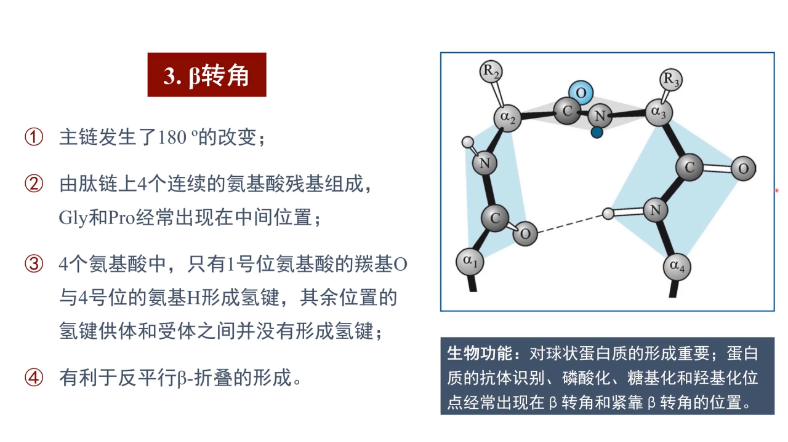

### 4.2 β 凸起：多插一个残基造成的鼓包

**β 凸起（β bulge）**的成因很具体：β 折叠的**一个 β 股里额外插入了一个氨基酸残基**，使原来连续的氢键结构被打断，于是肽链在那里产生一个弯曲凸起的结构；它也能轻微改变多肽链的走向 [【跳转到 08:10】](https://www.bilibili.com/video/BV1K3JRzAEk7/?t=490)。

它的生物功能很有意思：**减少进化过程中插入突变对保守结构的影响**。因为只要形成一个 β 凸起，多插进来的那个残基就被「吸收」掉了，原来的 β 折叠结构基本还能维持 [【跳转到 08:18】](https://www.bilibili.com/video/BV1K3JRzAEk7/?t=498)。换句话说，β 凸起是蛋白质结构的一种**容错机制**。

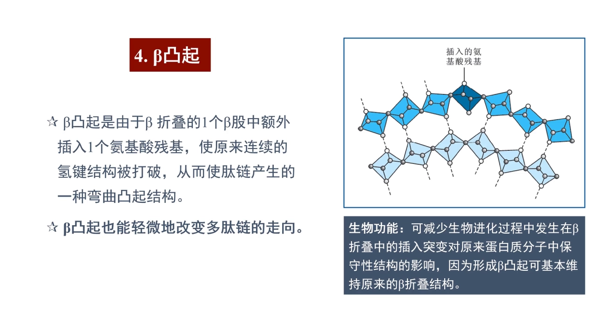

---

## 五、无规卷曲与环：稳定性最差，功能最重

最后一种二级结构是**无规卷曲（random coil）**：蛋白质分子中那些**柔性强、二面角变化大、极不规则**的二级结构 [【跳转到 09:01】](https://www.bilibili.com/video/BV1K3JRzAEk7/?t=541)。

这里有一个概念上的更新值得注意：**环（loop）以前被归为无规卷曲，现在被视为独立的二级结构**。区别在于，环虽然不规则，但往往有相对确定的构象和明确的功能，不是真的「随机」。

环的位置和功能都很鲜明：

- **位置**：位于球状蛋白质的**表面**，充当**联系二级结构的纽带**（把螺旋和片层串起来）。
- **结构特点**：其侧链和主链都含有**结合位点和功能位点**。
- **生物功能**：分子识别、与其他蛋白质相互作用、与配体结合、参与和控制酶的催化 [【跳转到 09:26】](https://www.bilibili.com/video/BV1K3JRzAEk7/?t=566)。

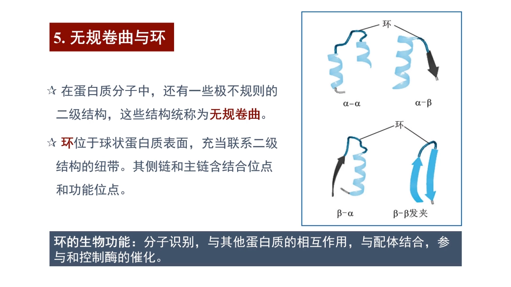

**为什么「最不稳定的」反而承担功能？** 视频开头就点出了这个反差：从稳定性看，α 螺旋最稳定，后面依次是 β 折叠、β 转角、环和无规卷曲；但从功能上看**正好相反**——蛋白质的活性中心通常由环和无规卷曲充当，而 α 螺旋和 β 折叠一般只起**支持作用** [【跳转到 00:20】](https://www.bilibili.com/video/BV1K3JRzAEk7/?t=20)。

道理是：稳定的结构（螺旋、片层）适合当「骨架」，把活性位点撑在正确的位置上；而功能需要**柔性**——底物要进得来、产物要出得去、构象要能变，这些都得靠不稳定的环来实现。稳定性和功能性在这里是一对必须平衡的取舍。

---

## 六、五种二级结构对照表

| 结构 | 氢键位置 | 关键数字 | 侧链朝向 | 稳定性 | 主要角色 |
| --- | --- | --- | --- | --- | --- |
| α 螺旋 | 链内，$n$ 位 $C=O$ 与 $n+4$ 位 $N-H$ | 每圈 3.6 残基，13 元环，右手 | 朝螺旋外侧 | 最高 | 骨架、跨膜、两亲界面 |
| β 折叠 | 相邻 β 股之间 | 反平行 0.347 nm，平行 0.325 nm | 交替伸向片层两侧 | 次之 | 骨架、β 桶、临时复合物 |
| β 转角 | 4 残基中仅 1 位 $C=O$ 与 4 位 $N-H$ | 4 个残基，转 180° | 多为 Gly/Pro | 较低 | 拐弯、修饰与识别位点 |
| β 凸起 | 连续氢键被打断 | 多插入 1 个残基 | 局部外凸 | 较低 | 吸收插入突变 |
| 无规卷曲 / 环 | 无固定模式 | 二面角变化大 | 无规则 | 最低 | 连接、识别、催化 |

---

## 小结

- **判据只有三条**：氢键在链内还是链间、肽段伸展还是卷曲、侧链朝哪边伸。α 螺旋是链内 $n \to n+4$ 氢键把主链卷起来；β 折叠是链间氢键把伸展的肽段并成片层。
- **α 螺旋的三个数字**：每圈 3.6 个残基、氢键环含 13 个原子、几乎只有右手。氢键供体是 $n+4$ 位的 $N-H$，受体是 $n$ 位的 $C=O$，方向不能反。
- **β 折叠的分水岭是走向**：反平行氢键正对、更强、每残基上升 0.347 nm；平行氢键斜连、较弱、上升 0.325 nm。
- **氨基酸偏好是互补的**：Gly、Pro 破坏螺旋（Pro 还破坏片层）；Val、Ile、Phe、Tyr、Trp、Thr 偏爱片层；Ala、Leu、Met、Glu、Gln、His、Lys 偏爱螺旋。
- **两亲性是功能接口**：两亲 α 螺旋一面疏水一面亲水，两亲 β 股卷成 β 桶，都是「埋疏水、露亲水」这一条原则的不同实现。
- **稳定性与功能反向排序**：螺旋与片层最稳定却只做支撑，环与无规卷曲最不稳定却承担识别与催化。

## 关键术语速查

| 术语 | 一句话解释 |
| --- | --- |
| 二级结构 | 多肽链主链在局部形成的有规律折叠，靠主链氢键稳定 |
| α 螺旋 | 主链绕虚拟轴盘绕，$n$ 位 $C=O$ 与 $n+4$ 位 $N-H$ 成氢键，每圈 3.6 残基 |
| β 股（β strand） | β 折叠中的单股完全伸展肽段，侧链交替伸向两侧 |
| β 折叠（β sheet） | 相邻 β 股间以氢键并成的锯齿状片层 |
| 平行 / 反平行 | 相邻 β 股走向相同 / 相反；反平行氢键更直更强 |
| β 转角 | 4 个残基把主链拐 180°，仅 1-4 位间成一根氢键 |
| β 凸起 | β 股中多插入一个残基，打断连续氢键形成局部鼓包 |
| 无规卷曲 / 环 | 柔性大、二面角多变的二级结构；环被视为独立类型，多位于表面 |
| 两亲 α 螺旋 | 疏水与亲水侧链分居螺旋两侧，可贴在界面或膜上 |
| β 桶 | 两亲 β 股卷成的筒状结构，孔蛋白用它做跨膜通道 |
| 构象熵 | 分子可采取构象数目对应的熵，构象越多熵越大（见下一篇） |