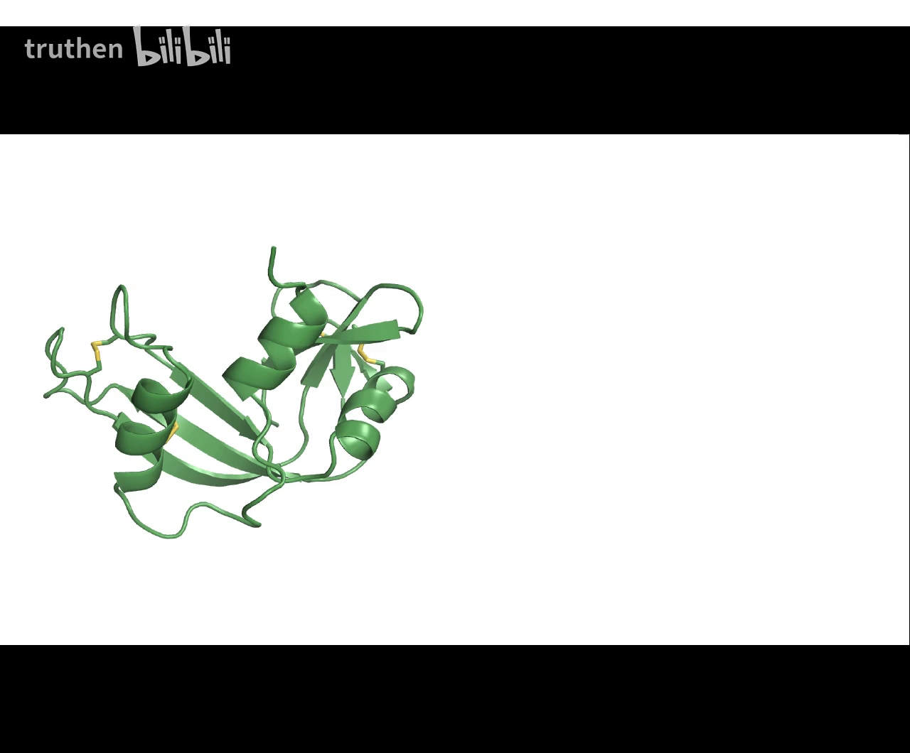
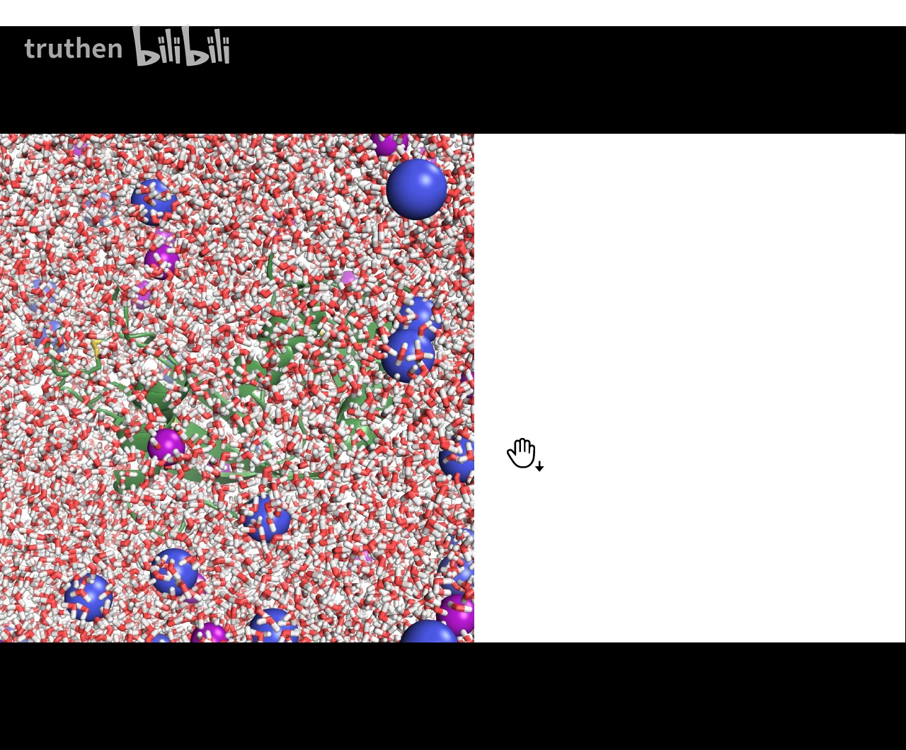
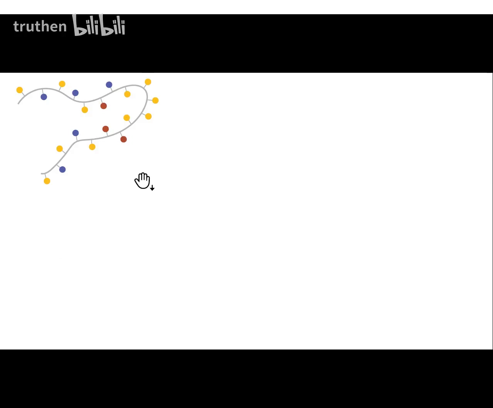
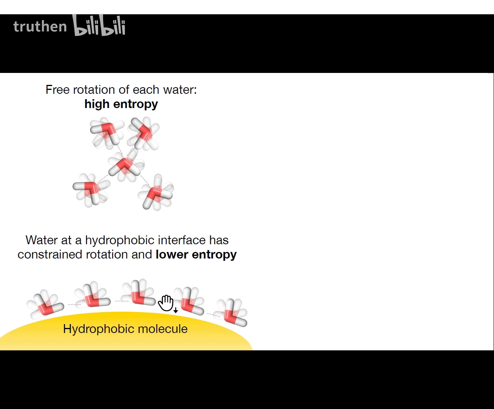
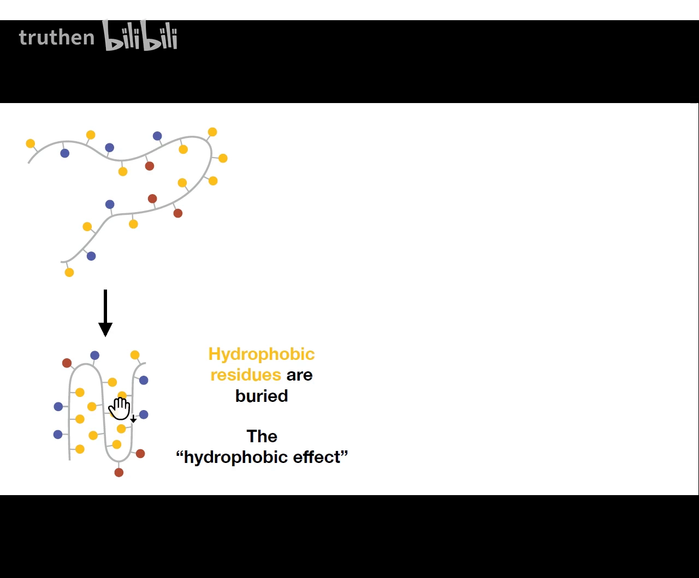
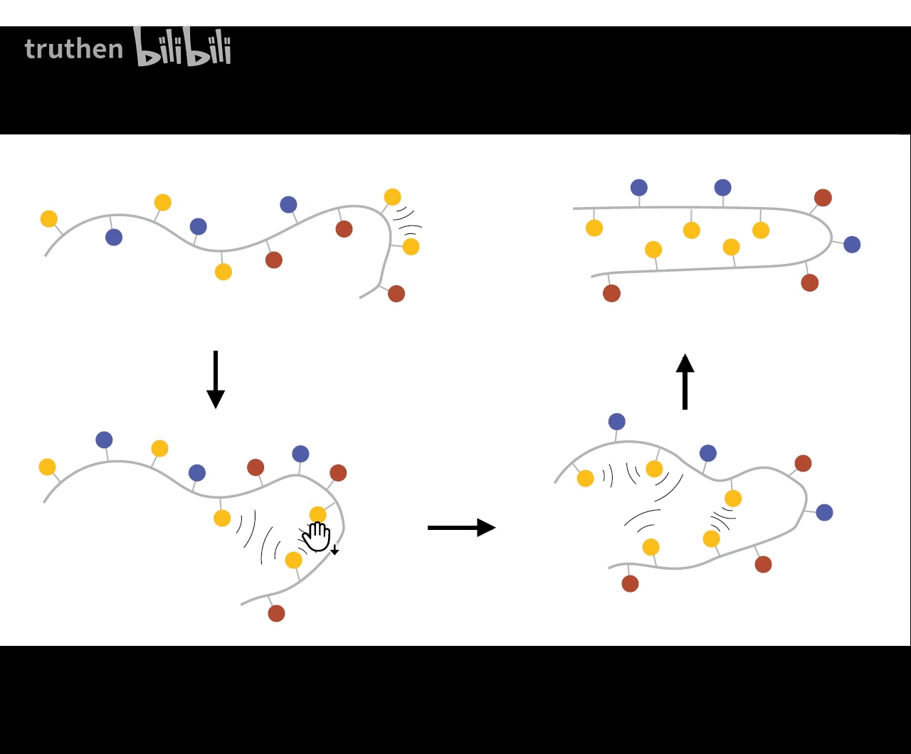
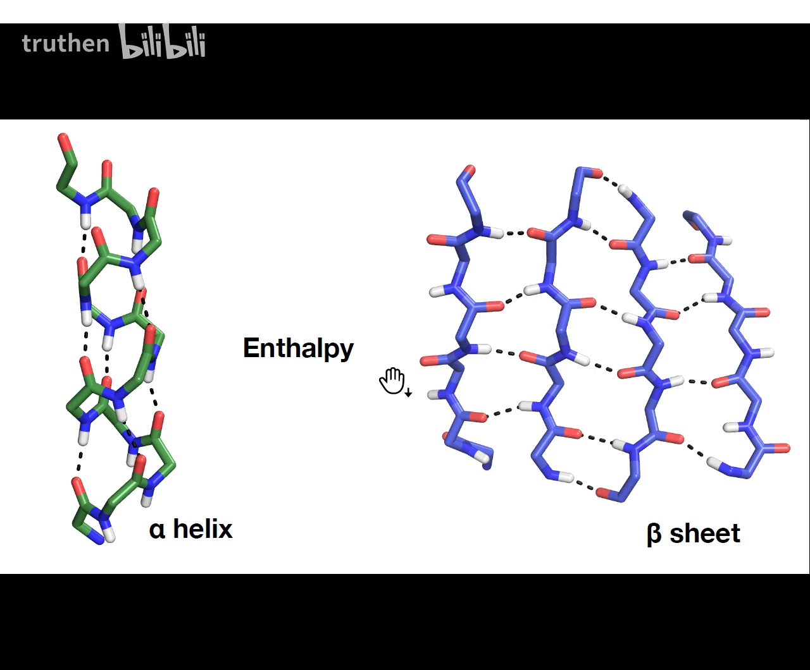
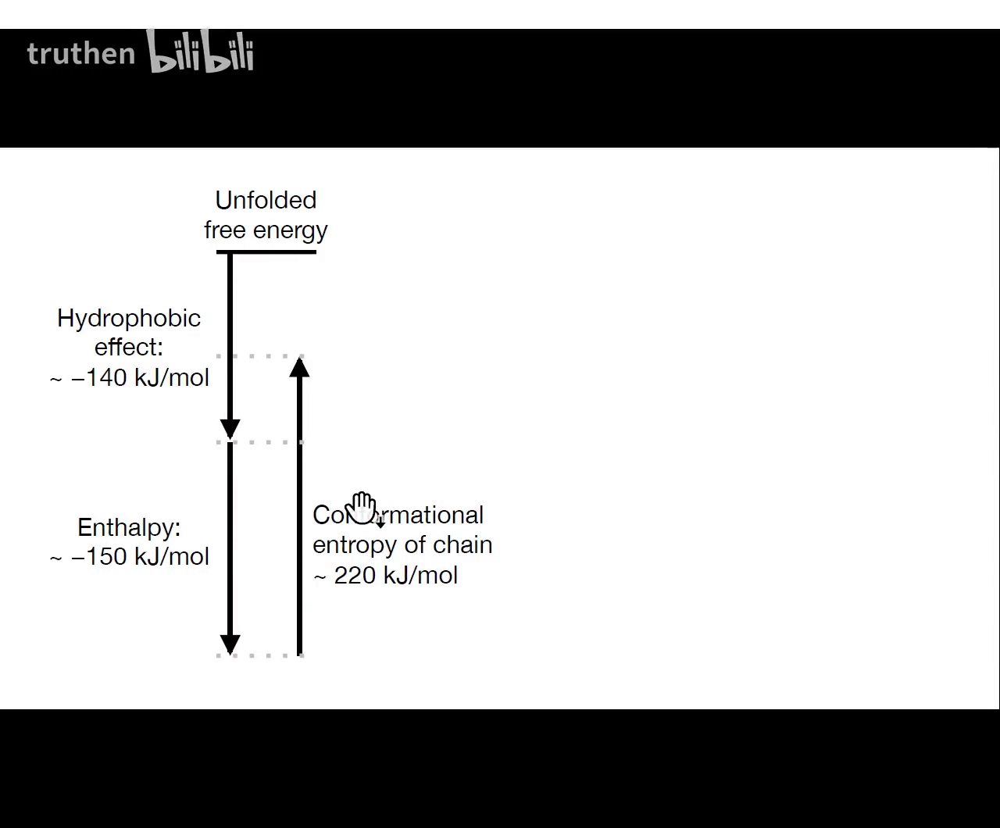

# 疏水核心怎么稳定蛋白质：疏水效应、水的熵与折叠驱动力

> 视频来源：[2.2.1 驱动蛋白质折叠的力：疏水作用、氢键](https://www.bilibili.com/video/BV19Z421i7qp/)（Bilibili · Truthen教授生命世界，时长约 9 分 28 秒）
> 导读：这支视频用分子动画和一张「能量账本」讲清了一件反直觉的事——把疏水侧链埋进核心，主要不是因为它们彼此「相吸」，而是因为水被解放了。本文按「水环境 → 构象熵 → 疏水效应 → 协同闭合 → 三个力的账」重排；折叠漏斗与自由能景观见 2.1.4，稳定性如何测量（$T_m$、$\Delta G$）见 2.1.6。

## 本讲要解决的核心问题（SCQA）

**背景**：蛋白质的氨基酸序列决定了它的高级结构，这已经是一条常识。但序列只是一维的文字，折叠却发生在**水溶液**里——蛋白质不是真空中的一条链，而是被成千上万个水分子和离子包围的分子。

**冲突**：如果只看蛋白质本身，折叠是「从无数种构象收敛到唯一一种天然构象」，这是一次巨大的**熵减**，热力学上极其不利。既然这样，蛋白质凭什么还能自发折叠？

**疑问**：驱动折叠的力究竟有哪几个？疏水核心为什么能稳定结构？把疏水侧链埋起来，能量上到底赚了多少？

**回答（中心思想）**：折叠不是一条链自己的事，而是**链 + 水**这个系统的合作。三个力合起来算账：疏水效应约贡献 $-140\ \mathrm{kJ/mol}$，主链与侧链间的非共价相互作用（氢键、盐桥、范德华力）约贡献 $-150\ \mathrm{kJ/mol}$，而链的构象熵损失要付出约 $+220\ \mathrm{kJ/mol}$；三项相加仍为约 $-70\ \mathrm{kJ/mol}$，所以折叠在热力学上是自发的 [【跳转到 08:03】](https://www.bilibili.com/video/BV19Z421i7qp/?t=483)。其中**疏水效应之所以有效，关键在于水**：疏水侧链埋进核心后，原本被「组织」在疏水表面的水分子被释放出来，获得了转动自由，系统熵增。

---

## 一、折叠发生在水里：先把水加回来

视频一开始就强调：蛋白质的折叠**并不是在真空环境里进行的，而是在水溶液环境下**，这个水环境对蛋白质获得天然构象至关重要 [【跳转到 00:00】](https://www.bilibili.com/video/BV19Z421i7qp/?t=0)。

为了让这件事看得见，视频做了一个分子模拟：取一种小型的、用来研究折叠的经典模型蛋白，给它加上**数千个水分子**，还有钠离子、氯离子等 [【跳转到 00:44】](https://www.bilibili.com/video/BV19Z421i7qp/?t=44)。

由于蛋白质在溶液中不断运动，每一次水分子与蛋白质的接触都是**短暂的**；但成千上万次瞬时相互作用累加起来，对折叠非常重要 [【跳转到 01:09】](https://www.bilibili.com/video/BV19Z421i7qp/?t=69)。

**为什么必须强调水？** 因为后面所有的能量账，主角之一都是水。如果只盯着蛋白质这条链，疏水效应根本讲不通——疏水侧链之间并没有强烈的吸引力，它们「聚在一起」是被水推过去的。

---

## 二、折叠的第一道难关：链的构象熵

### 2.1 未折叠态：一条链的「构象自由」

视频给出一张示意图：一条未折叠的多肽链，彩色小球代表氨基酸侧链 [【跳转到 01:21】](https://www.bilibili.com/video/BV19Z421i7qp/?t=81)。在未折叠状态下，这条链可以采取**多种不同的构象**，而且这些构象可以相互交换、相互转换——这意味着未折叠蛋白具有**很大的构象熵（conformational entropy）**。

**构象熵是什么？** 简单说，熵是「系统有多少种可区分的状态」的度量。一条链能摆出的姿势越多，构象熵越大；姿势被限制得越死，构象熵越小。

### 2.2 折叠态：熵的巨大损失

一旦蛋白质折叠起来，它会形成**单一的天然构象**，这极大地减少了构象熵。视频明确说：**这个熵的减少，是阻碍蛋白质折叠的主要力量** [【跳转到 01:46】](https://www.bilibili.com/video/BV19Z421i7qp/?t=106)。

这就是折叠的核心矛盾：折叠要付出一大笔「熵税」。所以任何能补偿这笔熵税的因素，都会成为折叠的驱动力。而自然界找到的补偿方式，就在水里。

---

## 三、疏水效应：被解放的是水，不是侧链

### 3.1 自由的水 vs 疏水界面上的水

视频用水分子动画对比了两种处境 [【跳转到 02:11】](https://www.bilibili.com/video/BV19Z421i7qp/?t=131)：

- **自由的水分子**：在溶液中翻滚转动，在不同方向上都能看到其他分子，并与其他水分子形成氢键。因此它们**具有很高的构象熵**。
- **疏水界面上的水分子**：位于疏水氨基酸残基的疏水侧链旁边。由于疏水表面不能与它形成氢键，它**能够形成氢键的构象数量较少**，于是和自由水相比，**构象熵降低了** [【跳转到 02:36】](https://www.bilibili.com/video/BV19Z421i7qp/?t=156)。

**打个比方**：疏水表面就像一块放在舞池中央的障碍物，贴着它站的人只能面朝外、动作受限；离它远的人则可以随便转。疏水侧链暴露得越多，被「卡住」的水就越多，系统熵就越低——这是不利的状态。

### 3.2 折叠把水释放出来

回到折叠示意图：在折叠过程中，许多疏水侧链（图中用**黄色小球**表示）被埋进蛋白质的**疏水核心**。这样一来，原本和这些侧链相互作用的水分子，现在可以与其他水分子自由地相互作用了 [【跳转到 03:01】](https://www.bilibili.com/video/BV19Z421i7qp/?t=181)。

于是，**水分子的构象熵大大增加，整个系统的构象熵也有所增加**。视频把这一现象命名为**疏水效应（hydrophobic effect）**：通过把疏水表面的水分子释放到疏水核之外，系统获得了对稳定性有利的熵增 [【跳转到 03:51】](https://www.bilibili.com/video/BV19Z421i7qp/?t=231)。

这里有一个极其常见的误解要澄清：**疏水效应不是「疏水基团互相吸引」**。疏水侧链之间确实有范德华接触，但那部分能量记在「非共价相互作用」账上。疏水效应这一项的本质是**水的熵增**——是水把疏水侧链「挤」到了一起。所以疏水效应在高温下会减弱（水本身的热运动已经很强，熵增的边际收益变小），这也是为什么有些蛋白质在低温下反而会解折叠（冷变性）的物理根源。

---

## 四、疏水残基并非全部埋起来

一个自然的追问是：疏水残基是不是总是埋在疏水核心里？视频的答案是**不是** [【跳转到 04:16】](https://www.bilibili.com/video/BV19Z421i7qp/?t=256)：

- 蛋白质**表面的残基大约有一半也是疏水残基**。
- 蛋白质可以通过表面的疏水残基与**其他蛋白质、配体或底物**相互作用。
- **膜蛋白**表面也有许多疏水残基，它们会与膜中的疏水脂质相互作用 [【跳转到 04:41】](https://www.bilibili.com/video/BV19Z421i7qp/?t=281)。

**这一点为什么重要？** 因为它说明疏水核心不是「把所有疏水的东西藏起来」这么简单。暴露在表面的疏水残基是**功能接口**：蛋白-蛋白结合界面、疏水口袋（结合底物或药物）、跨膜片段，都靠它们。如果全部埋起来，蛋白质就没法跟外界打交道了。所以天然结构是「埋得够多、以稳定；露得够巧，以工作」的折中。

---

## 五、疏水核心的闭合是「滚雪球」：高度协同

疏水效应之所以对折叠特别有效，还因为它是一个**高度协同（cooperative）**的过程 [【跳转到 04:41】](https://www.bilibili.com/video/BV19Z421i7qp/?t=281)。视频的描述可以拆成一条因果链：

1. 设想**两个疏水残基开始接触**，它们的疏水侧链开始相互作用。
2. 这种相互作用会**约束周围的主链**，使主链不能乱摆。
3. 主链被约束后，**其他的疏水侧链就被带着靠近**，并彼此相互作用。
4. 于是产生**滚雪球效应**：疏水核心迅速闭合，把蛋白质内部所有的疏水侧链都封闭、隐藏起来 [【跳转到 05:06】](https://www.bilibili.com/video/BV19Z421i7qp/?t=306)。

**「协同」是什么意思？** 就是「一步容易，下一步更容易」。前一对侧链的接触降低了后续接触的代价，所以过程一旦启动就会加速。这解释了为什么折叠不是慢慢线性推进，而是有明显的「转折点」——这也是后面 2.1.7 讲折叠动力学时要展开的内容。

---

## 六、极性的主链怎么办？用氢键把它「中和」掉

这里有一个必须回答的技术问题：肽链里含有大量**极性的氨基和羰基基团**（$N-H$ 与 $C=O$）。既然核心是疏水的，这些极性基团怎么也能被埋进去？[【跳转到 05:31】](https://www.bilibili.com/video/BV19Z421i7qp/?t=331)

答案是**二级结构里的主链氢键** [【跳转到 05:53】](https://www.bilibili.com/video/BV19Z421i7qp/?t=353)：

- 主链内的氢键可以稳定 α 螺旋、β 片层这些二级结构。
- 同时，这些氢键还**平衡了肽键上极性基团的部分电荷**，使这些极性基团能够**以氢键的形式**被埋在疏水核心，而不必与水接触。
- 类似于疏水效应，**二级结构元件的快速闭合也是一个高度协同的过程**。

**这条把两件事串起来了**：上一篇讲的 α 螺旋 $n \to n+4$ 氢键、β 折叠的链间氢键，不只是「造型」，它们还承担了**电荷中和**的功能。有了这层配对，主链的极性才能在疏水核心里「合法居留」。这也解释了为什么二级结构几乎总在折叠早期就形成——它们是疏水核心能闭合的前提。

---

## 七、第三个贡献者：非共价相互作用的焓

视频接着补上最后一块：在蛋白质内部形成的**非共价相互作用**，包括**盐桥、范德华力**等等，是决定蛋白质折叠热力学的最后一个重要贡献者。它们共同促进了折叠在动力学上有利的**焓的净减少** [【跳转到 06:18】](https://www.bilibili.com/video/BV19Z421i7qp/?t=378)。

到这里，驱动折叠的三个主要力齐了 [【跳转到 06:43】](https://www.bilibili.com/video/BV19Z421i7qp/?t=403)：

1. **疏水效应**（水的熵增）
2. **非共价相互作用**（氢键、盐桥、范德华力带来的焓降低）
3. **构象熵损失**（对抗折叠的力量）

---

## 八、把账算一遍：$-140 - 150 + 220 = -70$

视频最后做了一件对初学者极有帮助的事：把三种力折算成具体数值，以一个**约 100 个氨基酸的独立折叠单元（可以理解为一个结构域）**为例 [【跳转到 06:48】](https://www.bilibili.com/video/BV19Z421i7qp/?t=408)：

| 贡献项 | 数值 | 方向 |
| --- | --- | --- |
| 疏水效应（疏水氨基酸埋入核心） | 约 $-140\ \mathrm{kJ/mol}$ | 有利 |
| 非共价相互作用（氢键、盐桥、范德华力） | 约 $-150\ \mathrm{kJ/mol}$ | 有利 |
| 链的构象熵损失 | 约 $+220\ \mathrm{kJ/mol}$ | 不利 |
| **合计** | **约 $-70\ \mathrm{kJ/mol}$** | **净有利** |

三项相加：$(-140) + (-150) + 220 = -70\ \mathrm{kJ/mol}$。视频强调，这些数值是**估算值**，基于一些简单的假设，但它们与实验结果相当吻合 [【跳转到 08:28】](https://www.bilibili.com/video/BV19Z421i7qp/?t=508)。

**这张表最值得记住的是什么？** 不是具体数字，而是**量级关系**：

- 两个有利项加起来约 $-290\ \mathrm{kJ/mol}$，几乎全被 $+220\ \mathrm{kJ/mol}$ 的构象熵吃掉，最后只剩 $-70\ \mathrm{kJ/mol}$。
- 也就是说，**天然结构的稳定裕度非常小**——只有总驱动力的约四分之一。这解释了两件常见的事：一是蛋白质很容易被轻微加热或加点变性剂就散架；二是单点突变往往就足以 destabilize 一个蛋白。
- 也正因为裕度小，**温度、pH、盐浓度**这些环境条件稍有变化，就可能改变折叠的结局。

视频由此得出结论：蛋白质折叠是一个**简单的热力学问题**，它的过程是在水溶液当中、在热力学上有利的 [【跳转到 08:53】](https://www.bilibili.com/video/BV19Z421i7qp/?t=533)。

---

## 九、热力学解释了「能不能折」，但没解释「怎么折」

视频最后留了一个漂亮的悬念，也是理解整个折叠问题的关键分界 [【跳转到 09:18】](https://www.bilibili.com/video/BV19Z421i7qp/?t=558)：

热力学只告诉我们：**折叠态比未折叠态自由能低**，所以折叠是自发的。但天然构象**只有一个**，而可能的构象有天文数字那么多——蛋白质是怎么在毫秒到秒的时间里，准确找到那唯一一个的？这是**动力学**问题，不是热力学问题。

这个分界很重要：**热力学回答「终点在哪、为什么去」，动力学回答「怎么去、多快、走哪条路」**。前者由自由能差决定，后者由能垒和路径决定。视频把它留给了下一讲（对应本系列 2.1.7 折叠动力学）。

---

## 小结

- **折叠是链 + 水的合作**：只盯着多肽链，疏水效应讲不通；把水加回来，一切才顺。
- **第一道难关是构象熵**：未折叠链姿势极多、熵很高；折叠成单一构象要付出巨大熵代价，这是阻碍折叠的主要力量。
- **疏水效应的本质是水的熵增**：疏水界面上的水转动受限、熵低；疏水侧链埋进核心后，这些水被释放、熵升高，系统因此稳定。不是疏水基团互相吸引。
- **疏水残基不是全部埋起来**：表面约一半残基也是疏水的，它们构成蛋白-蛋白界面、疏水口袋和跨膜片段，是功能接口。
- **核心闭合是协同的**：两个侧链先接触，约束主链、带动邻居，滚雪球式迅速闭合。
- **极性主链靠氢键「洗白」**：α 螺旋与 β 片层的主链氢键平衡了肽键极性基团的部分电荷，使它们能以氢键形式埋进疏水核心。
- **三个力的账**：疏水效应 $-140$、非共价相互作用 $-150$、构象熵 $+220$，合计约 $-70\ \mathrm{kJ/mol}$，净有利但裕度很小。
- **热力学 vs 动力学**：热力学说明折叠自发，动力学才解释蛋白质如何快速找到唯一天然构象。

## 关键术语速查

| 术语 | 一句话解释 |
| --- | --- |
| 构象熵 | 分子可采取构象数目对应的熵；姿势越多熵越大 |
| 疏水效应 | 疏水侧链埋入核心后，疏水界面上的水被释放、系统熵增而稳定结构的现象 |
| 疏水核心 | 球状蛋白内部由疏水侧链堆积成的区域，通常不含水 |
| 协同（cooperative） | 一步的发生使下一步更容易，过程一旦启动便加速 |
| 滚雪球效应 | 疏水侧链逐个被带动靠近、核心迅速闭合的协同过程 |
| 盐桥 | 带正电与带负电侧链之间的静电相互作用 |
| 范德华力 | 中性原子/基团间由瞬时偶极引起的弱吸引 |
| 天然构象 | 蛋白质在生理条件下折叠成的、自由能最低的功能构象 |
| 结构域 | 蛋白质中可独立折叠的单元，常约 100 个氨基酸 |
| 冷变性 | 低温下疏水效应减弱导致蛋白质解折叠的现象 |