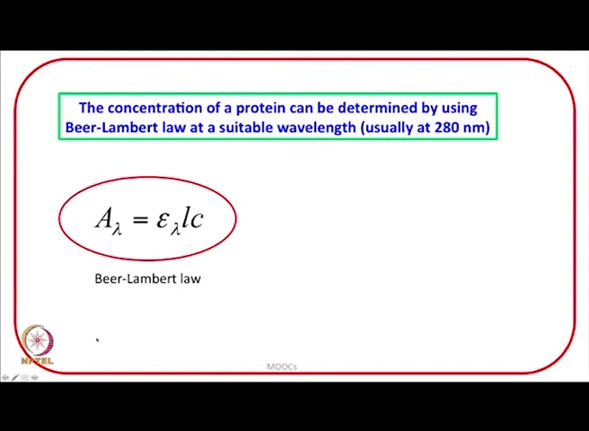
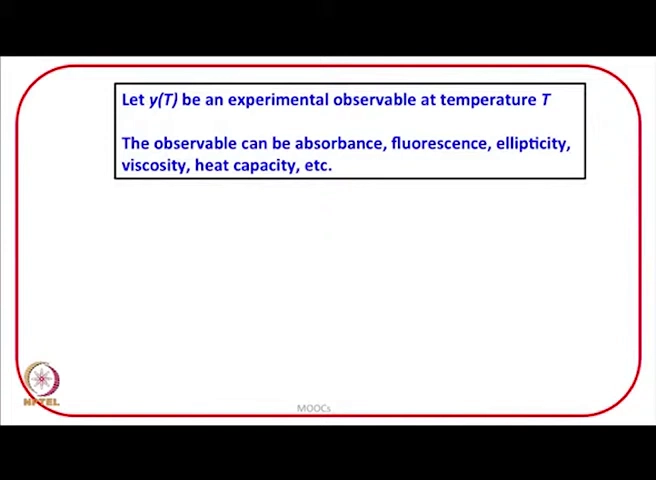
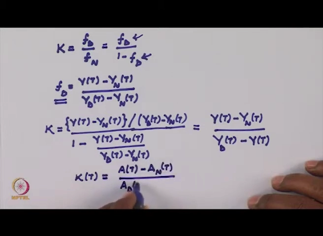
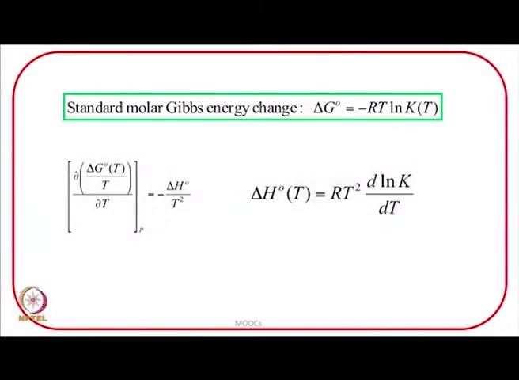
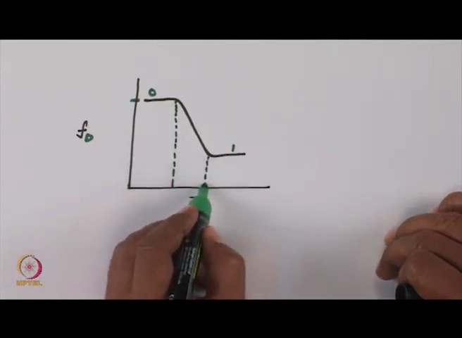
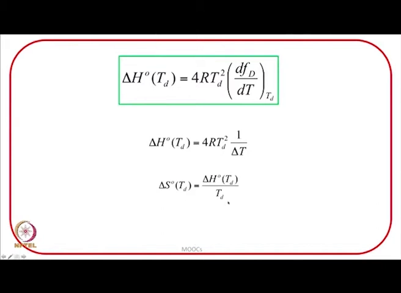
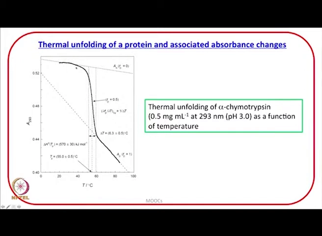
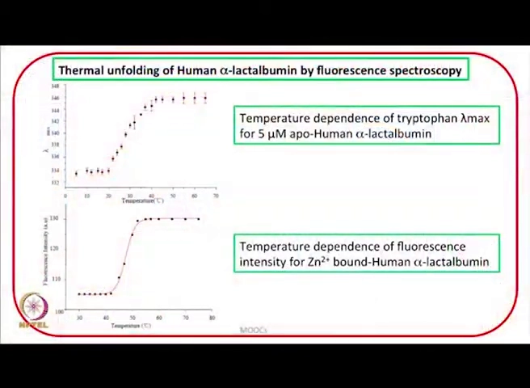
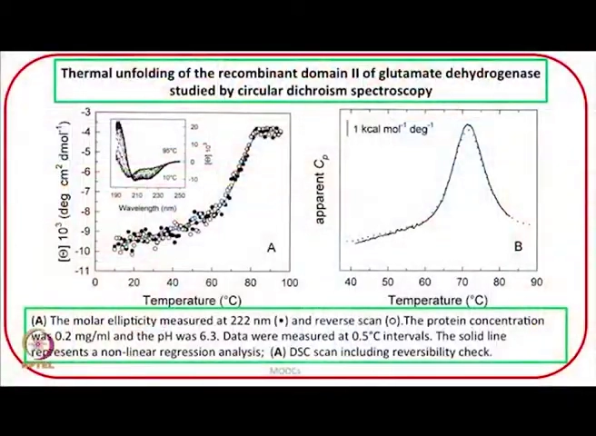

# 热变性曲线怎么读出 Tm 与 ΔH：用 UV、荧光、CD 这类「非量热」手段测蛋白质热稳定性

> 视频来源：[Thermal unfolding of protein by non-calorimetric methods: Addressing thermodynamics of the process](https://www.youtube.com/watch?v=_5ZHZacEOF8)（YouTube · NPTEL 课程《Chemical and Biological Thermodynamics: Principles to Applications》，时长约 35 分钟）
> 简要导读：这是一堂推导型课程。它从「先测准蛋白浓度」讲起，把一条随温度变化的光谱信号一步步换算成解折叠分数 $f_D$、平衡常数 $K$、标准自由能 $\Delta G^\circ$，最后用 van't Hoff 关系从曲线陡度里取出转变温度 $T_d$（即 $T_m$）与解折叠焓 $\Delta H^\circ$。本文按这条推导链复述，并在结尾说明为什么这样得到的焓叫「van't Hoff 焓」、它和量热焓差在哪里。

## 本讲要解决的核心问题（SCQA）

**背景**：蛋白质在生理条件下只靠一个不大的自由能差维持着折叠状态。温度一升高，到某个温度附近会发生**协同解折叠（cooperative unfolding）**——不是零零散散地松开，而是一整段结构几乎同时垮掉，所以各种「随温度变化的信号」都会在同一个窄温度区间里出现一段 S 形变化 [【跳转到 00:16】](https://www.youtube.com/watch?v=_5ZHZacEOF8&t=16)。

**冲突**：想拿到热稳定性的四个热力学量——**转变温度、解折叠焓、解折叠熵、解折叠热容变化**——最直接的办法是差示扫描量热（DSC），一次扫描全给齐 [【跳转到 02:01】](https://www.youtube.com/watch?v=_5ZHZacEOF8&t=121)。可 DSC 是专门的量热仪器；绝大多数实验室手上只有紫外-可见分光光度计、荧光光谱仪和圆二色（CD）光谱仪。这些仪器只给你一条「信号随温度变化」的曲线，并不直接给你焓和熵 [【跳转到 02:26】](https://www.youtube.com/watch?v=_5ZHZacEOF8&t=146)。

**疑问**：一条 S 形的光谱曲线，怎么变成 $T_m$、$\Delta H^\circ$、$\Delta S^\circ$ 这些数字？换算过程需要什么假设？得到的数字能信到什么程度？

**回答（中心思想）**：只要解折叠可以当作**两态（native $\rightleftharpoons$ denatured）协同过程**，那么任何随温度变化的可观测量 $y(T)$ 都能走同一条换算链：先由 $y(T)$ 算出解折叠分数 $f_D$，再由 $f_D$ 算出平衡常数 $K$，由 $K$ 算出 $\Delta G^\circ$，最后由 $K$ 随温度的变化率（van't Hoff 关系）取出 $\Delta H^\circ$ [【跳转到 20:21】](https://www.youtube.com/watch?v=_5ZHZacEOF8&t=1221)。这条链有两个关键落点：**$T_m$ 就是 $f_D = 0.5$ 的那个温度**，而**$\Delta H^\circ$ 由 $T_m$ 处曲线的陡度决定**，具体形式是 $\Delta H^\circ(T_d) = 4RT_d^2\,(\mathrm{d}f_D/\mathrm{d}T)$ [【跳转到 24:32】](https://www.youtube.com/watch?v=_5ZHZacEOF8&t=1472)。代价是：这样得到的焓是**模型依赖的 van't Hoff 焓**，不是量热法那种不依赖模型的「真焓」，所以它不如量热值可靠 [【跳转到 32:21】](https://www.youtube.com/watch?v=_5ZHZacEOF8&t=1941)。

---

## 一、先测准浓度：所有热力学量最后都要除以摩尔数

课程把「测浓度」放在最前面，理由是纯实操的：热力学量最终都要归一化成**每摩尔**的数值，浓度错了，后面所有 $\Delta H^\circ$、$\Delta S^\circ$ 都跟着错 [【跳转到 05:26】](https://www.youtube.com/watch?v=_5ZHZacEOF8&t=326)。

对含**色氨酸（tryptophan）**残基的蛋白，常规做法是测 **280 nm 的吸光度**，再用 **Beer-Lambert 定律**反推浓度 [【跳转到 03:34】](https://www.youtube.com/watch?v=_5ZHZacEOF8&t=214)：

$$
A(\lambda) = \varepsilon(\lambda)\, l \, c
$$

三个符号分别是：

- $A(\lambda)$：该波长下的**吸光度**（absorbance），无量纲；
- $\varepsilon(\lambda)$：该波长下的**摩尔吸光系数**（extinction coefficient，也叫 absorptivity），相当于「这种分子在单位浓度、单位光程下能挡掉多少光」；
- $l$：**光程**，通常就是比色皿（cuvette）的水平内宽，常见 1 cm；
- $c$：蛋白浓度，也就是我们想求的那个量 [【跳转到 04:37】](https://www.youtube.com/watch?v=_5ZHZacEOF8&t=277)。

一个容易被忽略的提醒：浓度必须选在 **Beer-Lambert 定律仍然成立的范围**内。吸光度太高时（比如超过 1 到 1.5），仪器响应不再线性，算出来的浓度就偏了 [【跳转到 03:59】](https://www.youtube.com/watch?v=_5ZHZacEOF8&t=239)。

---

## 二、把「折叠 / 解折叠」变成一个可测量的数：$y(T)$、$f_D$、$K$

### 2.1 任意随温度变化的量都可以当观测量

课程先给了一个很宽的定义：设 $y(T)$ 是温度 $T$ 下的**实验可观测量**。它可以是吸光度、荧光强度、椭圆率（ellipticity）、黏度、热容，或者任何随温度变化的性质 [【跳转到 10:53】](https://www.youtube.com/watch?v=_5ZHZacEOF8&t=653)。

这个宽定义是整堂课的支点：正因为 $y$ 可以随便换，UV、荧光、CD 才能共用同一套推导。

### 2.2 两态模型：观测量是「群体平均」

两态模型假设蛋白只有两种状态——天然态 N 和变性态 D：

$$
\mathrm{N} \rightleftharpoons \mathrm{D}
$$

平衡常数写成活度之比；在浓度很低的稀溶液里，用浓度代替活度 [【跳转到 10:03】](https://www.youtube.com/watch?v=_5ZHZacEOF8&t=603)：

$$
K(T) = \frac{[\mathrm{D}]}{[\mathrm{N}]}
$$

关键一步是：**你测到的信号是全体分子的加权平均**。设 $f_N$、$f_D$ 分别是天然态和变性态的分数，则

$$
y(T) = f_N(T)\, y_N(T) + f_D(T)\, y_D(T)
$$

其中 $y_N(T)$ 是「如果全都是天然态，这个温度下信号该是多少」，$y_D(T)$ 同理。因为 $f_N + f_D = 1$，代入 $f_N = 1 - f_D$ 整理后，可以把 $f_D$ 单独解出来 [【跳转到 11:35】](https://www.youtube.com/watch?v=_5ZHZacEOF8&t=695)：

$$
f_D(T) = \frac{y(T) - y_N(T)}{y_D(T) - y_N(T)}
$$

这个式子的读法很直白：**分子是「实测值比天然态基线高了多少」，分母是「两条基线之间的总间距」**。所以 $f_D$ 就是「信号从天然态基线出发，走完了到变性态基线这段距离的百分之几」。

### 2.3 从 $f_D$ 到 $K$：一个只用信号就能算的式子

由 $K = [\mathrm{D}]/[\mathrm{N}] = f_D/f_N = f_D/(1-f_D)$，把上面 $f_D$ 的表达式代进去，化简后得到一个非常实用的形式 [【跳转到 18:32】](https://www.youtube.com/watch?v=_5ZHZacEOF8&t=1112)：

$$
K(T) = \frac{y(T) - y_N(T)}{y_D(T) - y(T)}
$$

如果观测量是吸光度 $A$，就写成

$$
K(T) = \frac{A(T) - A_N(T)}{A_D(T) - A(T)}
$$

注意分母是 $A_D - A$，不是 $A_D - A_N$：分子和分母分别是「离天然态基线多远」和「离变性态基线多远」，两者的比就是两种状态的分子数之比 [【跳转到 18:57】](https://www.youtube.com/watch?v=_5ZHZacEOF8&t=1137)。

有了 $K$，标准摩尔自由能立刻可得：

$$
\Delta G^\circ(T) = -RT \ln K(T)
$$

同时，两种状态的浓度也能写出来：$[\mathrm{N}] = c_0 (1 - f_D)$，$[\mathrm{D}] = c_0 f_D$，其中 $c_0$ 是总蛋白浓度 [【跳转到 19:31】](https://www.youtube.com/watch?v=_5ZHZacEOF8&t=1171)。

---

## 三、$T_m$ 与 $\Delta H$：曲线的陡度就是焓

### 3.1 van't Hoff 关系：把「K 随温度的变化」和焓连起来

推导的下一步用到 **van't Hoff 方程**（课程里读作 "vent half"，就是 van't Hoff）：

$$
\frac{\mathrm{d}\ln K}{\mathrm{d}T}\bigg|_P = \frac{\Delta H^\circ}{RT^2}
\quad\Longleftrightarrow\quad
\Delta H^\circ = RT^2 \frac{\mathrm{d}\ln K}{\mathrm{d}T}
$$

物理含义：**焓变越大，平衡常数对温度越敏感**——曲线在转变区就越陡。这就是为什么「陡」可以直接读出「焓」 [【跳转到 20:46】](https://www.youtube.com/watch?v=_5ZHZacEOF8&t=1246)。

### 3.2 为什么偏偏在 $T_m$ 处求导

把 $\ln K = \ln f_D - \ln(1 - f_D)$ 对温度求导：

$$
\frac{\mathrm{d}\ln K}{\mathrm{d}T} = \left(\frac{1}{f_D} + \frac{1}{1 - f_D}\right)\frac{\mathrm{d}f_D}{\mathrm{d}T}
$$

现在**取转变中点**，也就是 $f_D = 1/2$ 的温度（课程里记作 $T_{\text{half}}$ 或 $T_d$，也就是通常说的 $T_m$、熔解温度）。此时 $1/f_D = 2$、$1/(1-f_D) = 2$，括号里正好是 4，于是 [【跳转到 23:39】](https://www.youtube.com/watch?v=_5ZHZacEOF8&t=1419)：

$$
\Delta H^\circ(T_d) = 4 R T_d^2 \left(\frac{\mathrm{d}f_D}{\mathrm{d}T}\right)_{T_d}
$$

这就是本讲最核心的一个公式。它说的是：**只要知道 $T_m$ 和 $T_m$ 处 $f_D$ 曲线有多陡，就能算出解折叠焓，完全不需要量热仪。**

### 3.3 一个更省事的近似：用转变宽度 $\Delta T$ 代替斜率

课程还给了一个工程化的写法。如果不想拟合斜率，可以直接量转变区的**宽度** $\Delta T$——即 $f_D$ 从 0 走到 1 所跨的温度区间。在这个区间里 $\Delta f_D = 1$，于是平均斜率就是 $1/\Delta T$，公式变成 [【跳转到 25:02】](https://www.youtube.com/watch?v=_5ZHZacEOF8&t=1502)：

$$
\Delta H^\circ(T_d) = \frac{4 R T_d^2}{\Delta T}
$$

直觉上很好记：**转变越窄（$\Delta T$ 越小），焓越大**——协同性越强，说明两种状态之间的能量差越悬殊。

### 3.4 熵：从焓和 $T_m$ 直接得到

在转变中点，两种状态等量共存，$K = 1$，所以 $\Delta G^\circ(T_d) = 0$。由 $\Delta G^\circ = \Delta H^\circ - T\Delta S^\circ$ 立刻得到 [【跳转到 26:48】](https://www.youtube.com/watch?v=_5ZHZacEOF8&t=1608)：

$$
\Delta S^\circ(T_d) = \frac{\Delta H^\circ(T_d)}{T_d}
$$

于是 $\Delta H^\circ$、$\Delta S^\circ$、$\Delta G^\circ$ 三个量在 $T_m$ 处全部到手。

---

## 四、三种常用的观测量：怎么选波长、怎么读曲线

推导是通用的，落到实验上要选一个「在天然态和变性态之间差别最大」的信号。课程给了三个典型例子。

### 4.1 紫外-可见吸收：293 nm 看 α-糜蛋白酶

第一个例子是 **α-糜蛋白酶（α-chymotrypsin）**在 **293 nm** 下的热变性。为什么是 293 nm？因为选波长的原则是「**天然态与变性态的吸光度差别最大**」，而在多数蛋白里这个波长落在 293 nm 附近 [【跳转到 08:08】](https://www.youtube.com/watch?v=_5ZHZacEOF8&t=488)。实验方式是**固定波长、扫描温度**。

曲线形状很有代表性：低温段吸光度几乎不变（**转变前区**，pre-transition）；进入协同解折叠后急降（**转变区**）；之后又缓慢下降（**转变后区**）。把这三段的信息合起来，就能算出热力学参数 [【跳转到 08:48】](https://www.youtube.com/watch?v=_5ZHZacEOF8&t=528)。

这张幻灯片还标出了完整的实验条件与结果，正好说明「测量条件必须一起记录」：

- 样品：α-糜蛋白酶，**0.5 mg·mL⁻¹**，**pH 3.0**，293 nm；
- **$T_m = 55.0 \pm 0.5\ ^\circ\mathrm{C}$**；
- **$\Delta H = 570 \pm 30\ \mathrm{kJ\,mol^{-1}}$**。

**注意这里的关键点**：同一个蛋白在 pH 3.0 和 pH 7.0 下测，$T_m$ 会不一样。所以「$T_m$ 是多少」这句话必须带上 pH、缓冲液、蛋白浓度这些条件才完整——这也是本小节学习目标里「测量条件影响数值」的直接体现。

### 4.2 荧光：λmax 红移与强度变化，两条曲线都行

第二个例子是**人 α-乳白蛋白（human α-lactalbumin）**的荧光热变性。做法有两种：一是选一个固定发射波长，看**荧光强度**随温度怎么变；二是扫全发射谱，看**λmax**（强度最大值所在的波长）怎么变 [【跳转到 28:11】](https://www.youtube.com/watch?v=_5ZHZacEOF8&t=1691)。

结果是两条 S 形曲线：

- **λmax 随温度升高而增大**，也就是**红移（red shift）**——色氨酸从疏水口袋暴露到水里，发射峰往长波方向挪；
- **荧光强度**随温度升高也呈现一段 S 形变化。

两条曲线都能当作 $y(T)$ 代入前面的公式 [【跳转到 29:15】](https://www.youtube.com/watch?v=_5ZHZacEOF8&t=1755)。

### 4.3 圆二色：222 nm 看 α-螺旋的消失

第三个例子是**谷氨酸脱氢酶重组结构域 II（recombinant domain II of glutamate dehydrogenase）**，用 CD 跟踪。CD 分两个波段用：

- **近紫外 CD（near-UV CD）**：报告**三级结构**的变化；
- **远紫外 CD（far-UV CD）**：报告**二级结构**的变化。

课程用的是 **222 nm 的椭圆率**，这是 α-螺旋的特征波长。同样得到一条 S 形曲线 [【跳转到 30:15】](https://www.youtube.com/watch?v=_5ZHZacEOF8&t=1815)。

这张幻灯片特别值得看，因为它把「怎么验证数据可信」和「条件怎么记」都写在图注里：

- 蛋白浓度 **0.2 mg·mL⁻¹**，**pH 6.3**；
- 数据按 **0.5 °C 间隔**采集；
- 实线是**非线性回归**拟合；
- 黑点（升温）与白点（回扫）**重合**，说明解折叠**可逆**；
- 右侧 DSC 曲线给出的转变温度与 CD 得到的**几乎一致**。

「升温—回扫是否重合」是这一步最实用的质控：**只有可逆的解折叠才能当作平衡来处理**，才能用上面那套 $K$、$\Delta G^\circ$ 的公式。如果回扫曲线明显滞后或回不去，说明发生了不可逆聚集，算出来的热力学量就没有意义了 [【跳转到 31:17】](https://www.youtube.com/watch?v=_5ZHZacEOF8&t=1877)。

---

## 五、这些数字能信到什么程度：van't Hoff 焓 vs 量热焓

课程最后花了不少篇幅讲一个「诚实性」问题：非量热法得到的焓，和 DSC 得到的焓**不是同一种东西** [【跳转到 32:21】](https://www.youtube.com/watch?v=_5ZHZacEOF8&t=1941)。

- **量热法（DSC）**：直接测样品在升温过程中吸收的热量，得到的是**不依赖任何模型**的真实焓。
- **非量热法（UV / 荧光 / CD）**：测的是「某个信号随温度怎么变」，要把它翻译成焓，**必须先假设一个模型**（这里是两态模型）。这样得到的焓叫 **van't Hoff 焓**，它是**模型依赖**的：如果真实过程不是两态（有中间态、有聚集），van't Hoff 焓就会偏离真值 [【跳转到 32:38】](https://www.youtube.com/watch?v=_5ZHZacEOF8&t=1958)。

所以课程给出的结论是一个排序，而不是二选一：

1. 要**最准确**的焓，用量热法；
2. 要**方便、省样品、能同时测很多条件**，用光谱法，但要记住它的焓是 van't Hoff 焓；
3. 最稳妥的做法是**两种方法互相印证**——就像上面 CD 与 DSC 对比 $T_m$ 那样。

---

## 小结

- **热变性是协同过程**，所以各种信号都会在同一个窄温度区间里出现 S 形变化；这正是「用光谱代替量热」的物理前提。
- **先测准浓度**：所有热力学量最后都要除以摩尔数，浓度靠 280 nm 吸光度加 Beer-Lambert 定律得到，且必须落在定律的线性范围内。
- **换算链只有三步**：$y(T) \rightarrow f_D \rightarrow K \rightarrow \Delta G^\circ$。其中 $f_D$ 是「实测值离天然基线多远 ÷ 两条基线总间距」，$K = f_D/(1-f_D)$。
- **$T_m$ 的定义就是 $f_D = 0.5$ 的温度**；此时 $K = 1$、$\Delta G^\circ = 0$。
- **$\Delta H^\circ$ 来自曲线陡度**：$\Delta H^\circ(T_d) = 4RT_d^2(\mathrm{d}f_D/\mathrm{d}T)$，或用转变宽度近似成 $4RT_d^2/\Delta T$；$\Delta S^\circ = \Delta H^\circ/T_d$。
- **三种观测量各有取舍**：UV 293 nm（吸光度差最大处）、荧光 λmax 红移或强度、CD 222 nm（α-螺旋特征）。选波长的统一原则是「两种状态差别最大」。
- **条件必须一起记录**：pH、缓冲液、蛋白浓度、升温间隔都会改变 $T_m$ 与 $\Delta H$ 的数值，脱离条件的 $T_m$ 没有意义。
- **可逆性是前提**：升温与回扫曲线重合，才能把解折叠当平衡处理。
- **van't Hoff 焓不等于量热焓**：前者模型依赖，后者不依赖模型；要准确的焓用量热法，要快速筛查用光谱法，最好两者互证。

## 关键术语速查

| 术语 | 一句话解释 |
| --- | --- |
| 协同解折叠（cooperative unfolding） | 整段结构几乎同时垮掉，而不是逐段慢慢松开，因此信号呈 S 形突变 |
| 转变温度 $T_m$（$T_d$、$T_{\text{half}}$） | 解折叠分数 $f_D = 0.5$ 时的温度，此时 $K = 1$、$\Delta G^\circ = 0$ |
| 可观测量 $y(T)$ | 任何随温度变化的实验读数：吸光度、荧光强度、λmax、椭圆率、黏度、热容等 |
| 转变前区 / 转变后区基线 | 低温段与高温段的信号外推线，$y_N(T)$ 与 $y_D(T)$，用来算 $f_D$ |
| Beer-Lambert 定律 | $A = \varepsilon l c$，用吸光度反推蛋白浓度，是一切「每摩尔」量的起点 |
| 椭圆率（ellipticity） | CD 光谱的读数，222 nm 处反映 α-螺旋含量 |
| λmax 红移（red shift） | 色氨酸从疏水口袋暴露到水环境时，荧光发射峰向长波方向移动 |
| van't Hoff 方程 | $\mathrm{d}\ln K/\mathrm{d}T = \Delta H^\circ/RT^2$，把平衡常数的温度敏感度与焓联系起来 |
| van't Hoff 焓 | 由模型（如两态模型）反推出来的焓，模型依赖，不同于量热直接测得的真焓 |
| 可逆性检查 | 升温后再回扫，若两条曲线重合则解折叠可逆，可作平衡处理 |