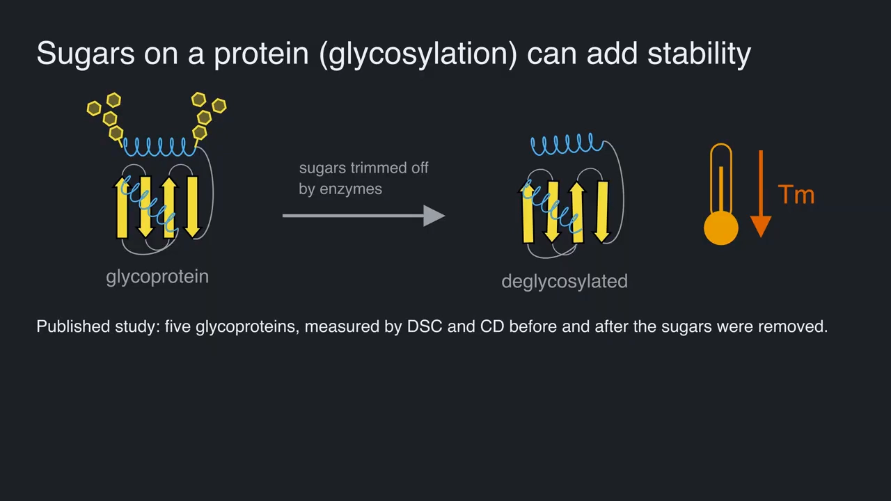
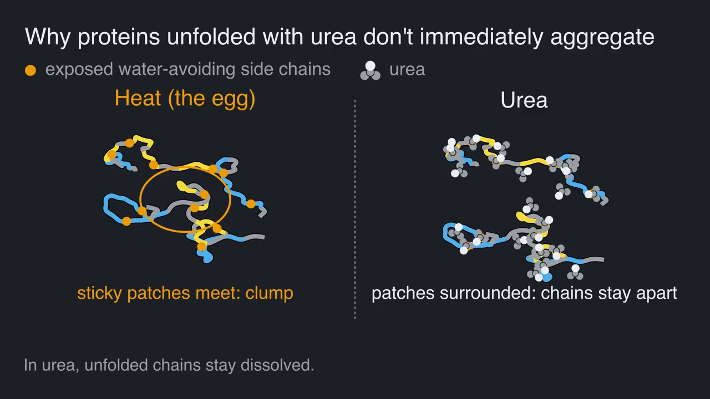
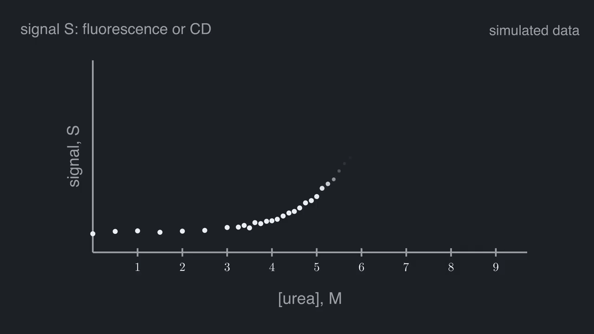
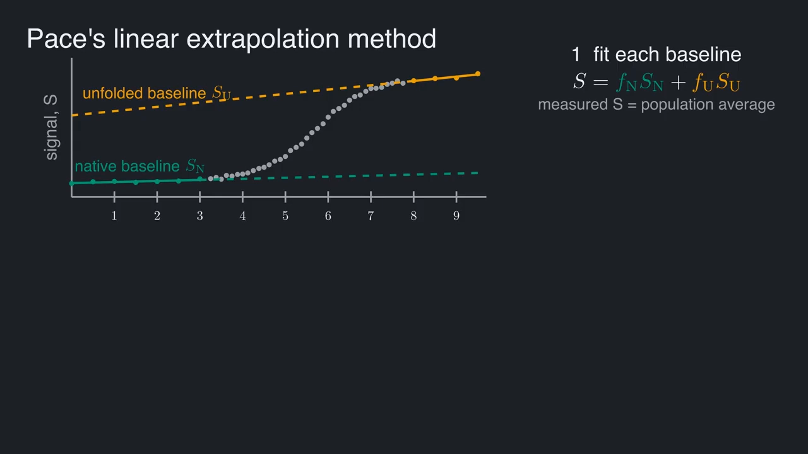
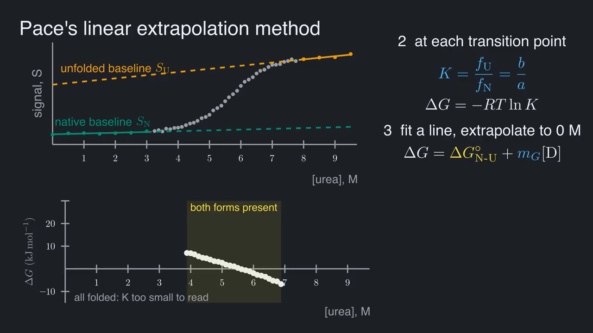
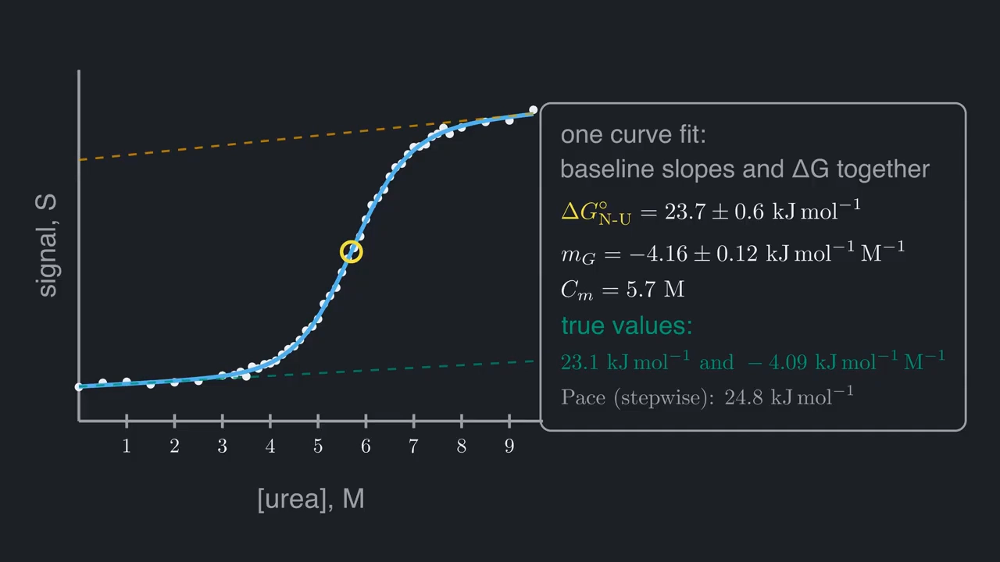
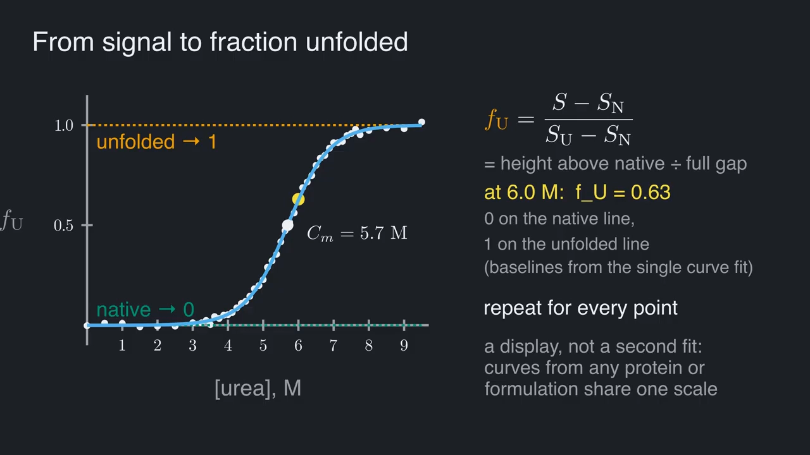
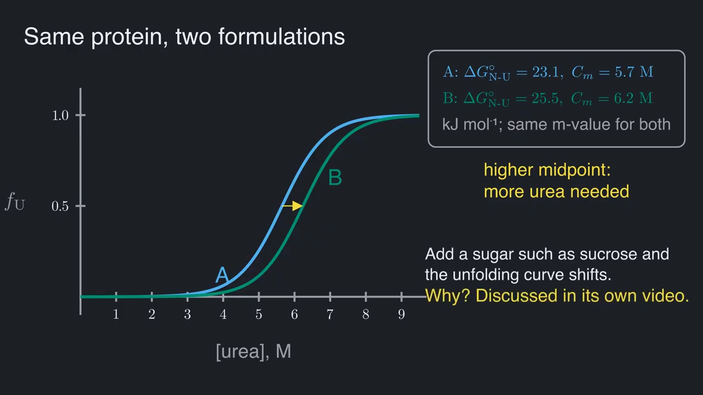
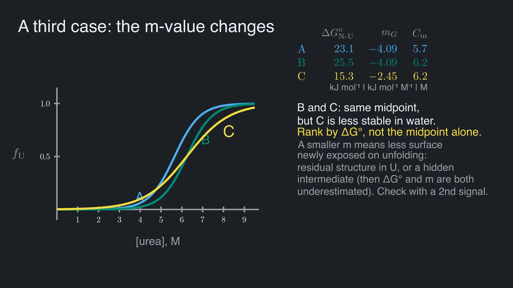
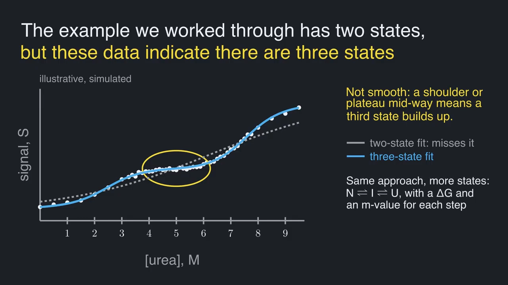

# 用尿素滴定测蛋白质稳定性：从一条 S 形曲线读出 ΔG°、m 值与 Cm

> 视频来源：[How stable is your protein therapeutic?](https://www.youtube.com/watch?v=4p6oWt5a70g)（YouTube · 频道 Formulation Unfolded，时长约 16 分钟）
> 简要导读：这支视频讲的是「化学变性法测蛋白质构象稳定性」的完整流程，依据 Pace（1986）与 Santoro & Bolen（1988）两篇经典方法学论文。它把一条尿素滴定曲线拆成四步：两态模型、信号选择、基线拟合、线性外推，最后落到「配方怎么排序」这个实际问题上。文中的数字来自视频里的模拟数据，用于演示方法本身。

## 本讲要解决的核心问题（SCQA）

**背景**：蛋白质只在两种形态之间切换——折叠的天然态（native, N）和解折叠的变性态（unfolded, U）。治疗性蛋白要在药瓶里放上几个月甚至几年，所以必须知道「它离垮掉还有多远」[【跳转到 00:00】](https://www.youtube.com/watch?v=4p6oWt5a70g&t=0)。

**冲突**：衡量「有多稳」最合适的数字是**把蛋白按住的自由能** $\Delta G^\circ_{N\text{-}U}$。麻烦在于，在纯缓冲液里一个稳定的蛋白几乎 100% 是折叠的，$K$ 小到根本读不出来——你没法直接测它 [【跳转到 03:24】](https://www.youtube.com/watch?v=4p6oWt5a70g&t=204)。更麻烦的是，工程改造常常让**功能和稳定性往相反方向走**：提高活性的突变可能让蛋白变得不稳定 [【跳转到 00:54】](https://www.youtube.com/watch?v=4p6oWt5a70g&t=54)。

**疑问**：既然天然态读不出 $K$，怎么才能测到 $\Delta G^\circ$？一条随尿素浓度变化的 S 形曲线，究竟能给出哪些数字？这些数字怎么用来比较不同的配方或突变体？

**回答（中心思想）**：办法是**用尿素把蛋白温和地、一步步掰开**，同时用一个对折叠状态敏感的信号（色氨酸荧光或 CD）跟踪，得到一条 S 形曲线；再按**两态模型**把每个点换算成 $K$ 与 $\Delta G$，最后把 $\Delta G$ 对尿素浓度作线性外推，回到 0 M 尿素，就得到纯缓冲液中的稳定性 $\Delta G^\circ_{N\text{-}U}$ [【跳转到 09:10】](https://www.youtube.com/watch?v=4p6oWt5a70g&t=550)。外推的**斜率 m 值**反映解折叠时新暴露的表面积，**中点 $C_m$** 则是「需要多少尿素才能掰开一半」。判读配方要看 $\Delta G^\circ$，不能只看 $C_m$——因为两条曲线可以中点相同而稳定性差很多 [【跳转到 09:35】](https://www.youtube.com/watch?v=4p6oWt5a70g&t=575)。

---

## 一、为什么非要测这个数：稳定性与功能会互相拉扯

视频开头给了三个真实的工程案例，说明「稳定性」为什么值得单独测。

**案例一：去掉一个糖，活性涨 50 倍。** 一个治疗性蛋白如果去掉某个特定的糖（岩藻糖 fucose），它与免疫受体的结合能紧上最多 50 倍，杀伤靶细胞更有效。但**功能与稳定性可能朝相反方向拉**：提高活性的改动有时恰恰是不稳定的 [【跳转到 00:54】](https://www.youtube.com/watch?v=4p6oWt5a70g&t=54)。

**案例二：HexaPro。** 新冠病毒刺突蛋白（spike）作为疫苗和检测的靶点，本身不稳定、难生产。研究者设计了多插六个脯氨酸的版本（HexaPro），把它「锁」在特定构象，产量提高 10 倍，而且耐热、能耐室温存放、能耐反复冻融 [【跳转到 01:19】](https://www.youtube.com/watch?v=4p6oWt5a70g&t=79)。

**案例三：枯草杆菌蛋白酶（subtilisin）。** 洗衣粉里用的那类蛋白酶，早期研究发现漂白剂型的氧化只要打中一个甲硫氨酸就能让酶失活；把这一个氨基酸换掉，它就抗住了这种氧化 [【跳转到 01:44】](https://www.youtube.com/watch?v=4p6oWt5a70g&t=104)。

还有一个反例说明「更稳」不等于「更好用」：在 **T4 溶菌酶**里，把负责结合和转化底物的残基换成「填满结合面」的残基后，活性丧失或下降，但稳定性上升了 **0.7 到 2 kcal/mol**。所以一个工程变体**两个指标都要测** [【跳转到 02:34】](https://www.youtube.com/watch?v=4p6oWt5a70g&t=154)。

糖链（糖基化）也会影响稳定性：把五种糖蛋白的糖切掉后，它们的**熔解温度下降**、解折叠时吸热变少，虽然 CD 谱显示折叠方式没变，但加热时聚集得更厉害——而且**糖带得越多，影响越大** [【跳转到 02:59】](https://www.youtube.com/watch?v=4p6oWt5a70g&t=179)。

测稳定性的方法不止一种：**加热类**方法如差示扫描量热（DSC）和差示扫描荧光（DSF）；**另一类**就是本视频的主题——测**解折叠自由能** [【跳转到 01:44】](https://www.youtube.com/watch?v=4p6oWt5a70g&t=104)。

---

## 二、为什么用尿素而不是加热：链不聚集，平衡才可逆

### 2.1 加热会让蛋白「粘死」，尿素不会

视频给了一个生活化的对比：**把鸡蛋加热，蛋白解折叠后就永久地黏在一起了**。治疗性蛋白也会解折叠，但它要在瓶子里放几个月到几年——所以我们要问的是「它离这条线有多近」[【跳转到 00:24】](https://www.youtube.com/watch?v=4p6oWt5a70g&t=24)。

尿素的作用机制很关键：它不只是「把天平推向 U」，它的分子会**围到解折叠的链周围**，与主链形成氢键、与侧链相互作用，包括解折叠刚刚暴露出来的那些**避水侧链**。对溶菌酶的模拟显示，尿素会覆盖整个蛋白表面。**这些黏性斑块被尿素包住之后，解折叠的链就保持溶解状态，不会互相黏成一团** [【跳转到 03:49】](https://www.youtube.com/watch?v=4p6oWt5a70g&t=229)。

这就是尿素与加热的本质区别：**加热让蛋白解折叠并永久黏在一起；尿素让它们解折叠但彼此分开。**

### 2.2 尿素为什么偏爱解折叠态：两类接触

为什么尿素聚在解折叠链上而不是折叠好的蛋白上？因为它建立两类接触 [【跳转到 04:39】](https://www.youtube.com/watch?v=4p6oWt5a70g&t=279)：

1. **与主链的氢键**：尿素的氧原子接受主链 NH 给出的氢键，尿素的 NH 基团则向主链 CO 提供氢键——**直接与蛋白自身的内部氢键竞争**；
2. **与侧链的接触**：尿素对侧链（包括非极性侧链）的范德华吸引力比水更强。

在折叠的蛋白里，大部分主链和非极性侧链是**埋在里面**的；解折叠把它们暴露出来，于是解折叠链能提供**更多接触位点**，每多一个接触就多一分对解折叠态的偏好 [【跳转到 05:04】](https://www.youtube.com/watch?v=4p6oWt5a70g&t=304)。

### 2.3 一个必须承认的例外：中等浓度下仍可能不可逆聚集

视频特意留了一个警告：在**中等尿素浓度**下，蛋白只是部分折叠，长时间放置**仍可能导致不可逆的聚集** [【跳转到 04:14】](https://www.youtube.com/watch?v=4p6oWt5a70g&t=254)。这提醒我们：把尿素解折叠当平衡处理，前提是体系真的达到了可逆平衡。

### 2.4 为什么可以当平衡处理：Anfinsen 的可逆性实验

支撑「尿素解折叠是可逆平衡」的经典证据来自 **Anfinsen 的诺奖工作**：把核糖核酸酶放在 **8 M 尿素**里让二硫键重新配对，得到的是一个**打乱的混合物，活性只有正常的约 1%**；一旦用**痕量巯基试剂**把尿素去掉，它又变得与天然酶**无法区分** [【跳转到 05:25】](https://www.youtube.com/watch?v=4p6oWt5a70g&t=325)。

**正是这种可逆性，让我们可以把尿素解折叠当作平衡态来算热力学。**

---

## 三、两态模型：$K$、$\Delta G$ 与「水中的 $\Delta G^\circ$」

从最简单的模型出发：蛋白要么是 N，要么是 U，处于平衡中 [【跳转到 02:59】](https://www.youtube.com/watch?v=4p6oWt5a70g&t=179)。

$$
K = \frac{[\mathrm{U}]}{[\mathrm{N}]},
\qquad
\Delta G_{N\text{-}U} = -RT \ln K
$$

在**水**里，一个稳定的蛋白几乎全是天然态，所以 $K$ 极小、$\Delta G$ 是**正的**（折叠是自发的，逆过来要耗能）。**这个「水中的值」$\Delta G^\circ$ 正是我们想要的那个数** [【跳转到 03:24】](https://www.youtube.com/watch?v=4p6oWt5a70g&t=204)。

矛盾就在这里：$\Delta G^\circ$ 是我们想要的，但它恰恰是**测不到**的——因为在没有变性剂时 $K$ 太小。尿素的作用就是**把平衡推向 U**，让两种形态同时存在、让 $K$ 落进可读范围，从而**间接**测出那个测不到的值。

---

## 四、信号怎么选：色氨酸荧光与圆二色

要跟踪解折叠，需要一个在 N 和 U 之间不同的信号。蛋白自带这种信号。

### 4.1 色氨酸荧光：报告「色氨酸周围是什么环境」

三种氨基酸有荧光，但真正好用的是一个 [【跳转到 05:50】](https://www.youtube.com/watch?v=4p6oWt5a70g&t=350)：

- **色氨酸（Trp）**：在水中约 **280 nm 吸收、348 nm 发射**，是最亮的；
- **酪氨酸（Tyr）**：**274 nm 吸收、303 nm 发射**，但在折叠蛋白里它的光常被猝灭或**传递给色氨酸**；
- **苯丙氨酸（Phe）**：贡献很小。

色氨酸好用的原因是**它会报告自己的环境**：

- 埋在折叠蛋白的**干燥口袋**里时，发射光偏蓝，可短到约 **308 nm**；
- **暴露到水里**（也就是蛋白解折叠时），发射**红移到约 350 nm**。

所以常规做法是**用 295 nm 激发而不是 280 nm**：酪氨酸在 295 nm 几乎不吸收，光就只挑中色氨酸，也不会发生从酪氨酸到色氨酸的能量传递（那会让数据解释变复杂）。然后在一个固定发射波长上读信号 [【跳转到 06:15】](https://www.youtube.com/watch?v=4p6oWt5a70g&t=375)。

一个限制：**这个方法对不含色氨酸的折叠结构域是「瞎」的** [【跳转到 06:40】](https://www.youtube.com/watch?v=4p6oWt5a70g&t=400)。

### 4.2 圆二色（CD）：报告二级结构

**CD（circular dichroism）**测的是蛋白对左旋和右旋圆偏振光吸收的差异。在**远紫外（约 250 nm 以下）**，信号来自肽主链，报告**二级结构**：α-螺旋在 **208 与 222 nm** 给负峰，β-折叠在 **218 nm** [【跳转到 06:40】](https://www.youtube.com/watch?v=4p6oWt5a70g&t=400)。

两者的分工很清楚：

- **色氨酸荧光**报告每个色氨酸的**紧邻环境**，对三级结构的小幅局部变化非常敏感——这种变化可能完全不碰二级结构；
- **远紫外 CD** 报告**二级结构**的整体含量。

### 4.3 两个信号一起测：判断是不是真的两态

这是本节最实用的一条判据 [【跳转到 07:05】](https://www.youtube.com/watch?v=4p6oWt5a70g&t=425)：

- **两条曲线重合** → 支持**两态转变**；
- **两条曲线不重合**，例如荧光在**更低的尿素浓度**就开始变化 → 说明**三级结构先丢、二级结构后丢**，中间有**中间态**。

还有一个实操差别：**荧光可以在酶标板里一次读很多样品，而 CD 通常在比色皿里一次测一个样品，慢得多** [【跳转到 07:30】](https://www.youtube.com/watch?v=4p6oWt5a70g&t=450)。

---

## 五、做一条曲线：采样、基线、拟合

### 5.1 采样：转变区要加密

做法是配制 **0 到 9.5 M 尿素**的一系列样品，记录一个在 N 与 U 之间有差别的信号（荧光或 CD）[【跳转到 07:30】](https://www.youtube.com/watch?v=4p6oWt5a70g&t=450)。

- 低尿素：蛋白折叠；
- 高尿素：蛋白解折叠；
- 中间：两态模型给出折叠与解折叠分子的混合。

所以信号会「爬坡」，**采样点就在这段坡上排得最密** [【跳转到 07:55】](https://www.youtube.com/watch?v=4p6oWt5a70g&t=475)。

### 5.2 一个容易被忽略的细节：两端都不是平的

视频特意强调：**曲线的两端都不是水平的**。天然态的信号会随尿素漂移，解折叠态的信号也会。**每一条都可用一条直线描述**——这就是**天然态基线**和**解折叠态基线** [【跳转到 08:20】](https://www.youtube.com/watch?v=4p6oWt5a70g&t=500)。

在任何尿素浓度下，我们测到的都是**群体平均**：

$$
S = f_N S_N + f_U S_U
$$

### 5.3 Pace 线性外推法：三步

经典做法是 **Pace 的线性外推法（linear extrapolation method, LEM）**，分三步 [【跳转到 08:45】](https://www.youtube.com/watch?v=4p6oWt5a70g&t=525)：

**第一步**：用转变**之前**和**之后**的点，各拟合一条直线作为基线。

**第二步**：在转变区的每个点上，量出它到两条基线的距离（记作 $a$ 与 $b$），算出 $K$：

$$
K = \frac{f_U}{f_N} = \frac{b}{a},
\qquad
\Delta G = -RT \ln K
$$

**第三步**：把这些 $\Delta G$ 对尿素浓度作图，并假设它是一条直线：

$$
\Delta G = \Delta G^\circ_{N\text{-}U} + m_G\,[\mathrm{D}]
$$

其中 $m_G$ 是斜率，**为负值**，因为尿素让蛋白不稳定 [【跳转到 09:10】](https://www.youtube.com/watch?v=4p6oWt5a70g&t=550)。

### 5.4 为什么要外推：测不到的地方才是重点

这是整支视频最关键的一个「为什么」[【跳转到 09:10】](https://www.youtube.com/watch?v=4p6oWt5a70g&t=550)：

- $\Delta G$ **只能在两种形态同时存在**的转变区里测到；
- 转变区**以下**，蛋白几乎全是折叠的，$K$ 太小读不出来；
- 转变区**以上**，几乎全是解折叠的，同样读不出来；
- 但**真正有意义的数字，是完全没有尿素时的稳定性**——也就是配方本身。

所以做法是：**沿着这条直线往回推到 0 M 尿素**。在视频的模拟数据上，这样得到 **24.8 kJ/mol**，$m$ 值为 **−4.47** [【跳转到 09:35】](https://www.youtube.com/watch?v=4p6oWt5a70g&t=575)。

### 5.5 Santoro–Bolen 单曲线拟合：把基线写进同一个方程

**Santoro 与 Bolen 在 Pace 的基础上做了改进**：把倾斜的基线**写进同一个方程**，这样整条曲线可以**一次性拟合** [【跳转到 10:00】](https://www.youtube.com/watch?v=4p6oWt5a70g&t=600)。

思路是把前面几块拼起来：

- 实测信号是混合：$S = f_N S_N + f_U S_U$；
- 两条基线各自随尿素线性漂移；
- 分数来自 $K = f_U/f_N$；
- 而 $K$ 来自「随尿素线性下降的稳定性」。

拼完之后得到一个式子：**天然态基线加上按 $K$ 加权的解折叠态基线，整体再除以 $1+K$**，其中 $K$ 用 $\Delta G^\circ$ 与 $m_G$ 写出。这个式子里只有**实测信号、尿素浓度和六个常数**：两个基线截距、两个基线斜率、$\Delta G^\circ$ 和 $m_G$ [【跳转到 10:25】](https://www.youtube.com/watch?v=4p6oWt5a70g&t=625)。

于是**一次非线性最小二乘拟合**就能同时返回这六个常数 [【跳转到 10:50】](https://www.youtube.com/watch?v=4p6oWt5a70g&t=650)。在同样的模拟数据上，单曲线拟合给出：

- $\Delta G^\circ_{N\text{-}U} = 23.7 \pm 0.6\ \mathrm{kJ\,mol^{-1}}$
- $m_G = -4.16 \pm 0.12\ \mathrm{kJ\,mol^{-1}\,M^{-1}}$
- $C_m = 5.7\ \mathrm{M}$

而数据的「真值」是 23.1 kJ/mol 与 −4.09 kJ/mol/M，Pace 分步法给出的是 24.8 kJ/mol。**两种做法结果略有差别**，但单曲线法的好处是：基线斜率被纳入模型，**它们的不确定度会传递到 $\Delta G$ 的误差上** [【跳转到 11:00】](https://www.youtube.com/watch?v=4p6oWt5a70g&t=660)。

---

## 六、读图：$f_U$ 曲线、$C_m$ 与配方排序

### 6.1 把信号换算成解折叠分数 $f_U$

基线拟合好之后，每个点都能换算成**解折叠分数** [【跳转到 11:20】](https://www.youtube.com/watch?v=4p6oWt5a70g&t=680)：

$$
f_U = \frac{S - S_N}{S_U - S_N}
$$

读法是：**「信号高出天然态基线多少」除以「两条基线之间的全部间距」**。视频里 6.0 M 尿素处那个点算出来是 **$f_U = 0.63$**，也就是说约 63% 的蛋白已经解折叠。

几个锚点：落在天然态基线上的点给 0，落在解折叠基线上的点给 1。对每个点都这么做，两条倾斜的基线就变成 0 和 1 两条水平线，**中点落在 0.5**——这里的中点是 **5.7 M** [【跳转到 11:50】](https://www.youtube.com/watch?v=4p6oWt5a70g&t=710)。

**重要提醒**：这只是**数据的另一种展示方式，不是第二次拟合**。它的价值在于把不同蛋白、不同探针、不同配方的曲线**放到同一个刻度上直接比较** [【跳转到 12:10】](https://www.youtube.com/watch?v=4p6oWt5a70g&t=730)。

### 6.2 配方科学家为什么要做这个实验

因为**同一个蛋白溶在不同东西里，稳定性可以不一样**。视频给了两个只差缓冲液和赋形剂的配方 A 与 B [【跳转到 12:50】](https://www.youtube.com/watch?v=4p6oWt5a70g&t=770)：

- **配方 B 的曲线整体右移**：需要更多尿素才能掰开它，所以**中点 $C_m$ 更高**（5.7 M → 6.2 M）；
- 把两条曲线都拟合，这个「右移」就变成**自由能的差**，于是配方可以在**同一个刻度上排序**（23.1 → 25.5 kJ/mol）。

这套方法在实际工作里确实站得住：一个自动化的尿素/胍滴定测定给 **12 个蛋白配方**排了序，其**中点与稳定性研究中聚集程度的相关系数 $R^2$ 达到 0.83** [【跳转到 13:15】](https://www.youtube.com/watch?v=4p6oWt5a70g&t=795)。

加糖（比如蔗糖）也会让解折叠曲线移动——糖为什么改变解折叠方式，视频说另有专集讨论 [【跳转到 13:35】](https://www.youtube.com/watch?v=4p6oWt5a70g&t=815)。

### 6.3 关键陷阱：中点相同，稳定性可以差很多

视频构造了第三个配方 C 来说明这一点 [【跳转到 14:00】](https://www.youtube.com/watch?v=4p6oWt5a70g&t=840)：

| 配方 | $\Delta G^\circ_{N\text{-}U}$（kJ/mol） | $m_G$（kJ/mol/M） | $C_m$（M） |
| --- | --- | --- | --- |
| A | 23.1 | −4.09 | 5.7 |
| B | 25.5 | −4.09 | 6.2 |
| C | 15.3 | −2.45 | 6.2 |

**B 与 C 的中点相同（都是 6.2 M），但 C 的转变更宽**，因为它的 $m$ 值更小。而水中的稳定性等于「$m$ 值 × 中点」，所以 C 明显更不稳定：**15.3 对 25.5 kJ/mol**。

**结论：按 $\Delta G^\circ$ 排序，不要只看中点。**

---

## 七、$m$ 值变化本身就是线索；两态假设的边界

### 7.1 $m$ 值在告诉你「暴露了多少新表面」

$m$ 值不是个凑数的斜率，它有物理含义：**它跟踪解折叠时新暴露出来的表面积** [【跳转到 14:25】](https://www.youtube.com/watch?v=4p6oWt5a70g&t=865)。

所以**$m$ 值变小意味着新暴露的表面变少**，可能有两种解释：

- 解折叠态**还保留着一些结构**；
- 或者体系里**藏着一个中间态**。

在这两种情况下，**两态拟合会同时低估 $\Delta G$ 和 $m$**，所以值得**换第二个信号再检查一遍** [【跳转到 14:38】](https://www.youtube.com/watch?v=4p6oWt5a70g&t=878)。

### 7.2 不是所有蛋白都是两态

前面所有推导都假设只有 N 和 U 两种状态。**很多小蛋白确实如此**，但有些蛋白会**经过一个中间态**解折叠——那是一个部分折叠、稳定到能积累起来的形态 [【跳转到 14:38】](https://www.youtube.com/watch?v=4p6oWt5a70g&t=878)。

视频给的例子是**卵清蛋白（ovalbumin）**：它在尿素中经中间态解折叠。这时需要**更多状态的模型**，而用**第二个信号（CD）配合荧光**一起跟踪是个好办法 [【跳转到 15:03】](https://www.youtube.com/watch?v=4p6oWt5a70g&t=903)。

**数据本身也会「告密」**：如果曲线不是一段平滑的台阶，而是在中途出现**肩部或平台**，那就是中间态在积累。两态拟合会漏掉这个形状 [【跳转到 15:28】](https://www.youtube.com/watch?v=4p6oWt5a70g&t=928)。

同样的方法可以扩展到**三态**：天然态 → 中间态 → 解折叠态，每一步都有自己的自由能和 $m$ 值，一起拟合 [【跳转到 15:40】](https://www.youtube.com/watch?v=4p6oWt5a70g&t=940)。

### 7.3 收尾：这个数字的适用范围

视频最后做了几点限定 [【跳转到 15:40】](https://www.youtube.com/watch?v=4p6oWt5a70g&t=940)：

- 这**只是众多方法之一**：DSC、DSF 给出的是相似或互补的正交信息，**多用一种工具就能看到更完整的图景**；
- **构象稳定性只是故事的一半**：还有**胶体稳定性**——蛋白分子之间如何相互作用、如何聚集——同样关键。

---

## 小结

- **要测的数**是「把蛋白按住的自由能」$\Delta G^\circ_{N\text{-}U}$；它在纯缓冲液里太小、读不出来，所以必须用变性剂把平衡推到中间再外推回来。
- **为什么用尿素**：尿素包住解折叠链暴露的避水斑块，让链保持分散、不聚集，因此解折叠是**可逆平衡**（Anfinsen 的 8 M 尿素复性实验就是证据）。加热则相反，会让蛋白永久黏死。
- **两态模型**给出 $K = [\mathrm{U}]/[\mathrm{N}]$ 与 $\Delta G = -RT\ln K$；水中的 $\Delta G^\circ$ 是正数。
- **信号选择**：色氨酸荧光（295 nm 激发，埋藏约 308 nm、暴露约 350 nm，报告三级结构局部环境）与远紫外 CD（222 nm 报告 α-螺旋，208/222 nm 螺旋负峰、218 nm 折叠峰）。**两信号曲线重合支持两态，不重合提示中间态。**
- **两端基线都会随尿素漂移**，必须拟合；实测信号是 $S = f_N S_N + f_U S_U$。
- **Pace 三步法**：拟合两条基线 → 用「到两基线的距离之比」算 $K$ 与 $\Delta G$ → 把 $\Delta G$ 对尿素作直线并外推到 0 M。
- **Santoro–Bolen 单曲线法**：把基线写进同一方程，一次非线性最小二乘同时得到六个常数，并把基线斜率的不确定度传递到 $\Delta G$。
- **$f_U$ 换算**：$f_U = (S - S_N)/(S_U - S_N)$，只是展示方式、不是二次拟合，但能把不同蛋白/配方放到同一刻度。
- **排序看 $\Delta G^\circ$，不要只看 $C_m$**：中点相同、$m$ 值不同的两个配方，稳定性可以差 10 kJ/mol 以上。
- **$m$ 值变小**意味着新暴露表面变少（残留结构或隐藏中间态），此时两态拟合会低估 $\Delta G$ 与 $m$。

## 关键术语速查

| 术语 | 一句话解释 |
| --- | --- |
| 天然态 N / 解折叠态 U | 折叠好的有功能形态，与解折叠的松散链；两态模型假设只有这两种 |
| $K$ | 解折叠与天然态之比 $[\mathrm{U}]/[\mathrm{N}]$，由信号换算而来 |
| $\Delta G^\circ_{N\text{-}U}$ | 水中（无变性剂）把蛋白按住的自由能，稳定性最核心的数字 |
| $m$ 值（$m_G$） | $\Delta G$ 对变性剂浓度的斜率，负值；反映解折叠时新暴露的表面积 |
| $C_m$ | 解折叠分数为 0.5 时的变性剂浓度，即曲线的中点 |
| 线性外推法（LEM） | Pace 提出的方法：把转变区测到的 $\Delta G$ 沿直线外推到 0 M 变性剂 |
| Santoro–Bolen 单曲线拟合 | 把倾斜基线与线性外推写进同一个方程，一次拟合得到全部六个常数 |
| 天然态基线 / 解折叠态基线 | 两端信号随变性剂线性漂移的直线，忽略它们会算错 $K$ |
| 色氨酸荧光 | 295 nm 激发，埋藏时发射偏蓝（约 308 nm）、暴露时红移（约 350 nm） |
| 远紫外 CD | 250 nm 以下报告主链二级结构；222 nm 常用于跟踪 α-螺旋的消失 |
| 胶体稳定性 | 蛋白分子之间相互作用与聚集的倾向，与构象稳定性是两件事 |