# 从静态快照到构象系综：核磁共振如何看见蛋白质的群体与转变速率

> 视频来源：[篮球打得最好的教授带你核磁共振研究蛋白质动力学 及其在研究蛋白-药物相互作用中的应用 by Dorothee Kern](https://www.bilibili.com/video/BV1pZ4y1X7Qi/)（Bilibili · 东山月光下，Dorothee Kern 在 iBiology 的讲座，本博客只覆盖第 1 部分约 38 分钟）｜时长约 38 分钟
> 导读：这是一场"边讲边看数据"的讲座。Kern 用一个酶（腺苷酸激酶）把"构象系综"从口号变成可以测量的三样东西——每个状态占多少（群体）、状态之间换得多快（速率）、状态长什么样（结构），并演示核磁共振、单分子荧光、快速混合动力学与模拟各自能回答哪一部分。字幕为机器翻译，本文已按讲座原意订正术语与人名。

## 本讲要解决的核心问题（SCQA）

**背景**：结构生物学给了我们大量漂亮的原子分辨率结构，教科书也常用"一张图 = 一个状态"来讲蛋白质：激酶未激活时是某种构象，磷酸化后切换到另一种构象。

**冲突**：Kern 说得很直接——"我给你看的这些美丽结构，不会告诉你它们如何工作"。静态结构是快照，不含时间信息；而酶催化、信号传递、转运、药物结合这些功能，恰恰发生在状态之间的来回切换里。她把这个缺口称为"隐形的诅咒"：你无法在显微镜下盯着单个原子看它跳舞。

**疑问**：如果蛋白质不是一张固定的图片，那它到底是什么？我们怎样把"动态"变成可测量、可比较的量？

**回答（中心思想）**：蛋白质是一个**构象系综**——同一分子在自由能景观上占据多个状态，每个状态有自己的**群体**（population）、状态之间有**互变速率**（由能垒高度决定）、每个状态有自己的**结构**。描述清楚这三件事，才等于描述了蛋白质；而核磁共振（NMR）之所以成为主力工具，是因为它能在原子分辨率上、在平衡态与生理条件下，一次性覆盖从皮秒到小时的整个时间尺度。

## 一、缺的那一维：功能写在运动里

Kern 用篮球打比方：一张比赛照片里，你看不出球会不会进。要判断结果，你需要一段视频，而不是一张定格。蛋白质也是一样——只看一张结构图，你不知道这个酶会不会催化、这个通道会不会打开。

[【跳转到 02:05】](https://www.bilibili.com/video/BV1pZ4y1X7Qi/?t=125)

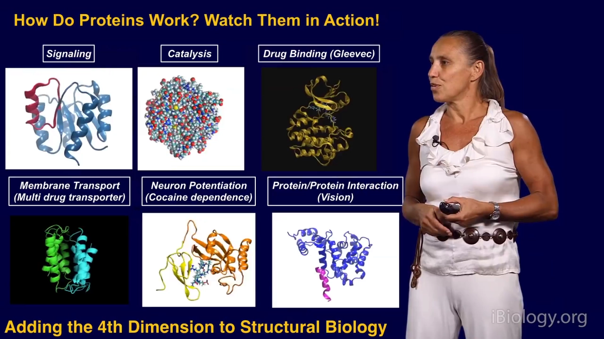

她把"第四维"落到几个具体问题上：

- **信号蛋白**：教科书图景是"未激活 → 磷酸化 → 激活"。实际测量发现，蛋白质在两种状态之间**不断来回跳**，信号并不是一次性的开关，而是一个被配体或修饰重新加权的平衡。
- **多药转运蛋白**：把刚进入细胞的药物再运回细胞外，靠的是持续的构象变化。
- **神经生物学**：长期记忆、可卡因依赖这类问题，涉及的是酶与受体之间的动态相互作用，而不是刚体对接。
- **药物设计**：教条是"小分子结合上去、把蛋白抑制住"；她认为合理药物设计的关键组分其实是蛋白质动力学。

这些例子的共同点是：**同一个分子在不同时刻处于不同构象，功能取决于这些构象各占多少、切换多快**。这正是"系综"这个词的含义——不是选一个代表结构，而是给出一组结构及其权重。

## 二、描述系综的三件事：群体、速率、结构

这是全场最核心的一页幻灯片。

[【跳转到 05:57】](https://www.bilibili.com/video/BV1pZ4y1X7Qi/?t=357)

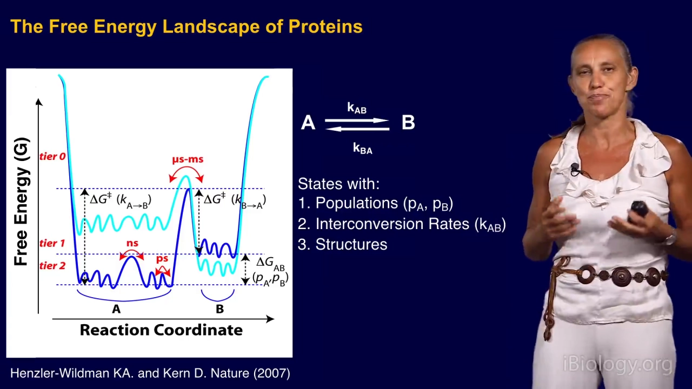

### 2.1 状态就是自由能景观上的坑

把蛋白质所有可能的形状铺在一个"反应坐标"上，纵轴画自由能 $G$，你会得到一条起伏的曲线：

- **状态**：曲线上的局部极小值（图中的 A 和 B）。落在同一个坑里的构象彼此快速互变，实验上分辨不开，于是被当作"一个状态"。
- **过渡态**：两个坑之间的最高点（图中标 $\ddagger$）。它不是一个能停留的状态，而是跨越能垒时经过的构型。
- **能垒高度** $\Delta G^\ddagger$：从坑底到垒顶的自由能差。

Kern 强调，所谓"动力学上不同的两个状态"，判据不是结构差多少，而是**它们之间隔着一个相当大的自由能垒**。这一点直接引出下面两个可测量。

### 2.2 群体：由自由能差决定，不由"哪个更稳定"一句话决定

两个状态各占多少，取决于它们的自由能差：

$$
\frac{p_B}{p_A} = \exp\!\left(-\frac{\Delta G_{AB}}{RT}\right),
\qquad \Delta G_{AB} = G_B - G_A
$$

这就是玻尔兹曼分布：自由能低的状态占得多，但**只要差值在几个 $RT$ 之内，少数状态依然有可观的群体**。幻灯片上标的 $\Delta G_{AB}(p_A, p_B)$ 正是这个意思——自由能差和群体是同一件事的两种写法。

对初学者最要紧的一步是：**"少数群体"不等于"不重要"**。一个只占百分之几的构象，如果它恰好是结合配体或催化的 competent 状态，它的功能贡献可能远大于它的比例。后面腺苷酸激酶的例子会反复用到这一点。

### 2.3 速率：由能垒高度决定，和群体是两件事

状态之间互变的速率常数由能垒决定：

$$
k = A\exp\!\left(-\frac{\Delta G^\ddagger}{RT}\right)
$$

垒高则慢，垒低则快。Kern 把这一点讲成一句很实用的话：**自由能垒的高度定义相互转换的速率**。

这里要区分两个常被混淆的量：

| 你关心的 | 由什么决定 | 实验上怎么体现 |
| --- | --- | --- |
| 平衡群体 $p_A, p_B$ | 两坑底部的自由能差 $\Delta G_{AB}$ | 峰强度比例、占据比例 |
| 互变速率 $k_{AB}, k_{BA}$ | 垒顶相对坑底的高度 $\Delta G^\ddagger$ | 弛豫、线形、单分子轨迹的切换频率 |

同一对状态可以"群体极不对称但交换很快"，也可以"群体接近 1:1 但交换很慢"。只报一个"结构差异"或只报一个"结合强弱"，都无法替代这两个量。

### 2.4 时间尺度是分层的

景观不是只有两个坑。Kern 把它画成多层：

- **第 0 层（tier 0）**：两个主要状态 A、B，中间是微秒到毫秒（μs–ms）的大垒。
- **第 1 层（tier 1）**：每个大坑内部还有更小的子坑，垒更小，在纳秒（ns）尺度互变。
- **第 2 层（tier 2）**：再往下是大量"熵子状态"，数量可达数十万个，在皮秒（ps）尺度互换。

对应的运动类型也分层：飞秒到皮秒是键振动，皮秒到纳秒是单键旋转，毫秒到小时则是许多原子一起的**集体运动**。Kern 的总结是：越局部、越快的运动，往上耦合成越全局、越慢的运动——这条"空间与时间的层次结构"是后面解释酶活性的钥匙。

## 三、怎么"看见"：一台仪器管一段尺度

Kern 列了一整套方法，并明确说它们是互补的，不是互相替代的。她自己最倚重 NMR，理由有四个：覆盖整个时间范围、原子分辨率、可在平衡态测量、可在生理条件下测量（能改温度、pH、底物浓度，让蛋白质在溶液里做它想做的事）。

[【跳转到 11:47】](https://www.bilibili.com/video/BV1pZ4y1X7Qi/?t=707)

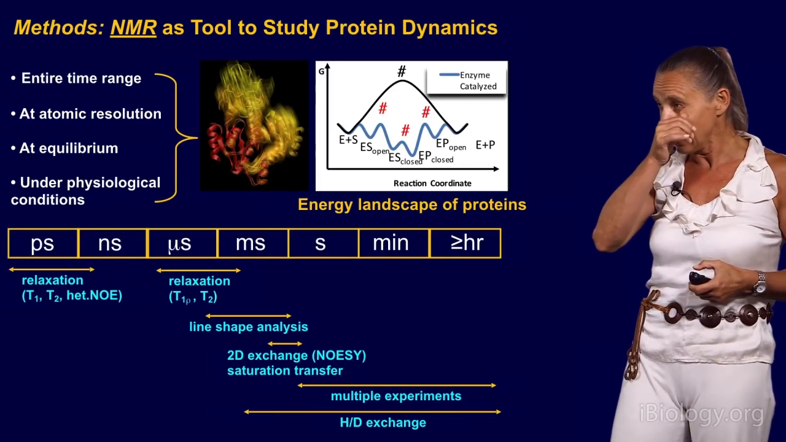

这张图值得记住，因为它把"方法"和"你要测的量"直接对上：

- **ps–ns**：$T_1$、$T_2$、异核 NOE，给出快运动的振幅与相关时间。
- **μs–ms**：$T_{1\rho}$、$T_2$ 与**线形分析**，这正是构象交换最常出现的时间窗。
- **ms–s**：二维交换谱（NOESY）、饱和转移，可以直接看到"谁变成了谁"。
- **分钟–小时**：氢氘交换（H/D exchange），慢的开放事件会让主链酰胺氢被交换掉。

### 3.1 NMR 的物理图像：每个原子一个峰，弛豫告诉你它动得多快

NMR 与磁共振成像（MRI）用的是同一套物理，只是 MRI 把整个人放进磁体，NMR 把单个蛋白质放进磁体、逐个原子看。射频波段激发后，每个原子核在自己的特征频率上共振；一张 $^{1}\mathrm{H}$–$^{15}\mathrm{N}$ 相关谱上的每个点，就是蛋白质里一个原子的"签名"。

[【跳转到 14:22】](https://www.bilibili.com/video/BV1pZ4y1X7Qi/?t=862)

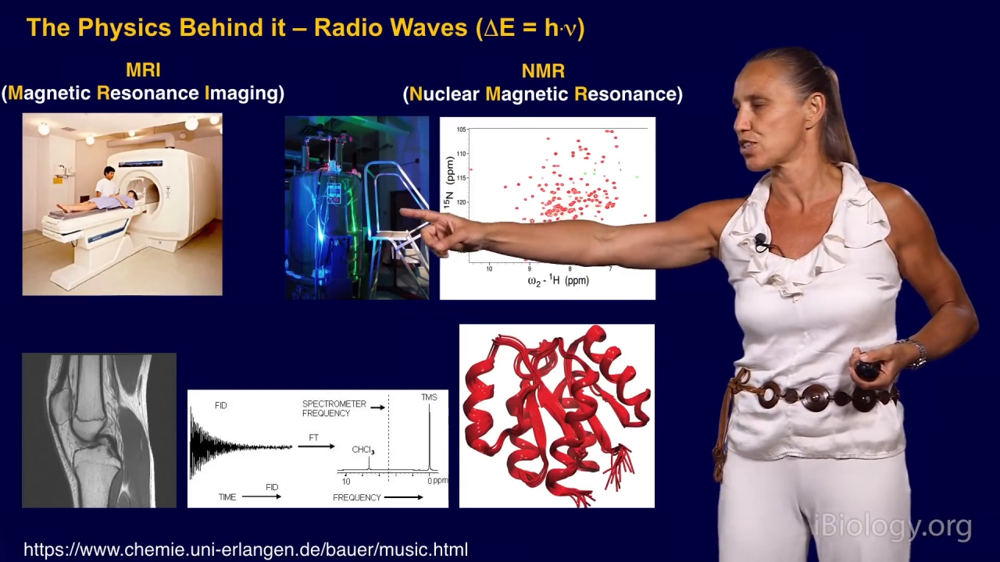

知道频率只解决了"是谁"，要测"动得多快"，靠的是**弛豫**。Kern 用跑步者打比方：把所有自旋放在同一条起跑线上同时出发（共振），跑得快慢不同，队伍就会散开（移相，dephasing），散开的速度就是横向弛豫速率 $R_2$。

$$ \frac{\mathrm{d}I}{\mathrm{d}t} = -R_2 I, \qquad R_2 = R_{20} + R_{\mathrm{ex}} $$

[【跳转到 15:51】](https://www.bilibili.com/video/BV1pZ4y1X7Qi/?t=951)

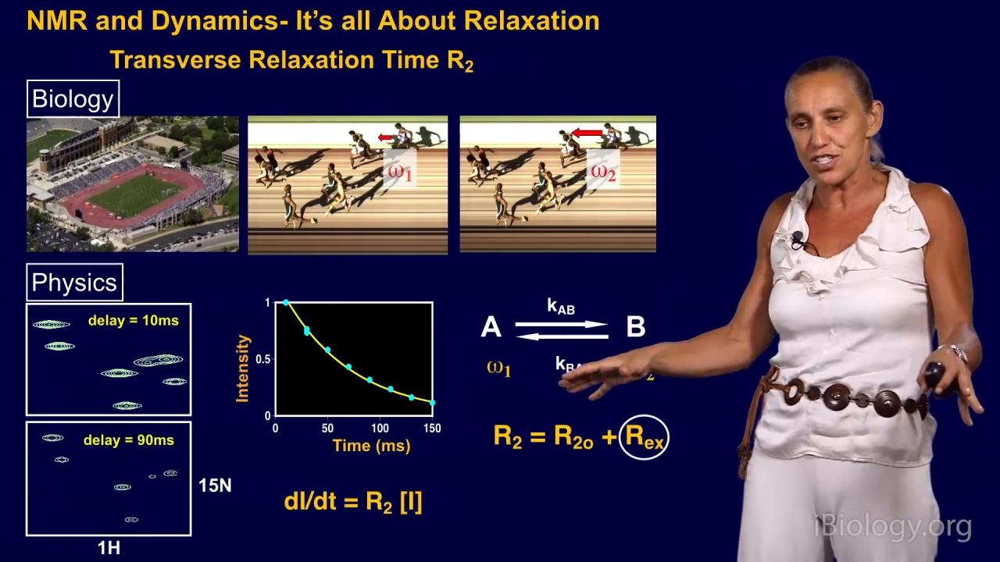

关键在最后那一项 $R_{\mathrm{ex}}$：如果原子在两种不同化学环境之间交换，信号会额外加速衰减。用不同频率的脉冲（CPMG 序列）去"干扰"这种交换，测量 $R_2$ 随脉冲频率的变化，就能拟合出**交换速率、两态群体和化学位移差**——这就是弛豫色散（relaxation dispersion）实验。它把"看不见的少数状态"变成了可计算的数字。
## 四、案例：腺苷酸激酶，一个"跳舞"的酶

Kern 选腺苷酸激酶（adenylate kinase，AdK）做主角，因为它既是每个细胞都必需的酶，又足够小、足够慢，能被各种方法盯住。

$$
\mathrm{MgATP} + \mathrm{AMP} \rightleftharpoons \mathrm{MgADP} + \mathrm{ADP}
$$

[【跳转到 09:55】](https://www.bilibili.com/video/BV1pZ4y1X7Qi/?t=595)

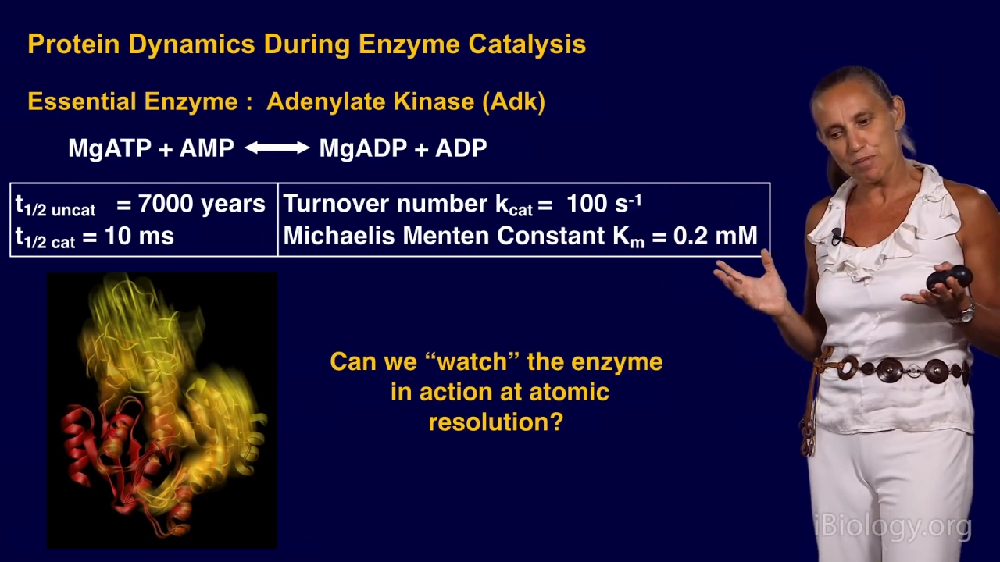

这组数字值得停下来看一眼：同一个反应，没有酶需要 7000 年，有酶 10 毫秒完成，$k_{\mathrm{cat}} = 100\ \mathrm{s^{-1}}$，$K_m = 0.2\ \mathrm{mM}$。但"催化得多快"只是结果，Kern 要问的是**过程**：这个只有约 20 kDa 的蛋白，在催化一圈里至少要走 10 个微观步骤。

### 4.1 先把催化循环写成状态清单

她的做法很朴素，也很值得学：先把能想到的每个状态写下来——游离酶 E、结合一个底物的状态、结合两个底物形成的三元复合物、化学步骤前后、产物释放。对应到景观上，就是 $E+S \to ES_{\mathrm{open}} \to ES_{\mathrm{closed}} \to EP_{\mathrm{open}} \to EP_{\mathrm{closed}} \to E+P$ 这样一串坑与垒。

这一步是后面所有测量的前提：**你得先知道要测哪两个状态之间的群体和速率**，否则数据只是曲线。

### 4.2 限速步骤不是化学，而是"开盖子"

把酶放进 NMR 管里，加上底物让它持续周转，测弛豫，就能在催化过程中读出动动力学。结果出乎意料：

[【跳转到 17:34】](https://www.bilibili.com/video/BV1pZ4y1X7Qi/?t=1054)

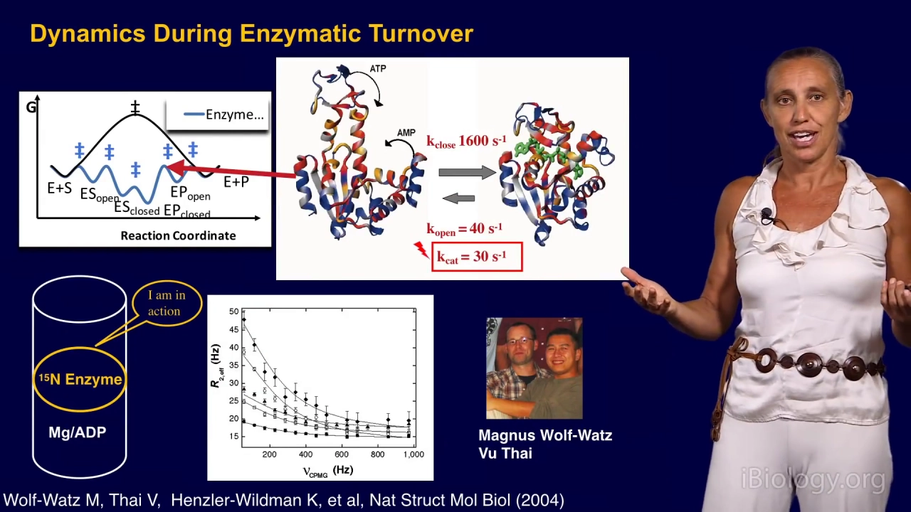

- 关闭（$k_{\mathrm{close}}$）约 $1600\ \mathrm{s^{-1}}$，很快；
- 打开（$k_{\mathrm{open}}$）约 $40\ \mathrm{s^{-1}}$，慢得多；
- 而 $k_{\mathrm{cat}} \approx 30\ \mathrm{s^{-1}}$，几乎等于打开速率。

结论是：**能量景观上最高的那道垒，不是"打断磷酸键再接到别处"的化学步骤，而是开盖—关盖这个大构象变化**。Kern 说这在生物学里是反复出现的主题：限制步骤常常是"蛋白质能跳多快"，而不是"化学能多快"。

### 4.3 X 射线能拍到快照，但拍不到时间

化学步骤太快，常规方法抓不住，于是换 X 射线晶体学：在室温下收数据，叠合大量晶体结构，看活性位点里哪些原子"坐不住"。他们看到 $\beta$ 磷酸基团的位置弥散，精氨酸 R150 伸向带负电的磷酸——这些静态图里的"模糊"，其实就是运动的痕迹。

要看到过渡态本身则更难，因为它位于垒顶、几乎不被占据。解决办法是用**过渡态类似物**：用氟化物模拟转移中的磷酸，配合镁，得到"卡在过渡态附近"的结构。

[【跳转到 19:19】](https://www.bilibili.com/video/BV1pZ4y1X7Qi/?t=1159)

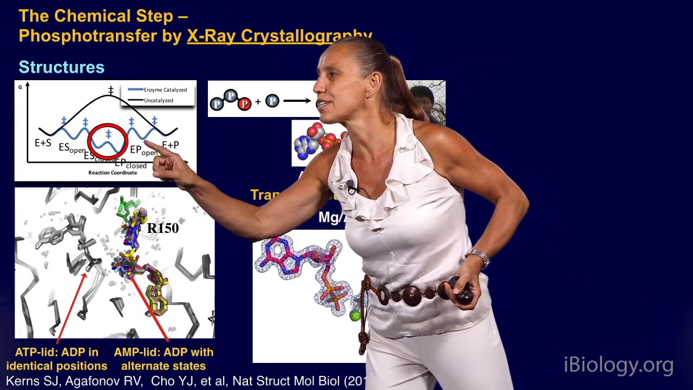

但 Kern 强调：这仍然是快照，不是时间尺度。结构告诉你"可以这样摆"，不告诉你"多久摆一次"。

### 4.4 单分子 FRET：在毫秒尺度上看一个酶开合

下一步是把时间分辨做出来。单分子荧光共振能量转移（smFRET）像一把"光谱尺"：给蛋白接上绿色供体和红色受体，两个染料距离约 47 Å 时能量转移弱，关盖后缩到约 36 Å 时转移强，于是荧光强度比直接报告开合。

[【跳转到 23:05】](https://www.bilibili.com/video/BV1pZ4y1X7Qi/?t=1385)

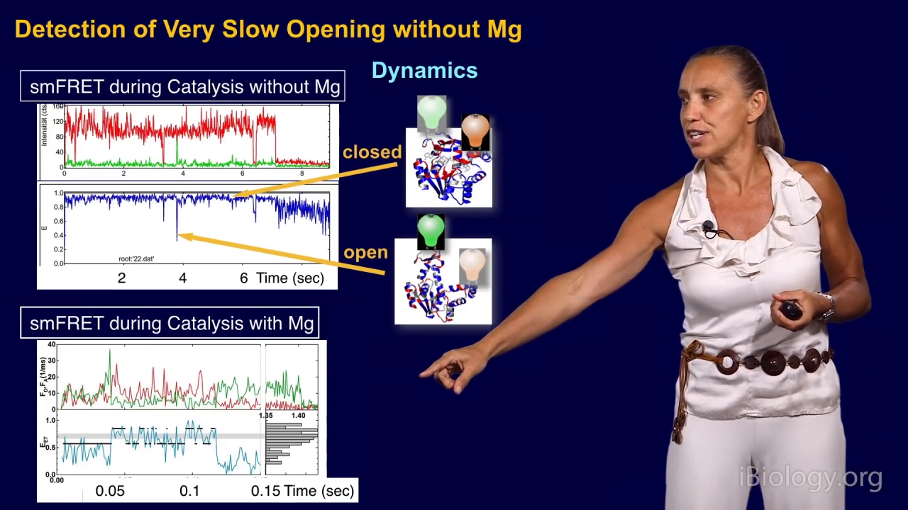

两个面板对比极有说服力：

- **有镁**：轨迹在 0.05–0.15 秒的窗口里反复跳，开合就在眼前；
- **无镁**：酶卡在关闭状态长达数秒，开合被减慢约三个数量级。

这正是"群体 + 速率"思路的威力：同一个蛋白、同一套标记，只换一个金属离子，速率就变了上千倍，而静态结构几乎看不出差别。

### 4.5 淬灭流：化学步骤到底多快

为了测化学步骤本身，他们用淬灭流（quench-flow）：快速混合酶与底物，让反应跑很短一段时间，再用酸淬灭，分析产物。问题是仪器的死时间约 50 毫秒，而在这 50 毫秒里酶已经把一整轮做完了——**化学步骤快到连"抓拍"都来不及**。去掉镁之后，才看到"先一个爆发（磷酸转移），再一个缓慢的打开"。

[【跳转到 24:54】](https://www.bilibili.com/video/BV1pZ4y1X7Qi/?t=1494)

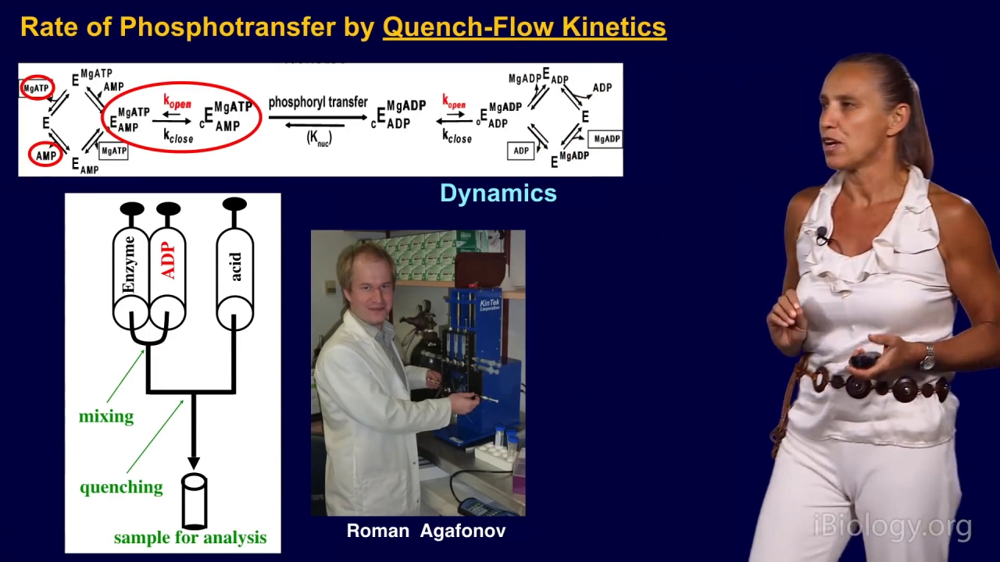

### 4.6 镁的双重身份：一个离子同时催化化学和构象

把所有测量放在一张表里，镁的作用就清楚了：

[【跳转到 26:42】](https://www.bilibili.com/video/BV1pZ4y1X7Qi/?t=1602)

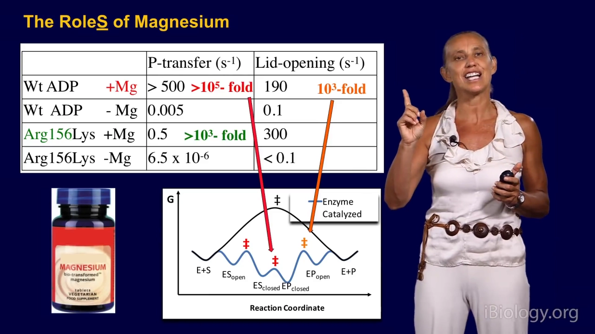

- 野生型 + Mg：磷酸转移 $>500\ \mathrm{s^{-1}}$（提高超过 $10^5$ 倍），开盖 $190\ \mathrm{s^{-1}}$（提高约 $10^3$ 倍）；
- 野生型 − Mg：磷酸转移掉到 $0.005\ \mathrm{s^{-1}}$，开盖掉到 $0.1\ \mathrm{s^{-1}}$；
- 把 R156 突变成赖氨酸后，加镁也只能部分挽救（$0.5\ \mathrm{s^{-1}}$），说明这个精氨酸与镁的配合是"电荷屏蔽"机制的一部分。

所以镁不只是"帮忙转移磷酸"的辅因子，它同时把构象变化的垒也压低了三个数量级。Kern 的说法是：大自然用一个原子，把整条反应里每一个关键步骤都催化了一遍。

### 4.7 计算：把"为什么"补上

实验给出数字，计算给出机制：

- **静电势计算**：R124、R150 等精氨酸与磷酸之间是强正负电荷吸引。要开盖，就必须打断这些相互作用——这正是那道高垒的来源。镁结合在相互作用的另一侧，相当于"屏蔽"掉一部分电荷，让垒变矮。
- **全原子分子动力学（MD）**：按牛顿定律算每个原子的运动，可以直接看到盖子打开。
- **水的角色**：MD 里能看到活性位点空腔中的水分子。酶并不是把水全部赶走，而是让水**远离磷酸**，从而避免 ATP 被水解掉。
- **量子力学计算**：键的断裂与生成需要量子力学，用来直接观察磷转移那一步。

[【跳转到 30:20】](https://www.bilibili.com/video/BV1pZ4y1X7Qi/?t=1820)

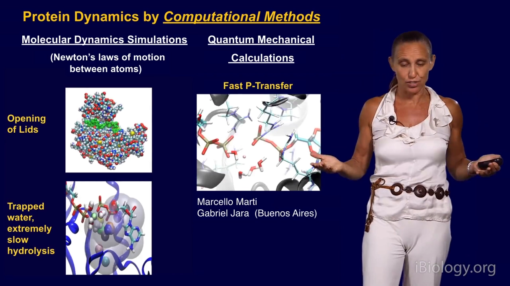

## 五、游离酶并不是"睡着"：构象选择的前奏

讲座最后一部分回答了一个更根本的问题：这些构象是底物来了才产生的，还是本来就在？

Kern 的答案是后者。**没有底物结合的静息态酶，已经在采样催化需要做的运动**。
她把这种性质叫作酶的"动态个性"（dynamic personality），并认为它是催化能力的基础。

[【跳转到 32:26】](https://www.bilibili.com/video/BV1pZ4y1X7Qi/?t=1946)

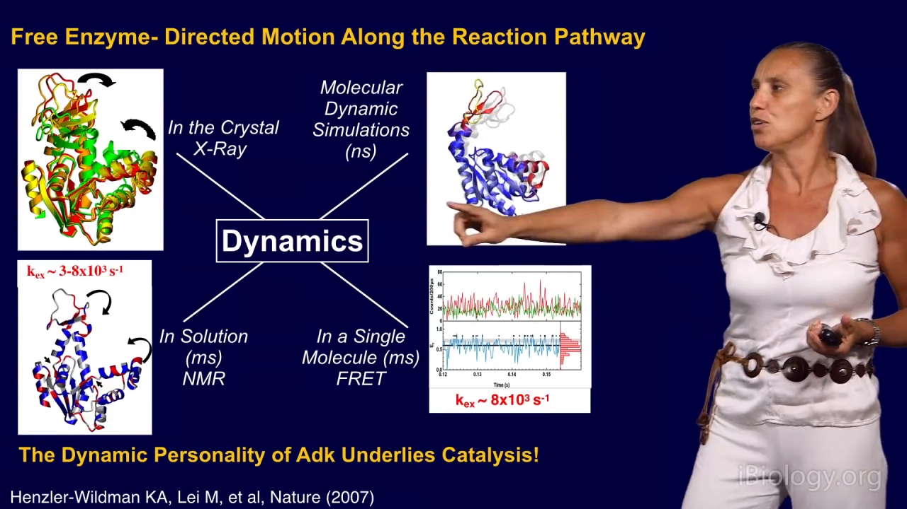

[【跳转到 34:23】](https://www.bilibili.com/video/BV1pZ4y1X7Qi/?t=2063)

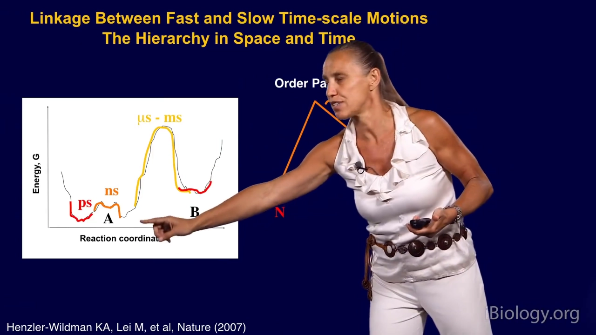

这幅"四方法交叉验证"的图把前面的方法串起来了：

- 晶体里的不同分子，盖子已经**部分关闭**，并且沿着催化轨迹分布；
- MD 显示这种部分关闭发生在**纳秒**尺度；
- 但 NMR 显示游离酶还有**毫秒**尺度的慢交换，单分子 FRET 测到完全关闭是一个**罕见而慢**的事件（$k_{\mathrm{ex}} \sim 8\times10^{3}\ \mathrm{s^{-1}}$ 量级）。

于是图景变成：**快的局部运动（部分关盖）经常发生，慢的全局运动（完全关盖）很少发生**。这正是"层次结构"的含义——快而局部的运动，是慢而全局运动的前提。

### 5.1 用有序参数 $S^2$ 给柔性画地图

怎么把"哪里在动"变成一张图？用 NMR 测主链键矢量的摆动，得到有序参数 $S^2$：$S^2$ 接近 1 表示该处几乎不动，越小表示摆幅越大。把 $S^2$ 按颜色画到结构上，就得到"动态热点"地图。

[【跳转到 36:13】](https://www.bilibili.com/video/BV1pZ4y1X7Qi/?t=2173)

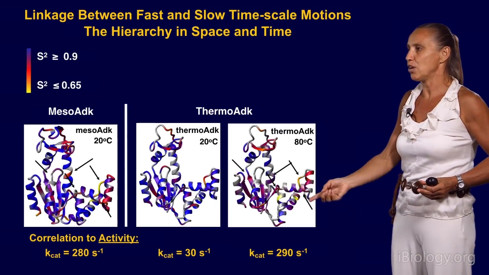

这张图把"动态"和"功能"直接连了起来：

- 中温酶（MesoAdk）在 20 °C，铰链区柔性高，$k_{\mathrm{cat}} = 280\ \mathrm{s^{-1}}$；
- 超嗜热酶（ThermoAdk）在 20 °C，整体过刚、铰链几乎不动，$k_{\mathrm{cat}}$ 只有 $30\ \mathrm{s^{-1}}$；
- 把超嗜热酶加热到 80 °C，柔性恢复到与中温酶相当，$k_{\mathrm{cat}}$ 也回到 $290\ \mathrm{s^{-1}}$。

也就是说，**酶活性的温度依赖，很大程度上是构象柔性的温度依赖**。Kern 还提到两个决定铰链柔性的结构因素：芳香族残基的堆积（把区域"焊"得更紧）和脯氨酸（限制主链）。这也解释了为什么嗜热酶在低温下"很糟糕"——不是结构坏了，而是该动的地方动不了。

## 六、这对"功能状态"意味着什么

把整场讲座收拢，可以得到几条对初学者最有用的判断：

1. **"活性/非活性"不是二值标签，而是一个被加权的平衡。** 激酶在两种状态间不断跳，磷酸化或配体结合改变的是两边的自由能差，也就是群体比例；它不必"锁死"在某一个构象。
2. **结构差异、群体、速率是三个独立的问题。** 两个状态的结构差多少，不决定它们各占多少；各占多少，也不决定它们换得多快。要描述功能，三个都得报。
3. **少数群体可能是功能主力。** 弛豫色散能测到只占百分之几的"激发态"，而这类状态常常正是结合或催化的 competent 构象。
4. **方法要按时间尺度配。** 你要测的是纳秒的局部抖动、微秒到毫秒的开关、还是分钟级的交换？NMR 的不同实验、单分子 FRET、停流/淬灭流、MD 各管一段，交叉验证才可信。
5. **动态本身可以是药物靶点。** 如果致病蛋白的病理来自某个构象的群体偏移，那么"改变群体分布"和"堵住活性位点"是两条不同的干预思路。

## 小结

- 静态结构是快照，缺少时间维度；蛋白质的功能写在构象之间的转换里。
- 构象系综用三件事描述：每个状态的**群体**（由自由能差决定）、状态间的**互变速率**（由能垒高度决定）、每个状态的**结构**。
- 自由能景观是分层的：ps 的键振动、ns 的子状态、μs–ms 的主状态交换、更慢的集体运动，快而局部的运动支撑慢而全局的运动。
- NMR 是主力工具：每个原子一个峰，弛豫与弛豫色散给出群体、速率和结构信息，且能在平衡态、生理条件下测量；X 射线给快照，smFRET 给实时开合，淬灭流给化学步骤，MD/QM 给机制。
- 腺苷酸激酶的限速步骤是开盖而不是化学；镁同时把化学步骤加速逾 $10^5$ 倍、把开盖加速约 $10^3$ 倍。
- 游离酶已经在采样催化路径：部分关盖在 ns 尺度常见，完全关盖是 ms 尺度的罕见事件。
- 动态柔性与活性定量相关：同一酶在柔性不足时 $k_{\mathrm{cat}}$ 下降近十倍，升温恢复柔性后活性也恢复。

## 关键术语速查

| 术语 | 一句话解释 |
| --- | --- |
| 构象系综 | 同一蛋白质在平衡态下占据的一组构象及其权重，而不是单一结构 |
| 自由能景观 | 以反应坐标为横轴、自由能为纵轴的起伏曲面；坑是状态，垒顶是过渡态 |
| 群体（population） | 某个状态在平衡态中所占的比例，由状态间自由能差按玻尔兹曼分布决定 |
| 过渡态 | 两个状态之间自由能最高的构型，不被稳定占据，但决定转换速率 |
| 能垒 $\Delta G^\ddagger$ | 坑底到垒顶的自由能差，越高则互变越慢 |
| 弛豫 | 激发态自旋恢复平衡的过程；$R_2$ 越大，信号衰减越快 |
| 弛豫色散 | 用不同频率脉冲测 $R_2$ 的变化，拟合出交换速率与少数状态群体 |
| CPMG | 一组重聚焦脉冲，用来调节交换对信号的贡献，是弛豫色散实验的核心 |
| $R_{\mathrm{ex}}$ | 构象交换带来的额外弛豫项，是"看见"μs–ms 运动的入口 |
| HSQC | $^{1}\mathrm{H}$–$^{15}\mathrm{N}$ 相关谱，每个点对应一个主链酰胺，是蛋白 NMR 的指纹 |
| 有序参数 $S^2$ | 描述键矢量摆动幅度的量，接近 1 表示刚性，越小越柔 |
| 氢氘交换（HDX） | 靠主链酰胺氢与溶剂交换的速度，报告局部开放事件，覆盖分钟到小时 |
| smFRET | 单分子荧光共振能量转移，用两个染料间距报告构象变化，时间分辨到毫秒 |
| 淬灭流 | 快速混合后立刻用酸终止反应，用来测毫秒级的化学步骤 |
| 过渡态类似物 | 模拟过渡态几何的分子或离子（如氟化物配镁），让垒顶"可结晶" |
| 腺苷酸激酶（AdK） | 催化 MgATP + AMP 与 MgADP + ADP 互变的小分子量酶，是构象动力学研究的模式体系 |
