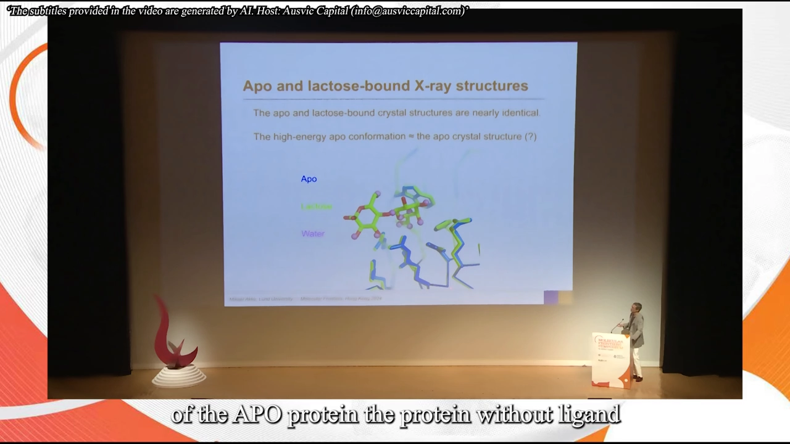
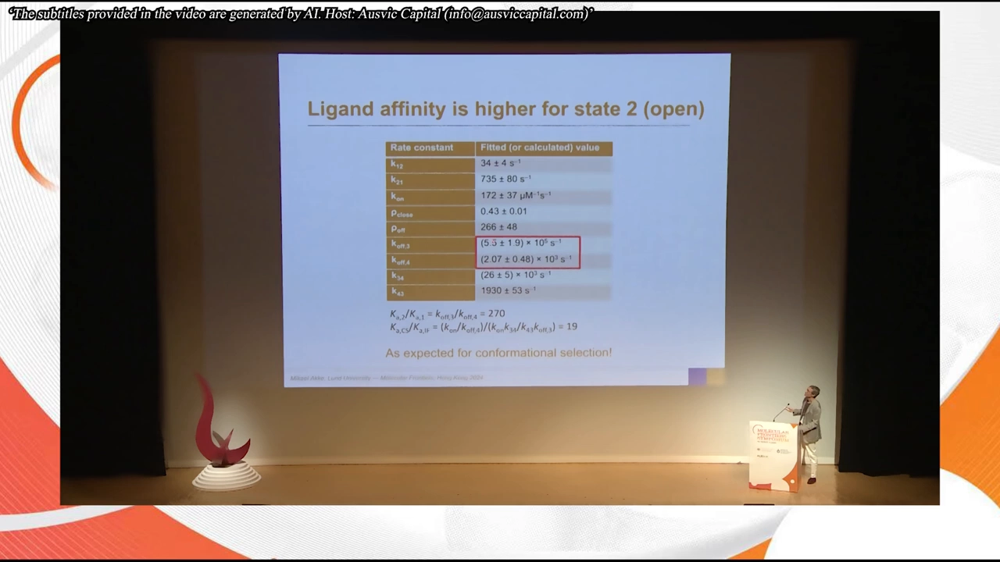
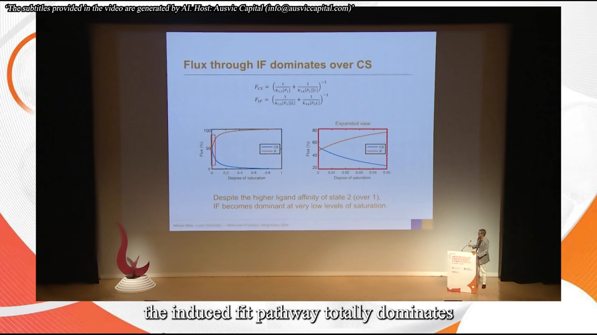
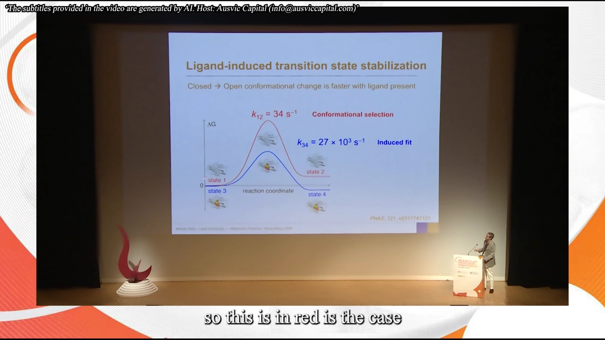

# 诱导契合还是构象选择：核磁共振如何拆开配体结合的两条路径

> 视频来源：[Induced Fit: Studying Protein–Ligand Binding by NMR Relaxation Dispersion — Mikael Akke](https://www.youtube.com/watch?v=59sukOvcZmk)（YouTube · MoleCluesTV 学术讲座录像，2024 年 Molecular Frontiers）
> 导读：这是一场"用一套数据把两种机制同时量出来"的报告。讲者用 galectin-3 与乳糖这一对模型，把"诱导契合 vs 构象选择"从教科书里的两张示意图，变成一组可以拟合的速率常数与通量曲线。本文按讲座顺序重排：先讲两种机制的差别，再讲能量景观的语言，然后一步步看 NMR 怎样读出群体与速率，最后落到那个反直觉的结论——两条路同时存在，而主导权随配体浓度翻转。

## 本讲要解决的核心问题（SCQA）

**背景**：教科书讲配体结合，主流图景是**诱导契合**（induced fit）：蛋白的口袋本来是闭合的、装不下配体，配体靠近后"把口袋撑开"，然后结合。这个说法从 1960 年代 Koshland 提出后，一直是中学与大学教材的标准答案。

**冲突**：过去二三十年，越来越多的证据支持另一种图景——**构象选择**（conformational selection）：蛋白自己就在两种构象之间来回跳，其中一小部分时间已经处于"能结合"的构象，配体只是把这个本来就存在的构象"挑"出来并稳定住。两派为此争论了很久：到底是这个，还是那个？

**疑问**：对一个具体的蛋白，我们能不能不靠争论、而是用数据回答——它到底走哪条路？更进一步：配体到底有没有改变蛋白构象的能量景观？

**回答（中心思想）**：两种机制**不是二选一，而是同一个热力学循环上的两条并行通路**，而且各自的"车流量"随配体浓度改变。在 galectin-3 这个例子里，无配体时构象选择占优，但只要 5% 的蛋白被配体饱和，约 80% 的结合就已经走诱导契合通路——因为配体把"闭合→开放"这一步的过渡态能垒降低了约一千倍。换句话说，**配体做了对蛋白质构象变化的"过渡态稳定化"**，这正好是酶催化底物反应的镜像版本。

## 一、同一个开关，两种讲法

讲座从一个很具体的画面开始：蛋白是分子开关。

[【跳转到 04:25】](https://www.youtube.com/watch?v=59sukOvcZmk&t=265)

细胞里是一锅很稠的"汤"——蛋白、RNA、DNA 挤在一起，彼此不停结合。免疫识别就是典型例子：病毒来源的小肽必须以非常特定的方式卡进 MHC 蛋白的槽里，才能被 T 细胞受体认出来，免疫反应由此启动。而蛋白在识别、结合配体时，**通常要改变形状**。所以"蛋白怎么结合配体"这个问题，本质上是在问"形状变化和结合谁先谁后"。

[【跳转到 07:20】](https://www.youtube.com/watch?v=59sukOvcZmk&t=440)

把两种模型并排放在一起，差别一目了然：

- **诱导契合**：闭合（不能结合）→ 配体靠近 → 被"诱导"出形状变化 → 结合。顺序是"先来后变"。
- **构象选择**：闭合 ⇌ 开放（自发、可逆）→ 配体只挑开放的那一份结合。顺序是"先变后挑"。

讲者特别强调两点，这两点是后面所有讨论的地基：

1. **两个箭头都是双向的**，它们是平衡，不是单向反应。所以严格来说不存在"只有一条路"的蛋白，只存在"两条路各占多少"。
2. 因此正确的提法不是"是 A 还是 B"，而是**"A 和 B 同时存在"**，问题变成定量问题：哪条路的通量大。

## 二、为什么要在意这个区别：变构药物改变的是"群体"

这个问题不只是学术趣味，它直接对应一类药物设计思路。

假设某个疾病状态下，蛋白需要处在某种构象才能激活下游信号。你可以设计一个配体，把它**锁在**这个构象上。但如果换一个思路：既然这个构象本来就在自发出现，你也可以设计一个结合在**别的位点**的配体——它不堵住原来的口袋，蛋白照样能正常工作，但你把两种构象的**群体比例**和信号强度挪动了。

[【跳转到 08:10】](https://www.youtube.com/watch?v=59sukOvcZmk&t=490)

这就是"变构（allosteric）药物"的逻辑：**不占正构位点，而是改变构象分布的权重**。要这样做，前提是你得知道这个蛋白的构象分布长什么样、两条通路各占多少——这正好把话题推到了能量景观。

## 三、把结合画成能量景观：三个可测量的量

讲者借用了 Alan Fersht 前一天报告里的同一套图。纵轴是自由能，横轴是反应坐标。

[【跳转到 09:50】](https://www.youtube.com/watch?v=59sukOvcZmk&t=590)

这张图上其实只有三样东西，但它们把"结构"和"能量"接了起来：

- **两个谷底的高度差** $\Delta G^\circ$ 决定平衡常数，也就是亲和力：

$$
K_{\mathrm{eq}} = \frac{[3]}{[1]} = \frac{p_3}{p_1} = e^{-\Delta G^\circ / RT}
$$

- **谷底到峰顶的高度差** $\Delta G^{\ddagger}$ 决定速率常数：

$$
k_{3\to 2} = A\, e^{-\Delta G^{\ddagger}/RT}
$$

  其中 $A$ 是指前因子。
- 自由能本身由焓和熵两部分组成：$\Delta G = \Delta H - T\Delta S$。这一点很重要——后面会看到，"高能态"之所以只占 4%，本质上是熵和焓的账。

于是"配体到底做了什么"这个问题，可以被翻译成一个非常干脆的实验问题：**配体存在时，这张能量景观图变了吗？变在哪里？**

## 四、模型系统：galectin-3 与乳糖

要回答这个问题，需要一个能被反复测量的干净体系。

[【跳转到 11:30】](https://www.youtube.com/watch?v=59sukOvcZmk&t=690)

选的是 **galectin-3**：一个 β-半乳糖苷结合凝集素（β-galactoside binding lectin），参与细胞周期调控、分化与凋亡，也是炎症与肿瘤领域多家公司在追的药物靶点。研究的是它的糖识别结构域（CRD，残基 110–235），配体是半乳糖苷类；这里用最小的代表分子——**乳糖**（牛奶里的糖），$K_d = 0.2\ \mathrm{mM}$。

结构是 β 三明治（β-sandwich），灰色画主链，绿色是乳糖（氧原子标红），黄色是把它"抱"住的那些侧链。注意这一点：**结合位点并不是一个深埋的洞，而是一组侧链围出来的浅槽**——这决定了后面"高能态"长什么样。

## 五、怎么测：把四状态循环里的速率一个个量出来

理论上，要判定走哪条路，只需要把循环里所有速率常数都测出来。但因为是循环，不必全测——测出足够多的一组，剩下的由热力学闭合关系给出。

工具是**核磁共振（NMR）**。原理可以讲得很朴素：原子核有自旋，像一根根小磁针；送进射频波把它们激发，再收信号，就得到谱。NMR 的好处是**不需要标记、不需要挂标签**——原子本身就是"沉默的间谍"，安安静静待在那儿，把蛋白内部发生了什么报告给你，包括结构、相互作用，以及蛋白如何在时间中运动。

[【跳转到 15:40】](https://www.youtube.com/watch?v=59sukOvcZmk&t=940)

这张图是全场的技术核心，值得慢慢看：

- 蛋白在构象 A、B 之间交换。如果两种构象各占一半，谱上就是两个等高峰；如果 10:90，就是一小一大。
- **快速交换**（交换速率远大于两个峰的频率差 $\Delta\Omega$）：谱仪只能看到平均，峰位是群体加权平均 $\Omega_{\mathrm{obs}} = \Omega_A p_A + \Omega_B p_B$。
- **慢交换**（交换速率小于 $\Delta\Omega$）：峰变宽，**群体很小的那个峰可能完全看不见**——这正是为什么"看不见"不等于"不存在"。

通过设计不同的脉冲实验，可以从峰的形状里同时抽出三样东西：化学位移差（含结构信息）、正反两个方向的交换速率、以及各状态的**群体**。讲者的说法是：这就把**结构、动力学、热力学**一次拿全了。

[【跳转到 19:50】](https://www.youtube.com/watch?v=59sukOvcZmk&t=1190)

实际做法是：先测无配体的蛋白，再在**七个不同配体浓度**下重复（饱和度从 4% 一路到 75%）。曲线的形状随浓度系统性地改变。为什么停在 75%？因为再往上曲线就变成一条平线——没有信息量了。

## 六、无配体的蛋白里，已经藏着"结合态"的样子

先看只有蛋白、没有乳糖的情况，这是最出人意料的一步。

[【跳转到 21:30】](https://www.youtube.com/watch?v=59sukOvcZmk&t=1290)

结果是：**在没有配体的情况下，结合位点的残基就已经在交换构象了**。拟合给出的两个数字是：

- 从状态 1 跳到状态 2 的速率 $k_{12} = 34 \pm 4\ \mathrm{s^{-1}}$，也就是大约每秒 34 次；
- 状态 2 的群体 $p_2 = 4\%$。

4% 听起来微不足道，但 NMR 恰好擅长这种"少数派"——只要交换速率落在合适的窗口里，4% 的峰也能被量出来。

更关键的一步是**化学位移的相关性**：把"从交换实验得到的化学位移差"对"饱和乳糖后测到的化学位移差"作图，数据点落在一条直线上。这意味着：

> 那个只占 4% 的高能态，其化学位移与**乳糖结合态**几乎一样——也就是说，它的结构已经很接近结合态了。

[【跳转到 24:00】](https://www.youtube.com/watch?v=59sukOvcZmk&t=1440)

晶体结构给了这个结论一个漂亮的旁证：apo 结构与乳糖结合结构**几乎完全叠合**。而且 apo 结构里那些水分子，正好坐在乳糖的氧原子该在的位置上——用讲者的话说，这个蛋白进化成了一个"装糖的摇篮"，或者说，**一堆排布得和糖的氧原子一模一样的氧原子**。

于是整个图景清楚了：蛋白平时待在基态；偶尔（4% 的时间）侧链一起收进来，摆出能配位水分子的那套排布——这正是结合糖所需要的排布。这个高能态寿命极短，大约只有**一毫秒**，然后就弛豫回基态。

顺带一个有意思的悬念：为什么晶体结构看起来像高能态？讲者坦言"我们不知道"，猜测可能是晶体中分子间的堆积力把这一构象选了出来。但无论如何，他们手上有了一个高能态的高分辨率结构。

## 七、亲和力差 270 倍：看起来"构象选择"赢了

有了 apo 态这一侧的数据（$k_{12}$、$k_{21}$、$p_2$），再加上不同配体浓度下的整套数据，就可以把四状态循环的所有速率一起拟合。

[【跳转到 28:10】](https://www.youtube.com/watch?v=59sukOvcZmk&t=1690)

关键的一行是：

$$
\frac{K_{2,4}}{K_{2,3}} = \frac{k_{\text{off},3}}{k_{\text{off},4}} = 270
$$

翻译成人话：**"开放"构象（状态 2）对乳糖的亲和力，比"闭合"构象高 270 倍**。这正是构象选择模型预期的样子——配体当然更喜欢那个已经摆好姿势的构象。讲者在幻灯片上直接写了结论："As expected for conformational selection!"

如果故事到这里结束，教科书就该改写成"构象选择才是对的"。但真正的转折在下一页。

## 八、通量计算：诱导契合反而主导

构象选择占优的是**亲和力**，但"结合事件实际从哪条路走"取决于**通量**（flux），也就是单位时间里有多少分子从这条通路过去。

[【跳转到 29:00】](https://www.youtube.com/watch?v=59sukOvcZmk&t=1740)

两条通路的通量可以写成"串联两步阻力之和的倒数"：

$$
F_{CS} = \left( \frac{1}{k_{12}[P_1]} + \frac{1}{k_{24}[P_2][L]} \right)^{-1}
$$

$$
F_{IF} = \left( \frac{1}{k_{13}[P_1][L]} + \frac{1}{k_{34}[P_3][L]} \right)^{-1}
$$

不必纠结细节，只要抓住一点：每条通路的通量由它**最慢的那一步**卡住。计算结果是：

- 完全没有配体、或配体极少时，构象选择占优（毕竟那时只有这一条路可走）；
- 但只要约 **5% 的蛋白被饱和，约 80% 的结合就已经走诱导契合通路**；
- 到高饱和度，诱导契合几乎占了全部。

原因只有一个数字：**配体存在时，"闭合→开放"这一步的速率快了大约一千倍**（$k_{34} \approx 2.6\times 10^{4}\ \mathrm{s^{-1}}$，对比无配体时的 $k_{12} = 34\ \mathrm{s^{-1}}$）。

## 九、配体是"蛋白质构象变化"的过渡态稳定剂

这一千倍从哪来？把它画回能量景观就一目了然。

[【跳转到 30:15】](https://www.youtube.com/watch?v=59sukOvcZmk&t=1815)

- **红线（无配体）**：状态 1 是基态，状态 2 是高能态（占 4%），中间能垒很高，所以交换很慢（34 次/秒）。
- **蓝线（有配体）**：配体先"半坐"在闭合构象的结合位上（此时口袋还没开），它**把过渡态的能量压低了**，于是"闭合→开放"变得容易得多，速率提升到 $2.7\times 10^{4}\ \mathrm{s^{-1}}$ 量级。

讲者在这里做了一个很漂亮的类比，也是全场最值得记住的一句话：

> 酶催化时，酶通过稳定**底物反应的过渡态**来降低能垒、加速反应。这里是**反过来的情形**：配体通过稳定**蛋白质构象变化的过渡态**，来加速构象变化。

从物理化学角度看，这件事"本来就该如此"；但讲者认为，在生物化学领域它并没有被广泛认识，教科书里更没有。这也解释了为什么两种模型会吵几十年——**大家量的是不同的量**：量亲和力，看到的是构象选择；量通量，看到的是诱导契合。

## 十、这对读文献、做设计意味着什么

把整场报告收拢，可以得到几条对初学者最有用的判断：

1. **"诱导契合 vs 构象选择"是一个假二选一。** 正确的模型是一个四状态循环：apo 的闭合/开放、holo 的闭合/开放，四条边都有速率。所谓"机制"只是这个循环上两条通路谁的通量大。
2. **群体小不等于不重要。** 4% 的高能态决定了这个蛋白能不能结合糖。NMR 之所以关键，就是它能在"看不见峰"和"看得见峰"之间找到窗口，把少数派的群体和寿命量出来。
3. **亲和力优势 ≠ 通路优势。** 状态 2 的亲和力高 270 倍，但诱导契合仍在 5% 饱和度时就拿下 80% 的通量。判断机制时，必须把速率（动力学）和亲和力（热力学）分开看。
4. **配体可以是"构象变化的催化剂"。** 它不只提供结合能，还能选择性地降低某条构象变化路径的能垒——这正是变构调节的物理基础：不堵口袋，改景观。
5. **这类知识能直接变成药物设计策略。** 如果疾病相关的是某个构象的群体比例，那么"挪动群体"的变构配体，可能比"堵死位点"的正构配体更温和、也更难被突变逃逸。

## 小结

- 配体结合有两条并行通路：**诱导契合**（先结合、后变形）与**构象选择**（先变形、后挑选），两者都是可逆平衡，同时存在。
- 用自由能景观描述：谷底高度差 $\Delta G^\circ$ 决定亲和力（$K_{\mathrm{eq}} = e^{-\Delta G^\circ/RT}$），谷底到峰顶的 $\Delta G^{\ddagger}$ 决定速率。
- galectin-3 的 apo 态里，结合位点已经以 34 次/秒的速率在两种构象间交换，高能态只占 4%，但其结构已非常接近乳糖结合态（化学位移相关 + 晶体结构叠合 + 水分子占位三重证据）。
- 开放构象对乳糖的亲和力高 **270 倍**，符合构象选择的预期。
- 但通量计算显示：只要 5% 饱和，**80% 的结合走诱导契合**，因为配体把"闭合→开放"的能垒降低了约一千倍。
- 因此配体的角色可以理解为**蛋白质构象变化的过渡态稳定剂**——酶催化的镜像版本。

## 关键术语速查

| 术语 | 一句话解释 |
| --- | --- |
| 诱导契合（induced fit） | 配体先靠近，诱导蛋白改变形状后再紧密结合；Koshland 1960 年代提出的经典模型 |
| 构象选择（conformational selection） | 蛋白自发在多种构象间平衡，配体只挑选并稳定其中能结合的那一种 |
| 构象交换（conformational exchange） | 同一分子在不同构象间来回切换的过程，可用交换速率 $k_{\mathrm{ex}}$ 与各状态群体描述 |
| 自由能景观（energy landscape） | 以自由能为纵轴、反应坐标为横轴的"地形图"；谷底是稳定状态，峰顶是过渡态 |
| $\Delta G^\circ$ 与 $\Delta G^{\ddagger}$ | 前者是两个状态的高度差（决定平衡与亲和力），后者是谷底到峰顶的高度差（决定速率） |
| 通量（flux） | 单位时间内经某条通路发生结合的分子数占比，用来判断"实际走哪条路" |
| 过渡态稳定化（transition state stabilization） | 通过降低过渡态自由能来加速过程；酶催化底物反应与配体加速构象变化是同一原理的两面 |
| 变构调节（allostery） | 配体结合在正构位点之外的位点，通过改变构象分布来调节蛋白功能 |
| 弛豫色散（relaxation dispersion） | 一类 NMR 方法，通过测量谱峰随脉冲频率的变化，提取毫秒级构象交换的速率与群体 |
| 化学位移（chemical shift） | 原子核共振频率相对参考的偏移，对局部化学环境敏感，可间接报告结构 |
| apo / holo | 未结合配体 / 已结合配体的蛋白状态 |
| $K_d$ | 解离常数，数值越小表示亲和力越强；本例乳糖对 galectin-3 为 0.2 mM |

> 本系列的相邻小节：**2.2.1** 讲构象系综的一般图景（群体、互变速率、结构三要素），**2.2.3** 讲协同结合的定量模型（Hill 系数、MWC 与 KNF）。本文只处理"结合走哪条路"这一层，不展开模型数学。