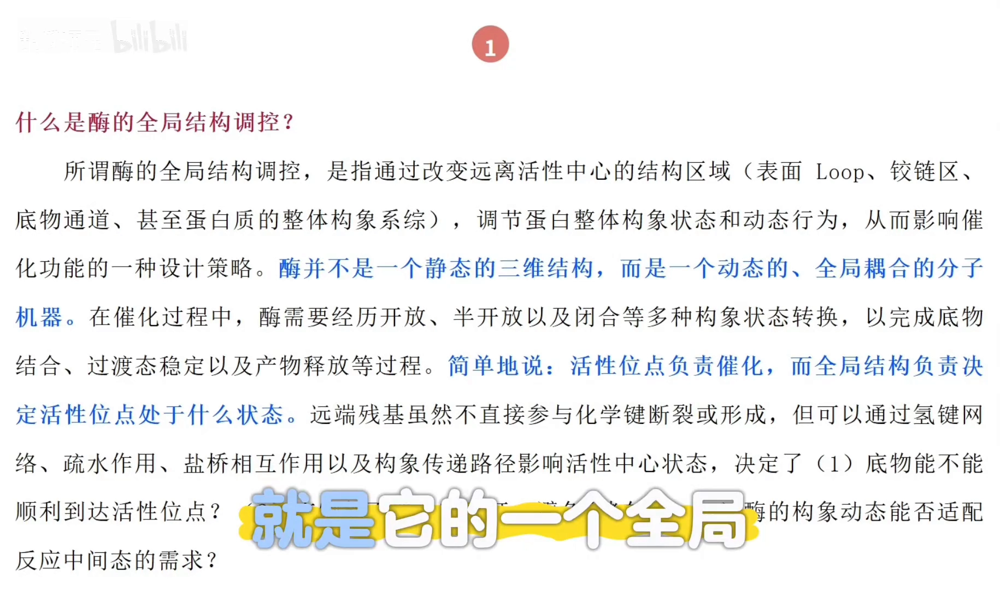
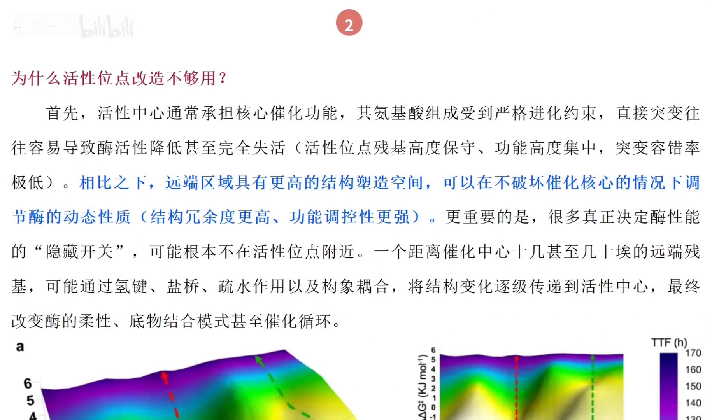
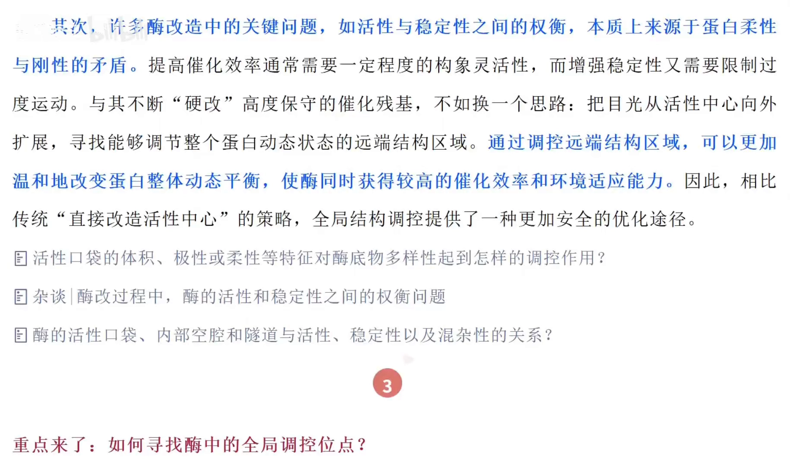
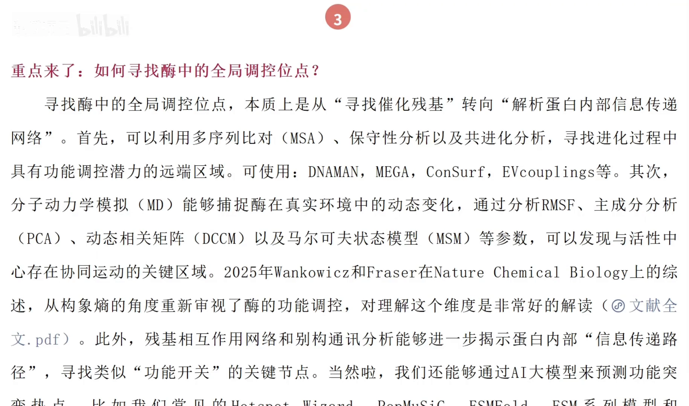
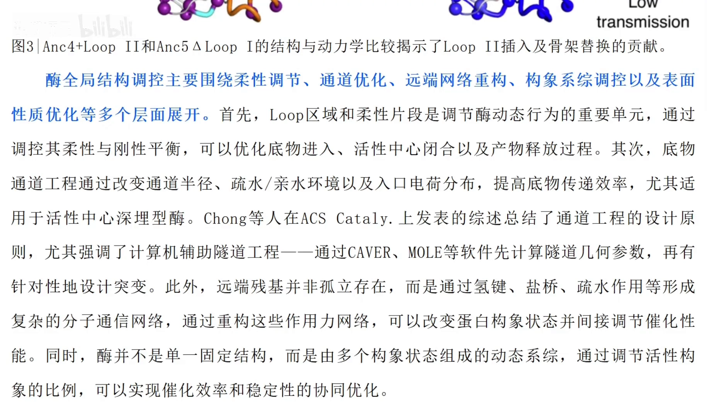
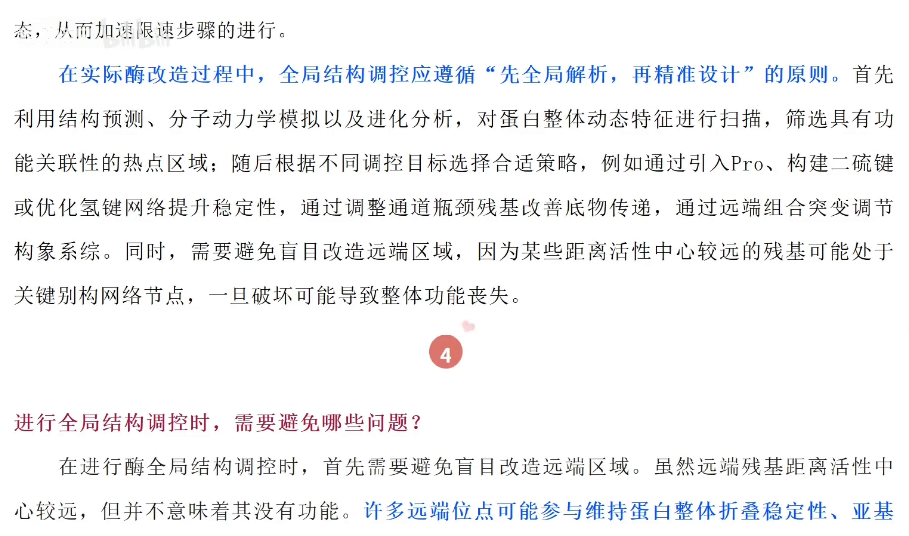
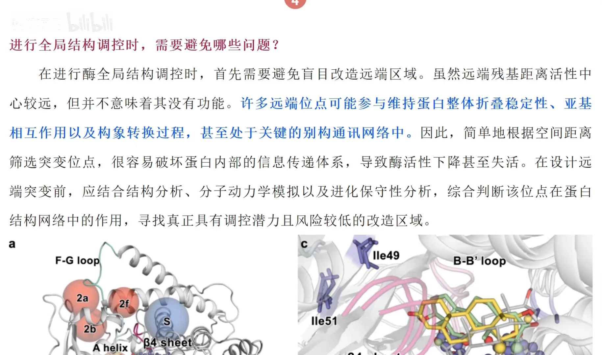
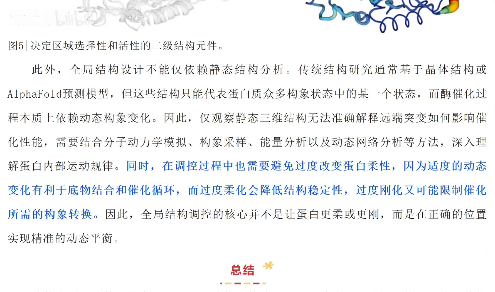

# 远端残基与别构网络：为什么调控位点常在活性中心之外

> 视频来源：[别再只改活性口袋！如何实现酶活性位点之外的全局结构调控？— 甜瓜师兄](https://www.bilibili.com/video/BV1SKpq6VEM1/)（Bilibili · 甜瓜师兄，约 9.5 分钟）
> 导读：这是一支"讲思路"而不是"讲实验"的视频。作者把酶工程里一个容易被忽略的事实摆到台面上：决定酶性能的开关，常常不在活性中心，而在几十埃之外的远端残基、loop 区与通道上。全片围绕一个判断展开——活性位点负责"能不能反应"，全局结构负责"反应做得怎么样"。字幕为 AI 自动生成，本文已按画面上的文字稿逐句订正术语。

## 本讲要解决的核心问题（SCQA）

**背景**：改造酶的时候，最自然的思路是盯着活性位点做定点突变——口袋里的残基直接接触底物，改它最"对症"。这也是过去几十年酶工程的主流做法。

**冲突**：但作者指出一个反复出现的现象：只改活性位点，结果往往是"性能上去了，稳定性塌了"，或者"底物谱变宽了，选择性丢了"，再或者"局部优化了，整体构象却失衡了"。原因在于，酶并不是几个关键残基的简单加和，而是由**整个蛋白结构网络**共同调控的；活性位点只是执行中心，不是控制中心。

**疑问**：如果真正的"调节系统"在活性中心之外，那么它由什么组成？为什么改远端反而更安全？又该怎样在几百个残基里找到那些真正有调控作用的位点？

**回答（中心思想）**：酶的全局结构调控，是通过**远离活性中心的结构区域**（表面 loop、铰链区、底物通道、乃至整体构象系综）来改变蛋白的构象状态与动态行为，从而影响催化性能。它的价值在于：**在不破坏催化核心的前提下，更温和地移动蛋白的动态平衡**。而要做对这件事，必须遵循"先全局解析、再精准设计"，并且避开一个最大的坑——把处于别构网络节点的远端残基当成"无关位点"随手改掉。

## 一、什么叫"全局结构调控"

[【跳转到 01:15】](https://www.bilibili.com/video/BV1SKpq6VEM1/?t=75)

[【跳转到 00:25】](https://www.bilibili.com/video/BV1SKpq6VEM1/?t=25)

定义可以拆成三层：

1. **改哪里**：不是口袋底部那几个催化残基，而是表面 loop、铰链区、底物通道，甚至整体的构象系综。
2. **改什么**：不是改"一个结构"，而是改蛋白的**构象状态和动态行为**——也就是各构象的比例与切换的快慢。
3. **为了什么**：影响催化功能。

这里有一个关键的观念转变：**酶不是一个静态的三维结构，而是一个动态的、全局耦合的分子机器**。催化过程中，它要经历开放、半开放、闭合等多种构象状态的转换，才能依次完成底物结合、过渡态稳定、产物释放。

于是作者给出一句很好记的分工：

> **活性位点负责催化，全局结构负责决定活性位点处于什么状态。**

远端残基虽然不直接参与化学键的断裂或形成，但它可以通过氢键网络、疏水作用、盐桥以及构象传递路径，影响活性中心的状态，具体决定三件事：

- 底物能不能**顺利到达**活性位点（通道是否通畅）；
- 底物/产物能不能**及时离开**（不至于堵在口袋里）；
- 酶的构象动态能否**适配反应中间态**的需求。

## 二、为什么只改活性位点不够用

[【跳转到 02:17】](https://www.bilibili.com/video/BV1SKpq6VEM1/?t=137)

作者给了两条理由，一条"不能改"，一条"值得改"。

**不能改**：活性中心承担核心催化功能，其氨基酸组成受到**严格的进化约束**——高度保守、功能高度集中、突变容错率极低。直接突变往往导致活性下降甚至完全失活。这不是"改得不够巧"，而是这块地方本来就没有多少腾挪空间。

**值得改**：相比之下，远端区域具有更高的**结构冗余度**，可以在不破坏催化核心的情况下调节酶的动态性质，功能调控性更强。

更值得注意的是第二点背后的现象：很多真正决定酶性能的"**隐藏开关**"，可能根本不在活性位点附近。一个距离催化中心十几甚至几十埃的远端残基，可以通过氢键、盐桥、疏水作用以及**构象耦合**，把结构变化**逐级传递**到活性中心，最终改变酶的柔性、底物结合模式，甚至整个催化循环。

这正是"变构"（allostery）在结构层面的含义：**信号不是靠一条长链直接传过去，而是靠一张相互作用网络一级一级传过去**。所以远端位点不是"离得远所以无关"，而是"离得远所以处在网络的上游"。

## 三、柔性与刚性的权衡：为什么远端是更"温和"的旋钮

[【跳转到 04:15】](https://www.bilibili.com/video/BV1SKpq6VEM1/?t=255)

酶改造里最经典的矛盾是**活性 vs 稳定性**，而它本质上是**柔性 vs 刚性**的矛盾：

- 提高催化效率，通常需要一定程度的构象灵活性（该动的地方要能动）；
- 增强稳定性，又需要限制过度的运动（不该动的地方别乱动）。

如果只在活性中心"硬改"，等于同时踩两个雷：既可能破坏催化所需的柔性，又可能整体 destabilize。

而通过远端区域调控，可以**更温和地改变蛋白整体的动态平衡**，使酶同时获得较高的催化效率和环境适应能力。原因是：远端残基通常不像口袋里的残基那样保守，在那里做微调，对整体稳定性的冲击往往更小（当然也有例外）。所以相比"直接改造活性中心"，全局结构调控提供了一条**更安全**的优化途径。

## 四、怎么找远端调控位点：三类证据

这是全片最实用的部分。作者把"找位点"重新定义了一次：

> 寻找全局调控位点，本质上是**从"寻找催化残基"转向"解析蛋白内部的信息传递网络"**。

[【跳转到 04:40】](https://www.bilibili.com/video/BV1SKpq6VEM1/?t=280)

具体有**三条互补的线索**：

1. **进化线索**：多序列比对（MSA）、保守性分析与共进化分析，用来找进化过程中具有功能调控潜力的远端区域。常用工具包括 DNAMAN、MEGA、ConSurf、EVcouplings 等。共进化信号的价值在于：两个残基在进化上"同进同退"，往往说明它们功能上耦合，哪怕空间上离得很远。
2. **动力学线索**：分子动力学模拟（MD）能捕捉酶在真实环境中的动态变化。通过 RMSF（均方根涨落）看哪些区域柔软、哪些刚硬，通过主成分分析（PCA）、动态相关矩阵（DCCM）、马尔可夫状态模型（MSM）等分析，找出**与活性中心存在协同运动**的关键区域——协同运动就是耦合的直接证据。
3. **网络线索**：残基相互作用网络与别构通讯分析，可以进一步揭示蛋白内部的"信息传递路径"，找到类似"功能开关"的关键节点。

此外，还可以借助 AI 模型预测功能突变热点，例如 Hotspot Wizard、PopMuSiC、ESMFold、ESM 系列模型，以及 FireProt、ThermoMPNN 这类稳定性预测服务器。

## 五、全局调控的五个层面

[【跳转到 05:20】](https://www.bilibili.com/video/BV1SKpq6VEM1/?t=320)

作者把目前发表最多的改造思路归纳成五个层面：

| 层面 | 做什么 | 典型手段 |
| --- | --- | --- |
| 柔性调节 | 调 loop 区与柔性片段的柔/刚平衡 | 优化底物进入、活性中心闭合、产物释放 |
| 通道优化 | 改通道半径、疏水/亲水环境、入口电荷 | 让底物传质更顺畅，尤其适合深埋型活性中心 |
| 远端网络重构 | 重构氢键、盐桥、疏水作用组成的分子通信网络 | 改变构象状态，间接调节催化性能 |
| 构象系综调控 | 调节活性构象在系综中的比例 | 实现催化效率与稳定性的协同优化 |
| 表面性质优化 | 改表面电荷与亲疏水性 | 影响溶解性、聚集倾向与稳定性 |

其中"通道工程"有一个很直观的操作：把**非生产性通道**改成**生产性通道**，或者扩大通道入口，让大一些的底物分子更容易进入。作者提到可用 CAVER、MOLE 这类软件先算隧道的几何参数，再有针对性地设计突变。

[【跳转到 05:44】](https://www.bilibili.com/video/BV1SKpq6VEM1/?t=344)

而"构象系综调控"这一条，正好接上本系列前一小节的内容：**酶不是单一固定结构，而是由多个构象状态组成的动态系综；调节活性构象的比例，就能在不牺牲稳定性的前提下提高催化效率**。

## 六、先全局解析，再精准设计

[【跳转到 06:14】](https://www.bilibili.com/video/BV1SKpq6VEM1/?t=374)

流程可以写成两步：

1. **全局解析**：用结构预测、分子动力学模拟以及进化分析，对蛋白整体的动态特征做一次"扫描"，筛出具有功能关联性的热点区域。
2. **精准设计**：按不同的调控目标选策略——
   - 要稳定性：引入脯氨酸（Pro）、构建二硫键、优化氢键网络；
   - 要传质：调整通道瓶颈残基；
   - 要构象分布：用**远端组合突变**调节构象系综。

注意最后一条的措辞是"**组合**突变"。远端位点单个突变的效果往往很弱（因为它们不是直接催化残基），真正的效果常常来自几个位点的叠加。

## 七、三个必须避开的坑

[【跳转到 07:00】](https://www.bilibili.com/video/BV1SKpq6VEM1/?t=420)

**坑一：把"离得远"当成"不重要"。** 虽然远端残基距离活性中心较远，但这并不意味着它没有功能。许多远端位点参与维持蛋白整体折叠稳定性、亚基相互作用以及构象转换过程，甚至就处在关键的**别构通讯网络**中。因此，简单地按空间距离筛选突变位点，很容易破坏蛋白内部的信息传递体系，导致活性下降甚至失活。正确做法是：在设计远端突变之前，结合结构分析、MD 与进化保守性分析，综合判断该位点在结构网络中的作用，找"真正有调控潜力且风险较低"的区域。

[【跳转到 07:49】](https://www.bilibili.com/video/BV1SKpq6VEM1/?t=469)

**坑二：只看静态结构。** 传统结构研究通常基于晶体结构或 AlphaFold 预测模型，但这些结构只能代表蛋白质众多构象状态中的**某一个**状态，而酶催化过程本质上依赖动态构象变化。因此，仅观察静态三维结构，无法准确解释远端突变如何影响催化性能——必须结合 MD、构象采样、能量分析与动态网络分析。这也是为什么文献里常把 10 ns、20 ns、30 ns 等不同时刻的构象截出来展示。

**坑三：过度改变柔性。** 适度的动态变化有利于底物结合和催化循环；过度柔化会降低结构稳定性，过度刚化又可能限制催化所需的构象转换。所以：

> 全局结构调控的核心，**不是让蛋白更柔或更刚，而是在正确的位置实现精准的动态平衡**。

## 八、把整件事收拢

[【跳转到 08:39】](https://www.bilibili.com/video/BV1SKpq6VEM1/?t=519)

作者最后给出一句总结，可以作为这一小节的判据：

> 酶的催化效率并不只是活性位点的结果，而是**整个蛋白网络协同作用**的体现。活性中心决定化学反应**发生的可能性**，而远端结构、loop 区域以及各种动态和残基通信网络，决定反应**如何进行得高效**。

对做酶改造的人，这意味着思路要打开：先找到关键的残基位点，理解并重构整个蛋白的动态体系，才能突破"只改活性中心"的限制，实现活性、稳定性与选择性的协同提升。

## 小结

- 酶是**动态的、全局耦合的分子机器**；活性位点负责催化，全局结构决定活性位点处于什么状态。
- 只改活性位点会遇到两个问题：那里进化约束极严、容错率极低；而真正决定性能的"隐藏开关"常在几十埃之外。
- 远端残基通过氢键、盐桥、疏水作用与构象耦合，把结构变化**逐级传递**到活性中心，影响底物到达、产物离开与中间态适配。
- 找位点要从"找催化残基"转向"解析信息传递网络"：进化线索（MSA/保守性/共进化）、动力学线索（RMSF/PCA/DCCM/MSM）、网络线索（残基相互作用与别构通讯）三路并用。
- 调控分五个层面：柔性、通道、远端网络、构象系综、表面性质。
- 设计原则是"**先全局解析、再精准设计**"；三个坑是：按距离筛位点、只看静态结构、过度改变柔性。
- 核心目标不是更柔或更刚，而是**在正确的位置实现精准的动态平衡**。

## 关键术语速查

| 术语 | 一句话解释 |
| --- | --- |
| 全局结构调控 | 通过远离活性中心的结构区域改变蛋白整体构象状态与动态行为，从而调节催化性能 |
| 别构（变构）位点 | 不在活性中心、但结合配体或发生突变后能改变活性中心状态的位点 |
| 别构通讯网络 | 把远端位点的变化逐级传递到活性中心的那张非共价相互作用网络 |
| RMSF | 均方根涨落，MD 轨迹中衡量每个残基位置波动大小的指标，用来区分柔性区与刚性区 |
| PCA / DCCM | 主成分分析 / 动态相关矩阵，用来找出哪些残基在运动中"协同" |
| MSM | 马尔可夫状态模型，把 MD 轨迹离散成若干亚稳态并估计它们之间的转换速率 |
| 共进化分析 | 比较同源序列，找出"总是一起突变"的残基对，提示功能耦合并可能空间相邻 |
| 底物通道（tunnel） | 从蛋白表面通向活性中心的空腔路径，其半径与化学性质决定传质效率 |
| 构象系综 | 同一蛋白在溶液中同时存在的一组构象状态及其比例 |
| 结构冗余度 | 一处结构可由多种残基组合实现的程度；冗余度高意味着可改动的空间大 |
| 过渡态稳定 | 通过降低反应过渡态的自由能来加速反应，是酶催化的核心原理 |

> 相邻小节：**2.2.1** 讲构象系综的一般图景，**2.2.3** 讲协同结合的定量模型（Hill 系数、MWC 与 KNF），**2.1.6** 讲稳定性如何测量。本文只处理"调控位点在活性中心之外"这一层。