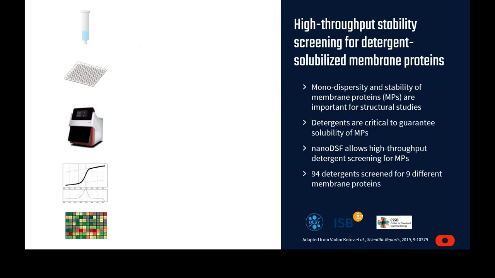
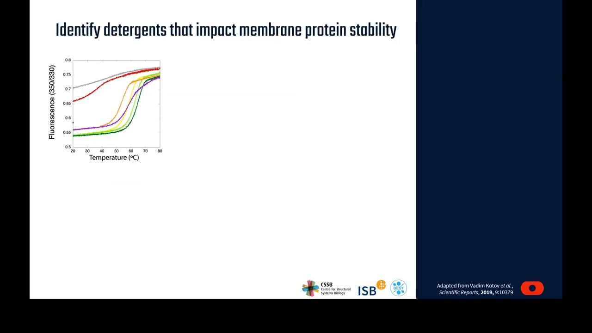
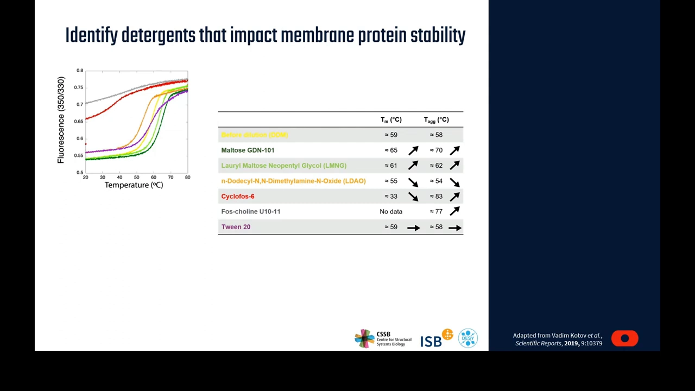
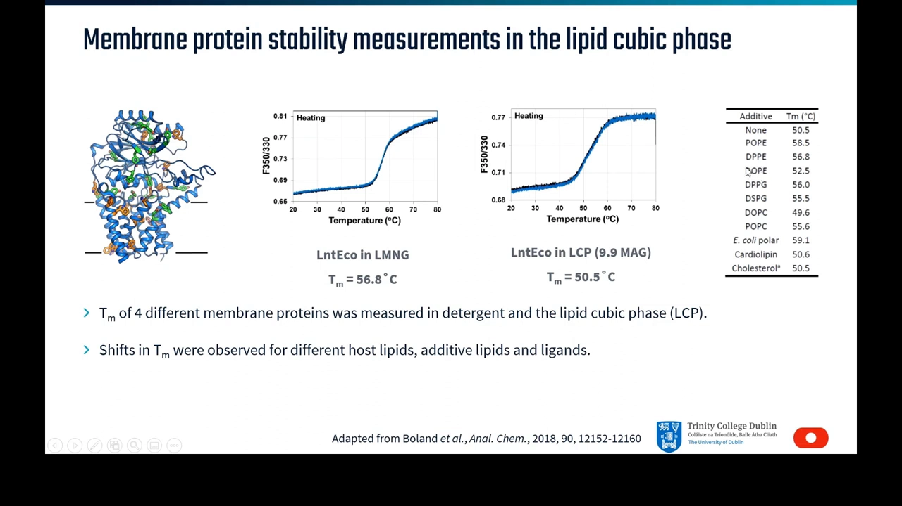
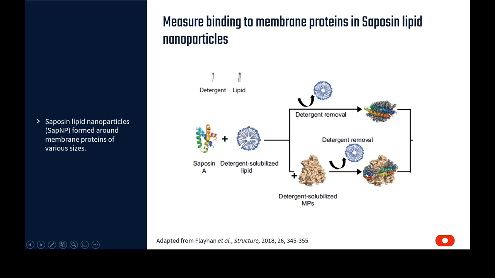
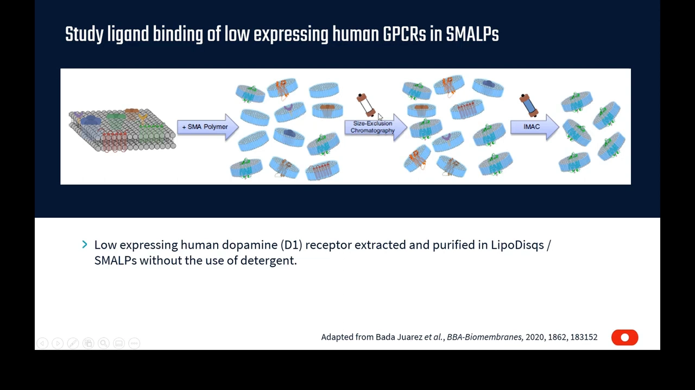
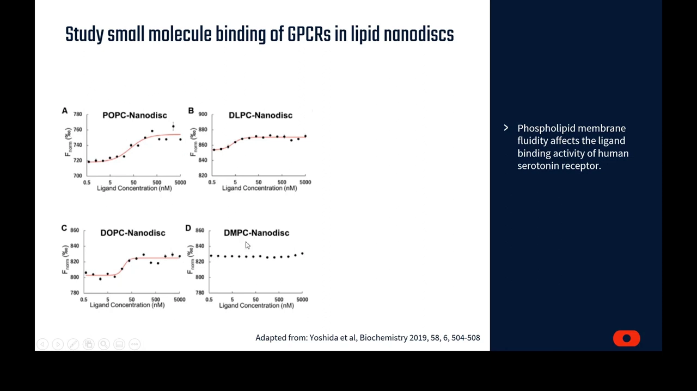

# 去垢剂、脂质立方相与纳米盘：膜蛋白稳定性数据能外推到膜内多远

> 视频来源：[Mischievous membrane proteins (and how to tame them)](https://www.youtube.com/watch?v=w52_PNouvFo)（YouTube · NanoTemper Technologies，讲者 Claire Hattie）｜时长约 25 分钟
> 导读：这是一场仪器厂商的应用网络研讨会，科学部分讲得很系统：先用 9 个膜蛋白 × 94 种去垢剂的高通量筛选说明"去垢剂本身就是变量"，再把同一蛋白放进脂质立方相、SapNP、纳米盘和 SMALP，最后用血清素受体的例子说明膜环境能直接决定配体结合。本文只保留科学论证，略去产品介绍；字幕为英文自动字幕，术语已订正。

## 本讲要解决的核心问题（SCQA）

**背景**：膜蛋白（GPCR、离子通道、转运蛋白）约占人类基因组的 30%，是半数以上药物的靶点。但它们表达量低、必须从天然脂双层里提取并增溶，还得在一个全新的类膜环境里保持结构和功能。

**冲突**：为了判断"哪个条件更好"，我们测稳定性——熔解温度 $T_m$、熔解起始温度 $T_{\text{onset}}$、聚集起始温度 $T_{\text{agg}}$。可这些数字全都依赖于**蛋白当时泡在什么里**：换一种去垢剂，$T_m$ 能差十几度；换成脂质立方相，又变一个值。那么，在试管里测到的稳定性，到底在多大程度上能代表膜内的真实情况？

**疑问**：不同膜模拟体系（去垢剂胶束、脂质立方相、纳米盘、SapNP、SMALP）之间，稳定性数据该怎么比较？哪些结论可以外推，哪些不可以？

**回答（中心思想）**：膜蛋白的稳定性不是一个固有常数，而是**"蛋白 + 膜模拟环境"的联合读数**。因此判读这类数据要同时看三件事：**同一环境内部的相对排序**（可比）、**跨环境时的方向与幅度**（只能定性）、以及**功能读数是否同步保留**（决定能不能谈"天然"）。下文按"去垢剂 → 脂质立方相 → 纳米盘/SapNP/SMALP → 功能"的顺序展开，最后给出四条外推判据。

## 一、先定义"稳定性"：三个参数，不是一句话

讲者把膜蛋白研究的困难归成三条：表达量低；要从天然脂双层里提取并增溶；要让它在新的类膜环境中保持结构和功能。她测稳定性用的读数是内源色氨酸、酪氨酸荧光随温度的变化——折叠时色氨酸埋在内部，去折叠时暴露到溶剂，荧光强度和峰位都会变。

[【跳转到 02:45】](https://www.youtube.com/watch?v=w52_PNouvFo&t=165)

从一条热变性曲线里，她取三个参数：

| 参数 | 含义 | 为什么重要 |
| --- | --- | --- |
| $T_m$ | 去折叠曲线的中点 | 反映整体构象稳定性 |
| $T_{\text{onset}}$ | 开始偏离基线的温度 | 反映"最早开始垮"的温度，常比 $T_m$ 更贴近实际使用窗口 |
| $T_{\text{agg}}$ | 开始出现聚集的温度 | 反映溶解度边界，与 $T_m$ 不一定同步 |

[【跳转到 03:27】](https://www.youtube.com/watch?v=w52_PNouvFo&t=207)

这三个参数的分工，是后面所有案例的判读基础。方法学细节（nanoDSF 如何工作、$T_m$ 如何拟合）属于另一小节的内容，这里只记住一点：**它读的是"蛋白所处的局部化学环境变了没有"，所以天然兼容任何缓冲液和去垢剂，不需要外加染料，也就不会因为染料而改变体系。**

## 二、去垢剂本身就是最大的变量：9 个蛋白 × 94 种条件

第一个案例来自一篇高通量筛选工作。设计很干脆：

1. 9 个不同的整合膜蛋白，先都在 **DDM** 里纯化，作为共同起点；
2. 把每个蛋白稀释到过量的 **94 种其他去垢剂**中，平衡 1 小时，让去垢剂交换完成；
3. 逐个测热去折叠与聚集，得到 $T_m$、$T_{\text{onset}}$、$T_{\text{agg}}$；
4. 把结果画成热图，看每种去垢剂相对 DDM 起点是"更稳"还是"更不稳"。

[【跳转到 05:08】](https://www.youtube.com/watch?v=w52_PNouvFo&t=308)

结果是：**同一种蛋白，在不同去垢剂里的 $T_m$ 差别非常明显**。

[【跳转到 06:23】](https://www.youtube.com/watch?v=w52_PNouvFo&t=383)

更值得注意的是下面这张表：**$T_m$ 和 $T_{\text{agg}}$ 的变化方向并不总是一致**。

[【跳转到 06:48】](https://www.youtube.com/watch?v=w52_PNouvFo&t=408)

这张表值得逐行读：

- **LMNG**：$T_m$ 约 59 → 61 ℃，$T_{\text{agg}}$ 58 → 62 ℃，两个方向一致地变好；
- **LDAO**：$T_m$ 降到 55 ℃，而 $T_{\text{agg}}$ 的变化方向与 $T_m$ 相反——**"构象更早垮"和"更不容易聚集"可以同时发生**；
- **Cyclofos-6**：$T_m$ 掉到 33 ℃，$T_{\text{agg}}$ 却升到 83 ℃，这是最极端的"两个参数打架"；
- **Tween 20**：两项基本不动。

讲者由此给出两条判读原则：

1. **只看 $T_m$ 会误判**。有些条件 $T_m$ 更高，但 $T_{\text{onset}}$ 早得多——也就是说蛋白在更低的温度就开始变形了，只是中点被拉高了。所以作者把 $T_m$ 与 $T_{\text{onset}}$ 做了关联，专门排除这类"假稳定"。
2. **聚集是独立的失效模式**。构象稳定 ≠ 不聚集；两者要分别优化。

[【跳转到 07:13】](https://www.youtube.com/watch?v=w52_PNouvFo&t=433)

## 三、从胶束到双层：脂质立方相里的 $T_m$ 会变

去垢剂胶束只有单层，没有真正的双层。要更接近膜，一个办法是把蛋白放进**脂质立方相**（lipid cubic phase，LCP）——也就是膜蛋白 in meso 结晶用的那种黏稠介观相。

讲者引用的工作检验了一个更基础的问题：**在介观相里到底能不能测到去折叠转变？** 答案是能。

[【跳转到 08:12】](https://www.youtube.com/watch?v=w52_PNouvFo&t=492)

这张图信息量很大，可以分三层读：

1. **环境类型改变基准值**：同一蛋白，LMNG 胶束里 $T_m = 56.8$ ℃，换到 LCP 里变成 50.5 ℃。差 6 度多。这说明"胶束里的稳定性"和"双层里的稳定性"不是同一个量。
2. **同一环境内，脂质组成是可控变量**：在 LCP 里换不同的添加脂质，$T_m$ 从 49.6 ℃（DOPC）到 58.5 ℃（POPE），跨度接近 9 度。**脂质组成本身就是稳定性的一个自变量。**
3. **有些添加物几乎无影响**：胆固醇 50.5 ℃、心磷脂 50.6 ℃，与不加（50.5 ℃）几乎一样。也就是说，不是"加了脂质就一定更稳"，方向依赖具体脂质。

讲者特别强调，这类测量此前做不到，因为 LCP 非常黏稠。它的意义不在于"LCP 更好"，而在于**它让"双层环境下的稳定性"第一次变成了可测的量**。

## 四、纳米盘、SapNP、SMALP：把膜"剪小"再测

比 LCP 更"像膜又能当可溶颗粒用"的，是各种膜模拟颗粒。

**SapNP（皂苷脂质纳米颗粒）**的组装逻辑很直观：把去垢剂增溶的膜蛋白、去垢剂增溶的脂质、以及皂苷（saponin A）混在一起，然后**去掉去垢剂**——皂苷在脂质存在下会形成盘状颗粒，把膜蛋白包在一片真正的脂双层里。

[【跳转到 18:19】](https://www.youtube.com/watch?v=w52_PNouvFo&t=1099)

讲者引用的结果显示：**同一批膜蛋白，重构到 SapNP 和脂质纳米颗粒后，比在去垢剂里更稳定**；同时无标记的结合测量显示，重构后的蛋白**仍然保留配体结合能力**——这一点很关键，因为"更稳定"如果以失去功能为代价，就没有意义。

**SMALP（SMA 脂质颗粒）**走的是另一条路：用 SMA 聚合物像饼干模具一样，直接在天然膜上切出含膜蛋白和周围天然脂质的盘状颗粒，全程不用去垢剂。

[【跳转到 21:19】](https://www.youtube.com/watch?v=w52_PNouvFo&t=1279)

这条路线对**低表达、易失活**的蛋白特别有价值：它保留了蛋白周围的一部分天然脂质，而这部分脂质恰恰是去垢剂提取时最先被剥掉的。

## 五、膜环境不只改稳定性，还改功能：血清素受体的例子

前面讲的都是"稳定性"。但讲者用一个人血清素受体（5-HT 受体）的实验说明，膜环境能直接改变**功能读数**。

[【跳转到 17:40】](https://www.youtube.com/watch?v=w52_PNouvFo&t=1060)

实验设计是：受体先在去垢剂中纯化，再重构到**不同脂质组成**的纳米盘里（POPC、DLPC、DOPC、DMPC），然后用荧光标记组氨酸标签，测血清素结合的浓度依赖曲线。

[【跳转到 20:17】](https://www.youtube.com/watch?v=w52_PNouvFo&t=1217)

结果是：POPC、DLPC、DOPC 纳米盘里都能测到结合，**DMPC 纳米盘里完全测不到**。

讲者的解释是：DMPC 的酰基链短、膜流动性低，可能**阻止了受体向活性构象转变**。也就是说，蛋白没坏、配体也在，但膜把这个受体"卡"在了不能结合的状态。

这个例子把本小节的核心推到了更强的一步：**膜环境不仅影响蛋白会不会散架，还影响它是不是处于能干活的状态。** 因此"在去垢剂里测得结合"和"在膜里是否结合"之间，隔着的不是误差，而是可能的定性差异。

## 六、外推边界：四条判据

把上面的案例合起来，可以得到一张判读清单。看到一份膜蛋白稳定性数据时，按顺序问四个问题：

**判据一：这个数字是在哪种膜模拟环境里测的？**
胶束（单层、无脂质）、脂质立方相（双层、黏稠）、纳米盘（双层 + 支架蛋白）、SapNP（双层 + 皂苷）、SMALP（双层 + 天然脂质）——它们给出的 $T_m$ 可以差 6 度以上。**跨环境比较只能看方向，不能看绝对值。**

**判据二：同一环境内部的相对排序是否稳健？**
94 种去垢剂的筛选之所以有用，恰恰因为它比较的是"同一类环境内部谁更好"。这类**相对排序**是最可靠的外推内容：你可以相信"LMNG 比 DDM 更适合这个蛋白"，但不能相信"这个蛋白的 $T_m$ 是 61 度"。

**判据三：三个参数是否同向？**
$T_m$ 升高但 $T_{\text{onset}}$ 提前，说明是"假稳定"；$T_m$ 掉而 $T_{\text{agg}}$ 升（如 Cyclofos-6），说明构象稳定性和胶体稳定性是两件事。**只看一个参数的外推最危险。**

**判据四：功能读数是否保留？**
SapNP 重构后仍能结合配体、SMALP 中的低表达 GPCR 仍能测到特异性结合——这些"功能还在"的证据，才让"更稳定"这个结论有意义。反过来，DMPC 纳米盘的例子说明：**稳定性合格不等于功能合格。**

[【跳转到 24:18】](https://www.youtube.com/watch?v=w52_PNouvFo&t=1458)

一句话总结外推边界：**从试管到膜内，可以外推的是"相对优劣"和"机制方向"，不能外推的是"绝对数值"和"功能状态"。**

## 小结

- 膜蛋白研究的三道坎：表达量低、要从天然脂双层提取增溶、要在新类膜环境中保持结构与功能。
- 稳定性要用三个参数一起看：$T_m$（中点）、$T_{\text{onset}}$（最早开始垮）、$T_{\text{agg}}$（开始聚集）。三者可以不同向。
- 去垢剂是最大的变量：9 个蛋白 × 94 种去垢剂的筛选显示，同一蛋白换去垢剂，$T_m$ 可差十几度；Cyclofos-6 甚至让 $T_m$ 掉到 33 ℃ 而 $T_{\text{agg}}$ 升到 83 ℃。
- 脂质立方相让"双层环境下的稳定性"变得可测：同一蛋白在 LMNG 中 $T_m$ 56.8 ℃，在 LCP 中 50.5 ℃；换添加脂质又能在 49.6–58.5 ℃ 之间移动。
- 纳米盘、SapNP、SMALP 让蛋白在更接近天然的环境中更稳定，并且保留配体结合能力；SMALP 还能保留天然脂质、实现无去垢剂纯化。
- 膜环境能改变功能本身：血清素受体在 DMPC 纳米盘中完全测不到结合，原因是膜流动性低、受体无法进入活性构象。
- 外推判据四条：看环境类型、看同环境内相对排序、看三参数是否同向、看功能是否保留。

## 关键术语速查

| 术语 | 一句话解释 |
| --- | --- |
| $T_m$（熔解温度） | 热去折叠曲线的中点温度，反映整体构象稳定性 |
| $T_{\text{onset}}$ | 曲线开始偏离基线的温度，代表"最早开始失稳"的位置 |
| $T_{\text{agg}}$ | 开始出现聚集的温度，反映胶体稳定性，可与 $T_m$ 不同向 |
| 脂质立方相（LCP） | 脂质形成的黏稠介观相，含连续双层，用于 in meso 结晶与稳定性测量 |
| 纳米盘（nanodisc） | 膜支架蛋白箍住的一小片脂双层，水溶性，可承载膜蛋白 |
| SapNP | 用皂苷代替支架蛋白形成的脂质纳米颗粒，去除去垢剂后组装 |
| SMALP | 用 SMA 聚合物从天然膜上切下的盘状颗粒，保留天然脂质、无需去垢剂 |
| DDM / LMNG / LDAO | 常用去垢剂；同一蛋白在它们之中的稳定性可以差别很大 |
| 膜模拟环境（membrane mimetic） | 泛指胶束、脂质体、纳米盘、SapNP、SMALP 等替膜体系 |