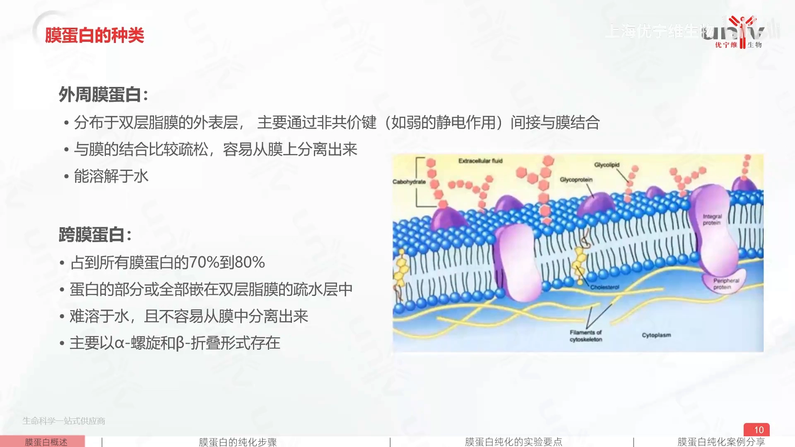
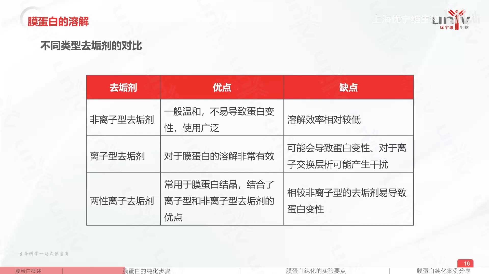
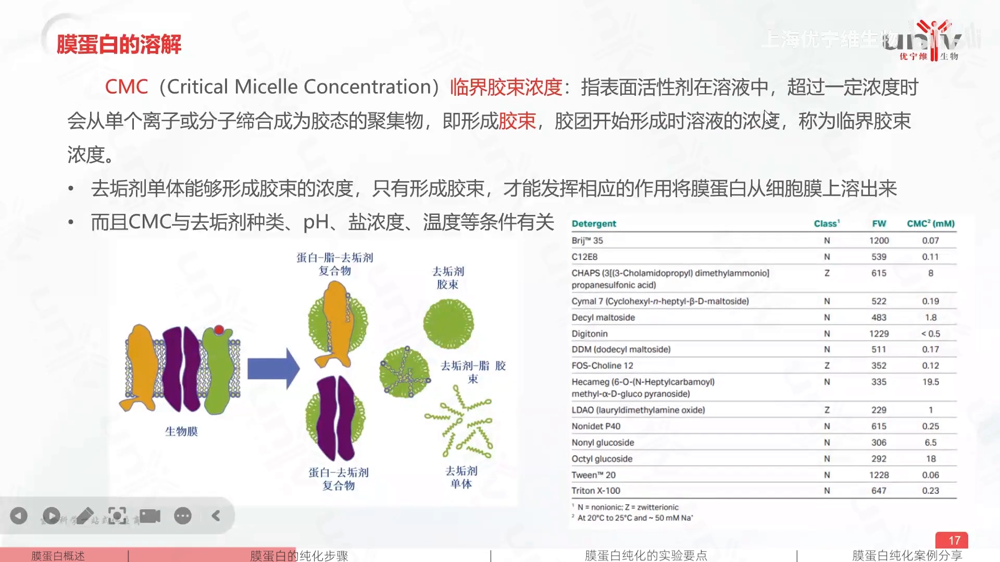
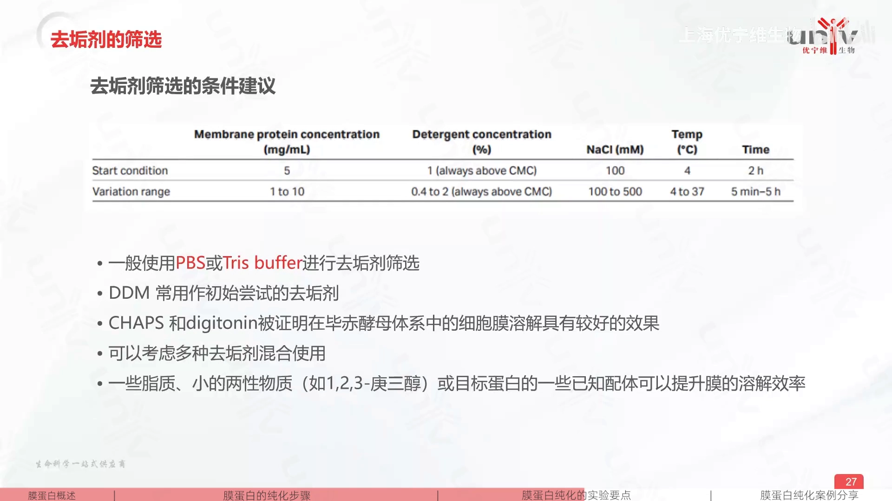
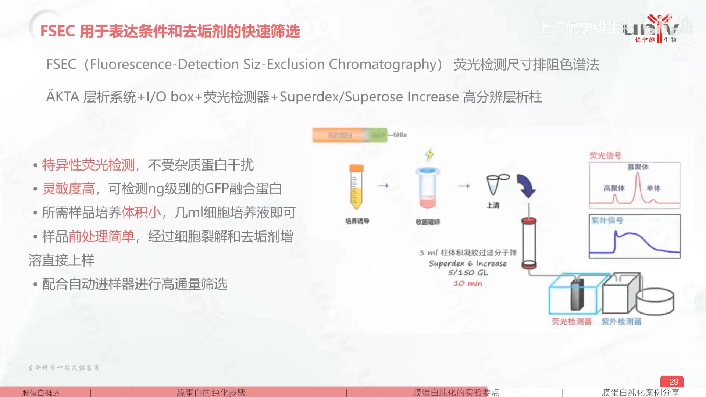
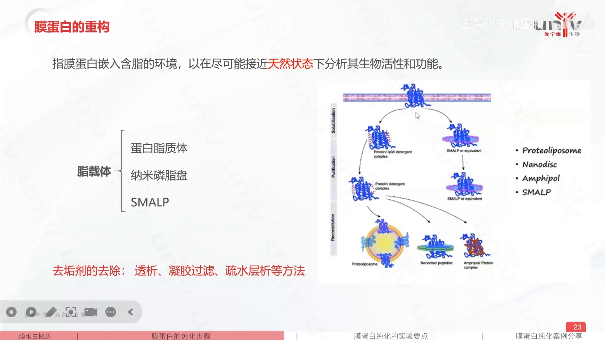

# 去垢剂筛选与溶液条件：膜蛋白从膜里被「请出来」时的稳定性账本

> 视频来源：[膜蛋白纯化策略分享](https://www.bilibili.com/video/BV1ETeczTE4L/)（Bilibili · 上海优宁维生物，讲者李老师，西湖大学）｜时长约 32 分钟
> 导读：这是一场偏实验操作的讲座，前半段讲膜蛋白分类与去垢剂原理，后半段给出可直接照抄的条件表：初始溶解条件、优化范围、去垢剂筛选方案、FSEC 快速筛选，最后用三个冷冻电镜结构工作说明真实项目里的具体参数。本文按讲者顺序整理，并把散落在各页的"溶液条件"集中成一张账本。字幕为中文自动字幕，术语（去垢剂、亲和层析、分子筛、洋地黄皂苷等）已按上下文订正。

## 本讲要解决的核心问题（SCQA）

**背景**：膜蛋白是近 70% 药物的靶标，其中跨膜蛋白占所有膜蛋白的 70%–80%。它们的功能重要到"每次结构解析有较大突破都会拿诺贝尔奖"。

**冲突**：跨膜蛋白的部分或全部嵌在脂双层的疏水层里，难溶于水、也不容易从膜上分离。要研究它，必须先用去垢剂把膜溶开、把蛋白"骗"进水里；可去垢剂本身又会扰动蛋白，离子型去垢剂甚至直接导致变性。于是同一个操作既是必需品，又是风险源。

**疑问**：去垢剂该怎么选？溶解时的蛋白浓度、去垢剂浓度、盐浓度、温度、时间该怎么定？怎么判断某个条件"守住了"蛋白而不是"弄坏了"它？

**回答（中心思想）**：膜蛋白的稳定性是一本**条件账本**——去垢剂种类是第一变量，溶液条件（浓度、盐、温度、时间、缓冲液）是可调旋钮，而"全程维持去垢剂 + 及时重构回脂环境"是两条不能破的底线。判读稳定性不能只看"溶没溶下来"，要看**均一度**（大小均一、电荷均一）和**是否能重构回有功能的脂环境**。

## 一、先分清两类膜蛋白：难溶的根源在哪

讲者把膜蛋白分成两类：

| 类型 | 位置 | 与膜的结合方式 | 溶解性 |
| --- | --- | --- | --- |
| 外周膜蛋白 | 双层脂膜的外表面 | 非共价键，如较弱的静电作用 | 能溶于水，容易从膜上分离 |
| 跨膜蛋白 | 部分或全部嵌在疏水层中 | 疏水作用嵌入脂双层 | 难溶于水，不易从膜中分离 |

[【跳转到 03:38】](https://www.bilibili.com/video/BV1ETeczTE4L/?t=218)

这张图解释了一件事：**"难溶"不是蛋白的缺陷，而是它的设计**。跨膜段必须疏水才能待在脂双层里，所以一旦离开膜，它就必然面对"疏水面暴露给水"的困境。后面的所有操作，本质上都是在替这段疏水面找一个替身。

## 二、三类去垢剂：温和与高效之间的取舍

去垢剂就是表面活性剂，一端亲水、一端疏水。讲者按亲水头带电情况把它分成三类，并给了明确的取舍表：

[【跳转到 08:14】](https://www.bilibili.com/video/BV1ETeczTE4L/?t=494)

- **非离子型**（如 DDM）：一般温和，不易导致蛋白变性，使用广泛；缺点是溶解效率相对较低。
- **离子型**（如 SDS）：对膜蛋白溶解非常有效；但可能导致变性，而且会与离子交换层析柱强结合，干扰纯化。
- **两性离子型**（如 CHAPS）：常用于膜蛋白结晶，兼具离子型与非离子型的优点；但相比非离子型更易导致变性。

这张表其实已经给出了策略：**默认从非离子型开始，只有在溶不下来时才考虑更强的手段，并承担变性的风险。**

## 三、CMC：去垢剂"起效"的门槛，而且随溶液条件变

讲者强调了一个必须满足的条件：去垢剂浓度要达到 **CMC**（临界胶束浓度，critical micelle concentration）。

[【跳转到 09:29】](https://www.bilibili.com/video/BV1ETeczTE4L/?t=569)

CMC 的含义是：**低于它，去垢剂以单体存在，不形成胶束，也就不能把膜蛋白"裹"出来；高于它，胶束形成，膜被溶解，蛋白-脂-去垢剂复合物出现。**

这张幻灯片上还有一句非常关键、很容易被忽略的话：**CMC 与去垢剂种类、pH、盐浓度、温度等条件有关。** 这句话把"去垢剂选择"和"溶液条件"直接连了起来——你换了缓冲液的 pH 或加了盐，严格来说 CMC 也变了，所以"去垢剂浓度 1%"这种写法背后必须有一句"always above CMC"作为前提。

表里几个数值可以帮读者建立数量级感：

| 去垢剂 | 类型 | CMC（约） |
| --- | --- | --- |
| DDM（十二烷基麦芽糖苷） | 非离子 | 0.17 mM |
| CHAPS | 两性离子 | 8 mM |
| Triton X-100 | 非离子 | 0.23 mM |
| Tween 20 | 非离子 | 0.06 mM |
| 洋地黄皂苷（digitonin） | 非离子 | 小于 0.5 mM |

注意 CHAPS 的 CMC 比 DDM 高出一个多数量级——这解释了为什么用 CHAPS 时浓度往往要给得更高。

## 四、溶解与纯化：几条容易被忽略的操作细节

讲者给的流程是：重组表达 → 细胞收获 → 细胞裂解与细胞膜制备 → **细胞膜溶解** → 纯化 → 纯度与均一度检测 → 结构与功能研究。

其中几个细节值得单独记：

**1）破碎要"叠加"而不是"选一个"。** 普通胞内蛋白用超声破碎就够了；膜蛋白一般把超声、物理研磨、反复冻融综合起来用，还会加酶，目的都是让膜更容易被打散。

**2）纯化一般走两步法。** 因为体系里有去垢剂，离子交换层析通常不合适（离子型去垢剂会与柱子强结合）。所以第一步用**亲和层析**捕获，第二步用**分子筛**精纯，同时去掉聚集体和去垢剂胶束。

**3）标签要小，His 要长。** 膜蛋白结构复杂、需要多次折叠，GST、MBP 这类大标签可能影响折叠和构象，所以常用 FLAG、His、Strep。如果只能用 His，一般会延长到十个组氨酸——因为标签太小可能被折叠到蛋白内部，延长才能充分暴露。

[【跳转到 12:46】](https://www.bilibili.com/video/BV1ETeczTE4L/?t=766)

**4）跑 SDS-PAGE 不要煮沸。** 膜蛋白在高温下非常容易沉淀，讲者建议在 60 ℃ 让样品溶解在 SDS 中即可，不要煮沸。

**5）均一度要分两维看。** 大小均一度靠分子筛（纯化第二步已经顺带完成）；电荷均一度靠离子交换，讲者推荐高分辨率的柱子（粒径约 9 μm），可以把电荷异构体分开。

## 五、去垢剂筛选：一张可以直接照抄的条件表

这是全场最实用的一页。讲者给出了初始条件与优化范围：

[【跳转到 20:36】](https://www.bilibili.com/video/BV1ETeczTE4L/?t=1236)

| 参数 | 起始条件 | 优化范围 |
| --- | --- | --- |
| 膜蛋白浓度 | 5 mg/mL | 1–10 mg/mL |
| 去垢剂浓度 | 1%（始终高于 CMC） | 0.4%–2%（始终高于 CMC） |
| NaCl | 100 mM | 100–500 mM |
| 温度 | 4 ℃ | 4–37 ℃ |
| 时间 | 2 h | 5 min–5 h |

配合这张表的还有几条经验：

- 缓冲液一般用 **PBS 或 Tris**；
- **DDM 作为初始尝试**的去垢剂；
- **CHAPS 和洋地黄皂苷**在毕赤酵母体系的细胞膜溶解中效果较好；
- 可以考虑**多种去垢剂混合**使用；
- 一些**脂质、小的两性物质（如 1,2,3-庚三醇）或目标蛋白的已知配体**可以提升膜的溶解效率。

最后这条特别值得注意：**加配体来稳定蛋白**这件事，在膜蛋白里同样是标准操作——配体把构象按住，蛋白就不容易在去垢剂里散掉。

讲者还展示了一篇文献的实例：用 EM29 这个蛋白，在 E. coli 中表达带 His 标签的蛋白，用 **8 种不同去垢剂**做膜溶解和重构尝试，结果差别明显——所以去垢剂筛选是"非常必要的一个步骤"，不能凭经验跳过。

[【跳转到 21:41】](https://www.bilibili.com/video/BV1ETeczTE4L/?t=1301)

如果不想每次都做完整纯化，可以用 **FSEC**（荧光检测尺寸排阻色谱）来快速筛：在目的蛋白一端加 GFP 标签，裂解、去垢剂增溶后直接上小柱（5/150，约 10 分钟一个样品），用荧光信号判断**峰的形态和位置**。荧光只来自你的目标蛋白，不受杂蛋白干扰；紫外信号则告诉你总蛋白情况。两者一对比，就能看出这个去垢剂是让蛋白以单体形式好好待着，还是变成了聚集体。

## 六、重构：把蛋白从胶束里"还"回脂环境

[【跳转到 25:03】](https://www.bilibili.com/video/BV1ETeczTE4L/?t=1503)

讲者反复强调一条底线：**在纯化的全程中都要包含去垢剂**，让膜蛋白维持在一个稳定的状态。但去垢剂中的蛋白很难做功能研究，因为它不在天然状态。所以纯化之后要做**重构**（reconstitution）：把膜蛋白嵌回含脂的环境。

[【跳转到 14:51】](https://www.bilibili.com/video/BV1ETeczTE4L/?t=891)

常见的脂载体有四类：

- **蛋白脂质体**（proteoliposome）：把蛋白重构进脂质体膜里，最接近"膜"的形态；
- **纳米磷脂盘**（nanodisc）：用支架蛋白箍住一小片脂双层；
- **amphipol**：用两亲性聚合物替代去垢剂包住跨膜段；
- **SMALP**：用 SMA 聚合物直接从天然膜上切下含天然脂质的盘状颗粒。

去垢剂的去除靠**透析、凝胶过滤、疏水层析**等方法——去垢剂被慢慢抽走，脂质接手包住疏水面。这一步做得好不好，直接决定你最后测到的是"蛋白的功能"还是"变性蛋白的残留信号"。

[【跳转到 15:36】](https://www.bilibili.com/video/BV1ETeczTE4L/?t=936)

讲者还提到 SMALP 的另一种用法：它本身就能起到去垢剂的作用，**直接把膜蛋白从细胞膜上提取下来**并构建成 SMALP 载体，省掉了先去垢剂溶解再重构的两步。这是与"去垢剂路线"并列的第二条常见路线。

## 七、三个真实案例里的具体条件

讲者用三篇结构工作说明这些参数在真实项目里长什么样。它们的共同点是：**去垢剂 + 脂质添加物 + 低温 + 超速离心**，差别在具体配方。

| 案例 | 表达体系 | 溶解条件 | 纯化路线 |
| --- | --- | --- | --- |
| TCR-CD3 受体复合物（Nature） | HEK293F，C 端 Strep 与 His 标签 | 1% DDM + 0.2% CHS，4 万 g 离心 30 min 取上清 | Strep 亲和层析 → 戊二醛交联 40 min → Superose 6 Increase |
| 人源 NALCN 钠通道 | HEK293F，C 端 FLAG 与 Twin-Strep | LMNG 与 GDN 溶解，超速离心 1 h | FLAG 亲和 → Strep 亲和 → Superose 6 Increase |
| CGRP 受体（GPCR） | 昆虫细胞，FLAG 标签 | 0.5% LMNG + 0.03% CHS，3 万 g 离心 15 min | FLAG 亲和 → Superdex 200 Increase |

[【跳转到 26:33】](https://www.bilibili.com/video/BV1ETeczTE4L/?t=1593)

案例中的溶解条件值得单独看：TCR-CD3 用 1% DDM 加 0.2% CHS；NALCN 用 LMNG 与 GDN；CGRP 受体用 0.5% LMNG 加 0.03% CHS。三者都在低温下用超速离心收集上清，然后进入亲和层析。

三点值得注意：

1. **CHS（胆固醇琥珀酸单酯）常与 DDM、LMNG 搭配**。它是脂质添加物，作用是补上去垢剂剥掉的那部分脂质环境——这正好呼应前面"加脂质提升溶解效率"的建议。
2. **新型去垢剂 LMNG、GDN 出现频率很高**。它们比 DDM 更温和，对 GPCR 这类容易失活的蛋白更友好。
3. **做结构的项目会用两个标签串联**（FLAG + Strep），因为纯度要求更高，后续要打质谱、上电镜。

## 小结

- 跨膜蛋白占膜蛋白的 70%–80%，"难溶"是它的设计而非缺陷：跨膜段必须疏水才能待在脂双层里。
- 三类去垢剂是温和与高效的取舍：非离子型（DDM）温和但溶解效率低，离子型（SDS）高效但易变性且干扰离子交换，两性离子型（CHAPS）居中、常用于结晶。
- 去垢剂浓度必须高于 CMC；而 **CMC 本身随 pH、盐浓度、温度变化**，所以"1% 去垢剂"必须配上"始终高于 CMC"这个前提。
- 去垢剂筛选有可照抄的起点：蛋白 5 mg/mL、去垢剂 1%、NaCl 100 mM、4 ℃、2 h，缓冲液用 PBS 或 Tris，DDM 起步；优化范围是 1–10 mg/mL、0.4%–2%、100–500 mM、4–37 ℃、5 min–5 h。
- 提升溶解效率的额外手段：混合去垢剂、加脂质、加小两性物质（如 1,2,3-庚三醇）、加已知配体。
- FSEC 可以在 10 分钟内用 GFP 荧光判断某个去垢剂下蛋白是单体还是聚集体，是低成本的筛选工具。
- 两条底线：纯化全程保持去垢剂；纯化后及时重构回脂环境（脂质体、纳米盘、amphipol、SMALP）。
- 真实项目的配方几乎都是"去垢剂 + 脂质添加物（如 CHS）+ 低温 + 超速离心"，并越来越多使用 LMNG、GDN 这类温和去垢剂。

## 关键术语速查

| 术语 | 一句话解释 |
| --- | --- |
| 跨膜蛋白 | 部分或全部嵌在脂双层疏水层中的膜蛋白，占膜蛋白的 70%–80% |
| 外周膜蛋白 | 通过非共价键（如弱静电作用）贴在膜外表面的蛋白，可溶于水 |
| 去垢剂 | 两亲性表面活性剂，一端亲水一端疏水，能把膜蛋白从膜上溶解下来 |
| CMC（临界胶束浓度） | 去垢剂开始形成胶束的浓度；低于它无法溶解膜，且随 pH、盐、温度变化 |
| DDM | 非离子型去垢剂，膜蛋白溶解的常用起点，CMC 约 0.17 mM |
| CHAPS | 两性离子型去垢剂，常用于膜蛋白结晶，CMC 约 8 mM |
| CHS | 胆固醇琥珀酸单酯，常作为脂质添加物与 DDM、LMNG 搭配 |
| LMNG / GDN | 较温和的新型去垢剂，常用于 GPCR 等易失活蛋白 |
| FSEC | 荧光检测尺寸排阻色谱，用 GFP 标签快速筛选表达条件与去垢剂 |
| 重构（reconstitution） | 把膜蛋白从去垢剂中转移回脂质体、纳米盘或 SMALP 等含脂环境 |
| SMALP | 用 SMA 聚合物从天然膜切下的盘状颗粒，保留天然脂质、无需去垢剂 |
| 均一度 | 样品在大小与电荷上的均一程度，是结构研究的常见质控指标 |