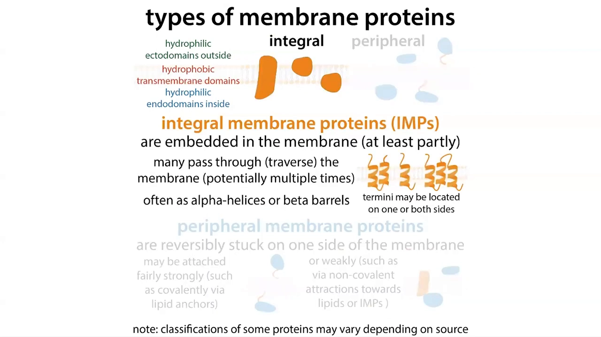
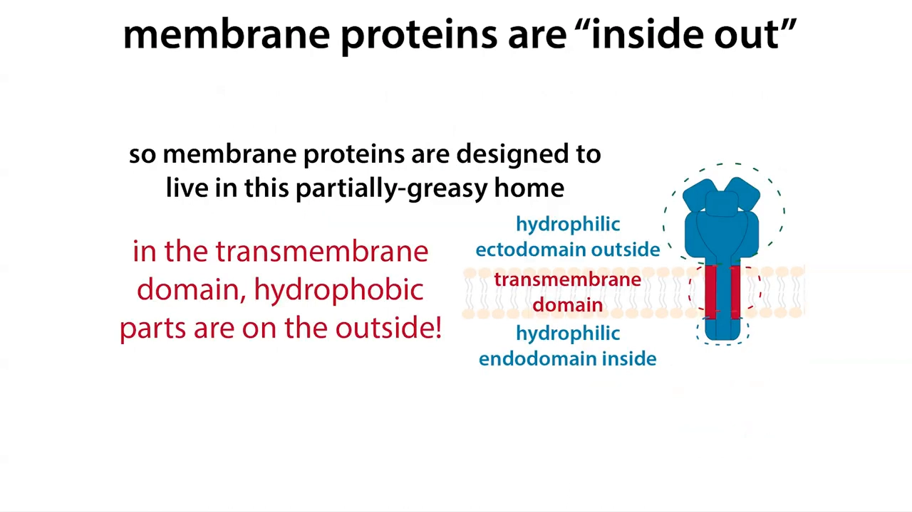
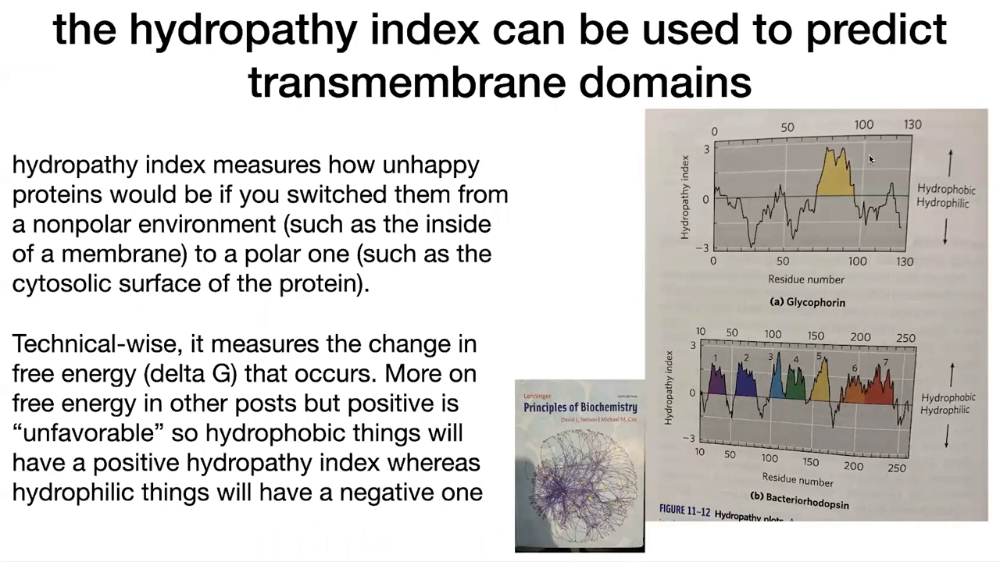
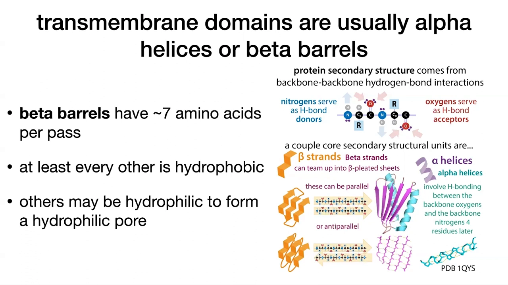
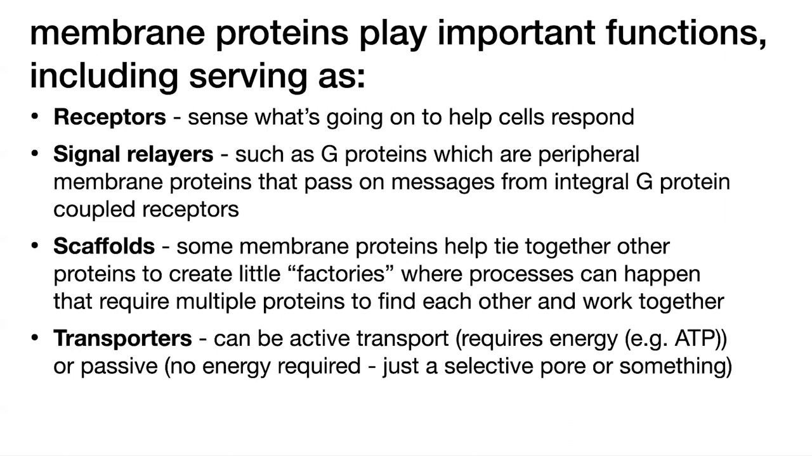
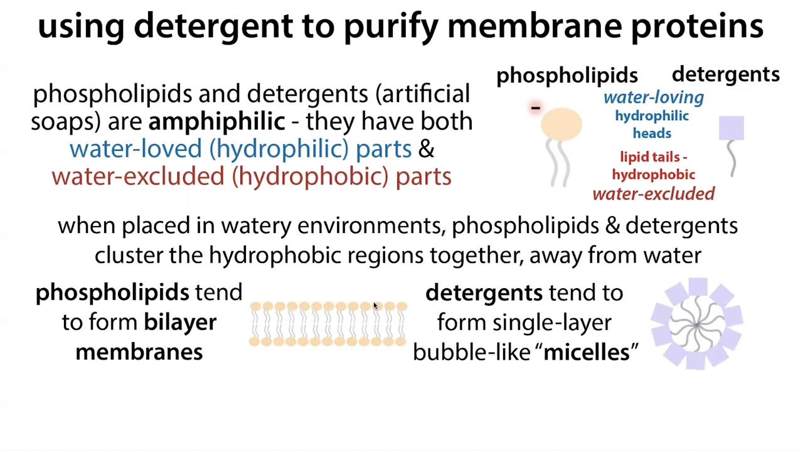
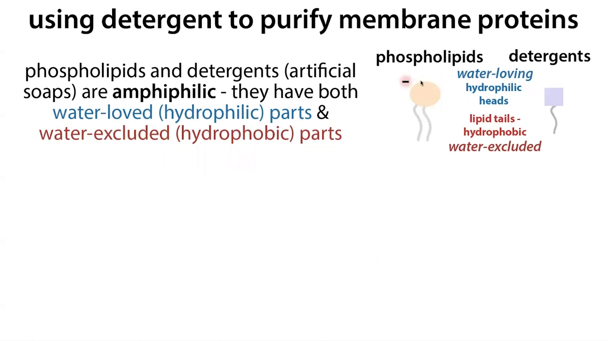
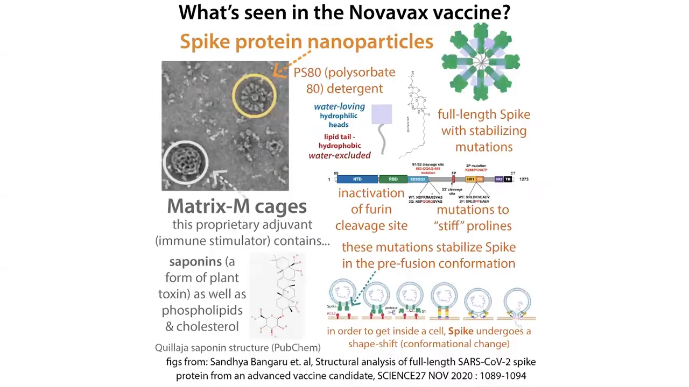
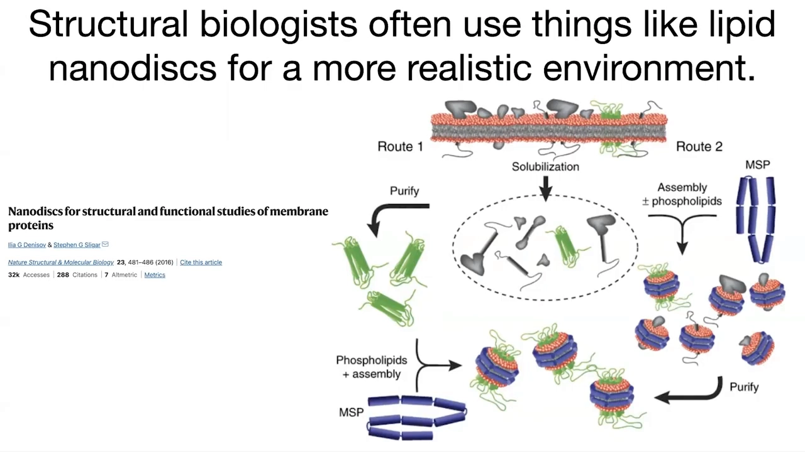

# 膜蛋白为什么是「里外翻转」的：膜环境如何决定疏水暴露，以及去垢剂与纳米盘如何把它请进水里

> 视频来源：[Membrane protein biochemistry - living in a world that's inside out](https://www.youtube.com/watch?v=uoXu1EF6atc)（YouTube · the bumbling biochemist）｜时长约 26 分钟
> 导读：讲者用"里外翻转"（inside out）这个比喻，把膜蛋白的疏水暴露、去垢剂胶束、脂质纳米盘和疏水性指数串成一条线，全程配手绘幻灯片，适合第一次接触膜蛋白的读者。本文按她的顺序整理；字幕为英文自动字幕，术语已按上下文订正。需要说明的是，这支视频没有讨论膜蛋白表面的界面电荷分布，那部分本文不作展开。

## 本讲要解决的核心问题（SCQA）

**背景**：生物化学里说一个蛋白"可溶"，意思是它被水包着。水溶性蛋白把亲水氨基酸摆在表面、把疏水氨基酸聚在核心，这是蛋白质折叠最基本的驱动力之一。

**冲突**：膜蛋白有一大块身体埋在脂双层里。脂双层内部是"反水"的油性环境，于是同一个蛋白在跨膜段上的排布必须整个反过来：疏水侧朝外、亲水侧朝内。讲者把这个状态叫作"里外翻转"。

**疑问**：这种翻转的排布是怎么被环境逼出来的？它为什么让膜蛋白特别难研究？实验室又是用什么办法，把一段本来只认脂质的结构域，搬进一个水相体系里还不让它散架？

**回答（中心思想）**：膜蛋白的疏水暴露方向是**由环境决定的**——在水里疏水朝内，在膜里疏水朝外。因此研究膜蛋白的核心操作，不是"把它变亲水"，而是**给它换一个仍然油性的小环境**：去垢剂胶束、脂质纳米盘、脂质立方相都属于这类"借来的膜"。换的环境越接近真实脂双层，蛋白的行为越接近天然，但也越难操作。

## 一、膜里一半是蛋白：先说清楚研究对象

讲者开篇给了两个数字：细胞膜的质量里大约一半其实是蛋白质；而这些嵌在膜里的蛋白占了药物靶点的大约 60%。原因不难理解——受体长在细胞表面，药物最容易撞上；而且受体一旦被调节，下游会像拧开消防水龙带一样放大效应。

[【跳转到 00:35】](https://www.youtube.com/watch?v=uoXu1EF6atc&t=35)

膜蛋白大致分两类：

- **整合膜蛋白**（integral membrane proteins，IMP）：至少有一部分嵌在膜里。其中很多会穿过整个膜，叫**跨膜蛋白**（transmembrane proteins）。
- **外周蛋白**（peripheral proteins）：可逆地贴在膜的一侧。可能通过共价连接的脂质锚固定，也可能只是弱结合在脂质头部或别的整合膜蛋白上。

讲者提醒，具体分类方式各家教材略有出入，但"整合／外周"这条主线是通用的。本文和她一样，主要讲整合膜蛋白。

## 二、「里外翻转」：疏水暴露的方向由环境决定

这是全场的核心论点，值得慢慢拆。

对一个水溶性蛋白来说，折叠的驱动力之一就是把疏水侧链埋进核心、把亲水侧链留在表面——因为水不喜欢油的表面。讲者用"水的外套"来形容可溶蛋白：它被溶剂包着，表面必须让水愿意贴上来。

但跨膜段面对的不是水，而是磷脂的脂肪酸尾巴。磷脂是**两亲性**（amphiphilic）分子：一个喜欢水的头、两条避水的尾。它们在水里自动排成**脂双层**（lipid bilayer），把尾巴藏在中间、头朝两侧的水。于是跨膜段必须做一件相反的事：

[【跳转到 03:38】](https://www.youtube.com/watch?v=uoXu1EF6atc&t=218)

- 在跨膜段里，**疏水残基朝外**，去和脂质尾巴打交道；
- **亲水残基朝内**，藏在螺旋之间或形成内部的水性通道。

讲者强调，这不是蛋白"想"这样，而是环境筛选出来的：同一条序列放到水里会想尽办法把疏水部分藏起来，放到膜里则必须把它们露出来。理解了这一点，后面所有的实验操作就都能读懂了——**你一旦把蛋白从膜里拿出来放进水，就等于强迫它把不该露的疏水面暴露给水，它当然会不稳定、会聚集。**

## 三、跨膜段长什么样：α 螺旋与 β 桶的两套算法

既然跨膜段要靠疏水残基和脂质接触，那么从序列上就应该能"看出"跨膜段。讲者介绍了**疏水性指数**（hydropathy index）。

它的定义很直白：把某个氨基酸从非极性环境（膜内部）挪到极性环境（胞质一侧），自由能会变化多少。用公式说就是测这个过程的 $\Delta G$：

$$
\Delta G_{\text{transfer}} = G_{\text{polar}} - G_{\text{nonpolar}}
$$

$\Delta G$ 为正，说明这一步"不利"，也就说明这个残基更喜欢油环境；为负则说明它更喜欢水。所以沿着序列画一条疏水性指数曲线，**正值峰就对应疏水段，负值谷对应亲水段**。

[【跳转到 19:24】](https://www.youtube.com/watch?v=uoXu1EF6atc&t=1164)

这张图把两件事同时说清楚了：

| 蛋白 | 疏水峰个数 | 含义 |
| --- | --- | --- |
| 血型糖蛋白（glycophorin） | 1 | 单次跨膜 |
| 细菌视紫红质（bacteriorhodopsin） | 7 | 七次跨膜，峰与峰之间由亲水段连接 |

讲者补充了两个"数数"的经验规则，这也是预测跨膜段的实际依据：

- 以 **α 螺旋**穿膜时，需要 **20 到 30 个氨基酸**。原因不是膜的厚度，而是螺旋是盘绕的：每个残基沿螺旋轴只前进约 0.15 nm，而且穿膜时每个残基都要和脂质接触，所以每个都得疏水。
- 以 **β 折叠链**穿膜时，只要约 **7 个氨基酸**就能穿过一次。因为 β 链是伸展的锯齿状，而且只有隔一个的侧链朝向脂质，所以"每隔一个疏水"就够了——剩下那些亲水侧链正好可以朝内，围成一个亲水孔道。

[【跳转到 23:17】](https://www.youtube.com/watch?v=uoXu1EF6atc&t=1397)

正是靠"连续 20 到 30 个疏水残基"这个特征，科学家估计出人类约四分之一的蛋白编码基因是膜蛋白。

## 四、为什么"里外翻转"让研究变难：截短策略的边界

膜蛋白的功能很多，讲者列了四类：

[【跳转到 04:23】](https://www.youtube.com/watch?v=uoXu1EF6atc&t=263)

- **受体**：感知外界，帮细胞作出响应；
- **信号传递者**：例如 G 蛋白，把整合膜蛋白受体收到的信息继续往下传；
- **支架**：把需要协同的蛋白拉到一起，像流水线上的工位；
- **转运蛋白**：主动运输要耗能（如 ATP），被动运输只要一个有选择性的孔道。

功能这么重要，但研究起来很别扭。讲者给出的第一个"妥协方案"是**只研究膜外的那一段**：把接触水相的部分单独表达、纯化，也就是胞外结构域（ectodomain）或胞内结构域（endodomain），避开跨膜段。

[【跳转到 10:15】](https://www.youtube.com/watch?v=uoXu1EF6atc&t=615)

这个策略的边界很明确：如果你只关心"配体在这一侧怎么结合"，截短完全够用；但如果你想问的是**跨膜信号如何传递、构象如何耦合**，截短就丢掉了一半的答案——因为被切掉的正是把两侧连起来的那一段。

## 五、从细胞到试管：沉淀里才是你的蛋白

接下来讲者讲了一个很实操、也很容易踩的坑。

常规纯化可溶蛋白的流程是：裂解细胞 → 高速离心 → 丢掉沉淀（膜碎片和不溶物）→ 取上清继续做。但膜蛋白恰恰在沉淀里。

[【跳转到 11:02】](https://www.youtube.com/watch?v=uoXu1EF6atc&t=662)

讲者说自己读研轮转时在膜蛋白实验室，必须反复提醒自己"别把沉淀扔了"。原因在于：膜蛋白的"正常溶剂"是脂质而不是水，所以它跟着膜走，不跟上清走。

把蛋白救回来的思路，讲者概括成一句话：**它本来住在膜里，我们就得让它继续住在某种类膜环境里；但我们不想要原来那张膜上的所有杂质，所以要把它从原来的膜里提取到一个更简单、更纯的"膜"里。** 最常用的工具就是去垢剂。

## 六、去垢剂：为什么单尾分子能拆膜，却组不出双层

去垢剂常被叫作"人工肥皂"。它和磷脂一样是两亲性的，差别在于**尾巴的条数**：

形状决定了组装方式。讲者的比喻是：磷脂更像长方形，两块拼起来才能把尾巴全藏住，于是形成**双层**（三明治结构）；去垢剂更像锥形，锥形堆起来自然围成一个球，于是形成**胶束**（micelle）——单层、气泡状，疏水尾巴全部朝内。

[【跳转到 13:59】](https://www.youtube.com/watch?v=uoXu1EF6atc&t=839)

这套性质正好可以用来拆膜：去垢剂长得像磷脂，所以能插进膜里把它打散；它又倾向于形成胶束而不是双层，所以只要浓度足够，膜就被溶成一个个胶束，而你的膜蛋白被包进胶束内部——跨膜段的疏水面仍然朝着去垢剂的尾巴，没有被水直接泡到。

讲者用 Novavax 的冠状病毒刺突蛋白疫苗作为落地例子：刺突蛋白在昆虫细胞里表达并嵌进昆虫细胞膜，科学家用去垢剂把它从膜里提取出来，再做成疫苗，让免疫系统学会识别它。

[【跳转到 12:52】](https://www.youtube.com/watch?v=uoXu1EF6atc&t=772)

这张图还顺带说明了一个重要细节：疫苗里的刺突蛋白带有**稳定化突变**（把 furin 切割位点失活、把两个脯氨酸换成"僵化"的脯氨酸），目的是把它锁在融合前构象。换句话说，**换环境只是第一步，还得同时把构象按住**。

## 七、胶束不够像膜：纳米盘与冷冻断层扫描

去垢剂好用，但有一个本质缺陷：它只有单层、没有双层。对结构生物学来说，这不够真实——真实膜里有双层、有脂质组成、有侧面压力。

[【跳转到 16:09】](https://www.youtube.com/watch?v=uoXu1EF6atc&t=969)

**脂质纳米盘**（lipid nanodisc）的思路是：用一圈膜支架蛋白（MSP）像救生圈一样箍住一小片真正的脂双层，把膜蛋白夹在中间。这样蛋白周围的脂质环境更接近天然，同时整个颗粒又是水溶的、可以当普通可溶蛋白来纯化。

讲者还提到另一条更"不打扰"的路线：**冷冻断层扫描**（cryo-tomography）直接看膜本来的样子，而不是看纯化出来的颗粒。她区分得很清楚——单颗粒冷冻电镜看的是悬在载网液体里的纯化蛋白，断层扫描看的是膜的切片，对大型膜复合物更合适。

## 八、把两端连起来：环境决定暴露，暴露决定稳定性

回到本小节的主线。讲者这支视频虽然没有直接讲"稳定性数据"，但它给出了判读稳定性数据的**前提**：

1. 膜蛋白的疏水面是**被膜环境养出来的**，不是序列自带的固定属性；
2. 一旦离开膜，这段疏水面就必须由别的东西接管——去垢剂胶束、纳米盘的双层、脂质立方相，都是"接管者"；
3. 接管者的性质不同（单层还是双层、什么脂质、有没有胆固醇），蛋白感受到的环境就不同，测出来的稳定性自然也不同。

所以看到"某膜蛋白 Tm = 某值"时，第一个该问的问题不是数值大小，而是**这个数值是在哪种膜模拟环境里测的**。这一点在下一篇（去垢剂、脂质立方相与纳米盘）里会用具体数据展开。

顺带说一句外周蛋白：因为它们与膜的结合是可逆的，细胞可以随时"拴上"或"切掉"它们来调节功能——这也解释了为什么有些膜相关蛋白在纯化时很容易"跑掉"。

[【跳转到 24:12】](https://www.youtube.com/watch?v=uoXu1EF6atc&t=1452)

## 小结

- 细胞膜的质量里约一半是蛋白；膜蛋白约占药物靶点的 60%，因为它们位于细胞表面且下游效应被放大。
- 整合膜蛋白与外周蛋白的区别在于是否嵌入膜内；本文主要讨论整合膜蛋白。
- **"里外翻转"是本节的核心**：水溶性蛋白疏水朝内，跨膜段的疏水残基则朝外，去和脂质尾巴接触。方向由环境决定。
- 疏水性指数测的是"把残基从非极性环境挪到极性环境"的 $\Delta G$，正值峰即疏水段；α 螺旋穿膜约需 20–30 个残基，β 链约需 7 个且隔一个疏水即可。
- 截短到胞外或胞内结构域是常用的妥协，但它丢掉了跨膜耦合这部分信息。
- 纯化膜蛋白时沉淀里才有蛋白；去垢剂靠"单尾→胶束"的几何性质把膜溶开，把蛋白包进胶束。
- 胶束不是双层，所以需要纳米盘（MSP 箍住的脂双层）或直接做冷冻断层扫描，才能更接近真实膜环境。
- 换环境只是第一步，通常还要用稳定化突变把构象按住（如刺突蛋白的脯氨酸替换）。

## 关键术语速查

| 术语 | 一句话解释 |
| --- | --- |
| 整合膜蛋白（IMP） | 至少有一部分嵌在膜内的膜蛋白，包括跨膜蛋白 |
| 外周膜蛋白 | 可逆地贴在膜一侧的蛋白，常通过脂质锚或弱相互作用结合 |
| 里外翻转（inside out） | 跨膜段把疏水残基朝外、亲水残基朝内，与水溶性蛋白相反 |
| 两亲性（amphiphilic） | 同一个分子既有亲水部分又有疏水部分，磷脂和去垢剂都是 |
| 脂双层（bilayer） | 磷脂双尾分子排成的双层结构，尾巴朝内、头朝两侧水相 |
| 胶束（micelle） | 单尾去垢剂在水里形成的单层球状聚集体，疏水尾朝内 |
| 疏水性指数（hydropathy index） | 残基从非极性环境转到极性环境的自由能变化，用来预测跨膜段 |
| 脂质纳米盘（nanodisc） | 用膜支架蛋白箍住一小片脂双层的水溶性颗粒，用于承载膜蛋白 |
| 冷冻断层扫描（cryo-tomography） | 直接对膜的薄层成像，而不是对纯化后的单颗粒成像 |
| ectodomain / endodomain | 膜蛋白位于胞外／胞内的亲水结构域，常被单独截短研究 |