# 淀粉样状态：错误折叠的蛋白为何比天然状态更稳定

> 视频来源：[Chris Dobson: The Amyloid State of Proteins and its Significance in Biology and Medicine](https://www.youtube.com/watch?v=Ic8LZx9OPqM)（YouTube · Med in Prot 频道，讲者 Chris Dobson，剑桥大学，2017 年）｜时长约 41 分钟
> 导读：这是一场面向同行的综述报告，主线非常清楚——先把「淀粉样沉积」当成一种**通用的蛋白质聚合物状态**，再用动力学解释它为什么可怕、细胞又靠什么压住它。本文按「错误折叠的出路 → 纤维的通用结构 → 稳定性/溶解度/聚集风险三个量的区分 → 寡聚体毒性 → 成核-延伸-断裂-二次成核 → 伴侣与小分子」重排。折叠漏斗与分子伴侣的基础机制见 [2.1.7](../../../README.md#b03-2-1-7)，本文只在「伴侣如何按步骤抑制聚集」处引用；Tm/ΔG 的测量见 [2.1.6](../../../README.md#b03-2-1-6)。

## 本讲要解决的核心问题（SCQA）

**背景**：我们体内大约有十万种蛋白质，它们大多必须折叠成唯一的结构才能工作；折叠指令写在各自的氨基酸序列里（[【跳转到 01:30】](https://www.youtube.com/watch?v=Ic8LZx9OPqM&t=90)）。

**冲突**：同一批蛋白在试管里放久了会变成凝胶、长出纤维。更麻烦的是，把纤维的稳定性测出来以后，Dobson 说他们「惊讶地发现」：这些纤维**即使在生理条件下也可能比天然状态更稳定**，对小蛋白尤其如此（[【跳转到 16:55】](https://www.youtube.com/watch?v=Ic8LZx9OPqM&t=1015)）。

**疑问**：既然聚集体在热力学上更划算，我们为什么没有立刻变成固体？细胞靠什么让蛋白在几十年里保持可溶？为什么这些病偏偏在现代社会爆发？

**回答（中心思想）**：**折叠稳定性、溶解度、聚集风险是三个不同的量。**天然态常常只是「亚稳态」——它不是最稳定的形态，而是被动力学屏障和一套质量控制机制守住的形态。淀粉样聚集的可怕之处不在热力学，而在它的**动力学形状**：一旦启动，二次成核会让它指数式增殖。

## 一、错误折叠的三条出路：送错地方、被降解、沉淀

### 1.1 三种后果，对应三类疾病

蛋白质在细胞里不停地折叠、去折叠，还有周转机制；一旦错误折叠得比较厉害，Dobson 把后果归成三类（[【跳转到 04:00】](https://www.youtube.com/watch?v=Ic8LZx9OPqM&t=240)）：

1. **送错地方**：蛋白造出来了，却被送到细胞内或机体内的错误位置——这类「运输问题」也关联疾病。
2. **被降解**：错误折叠的蛋白被精密的质量控制机制识别、送去降解，形成所谓「功能丧失型」疾病。经典例子是囊性纤维化：一种膜蛋白因多种突变而错误折叠，肺里的离子转运不能正常进行（[【跳转到 04:25】](https://www.youtube.com/watch?v=Ic8LZx9OPqM&t=265)）。
3. **沉淀出来**：也就是我们在试管里最熟悉的那件事——本来可溶的蛋白聚集、结块，在细胞和组织里形成难以清除的淀粉样沉积。

第三类就是本讲的主线。这类疾病的数量每年都在增加，现在**至少有 50 种**（[【跳转到 05:15】](https://www.youtube.com/watch?v=Ic8LZx9OPqM&t=315)）。

### 1.2 同一类沉积，完全不同的器官和症状

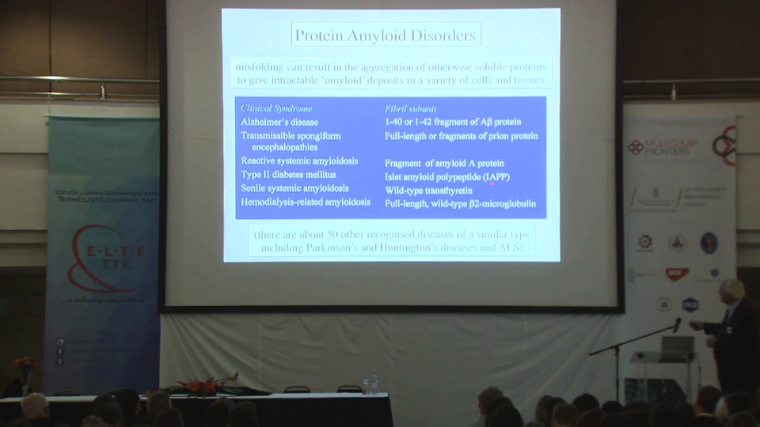

这张表是理解后面所有内容的关键：左边是不同的临床综合征，右边是形成纤维的蛋白亚基。阿尔茨海默病是 Aβ 肽的 1–40 或 1–42 片段；朊病毒病是朊蛋白的全长或片段；2 型糖尿病是胰岛淀粉样多肽（IAPP）；透析相关淀粉样变是 β2-微球蛋白；此外还有淀粉样 A 蛋白的片段、野生型转甲状腺素蛋白等（[【跳转到 06:15】](https://www.youtube.com/watch?v=Ic8LZx9OPqM&t=375)）。

Dobson 强调：**在这些致病蛋白之间找不出什么共同点**——可以是全长蛋白也可以是片段，可以是没有结构的肽也可以是高度结构化的蛋白（[【跳转到 06:30】](https://www.youtube.com/watch?v=Ic8LZx9OPqM&t=390)）。唯一的共同点是它们形成的沉积在电镜下看起来一样。

同一个「沉积」可以出现在完全不同的环境里：

- 肾衰竭病人做透析五年，几乎所有做满五年的人都会出现淀粉样沉积，只不过不在脑子里，而在骨骼组织和关节里，造成极大疼痛（[【跳转到 08:10】](https://www.youtube.com/watch?v=Ic8LZx9OPqM&t=490)）。
- 心脏淀粉样变：最近才认识到，老年心衰患者中可能有 25% 的病情被这些沉积加重，因为它们限制了心肌的运动（[【跳转到 08:35】](https://www.youtube.com/watch?v=Ic8LZx9OPqM&t=515)）。
- 全身性疾病：沉积出现在肝、肾、脾，有时量极大，可达公斤级；器官常常因蛋白聚集物的负荷而破裂（[【跳转到 09:00】](https://www.youtube.com/watch?v=Ic8LZx9OPqM&t=540)）。

## 二、淀粉样纤维的「通用结构」：不由序列编码

### 2.1 电镜下的样子

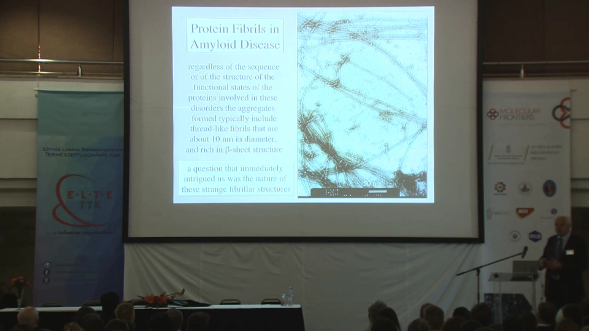

无论哪种病，把沉积从脑、肝或关节里提取出来，在电镜下都能看到大量纤维状结构：又长又细，长度可达微米，直径通常 10 纳米，富含 β 折叠结构；**无论看哪种病，它们看起来基本一样**，尽管沉积部位和症状完全不同（[【跳转到 10:15】](https://www.youtube.com/watch?v=Ic8LZx9OPqM&t=615)）。

### 2.2 意外：从溶菌酶到肌红蛋白

Dobson 说他们做的几乎每一件事都是意外。纤维结构的工作来自一次失败的核磁实验：一位博士后把 SH3 结构域的样品调到低 pH 放进核磁仪，去度了个长周末；回来时样品变成了一团凝胶，拿不到任何信号（[【跳转到 11:30】](https://www.youtube.com/watch?v=Ic8LZx9OPqM&t=690)）。他们把样品拿到电镜下看——里面全是纤维，而且具有与疾病相关的淀粉样结构的所有特征（[【跳转到 12:20】](https://www.youtube.com/watch?v=Ic8LZx9OPqM&t=740)）。

接着他们挑了人们认为**最不可能**形成富含 β 折叠纤维的蛋白：肌红蛋白——第一个被晶体学测定结构的蛋白，几乎全是 α 螺旋。把它放到变性条件下、离心，上层溶液看起来正常，沉淀里却同样是纤维（[【跳转到 13:10】](https://www.youtube.com/watch?v=Ic8LZx9OPqM&t=790)）。

### 2.3 同聚物实验：淀粉样折叠不写在序列里

有人反驳说：你们只是运气好，一定有个我们没认出来的序列基序在编码这个结构。于是一位学生拿**同聚物**（所有残基都相同的多肽）来做，证明只要条件合适，聚苏氨酸也能形成看起来和阿尔茨海默病纤维完全一样的结构（[【跳转到 14:00】](https://www.youtube.com/watch?v=Ic8LZx9OPqM&t=840)）。

结论很干脆：**天然状态是被序列精确编码的，淀粉样构筑不是**。它是多肽链作为「聚合物」的本性（[【跳转到 14:25】](https://www.youtube.com/watch?v=Ic8LZx9OPqM&t=865)）。

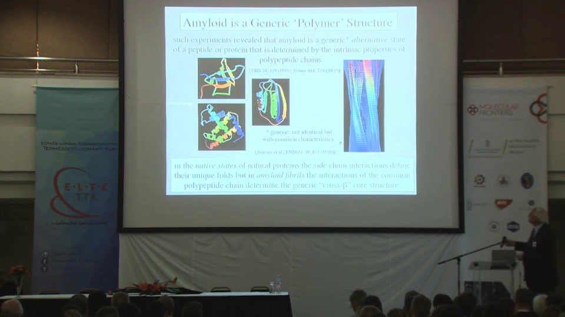

### 2.4 cross-β：主链氢键主导

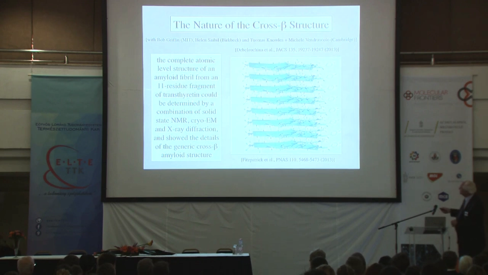

在 cross-β（交叉 β）结构里，纤维轴朝一个方向，β 链与它垂直；两片 β 折叠片之间是整排氢键，连接的是**所有蛋白共有的主链原子**（[【跳转到 16:05】](https://www.youtube.com/watch?v=Ic8LZx9OPqM&t=965)）。正因为主链对所有蛋白都一样，只要这个相互作用占主导，所有这类结构当然长得一样；侧链只能尽量嵌进去。

## 三、关键区分：折叠稳定性、溶解度、聚集风险

这一节是本讲对「蛋白质稳定性」这一章最重要的补充。三个量经常被混为一谈，但它们问的是不同的问题。

### 3.1 纤维可能比天然态更稳定：天然态只是「亚稳态」

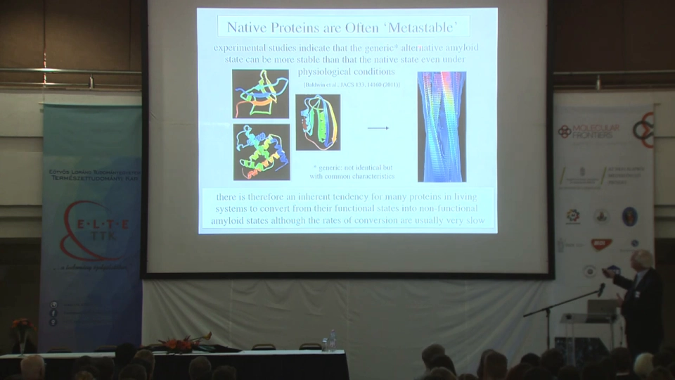

Dobson 的团队测了纤维的稳定性，结果让他们惊讶：这种通用的替代状态对各类蛋白有相似的性质（细节取决于侧链怎么堆积），**它可能比天然状态更稳定——即使在生理条件下，对小蛋白尤其如此**（[【跳转到 16:55】](https://www.youtube.com/watch?v=Ic8LZx9OPqM&t=1015)）。

所以天然蛋白不只是「一种结构形态」；从热力学上讲，即使在生理条件下，它们相对于这些聚集体也是更不稳定、或者说处于**亚稳态**（metastable）。因此许多蛋白都有转变成这种结构的内在倾向（[【跳转到 17:20】](https://www.youtube.com/watch?v=Ic8LZx9OPqM&t=1040)）。

### 3.2 为什么没有立刻变成固体：慢

紧接着是全讲最要紧的一句话：那么问题来了，我们为什么没有立刻变成固体？**答案是：幸好这个过程相当慢。**

这就是「稳定性」和「风险」的分野：

- **折叠稳定性**问的是：天然态相对于去折叠态有多稳（ΔG、Tm 那一套，见 2.1.6）。
- **溶解度**问的是：在给定缓冲条件、给定浓度下，蛋白能保持多少在溶液里而不进入沉积相。
- **聚集风险**问的是：从可溶状态走到纤维的**速率**有多快——它由成核、延伸、断裂、二次成核这几个步骤的速率常数共同决定。

一个蛋白可以折叠得很稳（天然态 ΔG 很大），同时溶解度很差（稍微浓一点就沉淀）；也可以热力学上早就该变成纤维，却因为几十年都跨不过动力学屏障而安然无恙。Dobson 的表述正好把这两层拆开：**热力学上倾向聚集，动力学上被拖住。**

### 3.3 三个量对照

| 量 | 问的问题 | 变大意味着 | 视频中的线索 |
| --- | --- | --- | --- |
| 折叠稳定性 | 天然态相对去折叠态有多稳 | 更不容易解折叠 | 纤维稳定性与天然态稳定性的对比测量（[【跳转到 16:55】](https://www.youtube.com/watch?v=Ic8LZx9OPqM&t=1015)） |
| 溶解度 | 给定条件下能溶多少 | 更不容易进入沉积相 | 「让蛋白保持可溶」的控制系统崩溃（[【跳转到 21:55】](https://www.youtube.com/watch?v=Ic8LZx9OPqM&t=1315)） |
| 聚集风险 | 从可溶到纤维有多快 | 更快形成纤维 | 随浓度变化的聚集动力学曲线（[【跳转到 26:32】](https://www.youtube.com/watch?v=Ic8LZx9OPqM&t=1592)） |

注意最后一行：视频里测聚集风险的办法，就是**在试管里跟踪随时间变化的聚集量，并把单体浓度作为变量**——浓度低时聚集很慢，浓度升高就聚集得更快（[【跳转到 26:32】](https://www.youtube.com/watch?v=Ic8LZx9OPqM&t=1592)）。这条「浓度依赖」正是把溶解度与动力学联系起来的桥梁：浓度越高，越容易越过成核的门槛。

### 3.4 浓度是那个把天平压过去的变量

Dobson 对「为什么这些病现在才出现」的回答，本质上就是浓度与调控：蛋白浓度的细微变化、有时是家族性疾病的突变、长寿、饮食，都会让调节过程失灵，导致蛋白聚集，最终**整套「让蛋白保持可溶」的控制系统崩溃**（[【跳转到 21:55】](https://www.youtube.com/watch?v=Ic8LZx9OPqM&t=1315)）。

他还给了一个很直观的细胞背景：细胞里的分子挤得极紧，浓度可达每升 300 克——你不妨试着配出这么浓的溶液（[【跳转到 02:20】](https://www.youtube.com/watch?v=Ic8LZx9OPqM&t=140)）。在这样的环境里，「溶解度」不是抽象参数，而是每天都在被挑战的边界。

## 四、真正有毒的是寡聚体，不是纤维本身

### 4.1 早期中间体又黏又乱

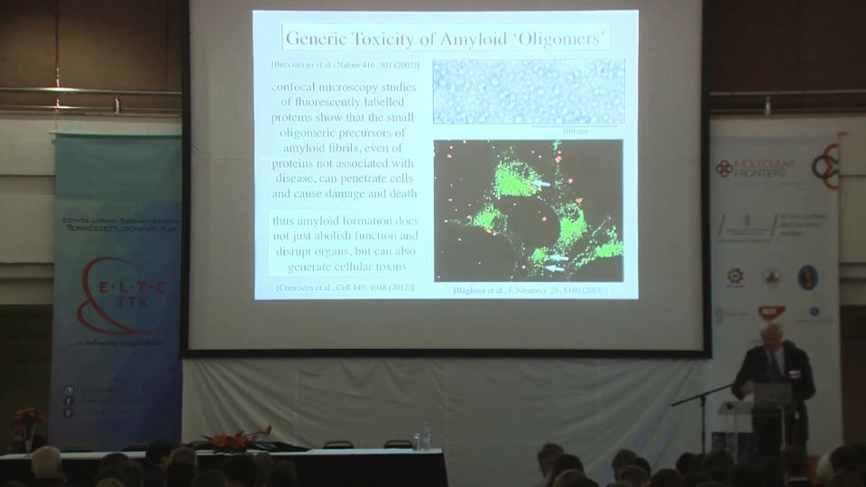

Dobson 强调：淀粉样形成不只是让蛋白失去功能，也不只是破坏组织器官，它还在细胞和体内**产生有毒的物种**（[【跳转到 19:50】](https://www.youtube.com/watch?v=Ic8LZx9OPqM&t=1190)）。

证据来自早期中间物——常被称为寡聚体的前体。它们在电镜下先形成，再发展成纤维；它们错误折叠了，表面暴露的残基对那个蛋白来说是「不对的」，非常黏。把它们加到各种细胞培养物里，无论与疾病有无关系，它们都能穿透细胞、黏到各种组分上，或破坏膜（[【跳转到 20:15】](https://www.youtube.com/watch?v=Ic8LZx9OPqM&t=1215)）。

### 4.2 一张「构象状态地图」

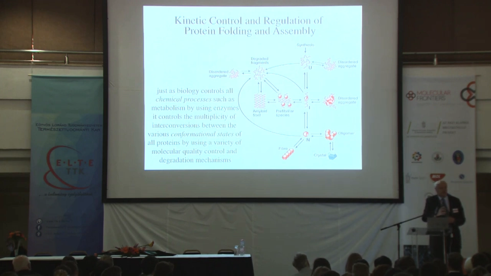

这张图把前面几节串起来：同一个蛋白有多种可能的去向——无序聚集体、被降解、经中间态折叠成更高阶结构、组装成寡聚体和纤维，也可以转变成淀粉样纤维。Dobson 的看法是：这些过程在很大程度上由遗传过程控制，生物学的安排让你通常不会得到淀粉样纤维（[【跳转到 19:00】](https://www.youtube.com/watch?v=Ic8LZx9OPqM&t=1140)）。

由此他们提出一个简化的统一看法：正常情况下有一套「管家」机制，四处搜寻、抓住错误折叠、开始聚集的蛋白，送去降解；这就是我们能几十年保持功能状态的原因。而这些机制一旦失效，就会产生病理——要么积累太多，要么产生有毒物种导致细胞死亡（[【跳转到 20:15】](https://www.youtube.com/watch?v=Ic8LZx9OPqM&t=1215)）。

### 4.3 果蝇实验：几个百分点的聚集倾向，换来大规模神经元损伤

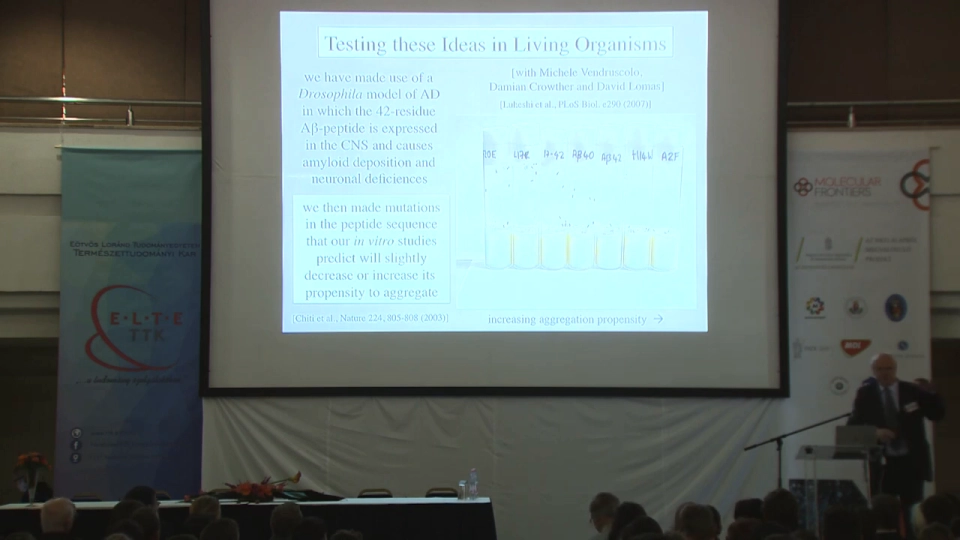

他们把人类的 42 残基肽段表达在果蝇中枢神经系统里，然后引入突变——根据试管实验的预测，让肽段更容易或更不容易聚集。做法很土：把果蝇放进试管、在桌上敲一敲，它们掉到底部，再数有多少爬上去（[【跳转到 22:22】](https://www.youtube.com/watch?v=Ic8LZx9OPqM&t=1342)）。

结果是惊人的相关性（[【跳转到 23:12】](https://www.youtube.com/watch?v=Ic8LZx9OPqM&t=1392)）：

- 一边是**物理性质**——聚集倾向是物理问题，服从物理定律；
- 另一边是**生物学**——果蝇两万个基因在试图控制这个过程。

而聚集倾向只改变了百分之几，就足以让更容易聚集的肽段造成大规模神经元损伤；把肽段变得不那么容易聚集，它就和完全不存在没有区别（[【跳转到 23:37】](https://www.youtube.com/watch?v=Ic8LZx9OPqM&t=1417)）。

## 五、聚集的动力学：成核—延伸—断裂—二次成核

### 5.1 四个基本步骤

Thomas Knowles（当时还是研究生）把这套过程拆成几个分子事件（[【跳转到 24:27】](https://www.youtube.com/watch?v=Ic8LZx9OPqM&t=1467)）：

1. **一次成核（primary nucleation）**：从可溶的蛋白出发，形成小的寡聚体、小的核。
2. **延伸（elongation）**：核长成纤维状结构——往末端添加分子而生长；也可以**解离**、通过失去分子而缩短。
3. **断裂（fragmentation）**：纤维虽然很强，有时也会断；断裂让末端数翻倍，于是聚集体数量翻倍、生长速度也翻倍。
4. **二次成核（secondary nucleation）**：已有的聚集体「招引」单体，在其表面催化形成新的核，给出更快的成核途径。

所以这是一个非常复杂的过程，每一步有不同的速率常数，许多步骤并行发生（[【跳转到 25:17】](https://www.youtube.com/watch?v=Ic8LZx9OPqM&t=1517)）。

### 5.2 把步骤写成方程，再解出来

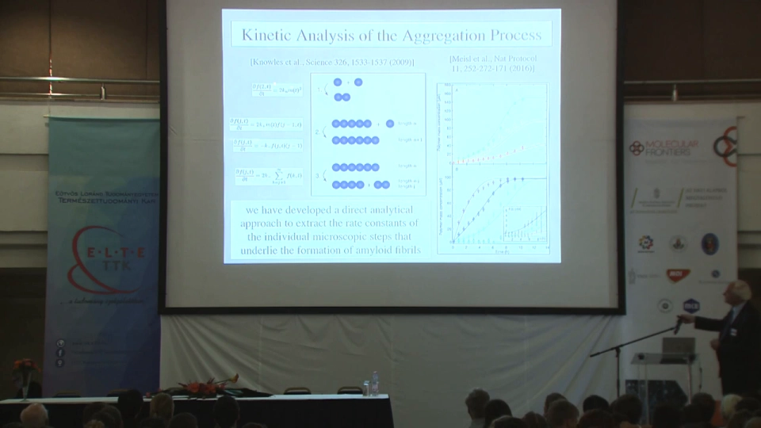

2009 年 Knowles 把组装过程的不同步骤写成微分方程，用速率常数表示速率，得到一组耦合的非线性微分方程；大家都说它复杂到无法求解，但他想起自己上过的一门数学课，找到了求解析解的办法（[【跳转到 25:42】](https://www.youtube.com/watch?v=Ic8LZx9OPqM&t=1542)）。

用速率语言写出来，大致是这样一组关系（$m$ 是单体浓度，$M$ 是纤维的质量浓度，$P$ 是纤维的数目浓度，$n_c$、$n_2$ 分别是两种成核的临界核大小）：

$$
\frac{dP}{dt} = k_n m^{n_c} + k_2 m^{n_2} M
$$

$$
\frac{dM}{dt} = 2 k_+ m P
$$

第一行说明：新的纤维末端可以来自**一次成核**（只依赖单体浓度），也可以来自**二次成核**（依赖已有纤维的量 $M$，是自催化的）；第二行说明：质量增长靠单体加到末端上，速率正比于末端数 $P$。这三个速率常数 $k_n$、$k_2$、$k_+$ 谁大，决定了曲线长什么样。

### 5.3 浓度依赖的曲线，全局拟合出速率常数

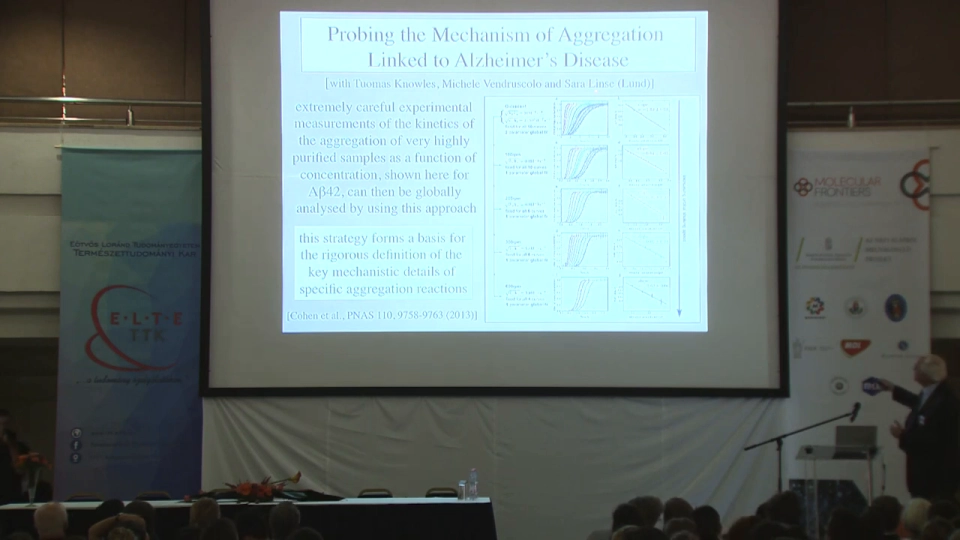

实验是与 Sara Linse 合作完成的，她的实验做得极其仔细。他们考察 Aβ42 聚集动力学随浓度的变化，从高浓度到低浓度；还设置了不同条件，比如振荡，这会增强纤维断裂。这样就能拟合曲线，得到主导聚集过程的关键机制细节（[【跳转到 26:57】](https://www.youtube.com/watch?v=Ic8LZx9OPqM&t=1617)）。

关键操作是**全局拟合**：把一整组不同浓度的曲线一起拟合到解析解上，就能提取出各个步骤的速率常数，从而知道在聚集过程的不同时刻哪些过程占主导（[【跳转到 26:32】](https://www.youtube.com/watch?v=Ic8LZx9OPqM&t=1592)）。

### 5.4 结论：主导的是二次成核，不是第一次成核

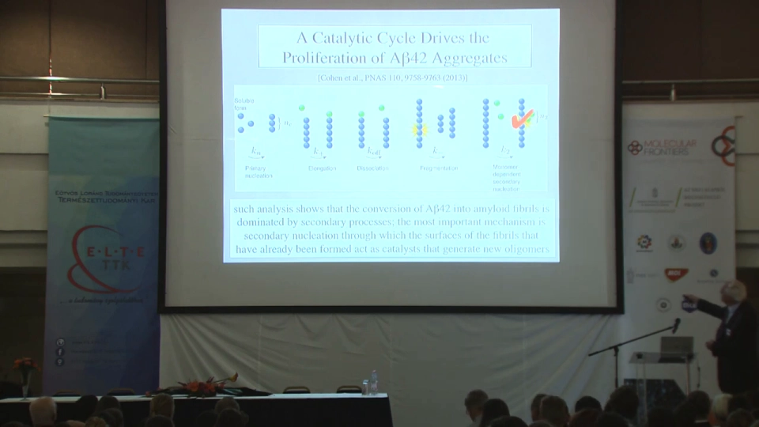

他们原以为「把分子凑到一起」的初次成核会是限速步骤，结果并不是。对 Aβ42 来说，真正主导的是**二次过程**：一旦有了聚集体，它们就催化形成更多寡聚体、更多核，这些核再长成更多纤维（[【跳转到 28:12】](https://www.youtube.com/watch?v=Ic8LZx9OPqM&t=1692)）。

所以你得到的越多，新生成的也越多——这是一个真正爆炸性的过程：一旦开始聚集，聚集体就非常迅速地增殖。而且他们有强有力的证据表明这在体内也成立（[【跳转到 28:37】](https://www.youtube.com/watch?v=Ic8LZx9OPqM&t=1717)）。

这也解释了第 3 节留下的问题：**热力学上该聚集，动力学上却被成核这一步拖住几十年**；而一旦跨过去，自催化就让过程失控。

## 六、细胞如何压住这条曲线：伴侣按步骤抑制

### 6.1 BRICHOS 抑制的是二次成核

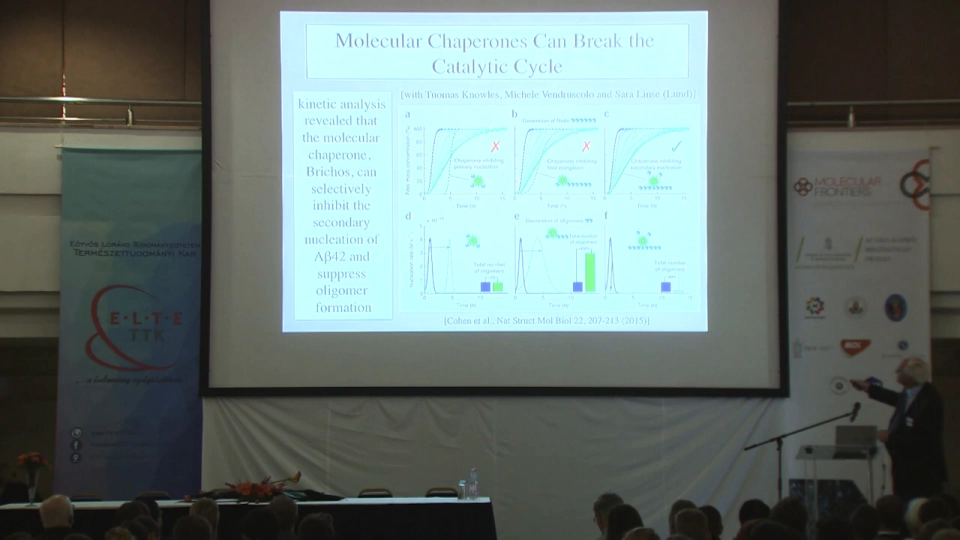

细胞里的分子伴侣结合到多肽链形成的早期阶段——这些链本身就是容易聚集的——阻止它们聚集，直到蛋白正确折叠；它们照看这些还没「成年」的蛋白，直到它们能在这个复杂的细胞环境里照顾自己（[【跳转到 28:37】](https://www.youtube.com/watch?v=Ic8LZx9OPqM&t=1717)）。

但伴侣不只对最初的折叠重要。Dobson 说他们又惊讶地发现，伴侣对**抑制聚集反应**也非常有效。以 BRICHOS 为例：不加伴侣时聚集是这样，随着加入越来越多伴侣，聚集速率明显变慢（[【跳转到 29:52】](https://www.youtube.com/watch?v=Ic8LZx9OPqM&t=1792)）。

### 6.2 为什么要问「抑制的是哪一步」

这是本节最漂亮的方法论。他们用同一套解析解去问：它是在哪个机制上起作用？

- 如果它阻止**初次成核**，你只会把整个过程整体推迟，之后还是会爆发；
- 如果是作用于**延伸**，曲线形状又不一样。

结果这组数据完美地符合「抑制二次成核」的拟合——而在自由的 Aβ42 体系里，二次成核正是主导机制（[【跳转到 30:17】](https://www.youtube.com/watch?v=Ic8LZx9OPqM&t=1817)）。

### 6.3 不能只抑制延伸：那会积累更毒的前体

Dobson 特别强调了一个反直觉的推论：**如果你去阻断延伸，会积累前体蛋白，那些东西毒性极强**；而通过抑制二次成核、阻止新核形成，寡聚体数量会大幅下降（[【跳转到 30:17】](https://www.youtube.com/watch?v=Ic8LZx9OPqM&t=1817)）。

这直接呼应第 4 节：毒性物种是寡聚体，不是成熟的纤维。所以「减少寡聚体」比「减少纤维」更接近治疗目标。

### 6.4 伴侣是一支分工的军队

机制其实很简单：伴侣结合到纤维表面，把成核位点盖住（可以用金簇做免疫标记，沿纤维表面做结合研究）（[【跳转到 30:42】](https://www.youtube.com/watch?v=Ic8LZx9OPqM&t=1842)）。

而生物学实在了不起——它有几百种伴侣，有的抑制初次成核，有的抑制延伸，有的抑制二次成核，像一支防卫大军，从过程一开始就起作用；如果失败，还有另一层防御机制接上（[【跳转到 31:07】](https://www.youtube.com/watch?v=Ic8LZx9OPqM&t=1867)）。

## 七、把机制变成药：小分子与线虫

### 7.1 用动力学分析做高通量筛选

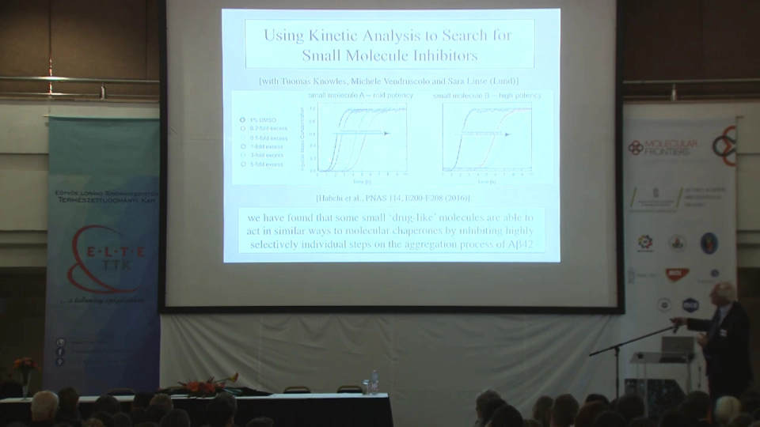

他们用的是同一套动力学分析，只是把对象从伴侣换成小分子。在相对低的浓度下加入这些小分子，对聚集有显著影响；当然要选对分子——很多分子毫无作用（[【跳转到 32:22】](https://www.youtube.com/watch?v=Ic8LZx9OPqM&t=1942)）。

流程是：构建候选小分子库，挑出可能与 Aβ 结合的分子（有些是已有药物，有些是新分子）；在实验里看它们能否抑制聚集；如果能，再看它抑制的是哪一步（[【跳转到 32:47】](https://www.youtube.com/watch?v=Ic8LZx9OPqM&t=1967)）。

### 7.2 从试管到线虫

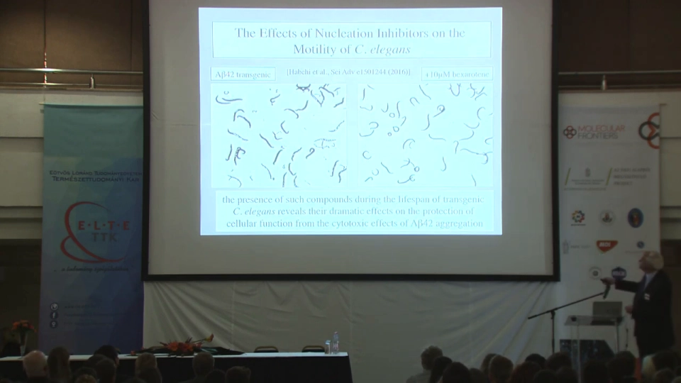

试管里的结果要在活体里检验。他们搭了一套自动追踪线虫运动的系统：过去一周能做 500 条，现在并行处理，一周能做一百万条（[【跳转到 33:12】](https://www.youtube.com/watch?v=Ic8LZx9OPqM&t=1992)）。

转入 Aβ42 的线虫在肌肉里表达这个肽段，导致瘫痪——这些线虫非常不快乐，除了轻微扭动几乎不动。但在培养基里加入一个小分子后，它们很快乐，到处扭动（[【跳转到 34:02】](https://www.youtube.com/watch?v=Ic8LZx9OPqM&t=2042)）。Dobson 说他们现在拿到的分子比这个已有药物有效一千倍（[【跳转到 34:27】](https://www.youtube.com/watch?v=Ic8LZx9OPqM&t=2067)）。

### 7.3 抑制不同步骤，意味着不同的治疗哲学

他们能找到抑制初次成核的分子，也能找到抑制二次成核的，甚至能找到结合表面、抑制生长（也许还有断裂）的分子（[【跳转到 35:17】](https://www.youtube.com/watch?v=Ic8LZx9OPqM&t=2117)）。

Dobson 把两种思路对比得很清楚（[【跳转到 35:42】](https://www.youtube.com/watch?v=Ic8LZx9OPqM&t=2142)）：

- 如果能抑制**初次成核**，那就像一种「神经抑制素」：只要挡住第一步，后面的事都不用担心，是预防性的。
- 如果目标是**增殖步骤**（二次成核），那就能阻止聚集体的增殖，从而可能控制病理在脑内的扩散——这是给已经发病的人用的。

而且这不只适用于一种淀粉样疾病：他们还研究了表达 α-突触核蛋白（与帕金森病相关）的线虫，也找到了别的分子（[【跳转到 36:13】](https://www.youtube.com/watch?v=Ic8LZx9OPqM&t=2173)）。

## 八、为什么是现在：现代病与人口老龄化

Dobson 对「为什么这些病现在才出现」的回答很有穿透力：看这些质量控制与调节机制，它们其实都是「现代病」（[【跳转到 21:05】](https://www.youtube.com/watch?v=Ic8LZx9OPqM&t=1265)）。

- 阿尔茨海默病出现，是因为我们活得长；
- 朊病毒病，尤其在英国，是因为把已经带聚集体的老牛喂给小牛；
- 不运动、吃得过多会肥胖，而这是糖尿病的巨大风险因素；
- 过去我们也不给人做透析。

他最后给了一组数字：2015 年美国花了两千二百亿美元**照护**（不是治疗）阿尔茨海默病患者；按人口规模推算，到 2050 年每年要花一万亿美元（[【跳转到 38:18】](https://www.youtube.com/watch?v=Ic8LZx9OPqM&t=2298)）。患病风险是：65 岁时大约六十分之一到百分之一，到 85 岁大约二分之一；而人类历史上所有活到 65 岁的人里，超过一半现在还活着（[【跳转到 38:43】](https://www.youtube.com/watch?v=Ic8LZx9OPqM&t=2323)）。

## 小结

- **错误折叠有三种出路**：送错地方、被降解（功能丧失）、沉淀成淀粉样沉积；第三类至少涉及 50 种疾病。
- **淀粉样纤维是通用的聚合物结构**：cross-β、主链氢键主导，不由氨基酸序列编码——连聚苏氨酸、肌红蛋白都能形成。
- **折叠稳定性、溶解度、聚集风险是三个不同的量**：纤维在生理条件下可能比天然态更稳定，天然态只是亚稳态；我们没被「固化」，靠的是过程很慢。
- **毒性主要来自寡聚体**，不是成熟纤维；果蝇实验显示聚集倾向改变几个百分点就足以造成大规模神经元损伤。
- **聚集动力学有四个步骤**：一次成核、延伸、断裂、二次成核；对 Aβ42，主导的是自催化的二次成核。
- **伴侣按步骤抑制**：BRICHOS 抑制二次成核；只抑制延伸反而会积累更毒的前体。
- **同一套动力学分析可以筛药**：先判断分子抑制哪一步，再在果蝇、线虫里验证表型。

## 关键术语速查

| 术语 | 一句话解释 |
| --- | --- |
| 淀粉样纤维（amyloid fibril） | 错误折叠蛋白聚成的长纤维，直径约 10 纳米，富含 cross-β 结构 |
| cross-β 结构 | β 链垂直于纤维轴、两片 β 折叠片靠主链氢键相连的通用构筑 |
| 亚稳态（metastable） | 不是最稳定、但被动力学屏障暂时守住的状態；天然态常属此类 |
| 折叠稳定性 | 天然态相对去折叠态有多稳，用 ΔG、Tm 一类量描述 |
| 溶解度 | 给定条件下蛋白能保持多少在溶液中而不进入沉积相 |
| 聚集风险 | 从可溶状态走向纤维的速率，由成核/延伸/断裂等速率常数决定 |
| 一次成核 | 由单体直接形成临界核，速率只依赖单体浓度 |
| 二次成核 | 已有纤维表面催化形成新核，速率依赖纤维量，是自催化步骤 |
| 断裂（fragmentation） | 纤维断成两段，使末端数翻倍、聚集加速 |
| 寡聚体（oligomer） | 纤维形成途中的小聚集体，常是真正的毒性物种 |
| 分子伴侣 | 结合暴露疏水区、防止错误聚集的蛋白；不同伴侣抑制不同步骤 |