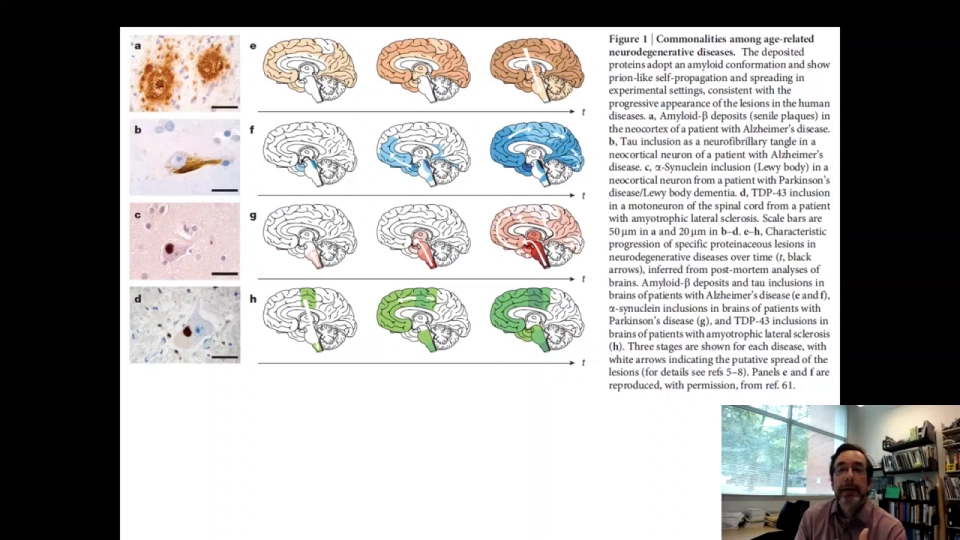
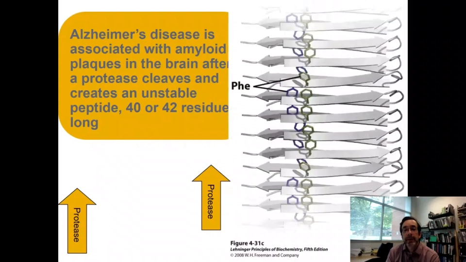
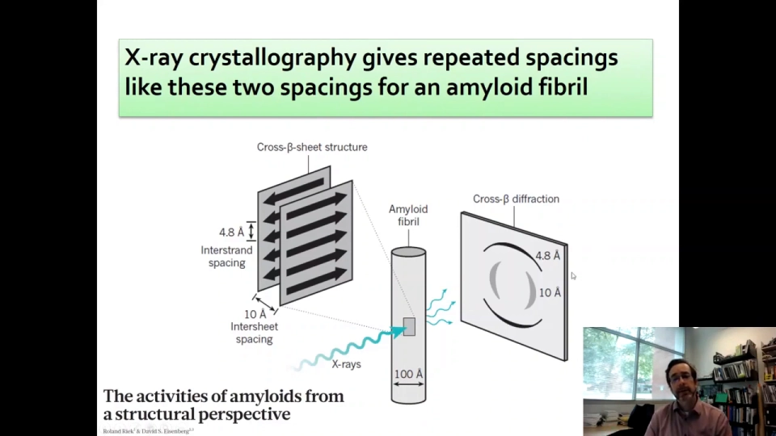
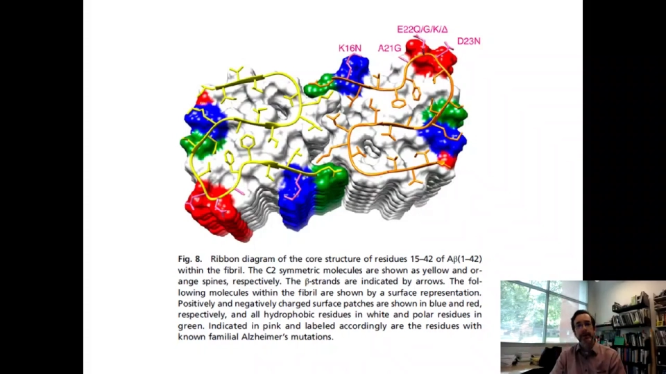
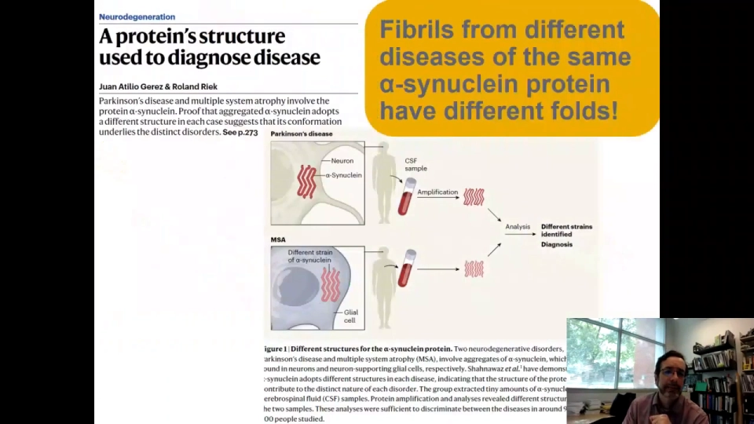
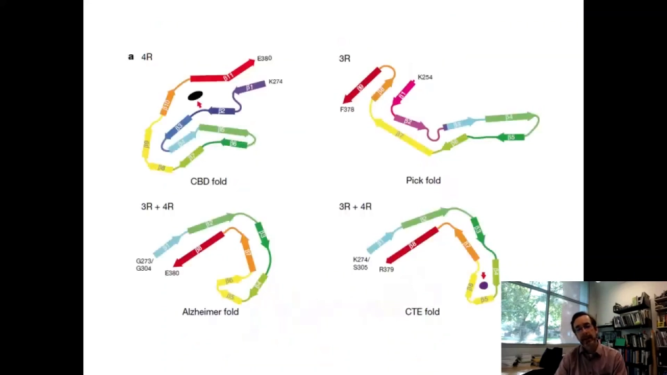
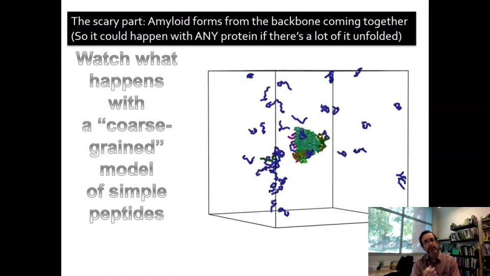
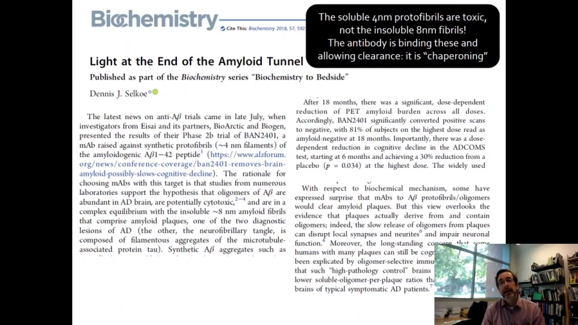
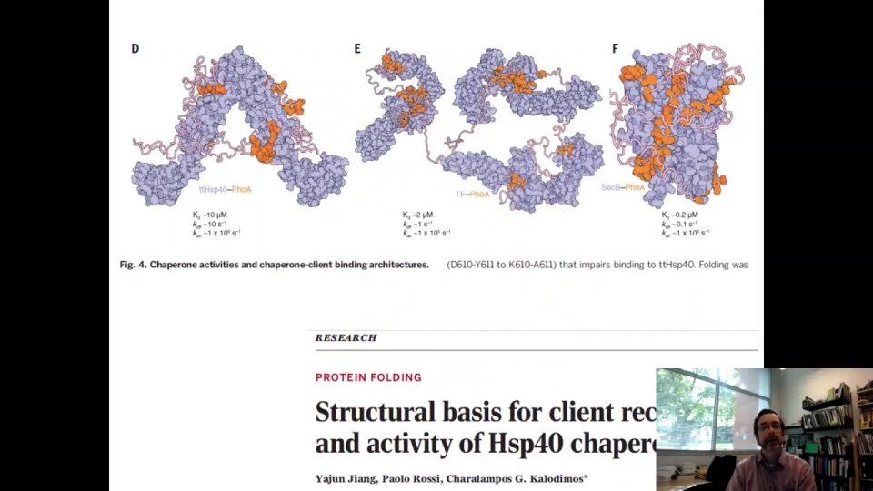

# 淀粉样纤维的结构与多态性：一条序列如何折出多种致病构象

> 视频来源：[Lecture 11.1: Protein Misfolding in Neurodegenerative Diseases](https://www.youtube.com/watch?v=2u7X184WzXk)（YouTube · Ben McFarland 频道，2020 年）｜时长约 32 分钟
> 导读：这是一堂生化课的临床延伸讲，讲法很「结构」——反复回到一个问题：**我们怎么知道纤维内部长什么样？** 答案依次是 X 射线衍射、固体核磁、晶体学、冷冻电镜、圆二色谱。本文按「临床地图 → Aβ 的 α→β 转变 → cross-β 的衍射证据 → 结构解析 → 多态性 → 主链决定论 → 毒性物种 → 伴侣」重排。折叠漏斗、Hsp70/Hsp60 的基础机制见 [2.1.7](../../../README.md#b03-2-1-7)，本文只在「伴侣的两种策略」处简要引用。

## 本讲要解决的核心问题（SCQA）

**背景**：神经退行性疾病里几乎总能找到一种错误折叠的蛋白，它聚成斑块或包涵体。

**冲突**：同一种蛋白可以形成**结构不同**的纤维，而这些不同的纤维对应**不同的病**；更奇怪的是，连没有侧链的模型都能自发形成淀粉样结构。

**疑问**：纤维内部到底是什么结构？我们怎么测定它？为什么「一条序列一种结构」的经典观念在这里失效？到底哪个物种在杀伤细胞？

**回答（中心思想）**：淀粉样纤维的核心由**主链之间重复的氢键**搭成，所以它对序列不挑；但侧链怎么嵌进去、片段从哪里开始，又让同一条序列能折出多种稳定构象（多态性）。真正有毒的往往是**可溶的**小纤维，而不是不溶的大纤维。

## 一、三种病、四种包涵体：错误折叠的临床地图

McFarland 先给了一张「临床地图」（[【跳转到 01:07】](https://www.youtube.com/watch?v=2u7X184WzXk&t=67)）：

- **阿尔茨海默病**：Aβ 沉积（细胞外斑块）+ tau 包涵体（细胞内），两种蛋白、两种纤维、不同部位；
- **帕金森病**：α-突触核蛋白；
- **ALS（渐冻症）**：TDP-43 等包涵体。

四种包涵体，其实是三种病，**它们都来自蛋白质错误折叠**（[【跳转到 01:57】](https://www.youtube.com/watch?v=2u7X184WzXk&t=117)）。

他还给了一个很有用的对照：疯牛病（朊病毒病）里的蛋白是**从脑外引入**的，传播途径难得多；而如果蛋白本来就在脑内，在某些应激条件下开始去折叠，它就能成为一个「种子」，长出纤维，把脑子搅乱、造成神经退行（[【跳转到 00:17】](https://www.youtube.com/watch?v=2u7X184WzXk&t=17)）。

### 1.1 关键的结构特征：开放的 β 折叠片

为什么这些纤维能一直长？McFarland 的解释是：最突出的那些中间体带有一片**「开放的」β 折叠片**——两端都开着，可以不断接续下去（[【跳转到 02:03】](https://www.youtube.com/watch?v=2u7X184WzXk&t=123)）。

由此推出三个后果（[【跳转到 02:28】](https://www.youtube.com/watch?v=2u7X184WzXk&t=148)）：

1. 蛋白越多，纤维就越多；
2. 一旦卡进纤维里就出不来了；
3. 你唯一的选择是把它清除掉——而在脑内这往往不是好选项。

用他的话说：**重复的二级结构能造成重复的、稳定的错误折叠纤维结构**（[【跳转到 02:53】](https://www.youtube.com/watch?v=2u7X184WzXk&t=173)）。

## 二、从 α 到 β：Aβ 片段怎么变成 β 折叠片

阿尔茨海默病的起点是一个很平常的事件：有一种蛋白酶会天然地降解淀粉样前体蛋白，于是你得到这个天然片段（[【跳转到 02:58】](https://www.youtube.com/watch?v=2u7X184WzXk&t=178)）。当这种片段太多时，它会去折叠，从 α 结构伸展成 β 结构——这正是本单元里反复出现的「α 变成 β、被拉直」（[【跳转到 03:34】](https://www.youtube.com/watch?v=2u7X184WzXk&t=214)）。

拉直后它带有氢键，能形成折叠片。而当你有许多份这种片段时，折叠片不仅靠氢键连在一起，还靠**苯丙氨酸之间重复的疏水堆积**——McFarland 称之为「苯丙氨酸梯子」（phenylalanine ladder），一级一级上下的氨基酸梯子（[【跳转到 03:59】](https://www.youtube.com/watch?v=2u7X184WzXk&t=239)）。

这里有个值得记住的因果链：**蛋白酶切割 → 片段浓度升高 → 片段去折叠 → β 折叠片 → 重复堆积 → 纤维**。

## 三、怎么证明它是 cross-β：4.8 埃与 10 埃

这是全讲最「可操作」的一段。既然结构是重复的，就应该能在衍射图上看到重复的间距（[【跳转到 04:05】](https://www.youtube.com/watch?v=2u7X184WzXk&t=245)）：

- **链与链之间**：反复出现 **4.8 埃**的间距；
- **片与片之间**：**10 埃**。

让 X 射线穿过纤维，你就得到一张带两个环的衍射图：4.8 埃和 10 埃的反射（[【跳转到 04:30】](https://www.youtube.com/watch?v=2u7X184WzXk&t=270)）。McFarland 强调：**很早人们就能凭这两个峰判断纤维内部存在重复图案**——不需要先解出原子结构。

这也给了你一个判据：以后看到「4.8 埃和 10 埃反射」这几个字，就知道说的是 cross-β 结构。

## 四、纤维的结构是怎么解出来的

### 4.1 难点：纤维不是完美晶体

纤维给不出完全聚焦的结构；它们靠疏水相互作用连在一起，所以有点松垮、有点油腻、不像晶体那样整齐排列（[【跳转到 05:00】](https://www.youtube.com/watch?v=2u7X184WzXk&t=300)）。

解决办法是**试条件**：不同的 pH、温度和离子强度（盐浓度）组合，去优化结构的均一性，最终找到能结晶的条件（[【跳转到 05:25】](https://www.youtube.com/watch?v=2u7X184WzXk&t=325)）。他们让纤维以重复的方式结晶，重复到连侧链构象都一致；42 残基片段和 40 片段都是这样做的。这里用了「晶种法」——从一份溶液里取一小块晶种放进另一份里（[【跳转到 05:50】](https://www.youtube.com/watch?v=2u7X184WzXk&t=350)）。

McFarland 的吐槽很生动：有人说睫毛很好用，也有人说猫须很好用——你永远不知道什么管用，这更像魔法而不是科学（[【跳转到 06:15】](https://www.youtube.com/watch?v=2u7X184WzXk&t=375)）。

### 4.2 三种互补的技术

得到好晶体后就能拿到原子分辨率的结构。但纤维结构不只靠晶体学（[【跳转到 06:50】](https://www.youtube.com/watch?v=2u7X184WzXk&t=410)）：

- **固体核磁**：能看到交叉共振、看到相距较远的质子之间的相互作用，从而得到「哪个氨基酸挨着哪个」的约束（[【跳转到 07:15】](https://www.youtube.com/watch?v=2u7X184WzXk&t=435)）；
- **X 射线晶体学**：给出重复到侧链层面的结构；
- **冷冻电镜**：后来居上，得到了 1–42 片段的好纤维结构（[【跳转到 08:40】](https://www.youtube.com/watch?v=2u7X184WzXk&t=520)）；
- **圆二色谱（CD）**：不解析结构，只比较不同纤维的二级结构信号（[【跳转到 10:49】](https://www.youtube.com/watch?v=2u7X184WzXk&t=649)）。

### 4.3 结构长什么样：疏水在内，带电在外

把结构画出来，规则很朴素：大约 42 个残基长，**内部主要是疏水残基，外面是带电残基**，还有一些异号电荷相邻（[【跳转到 07:33】](https://www.youtube.com/watch?v=2u7X184WzXk&t=453)）。

McFarland 提醒学生：这正是课上用颜色做的练习——把疏水残基涂成白色、带电残基用不同颜色、极性残基放外侧；你能看到所有疏水残基都在内部，形成一个二维的核心（[【跳转到 08:10】](https://www.youtube.com/watch?v=2u7X184WzXk&t=490)）。

关键在于：**这是一个稳定的结构，两端都还开放着可以形成氢键，所以它能像一摞盘子一样堆起来**（[【跳转到 08:35】](https://www.youtube.com/watch?v=2u7X184WzXk&t=515)）。这就是第一节说的「开放 β 折叠片」在结构层面的样子。

顺便一提，图上粉色标出的是已知的家族性阿尔茨海默病突变位点（如 K16N、A21G、E22Q/G/K/Δ、D23N）——它们大多落在带电或界面残基上，这与「改变界面堆积会改变聚集倾向」是一致的。

## 五、多态性：一条序列，多种稳定构象

### 5.1 Aβ40 和 Aβ42 折得不一样

Aβ42 的纤维是一种蛇形的 S 形；而 Aβ40 实际上形成不同的结构——不是 S 形，更像一个环（[【跳转到 09:30】](https://www.youtube.com/watch?v=2u7X184WzXk&t=570)）。它内部仍然是疏水的，仍然像一摞盘子那样堆叠，但结构不同。

**同一条序列可以形成两种不同的稳定纤维结构**（[【跳转到 09:55】](https://www.youtube.com/watch?v=2u7X184WzXk&t=595)）。

### 5.2 同一个蛋白，不同的病

α-突触核蛋白是更好的例子：它在帕金森病里以某种方式堆叠，在多系统萎缩（MSA）里在胶质细胞中以略微不同的方式堆叠，形成结构不同的纤维（[【跳转到 10:27】](https://www.youtube.com/watch?v=2u7X184WzXk&t=627)）。

CD 谱能看出差别：同样的纤维给出不同信号，下降幅度不同；在显微镜下它们的形状看起来也不同（[【跳转到 10:49】](https://www.youtube.com/watch?v=2u7X184WzXk&t=649)）。事实上 α-突触核蛋白能形成**三种**不同的纤维结构（[【跳转到 11:14】](https://www.youtube.com/watch?v=2u7X184WzXk&t=674)）。

这张图展示的思路是：正因为不同病的纤维构象不同，把 CSF 样本里的少量聚集体扩增后分析构象，就有可能**区分疾病**——这就是「用蛋白结构做诊断」（[【跳转到 10:27】](https://www.youtube.com/watch?v=2u7X184WzXk&t=627)）。

### 5.3 tau：3R 与 4R，四种折叠

tau 片段是一个重复蛋白，形成纤维的片段有「三重复」（3R）版本或「四重复」（4R）版本（[【跳转到 12:10】](https://www.youtube.com/watch?v=2u7X184WzXk&t=730)）。这就像 Aβ 的 40 与 42，只不过这里是重复数不同。

对应关系（[【跳转到 12:35】](https://www.youtube.com/watch?v=2u7X184WzXk&t=755)、[【跳转到 13:40】](https://www.youtube.com/watch?v=2u7X184WzXk&t=820)）：

- 3R → Pick 折叠（Pick 病）；
- 4R → CBD 折叠（皮质基底节变性）；
- 3R + 4R 混合 → Alzheimer 折叠与 CTE 折叠（两种不同的病）。

而 Alzheimer 折叠和 CTE 折叠**非常相似**（同一个蛋白、非常相似的结构），另外两个则非常不同（[【跳转到 14:05】](https://www.youtube.com/watch?v=2u7X184WzXk&t=845)）。

### 5.4 一个悬而未决的细节

在 CBD 折叠和 CTE 折叠里，他们看到一种奇怪的小电子密度反复出现，看起来很重要。那是什么？McFarland 说他也不确定研究者自己是否知道，但他们知道**有某种小分子化学物质似乎在纤维形成中起作用**（[【跳转到 14:30】](https://www.youtube.com/watch?v=2u7X184WzXk&t=870)）。

这是一个很好的科学态度示范：结构解出来了，但图里仍有解释不了的东西。

## 六、为什么这么多序列都能形成淀粉样：主链的锅

### 6.1 粗粒化模拟：没有侧链也能成

McFarland 放了一段模拟：做一个**粗粒化模型，不具体建模侧链**——基本上就是一堆主链在漂浮。把它们放进计算机，主链先乱跳一阵，然后你会看到随着时间推移，主链开始形成这种稳定的淀粉样结构（[【跳转到 17:08】](https://www.youtube.com/watch?v=2u7X184WzXk&t=1028)）。

结论：这种结构之所以在这么多序列上都能出现，是因为**侧链并不太重要；重要的是主链上重复的酰胺键**（[【跳转到 17:08】](https://www.youtube.com/watch?v=2u7X184WzXk&t=1028)）。

### 6.2 「加州旅馆」

一旦开始，派对就开始了，它们不断邀请更多「人」进来，然后纤维就不断形成。但你一旦入住就再也离不开——就像那首《加州旅馆》：你可以退房，但你永远不能离开（[【跳转到 17:33】](https://www.youtube.com/watch?v=2u7X184WzXk&t=1053)）。

原因很物理：每个氨基酸、每个蛋白都有主链，你逃不掉。蛋白浓度足够高、条件足够糟，就会促使它开始形成；一旦开始就会一直形成下去（[【跳转到 17:58】](https://www.youtube.com/watch?v=2u7X184WzXk&t=1078)）。

这也把「溶解度」这件事讲清楚了：**纤维的形成门槛不是序列特异性的，而是浓度和条件特异性的**。同一个蛋白，浓度低时老老实实待在溶液里，浓度高一点、条件差一点，就跨过了那道门。

### 6.3 α-突触核蛋白的间距：8.1 埃与 6.5 埃

作为对照，α-突触核蛋白主链之间的间距是 8.1 埃和 6.5 埃，与我们 β 结构的正常间距很接近（[【跳转到 18:36】](https://www.youtube.com/watch?v=2u7X184WzXk&t=1116)）。如果你理解间距是怎么来的，就可以把它当作 β 结构的问题来处理（[【跳转到 19:01】](https://www.youtube.com/watch?v=2u7X184WzXk&t=1141)）。

## 七、cross-α 与晶状体：不止 β

大多数淀粉样纤维是 β 的，但**甚至存在由 α 螺旋堆叠而成的淀粉样纤维**（[【跳转到 19:08】](https://www.youtube.com/watch?v=2u7X184WzXk&t=1148)）。例子来自金黄色葡萄球菌：一种细胞毒性纤维，它形成的淀粉样结构里螺旋的疏水部分彼此堆叠（[【跳转到 19:33】](https://www.youtube.com/watch?v=2u7X184WzXk&t=1173)）。

这比 β 折叠片少见，但显然能发生。好消息是这更难，而且它们的间距与 α 螺旋相容——不像 β 折叠片那么近，而是大于 10 埃，因为 α 螺旋本身更大，堆起来间距更宽（[【跳转到 20:08】](https://www.youtube.com/watch?v=2u7X184WzXk&t=1208)）。他们称之为 **cross-α（交叉 α）**（[【跳转到 20:20】](https://www.youtube.com/watch?v=2u7X184WzXk&t=1220)）。

它出现在哪里？你甚至能在**人类白内障**里找到它——我们讲过晶状体是蛋白溶液；凡是蛋白浓度高的地方似乎都能形成这些纤维，即使在眼睛的晶状体里也能找到（[【跳转到 20:45】](https://www.youtube.com/watch?v=2u7X184WzXk&t=1245)）。

## 八、毒性来自可溶的中间体，不是不溶的大纤维

### 8.1 4 纳米有毒，8 纳米无毒

这是本讲对「溶解度 vs 毒性」最重要的一段。有人专门针对 Aβ 开发了抗体，而他们发现了有意思的事（[【跳转到 21:15】](https://www.youtube.com/watch?v=2u7X184WzXk&t=1275)）：

- 当它们形成较小的 **4 纳米**纤维时是**有毒**的；
- 而不溶的 **8 纳米**纤维在那疾病里其实**没有毒**。

所以我们能看到更大的纤维，但造成毒性的其实不是它，而是通往纤维途中的中间体（[【跳转到 21:40】](https://www.youtube.com/watch?v=2u7X184WzXk&t=1300)）。

**这意味着它是一个可溶的中间体。**换句话说：病理学家在显微镜下看到的那些大斑块，可能只是「墓碑」；真正的凶手是看不见的可溶小纤维。

### 8.2 抗体、失败与回头

如果能用抗体结合这些小纤维，也许就能阻止它发挥毒性（[【跳转到 22:05】](https://www.youtube.com/watch?v=2u7X184WzXk&t=1325)）。

McFarland 讲了一个完整的药物开发故事（[【跳转到 22:35】](https://www.youtube.com/watch?v=2u7X184WzXk&t=1355)、[【跳转到 23:10】](https://www.youtube.com/watch?v=2u7X184WzXk&t=1390)）：

1. Biogen 做了一个抗体，能在纤维形成前结合原纤维，在各项前期测试里都有效；
2. 然后做临床试验，**被宣布失败**：效果不如预期，试验停止，公司股价大跌（2019 年 3 月）；
3. 但到 2019 年底，他们重新看数据，发现有一小部分患者似乎得到了统计学显著的帮助；
4. 于是他们宣布重回试验，尝试针对这个特定人群，因为基本机制是说得通的。

他的态度很值得学：一方面承认「大多数临床试验都不成功」，另一方面指出失败后有两种反应——回到绘图板，或者问「有没有可能有些人确实被帮助了，我们应该更精准地针对它」（[【跳转到 23:35】](https://www.youtube.com/watch?v=2u7X184WzXk&t=1415)）。

### 8.3 抗体的作用方式

最后一个主题：抗体其实是通过**结合原纤维来阻碍错误折叠**，使它不能形成那种长期存在的稳定纤维（[【跳转到 23:51】](https://www.youtube.com/watch?v=2u7X184WzXk&t=1431)）。

这告诉我们：如果你结合一个错误折叠的蛋白，也许能给它一次正确折叠的机会，或者干脆把它拉走，让它不去祸害别的东西（[【跳转到 24:16】](https://www.youtube.com/watch?v=2u7X184WzXk&t=1456)）。

## 九、伴侣与伴侣素：两种策略

我们已经见过一个蛋白导致另一个蛋白错误折叠的例子——把它推成错误形状，那就是朊病毒。也正因为如此，我们才有「好的」分子伴侣来帮助别的蛋白正确折叠（[【跳转到 24:16】](https://www.youtube.com/watch?v=2u7X184WzXk&t=1456)）。这里只讲 McFarland 强调的**两种策略**，Hsp70/Hsp60 的完整机制见 [2.1.7](../../../README.md#b03-2-1-7)。

### 9.1 策略一：抢在别的东西之前结合疏水区

问题出在**折叠中间体**上：天然蛋白不会聚集，但折叠中间体会。所以要做的，是造一个能结合折叠中间体的蛋白（[【跳转到 26:30】](https://www.youtube.com/watch?v=2u7X184WzXk&t=1590)）。

好消息是这件事很容易做到：折叠中间体暴露的疏水区段**并不特异**，所以你可以造一个表面带疏水区的蛋白，去结合它们，使它不形成聚集体，给它时间去折叠成天然蛋白（[【跳转到 26:55】](https://www.youtube.com/watch?v=2u7X184WzXk&t=1615)）。

McFarland 举了几个例子（[【跳转到 27:26】](https://www.youtube.com/watch?v=2u7X184WzXk&t=1646)、[【跳转到 28:03】](https://www.youtube.com/watch?v=2u7X184WzXk&t=1683)）：

- **SecB**：结合麦芽糖结合蛋白暴露的疏水区，防止聚集；它还兼做别的事——把这个蛋白**运过膜**，像个仙女；
- **Hsp90**：橙色的是它，蓝色是被照看的蛋白，明显不在天然状态；
- 三种伴侣并排：做事方式千差万别，但策略相同——**抢在别的东西之前先结合疏水区**（[【跳转到 28:33】](https://www.youtube.com/watch?v=2u7X184WzXk&t=1713)）。

### 9.2 策略二：关进盒子，数到七

伴侣素（chaperonin）的机制根本不同：看它的结构，其实就是一个巨大的盒子——有时被称为蛋白「穹顶」，基本上就是个蛋白盒子（[【跳转到 28:48】](https://www.youtube.com/watch?v=2u7X184WzXk&t=1728)）。

流程是（[【跳转到 29:08】](https://www.youtube.com/watch?v=2u7X184WzXk&t=1748)）：

1. 小蛋白进入盒子（GroEL）；
2. 盖子（GroES）盖上；
3. 盖子脱落前要水解**七个 ATP**，每一次水解都要花时间——「就像数到十来让自己不发火，它是数到七，好让你的蛋白不聚集」；
4. 这段时间里蛋白不会和别的东西聚集，于是能形成正确的接触；
5. 盖子打开，出来的就是已经有时折叠的天然蛋白。

### 9.3 它对折叠漏斗做了什么

一切的关键在于清除或隔离那些稳定的中间体，让它们不去结合别的东西（[【跳转到 29:58】](https://www.youtube.com/watch?v=2u7X184WzXk&t=1798)）。

你可能会想，这会对折叠漏斗产生影响——事实上，伴侣素做的是**降低去折叠链的熵**，也就是让漏斗变窄。漏斗越窄，蛋白越快顺着边滚到底部的终态，从而避开那些稳定中间体——它们就像漏斗壁上的凹坑和粗糙处（[【跳转到 30:23】](https://www.youtube.com/watch?v=2u7X184WzXk&t=1823)）。

### 9.4 一个意外的连接：癌症

分子伴侣帮你的细胞活下来，也帮任何处于应激的细胞活下来。癌细胞其实也处于某种应激中——想到这点并不让人宽慰，因为它们也让我们很紧张。但伴侣是癌细胞抗应激的手段之一：它们**上调热激蛋白**（[【跳转到 30:47】](https://www.youtube.com/watch?v=2u7X184WzXk&t=1847)）。

于是有个反过来的思路：如果我们破坏癌细胞里的伴侣，处于应激的癌细胞就会有更多聚集，甚至形成纤维，最终杀死细胞——这也许能成为一种抗癌治疗（[【跳转到 31:12】](https://www.youtube.com/watch?v=2u7X184WzXk&t=1872)）。

McFarland 用这个例子收尾：神经退行性疾病、癌症和实验室里的蛋白折叠实验，以出人意料的方式联系在一起——这是生化最迷人的地方之一（[【跳转到 31:37】](https://www.youtube.com/watch?v=2u7X184WzXk&t=1897)）。

## 小结

- **临床地图**：Aβ、tau、α-突触核蛋白、TDP-43 四种包涵体对应三种病，共同点是错误折叠；纤维能一直长，是因为中间体带有一片两端开放的 β 折叠片。
- **结构证据**：cross-β 的标志是 X 射线衍射图上的 **4.8 埃（链间）与 10 埃（片间）**两个反射。
- **结构解析**：纤维不是完美晶体，要靠调 pH、温度、盐浓度结晶；晶体学、固体核磁、冷冻电镜、圆二色谱各管一段。
- **多态性**：同一条序列能折出多种稳定构象——Aβ40 与 Aβ42、α-突触核蛋白的三种折叠、tau 的 3R/4R 四种折叠，不同构象对应不同的病。
- **主链决定论**：只保留主链的粗粒化模型也能自发形成淀粉样结构；门槛由浓度和条件决定，不由序列决定。
- **不止 β**：还有 cross-α（金黄色葡萄球菌的细胞毒性纤维），甚至能在人类白内障里找到。
- **毒性物种**：可溶的 4 纳米原纤维有毒，不溶的 8 纳米成熟纤维反而无毒——大斑块可能只是「墓碑」。
- **两种伴侣策略**：抢在别的东西之前结合暴露的疏水区；或把蛋白关进 GroEL/GroES 盒子「数到七」。

## 关键术语速查

| 术语 | 一句话解释 |
| --- | --- |
| 包涵体 / 斑块 | 错误折叠蛋白在细胞内外聚成的沉积，可在显微镜下看到 |
| 开放 β 折叠片 | 两端都能继续形成氢键的 β 折叠片，是纤维能无限延伸的结构基础 |
| cross-β 结构 | β 链垂直于纤维轴的通用构筑，衍射图上有 4.8 埃与 10 埃两个反射 |
| 苯丙氨酸梯子 | Aβ 中苯丙氨酸侧链重复堆积形成的「梯子」，帮助稳定片层 |
| 多态性（polymorphism） | 同一段序列形成多种不同但稳定的纤维构象 |
| 3R / 4R tau | tau 片段的三重复与四重复版本，对应不同的病与不同的折叠 |
| 粗粒化模型 | 只保留主链、不建模侧链的简化模拟，用来检验「主链决定论」 |
| cross-α | 由 α 螺旋堆叠形成的淀粉样纤维，比 cross-β 少见但确实存在 |
| 原纤维（protofibril） | 纤维形成途中的可溶中间体，常是真正的毒性物种 |
| 伴侣素（chaperonin） | 桶状（盒子状）伴侣，如 GroEL/GroES，靠水解 ATP 定时封闭 |
| 折叠漏斗变窄 | 伴侣素降低去折叠链的熵，使蛋白更快滚向天然态、避开聚集岔路 |