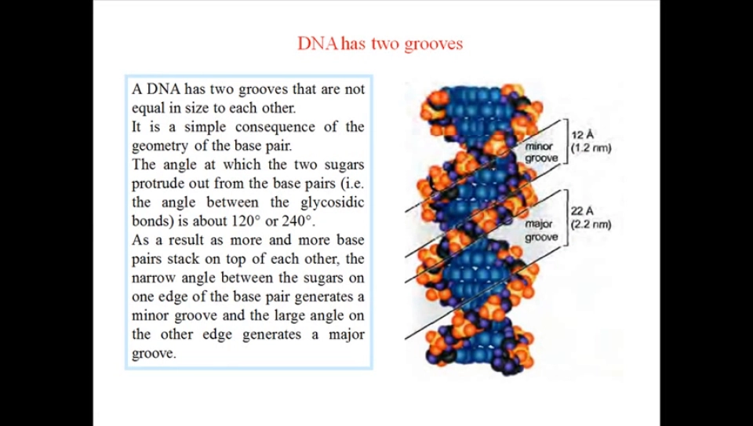
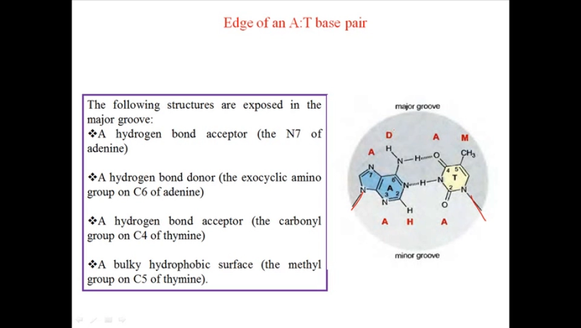
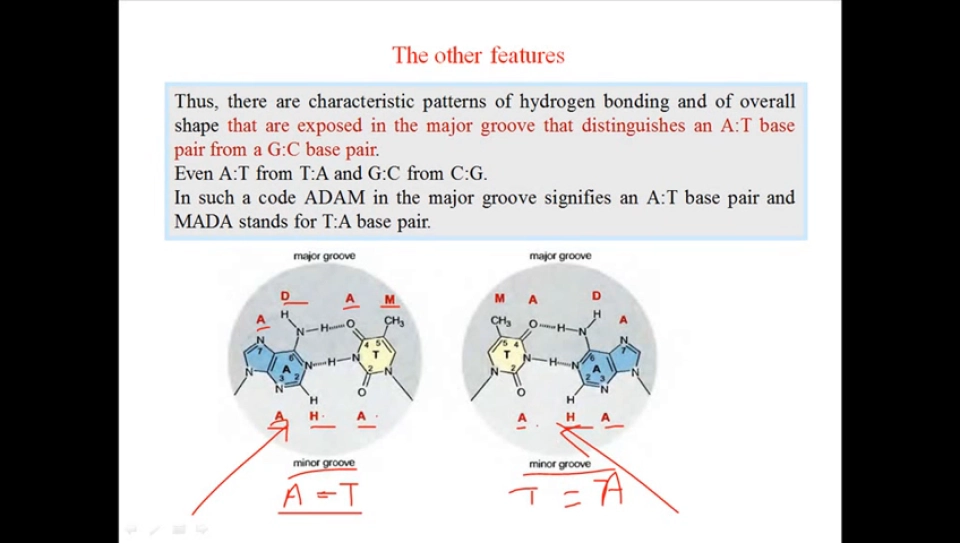
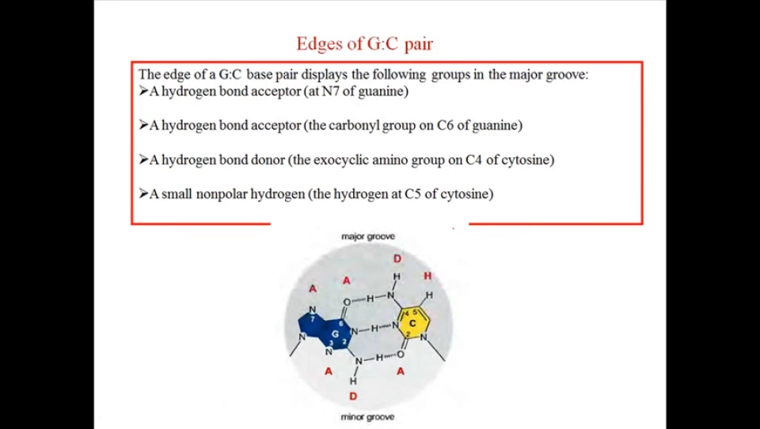
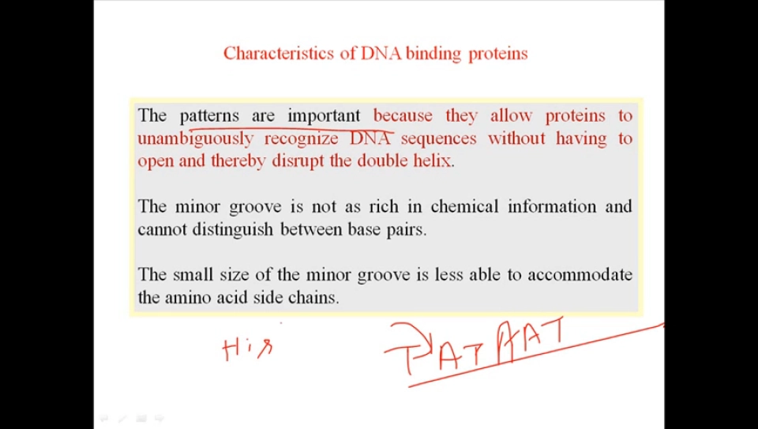
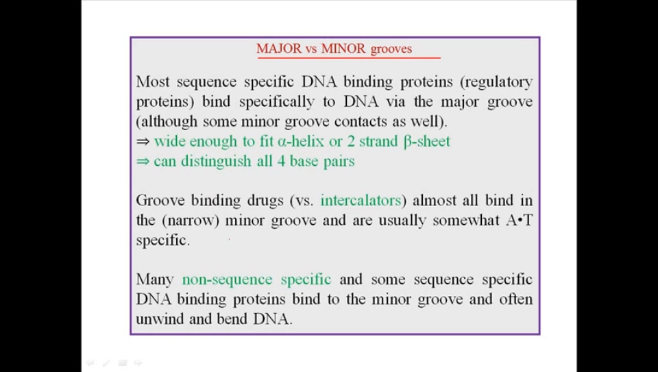
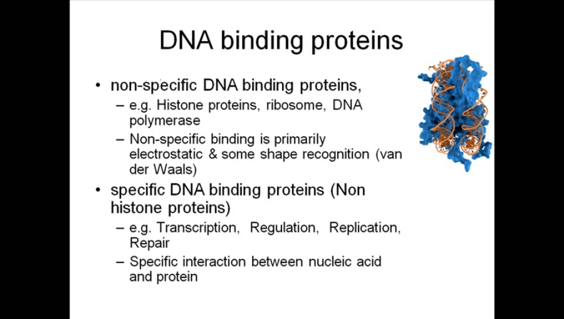
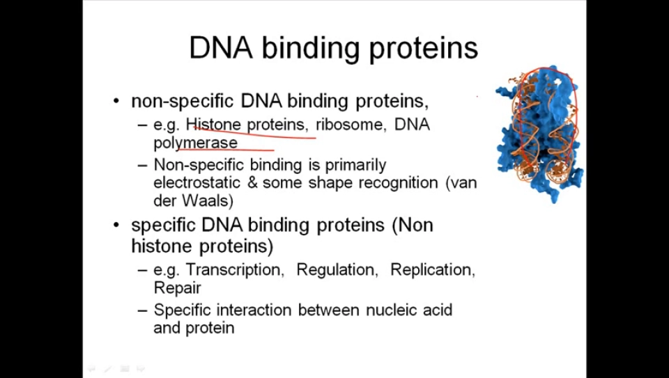

# DNA 的大沟与小沟：蛋白质如何"读出"碱基序列

> 视频来源：[Major groove and minor groove](https://www.youtube.com/watch?v=BuLES4ibFSk)（YouTube，Shomu's Biology，约 11 分钟）。本文基于该视频的演说图文稿整理，关键结论都标了可跳回原片的时间戳。

## 本讲要解决的核心问题（SCQA）

**背景**：DNA 是双螺旋，两条链上的碱基对排在中间，外面裹着糖-磷酸骨架。转录因子、聚合酶、组蛋白这些蛋白要"认"DNA，就得贴到双螺旋表面上去。

**冲突**：双螺旋表面并不是光滑的圆柱，它有两道螺旋形的凹槽——**大沟（major groove）**和**小沟（minor groove）**。奇怪的是，绝大多数能精确识别序列的蛋白都往大沟里钻，而不是看起来更"紧"的小沟。

**疑问**：大沟和小沟在化学上到底差在哪？蛋白凭什么能从沟里"读出"这是 A:T 还是 G:C、是 A:T 还是 T:A？

**回答（中心思想）**：**大沟宽、能容纳氨基酸侧链，而且四种碱基对在大沟里各自露出独一无二的"氢键供体—受体—甲基"图案；小沟窄，化学信息退化到连 A:T 和 T:A 都分不出来。** 所以序列特异性蛋白走大沟，非特异的结构性蛋白（如组蛋白）走骨架和小沟、靠形状与静电结合——这就是蛋白—核酸识别特异性的第一层来源。

## 一、两道沟是碱基对几何的必然产物

### 1.1 糖苷键夹角决定沟的宽窄

碱基对并不是对称地长在螺旋轴上的。碱基与糖相连的两个**糖苷键（glycosidic bond）**从碱基对两侧伸出去，它们相对螺旋轴的夹角不相等：一侧约 **120°**，另一侧约 **240°**——正好差一倍。

当一层层碱基对往上堆叠时，**夹角小的那一侧被挤出一条窄缝，夹角大的那一侧张开成一条宽缝**。窄的叫小沟，宽的叫大沟。所以沟不是"设计"出来的，而是碱基对排布方式的几何后果。[【跳转到 00:05】](https://www.youtube.com/watch?v=BuLES4ibFSk&t=5)

### 1.2 宽窄带来的第一个直接差别：能不能装下侧链

大沟约 **22 Å** 宽，小沟约 **12 Å**。宽度直接决定了一件事：**大沟里塞得进 α 螺旋或两股 β 折叠片那样的蛋白质二级结构，小沟装不下。** 蛋白质要"读"碱基，必须把氨基酸侧链伸进去接触碱基边缘；沟太窄，这一步就做不成。

大沟还更"开放"，能容纳大量水分子进入；小沟里水分子就少得多。[【跳转到 00:55】](https://www.youtube.com/watch?v=BuLES4ibFSk&t=55)

## 二、碱基边缘的"化学条形码"

### 2.1 用 D / A / M 三个字母读一条边

把碱基对从沟的方向看过去，看到的不是碱基平面，而是碱基的**边缘（edge）**。边缘上暴露的基团只有三类，视频里用三个字母记：

- **D = donor（氢键供体）**：带可给出的氢，例如氨基 −NH₂；
- **A = acceptor（氢键受体）**：带孤对电子，例如羰基氧、环上的 N；
- **M = methyl（甲基）**：体积大、疏水，是一个"胖"的接触面。

以 A:T 碱基对为例，从大沟这一侧看，依次露出的是：腺嘌呤 N7 的**受体**、腺嘌呤 C6 外环氨基的**供体**、胸腺嘧啶 C4 羰基的**受体**、胸腺嘧啶 C5 的**甲基**。也就是 **A–D–A–M** 这一串图案。[【跳转到 02:24】](https://www.youtube.com/watch?v=BuLES4ibFSk&t=144)

### 2.2 关键一步：小沟分不出 A:T 和 T:A，大沟可以

这是整支视频最核心的论证。

把同一个碱基对翻过来，从**小沟**看：A:T 露出的是"受体—氢—受体"。再把碱基对**左右翻转**成 T:A，小沟里露出的仍然是"受体—氢—受体"——**完全一样**。

所以：**只看小沟，你无法判断自己面对的是 A:T 还是 T:A。** 方向信息丢了。

但换到**大沟**：A:T 是 **A–D–A–M**，T:A 是 **M–A–D–A**。同一串化学基团，顺序被倒过来了，**信息还在**。蛋白质只要有几个侧链按固定位置去对接，就能分辨这两种朝向。[【跳转到 03:21】](https://www.youtube.com/watch?v=BuLES4ibFSk&t=201)

### 2.3 G:C 的边缘是另一套图案

G:C 碱基对的大沟侧露出：鸟嘌呤 N7 的**受体**、鸟嘌呤 C6 羰基的**受体**、胞嘧啶 C4 外环氨基的**供体**，以及胞嘧啶 C5 上一个**小的非极性氢**。这和小沟侧的"受体—供体—受体"是两套不同的图案。[【跳转到 04:19】](https://www.youtube.com/watch?v=BuLES4ibFSk&t=259)

### 2.4 于是大沟成为"化学信息更丰富"的那一侧

把上面几件事合起来看，可以得出一个清晰的层级：

| 问题 | 小沟能不能回答 | 大沟能不能回答 |
| --- | --- | --- |
| 这里是 A:T 还是 G:C？ | 能（图案不同） | 能 |
| 这里是 A:T 还是 T:A？ | **不能** | 能 |
| 这里是 G:C 还是 C:G？ | **不能** | 能 |

视频用一句话总结：**大沟里的化学信息比小沟多得多**。所以那些"必须严格、快速找到特定位点"的序列特异性 DNA 结合蛋白，几乎总是选择大沟而不是小沟。[【跳转到 04:27】](https://www.youtube.com/watch?v=BuLES4ibFSk&t=267)

## 三、谁走大沟，谁走小沟

### 3.1 序列特异蛋白：走大沟

视频把 DNA 结合蛋白分成两类。**特异性结合**的那些——转录因子、调控蛋白——关心的是"图案"和"要结合的那段区域"。比如原核基因要启动转录，蛋白必须认准 `TATATA` 这一段，而不是它的反向排布；要做到这一点，就必须贴在大沟上。[【跳转到 05:42】](https://www.youtube.com/watch?v=BuLES4ibFSk&t=342)

### 3.2 非特异蛋白：走骨架、走小沟，靠形状和静电

另一类是**非特异性**结合，典型代表是**组蛋白（histone）**。它们的功能不是"认出某段序列"，而是给 DNA 提供结构支撑。这类蛋白可以贴在大沟也可以贴在小沟，可以结合在 DNA 的各个部位。[【跳转到 06:07】](https://www.youtube.com/watch?v=BuLES4ibFSk&t=367)

视频给出的总结很干脆：

- **大多数序列特异性 DNA 结合蛋白（调控蛋白）通过大沟结合**（也会附带一些小沟接触）；
- 大沟**宽到能容纳 α 螺旋或两股 β 折叠片**，而且**能区分全部四种碱基对**；
- **非序列特异**的蛋白、以及一部分序列特异蛋白，则结合在小沟，并且常常**让 DNA 解旋、弯曲**。[【跳转到 07:47】](https://www.youtube.com/watch?v=BuLES4ibFSk&t=467)

### 3.3 顺带一提：沟结合药物为什么偏爱小沟

视频还讲了一个应用侧的对照。有些小分子药物是**沟结合药物（groove binding drugs）**，它们几乎都结合在窄窄的**小沟**里，并且往往对 A:T 富集区有偏好。

原因不是化学上的精细识别，而是策略上的：如果设计一个只认某段特定序列的药，它得先"找到"那段序列，耗时且未必找得到；而在需要阻断 DNA 复制的场景里，**能攻击 DNA 任意部位的药反而更有效**。小沟窄、序列区分度低，正好符合"不挑序列"的需求。[【跳转到 06:57】](https://www.youtube.com/watch?v=BuLES4ibFSk&t=417)

## 四、稳定性从哪来：碱基堆积比氢键更关键

讲完识别，视频用一段讲"DNA 为什么稳定"，因为蛋白结合时要和这些作用力竞争或利用它们。

很多人第一反应是"氢键把两条链拉在一起"。视频强调：**真正排在第一位的不是氢键，而是碱基堆积（base stacking）**。

- **堆积作用**由**疏水作用**加上**范德华作用**（偶极—偶极相互作用）构成，它让碱基像硬币一样一层层摞起来；
- 堆积作用把 DNA 变成一个**能量上高度稳定**的分子；
- **氢键**提供额外的稳定化；
- 再往后才是**静电作用**。[【跳转到 08:12】](https://www.youtube.com/watch?v=BuLES4ibFSk&t=492)

这个排序的意义在于：当蛋白要**弯折或解开** DNA 时，它要克服的主要是堆积作用，而不是先"拆"氢键。

## 五、形状识别：AT 富集区为什么容易被弯

### 5.1 两个氢键 vs 三个氢键

A:T 之间只有**两个氢键**，G:C 之间有**三个氢键**。结果就是：**AT 富集区更容易被弯折，GC 富集区更难弯**。

组蛋白要在 DNA 上绕圈，就必须让 DNA 弯。所以组蛋白倾向于组装到**AT 序列更多的区域**，而不是 GC 富集区。[【跳转到 08:54】](https://www.youtube.com/watch?v=BuLES4ibFSk&t=534)

### 5.2 这就是"形状识别"

注意这里的逻辑：组蛋白并没有"读"某个碱基的氢键图案，它读的是**这段 DNA 好不好弯**——也就是**形状/力学性质**。这是蛋白—核酸识别特异性的第二层来源，和第二节讲的"化学条形码读取"是两条并行的路径。

## 小结

- **两道沟来自几何**：碱基对两侧糖苷键夹角约 120° 与 240°，堆叠后形成窄的小沟（约 12 Å）与宽的大沟（约 22 Å）。
- **大沟能装下侧链**：宽到可以容纳 α 螺旋或两股 β 折叠片；小沟太窄，装不下。
- **碱基边缘只有三种化学基团**：氢键供体 D、氢键受体 A、甲基 M，它们在大沟侧排成一串"条形码"。
- **小沟的信息是退化的**：A:T 与 T:A 在小沟里看起来一模一样；大沟里分别是 ADAM 与 MADA，方向信息保住了。
- **特异性蛋白走大沟，非特异蛋白走小沟/骨架**：前者读化学图案，后者靠静电与形状，并常常弯折 DNA。
- **稳定性排序**：碱基堆积（疏水 + 范德华）> 氢键 > 静电；蛋白弯折 DNA 主要是在跟堆积作用较劲。
- **形状也是信息**：AT 富集区只有两个氢键、易弯，GC 富集区三个氢键、难弯——组蛋白偏好 AT 区正是形状识别的例子。

## 关键术语速查

| 术语 | 一句话解释 |
| --- | --- |
| 大沟（major groove） | 双螺旋表面较宽的螺旋凹槽，约 22 Å，能容纳蛋白二级结构，化学信息最丰富 |
| 小沟（minor groove） | 双螺旋表面较窄的凹槽，约 12 Å，装不下大侧链，且分不出 A:T 与 T:A |
| 糖苷键（glycosidic bond） | 碱基与脱氧核糖相连的键；两侧夹角约 120°/240°，是两道沟宽窄不等的根源 |
| 碱基边缘（base edge） | 从沟的方向看到的碱基侧面，暴露氢键供体、受体与甲基 |
| D / A / M | 氢键供体（donor）、氢键受体（acceptor）、甲基（methyl）的简写，用来描述边缘图案 |
| ADAM / MADA | A:T 与 T:A 在大沟里各自的边缘图案代码，顺序相反，因此可被区分 |
| 序列特异性结合 | 蛋白精确识别特定碱基序列，通常通过大沟的氢键图案实现 |
| 非特异性结合 | 不区分序列的结合，主要靠静电与形状，如组蛋白 |
| 碱基堆积（base stacking） | 相邻碱基之间的疏水与范德华作用，是维持双螺旋稳定性的首要因素 |
| 沟结合药物（groove binder） | 结合在 DNA 沟里的小分子，多选择小沟，且常不区分序列 |