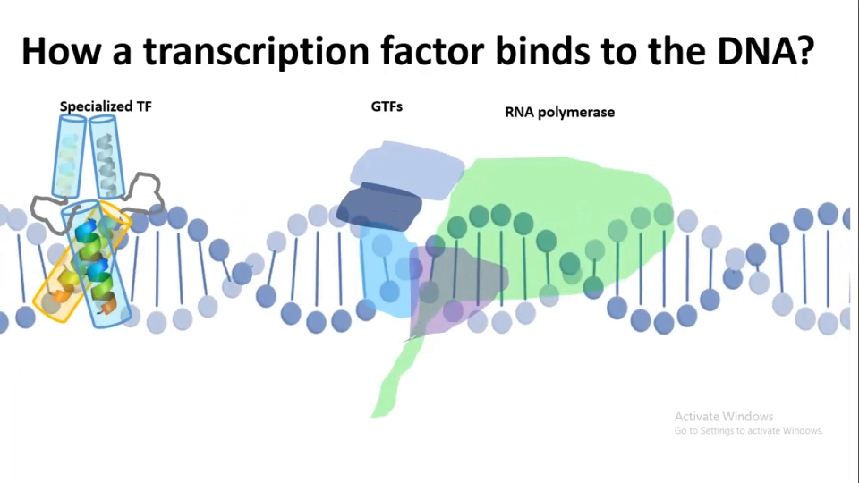
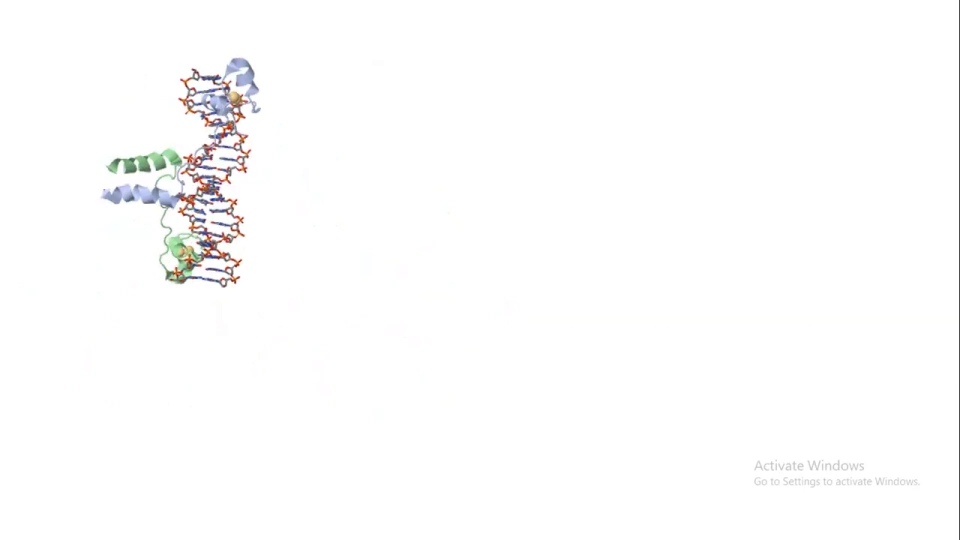
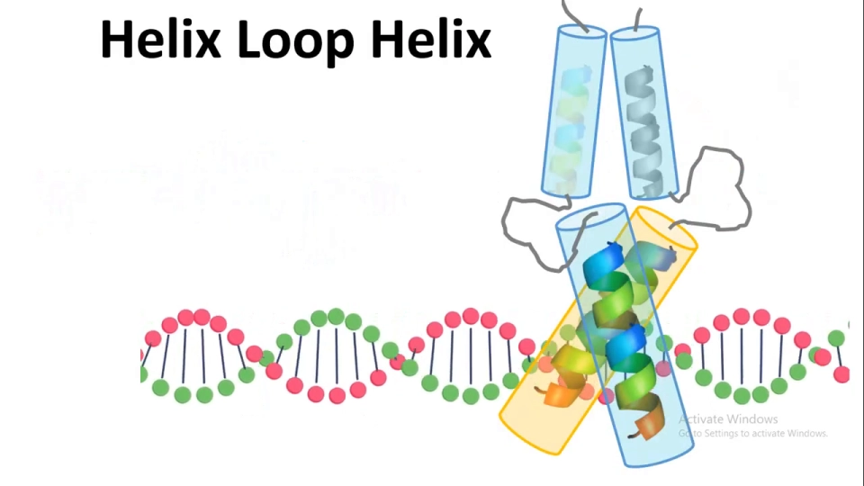
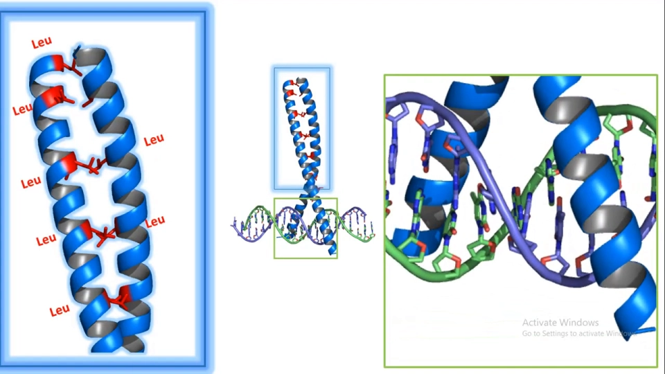
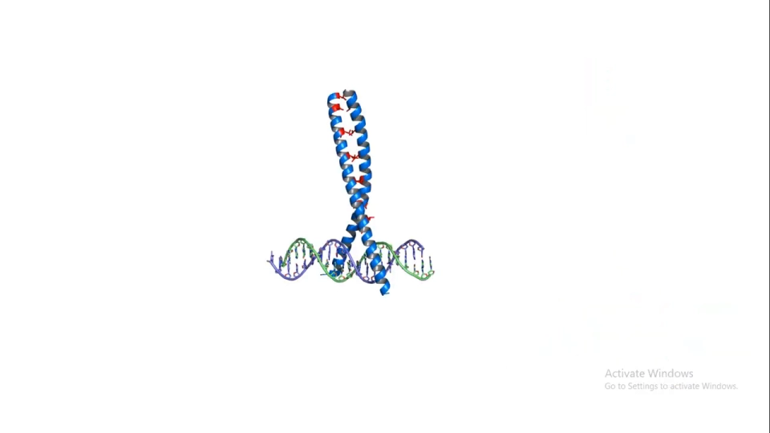
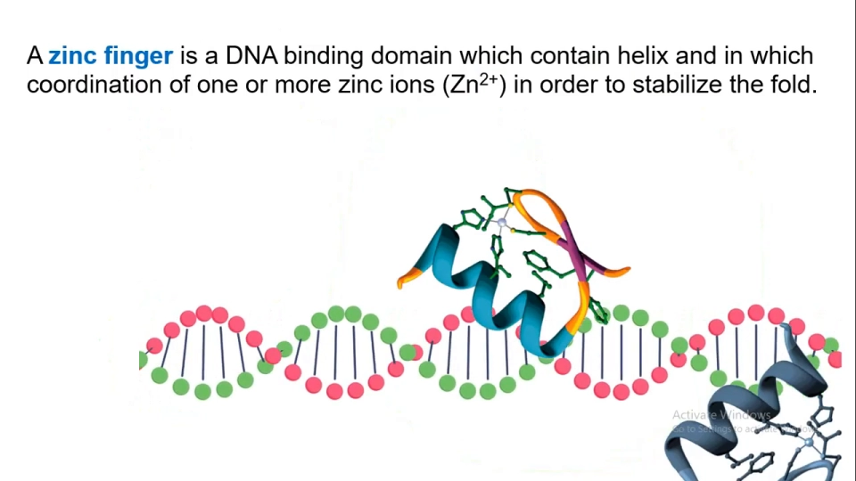

# DNA 结合基序：从螺旋-转角-螺旋到锌指

> 视频来源：[DNA Binding motifs overview](https://www.youtube.com/watch?v=_Lun2RCvp5k)（YouTube，Animated biology With arpan，约 7 分钟）。本文基于该视频的演说图文稿整理，关键结论都标了可跳回原片的时间戳。原片是屏幕录制，部分画面有系统水印，不影响内容。

## 本讲要解决的核心问题（SCQA）

**背景**：转录要启动，最少需要通用转录因子和 RNA 聚合酶。但真正决定"哪个基因在什么时候开"的，是另一类**特异转录因子**——它们结合到 DNA 上的特定区域，招募激活子或抑制子。

**冲突**：一个蛋白只有几十到几百个氨基酸，DNA 上有几十亿个碱基。它凭什么在这么多碱基里找到那一小段？而且"结合 DNA"这件事，不同蛋白用的竟然是形状完全不同的零件。

**疑问**：转录因子靠什么结构去结合 DNA？这些结构为什么能带来序列特异性？

**回答（中心思想）**：**转录因子里有一小段专门负责结合 DNA 的"基序（motif）"——整条蛋白并不负责结合，只有这段保守的氨基酸序列负责。** 常见的有四类：螺旋-转角-螺旋（HTH）、螺旋-环-螺旋（HLH）、亮氨酸拉链（bZIP）和锌指。它们的共同套路是：**用一段 α 螺旋插进 DNA 的大沟，让伸出来的侧链去读碱基边缘**；差别在于二聚化方式、以及靠什么把螺旋固定成正确的角度。

## 一、为什么是"基序"而不是"整条蛋白"

视频开篇就点明：**DNA 结合基序（DNA binding motif）是转录因子内部的一小段结构，它保证了这个特异转录因子能以序列特异的方式结合**，从而激活或抑制转录。[【跳转到 00:35】](https://www.youtube.com/watch?v=_Lun2RCvp5k&t=35)

这个说法很重要，因为它解释了为什么同一类基序可以出现在功能完全不同的蛋白里：**基序是模块**。换掉蛋白的其他部分，功能就变了；但基序本身仍然干"抓住这段 DNA"这件事。

## 二、螺旋-转角-螺旋（HTH）：最经典的那一个

### 2.1 结构：两个 α 螺旋 + 一个 β 转角

HTH 基序由**两个 α 螺旋**组成，中间由一个短的 **β 转角**连接，整段大约 **20–25 个氨基酸**。它结合在 DNA 的**大沟**里。[【跳转到 01:00】](https://www.youtube.com/watch?v=_Lun2RCvp5k&t=60)

### 2.2 靠什么接触碱基

HTH 与 DNA 之间是**多种作用力共同作用**：氢键、范德华相互作用等等。真正决定特异性的是**伸进大沟、暴露在外的那些残基**——它们直接与 DNA 上的特定碱基接触。视频举的例子是**色氨酸（Trp）**和**赖氨酸（Lys）**这类侧链，它们与 DNA 中的芳香碱基发生作用。[【跳转到 01:21】](https://www.youtube.com/watch?v=_Lun2RCvp5k&t=81)

### 2.3 一个证据：从细菌到人都在用

视频给了一个很有说服力的旁证：**λ 噬菌体**的裂解—溶源转换开关蛋白也使用 HTH 基序。这个开关是噬菌体"杀死宿主"还是"潜伏"的核心决策，用的却是和人类转录因子同一套零件。所以视频说，**HTH 基序的功能从细菌到人都是相当保守的**。[【跳转到 01:59】](https://www.youtube.com/watch?v=_Lun2RCvp5k&t=119)

### 2.4 同源域：HTH 的三螺旋版本

**同源域（homeodomain）**是一类特别重要的 HTH 变体：

- 高度保守，长度约 **60 个氨基酸**；
- 由一段 **180 个碱基对**的 DNA 片段编码，这段 DNA 叫**同源盒（homeobox）**；
- 结构上仍然是螺旋-转角-螺旋，但**不是两个螺旋，而是三个螺旋**。

含同源域的转录因子在**体节极性与图式形成（segment polarity and patterning）**中极其重要——从果蝇到哺乳动物胚胎都是如此。[【跳转到 02:21】](https://www.youtube.com/watch?v=_Lun2RCvp5k&t=141)

## 三、螺旋-环-螺旋（HLH）：把"转角"换成"环"

### 3.1 结构差别只在连接段

HLH 顾名思义：**两个 α 螺旋，中间由一个环（loop）连接**。它同样结合 DNA。

### 3.2 关键能力：可以二聚化

HLH 型转录因子能形成**同源二聚体（homodimer）**，也能形成**异源二聚体（heterodimer）**。视频里的示例是一个异源二聚体。[【跳转到 02:59】](https://www.youtube.com/watch?v=_Lun2RCvp5k&t=179)

二聚化不是细节，而是**调控手段**：换一个搭档，识别的序列和调控的靶基因就变了。

## 四、亮氨酸拉链（bZIP）：用疏水作用把两条螺旋"拉"在一起

### 4.1 结构：一端负责拉链，一端负责读碱基

亮氨酸拉链属于 **bZIP 家族**，bZIP 结构域约 **60–80 个氨基酸**。视频把它拆成两个结构要点：

1. **拉链端**：一段螺旋上排列着多个**亮氨酸（Leu）**残基，两条螺旋的这些亮氨酸之间靠**疏水作用**互相贴合，把两个单体"拉"在一起；
2. **DNA 结合端**：与 DNA 大沟接触的那一侧有若干**凸起（protrusion）**，其中**精氨酸（Arg）**侧链从拉链上伸出去，与 DNA 上的**鸟嘌呤**残基作用。

**正是这个特异性接触，决定了这条亮氨酸拉链会结合到 DNA 上的哪一段调控元件。**[【跳转到 03:37】](https://www.youtube.com/watch?v=_Lun2RCvp5k&t=217)

### 4.2 实例：Fos / Jun 与 AP-1

视频给的例子是 **Fos** 和 **Jun**——它们是 **MAPK 信号通路**激活的转录因子。Fos 带亮氨酸拉链基序；不只是 Fos，**Jun 和 C/EBP 也带同样的亮氨酸拉链 DNA 结合基序**，它们因此都能作用于 **AP-1 家族**的转录结合区域。[【跳转到 04:24】](https://www.youtube.com/watch?v=_Lun2RCvp5k&t=264)

## 五、锌指：用锌离子把一个小模块"钉"成正确形状

### 5.1 结构：锌离子是折叠的"铆钉"

**锌指（zinc finger）**基序含有**一个或多个锌离子（Zn²⁺）**，锌离子被若干个从 α 螺旋和 β 转角上伸出的基团**配位**。它同样结合在 DNA 的**大沟**上。[【跳转到 04:54】](https://www.youtube.com/watch?v=_Lun2RCvp5k&t=294)

这里要理解锌离子的角色：它本身不读碱基，它的作用是**把这段小模块稳定成固定的三维形状**。形状固定了，"识别螺旋"才能每次都停在正确的角度上，把正确的侧链送到大沟里。

### 5.2 特异性来自伸出的氨基酸

与 HTH 一样，锌指的特异性来自**从螺旋或 β 折叠片上伸出来、与 DNA 特定碱基接触的那些氨基酸**。视频的表述是：它们与 DNA 的特定碱基作用，**从而保证结合的特异性得以维持**。[【跳转到 05:19】](https://www.youtube.com/watch?v=_Lun2RCvp5k&t=319)

### 5.3 实例：核受体

视频举的锌指例子是**类固醇受体**和**甲状腺激素受体**。以甲状腺激素受体为例，它的逻辑链是：

- 它是一个**核受体（nuclear receptor）**，也就是位于细胞核内；
- 甲状腺激素结合后，它通过与其他**共激活子（coactivator）**或**共抑制子（corepressor）**相互作用，激活或抑制转录；
- 它的 DNA 结合基序是**锌指**；
- 这个锌指含有**两个半胱氨酸和两个组氨酸**残基，与 DNA 上一段叫**甲状腺激素响应元件（thyroid response element）**的特定区域作用；
- 结合的特异性由**从锌指上伸出的特定氨基酸**保证；
- 于是这个含锌指的甲状腺受体作为核转录因子，结合到响应元件上并启动转录。[【跳转到 05:39】](https://www.youtube.com/watch?v=_Lun2RCvp5k&t=339)

## 六、四类基序放在一起看

| 基序 | 核心结构 | 怎么保证特异性 | 典型例子 |
| --- | --- | --- | --- |
| 螺旋-转角-螺旋 HTH | 两个 α 螺旋 + 短 β 转角，约 20–25 aa | 识别螺旋伸入大沟，Trp/Lys 等侧链接触碱基 | λ 噬菌体开关蛋白、同源域蛋白 |
| 同源域（HTH 变体） | 三个 α 螺旋，约 60 aa，由 180 bp 同源盒编码 | 同上，螺旋数更多 | 体节极性与图式形成相关因子 |
| 螺旋-环-螺旋 HLH | 两个 α 螺旋 + 环 | 可同源/异源二聚化，换搭档换特异性 | 示例为异源二聚体 |
| 亮氨酸拉链 bZIP | 60–80 aa；Leu 疏水界面 + 碱性区 | 碱性区的 Arg 与鸟嘌呤特异接触 | Fos、Jun、C/EBP → AP-1 |
| 锌指 | Zn²⁺ 配位 α 螺旋 + β 结构 | 锌离子固定折叠，伸出侧链读碱基 | 类固醇受体、甲状腺激素受体 |

四类基序的共同点非常清楚：**都是一小段模块、都靠一段 α 螺旋插进大沟、都用伸出的侧链去接触碱基边缘。** 差别在于"怎么把这段螺旋摆稳"——HTH 靠转角与整体折叠，HLH 靠二聚化，bZIP 靠亮氨酸拉链的疏水界面，锌指靠锌离子配位。

这也解释了为什么它们能出现在从细菌到人的各种蛋白里：**模块可以复用，特异性由少数几个接触残基决定。**

## 小结

- **结合 DNA 的是基序，不是整条蛋白**；基序是一小段保守结构，负责序列特异性。
- **HTH**：两个 α 螺旋 + β 转角，20–25 aa，插进大沟，靠 Trp/Lys 等侧链接触碱基；从 λ 噬菌体到人保守。
- **同源域**是 HTH 的三螺旋版本，60 aa、由 180 bp 同源盒编码，管体节极性与图式形成。
- **HLH**：两螺旋 + 环，能同源/异源二聚化，二聚化是调控特异性的开关。
- **亮氨酸拉链 bZIP**：Leu 疏水界面负责二聚化，碱性区的 Arg 与鸟嘌呤接触决定结合位点；Fos/Jun/C/EBP 作用于 AP-1。
- **锌指**：Zn²⁺ 把模块钉成固定形状，识别螺旋进大沟；核受体（类固醇、甲状腺激素受体）用它读响应元件。
- 共同套路：**α 螺旋进大沟 + 侧链读碱基边缘**；差别只在"如何把螺旋摆稳"。

## 关键术语速查

| 术语 | 一句话解释 |
| --- | --- |
| DNA 结合基序（motif） | 蛋白内部一小段专门结合 DNA 的保守结构，决定序列特异性 |
| 通用转录因子 vs 特异转录因子 | 前者在启动子上组装 RNA 聚合酶；后者结合特定位点调控单个基因 |
| 螺旋-转角-螺旋（HTH） | 两个 α 螺旋夹一个短 β 转角，20–25 aa，插入大沟 |
| 同源域 / 同源盒 | 60 aa 的三螺旋 HTH 结构 / 编码它的 180 bp DNA 序列 |
| 螺旋-环-螺旋（HLH） | 两个 α 螺旋由环连接，可形成同源或异源二聚体 |
| 亮氨酸拉链（bZIP） | 用成排 Leu 的疏水作用实现二聚化，碱性区负责识别 DNA |
| 碱性区（basic region） | bZIP 中紧邻拉链、伸入大沟并与鸟嘌呤特异接触的片段 |
| 锌指（zinc finger） | 由 Zn²⁺ 配位稳定的小模块，识别螺旋插入大沟 |
| 核受体 | 位于核内、配体结合后直接调控转录的受体，多含锌指 |
| 响应元件（response element） | DNA 上被特定核受体识别的短序列，如甲状腺激素响应元件 |