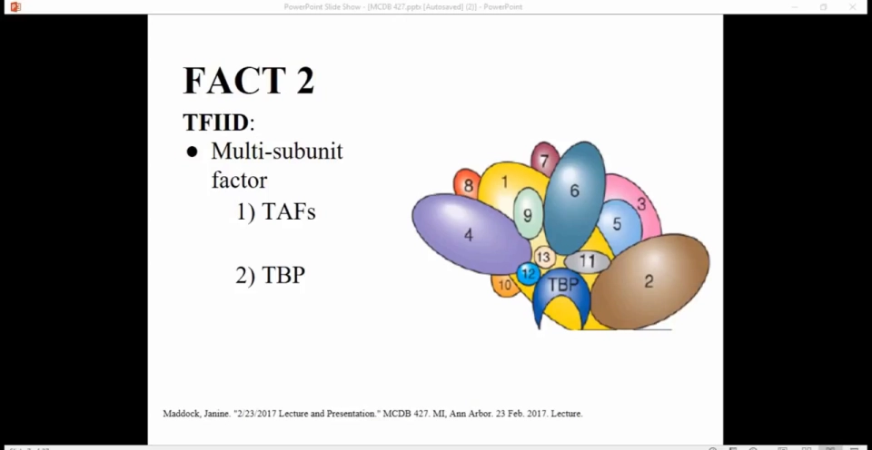
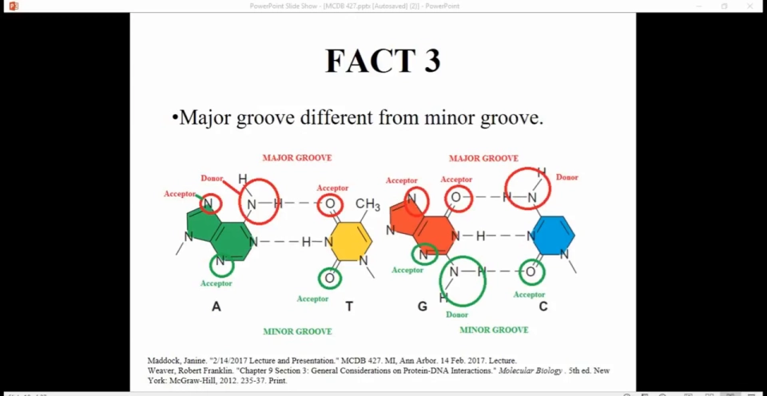
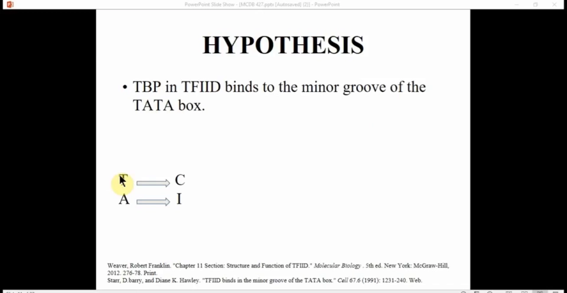
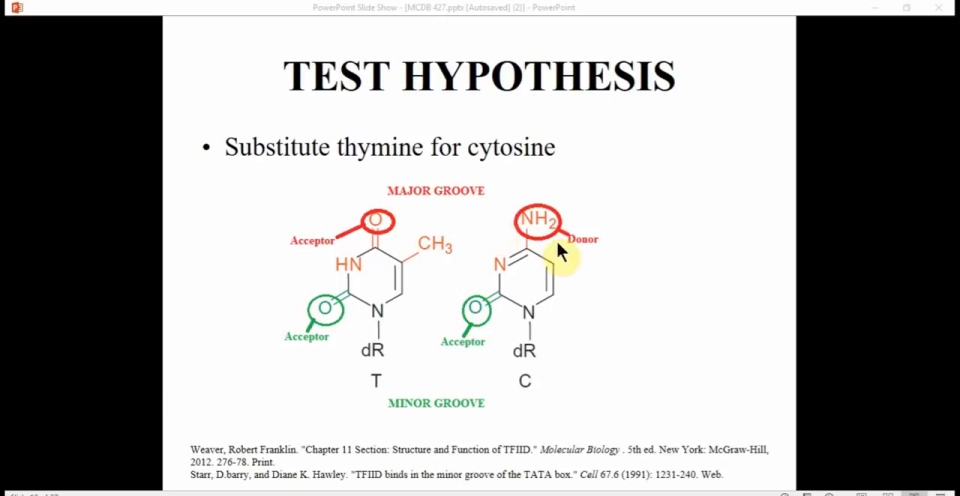
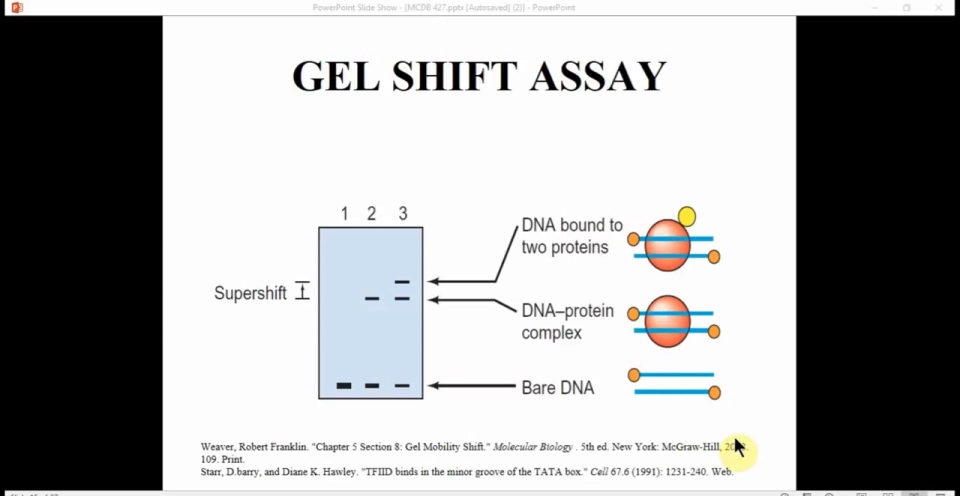
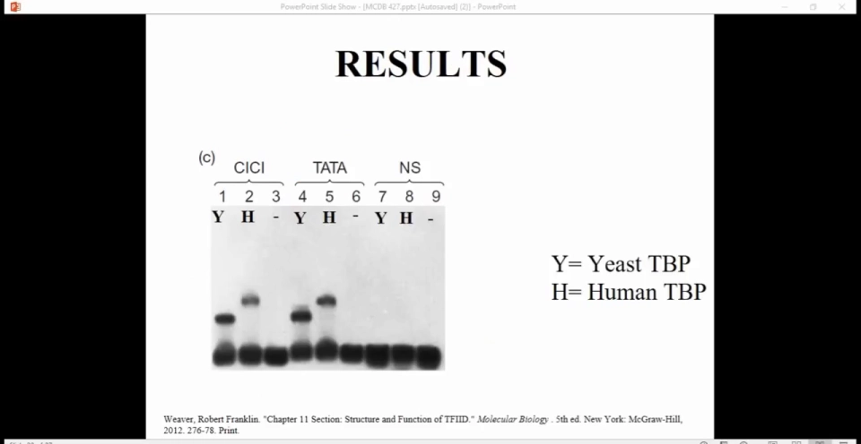
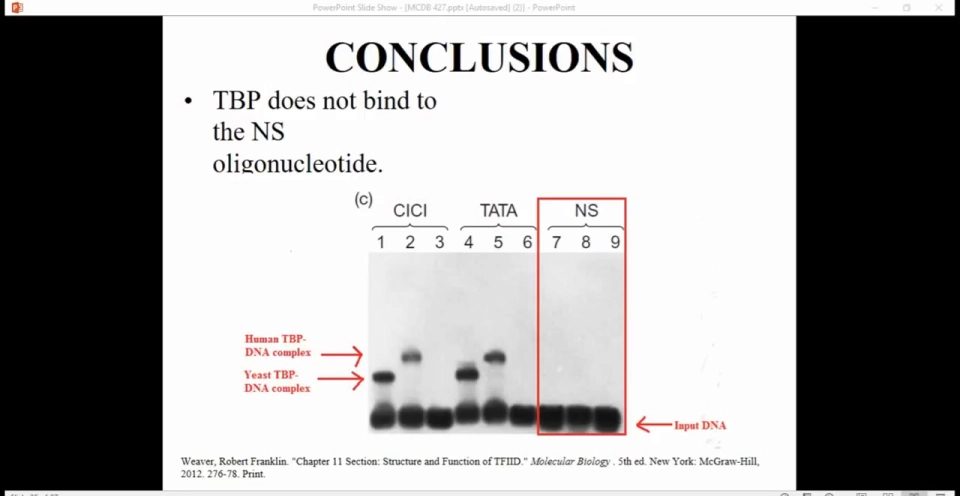

# TBP 为何结合小沟：一个"只改大沟"的替换实验

> 视频来源：[Figure 11.5 TBP Binds Minor Groove](https://www.youtube.com/watch?v=WDkkCNv_bVo)（YouTube，MCDB 427 Molecular Biology, University of Michigan，讲者 Regina Body，约 12 分钟）。本文基于该视频的演说图文稿整理，关键结论都标了可跳回原片的时间戳。

## 本讲要解决的核心问题（SCQA）

**背景**：真核基因要转录，RNA 聚合酶 II 必须先在一个叫**启动子**的地方组装。组装的第一步之一，是 **TFIID** 结合到 DNA 上的 **TATA 框**。TFIID 里真正干这件事的亚基叫 **TBP（TATA box binding protein，TATA 框结合蛋白）**。

**冲突**：DNA 有两道沟——大沟和小沟。上一节讲过，大沟化学信息丰富、能装下侧链，所以绝大多数序列特异蛋白都走大沟。那 TBP 呢？它凭什么认准 TATA 框？如果它走大沟，改掉大沟表面它就该不认了；如果它走小沟，改掉大沟它应该照样结合。

**疑问**：怎么用实验直接判定 TBP 到底读的是哪一侧？

**回答（中心思想）**：**Starr 和 Hawley 设计了一个"只改大沟、不动小沟"的碱基替换——把 TATAAA 换成 CICIAA——然后用凝胶迁移实验看 TBP 还认不认。结果 TBP 照样结合，说明它读的是小沟，而不是大沟。** 这个实验是"用化学差异把两条沟分开"的经典范式：只要你能让一侧变、另一侧不变，就能把"蛋白读哪一侧"变成一个可观测的判断题。

## 一、先认识演员：TFIID、TAF 与 TBP

实验开始前，视频先交代科学家当时已经知道的三个事实。

**事实一：TFIID 结合在 TATA 框上。** RNA 聚合酶 II 开始转录之前，许多因子会在启动子上形成一个复合物；其中一个因子早早地结合到 TATA 框上，这个复合物叫 **TFIID**（图中蓝色）。

**事实二：TFIID 是多亚基因子。** 它由 **13 个 TBP 相关因子（TAF，TBP-associated factors）** 加上 **TBP** 本身组成。TBP 在图中是深蓝色，它在真核生物中高度保守，正如名字所示，它结合 DNA 的 TATA 框。[【跳转到 00:50】](https://www.youtube.com/watch?v=WDkkCNv_bVo&t=50)

**事实三：蛋白怎么"直接接触"核苷酸。** 蛋白结合双链 DNA 的一种方式是通过**氢键**：蛋白氨基酸侧链作为氢键供体/受体，与核苷酸的氢键供体/受体配对。图中画的是氨基酸**谷氨酰胺（Gln）**与一个 T:A 碱基对作用。

但一个蛋白要认的不只是一个碱基对，而是一段序列。所以它必须结合到**大沟**或**小沟**——因为**大沟和小沟携带的信息不一样**。[【跳转到 01:15】](https://www.youtube.com/watch?v=WDkkCNv_bVo&t=75)

## 二、把"两条沟信息不同"变成可操作的判据

### 2.1 A:T 与 G:C 的边缘各是什么样

视频用一张幻灯片把四种碱基的边缘摊开。从**大沟**看过去（红色标注）与从**小沟**看过去（绿色标注），同一对碱基露出的基团不同：

- **A:T**：大沟侧是**受体—供体—受体**；小沟侧是**两个受体**。
- **G:C**：大沟侧是**受体—受体—供体**；小沟侧是**受体—供体—受体**。

视频用了一个很好的类比：**从大沟看还是从小沟看，就像从两面看同一枚硬币——每一面给你的印象不同。**[【跳转到 02:30】](https://www.youtube.com/watch?v=WDkkCNv_bVo&t=150)

### 2.2 关键的不对称：小沟分不出 T 和 C

真正让实验成立的是这一条：

- **胸腺嘧啶（T）和胞嘧啶（C）在小沟里都只有一个受体氧**，所以**从小沟看，两者一模一样**；
- 但从**大沟**看，**T 是受体，C 是供体**，两者不同。

同理：

- **腺嘌呤（A）和次黄嘌呤（I）在小沟里都有一个受体和一个氮**，从小沟看一模一样；
- 从大沟看，**A 有一个供体和一个氮，I 有两个受体**，两者不同。

换句话说：**T↔C 与 A↔I 这两组替换，恰好是"小沟不变、大沟改变"的替换。** 这正是设计判据所需要的工具。[【跳转到 02:55】](https://www.youtube.com/watch?v=WDkkCNv_bVo&t=175)

## 三、假设与实验设计

### 3.1 假设：TBP 结合小沟

**Starr 和 Hawley 提出的假设是：TBP 结合 TATA 框的小沟。** 要检验它，就要造一段"大沟变了、小沟没变"的 DNA，看 TBP 还认不认。[【跳转到 03:20】](https://www.youtube.com/watch?v=WDkkCNv_bVo&t=200)

### 3.2 造一段"只改大沟"的 DNA

做法是逐个替换 TATA 框里的碱基：

- 把 **T 换成 C**：小沟里两者都是受体氧，看起来相同；大沟里 T 是受体、C 是供体，变了。
- 把 **A 换成 I（次黄嘌呤）**：小沟里两者都是"受体 + 氮"，看起来相同；大沟里 A 是供体、I 是受体，变了。

于是原来的序列 **TATAAA** 被改成 **CICIAA**，视频把它叫作 **CICI 框**。

**这个设计的巧妙之处在于：如果 TBP 读的是大沟，CICI 框对它来说就是一段"陌生序列"，应该不结合；如果 TBP 读的是小沟，CICI 框和 TATA 框在它眼里没有区别，应该照样结合。** 实验结果直接给出答案。[【跳转到 04:10】](https://www.youtube.com/watch?v=WDkkCNv_bVo&t=250)

### 3.3 检测手段：凝胶迁移实验（gel shift assay）

要判断"结合了没有"，用的是**凝胶迁移实验（gel shift assay，也叫 EMSA）**。它的原理只有一句话：**同一段 DNA，结合了蛋白之后会变"胖"，在凝胶里跑得慢。**

流程是：

1. 给 DNA 片段打上放射性标记（5′ 端或 3′ 端都行，只要标上）；
2. 让 DNA 与蛋白孵育一段时间，允许形成复合物；
3. 把样品上样到凝胶里做电泳（本实验用的是**非变性聚丙烯酰胺凝胶**）；
4. 对凝胶做放射自显影，检测 DNA 条带的位置。

跑得快的条带在凝胶下方，是**没有结合蛋白的裸 DNA**（本实验中称为 input DNA）；跑得慢的、位置上移的条带就是**蛋白—DNA 复合物**，这个上移就叫 **shift（迁移滞后）**。[【跳转到 05:00】](https://www.youtube.com/watch?v=WDkkCNv_bVo&t=300)

### 3.4 三组 DNA × 三种条件

实验用了**三种双链寡核苷酸**：

1. **TATA 寡核苷酸**（含 TATA 框，图中红色）——用来建立"TBP 认 TATA 框"的基线；
2. **CICI 寡核苷酸**（含 CICI 框，图中绿色）——核心测试对象；
3. **非特异 DNA**（不含 TATA 框，图中蓝色）——阴性对照，用来证明 TBP 不是随便抓 DNA。

每种 DNA 都配三种条件：

- **A 管**：加**酵母 TBP** + 缓冲液，孵育 60 分钟让复合物形成；
- **B 管**：加**人 TBP** + 缓冲液；
- **C 管**：只加缓冲液、**不加 TBP**——这是对照，用来标定 input DNA 在凝胶上的位置。

用人 TBP 和酵母 TBP 两种，是为了多一个内部对照：两者都能结合时结论更稳；而且人 TBP 分子更大，复合物跑得更慢，条带位置本身就能区分是谁结合的。[【跳转到 06:40】](https://www.youtube.com/watch?v=WDkkCNv_bVo&t=400)

## 四、读胶：结果怎么解释

凝胶一共 9 个泳道，按 DNA 分成三组，每组内依次是**酵母 TBP / 人 TBP / 无蛋白**：

| 泳道 | DNA | 加的蛋白 |
| --- | --- | --- |
| 1 | CICI | 酵母 TBP |
| 2 | CICI | 人 TBP |
| 3 | CICI | 无（对照） |
| 4 | TATA | 酵母 TBP |
| 5 | TATA | 人 TBP |
| 6 | TATA | 无（对照） |
| 7 | 非特异 | 酵母 TBP |
| 8 | 非特异 | 人 TBP |
| 9 | 非特异 | 无（对照） |

### 4.1 TATA 组：基线成立

- **泳道 6**（TATA，无蛋白）：只有底部一条带，就是 input DNA，**没有 shift**——没有 TBP，自然不形成复合物。
- **泳道 5**（TATA，人 TBP）：出现上移条带，说明复合物形成了；底部还留有 input DNA 条带，说明不是所有 DNA 都被结合。
- **泳道 4**（TATA，酵母 TBP）：同样出现两条带——底部是 input DNA，上方是 shift。

**人 TBP 的复合物比酵母 TBP 的跑得更慢**，因为人 TBP 更大。这正好验证了条带身份。[【跳转到 09:17】](https://www.youtube.com/watch?v=WDkkCNv_bVo&t=557)

### 4.2 CICI 组：核心结论

- **泳道 3**（CICI，无蛋白）：没有 shift，符合预期。
- **泳道 2**（CICI，人 TBP）：**出现 shift**——人 TBP 能结合 CICI 寡核苷酸。
- **泳道 1**（CICI，酵母 TBP）：**也出现 shift**，且复合物比人 TBP 的跑得快（酵母 TBP 更小）。

**两种 TBP 都能结合 CICI 框。** 而 CICI 框与 TATA 框的差别，恰恰只在**大沟一侧**；小沟一侧被设计成完全一致。所以结论是：**TBP 不需要读大沟就能认出它的位点——它结合的是小沟。**[【跳转到 10:32】](https://www.youtube.com/watch?v=WDkkCNv_bVo&t=632)

### 4.3 非特异组：阴性对照成立

- **泳道 9**（非特异 DNA，无蛋白）：没有 shift。
- **泳道 7、8**（非特异 DNA + 酵母/人 TBP）：**也没有 shift**，没有复合物形成。

这说明 TBP **必须有一段 TATA 框（或等价的小沟图案）才结合**，它并不会随便抓 DNA。这条对照排除了"TBP 对任何 DNA 都有亲和力"这个替代解释。[【跳转到 10:57】](https://www.youtube.com/watch?v=WDkkCNv_bVo&t=657)

## 五、这个实验为什么值得记住

### 5.1 逻辑骨架：把"读哪一侧"变成一个可观测的判断题

整个实验的逻辑可以压缩成三步：

1. **找到一组"只改一侧"的化学替换**（T↔C、A↔I 在小沟等价、在大沟不等价）；
2. **用它造出"大沟变了、小沟没变"的底物**；
3. **用结合实验读出答案**：还结合 → 读的是没变的那一侧。

这个套路不限于 TBP。任何"蛋白读的是哪一侧"的问题，只要能找到"一侧变、另一侧不变"的化学或形状扰动，都能这样判定。

### 5.2 结论的分量：TBP 是"小沟读取"的经典案例

TBP 结合小沟这件事，在蛋白—核酸识别里是一个重要的反例：它说明**"序列特异性"并不必然等于"读大沟的氢键图案"**。小沟虽然化学信息退化，但**不同碱基对在小沟里的形状（宽度、深度、静电势）仍然有差别**，蛋白可以通过小沟的形状与骨架接触来实现特异性。

这也解释了为什么 TBP 结合 TATA 框时会把 DNA 明显弯折——小沟结合往往伴随 DNA 的形变，识别和形变是同一件事的两面。

### 5.3 一个必须注意的边界

本实验证明的是"**TBP 不需要大沟的化学差异就能结合**"，也就是"结合不依赖于大沟读取"。它并没有单独测出"TBP 与小沟之间形成了多少根氢键"——那需要结构生物学（晶体结构）来回答。视频只讲到实验逻辑这一层，本文也停在这一层。

## 小结

- **TFIID 是多亚基因子**：13 个 TAF + TBP，TBP 负责结合 TATA 框，在真核中高度保守。
- **两条沟的信息不同**：A:T 与 G:C 在大沟、小沟两侧露出的供体/受体图案都不一样；从两面看像看硬币的两面。
- **可用的不对称**：T 与 C 在小沟里都是同一个受体氧，A 与 I 在小沟里都是"受体 + 氮"——**小沟等价、大沟不等价**。
- **实验设计**：把 TATAAA 改成 CICIAA，大沟表面变了、小沟表面不变；若 TBP 仍结合，就说明它读小沟。
- **检测手段**：凝胶迁移实验——结合蛋白的 DNA 跑得慢，条带上移即复合物形成。
- **结果**：TATA 组与 CICI 组都出现 shift，非特异 DNA 组没有 shift；人 TBP 复合物比酵母 TBP 跑得慢（分子更大）。
- **结论**：**TBP 结合 TATA 框的小沟**——序列特异性不必来自大沟的氢键图案，也可以来自小沟的形状与骨架接触。

## 关键术语速查

| 术语 | 一句话解释 |
| --- | --- |
| TBP | TATA box binding protein，TFIID 中负责结合 TATA 框的保守亚基 |
| TFIID | 由 13 个 TAF 与 TBP 组成的多亚基转录起始因子 |
| TAF | TBP-associated factor，TBP 相关因子 |
| TATA 框 | 启动子上的一段富含 A:T 的短序列，TBP 的结合位点 |
| 大沟 / 小沟 | 双螺旋表面的两道凹槽；大沟化学信息丰富，小沟信息退化但仍有形状差异 |
| 碱基边缘图案 | 从某一侧沟看到的氢键供体/受体排布，是蛋白读取序列的化学基础 |
| CICI 框 | 把 TATAAA 中的 T 换成 C、A 换成 I 得到的序列，小沟表面与 TATA 框等价 |
| 凝胶迁移实验（EMSA） | 用"结合蛋白后跑得慢"来检测蛋白—DNA 结合的电泳方法 |
| shift（迁移滞后） | 复合物条带相对裸 DNA 条带位置上移的现象 |
| input DNA | 未结合蛋白的裸 DNA，作为位置参照 |
| 非特异 DNA | 不含目标位点的对照 DNA，用于排除"随便结合"的解释 |