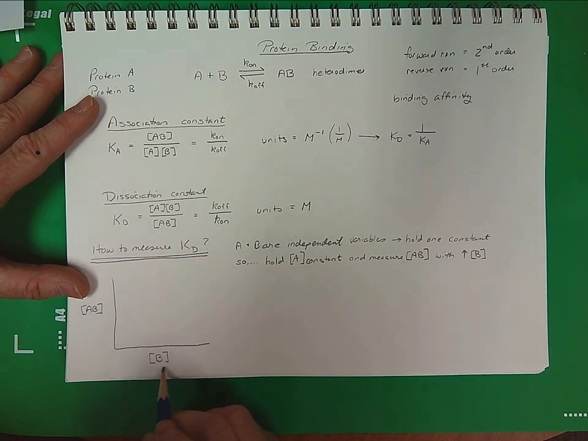
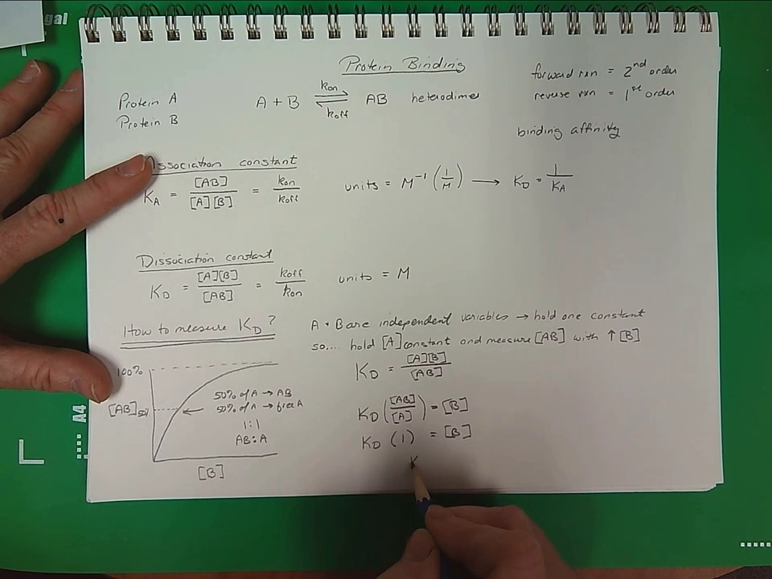

# 蛋白质结合动力学：从速率方程推导Kd与kon、koff的关系，并在半高点读亲和力

> 视频来源：[05 Protein Binding Kinetics](https://www.youtube.com/watch?v=V4LoG2-WrIM)（YouTube · Rob Orlando）｜时长约 13 分钟
> 导读：一支白纸手写推导式的短课。它只做一件事：把 $K_d$ 从「课本上的一个常数」还原成「两个速率常数的比值」，再用一条饱和曲线说明为什么可以在 50% 处直接读出 $K_d$。适合作为 3.1.6 的数学入门，读完再去看长驻留时间带来的生物学后果。

## 本讲要解决的核心问题（SCQA）

**背景**：描述两个蛋白（或蛋白与配体）结合得紧不紧，最常用的量是解离常数 $K_d$，单位是浓度，数值越小越紧。

**冲突**：$K_d$ 有两个看似无关的身份。它既是「平衡时产物与反应物的浓度比」，又是「两个速率常数的比值」；一个从热力学来，一个从动力学来。更别扭的是：正向反应明明是二级反应、逆向是一级反应，两个不同量纲的速率常数怎么除得出一个浓度？

**疑问**：$K_d = k_{off}/k_{on}$ 是怎么来的？为什么在饱和曲线上「一半结合」对应的浓度就是 $K_d$？

**回答（中心思想）**：**把结合写成 $A + B \rightleftharpoons AB$ 的二态反应，正逆两个方向的速率在平衡时相等，于是浓度比（$K_a$）恰好等于速率常数之比（$k_{on}/k_{off}$）；取倒数就得到 $K_d = k_{off}/k_{on}$，量纲自动落回浓度。** 而「一半靶点被占据」正是 $[AB] = [A]$ 的那一点，此时 $K_d$ 在数值上就等于游离配体浓度 $[B]$——这就是从曲线上读 $K_d$ 的全部秘密。

## 一、二态模型：两个分子进，一个复合物出

### 1.1 从异二聚体说起

课程从一个具体例子开始：溶液里有两个不同的蛋白 A 和 B，放在一起会形成复合物 AB。因为 A 与 B 不同，这个复合物叫**异二聚体**（hetero- 表示「不同」，-dimer 表示「双分子结合」）。[【跳转到 00:41】](https://www.youtube.com/watch?v=V4LoG2-WrIM&t=41)[【跳转到 00:59】](https://www.youtube.com/watch?v=V4LoG2-WrIM&t=59)

这个模型同样适用于「蛋白 + 小分子配体」，后文不再区分两者。[【跳转到 00:21】](https://www.youtube.com/watch?v=V4LoG2-WrIM&t=21)

### 1.2 正向 $k_{on}$，逆向 $k_{off}$

结合是非共价相互作用，所以两个方向都有各自的速率：

- **正向**：A 与 B 结合成 AB，速率常数为 $k_{on}$（读作「k on」）；
- **逆向**：AB 散开成 A 与 B，速率常数为 $k_{off}$。[【跳转到 01:04】](https://www.youtube.com/watch?v=V4LoG2-WrIM&t=64)[【跳转到 01:40】](https://www.youtube.com/watch?v=V4LoG2-WrIM&t=100)

### 1.3 为什么一个是二级、一个是一级

这是理解「量纲」的关键一步：

- 正向有**两个独立的分子**（A 和 B）撞在一起变成一个，反应速率同时依赖两者浓度，所以是**二级反应**；
- 逆向只有**一个分子实体**（AB）在分解，速率只依赖它自己的浓度，所以是**一级反应**。[【跳转到 02:10】](https://www.youtube.com/watch?v=V4LoG2-WrIM&t=130)[【跳转到 02:30】](https://www.youtube.com/watch?v=V4LoG2-WrIM&t=150)

因此 $k_{on}$ 的单位带「浓度⁻¹」，$k_{off}$ 的单位只有「时间⁻¹」。这个差别在第三章会决定 $K_d$ 的量纲。

## 二、结合常数 $K_a$：产物除以反应物

测结合动力学的目的，是得到**结合亲和力**——它告诉我们两个分子结合得有多紧。[【跳转到 02:35】](https://www.youtube.com/watch?v=V4LoG2-WrIM&t=155)[【跳转到 02:45】](https://www.youtube.com/watch?v=V4LoG2-WrIM&t=165)

第一步先写**结合常数（association constant）$K_a$**：平衡时产物的浓度除以各反应物浓度之积。[【跳转到 03:14】](https://www.youtube.com/watch?v=V4LoG2-WrIM&t=194)

$$
K_a = \frac{[AB]}{[A][B]}
$$

这个式子里也藏着速率常数：$K_a$ 等于结合速率除以解离速率，即 $K_a = k_{on}/k_{off}$。[【跳转到 03:57】](https://www.youtube.com/watch?v=V4LoG2-WrIM&t=237)

### 2.1 单位为什么是「浓度的倒数」

分子是一个浓度，分母是两个浓度相乘，约掉一个后剩下「1/浓度」，即 $M^{-1}$。[【跳转到 04:16】](https://www.youtube.com/watch?v=V4LoG2-WrIM&t=256)[【跳转到 04:31】](https://www.youtube.com/watch?v=V4LoG2-WrIM&t=271)

$M^{-1}$ 这种单位不直观，也不好交流。于是生化的惯例是把它翻过来，用一个「单位是浓度」的量来说话。[【跳转到 04:48】](https://www.youtube.com/watch?v=V4LoG2-WrIM&t=288)

## 三、解离常数 $K_d$：把式子翻过来

$$
K_d = \frac{1}{K_a} = \frac{[A][B]}{[AB]}
$$

因为取的是倒数，单位自然变成**摩尔浓度（M）**——这正是我们熟悉的「纳摩尔级亲和力」的说法来源。[【跳转到 05:08】](https://www.youtube.com/watch?v=V4LoG2-WrIM&t=308)[【跳转到 06:13】](https://www.youtube.com/watch?v=V4LoG2-WrIM&t=373)

课程强调：正因为单位直观、便于解释和沟通，日常讨论结合强弱时基本都用 $K_d$，而不是 $K_a$。[【跳转到 06:23】](https://www.youtube.com/watch?v=V4LoG2-WrIM&t=383)[【跳转到 06:35】](https://www.youtube.com/watch?v=V4LoG2-WrIM&t=395)

### 3.1 同一个式子，换成速率常数写

既然 $K_a = k_{on}/k_{off}$，取倒数立刻得到：

$$
K_d = \frac{k_{off}}{k_{on}}
$$

单位也随之对上：$k_{off}$ 是「时间⁻¹」，$k_{on}$ 是「浓度⁻¹·时间⁻¹」，相除后「时间⁻¹」约掉，剩下浓度。[【跳转到 06:01】](https://www.youtube.com/watch?v=V4LoG2-WrIM&t=361)[【跳转到 06:18】](https://www.youtube.com/watch?v=V4LoG2-WrIM&t=378)

### 3.2 为什么平衡时「浓度比 = 速率比」

把两个方向写成速率：

- 结合速率 $= k_{on}[A][B]$
- 解离速率 $= k_{off}[AB]$

**平衡的定义就是两个方向速率相等**（净变化为零，浓度不再改变）：

$$
k_{on}[A][B] = k_{off}[AB]
$$

移项整理：

$$
\frac{[A][B]}{[AB]} = \frac{k_{off}}{k_{on}}
$$

左边正是 $K_d$ 的定义式，右边正是速率常数之比。**这就是 $K_d = k_{off}/k_{on}$ 的全部推导**：它不是新假设，只是「平衡时正逆速率相等」这一句话的代数改写。

## 四、怎么测 $K_d$：一次只让一个变量动

### 4.1 二级反应的麻烦：两个自变量

$K_d$ 的定义式里有 $[A]$、$[B]$、$[AB]$ 三个量，但结合是二级反应，A 和 B 都是自变量。要得到可解释的曲线，必须**把其中一个固定住**，只让另一个变化。[【跳转到 07:00】](https://www.youtube.com/watch?v=V4LoG2-WrIM&t=420)[【跳转到 07:23】](https://www.youtube.com/watch?v=V4LoG2-WrIM&t=443)

### 4.2 固定 A，滴定 B

课程给的实验设计是：

1. 所有试管里放**相同浓度**的 A；
2. 加入**一系列不同浓度**的 B（B 也可以是配体）；
3. 让它们反应，**在平衡时**测生成的 AB 量。[【跳转到 08:09】](https://www.youtube.com/watch?v=V4LoG2-WrIM&t=489)[【跳转到 08:47】](https://www.youtube.com/watch?v=V4LoG2-WrIM&t=527)

以 $[AB]$ 为纵轴、$[B]$ 为横轴作图，得到的是一条**双曲线（饱和曲线）**：B 越多，AB 越多，但最终会饱和——因为 A 被用完了，再怎么加 B 也无法超过 100%。[【跳转到 09:02】](https://www.youtube.com/watch?v=V4LoG2-WrIM&t=542)[【跳转到 09:25】](https://www.youtube.com/watch?v=V4LoG2-WrIM&t=565)

## 五、50% 点：从曲线上直接读出 $K_d$

### 5.1 在「一半结合」处，$[AB] = [A]$

取曲线上 $[AB]$ 达到最大值一半的那一点。此时：

- 一半的 A 变成了 AB（结合态）；
- 另一半 A 仍是游离的（游离态）。

所以 $[AB] = [A]$，两者是 1:1 的关系。[【跳转到 10:13】](https://www.youtube.com/watch?v=V4LoG2-WrIM&t=613)[【跳转到 11:33】](https://www.youtube.com/watch?v=V4LoG2-WrIM&t=693)

### 5.2 代数上一步到位

把 $[AB] = [A]$ 代回定义式：

$$
K_d = \frac{[A][B]}{[AB]} = \frac{[A][B]}{[A]} = [B]
$$

也就是说：**$K_d$ 在数值上等于「让一半靶点被结合」所需的游离配体浓度**。在图上，从 50% 点向左画一条水平线、再向下落到横轴，读到的那个 $[B]$ 就是 $K_d$。[【跳转到 11:58】](https://www.youtube.com/watch?v=V4LoG2-WrIM&t=718)[【跳转到 12:23】](https://www.youtube.com/watch?v=V4LoG2-WrIM&t=743)

### 5.3 这条推导的三个前提

课程没有展开，但值得初学者记住，否则容易误用：

1. **二态假设**：只有一个结合位点、一个复合物状态，没有中间态、没有协同；
2. **平衡假设**：曲线必须真的到了平台，否则读到的「中点」不是 $K_d$（这正是长驻留时间化合物最容易踩的坑，见 3.1.6 的另一篇）；
3. **自由配体近似**：推导默认加入的 B 浓度近似等于游离 B 浓度，也就是 B 大大过量、被结合掉的部分可忽略。

## 小结

- 结合写成二态反应 $A + B \rightleftharpoons AB$：正向 $k_{on}$（二级，单位浓度⁻¹·时间⁻¹），逆向 $k_{off}$（一级，单位时间⁻¹）。
- 结合常数 $K_a = [AB]/([A][B]) = k_{on}/k_{off}$，单位 $M^{-1}$。
- 解离常数 $K_d = 1/K_a = [A][B]/[AB] = k_{off}/k_{on}$，单位是浓度。
- $K_d = k_{off}/k_{on}$ 的来历只有一句话：平衡时正逆速率相等，$k_{on}[A][B] = k_{off}[AB]$，移项即得。
- 测量时固定 A、滴定 B，在平衡时测 $[AB]$，得到饱和双曲线；50% 处 $[AB] = [A]$，故 $K_d = [B]$。
- 这套推导依赖二态、平衡、自由配体过量三个前提；不满足时读出的「$K_d$」只是表观值。

## 关键术语速查

| 术语 | 一句话解释 |
| --- | --- |
| 异二聚体 | 两个不同的蛋白分子结合成的复合物 |
| $k_{on}$ | 结合速率常数，二级反应，单位「浓度⁻¹·时间⁻¹」 |
| $k_{off}$ | 解离速率常数，一级反应，单位「时间⁻¹」 |
| $K_a$ | 结合常数，产物浓度除以反应物浓度之积，单位 $M^{-1}$ |
| $K_d$ | 解离常数，$K_a$ 的倒数，单位是浓度，数值越小结合越紧 |
| 饱和曲线 | 固定 A、改变 B 时 $[AB]$ 对 $[B]$ 的双曲线，最终趋于平台 |
| 50% 点 | $[AB]$ 为最大值一半处，此时 $[B] = K_d$ |