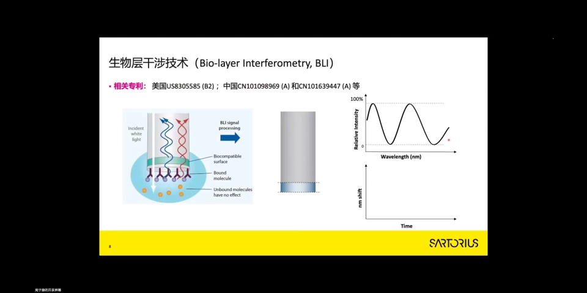
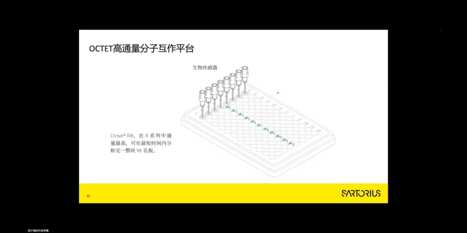
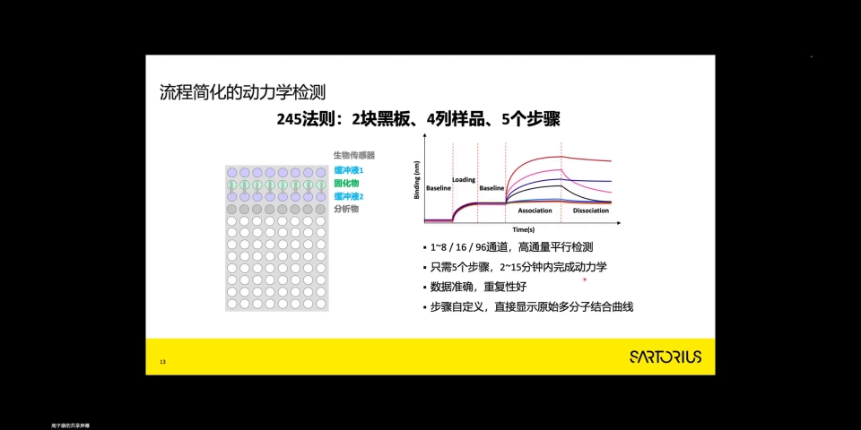
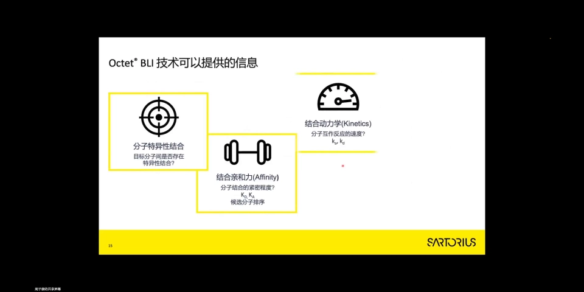
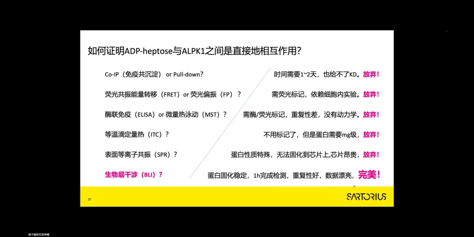
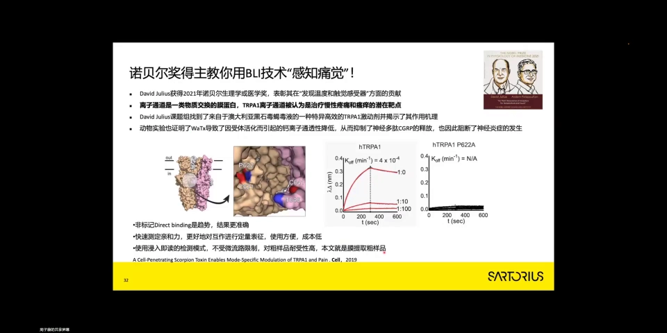
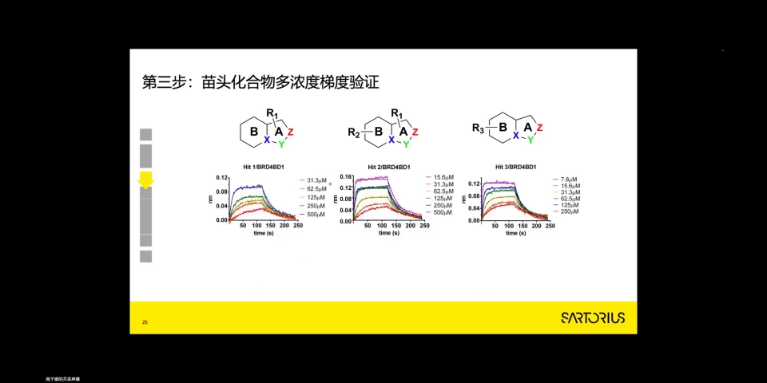
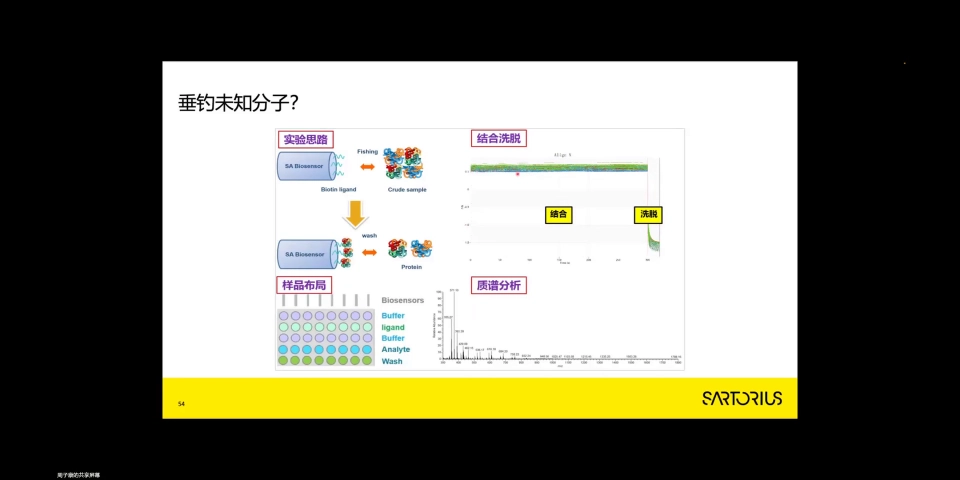
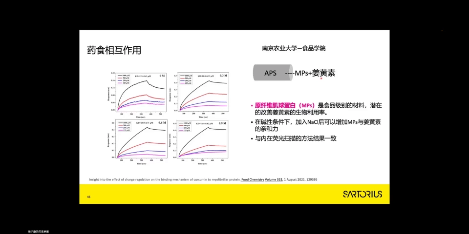

# BLI 读数指南：光纤探针上的干涉信号、245 法则与 koff

> 视频来源：[生物层干涉技术(BLI)用于分子互作研究](https://www.bilibili.com/video/BV1Za4y1m74e/)（Bilibili · 共享平台网络课程 · 约 67 分钟）
> 导读：这是赛多利斯（Sartorius）技术支持做的一场 Octet/BLI 系统讲座：先讲干涉原理与"245 法则"的实验流程，再讲 BLI 能给的三类信息，然后用十几个文献案例说明它适合什么样的样品（膜蛋白粗提物、细胞上清、病毒颗粒、中药提取液）。文末把讲者自己做的"方法学横评"单独拎出来，那是本讲最有价值的一页。

## 本讲要解决的核心问题（SCQA）

**背景**：测分子互作的老办法很多——pull-down、Co-IP、ELISA、凝胶迁移（EMSA），它们能回答"有没有结合"。

**冲突**：这些方法要么需要标记、要么给不出定量参数，要么在"蛋白不好拿"的时候直接失效：膜蛋白提不纯、靶点没法偶联到芯片上、样品只有细胞上清。当样品本身就是"脏"的，很多精密仪器就退场了。

**疑问**：BLI 靠什么物理量读数？它凭什么能容忍粗样品？它给出的 Kd、ka、kd 与 SPR、ITC 相比有什么不同、又有什么共同点？

**回答（中心思想）**：**BLI 用光纤探针末端的生物膜层反射光干涉、读取"相位（nm 位移）"来实时追踪结合；探针浸入式、无流路，所以能直接泡在粗样品里；它同样给出亲和力与动力学，但读数的可信度取决于固化（loading）质量、对照设置与拟合区间。**

## 一、先把 BLI 放进"非标记技术"的地图里

研究分子互作，本质就是看 A 和 B 能不能形成 AB 复合物、以及这个复合物有多稳定。[【跳转到 2:16】](https://www.bilibili.com/video/BV1Za4y1m74e/?t=136) 传统方法各有短板：pull-down、Co-IP 只能给条带，ELISA 要拍板子做免疫发光，EMSA 最早用于 DNA—蛋白结合。[【跳转到 2:41】](https://www.bilibili.com/video/BV1Za4y1m74e/?t=161)

新一代方法的共同优势是**非标记**——不需要对样品做额外特殊处理就能检测互作。讲者把非标记技术分成三大流派：[【跳转到 3:11】](https://www.bilibili.com/video/BV1Za4y1m74e/?t=191)

1. **光学**：BLI 与 SPR，都基于光；
2. **能量**：ITC 等温滴定量热，测封闭体系里的能量变化——任何反应都伴随吸热或放热；[【跳转到 2:41】](https://www.bilibili.com/video/BV1Za4y1m74e/?t=161)
3. **重力场**：靠离心/沉降判断结合，讲者说目前还不够成熟，因此没有列入主流。

这张地图很重要：**BLI 与 SPR 是同一类（光学、实时），ITC 是另一类（热力学、终点）**。它们给出的参数因此不同——这一点在第四节会展开。

## 二、原理：一根光纤、两层反射、一个相位差

原理本身是中学物理的干涉现象。传感器是一根**实心光纤**，表面做化学或生物修饰，让它能结合特定物质；光纤内表面有一层**参比层（reference layer）**。[【跳转到 6:10】](https://www.bilibili.com/video/BV1Za4y1m74e/?t=370)

光沿光纤下行，到参比层反射一束；如果探针末端附着了一层物质（比如抗体），在这层物质的界面又会反射一束。**两束反射光叠加形成的干涉图纹，就是我们要记录的信号**：波峰叠波峰则振幅变大（相长），波峰遇波谷则相互抵消（相消）。[【跳转到 6:40】](https://www.bilibili.com/video/BV1Za4y1m74e/?t=400)

关键在下一步：物质再往上叠一层，干涉条纹就整体平移——光源能量几乎不变，**改变的是相位**。软件上看到的实时信号，就是"相位改变量"，通常以 nm 位移表示。[【跳转到 7:35】](https://www.bilibili.com/video/BV1Za4y1m74e/?t=455)

于是这条曲线可以被等效理解为结合与解离：膜层变厚，nm 上升（结合）；物质脱落，nm 下降（解离）。[【跳转到 7:45】](https://www.bilibili.com/video/BV1Za4y1m74e/?t=465)

### 2.1 探针的规格与量程

以八通道设备为例：一次可检测 1 到 8 个样品；检测范围从毫摩尔到皮摩尔，共九个数量级（$10^{-3}$ 到 $10^{-12}$）；分子量检测下限 150 道尔顿——讲者补充，国内厦门大学的课题组已经把下限做到 87（一个苯环结构的芳香族化合物）。[【跳转到 8:50】](https://www.bilibili.com/video/BV1Za4y1m74e/?t=530)

一个容易被忽略的能力：Octet 还能用来**测蛋白浓度**。[【跳转到 8:55】](https://www.bilibili.com/video/BV1Za4y1m74e/?t=535)

## 三、245 法则：一块板、四列样品、五个步骤

样品放在黑色 96 孔板里。这块板是 12×8：**12 列代表 12 个步骤，8 行（A–H）代表 8 个通道**。做几个样品就用几个通道，流程按列号往前走；某一列也可以反复使用。[【跳转到 9:45】](https://www.bilibili.com/video/BV1Za4y1m74e/?t=585)

讲者给的口诀是 **245 法则：2 块黑板、4 列样品、5 个步骤**，大约 10 分钟就能拿到一套完整的动力学表征数据。[【跳转到 10:25】](https://www.bilibili.com/video/BV1Za4y1m74e/?t=625)

- **2 块黑板**：一块放样品，另一块用来**预湿传感器**。探针出厂时末端有一层惰性保护层，要把活性位点泡出来才能结合目标分子。[【跳转到 10:50】](https://www.bilibili.com/video/BV1Za4y1m74e/?t=650)
- **4 列样品**：缓冲液一、固化物、缓冲液二、分析物。[【跳转到 11:15】](https://www.bilibili.com/video/BV1Za4y1m74e/?t=675)
- **5 个步骤**：基线 → loading → 平衡 → 结合 → 解离。

为什么要有两列缓冲液？因为 Octet 是目前实时动力学检测中**唯一允许一次实验使用两种不同缓冲体系**的设备。换别的设备，缓冲液一变，基线、背景、干扰全都要重新冲洗校正；这里可以直接切换，当然也允许用同一种，那样对数据更友好。[【跳转到 11:00】](https://www.bilibili.com/video/BV1Za4y1m74e/?t=660)

### 3.1 loading 是"现场质检"

第二步 loading 是把配体（固化物）特异性地挂到探针表面。挂上去时膜层厚度和密度改变，干涉信号立刻可见——**如果这一步做得不好，可以马上终止实验、调整方案，一分钟都不耽误**。[【跳转到 11:45】](https://www.bilibili.com/video/BV1Za4y1m74e/?t=705)

第三步的平衡有两个目的：一是看固化物牢不牢固，二是为结合步骤再走一条基线。第四步把探针浸入分析物，定性判断结合与否；第五步回到缓冲液里解离。**有了结合段、解离段，并且分析物浓度已知，就能算出 Kd、ka、kd**。[【跳转到 12:25】](https://www.bilibili.com/video/BV1Za4y1m74e/?t=745)

因为每一步都可以自定义，一块板 12 列可以设计连续的多分子结合动力学（A→B，ABC、ABCD 都行）。[【跳转到 12:50】](https://www.bilibili.com/video/BV1Za4y1m74e/?t=770)

探针本身是直径 600 微米的光纤，末端镀层不同就是不同型号的传感器（该平台共 25 种），按需选择。[【跳转到 13:00】](https://www.bilibili.com/video/BV1Za4y1m74e/?t=780)

## 四、BLI 能给出的三类信息，以及它给不了什么

1. **特异性结合**：目标分子之间是否存在特异性结合——靠对照来区分特异与非特异；
2. **亲和力**：Ka、Kd，用于候选分子排序；
3. **结合动力学**：ka、kd，即互作反应的速度。

讲者特意点明了一条分界线：**ITC、ELISA 这类终点法也能算出亲和力，但终点法给不了 kinetics**——结合多快、解离多快，终点法看不出来。[【跳转到 13:50】](https://www.bilibili.com/video/BV1Za4y1m74e/?t=830)

此外 BLI 还能定量浓度（目标分子到底有多少）。[【跳转到 13:55】](https://www.bilibili.com/video/BV1Za4y1m74e/?t=835)

### 4.1 一页"方法学横评"：为什么这个课题最后选了 BLI

这是全片信息密度最高的一页。邵峰团队要证明细菌来源的 ADP-庚糖与宿主蛋白 ALPK1 直接结合，讲者把候选方法逐条否掉：[【跳转到 26:33】](https://www.bilibili.com/video/BV1Za4y1m74e/?t=1593)

- **Co-IP / pull-down**：要 1–2 天，而且**给不了 Kd**；
- **FRET / FP**：需要荧光标记，依赖细胞内实验；
- **ELISA / MST**：需要酶或荧光标记，重复性差，没有动力学；
- **ITC**：不用标记，但**蛋白需要毫克级**；
- **SPR**：蛋白性质特殊、**无法固化到芯片上**，且芯片昂贵；
- **BLI**：蛋白固化稳定，1 小时完成检测，重复性好，"数据漂亮"。

这一页其实在讲一个方法论原则：**选方法不是选"最先进"，而是选"样品能配合的那个"**。ITC 卡在蛋白用量，SPR 卡在固定化，BLI 的优势恰恰是探针浸入式、对样品宽容。[【跳转到 25:43】](https://www.bilibili.com/video/BV1Za4y1m74e/?t=1543)

## 五、案例：BLI 在"蛋白不好拿"时最有价值

### 5.1 膜蛋白与粗提物：只能读 koff，也能发文章

诺奖得主 David Julius 因发现温度和触觉感受器获奖，他研究的 TRPA1 是离子通道——一类膜蛋白。讲者先泼了冷水：膜蛋白提取纯化非常难，它嵌在磷脂双分子层里，脂溶性好但不溶于水，想在水溶状态下保住活性极其困难。[【跳转到 20:48】](https://www.bilibili.com/video/BV1Za4y1m74e/?t=1248)

于是这篇工作用的是**膜的粗提物**。粗提物有一个硬限制：你无法准确知道蛋白的量，而不知道分析物的准确摩尔浓度，就**算不出亲和力**。但另一个参数是知道的——**koff**。所以文章标定的是解离速率常数：人源 TRPA1 的 koff 为 $4\times10^{-4}$；把第 622 位脯氨酸突变成丙氨酸后，解离信号消失，说明不结合了，从而反证这个位点是关键。[【跳转到 21:48】](https://www.bilibili.com/video/BV1Za4y1m74e/?t=1308)

这是本讲最值得记住的一条读数逻辑：**浓度不确定时，动力学里的 koff 仍然可用，而 Kd 不可用。**

### 5.2 细胞上清直接上样：截短体定位结合结构域

另一篇 Science 工作直接在细胞表达上清里，用传感器抓 Fc 标签融合蛋白，检测淀粉样前体蛋白 sAPP。研究团队把蛋白的两个结构域分别表达，发现**只有 sushi1 存在时才有结合信号，单独的 sushi2 没有**——说明完整蛋白中 sAPP 结合的是其中一个结构域。[【跳转到 22:48】](https://www.bilibili.com/video/BV1Za4y1m74e/?t=1368)

讲者顺带提醒了一个结构生物学常识：截短表达对**线性表位**没问题，对**空间表位**就可能失真。[【跳转到 22:53】](https://www.bilibili.com/video/BV1Za4y1m74e/?t=1373)

### 5.3 药物筛选：从 455 个化合物到亚纳摩尔

以密歇根大学王绍萌团队筛选溴结构域蛋白抑制剂为例，可以看到一条标准的筛选流水线：[【跳转到 16:50】](https://www.bilibili.com/video/BV1Za4y1m74e/?t=1010)

1. **建立方法**：找到阳性对照（可能还要阴性对照），以 benchmark 加三倍标准差建立置信区间；[【跳转到 17:15】](https://www.bilibili.com/video/BV1Za4y1m74e/?t=1035)
2. **单浓度筛库**：455 个化合物得到 19 个阳性，从中挑出 3 个 hit；[【跳转到 17:40】](https://www.bilibili.com/video/BV1Za4y1m74e/?t=1060)
3. **看构效线索**：三个 hit 有几乎相同的母核（苯环加侧链、类似杂环），提示这是该类抑制剂的骨架基础；
4. **多浓度梯度 + 全局拟合**：hit1 的 Kd 为 89.2、hit3 为 19.4（微摩尔），数值越小亲和力越高，于是重点考察 hit3；[【跳转到 18:15】](https://www.bilibili.com/video/BV1Za4y1m74e/?t=1095)
5. **结构验证**：docking 只是预测，最直接的证据是共结晶——他们拿到 1.4 埃分辨率的晶体结构，确认了结合位点；[【跳转到 18:43】](https://www.bilibili.com/video/BV1Za4y1m74e/?t=1123)
6. **反复改、反复测**：一轮轮改造小分子再测亲和力，最终做到**亚纳摩尔级**（零点几 nM）；[【跳转到 19:13】](https://www.bilibili.com/video/BV1Za4y1m74e/?t=1153)
7. **选择性**：再拿无关蛋白和亲缘关系近的蛋白测一遍，确认没有脱靶抑制。[【跳转到 19:48】](https://www.bilibili.com/video/BV1Za4y1m74e/?t=1188)

帕金森抑制剂的案例同理：把核酸酶带上 His 标签、用 Ni-NTA 传感器抓取，与小分子结合测得亲和力 1.56 微摩尔，再做点突变定位位点、改造小分子提升亲和力。[【跳转到 16:01】](https://www.bilibili.com/video/BV1Za4y1m74e/?t=961)

### 5.4 膜蛋白 IgM 与 gp120：图不好看，但已经是极限

施一公团队做膜结合的 IgM 与 HIV 表面蛋白 gp120 的结合，讲者的评价很实在：这张传感图"算不上好看"，但加上"这是膜蛋白"这个定语，结果就非常亮眼——从侧面说明膜蛋白有多难做。[【跳转到 28:58】](https://www.bilibili.com/video/BV1Za4y1m74e/?t=1738)

讲者在这里还比较了结构生物学的两代工具：过去最爱用 ITC，因为数据直接、准确，但**蛋白耗费是毫克级、纯度要 95% 以上**（接近结晶级别），普通课题组吃不消；现在"BLI + 冷冻电镜 / BLI + X 射线"成了标配。[【跳转到 27:58】](https://www.bilibili.com/video/BV1Za4y1m74e/?t=1678)

## 六、把 BLI 当"质谱前处理"：垂钓与定量

### 6.1 垂钓（fishing）：泡一泡、洗一洗

分子垂钓对 Octet 来说几乎没有技术难度——本质上是把 Octet 当作**质谱样品前处理**：把靶蛋白挂到探针上，在化合物库/提取液里反复"泡一泡、洗一洗"，洗脱后富集、直接上质谱。[【跳转到 35:36】](https://www.bilibili.com/video/BV1Za4y1m74e/?t=2136)

由于没有流路限制，它对有机溶剂适应性很广，洗脱可以直接用色谱级甲酸，洗完接质谱没问题。[【跳转到 36:15】](https://www.bilibili.com/video/BV1Za4y1m74e/?t=2175) 西南医科大学用这套流程从开心散中鉴定活性成分：富集 → 质谱打分取 top3 → 三个单体回到 Octet 做结合验证 → 再上动物实验，两个月完成从实验到投稿。[【跳转到 36:40】](https://www.bilibili.com/video/BV1Za4y1m74e/?t=2200)

MIT 的案例则演示了**对照的必要性**：他们把靶蛋白固定在探针上富集多肽库，同时把一根空白探针也放进库里做垂钓，扣减之后才知道哪些是特异性捕获。初筛到的七肽亲和力大于 3800 nM（3.8 μM），经多轮侧链修饰，最终做到 20 nM。[【跳转到 37:35】](https://www.bilibili.com/video/BV1Za4y1m74e/?t=2255)

### 6.2 定量：从血药浓度到毒素检测

- 西湖大学在**癫痫患者全血**中定量卡马西平，灵敏度 10 ng/mL，10 分钟内出结果——难点在于全血含抗凝剂、成分复杂、药物本身浓度极低、还有检测窗口问题；[【跳转到 32:57】](https://www.bilibili.com/video/BV1Za4y1m74e/?t=1977)
- 复旦大学医学院在血清、尿液中定量血小板衍生生长因子，检测极限 80 pg/mL，半小时出结果；[【跳转到 34:27】](https://www.bilibili.com/video/BV1Za4y1m74e/?t=2067)
- 呕吐毒素检测灵敏度达 0.1 mg/kg（0.1 ppb）。[【跳转到 32:11】](https://www.bilibili.com/video/BV1Za4y1m74e/?t=1931)

### 6.3 无标签固定：APS 传感器的静电吸附

很多样品（纳米颗粒、病毒颗粒）不好做体外修饰，可以用 **APS 传感器**通过类似静电吸附的方式固定，再检测其他物质。[【跳转到 32:06】](https://www.bilibili.com/video/BV1Za4y1m74e/?t=1926) 南京农业大学的案例里，原纤维肌球蛋白（MPs）固定后测姜黄素结合，**在碱性条件下加入 NaCl 可以增加两者的亲和力**，结果与内源荧光扫描一致。[【跳转到 31:46】](https://www.bilibili.com/video/BV1Za4y1m74e/?t=1906)

这一条其实回答了"测量条件如何影响亲和力数值"：**缓冲液的离子强度一变，Kd 就变**——不是仪器不稳，而是静电相互作用被屏蔽了。

## 七、常见误读与边界

- **粗样品里没有 Kd**：不知道蛋白浓度就没有摩尔浓度，只能读 koff（见 5.1）。
- **单浓度响应高 ≠ 亲和力强**：单浓度只做定性筛选，亲和力必须靠浓度梯度全局拟合（见 5.3 的 89.2 vs 19.4）。
- **docking 不是证据**：分子模拟的好坏取决于模型，最终要靠共结晶/X 射线（1.4 埃）确认位点。[【跳转到 18:43】](https://www.bilibili.com/video/BV1Za4y1m74e/?t=1123)
- **必须做空白/参比对照**：MIT 的垂钓实验用空白探针扣减背景，否则富集到的可能全是"粘上去的"。[【跳转到 37:35】](https://www.bilibili.com/video/BV1Za4y1m74e/?t=2255)
- **膜蛋白要谨慎**：能做，但纯化与活性保持极难，数据质量预期要放低。[【跳转到 20:23】](https://www.bilibili.com/video/BV1Za4y1m74e/?t=1223)
- **颗粒与细胞**：Octet 无管路、无流路，对颗粒粒径没有限制，病毒颗粒可直接固定检测；理论上细胞也能挂上去，但前提是细胞保持活性、状态不发生明显改变——讲者明确说这只是"开脑洞"，不鼓励。[【跳转到 38:45】](https://www.bilibili.com/video/BV1Za4y1m74e/?t=2325)

讲者最后把 Octet 的技术特点总结为五个词：**速度快、通量高、区分度高、维护容易、适用面广**。[【跳转到 39:54】](https://www.bilibili.com/video/BV1Za4y1m74e/?t=2394)

## 小结

- **BLI 读的是相位（nm 位移）**：白光在探针末端参比层与生物膜层各反射一束，干涉图纹随膜层厚度平移，平移量就是结合信号。
- **探针浸入式、无流路**：这是它能容忍粗样品、细胞上清、病毒颗粒的根本原因，也是它与 SPR（芯片 + 微流路）最大的结构差异。
- **245 法则**：2 块黑板（样品 + 预湿）、4 列样品（缓冲液一/固化物/缓冲液二/分析物）、5 个步骤（基线/loading/平衡/结合/解离）。
- **loading 是现场质检**：固化不好立刻停，别浪费整板实验。
- **三类输出**：特异性、亲和力（Ka/Kd）、动力学（ka/kd）；终点法能给亲和力，给不了动力学。
- **浓度未知时只能读 koff**：膜粗提物案例里，Kd 不可得，但 koff 与突变对照仍能支撑结论。
- **方法选择取决于样品**：ITC 卡蛋白用量、SPR 卡固定化、BLI 卡的是……几乎不卡，但要用对照把"粘上去的"扣掉。

## 关键术语速查

| 术语 | 一句话解释 |
| --- | --- |
| BLI | 生物层干涉技术，用光纤探针末端两层反射光的干涉相位变化检测结合 |
| 生物传感器（探针） | 直径 600 μm 的光纤，末端镀层决定它能抓什么 |
| 参比层 | 光纤内表面的反射层，与膜层反射光形成干涉 |
| nm 位移 | BLI 的响应单位，膜层变厚则位移增大 |
| loading | 把配体（固化物）挂到探针表面的步骤，也是固化质量的现场检查 |
| 245 法则 | 2 块黑板、4 列样品、5 个步骤完成一次动力学检测 |
| 预湿 | 把探针泡在缓冲液中溶掉保护层、暴露活性位点 |
| koff | 解离速率常数；浓度未知时仍可测，是粗样品实验的主要读数 |
| 全局拟合 | 用多浓度曲线同时拟合 ka、kd 与 Kd |
| 垂钓（fishing） | 探针固定靶蛋白，从混合物中富集结合分子，洗脱后进质谱 |
| APS 传感器 | 靠静电吸附固定、无需标签的探针，适合纳米颗粒、病毒颗粒 |