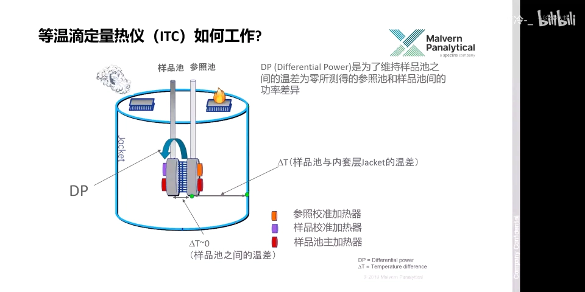
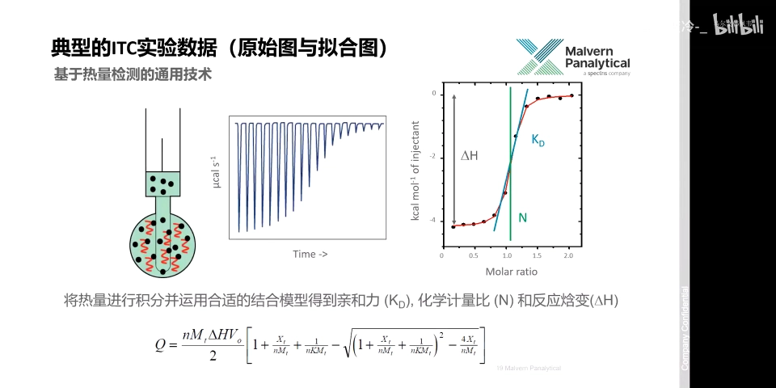
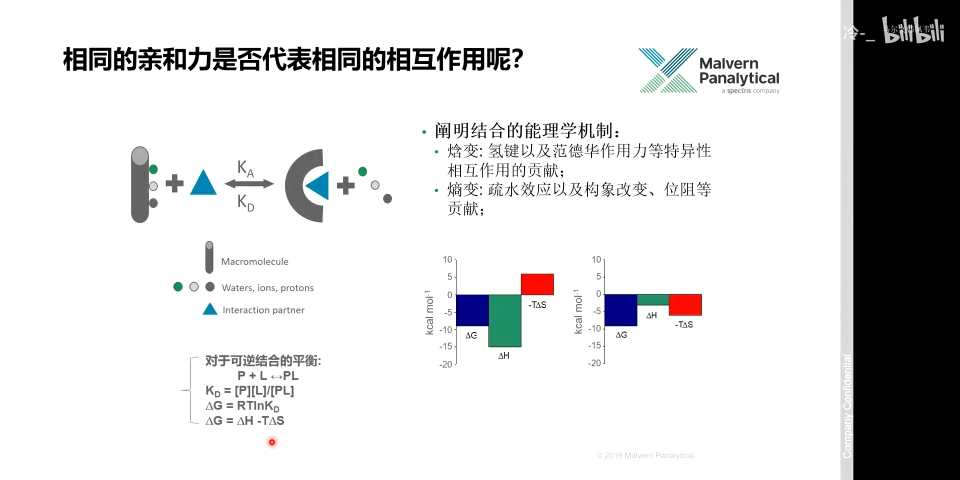
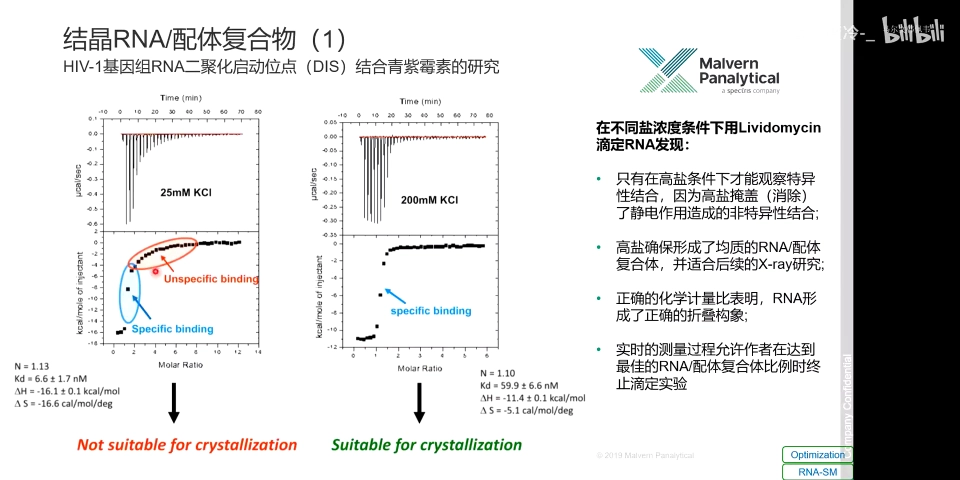
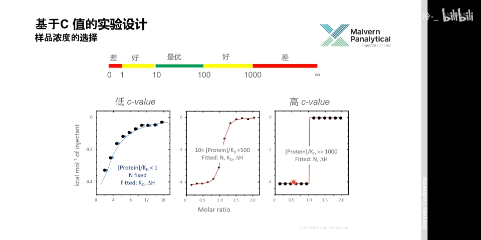
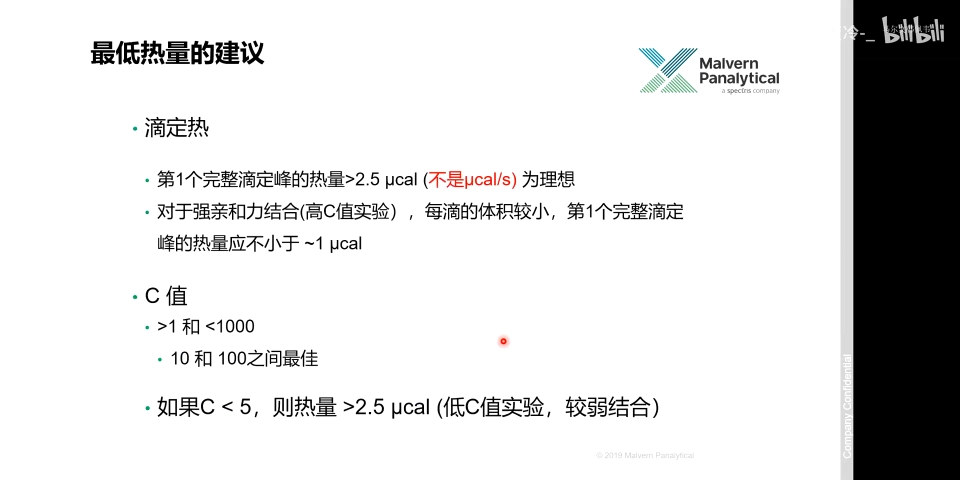
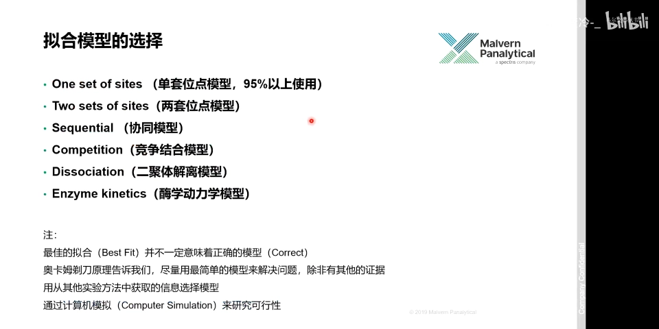
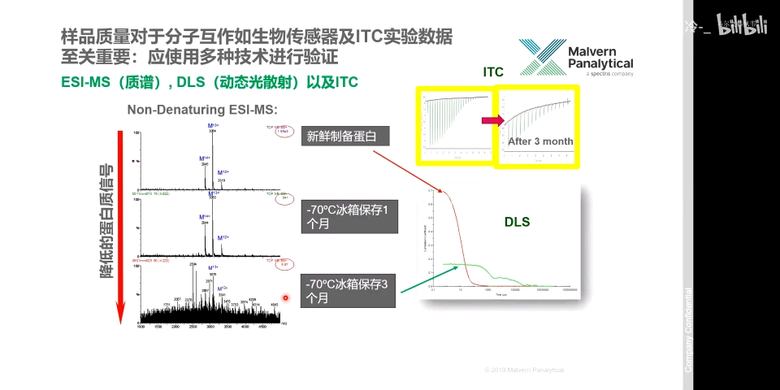

# ITC 曲线怎么读：从热量峰到 Kd、化学计量比 N 与 ΔH

> 视频来源：[等温滴定量热仪ITC：原理、曲线与数据解读](https://www.bilibili.com/video/BV1Mr421b7X4/)（Bilibili · 小盒社长 · 约 70 分钟）
> 导读：这是一场面向平台用户的 ITC 上机培训（马尔文 MicroCal 系列），前半段讲"两个池子如何用功率补偿测热"，中段用七八个文献案例说明 ITC 能答什么问题，后半段几乎全是实操细节：c 值怎么算、最低热量、缓冲液匹配、DMSO 与甘油、样品冻存三个月后为什么做不出来。本文按"原理 → 曲线 → 参数 → 条件 → 坑"重排。

## 本讲要解决的核心问题（SCQA）

**背景**：ITC 是测分子互作的经典手段，一滴一滴把配体滴进蛋白溶液，直接读出结合热。它不需要标记、不需要固定，还能同时给出 Kd、化学计量比 N 和焓变 ΔH。

**冲突**：但 ITC 的原始输出只是一串"功率对时间"的峰。同样两条曲线，一条是真正的结合热，另一条可能只是缓冲液混合热、质子化热或蛋白聚集的背景；同一个 Kd，也可能对应完全不同的作用力组成。更麻烦的是，ITC 对样品状态极其敏感——同一批蛋白冻存三个月，曲线就变了。

**疑问**：热量峰怎么变成 Kd、N 和 ΔH？同样的亲和力为什么不算"同样的相互作用"？实验条件（盐、pH、DMSO、温度）怎样改变读数？哪些现象说明数据不可信？

**回答（中心思想）**：**ITC 用功率补偿把结合热记成峰，积分成摩尔焓变后拟合出 Kd、N、ΔH；再由 $\Delta G=\Delta H-T\Delta S$ 拆出熵的贡献；而这一切的前提是样品均一有活性、缓冲液严格匹配、c 值落在可拟合区间。**

## 一、ITC 测的是"为了保持等温，需要补多少功率"

### 1.1 它和 DSC 是同一家技术谱系

现在常见的 P200、MicroCal 200 等机型，早期都属于 MicroCal 公司，后来被 GE 收购，现在归马尔文。最早做微热量技术的是 John Brandts，产品线分两支：**ITC 做分子相互作用**（分子识别、药物与靶点结合），**DSC 做生物大分子的热稳定性**（判断分子在什么环境、什么突变下更稳定）。[【跳转到 0:35】](https://www.bilibili.com/video/BV1Mr421b7X4/?t=35)

两者是互补关系：做配体结合时，DSC 常作为另一种技术来交叉验证。[【跳转到 1:23】](https://www.bilibili.com/video/BV1Mr421b7X4/?t=83)

### 1.2 为什么不用荧光标记

传统标记技术（ELISA、Co-IP、MST、FRET）简单、易高通量，但问题在于标记本身：荧光素往往比较大，接在氨基、巯基上可能影响研究对象的构象，导致假阳性或假阴性；荧光还有淬灭、内滤效应。[【跳转到 1:01】](https://www.bilibili.com/video/BV1Mr421b7X4/?t=61)

非标记技术（SPR、BLI、ITC）检测的是结合过程中的直接物理量——折射率、质量、厚度、能量。因为结合与这些物理量有直接定量关系，所以能给出定量信息：结合强弱、结合快慢、以及热力学机制。**ITC 的独特之处是它在溶液中进行，能给亲和力，也能给热力学。**[【跳转到 1:36】](https://www.bilibili.com/video/BV1Mr421b7X4/?t=96)

### 1.3 两个池子、一个功率差

ITC 全称等温滴定量热，"等温"有两层含义：[【跳转到 3:01】](https://www.bilibili.com/video/BV1Mr421b7X4/?t=181)

1. **反应在恒温下进行**，不变温。温度可选 2–80 ℃，按研究对象的最佳工作状态定，比如 25 ℃、30 ℃，有人研究碳酸酐酶会用 15 ℃；
2. **体系里有两个一模一样的池子**（各 200 μL）：参比池（reference cell）与样品池（sample cell），相对排列，中间有温度传感器。

参比池**只放水**，不要放 buffer，一般一周换一次。样品池放研究体系，蛋白放下面、小分子放上面，或者反过来都行——结合是平衡反应，与顺序无关。[【跳转到 3:06】](https://www.bilibili.com/video/BV1Mr421b7X4/?t=186)

工作方式是**功率补偿**：先给参比池一个基准功率（比如 5 μcal/s），样品池也跟到 5 μcal/s。当样品池里发生放热反应、自己放出 3 个单位的热时，样品池会比参比池热，传感器把差异传给加热器，加热器只需再补 2 个单位。**所以放热反应信号向下、吸热反应信号向上。**[【跳转到 5:36】](https://www.bilibili.com/video/BV1Mr421b7X4/?t=336)

## 二、从一串峰到一条 S 曲线

第一滴下去放热最大；随着不断滴定，蛋白上的结合位点越来越少，放热越来越少；直到配体把蛋白饱和，剩下的热只是稀释热或混合热，也就是很小的背景。[【跳转到 6:01】](https://www.bilibili.com/video/BV1Mr421b7X4/?t=361)

把每个峰积分，再对滴入的摩尔数归一化，纵坐标就变成 **kcal/mol per injection**——也就是摩尔放热量，即焓变。这里有一条硬约束：**进样浓度必须准确**，浓度不准会直接影响摩尔焓变，进而影响后面机理的计算。[【跳转到 6:36】](https://www.bilibili.com/video/BV1Mr421b7X4/?t=396)

积分后的曲线用结合模型拟合，得到三个参数：[【跳转到 6:46】](https://www.bilibili.com/video/BV1Mr421b7X4/?t=406)

- **Kd / Ka**：曲线拐点的位置，两者互为倒数；
- **N（化学计量比）**：曲线终点的位置，也就是几比几结合；
- **ΔH**：曲线的平台高度（每摩尔结合放出的热）。

N 在 1 左右通常是 1:1 结合，2 左右是 2:1；一般认为 **0.8–1.2 之间都算 OK**，如果太低，可能是样品状态不好造成的。[【跳转到 7:11】](https://www.bilibili.com/video/BV1Mr421b7X4/?t=431)

### 2.1 亲和力的单位就是浓度

Kd 表示复合体有多少会解离成单体，数值越小结合越强、越难解离。单位是摩尔（浓度），所以我们会说纳摩尔级、微摩尔级、毫摩尔级——纳摩尔级当然比微摩尔级更强。[【跳转到 2:36】](https://www.bilibili.com/video/BV1Mr421b7X4/?t=156)

## 三、同样的 Kd，不代表同样的相互作用

这是 ITC 相对其他方法最不可替代的价值。两个体系的 Kd 只差一倍两倍、看起来"差不多"时，它们的作用过程可能完全不同。[【跳转到 7:36】](https://www.bilibili.com/video/BV1Mr421b7X4/?t=456)

由热力学关系：

$$
\Delta G = \Delta H - T\Delta S, \qquad \Delta G = RT\ln K_d
$$

相同的 Kd 对应相同的 ΔG，但 ΔG 是焓与熵两项之和，两项的分配可以截然不同：

- **焓变 ΔH**：主要由氢键、范德华力等特异性相互作用贡献，放热则为负；
- **熵变 ΔS**：主要由疏水效应、构象变化、位阻等贡献，疏水作用通常有利于结合。[【跳转到 7:41】](https://www.bilibili.com/video/BV1Mr421b7X4/?t=461)

讲者给了两个对照：第一个反应强放热（焓很有利），但熵项为负、不利于结合，是"很强的特异性克服了熵的阻碍"；第二个反应则是焓与熵比较平衡。[【跳转到 8:36】](https://www.bilibili.com/video/BV1Mr421b7X4/?t=516)

这个区分在药物设计里非常实际：我们希望焓贡献大、特异性好、选择性高；但如果分子带电很强、过于离子化，疏水贡献差，**过膜能力就差、生物利用度低**——它可能是一个很好的体外配体，却成不了好药。所以要找的是"既特异、又能过膜"的平衡点。[【跳转到 8:46】](https://www.bilibili.com/video/BV1Mr421b7X4/?t=526)

## 四、ITC 能研究什么、不能研究什么

- **要求均相、可逆**：蛋白、核酸、糖类都可以；纳米颗粒因为不完全均相，一般只做半定量或定性；[【跳转到 9:21】](https://www.bilibili.com/video/BV1Mr421b7X4/?t=561)
- **非生物分子也行**：环糊精、化学合成小分子都可以；
- **细胞、细菌要谨慎**：它们自身有代谢热，会干扰测量。[【跳转到 9:36】](https://www.bilibili.com/video/BV1Mr421b7X4/?t=576)

### 4.1 案例：从标记肽到 DNA 修复

清华的案例里，合成的 marker 与蛋白结构域结合亲和力达 24 纳摩尔；把特定位点突变成半胱氨酸后亲和力降低约 30 多倍，改成甘氨酸则变成很弱的结合。[【跳转到 9:46】](https://www.bilibili.com/video/BV1Mr421b7X4/?t=586)

2018 年一篇 Nature 工作研究 DNA 双链断裂修复的调控：平时抑制蛋白 TIR2 与修复调控因子结合（体外 0.78 微摩尔），而一旦需要修复，H4K20 二甲基化与 P53 结合蛋白的结合（20 多微摩尔）就要能竞争过它——两者差得蛮多，构成了"平时抑制、损伤时切换"的开关。[【跳转到 1:32】](https://www.bilibili.com/video/BV1Mr421b7X4/?t=92)

### 4.2 案例：纳米抗体与 RBD

新冠中和抗体的研究里，作者同时用 SPR 与 ITC 证明纳米抗体与 RBD 的结合，亲和力分别为 12 纳摩尔与 4 纳摩尔，足以阻断 RBD 与 ACE2 的结合。讲者的评论是：**多种方法相互佐证**，因为每个方法都有优缺点。[【跳转到 18:13】](https://www.bilibili.com/video/BV1Mr421b7X4/?t=1093)

### 4.3 案例：用热力学指导小分子优化

一个药物优化的例子很能说明 ITC 的"机制价值"：最初设计靠环状结构填补 pocket、以疏水作用为主，特异性尚可但构象不利；几轮改造后达到均衡状态——**强氢键提供特异性，疏水作用同时有利于结合**，于是从"好配体"变成"好药物"。[【跳转到 18:39】](https://www.bilibili.com/video/BV1Mr421b7X4/?t=1119)

ITC 在这里的作用不是给一个 Kd 数字，而是告诉你"往哪个方向改"：增加一个氢键供体、还是调整疏水结构。[【跳转到 19:43】](https://www.bilibili.com/video/BV1Mr421b7X4/?t=1183)

## 五、条件如何改变读数：盐、pH、DMSO 与温度

### 5.1 盐浓度：把非特异结合"屏蔽"掉

这是全片最直观的一页。研究 HIV-1 基因组 RNA 的二聚化启动位点（DIS）与青紫霉素（Lividomycin）的结合时，作者发现：[【跳转到 13:04】](https://www.bilibili.com/video/BV1Mr421b7X4/?t=784)

- **25 mM KCl**：曲线不干脆，衰减不到零、有很长很缓的拖尾——这是典型的**非特异结合**叠加在特异结合上；
- **200 mM KCl**：曲线很快衰减到基线，只剩下很低的稀释热，才是干净的特异结合。

原因讲得很清楚：低盐时静电作用没被屏蔽，分子间靠非共价静电"乱粘"；提高离子强度后静电相互作用被屏蔽，非特异结合被去掉。[【跳转到 13:34】](https://www.bilibili.com/video/BV1Mr421b7X4/?t=814)

更有意思的是结果对比：低盐条件下 N=1.13、Kd=6.6 nM、ΔH=−16.1 kcal/mol、ΔS=−16.6 cal/mol/deg，**不适合结晶**；高盐条件下 N=1.10、Kd=59.9 nM、ΔH=−11.4 kcal/mol、ΔS=−5.1 cal/mol/deg，**适合结晶**。同一个分子对，Kd 差了近十倍，N 与热力学参数也全变了——**条件变了，读数就变了**。

### 5.2 pH 与缓冲液：质子化热是隐形背景

ITC 给的是**表观结果（apparent）**：既有结合热，也有背景热。缓冲液的盐、pH、有机溶剂必须严格匹配，否则扣不干净。[【跳转到 26:35】](https://www.bilibili.com/video/BV1Mr421b7X4/?t=1595)

一个常被忽略的机制：配高浓度小分子或多肽时，溶液 pH 可能被改变；pH 一变就涉及质子的质子化/去质子化，而这一步本身有很强的放热。不同缓冲液的电离焓差别很大——**Tris 的背景发热远大于 PBS**，所以很多人发现"背景特别大"，原因就是用了 Tris。讲者强调不是 Tris 不好（很多生物体系里它很重要），而是要知道这个代价。[【跳转到 26:53】](https://www.bilibili.com/video/BV1Mr421b7X4/?t=1613)

其他配方建议：pH 2–12 常规缓冲液都可以；需要还原剂时用 TCEP，DTT 在 ITC 中自身氧化和基线漂移严重；**甘油尽量不用，实在要用也压到 1% 以下**（10% 太高了）。[【跳转到 27:36】](https://www.bilibili.com/video/BV1Mr421b7X4/?t=1656)

### 5.3 DMSO：为了溶小分子，可能先伤了蛋白

小分子不溶时常用 DMSO 助溶，既然样品里有 5%–10% DMSO，蛋白侧也必须匹配同样的浓度。对仪器来说 DMSO 没问题，问题在蛋白受不受得了。[【跳转到 23:45】](https://www.bilibili.com/video/BV1Mr421b7X4/?t=1425)

一个药企的例子：加 2% DMSO 时蛋白状态基本不变；加到 4% 时 DSC 峰向低温偏移，稳定性下降。稳定性一降，疏水区暴露，就容易产生非特异结合——这正是"结果不重复""出现弱结合"的常见来源。[【跳转到 24:15】](https://www.bilibili.com/video/BV1Mr421b7X4/?t=1455)

### 5.4 温度

反应温度可设 2–80 ℃，选研究对象活性最好的温度。注意温度会同时改变 ΔH 与 Kd（通过 van't Hoff 关系），所以比较不同文献的 Kd 时，温度必须对齐。

## 六、c 值：实验设计的那一个数

c 值定义为蛋白浓度与 Kd 的比值（无量纲）：

$$
c = \frac{[\text{protein}]}{K_d}
$$

**c 越大曲线越陡，c 越小曲线越缓。**[【跳转到 28:46】](https://www.bilibili.com/video/BV1Mr421b7X4/?t=1726)

- c 在 **10–100** 最优，能得到漂亮的 S 曲线，Kd、N、ΔH 都能拟合；
- c < 1 时曲线只是一段缓坡，只能拟合 Kd 与 ΔH，N 要固定；
- c > 1000 时曲线近乎直角，只能得到 N 与 ΔH，Kd 拟合不出来。

讲者给了一个实操例子：预估某个结合是 2 微摩尔，用 20 微摩尔蛋白，c=10，曲线拐点落在 5–50 之间很漂亮。但如果实际是 20 微摩尔的弱结合，c 就只有 1，曲线变得很缓——**说明你把 Kd 估强了**，应该按弱相互作用重新设计，把配体比例从 10:1 提到 50:1。[【跳转到 29:26】](https://www.bilibili.com/video/BV1Mr421b7X4/?t=1766)

### 6.1 弱结合不能靠 c 值设计

对几十、上百微摩尔的弱结合，按 c 值反推会要求 500 微摩尔级的蛋白浓度——既拿不到、活性也未必好，小分子浓度还要远超蛋白，DMSO 也加不了那么多。所以弱结合的常规做法是：**固定蛋白浓度（30–50 微摩尔），让配体远远过量**，比如 50 微摩尔亲和力配 30 微摩尔蛋白时，配体做到 2 毫摩尔、约 70 倍比例，把平衡往结合方向推。[【跳转到 29:55】](https://www.bilibili.com/video/BV1Mr421b7X4/?t=1795)

## 七、最低热量与参数设置：数据能不能用的底线

- **第一个完整滴定峰的热量应大于 2.5 μcal**（是面积，不是纵坐标 μcal/s）；
- 高亲和（高 c）实验每滴体积较小，第一滴热量**不小于约 1 μcal**；
- 如果 c < 5（弱结合），热量仍建议大于 2.5 μcal。[【跳转到 30:56】](https://www.bilibili.com/video/BV1Mr421b7X4/?t=1856)

热量太小会怎样？曲线趋势根本看不出来，看着就跟背景差不多。在 Origin 里打开数据，DH 列第二行（比如 22.06）就是正常滴一滴的放热量，负号表示放热，绝对值大于 2.5 就 OK。[【跳转到 31:21】](https://www.bilibili.com/video/BV1Mr421b7X4/?t=1881)

其他参数的经验值：[【跳转到 31:46】](https://www.bilibili.com/video/BV1Mr421b7X4/?t=1906)

- **参考 DP**：放热反应信号向下，基线要设得比预期放热高一些；生物样品多在 3 μcal 以内，设 4–6 就够；若已知放热到 10，则要设到 11——设太低信号会穿过零，意味着功率已撤到零还没平衡，数据就废了；
- **转速** 700–1000；**反馈模式**用高反馈，信号更锐利；
- **每滴体积** 2–3 μL，趋势变化快就调小、发热不足就调大；
- **间隔时间** 150–180 秒，目的是留够平衡时间让信号回到基线，间隔太短会导致焓变算不准、基线乱拐。

### 7.1 对照：ITC 是表观量，必须扣背景

常规只做一个对照：小分子滴蛋白，配小分子滴 buffer 即可。完整版要做三个对照（小分子滴 buffer、buffer 滴蛋白、buffer 滴 buffer），但后两者发热通常很小，匹配良好时前者相减就够。[【跳转到 32:46】](https://www.bilibili.com/video/BV1Mr421b7X4/?t=1966)

## 八、模型选择：拟合得好不等于模型对

可选模型包括：单套位点（one set of sites，95% 以上使用）、两套位点、协同（sequential）、竞争、二聚体解离、酶动力学。[【跳转到 33:26】](https://www.bilibili.com/video/BV1Mr421b7X4/?t=2006)

使用边界很清楚：

- **单套位点**：一个位点，或几个亲和力相同的位点，N 可以是 1、2、4；
- **两套位点**：曲线必须有两个拐点、有先后顺序（一强一弱）才能用；只有一条 S 曲线时用单位点就够；
- **协同模型**：A 加 B 生成 AB，AB 再加 A 生成 A₂B，后续结合亲和力与前面不同，曲线可能是 V 型。

关键提醒：**模型越复杂，拟合可能越好，但不一定正确**。所有拟合都是对曲线做数学拟合，数学结果未必有生物学意义。所以按奥卡姆剃刀原则尽量用简单模型；简单模型解释不了时，第二件要检查的是蛋白状态——很多复杂图形其实来自样品状态与构象问题。[【跳转到 34:01】](https://www.bilibili.com/video/BV1Mr421b7X4/?t=2041)

## 九、最常见的坑：样品状态

讲者把这一条放在总结的第一位：**蛋白的活性与状态对 ITC 实验至关重要**。[【跳转到 34:31】](https://www.bilibili.com/video/BV1Mr421b7X4/?t=2071)

一个反复出现的现象：同一批蛋白在 −70 ℃ 放三个月，ITC 结果与新鲜样品差别很大——新鲜蛋白曲线很好；放一个月背景开始有噪音；放三个月信号反而变强，因为蛋白在冻存中已经发生构象变化。[【跳转到 20:43】](https://www.bilibili.com/video/BV1Mr421b7X4/?t=1243)

怎么发现？用多种技术交叉验证：**ESI-MS 看蛋白信号是否降低、DLS 看粒径是否变大（聚集）、ITC 看曲线是否变形**。[【跳转到 21:48】](https://www.bilibili.com/video/BV1Mr421b7X4/?t=1308) 动态光散射的原理是测布朗运动引起的光散射变化，再通过 Stokes-Einstein 关系算出流体力学半径——本来零点几纳米的蛋白测出几纳米，就说明团聚了。[【跳转到 21:50】](https://www.bilibili.com/video/BV1Mr421b7X4/?t=1310)

小分子侧也有类似问题：不溶、析出、晶型转变。稳定的晶型不一定有活性，不稳定的晶型反而有活性，晶型之间还会互变——所以化合物放一段时间后活性可能变化。[【跳转到 25:00】](https://www.bilibili.com/video/BV1Mr421b7X4/?t=1500)

### 9.1 问答里的实操判据

- **水滴水（water-into-water）峰差异大**：正常水滴水峰很小；若第一滴特别大、后面都正常，通常是池子没洗干净。[【跳转到 37:24】](https://www.bilibili.com/video/BV1Mr421b7X4/?t=2244)
- **DP 值**：参考 DP 设 5 时，开始滴定应在 4.8–4.9，说明气泡赶干净、操作到位；4 以上算可以；掉到 2–3 则可能有大气泡或沉淀，也要检查进样针有没有弯。[【跳转到 38:19】](https://www.bilibili.com/video/BV1Mr421b7X4/?t=2299)
- **去垢剂**：做膜蛋白时浓度要低于 CMC，加样避免气泡。[【跳转到 36:24】](https://www.bilibili.com/video/BV1Mr421b7X4/?t=2184)
- **多个底物一起滴蛋白**不能拟合成一个数据，还是要分别做；竞争体系另当别论。[【跳转到 39:19】](https://www.bilibili.com/video/BV1Mr421b7X4/?t=2359)
- **pH 变化超过 0.1** 就要调回，否则质子化背景发热会很强。[【跳转到 39:49】](https://www.bilibili.com/video/BV1Mr421b7X4/?t=2389)
- **反滴定验证**：一比一结合的正向滴与反向滴结果应当一致或非常接近；溶解性不好时可以把小分子放下面、蛋白放上面，浓度也可以不同。[【跳转到 35:06】](https://www.bilibili.com/video/BV1Mr421b7X4/?t=2106)

## 小结

- **原理是功率补偿**：两个池子保持等温，放热则信号向下、吸热向上；峰的面积就是结合热。
- **一条曲线三个参数**：拐点给 Kd、终点给 N、平台给 ΔH；N 在 0.8–1.2 通常意味着 1:1。
- **同样的 Kd 不等于同样的机制**：$\Delta G=\Delta H-T\Delta S$，焓（氢键、范德华）与熵（疏水、构象）的分配决定特异性与可成药性。
- **c 值决定能不能拟合**：c = 蛋白浓度 / Kd，10–100 最优；弱结合改用"固定蛋白、配体过量"。
- **条件会改数**：同一体系在 25 mM 与 200 mM KCl 下，Kd 从 6.6 nM 变成 59.9 nM，N 与 ΔH 也全变——静电屏蔽掉了非特异结合。
- **表观量必须扣背景**：缓冲液盐、pH、DMSO 严格匹配；Tris 的质子化热会让背景很大。
- **样品状态是第一位的**：冻存三个月、聚集、DMSO 过量都会让曲线失真；用 ESI-MS、DLS、DSC 交叉验证。
- **模型从简**：最佳拟合不等于正确模型；简单模型解释不了时，先怀疑样品。

## 关键术语速查

| 术语 | 一句话解释 |
| --- | --- |
| ITC | 等温滴定量热，通过功率补偿测结合放热/吸热 |
| 参比池 | 只放水的参照池，用于维持温差为零 |
| DP | 差示功率，维持两池等温所需的功率差，即信号来源 |
| 原始图 | 功率（μcal/s）对时间的峰序列 |
| 等温线 | 峰积分后的摩尔焓变对摩尔比的曲线 |
| N | 化学计量比，曲线终点位置，1 左右即 1:1 结合 |
| ΔH | 反应焓变，曲线平台高度，反映氢键与范德华贡献 |
| ΔS | 熵变，主要反映疏水效应与构象变化 |
| c 值 | 蛋白浓度与 Kd 之比，决定曲线形状与可拟合参数 |
| 表观结果 | 含结合热与背景热的实测值，需扣对照 |
| 非特异结合 | 静电等非特异性吸附造成的长拖尾，提高盐浓度可去除 |
| 反滴定 | 把滴定方向反过来做，用于验证一比一结合与溶解性问题 |