# SPR 传感图怎么读：从芯片、RU 到稳态与动力学拟合

> 视频来源：[SPR技术：生物分子互作金标准｜一个视频带你了解SPR技术在药物筛选中的应用](https://www.bilibili.com/video/BV1VXC2YTEuU/)（Bilibili · 陶术小课堂 · 约 68 分钟）
> 导读：这是一场厂商技术服务团队做的 SPR 系统课，前半段讲清芯片、传感图、RU、稳态与动力学两种拟合，后半段用五篇文献案例演示"怎么用 SPR 设计实验"，末尾还有一段很实用的问答（质控红绿灯、参比通道、负值、非特异吸附等）。本文按"原理 → 读数 → 流程与样品 → 案例 → 常见坑"重排，公式推导部分请回看 3.1.6。

## 本讲要解决的核心问题（SCQA）

**背景**：测结合亲和力有很多手段——荧光偏振、FRET、CETSA、MST、BLI、ITC。它们都能给出一个"结合强弱"的数字，但背后的物理量并不相同。

**冲突**：SPR 被业内称作分子互作的"金标准"，可它的原始输出既不是浓度也不是热量，而是一条以 RU 为纵坐标、以秒为横坐标的曲线。这条曲线为什么能变成 Kd？同一个 Kd 为什么既可以来自"稳态拟合"、也可以来自"动力学拟合"？实验里那些看起来奇怪的负值、偏高的响应、拟合出的红黄绿灯又意味着什么？

**疑问**：SPR 到底测的是什么物理量，怎么把一条传感图读成亲和力与速率常数？做一次实验要准备什么、注意什么，哪些结论它给不了？

**回答（中心思想）**：**SPR 测的是芯片表面质量变化引起的折射率变化，用 RU 记录成实时传感图；把不同浓度的曲线做稳态或动力学拟合，就得到 Kd 或 ka/kd；而这条曲线是否可信，取决于芯片固定方式、参比通道扣减、样品活性与拟合质控。**

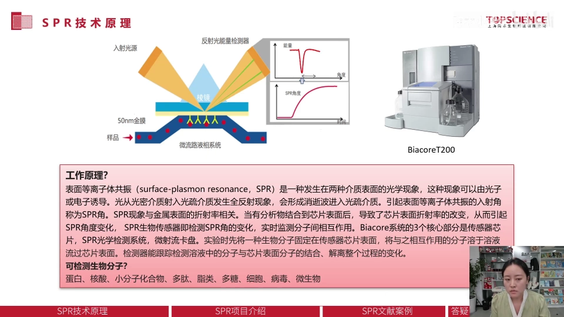

## 一、SPR 测的不是"结合"，而是"表面质量的变化"

### 1.1 一个 80 年代的光学现象，变成了药物研发的常规工具

SPR 全称表面等离子体共振（surface plasmon resonance），是上世纪 80 年代发展起来、以生物传感芯片为中心的新技术。它最突出的特点是**能实时监测分子之间的结合与解离过程**；随着技术优化，它逐渐适应高通量药物筛选，因此特别适合小分子化合物的筛选。[【跳转到 1:00】](https://www.bilibili.com/video/BV1VXC2YTEuU/?t=60)

基于 SPR 开发的 Biacore 仪器，其实验可以贯穿药物研发的每一个阶段：从最开始的药物靶点发现，到药物筛选中筛到小分子后的验证；此外蛋白质组学、免疫原性、生物药研发中检测大分子相互作用也会用到它。[【跳转到 0:10】](https://www.bilibili.com/video/BV1VXC2YTEuU/?t=10)

它被称为"金标准"有两个可查的旁证：一是被收录进 2020 版《中国药典》；二是文献量逐年增长——PubMed 上检索 SPR 有超过 3 万篇文章，范围缩到国内也有超过 6600 篇。[【跳转到 0:55】](https://www.bilibili.com/video/BV1VXC2YTEuU/?t=55)

### 1.2 三层结构：玻璃、50 nm 金膜、固定在上面的配体

传感芯片的构造决定了测量原理：最底下是一层玻璃（生物芯片的基底），玻璃上面是一层 **50 nm 厚的金膜**，金膜上面通过化学方法把蛋白固定住。入射光打进棱镜后发生全反射，反射光与**共振角**随表面折射率改变而变化；分子结合让表面质量增加，共振角随之偏移，生物传感器把这个物理量记录下来，就生成一条实时的传感曲线。[【跳转到 0:02】](https://www.bilibili.com/video/BV1VXC2YTEuU/?t=2)

正因为信号来自共振角，SPR **不需要给分子打荧光标记**——这一点与荧光偏振、FRET 这类必须标记的方法形成对照。[【跳转到 0:29】](https://www.bilibili.com/video/BV1VXC2YTEuU/?t=29)

### 1.3 一次实验能回答四个层次的问题

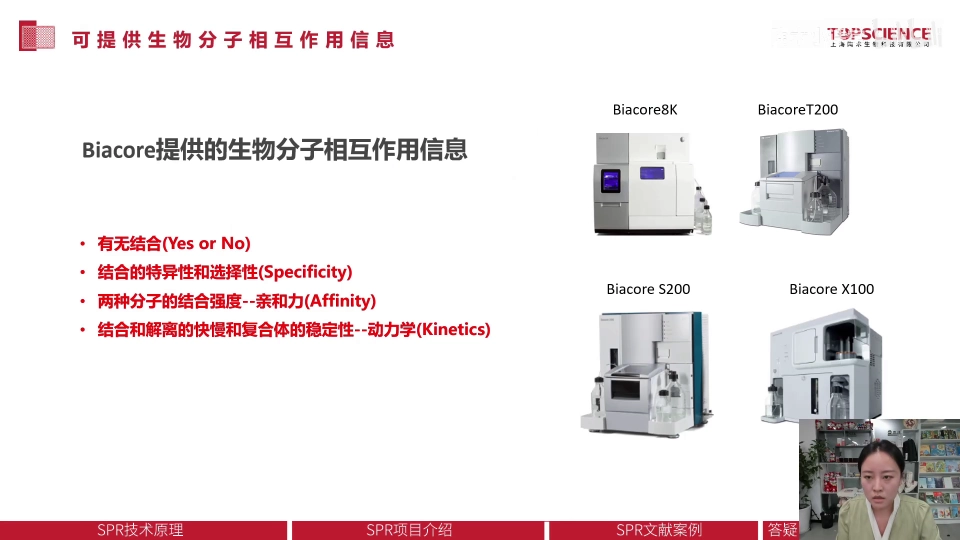

按讲者的归纳，SPR 的输出分四层：**有没有结合（定性）→ 结合是否特异、有无选择性 → 结合强度即亲和力 Kd → 结合与解离的快慢、复合物稳定性即动力学**。仪器型号上，T100、S200、T200、8K、1K 各有侧重：T200 可以做垂钓（回收样品），8K 通量更高、适合高通量筛选。[【跳转到 0:12】](https://www.bilibili.com/video/BV1VXC2YTEuU/?t=12)

## 二、术语对齐：配体是"钉在板上的"，分析物是"流过去的"

初学者最容易在这里翻车：SPR 里的"配体（ligand）"和平时说的内源性/外源性配体**不是一回事**。

- **配体**：被固定在芯片表面的那个分子。蛋白与小分子测试时，通常固定分子量更大的蛋白，所以这个蛋白就叫配体。
- **分析物（analyte）**：流经芯片表面的那一方——小分子、多肽、蛋白、抗体、核酸都算。[【跳转到 0:01】](https://www.bilibili.com/video/BV1VXC2YTEuU/?t=1)

### 2.1 芯片：CM5 为什么最常用

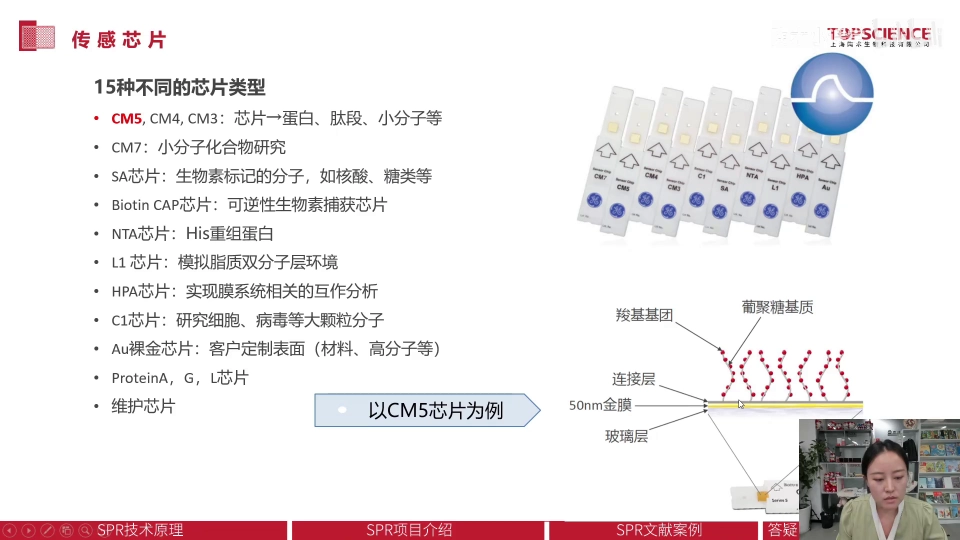

Biacore 配套芯片有 15 种。CM3/CM4/CM5 用于蛋白、肽段、小分子，CM7 偏小分子化合物研究；SA 芯片固定生物素标记的分子（核酸、糖类），Biotin CAPture 是可逆的生物素捕获芯片，NTA 芯片抓 His 重组蛋白；L1 模拟脂质双分子层，HPA 做膜系统互作，C1 研究细胞、病毒等大颗粒，Au 裸金芯片可客户定制，此外还有 Protein A/G/L 芯片，以及不测试时放在仪器里的维护芯片。[【跳转到 0:51】](https://www.bilibili.com/video/BV1VXC2YTEuU/?t=51)

以 CM5 为例：金膜上面是一层**葡聚糖基质**，基质上带**羧基**，羧基与蛋白的氨基发生缩合反应，蛋白就被共价固定住了——这就是最经典的"氨基偶联"。[【跳转到 0:51】](https://www.bilibili.com/video/BV1VXC2YTEuU/?t=51) 葡聚糖除了提供反应位点，还给固定住的蛋白一个亲水环境。[【跳转到 1:09】](https://www.bilibili.com/video/BV1VXC2YTEuU/?t=69)

理解了氨基偶联，就能理解后面一条样品要求：缓冲液里不能有 Tris、咪唑这类带氨基的试剂，否则它们也会被偶联到芯片上，造成干扰。[【跳转到 0:47】](https://www.bilibili.com/video/BV1VXC2YTEuU/?t=47)

## 三、传感图：一条曲线分成五段

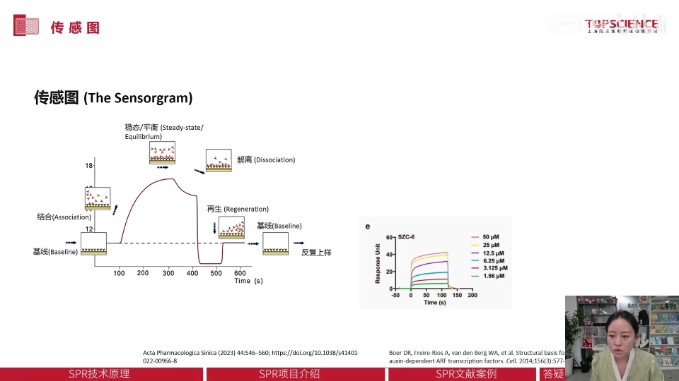

传感图就是整个实验过程的记录，横轴是时间、纵轴是响应值。它的标准形状分五段：[【跳转到 0:51】](https://www.bilibili.com/video/BV1VXC2YTEuU/?t=51)

1. **基线**：进样前，信号平稳；
2. **结合（association）**：开始进样品，若有结合，响应上升；
3. **稳态/平衡**：上升到一定程度趋于饱和，结合与解离达到动态平衡；
4. **解离（dissociation）**：停止进样品、改为进运行缓冲液（running buffer），响应下降，解离占主导；
5. **再生（regeneration）**：把残余的分析物洗掉，基线复位，进入下一个循环。

注意第 4 步的措辞：**"停止进样"不是什么都不进**，而是停止进样品分子、改走缓冲液。[【跳转到 1:16】](https://www.bilibili.com/video/BV1VXC2YTEuU/?t=76) 正因为有再生，同一张固定好配体的芯片才能连续测多个样品、多个浓度。[【跳转到 0:46】](https://www.bilibili.com/video/BV1VXC2YTEuU/?t=46)

### 3.1 曲线形状本身就是信息：快上快下 vs 慢上慢下

讲者把常见的曲线分成四类：快上快下、慢上慢下、快上慢下、慢下快上。形状不同代表**结合模式不同**——有的靠氢键，有的靠范德华力，有的甚至形成共价结合，而这些差异对应着不同的作用机理与功能。[【跳转到 0:26】](https://www.bilibili.com/video/BV1VXC2YTEuU/?t=26)

这套语言可以直接翻译成药学结论：

- **快上快下**（较快动力学）：低剂量就能饱和，但药效维持时间短，想维持效果就得多次给药；
- **慢上慢下**（较慢动力学）：需要提高剂量才能饱和，但药效持续时间更久。[【跳转到 1:16】](https://www.bilibili.com/video/BV1VXC2YTEuU/?t=76)

讲者举的例子很直观：安眠药希望作用持续四到八小时，因为人每晚睡七八个小时；而有些药反而希望起效快、代谢快。[【跳转到 0:01】](https://www.bilibili.com/video/BV1VXC2YTEuU/?t=1) 这就是"同一个 Kd、不同动力学"在临床上的差别。

### 3.2 RU 是响应值，不是浓度

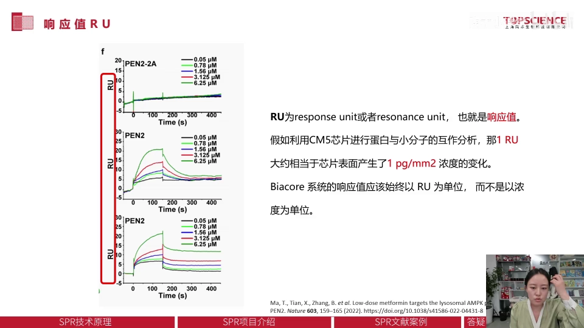

文献里 SPR 图的纵坐标常写 RU，很多初学者误以为是浓度。RU 是 response unit（响应值）：在 CM5 芯片上做蛋白—小分子互作时，**1 RU 大约相当于芯片表面每平方毫米 1 pg 的质量变化**，所以 Biacore 的响应值始终以 RU 为单位，而不是浓度。[【跳转到 1:00】](https://www.bilibili.com/video/BV1VXC2YTEuU/?t=60)

这也解释了 SPR 的一个隐含限制：它只"看得见"质量。分析物太小、浓度太低，响应就弱；而质量变化与结合事件之间还隔着"1:1 还是 1:2"这类化学计量假设。

## 四、从曲线到 Kd：稳态拟合与动力学拟合

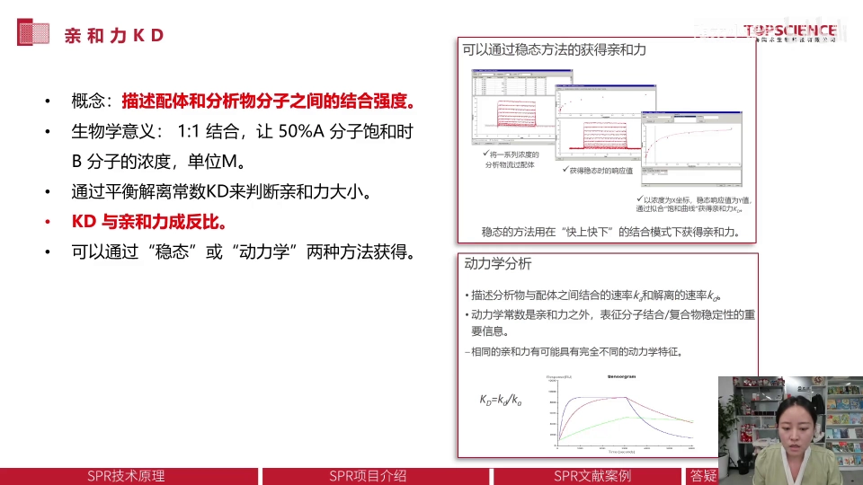

Kd 描述配体与分析物之间的结合强度，生物学意义是 **1:1 结合时让 50% 的 A 分子饱和所需的 B 分子浓度**，单位是摩尔（M）；Kd 与亲和力成反比，数值越小亲和力越强。[【跳转到 0:26】](https://www.bilibili.com/video/BV1VXC2YTEuU/?t=26)

测试结束后有两条拟合路线：[【跳转到 1:16】](https://www.bilibili.com/video/BV1VXC2YTEuU/?t=76)

**稳态拟合**：只看每个浓度达到平衡后的响应值，把"浓度—平衡响应"做成饱和曲线。它适用于结合解离都很快（"快上快下"）的情况——曲线来不及区分速率，但平衡点很清楚。

**动力学拟合**：同时拟合结合段与解离段的形状，仪器会额外给出 ka（结合速率常数）与 kd（解离速率常数），此时

$$
K_d = \frac{k_d}{k_a}
$$

同一条曲线，两种拟合给出的 Kd 应当一致；若差得远，往往说明模型选错了（比如实际是 1:2 结合、或存在质量转移）。

### 4.1 Kd 的数量级怎么读

初学者最常问的是"我测到 10 的负六次方，这算强还是弱"。讲者给了一个可用的锚点：蛋白与小分子结合一般在毫摩尔到微摩尔级别，因此 **小于 $10^{-6}$ M 表示更强，大于 $10^{-6}$ M 表示更弱，$10^{-6}$ M（微摩尔）附近属于中等强度**；纳摩尔级别就属于比较强了。[【跳转到 0:10】](https://www.bilibili.com/video/BV1VXC2YTEuU/?t=10)

## 五、一次 SPR 实验的完整流程与样品准备

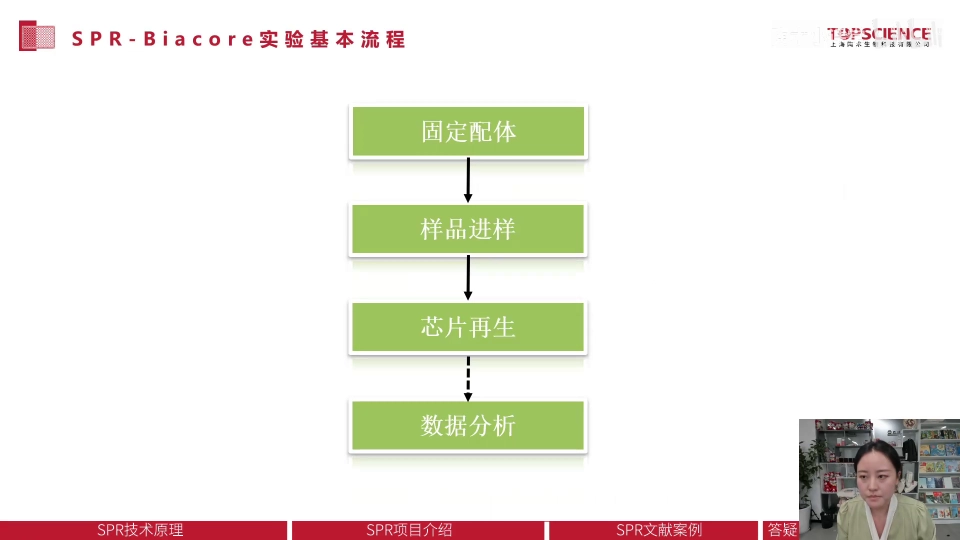

流程四步：**固定配体（一般固定分子量更大的蛋白）→ 样品进样（小分子、多肽等待测物）→ 芯片再生 → 数据分析拟合**。同一份固定好的配体可以测多个样品；最终交付的是通过质控、曲线完整、**至少五个浓度点**的结果。[【跳转到 0:21】](https://www.bilibili.com/video/BV1VXC2YTEuU/?t=21)

### 5.1 样品要求：量、纯度、活性

- **量**：蛋白至少 50 μg；如果缓冲体系含 Tris、咪唑等带氨基试剂，需要先置换缓冲液，置换有损耗，建议准备 70–100 μg。[【跳转到 0:47】](https://www.bilibili.com/video/BV1VXC2YTEuU/?t=47)
- **纯度**：最好大于 90%，最低也建议 85%、80% 以上，纯度越低杂质干扰越大。[【跳转到 1:37】](https://www.bilibili.com/video/BV1VXC2YTEuU/?t=97)
- **活性**：必须是新鲜、有活性的样品。蛋白空间结构若被破坏或降解，小分子根本没有口袋可结合，测出来就是"测不到"。[【跳转到 0:22】](https://www.bilibili.com/video/BV1VXC2YTEuU/?t=22)
- **阳性对照**：很多商品化蛋白没测过活性，强烈建议加一个阳性对照——选与蛋白有结合的抑制剂或激动剂，最次之选抗体，用来判断蛋白是否有活性。[【跳转到 1:12】](https://www.bilibili.com/video/BV1VXC2YTEuU/?t=72)
- **化合物**：粉末准确称量 1–2 mg，常温或冰袋寄送；溶液尽量浓，母液如 10 mM、送 30 μL。[【跳转到 1:37】](https://www.bilibili.com/video/BV1VXC2YTEuU/?t=97)
- **缓冲液**：分析物若是蛋白或多肽，注意缓冲体系里不能有甘油、蔗糖这类**高折光率**物质，它们会直接干扰检测。[【跳转到 0:22】](https://www.bilibili.com/video/BV1VXC2YTEuU/?t=22)

这里有一条贯穿全篇的因果链：SPR 读的是折射率，所以一切改变折射率或占据芯片表面的东西都是噪声——高折光率的甘油蔗糖、带氨基的 Tris 咪唑、以及后面要讲的非特异吸附。

## 六、实验设计：从"测一对"到"筛一个库"

讲者按"靶点是否明确、化合物数量多少"给出了几套方案。[【跳转到 1:25】](https://www.bilibili.com/video/BV1VXC2YTEuU/?t=85)

| 情形 | 建议方案 | 得到什么 |
| --- | --- | --- |
| 靶点确定，化合物 1–10 个 | 直接测多浓度 Kd | 定性 + 定量亲和力 |
| 靶点确定，化合物成百上千 | 先单浓度初筛，挑高响应者做浓度梯度 | 先定性、再定量 |
| 靶点确定，要筛整个化合物库 | 分组混合筛选（pooling） | 低成本锁定候选 |
| 想知道结合在哪个位点 | 野生型 vs 突变体 Kd 比较 | 关键位点判断 |
| 中药/复方找活性成分 | 蛋白固定 + 提取液垂钓 + 质谱 | 成分鉴定 + Kd 验证 |

### 6.1 分组混合筛选：把新冠"十混一"搬到 SPR 上

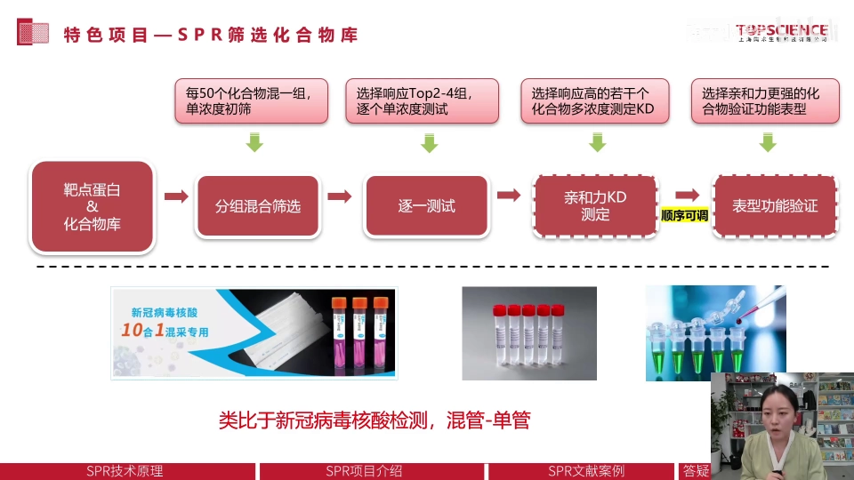

具体做法：把 **50 个化合物混成一组**做单浓度初筛（这个数字可按预算调到 30 个、10 个）；根据响应值挑 top 2–4 组；把这几组里的化合物**逐一**单浓度测试；再挑响应值高的做多浓度 Kd；最后做表型功能验证。[【跳转到 1:31】](https://www.bilibili.com/video/BV1VXC2YTEuU/?t=91)

讲者自己点明了这个设计的来源：和新冠核酸检测的"十混一"是同一个逻辑——先混管筛，阳性管再拆开单管测，为了降成本。[【跳转到 0:41】](https://www.bilibili.com/video/BV1VXC2YTEuU/?t=41)

一个容易被忽略的提醒：**结合了不等于发挥作用**，所以表型验证和多浓度 Kd 这两步的顺序可以调。如果表型实验便宜、实验室随时 ready，可以先拿响应值较高（比如 RU 大于 20 或 10）的化合物做表型，有效果的再回头测 Kd，这样能在不同分子之间做比较。[【跳转到 1:31】](https://www.bilibili.com/video/BV1VXC2YTEuU/?t=91)

### 6.2 点突变验证结合位点：单次 SPR 做不到

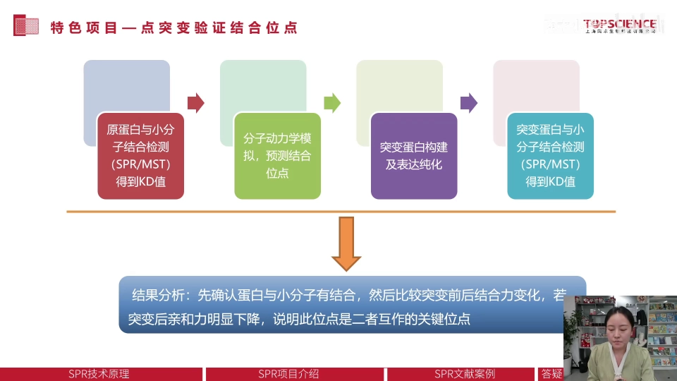

仅靠一次 SPR 是得不到结合位点的，必须做对照实验：先测野生型蛋白与小分子的 Kd；用分子动力学模拟预测结合位点；据此构建、表达、纯化突变蛋白；再测突变体的 Kd。**如果突变后亲和力明显下降，说明这个位点是二者互作的关键位点**。[【跳转到 0:14】](https://www.bilibili.com/video/BV1VXC2YTEuU/?t=14)

## 七、五篇文献案例：SPR 在真实课题里的位置

讲者用五篇文献说明 SPR 如何嵌进完整的研究链条，值得作为"实验设计模板"来看。

**案例一：北大化学院的别构抑制剂设计。** 作者用 CADD 预测磷酸甘油酸脱氢酶的别构位点，分子对接验证后表达纯化蛋白，再买实体化合物做实验：位点一 170 个、位点二 178 个，用 SPR 做亲和力检测，最后用突变实验验证结合位点。[【跳转到 0:33】](https://www.bilibili.com/video/BV1VXC2YTEuU/?t=33)

**案例二：Cell 上的奥密克戎 RBD 亲和力比较。**

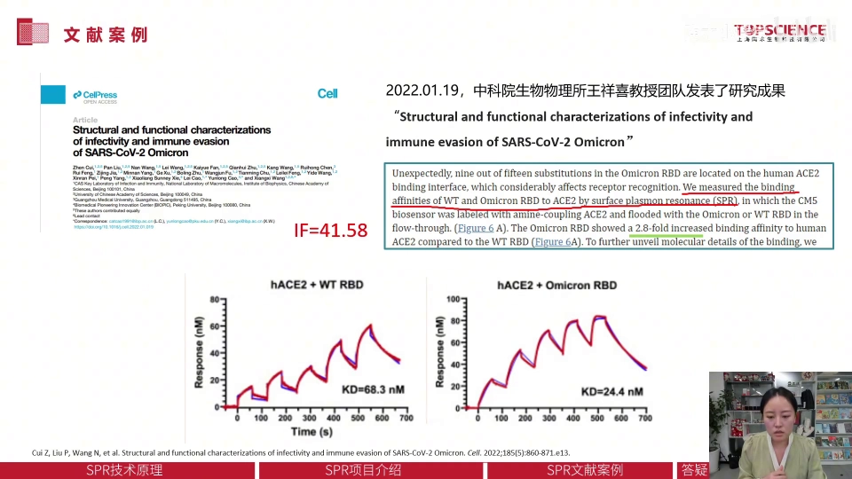

这篇工作的目的是比较奥密克戎与原始毒株的 RBD 跟人 ACE2 的亲和力：野生型 Kd 为 68.3 nM，奥密克戎为 24.4 nM，**相差约 2.8 倍**。[【跳转到 0:43】](https://www.bilibili.com/video/BV1VXC2YTEuU/?t=43) 讲者借这个数字回答了一个高频提问：多大的差异才算差异？——**2.8 倍已经算有差异，大于三倍一般就是非常肯定的结果**。[【跳转到 1:33】](https://www.bilibili.com/video/BV1VXC2YTEuU/?t=93)

**案例三：基于靶点的 SOAT1 抑制剂筛选。**

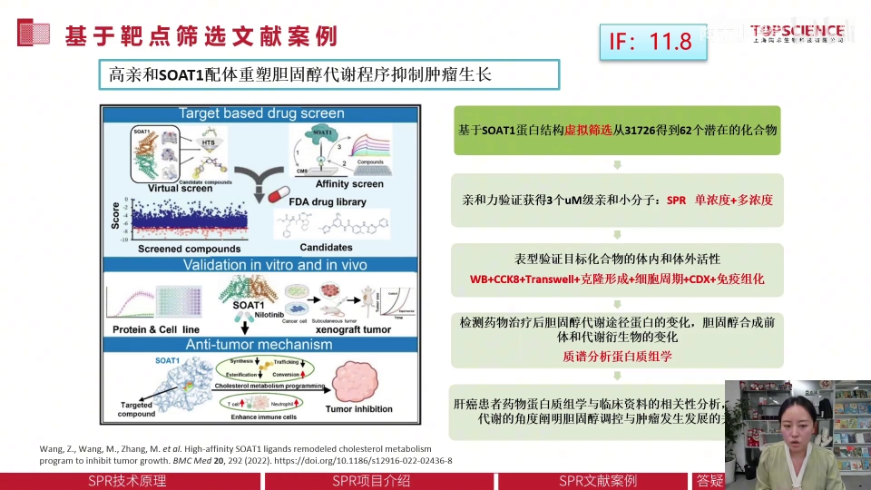

从 SOAT1 蛋白结构出发虚拟筛选 31726 个化合物，得到 62 个潜在小分子；用 SPR 以**单浓度 + 多浓度组合**验证，得到 3 个微摩尔级亲和力的小分子；随后做 WB、CCK-8、Transwell、克隆形成、细胞周期、CDX 等体内外表型，再检测胆固醇代谢通路变化、做蛋白质组学与临床资料相关性分析。[【跳转到 0:23】](https://www.bilibili.com/video/BV1VXC2YTEuU/?t=23)

**案例四：基于表型的老药新用。** 作者不知道明确靶点，从 FDA 上市药物库出发，第一步用 CCK-8 测细胞活力（还补了 CDX、PDX、PDO 类器官），拿到候选后用 **DARTS** 鉴定靶点：小分子结合使蛋白构象更稳定、抗蛋白酶降解，再用质谱鉴定出候选靶蛋白列表；挑出 NMT1 后用 SPR 验证直接结合，再用点突变定位结合位点。[【跳转到 0:42】](https://www.bilibili.com/video/BV1VXC2YTEuU/?t=42)

**案例五：STEAP 抑制剂的构效研究。** 基于药效团模型从 ZINC 数据库（57 万余小分子）筛选，找到 7 个类似物做构效关系，得到 SN-011；后续同样用点突变 + SPR 定位结合位点，并做 CCK-8 等细胞实验。[【跳转到 0:58】](https://www.bilibili.com/video/BV1VXC2YTEuU/?t=58)

**案例六：中药成分垂钓。**

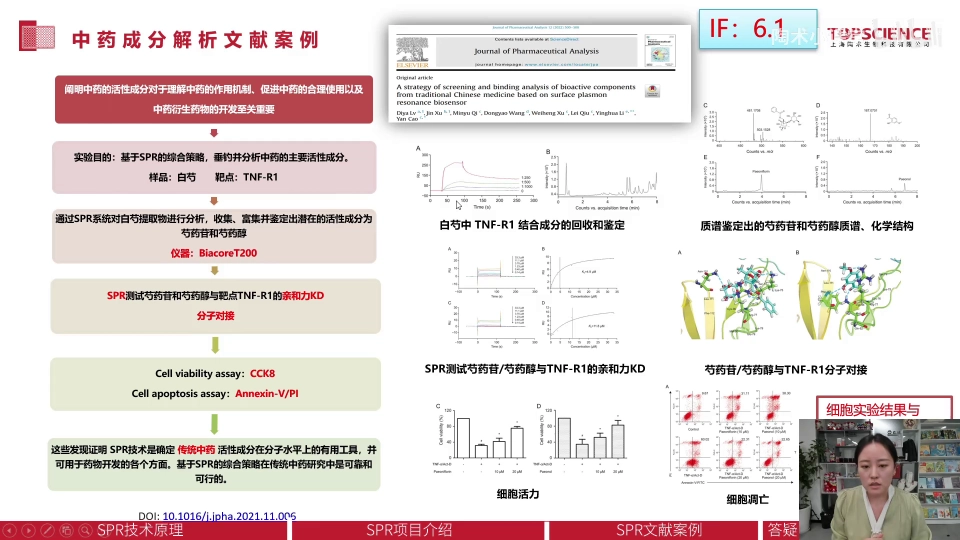

把 TNFR1 蛋白固定在芯片上，用不同浓度的白芍提取液检测，看到**剂量依赖的响应**说明有成分结合；回收样品送高分辨质谱鉴定结构；再对鉴定出的小分子（芍药苷、芍药醇）测多浓度 Kd；最后用分子对接、CCK-8 细胞活力、Annexin-V/PI 凋亡实验验证，细胞结果与 SPR 结果高度一致。[【跳转到 1:12】](https://www.bilibili.com/video/BV1VXC2YTEuU/?t=72)

## 八、质控与常见伪影：红绿灯、参比通道与负值

这一节是问答环节里信息密度最高的部分，也是初学者最容易踩坑的地方。

**拟合参数可以调，但要靠质控判断调得对不对。** 修改迁移率等参数，Kd 确实会变；判断依据是 Cytiva 软件的红绿灯：全绿最好，偶尔一两个黄色感叹号可以接受，**出现红色就说明数据或拟合有问题**。此外 chi² 在拟合良好时应小于 10% 的 Rmax，U 值一般要小于 15。[【跳转到 0:00】](https://www.bilibili.com/video/BV1VXC2YTEuU/?t=0)

**特异性靠参比通道，不靠肉眼。** 传感图本身看不出特异性。样品流经芯片时既可能结合固定蛋白，也可能结合芯片表面本身（非特异吸附）。所以实验通道之外必须同时做一个**不固定蛋白、只做活化+封闭的参比通道**，拟合时把参比信号扣减掉——实验时看到 50–60 RU，扣减后可能只剩 20–30 RU。[【跳转到 1:09】](https://www.bilibili.com/video/BV1VXC2YTEuU/?t=69)

**负值往往是"扣多了"。** 扣减参比通道后出现负值，说明非特异吸附信号偏高：实验通道 10 RU、参比通道 12 RU，一减就成了负二。可以在缓冲液里加 Tween 这类去垢剂来抑制非特异吸附。[【跳转到 1:09】](https://www.bilibili.com/video/BV1VXC2YTEuU/?t=69)

**kon/koff 是仪器拟合给出的，不能从图上手算。** 有人问"如何由 SPR 信号图计算 kon 和 koff"，答案是这些参数由仪器拟合给出，无法自己从曲线直接计算。[【跳转到 1:34】](https://www.bilibili.com/video/BV1VXC2YTEuU/?t=94)

**单浓度响应高不等于 Kd 好。** 响应值高只说明"大概率有结合"，属于定性；Kd 大小无法从单浓度响应预估，完全可能响应很高但 Kd 并不低。[【跳转到 0:44】](https://www.bilibili.com/video/BV1VXC2YTEuU/?t=44)

**它给不了的结论：激动还是抑制。** SPR 只能告诉你有没有亲和力、能不能结合，**看不出是激动剂还是抑制剂**，那要靠酶活体系或细胞表型实验来验证。[【跳转到 1:34】](https://www.bilibili.com/video/BV1VXC2YTEuU/?t=94)

**与其他方法的比较。** 细胞热迁移（CETSA）从热稳定性角度判断结合，后面靠 Western blot 条带灰度值，定量不够准；SPR 灵敏、实时、可定性也可定量，蛋白方便准备时优先推荐 SPR，两者也可以都做。[【跳转到 0:44】](https://www.bilibili.com/video/BV1VXC2YTEuU/?t=44) 至于 BLI 与 SPR 谁更准，讲者的回答是"其实差不多，非要比的话 SPR 灵敏度更高一点点"。[【跳转到 1:09】](https://www.bilibili.com/video/BV1VXC2YTEuU/?t=69)

**其他实操细节**：8K 有 8 个通道，可同时测 8 对样品，也可以每通道固定不同蛋白；蛋白不需要有解析出的三级结构，只要有纯化好的活性样品即可；蛋白浓度尽量高，最低不要低于 0.3–0.5 μg/μL；分子量大小没有要求，二聚体、多肽—多肽都能测；小分子要做固定相时通常需生物素标记，但标记可能影响小分子结构与功能，因此做得较少；水不溶的小分子可在水相缓冲液中加 5%–10% DMSO 助溶。[【跳转到 0:25】](https://www.bilibili.com/video/BV1VXC2YTEuU/?t=25)

## 小结

- **SPR 测的是质量，不是浓度**：结合事件改变芯片表面折射率，共振角偏移被记录成 RU 对时间的传感图；1 RU 约等于 1 pg/mm² 的质量变化。
- **配体是固定的那一方，分析物是流过的那一方**；蛋白—小分子实验通常固定蛋白，用氨基偶联挂到 CM5 的羧基葡聚糖上。
- **一条传感图分五段**：基线、结合、稳态、解离、再生；再生让同一张芯片能连续测多个浓度。
- **两种拟合两条路**：稳态拟合读平衡点（适合快上快下），动力学拟合读曲线形状并给出 ka、kd，且 $K_d = k_d/k_a$。
- **曲线形状本身是结论**：快动力学=低剂量饱和但药效短，慢动力学=剂量高但药效久。
- **可信度取决于三件事**：参比通道扣减非特异吸附、样品新鲜有活性并带阳性对照、拟合质控（红绿灯、chi²、U 值）过关。
- **SPR 给不了功能结论**：结合 ≠ 起效，激动/抑制必须用表型实验回答。

## 关键术语速查

| 术语 | 一句话解释 |
| --- | --- |
| SPR | 表面等离子体共振，靠金膜表面折射率变化实时检测结合的光学方法 |
| 传感芯片 | 玻璃 + 50 nm 金膜 + 化学修饰层的耗材，CM5 表面为羧基葡聚糖 |
| 配体（ligand） | 被固定在芯片表面的分子，通常是分子量较大的蛋白 |
| 分析物（analyte） | 流经芯片表面的待测分子，如小分子、多肽、抗体、核酸 |
| 传感图（sensorgram） | 响应值随时间变化的曲线，含基线、结合、稳态、解离、再生五段 |
| RU | response unit，响应值单位；CM5 上 1 RU 约等于 1 pg/mm² 的质量变化 |
| 稳态拟合 | 只用各浓度平衡响应做饱和曲线求 Kd，适合快结合快解离 |
| 动力学拟合 | 同时拟合结合段与解离段，给出 ka、kd，并由 $K_d=k_d/k_a$ 得 Kd |
| 再生 | 洗去残余分析物、让基线复位，使芯片可重复使用 |
| 参比通道 | 不固定蛋白的对照通道，用于扣除非特异吸附信号 |
| 氨基偶联 | 用芯片羧基与蛋白氨基缩合实现共价固定的经典方法 |
| 垂钓（fishing） | 固定蛋白从混合物（如中药提取液）中捕获结合成分，再回收做质谱 |